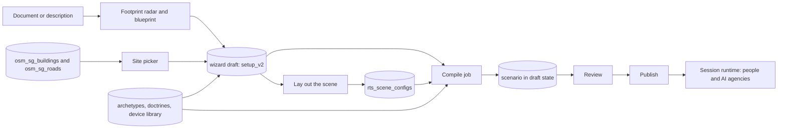
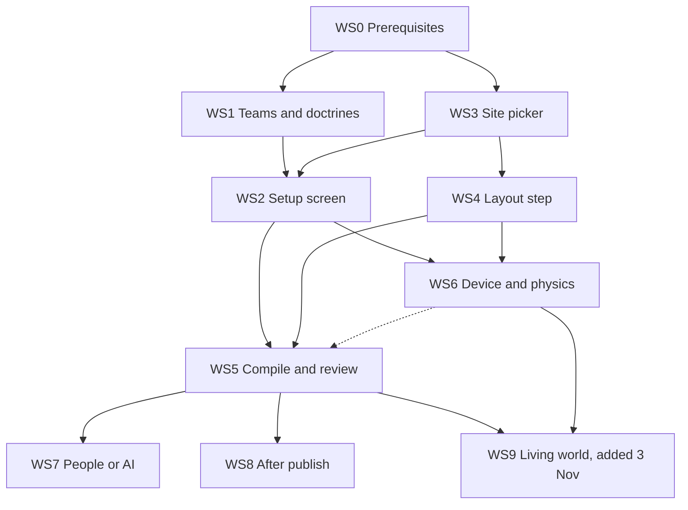

# Field operations War Room: master plan

**Status:** v1.2, 3 Nov 2026. Not built. Entries marked **Added 3 Nov 2026** record the owner's requirements of that day and how they are specified: in the revised 02 and 06, in WS9's new spec 11, and in marked additions to the other specs (10.8 item 36).
**Workstream:** all
**Depends on:** none
**Flags:** see section 8
**Migrations:** allocation in section 9
**Baseline:** verified against commit a0fb07a (8 Nov 2026); see the README.

This document is the spine of the set. It records the decisions, fixes the names every other spec must use (flags, migration numbers, route prefixes, types, components), sets the order of work, and defines what "done" means for the whole programme. The workstream specs fill in how each part is built.

## 1. Purpose and scope

**Purpose.** Build the field-operations War Room the way the journey document describes it (`docs/field-ops-user-journey.html`, "Addendum · Document-driven setup") and the way the mockup shows it (`docs/design/warroom/field-ops-setup.html`).

**In scope**

- One setup screen fed by the trainer's own scenario document, with a footprint radar that prefills it.
- A shared doctrine library, team archetypes with capabilities, and a matching layer, with an admin approval flow.
- A site picker that runs on the saved OpenStreetMap data in Supabase (addresses, landmarks, streets, a 150 m default radius, buildings involved).
- A "Lay out the scene" step that opens with the site already loaded.
- Optional, detailed device specifics, a deterministic effects calculator, and casualties computed from where people stand.
- A compile that honours the document, snapshots doctrines, and writes a draft that is reviewed and then published.
- AI-operated agencies built on the corporate teammate-bot framework, with the doctrine as the planner.
- A post-publish editor and a pressure runtime.

**Out of scope**

- Incident types other than the four live bombing types (D11).
- Any change to the corporate-crisis wizard's behaviour. Shared components are extracted and reused; the corporate screens must not change.
- The privacy programme in `docs/privacy/01-current-exposure.html` to `04-implementation-phases.html`. This set consumes it (D19) and does not redo it.
- Deleting the legacy field-ops wizard. That is a separate clean-up after the new flow has been live for a release (D25).

## 2. The product in one page

A trainer opens the War Room and chooses field operations. One screen, **Setup**, asks "What happened?". She types a description or drops in a document. A **footprint radar** reads it and prefills five lanes: the incident (type, people present, devices), the site, the responding agencies, the pressure on them, and the adversaries. She corrects what is wrong.

Each **agency** is a team card with an archetype, a rewritable description, a roster of roles, and People or AI. It is matched to a **doctrine** in a shared library; where none fits it says "No doctrine detected" and the trainer writes one, which joins the library as Unverified until an admin approves it. The **site** lane is the Scene Editor's map picker moved into Setup: she searches an address, landmark or street, the building, its neighbours and the streets are outlined from the saved map data at a 150 m radius that she can expand or shrink, and she marks the other buildings involved. A **device** can be described as precisely as she likes (charge and quantity, fragments, casing, other hazard materials, initiation, container, position); anything she leaves blank is assumed and labelled.

**Lay out the scene** opens with the site already loaded. She adds hazards, walks the site taking photos, plants the devices, paints crowd zones. **Compile** builds the exercise from her document, the doctrines, and the physics calculated from her device details, with no research step. A **Review** page shows what was built and where each part came from; she publishes it and can edit it afterwards, except while a session is live. On the day, agencies marked AI are run by AI, and the lobby can override any seat.

## 3. Decision log

"Decided" means the owner chose it in conversation. "Assumed" means this set uses the stated default until the owner overrules it; every spec that depends on an assumed decision says so.

| ID | Decision | Status | Specs |
| --- | --- | --- | --- |
| D1 | Document-driven setup on one screen; the document prefills it; nothing in it is silently dropped. | Decided | 03, 06 |
| D2 | A shared doctrine library. A trainer-written doctrine is usable by every trainer at once and shown as Unverified until an admin approves it. | Decided | 02, 09 |
| D3 | The trainer can lay out the scene while a team has no doctrine, but compile is blocked until every team has one. | Decided | 02, 03, 06 |
| D4 | AI-operated teams are built on the corporate teammate-bot framework. The doctrine is the planner. One brain per AI agency; roster seats are personas. Setup sets the default, the lobby overrides per seat. | Decided | 08 |
| D5 | The site is set on the setup screen from the saved OpenStreetMap data in Supabase. Nothing involves Google Maps. No building, road or address data is fetched live (no Overpass, no Nominatim); the map background is the existing OpenStreetMap tile layer through our tile proxy, as the Scene Editor shows it today. | Decided | 04, 05 |
| D6 | Addresses resolve. The saved data is re-extracted with street numbers and postcodes and the search index includes them. | Decided | 04 |
| D7 | Lay out the scene opens with the site loaded. Hazards, photos, planting devices and crowd zones happen there. | Decided | 05 |
| D8 | A device can be described in as much detail as the trainer wants. Everything is optional. Entered values are used as given; blanks are assumed and labelled. Effects are calculated by deterministic code. | Decided | 07 |
| D9 | Other involved buildings are handled at footprint level: shown on the map, devices and hazards can be placed in them, exits and wall points are generated from the footprint. Only the primary building has the full interior layout. | Decided | 04, 05 |
| D10 | The crowd is split. The headcount is set on the setup screen; where people stand is painted as crowd zones in Lay out the scene. | Decided | 03, 05, 07 |
| D11 | Incident types are the four live bombing types. A document about any other type is named, marked "soon", and nothing is compiled. | Decided | 03 |
| D12 | The similar-cases research is removed. Per-team standards research is replaced by the doctrine library. | Decided | 06 |
| D13 | Outside the saved data's coverage the site picker says there is no saved map data for the area and stops. There is no live fallback. An admin import path is documented. | Assumed | 04 |
| D14 | Street View imagery on wall points is removed. The trainer's own photos are the only wall-point and hazard imagery. | Assumed | 05 |
| D15 | Caps: 10 agencies, 6 pressure bodies, 3 adversaries, 6 devices, 5 involved buildings besides the primary. | Assumed | 03, 04, 07 |
| D16 | Roster roles are labels and seats in version 1. Permissions (for example only the incident commander authorises) are deferred; the data model leaves room for them. | Assumed | 02, 08 |
| D17 | Platform admins approve doctrines in an admin queue. A doctrine is usable while Unverified. Target response time is five working days. Admins can retire a doctrine. | Assumed | 02, 09 |
| D18 | The area and vicinity dossier stays (hospitals, police and fire stations within 5 km, nearby hazards). | Assumed | 06 |
| D19 | Document privacy: a plain notice at upload and a size cap now; document text goes to the LLM provider through the privacy programme's aliasing layer when that ships. No redaction step in version 1. | Assumed | 03 |
| D20 | Pressure kinds are the corporate five (regulator, union, NGO, community group, political) plus `media`. | Assumed | 03, 09 |
| D21 | AI-operated agencies ship behind `ENABLE_FIELDOPS_AI_TEAMS`, off in production until validated on staging with the bot scorecard. | Assumed | 08 |
| D22 | A person with blast-effects or EOD experience reviews the calculator and the first library entries before `ENABLE_FIELDOPS_PHYSICS` is turned on in production. Until then results carry an "Unreviewed model" label. | Assumed | 07 |
| D23 | Migrations are numbered from 219 and are additive only (section 9). **Updated 8 Nov 2026:** from 219, not 218, because the launch security fix took 218. | Assumed | all |
| D24 | Compile writes a scenario in the `draft` publish state. A scenario is published by an explicit action. | Assumed | 01, 06 |
| D25 | The new wizard is a new page, `/warroom/field-ops`, so the legacy field-ops wizard and the corporate wizard stay untouched while it is built. | Assumed | 03 |
| D26 | Doctrine matching thresholds: 0.85 or more is assigned, 0.60 to below 0.85 is suggested, below 0.60 is "No doctrine detected". They are constants that can be tuned. | Assumed | 02 |
| D27 | Credit semantics are unchanged: one scenario credit is taken when compile starts and is refunded if compile fails before a draft is written. | Assumed | 01, 06 |
| D28 | Where the approved mockup and a spec would differ, the mockup wins, unless safety, accessibility, the data model or the design brief (`docs/design/warroom/IMPLEMENTATION_SPEC.md`) requires otherwise. Each difference is listed in the UI spec sheet. So agency cards follow the mockup (one card open, the others compact with an Edit control), and the layout tools use `WrIcon` instead of the mockup's emoji. | Assumed | 02, 05, 10 |
| D29 | **Added 3 Nov 2026.** Doctrines are grouped by country and agency. During development the library is seeded with the doctrines of the response agencies of the Southeast Asian countries, researched once from public sources, reviewed by a person and stored in the database like the map data. Compile never researches doctrines, and matching considers the agency's country. | Decided | 02 |
| D30 | **Added 3 Nov 2026.** When an agency the trainer names matches no doctrine, she can pick any doctrine in the library, type one, or upload a doctrine document for that agency, organisation or team. She states its country, so the doctrine is grouped with the right country. An uploaded document is read into the doctrine's fields for her to check, and is saved as Unverified (D2). | Decided | 02 |
| D31 | **Added 3 Nov 2026.** All physics comes from stored data. The device library (WS6) and the spread and deterioration parameters (materials, fire and smoke behaviour, structural resistance, gas plumes) are seeded and reviewed during development. Compile never researches physics for a scenario: stored parameters replace the model call `researchDeteriorationPhysics`. | Decided | 06, 07 |
| D32 | **Added 3 Nov 2026.** Field ops is a real-time strategy simulation. Compile turns every detail into the starting state of a live world. During the session a server-side simulation evolves it: fire and smoke spread through the building by material and wall, structural damage progresses with time and fire exposure, gas plumes drift, crowds move, and the world reacts to what the teams do. | Decided | new WS9 |
| D33 | **Added 3 Nov 2026.** Teams place and move units. A unit has a type, the capabilities of its archetype, a position and a status. It is dispatched, travels over the saved road network with a travel time, and acts on arrival according to its capabilities. | Decided | new WS9 |
| D34 | **Added 3 Nov 2026.** Fog of war. A team sees what its units and positions can observe, with range reduced by smoke and weather, plus what is reported to it. The trainer sees everything, and AI agencies see through the same fog as people. | Decided | new WS9 |
| D35 | **Added 3 Nov 2026.** Weather and traffic are mechanics, not labels. Weather (rain, wind, haze, heat, visibility) changes spread, visibility, travel speed and casualties. Traffic (time-of-day congestion on the saved roads, cordons, closures, evacuation jams) changes unit travel times and so the teams' deployment choices. | Decided | 03, new WS9 |
| D36 | **Added 3 Nov 2026.** Every detail the trainer gives builds the world: the scene description, the device, the hazards, the structures (walls, stairs, exits), the inspection points, the crowd zones, the weather and the time of day. | Decided | 03, 05, 06 |
| D37 | **Added 4 Nov 2026.** A session with no human activity for 30 minutes ends by itself, after a warning at 25 that anyone in it can answer with "I'm still here"; and any session ends 12 hours after it started. AI teammates, NPC replies and the engines' own events never count as activity. It applies to every session type, needs no flag, and turns off with `SESSION_IDLE_END_MINUTES=0` and `SESSION_MAX_HOURS=0`. Four forgotten sessions ran from 29 Oct to 4 Nov 2026 and used up the OpenAI balance. | Decided | 01 |

## 4. Architecture overview



**Principles**

- Store the trainer's choices, not map data. The draft keeps the site selection (centre, radius, the primary and involved polygons); the surrounding footprints and streets are read again from the saved tables when a screen needs them.
- Deterministic code does the physics, from data stored in the database. The LLM writes narrative and reads the categories the trainer's own words state; it never computes effects and is never asked for a device value (10.8 item 17). **Updated 3 Nov 2026**: this line said the LLM fills gaps inside bounds, which item 17 had already overruled.
- **Added 3 Nov 2026.** The session is a live world. A simulation on the server evolves what compile built and reacts to what the teams do (D32 to D35).
- A compiled scenario owns a snapshot of the doctrines and the physics it was built with. Later library changes never alter it.
- Every long operation is a persisted job. Nothing depends on a browser tab or on process memory.
- Everything new is behind a flag and additive.

## 5. Workstreams

| WS | Document | Delivers | Depends on | Size |
| --- | --- | --- | --- | --- |
| WS0 | `01-prerequisites.md` | A live map for wizard-built scenarios (13.1); a durable, locked, draft-state compile (7.1, 7.3, 7.5); validated draft input (5.4); persisted jobs | none | M |
| WS1 | `02-teams-and-doctrines.md` | Team archetypes and capabilities; the doctrine library; matching; admin approval; seeding; snapshot contract | WS0 | L |
| WS2 | `03-setup-screen.md` | The new wizard page and its five lanes; document upload; footprint radar; field-ops blueprint; readiness checks; the `setup_v2` draft payload | WS0, WS1, WS3 | XL |
| WS3 | `04-site-picker.md` | Saved-map search with addresses; radius; buildings involved; the re-extract; the search index; the site handoff to the draft | WS0 | L |
| WS4 | `05-layout-step.md` | The Scene Editor opens with the site; footprint-level buildings; crowd zones; photos; Street View removal; device summary | WS0, WS3 | L |
| WS5 | `06-compile-and-review.md` | A blueprint-honouring compile; doctrine snapshot; draft and publish; the Review page | WS0 to WS4 | XL |
| WS6 | `07-device-and-physics.md` | The device specifics contract; the calculator; the library; casualties from crowd zones; labels | WS2, WS4 | XL |
| WS7 | `08-people-or-ai.md` | AI-operated agencies; the field-ops perception and action layer; the lobby card; the end of engine auto-play | WS1, WS5 | XL |
| WS8 | `09-after-publish.md` | The post-publish editor; the pressure runtime | WS5 | L |
| UI | `10-ui-spec-sheet.md` | The mockup mapped element by element to components, data and states | all | M |
| WS9 | `11-living-world.md` (**Added 3 Nov 2026**) | The living world (D31 to D36): the stored spread and deterioration parameters; the server-side simulation of fire, smoke, structure, gas plumes and crowds during a session; units that are dispatched and travel over the saved roads; fog of war; weather and traffic as mechanics | WS4, WS5, WS6 | XL |

**Added 3 Nov 2026.** WS1 also takes D29 and D30: a country on every doctrine and alias, Southeast Asian seed doctrines, and a doctrine-document upload. WS6 takes D31's spread data. Their specs (02 and 07) carry a marked note and are revised before they are built (10.8 item 36).

## 6. Dependencies and order of work



The dotted arrow from WS6 to WS5 is soft: compile uses calculated effects when `ENABLE_FIELDOPS_PHYSICS` is on and the legacy bands when it is off, so neither blocks the other.

**Build order**

1. **WS0** first. The live-map fix (13.1) can ship on its own and is useful to every session today. **Added 4 Nov 2026:** before it, WS0's task T0.23, the idle-session rule (D37), ships alone as commit 0, because every running session costs money until it ends.
2. **WS1 and WS3 in parallel.** They do not depend on each other. WS4 follows WS3.
3. **WS2** once the WS1 card contract and the WS3 site contract exist (stubs are enough to start).
4. **WS6's calculator core** is a pure module with no dependencies and can be built at any time; its UI and wiring wait for WS2 and WS4.
5. **WS5** once WS1 to WS4 have landed, because it consumes all four contracts.
6. **WS7 and WS8** after WS5, in parallel. WS8's session start claim (its migration and `claimSessionStart`, 10.8 item 26) lands first, because WS7's start-branch task depends on it.
7. **Added 3 Nov 2026. WS9** after WS5 and WS6, in slices that each fall back to today's scripted escalation:
   - the stored spread parameters (D31), landing with WS5, because 10.8 item 35 needs them;
   - the live simulation of fire, smoke, structure, plumes and crowds;
   - units with dispatch and travel;
   - fog of war;
   - weather and traffic effects.

**Suggested release slices** (not binding):

- Slice A: WS0.
- Slice B: WS3 and WS4 behind `ENABLE_FIELDOPS_V2`, with the Setup page containing only the incident, site and the existing eight-team inventory. This is the visible streamlining and needs no doctrines or documents.
- Slice C: WS1, WS2 and WS5, which turn Setup into the document-driven screen and add draft, review and publish.
- Slice D: WS6.
- Slice E: WS7 and WS8.
- Slice F (**Added 3 Nov 2026**): WS9, in the slices of build-order item 7.

## 7. Where things live

| Area | Location |
| --- | --- |
| Shared types, constants and pure helpers (browser and server) | `shared/fieldOps/*.ts (new)`, under the rules in section 10.7 |
| zod schemas and the tests of shared modules | `server/lib/fieldOps/*.ts (new)` (section 10.7) |
| Server services | `server/services/fieldOps/<area>/ (new)` with areas `setup`, `radar`, `documents`, `blueprint`, `site`, `layout`, `teams`, `doctrine`, `physics`, `compile`, `bots`, `editor`, `pressure` |
| Server routes | `server/routes/fieldOps<Area>.ts (new)`, with `fieldOpsJobs`, `fieldOpsSetup`, `fieldOpsSite`, `fieldOpsScene`, `fieldOpsTeams`, `fieldOpsDoctrine`, `fieldOpsDevices`, `fieldOpsCompile`, `fieldOpsBots`, `fieldOpsEditor` and `fieldOpsPressure` as the router files the specs define |
| Client page | `frontend/src/pages/FieldOpsWizard.tsx (new)` at `/warroom/field-ops` |
| Client components | `frontend/src/components/FieldOps/<Area>/ (new)` |
| Shared lane components extracted from the corporate wizard | `frontend/src/components/WarRoom/lanes/ (new)`, used by both wizards with no behaviour change to the corporate one |
| Stylesheets | `frontend/src/design/fieldops-<area>.css (new)` with the class prefix `fo-`, each created by the spec that owns its components (section 10.8) |
| Tests | next to the module as `*.test.ts`, except modules under `shared/`, whose tests live in `server/lib/fieldOps/` (section 10.7); client tests in `frontend/tests/` |
| Migrations | `migrations/NNN_<name>.sql (new)` |

## 8. Feature flags

All flags default to on in development and off in production until the owning workstream's acceptance criteria pass. Server flags are read once in `server/env.ts`; client flags use the `VITE_` prefix. When a flag is off its routes answer 404 and its UI is absent, so the legacy behaviour is unchanged.

| Flag | Owner | Gates |
| --- | --- | --- |
| `ENABLE_FIELDOPS_V2` and `VITE_ENABLE_FIELDOPS_V2` | WS2, WS3, WS4, WS5 | The `/warroom/field-ops` page, the site picker, the layout step opening with the site, the `setup_v2` draft endpoints, draft and publish |
| `ENABLE_FIELDOPS_DOCTRINES` | WS1 | Archetype and doctrine APIs, the matching layer and the admin queue. Off: teams use the legacy eight-name inventory and per-scenario research. **Added 3 Nov 2026:** the off state is for development and staging only. The new compile reaches production with the doctrine library (release slice C), so production compiles never research doctrines (D29) |
| `ENABLE_FIELDOPS_BLUEPRINT` | WS2 | The document drop zone, the footprint radar and blueprint extraction. Off: the setup screen takes a text description only |
| `ENABLE_FIELDOPS_PHYSICS` | WS6 | Calculator-driven bands and casualties. It takes `true`, `admin` (on for the admin role only, read through `physicsEnabledFor(role)`) or `false`. In production `true` behaves as `admin` until the D22 review is recorded. It has no `VITE_` mirror, because `admin` depends on the user: the client asks `GET /api/field-ops/devices/capabilities`. Off: the legacy manual radius with fixed 33 and 66 per cent bands |
| `ENABLE_FIELDOPS_AI_TEAMS` | WS7 | Field-ops bots and agency brains. Does not require the corporate `ENABLE_TEAMMATE_BOTS` flag |
| `ENABLE_FIELDOPS_EDITOR` | WS8 | The post-publish editor and the pressure runtime. It has no `VITE_` mirror: the client asks `GET /api/field-ops/editor/capabilities` |
| `ENABLE_FIELDOPS_WORLD_SIM` (**Added 3 Nov 2026**) | WS9 | The live world simulation, units with travel, fog of war, and weather and traffic effects. Off: today's scripted escalation (spawn pins and deterioration timelines) |

Each flag is read once, at boot, into one `env` property named as in section 10.7 (`env.enableFieldopsV2` is defined by WS0 and reused by the others), so flipping a server flag needs a restart but no build. The job settings below are read as `env.fieldopsJobs*`, and `FIELDOPS_JOBS_MAX_CONCURRENT=0` switches the job engine off.

**Non-flag settings.** These are tuning values with safe defaults, owned by the workstream that names them. A spec gives each its default and range.

| Setting | Owner | Controls |
| --- | --- | --- |
| `FIELDOPS_JOBS_MAX_CONCURRENT`, `FIELDOPS_JOBS_MAX_ACTIVE_PER_USER` | WS0 | Builds running at once, per process and per trainer |
| `FIELDOPS_JOBS_LEASE_SECONDS`, `FIELDOPS_JOBS_HEARTBEAT_SECONDS`, `FIELDOPS_JOBS_SWEEP_SECONDS` | WS0 | The job lease, its heartbeat and the sweeper interval |
| `FIELDOPS_COMPILE_MAX_LLM_CALLS`, `FIELDOPS_COMPILE_MAX_MINUTES` | WS5 | The ceiling on model calls and on wall-clock time for one compile |
| `FIELDOPS_BOTS_MAX_AGENCIES`, `FIELDOPS_BOTS_MAX_LLM_PER_HOUR`, `FIELDOPS_BOTS_MAX_LLM_PER_AGENCY_HOUR`, `FIELDOPS_BOTS_MAX_ACTIONS_PER_AGENCY_HOUR`, `FIELDOPS_BOTS_TRAINER_ALLOWLIST` | WS7 | AI agency count, model-call and action budgets, and the trainers allowed to use AI agencies while the flag is staged |
| **Added 4 Nov 2026.** `SESSION_IDLE_END_MINUTES` (default 30, 0 to 1,440), `SESSION_IDLE_WARN_MINUTES` (5, 0 to 60), `SESSION_MAX_HOURS` (12, 0 to 72) | WS0 | D37: minutes without human activity before any session ends, the warning before it, and the longest a session may run; 0 turns a rule off (`01-prerequisites.md` section 6.15) |
| **Added 3 Nov 2026.** `FIELDOPS_WORLD_MAX_SESSIONS` (default 4, 0 to 8), `FIELDOPS_WORLD_WORKERS` (2, 1 to 4), `FIELDOPS_WORLD_LEASE_SECONDS` (30, 15 to 120), `FIELDOPS_WORLD_TICK_BUDGET_MS` (250, 50 to 900), `FIELDOPS_WORLD_SNAPSHOT_SECONDS` (60, 30 to 300) | WS9 | Live worlds per process, where 0 runs none and is the operational off switch; worker threads; the world lease; the tick's time budget before the world degrades; the snapshot interval (`11-living-world.md` section 6.13) |

Existing flags this set relies on: `ENABLE_DOCUMENT_BLUEPRINT` (corporate; not used here), `ENABLE_TEAMMATE_BOTS` (corporate; the framework code is reused), `ENABLE_LOCAL_OSM_SINGAPORE` (the legacy map path; the new site picker reads the tables directly and does not depend on it).

## 9. Migrations

The latest migration at the baseline was `217_agreement_signed_copy_draft.sql`. **Updated 8 Nov 2026:** the launch security fix (commit a0fb07a) then added `migrations/218_launch_access_locks.sql`, so every field-ops number below moved up by one, in order, and the next free number is 219. Older numbers are not unique (there are two files each for 190, 193 and 194), so specs cite a migration by its file name, for example `migrations/194_team_charters.sql`. Each workstream owns a range; it uses numbers inside the range in order and never skips backwards.

| WS | Range | Likely contents |
| --- | --- | --- |
| WS0 | 219 to 220 | 219 `scenarios.publish_state`; 220 persisted jobs (`fieldops_jobs`, `fieldops_job_stages`) and the claim, credit, commit and fail functions. The order differs from the first plan so the commit function can use the publish state |
| WS1 | 221 to 225 | `team_archetypes` (221), `doctrines` and `doctrine_versions` (222), usage, reports and events (223), queue indexes (224), `team_match_feedback` (225) |
| WS2 | 226 to 228 | `setup_v2`, `setup_v2_rev` and `setup_v2_schema_version` on the draft (226), `fieldops_documents` (227), `fieldops_radar_results` (228) |
| WS3 | 229 to 232 | Address and place-class columns and `osm_sg_data_versions` (229), the search index (230), the site-area function (231), `osm_sg_facilities` (232). Nothing is added to the draft: the site lives in `setup_v2` |
| WS4 | 233 to 234 | V2 layout columns on `rts_scene_configs`, two partial unique indexes and `rts_scene_revisions` (233); crowd zones with `crowd_headcount`, `rts_scene_photos` with `deleted_reason`, and the private bucket `fieldops-scene-photos` (234) |
| WS5 | 235 to 237 | Doctrine and physics snapshot tables (235), provenance and coverage (236), compile manifests, review decisions, publish events and the persist, discard and publish functions (237) |
| WS6 | 238 to 242 | Device presets (238), explosive materials (239), injury thresholds (240), an effect-result index (241; the full result is in WS5's snapshot), physics reviews (242) |
| WS7 | 243 to 245 | `scenario_teams.operation` with session settings and seats (243), bot enrolment (244), brain state and decisions (245) |
| WS8 | 246 to 249 | Pressure runtime tables (246), scenario revisions (247), edit audit and edit jobs (248), the edit-apply function (249) |
| WS9 | 250 to 257 | **Added 3 Nov 2026.** The spread library and its review record (250), world models (251), world sessions (252), the world log (253), units (254), visibility (255), weather presets and traffic profiles (256); 257 is kept unused for WS9's next revision (`11-living-world.md` section 5) |

**Added 3 Nov 2026.** D29 and D30 need a `country` (ISO 3166-1 alpha-2) on doctrines and archetype aliases, and a table for uploaded doctrine documents. None of WS1's migrations is applied yet, so the change goes into 221 to 223 rather than a new number.

**Rules**

- **Added 8 Nov 2026. A clash moves the field-ops numbers, never the other migration.** A migration outside field ops, such as a fix, takes the next free number when it lands, even inside the ranges above. While none of the field-ops migrations is applied, the ranges then move up past it together and in order, in one change to this section and to every spec, as on 8 Nov 2026. Before writing a migration file, the builder checks `migrations/` for its number. If another file already has it, the builder stops and asks the owner, and never writes a second file with that number. `scripts/verify-field-ops-specs.mjs` reports a planned number that an existing file has taken.
- Additive only: new tables, new nullable columns, new indexes. No drops, renames or type changes in the same release as the code that stops using the old shape.
- The three environments (development, preview, production) share one Supabase project (finding 17.17), so every migration must be safe for the code that is already running.
- Migrations are SQL files applied by the owner. Code must detect a missing column or table and degrade to the legacy behaviour until the migration is applied (the same approach as section 6 of `docs/durable-warroom-builds-plan.md`).
- Every migration is idempotent (`IF NOT EXISTS`) and states its rollback in a comment.
- RLS: the server uses the service role everywhere, so authorisation is route code. A table that a browser could reach through the anon key must have RLS enabled with no permissive policy.

## 10. Shared contracts

### 10.1 Vocabulary

| Name | Values |
| --- | --- |
| `IncidentTypeKey` (live) | `bombing`, `car_bomb`, `suicide_bombing`, `bombing_mall` |
| `IncidentTypeKey` (named and stopped) | `open_field_shooting`, `knife_attack`, `gas_attack`, `poisoning`, `kidnapping`, `hijacking` |
| `ArchetypeKey` (the eight that exist today) | `bomb_disposal_eod`, `medical_triage`, `fire_rescue`, `evacuation_crowd`, `media_comms`, `pursuit_investigation`, `incident_command`, `police_security` |
| `ArchetypeKey` (new) | `transport_operator`, `venue_operations`, `hospital_ed`, `utilities`, `ministry_liaison` |
| `OperationMode` | `people`, `ai` |
| `ValueOrigin` (an input value) | `yours`, `library`, `assumed` |
| `EffectSource` (a calculated result) | `calculated`, `stored`, `ai_estimated`, `manual_override`. The new flow never produces `ai_estimated`: it labels legacy compiles only, whose casualty range came from a model. A device whose blanks were filled by library rules is shown as "Calculated from assumed inputs" (07) |
| `DoctrineStatus` | `unverified`, `verified`, `retired` |
| `DoctrineSource` | `seeded`, `trainer`, `ai_drafted`, `imported` |
| `PressureKind` | `regulator`, `union`, `ngo`, `community_group`, `political`, `media` |
| `InvolvedBuildingKind` | `car_park`, `transit_station`, `adjacent`, `other` |
| `PublishState` (scenario) | `draft`, `published` |
| `DraftStatus` (wizard draft) | `draft`, `compiling`, `compiled`, `failed` |

The eight existing archetypes come from the `TEAM_INVENTORY` names in `frontend/src/pages/WarRoom.tsx:66-104` (Bomb Squad / EOD, Medical Triage, Hazards / Fire / Rescue, Evacuation, Media & Communications, Pursuit & Investigation, Incident Command, Police / Security). The incident types come from `INCIDENT_TYPES` in `frontend/src/pages/WarRoom.tsx:33-62`. Coordinates are `[lat, lng]` pairs everywhere, the same order the saved map tables and the Scene Editor use.

WS7 owns `SessionPlayMode` and `AgencyActionKind` (`shared/fieldOps/aiAgency.ts (new)`). `PublishState` and `DraftStatus` are declared in `shared/fieldOps/jobs.ts (new)` (WS0), together with `StoredDraftStatus` (the legacy value `persisted` is still written by the legacy compile). `shared/fieldOps/vocabulary.ts (new)` (WS1) re-exports those two and declares every other list in this table, and it is the one place a spec imports a vocabulary from.

### 10.2 The setup payload

The wizard draft gains one validated JSONB column, `setup_v2` (WS2 migration), holding this object. It is the single contract between the setup screen, the layout step, compile, the physics calculator and the AI layer. The shapes below are contract sketches. The owning workstream finalises each sub-type as a TypeScript type with its constants and pure helpers in `shared/fieldOps/`, and as a zod schema in `server/lib/fieldOps/` for the server edge (section 10.7). Any change goes through the change log at the end of this document.

```ts
// shared/fieldOps/setup.ts (new). The envelope is owned by WS2.
export interface FieldOpsSetupV2 {
  schema_version: 2;
  brief: {                                   // WS2
    description: string;                     // up to 12,000 characters
    document: { id: string; filename: string; mime: string; word_count: number; truncated: boolean } | null;
  };
  footprint: FootprintProposal | null;       // WS2: what the radar proposed, with evidence, kept for Review
  incident: {                                // WS2
    type: IncidentTypeKey;
    people_present: number | null;
    when: { day: 'weekday' | 'weekend'; time: string; label: string };
  };
  devices: DeviceSpec[];                     // WS6: one to six; the first is the main device
  site: SiteSelection | null;                // WS3
  agencies: AgencyCard[];                    // WS1 owns the card, WS2 owns the lane
  pressure: PressureBody[];                  // WS2
  adversaries: AdversaryInput[];             // WS2
  options: { duration_minutes: number; weather: string | null; auto_adversary: boolean };
}

export interface SiteSelection {             // WS3
  place_label: string;
  centre: [number, number];
  radius_m: number;                          // 50 to 500, default 150
  primary: BuildingRef;
  involved: Array<BuildingRef & { kind: InvolvedBuildingKind; label: string }>;
  source: 'saved_osm';
}
export interface BuildingRef { osm_id: string | null; name: string | null; polygon: Array<[number, number]> }

export interface AgencyCard {                // WS1
  id: string;
  display_name: string;
  agency_label: string | null;
  archetype_key: ArchetypeKey | null;
  match: { confidence: number; method: 'alias' | 'name' | 'ai' | 'manual'; candidates: Array<{ key: ArchetypeKey; confidence: number }> } | null;
  description: string;
  roster: Array<{ key: string; label: string; count_min: number; count_max: number; is_lead: boolean }>;
  min_players: number;
  max_players: number;
  is_investigative: boolean;
  operation: OperationMode;
  doctrine: { doctrine_id: string; version: number; status: DoctrineStatus; title: string } | null;
}

export interface PressureBody {              // WS2
  id: string; display_name: string; kind: PressureKind; wants: string;
  escalation: string[]; stand_down: string; targets_agency_ids: string[];
}
export interface AdversaryInput {            // WS2
  id: string; label: string; kind: 'perpetrator' | 'hoax' | 'copycat' | 'other'; behaviour: string; pursuit: boolean;
}
// DeviceSpec and FootprintProposal are defined in 07-device-and-physics.md and 03-setup-screen.md.
```

The radar's device proposal is a hint, not a device. WS2 defines it and WS6 maps it (section 10.8, item 9):

```ts
// shared/fieldOps/footprint.ts (new). Owned by WS2; WS6's deviceSpecFromHint turns a hint into a DeviceSpec.
export interface DeviceHint {
  role: 'main' | 'secondary' | 'unspecified';
  summary: string;                  // the document's own words for the device, at most 160 characters
  container_text: string | null;    // at most 80 characters
  items: DeviceHintItem[];          // at most 12
  at_minutes: number | null;        // minutes from the start at which the document says it goes off
  evidence: EvidenceRef | null;     // WS2's reference to the sentence it came from
}
export interface DeviceHintItem {
  group: 'charge' | 'fragments' | 'other_hazard' | 'initiation' | 'position' | 'timing';
  label: string;                    // the document's words, at most 80 characters, moderated
  amount: { value: number; unit: 'kg' | 'g' | 'l' | 'count' } | null; // only for charge, fragments and other_hazard
}
```

**Refinements to these sketches.** They were settled while the first drafts were written and are binding; the owning spec finalises the exact shape in its section 5.

- `incident.type` is `IncidentTypeKey | null` in a stored draft (03 section 5).
- `brief.document` also carries `chars_kept`, `chars_original`, `truncation` and `pages`, written only by the server (03).
- `FieldOpsSetupV2` and `SetupPatch` are in `shared/fieldOps/setup.ts (new)`, `FootprintProposal` in `shared/fieldOps/footprint.ts (new)`; their zod schemas are on the server (section 10.7). `PressureBody` has no register or tone field.
- `SiteSelection` gains optional `address` and `data_version`; the types are in `shared/fieldOps/site.ts (new)` and the zod schema is on the server (04). `SiteSelection.centre` is always the vertex mean of the primary polygon, recomputed by the server. WS3 also exports `SiteHint`, `SiteHintResolution` (with `involved` and a ready `selection`), `SiteSearchResult`, `SiteArea` (its streets as `roads`), `FacilityRef`, `siteReadinessRules`, `describeSite` and `toggleInvolved`.
- `AgencyCard` and the roster seat are in `shared/fieldOps/agency.ts (new)` (02); the card's zod schema is in `server/lib/fieldOps/agencySchemas.ts (new)`.
- `DeviceSpec`, `EffectEstimate` and the vocabularies are in `shared/fieldOps/device.ts (new)` and `shared/fieldOps/effects.ts (new)` (07). The radar proposes `DeviceHint` objects (03) and WS6's `deviceSpecFromHint` turns each into a `DeviceSpec`; the model never writes a `DeviceSpec` itself.
- The stored layout is `SceneConfigV2` with `SceneConfigV2Authored`, `CrowdZone`, `PlacedDevice`, `FootprintBuildingLayout` and `LayoutReadiness`, defined in 05 and kept in `rts_scene_configs`; the draft points at it through the existing `rts_scene_id` column.

### 10.3 API conventions

- **Prefixes.** Wizard-time endpoints: `/api/warroom/field-ops/...`. Library resources: `/api/field-ops/...`. Existing routes keep their paths.
- **Auth.** `requireAuth`, then WS0's `requireFieldopsTrainer` on trainer routes (10.8 item 31). Admin-only routes check the `admin` role server-side. The client is never trusted for roles.
- **Validation.** Every body, query and param goes through the existing `validate()` helper with a zod schema (`server/lib/validation.ts`). Draft payloads are validated against the zod schemas in `server/lib/fieldOps/` with explicit size caps.
- **Errors.** `{ "error": "<message for a person>", "code": "<SNAKE_CASE>", "details": [...] }` with the right status code. Codes are listed in each spec.
- **Long operations.** `POST` answers `202 { data: { job_id } }`; `GET /api/warroom/field-ops/jobs/:id` answers `{ data: FieldOpsJobView }`, which carries the status, progress, result and error. Job state is stored in the database (WS0), never only in memory. Every job has a heartbeat, a retry policy and a lock so a second request cannot start a second run.
- **Rate limits.** Reuse the existing limiter patterns, keyed on the verified user id. LLM-backed routes are credit- or budget-gated.
- **Success bodies and validation errors.** Job and library responses wrap their content as `{ data }`. A validation failure is a 400 whose body carries `code: 'VALIDATION_FAILED'` (WS0 adds it to `validate()`, additively).
- **Further route subtrees.** Session-runtime endpoints sit under `/api/field-ops/sessions/:id/...`: WS7's AI agencies under `/ai/...`, WS8's pressure runtime under `/pressure/...` and, **added 3 Nov 2026**, WS9's live world under `/world/...`. **Added 3 Nov 2026:** WS9's admin routes for the spread library sit under `/api/field-ops/spread-library` (`11-living-world.md` section 6.14). WS7 also owns `GET /api/field-ops/bots/availability` and the socket event `fieldops_ai.updated`. WS1's routers are mounted at `/api/field-ops/teams` and `/api/field-ops/doctrines`. The post-publish editor sits under `/api/field-ops/scenarios/:id/...` (WS8). The scene store sits under `/api/warroom/field-ops/scene` (WS4). Publishing sits under `/api/warroom/field-ops/scenarios/:scenarioId/publish` and `/api/warroom/field-ops/drafts/:draftId/publish` (WS5); the reserved wizard-prefix publish path is released.

### 10.4 Canonical component names

The UI spec sheet and every workstream spec use these names.

| Component | Purpose | Spec |
| --- | --- | --- |
| `FieldOpsWizard` | The page and its step shell | 03 |
| `SetupHero` | "What happened?", the description box and the document chip | 03 |
| `FootprintRadar` | "Detected from your document" and its chips | 03 |
| `IncidentLane` | Incident type tiles and the crowd fields | 03 |
| `DevicesCard` | Device tabs, the specifics form and the effects panel | 07 |
| `EffectsPanel` | Calculated effects with origin labels | 07 |
| `SiteLane` | The relocated map picker | 04 |
| `PlaceSearch` | The address, landmark and street dropdown | 04 |
| `RadiusControl` | The 50 to 500 m control, default 150 | 04 |
| `SiteMap` | Leaflet map: ring, streets, footprints, ghosts | 04 |
| `InvolvedBuildingsList` | Buildings involved with roles | 04 |
| `AgencyLane` | The responding-agency cards | 03 |
| `AgencyCard` | One team card | 02 |
| `DoctrinePill` | Verified, Unverified or No doctrine detected | 02 |
| `DoctrineDrawer` | Create a doctrine | 02 |
| `RosterEditor` | Roles and seats | 02 |
| `PressureLane` | Pressure bodies | 03 |
| `AdversaryLane` | Adversaries | 03 |
| `ReadinessList` | "Before you move on" | 03 |
| `LayoutShell` | The layout step and its site bar | 05 |
| `SceneToolsPanel` | Structure, hazards, devices, photos, crowd tools | 05 |
| `SceneCanvas` | The map and canvas editor | 05 |
| `SceneInspector` | Device, effects, override and scene totals | 05 |
| `OperationSegment` | The People or AI control, on an agency card and in the session lobby | 08 |
| `CompileReviewStep` | The step component `stepRegistry.compile` points to; it shows `CompilePanel` until the draft is compiled and `ReviewPage` after | 06 |
| `CompilePanel` | Compile progress, failure and retry, before the draft is compiled | 06 |
| `ReviewPage` | Counts, storyline, provenance, doctrines, physics, unplaced notes | 06 |
| `PublishBar` | Blockers, review count and Publish | 06 |

### 10.5 Logging and telemetry

Use the existing `pino` logger. Event names are snake case and start with `fieldops_`, for example `fieldops_footprint_inferred`, `fieldops_site_selected`, `fieldops_doctrine_matched`, `fieldops_compile_started`. Never log document text, descriptions, or device specifics; log counts, ids and durations.

### 10.6 Tests

Server and shared tests use `node:test` through `tsx`, as in the `test` script of `package.json`, which lists test files explicitly. **Every new test file must be added to that list.** Client tests live in `frontend/tests/`, following `setupValidation.test.ts`. Pure logic (matching, calculator, validation, guard-rails, planners) is written as pure functions so it can be unit-tested without a database or an LLM.

### 10.7 Shared code rules

The frontend build is `tsc && vite build` (`frontend/package.json:8`), and `frontend/tsconfig.json` includes `../shared`, so every file under `shared/` is type-checked by the browser project, without Node types (`frontend/tsconfig.json:7`, `frontend/tsconfig.json:34`) and with `erasableSyntaxOnly` (`frontend/tsconfig.json:24`). Vercel's root directory is `frontend` and it installs only `frontend/node_modules` (`frontend/vercel.json`), so the root `node_modules`, where zod lives (`package.json:103`), is not there. Today no file under `shared/` imports a third-party package. These rules follow from that:

1. **No third-party imports under `shared/`**, zod included. A `shared/fieldOps/*.ts` file holds types, constants, labels, limits and pure helpers, and imports only other files in `shared/`.
2. **zod schemas live on the server**, in `server/lib/fieldOps/` or next to the service that owns them under `server/services/fieldOps/<area>/`, in a file named `<area>Schema.ts` or `<area>Schemas.ts`. The server validates request bodies there. Where the browser needs the same check it uses a hand-written pure validator from `shared/`, and a parity test in `server/lib/fieldOps/` feeds one corpus to both so they cannot drift.
3. **No `*.test.ts` under `shared/`.** A test of a shared module sits in `server/lib/fieldOps/<name>.test.ts` and imports the module with a `.js` suffix, as `server/lib/authLinkError.test.ts` does for `shared/authLinkError.ts`.
4. **No TypeScript enums, namespaces or parameter properties** (`erasableSyntaxOnly`). Use a `const` array with `as const` and a union type.
5. **Environment property names** follow the flag: `ENABLE_FIELDOPS_V2` is `env.enableFieldopsV2`, `ENABLE_FIELDOPS_DOCTRINES` is `env.enableFieldopsDoctrines`, and so on, with a lower-case "ops".

The checker (`node scripts/verify-field-ops-specs.mjs`) fails a spec that breaks rule 1, 3 or 4.

### 10.8 Settled interface decisions

These decisions fix how the workstreams meet. They bind every spec. A spec that finds one wrong raises a cross-spec request in its section 15 instead of departing from it.

**Jobs, compile and publish (WS0, WS2, WS5)**

1. WS0 owns the generic job engine (persisted jobs and stages, lease, heartbeat, sweeper, retry per stage), the compile lock (a draft whose status is `compiling` refuses writes with 409 `DRAFT_COMPILING`, raised by WS0's `assertDraftEditable`), the credit rules (D27) and `scenarios.publish_state` (D24). WS5 registers a `v2` compile variant on that engine; WS2 registers the `fieldops_radar` and `fieldops_blueprint` job kinds on it.
2. A compile variant declares `draftColumns`, the extra draft columns it loads (for v2: `setup_v2`, `setup_v2_rev` and `rts_scene_id`), and an `assertReady` that may be asynchronous and returns `{ ok: false, message, details? }`. The `details` reach the 400 `DRAFT_NOT_READY` body, so a start is refused before a credit moves. A variant may supply its own `ALREADY_COMPILED` message. The commit stage takes the scene id from the persist stage's summary when it is present, because WS4 may copy a scene at commit.
3. `POST /api/warroom/field-ops/drafts/:id/compile` (WS0) offers only variants other than `legacy`; the legacy `/persist` route keeps the `immediate` mode. For a job kind with no commit step, the runner passes the last stage's summary to `completeJob` as the job's result. Several routers may share the `/api/warroom/field-ops` prefix, and a job kind registered when its module is imported is enough for the boot sweeper.
4. Publishing a new-flow scenario is WS5's: `POST /api/warroom/field-ops/scenarios/:scenarioId/publish` and `POST /api/warroom/field-ops/drafts/:draftId/publish`. WS0 keeps `publishScenarioRow` for legacy compiles. The standard scenario edit routes keep refusing drafts; Review edits drafts through WS5's own routes. `GET /api/scenarios/:id` answers 404 to a trainer who did not create a draft scenario; admins keep access.
5. Missing tables, columns and functions are detected everywhere with WS0's helpers in `server/lib/schemaFeatures.ts (new)`: `createCachedDetector`, `isMissingColumnError`, `isMissingRelationError` and `isMissingFunctionError`. The module imports nothing from `server/env.ts`, so pure tests can use it. A negative answer is re-checked after about a minute, so applying a migration needs no restart.
6. The new page writes only `input.sim_mode` and `input.scenario_type` into a draft's legacy `input` column. Drafts made by the new page are hidden from the legacy wizard's draft list.

**Setup and its lanes (WS2 with WS1, WS3, WS6, WS7)**

7. WS2 creates `frontend/src/components/FieldOps/stepRegistry.ts (new)`; WS4 and WS5 each change one line of it (`layout` and `compile`). Every step component implements WS2's `StepMountProps`.
8. WS1 owns `AgencyCard`, its zod schema in `server/lib/fieldOps/agencySchemas.ts (new)` and its readiness rules; WS2's `AgencyLane` hosts the cards. The People or AI control is WS7's `OperationSegment`, rendered inside the card. When AI agencies are switched off it reads "AI-operated agencies are not enabled on this server."
9. The footprint radar returns devices as `DeviceHint` objects (section 10.2). WS6's pure `deviceSpecFromHint` in `shared/fieldOps/deviceHints.ts (new)` turns a hint into a `DeviceSpec`, writing only closed-vocabulary values and only amounts the document states; the model never writes a `DeviceSpec` itself. WS6 exports `validateDevices`, `moderateDeviceText`, `deviceReadinessRules` and `physicsEnabledFor(role)` for WS2, and WS6's `DEVICE_CAP` equals WS2's device limit.
10. WS3 exports the type `SiteHintResolution` from `shared/fieldOps/site.ts (new)` and the server function `resolveSiteHint`; WS2 keeps WS3's `SiteSearchResult` in its own radar ledger. WS2's save route calls WS3's `normaliseSiteSelection` with the context built by WS3's `buildSiteSelectionContext`. The default radius is WS3's `SITE_LIMITS.radiusDefault` (150 m). The site lane's data note reads "Map data: saved OpenStreetMap for Singapore." and adds the extract date when it is known.

**Layout (WS4 with WS3, WS5, WS6, WS8)**

11. The layout is stored in `rts_scene_configs`; a draft points at it through the existing column `warroom_wizard_drafts.rts_scene_id` (`migrations/163_rts_scene_configs.sql:63`). WS3 keeps `ringFingerprint` and `siteFingerprint` (the radius is part of the site fingerprint) in `shared/fieldOps/site.ts (new)`, and keeps `loadSiteArea` and its route stable. WS4 provides `loadSceneForCompile`, `getLayoutReadiness`, `buildTrainerScene` and `resolveSceneForCommit` (a scene owned by another scenario is copied, otherwise reused) to WS5; the pure exports `toCrowdZoneInputs`, `confinementAt`, `allocateCrowd` and `simToLatLng` to WS6; and a published mode of `LayoutShell`, with a read route by scenario, to WS8.
12. WS0's participant projection of a scene is an allow-list, so columns added later stay hidden from participants unless a spec adds them on purpose.

**Doctrines and teams (WS1 with WS5, WS7, WS8)**

13. Compile snapshots doctrines with WS1's functions (`resolveDoctrineForCompile`, `buildDoctrineSnapshot`, `applySnapshotToPayload`, `charterColumnsFromSnapshot`, `stripDoctrineKeys`, `recordDoctrineUsage`) and stores them in WS5's `scenario_doctrine_snapshots`, whose `content.projection` holds the readers' shape. WS1's `getDoctrineHeads` and `checkDoctrineUpdates` report newer and retired versions, and `invalidateRuntimeDoctrines` clears the runtime cache after a refresh (WS8). In library mode it also writes `scenario_teams.charter`, `expected_actions` and `scoring_rubric` where the columns of `migrations/194_team_charters.sql` exist, because team scoring reads them with a catalogue fallback (`server/services/teamScoreService.ts:229-246`); in legacy-research mode they stay null. `scenario_teams.function_key` holds the archetype key, `org_key` stays null for field ops in version 1, and the roster is stored in `scenario_teams.charter.roster` with its labels in `required_roles` (D16).
14. Compile writes `scenario_teams.operation` (WS7's migration 243) from `AgencyCard.operation` when that column exists.
15. WS7 gates the engine's three NPC queues by the session's mode, not by who staffs a team. WS1's edits to the team lookups inside those queues serve the legacy path.

**Physics and the answer key (WS6 with WS4, WS5)**

16. WS6's `getEffectsForCompile` returns WS5's `CompileEffects`; WS5 stores the full result in `scenario_physics_snapshots.payload` and calls WS6's `recordEffectIndex` after the persist. Every signed-in user could read the active rows of `scenarios` (`migrations/002_rls_policies.sql:44-46`, journey finding 8.1), and `GET /api/scenarios/:id` returned the whole row (`server/routes/scenarios.ts:354`). **Updated 8 Nov 2026:** the launch security fix narrowed both. Migration 218, applied in production, lets a browser read only the scenarios it created, or any as an admin. The route refuses anyone who neither created the scenario nor trains or plays one of its sessions (`server/routes/scenarios.ts:348-384`). A player of one of its sessions still receives the whole row except `insider_knowledge` and `blueprint`, `sweep_device_pool` included, so the rule stands. So for a new-flow scenario none of the following is written to a column of `scenarios`, and each lives in the draft or in snapshot tables with RLS on and no policy, read only through checked server routes and accessors:
    - device specifics and calculated effects;
    - the bomb-squad device pool: `sweep_device_pool` is written as `[]`, the pool lives in `scenario_physics_snapshots.device_pool`, and session start reads it through WS5's `loadDevicePoolForScenario`;
    - doctrine content: none of the doctrine keys of `insider_knowledge` (`team_doctrines`, `forbidden_actions`, `team_workflows`, `sector_standards` and their kin) are written; WS1's runtime accessor serves today's readers from `scenario_doctrine_snapshots`;
    - the field-ops blueprint: `scenarios.blueprint` stays null, and the blueprint is stored on WS2's `fieldops_documents` row (migration 227).

    Both accessors fall back to the `scenarios` columns when a scenario has no snapshot rows, so legacy scenarios are read exactly as today. WS1's runtime accessor serves every doctrine reader, including WS7's agency brains, which never read the `insider_knowledge` keys of a new-flow scenario. WS8's stored setup copy, revisions and edit jobs hold the same kinds of data and follow the same rule. Other keys of `insider_knowledge` (the dossier, profiles, layout facts) are still written; finding 8.1 is fixed separately.
17. Blank device fields are filled by fixed library rules. No model is ever asked for a position, a time, a quantity, a material or an initiation method. The mockup's sentence about where a secondary device is hidden and when it goes off is replaced by library wording.

**After publish (WS8 with WS5)**

18. WS5 does not call WS8's functions; WS8 calls them itself, and wraps WS5's exported generators when it regenerates part of a scenario. Pins compiled from the scene carry `conditions.scene_item_id` on location pins and `properties.scene_item_id` on hazards, so WS8 can match them to scene items. The editor serves published scenarios; Review edits drafts.

**Interface and styles (all, with the UI spec sheet)**

19. New stylesheets follow section 7: `fo-` classes in a `frontend/src/design/fieldops-<area>.css` file created by the spec that owns the components and cited by the others, the UI spec sheet included. Icons come from `WrIcon`, never emoji (`docs/design/warroom/IMPLEMENTATION_SPEC.md:20`). Where the mockup and a spec differ, D28 applies.

**Settled when the drafts were reconciled (25 Oct 2026)**

20. **Compile route, refund and the legacy path (WS0, WS5).** WS0 defines the compile start route and WS5's router does not. WS0 refunds from the job's credit state on any failure before its commit; no spec-specific marker decides a refund. The legacy `/persist` route runs on WS0's engine whenever 219 and 220 are applied and the engine is on, whatever the flag. WS0 finalises the variant interface and WS5 adopts its names:
    - `enabled`, `draftColumns`, an `assertReady` that returns `details`, `alreadyCompiledMessage`, stages with `maxAttempts`, `timeoutMs` and `run`, `summaryOf` and `onCommitted`;
    - a start body of `{ variant, recompile?, retry_of? }`;
    - after a failed or cancelled re-compile, the draft returns to `compiled` when its `scenario_id` is set;
    - the job result and `scene_id` come from the persist stage's summary;
    - the sweeper fails and refunds jobs whose variant is not registered;
    - `FieldOpsJobView` carries per-stage status and summaries, the progress, `error.code`, and whether the credit was refunded.
21. **Foreign keys.** A foreign key from any new table to `scenarios` is `ON DELETE CASCADE` or `ON DELETE SET NULL`, because WS5 deletes superseded and reopened draft scenarios.
22. **The trainer's layout survives a replaced draft scenario.** WS5 calls WS4's `detachAuthoringScene(scenarioId)` before it deletes any draft scenario. `resolveSceneForCommit` takes a `replacingScenarioId` and reuses, rather than copies, a scene owned only by that draft scenario. Only WS0's commit links a scene to a scenario, so a failed job never touches it.
23. **One source for the setup caps.** WS0 owns `SETUP_V2_ENVELOPE_LIMITS` (the D15 caps and the 262,144-byte ceiling); WS2's `SETUP_LIMITS` takes its values from it, with a parity test.
24. **One free-text check.** `moderateDeviceText(text, options?)` (WS6, `shared/fieldOps/deviceModeration.ts (new)`) returns `{ ok: true, text }` or `{ ok: false, code, reason }`. Device fields pass `{ field }`; every other caller passes the text alone, or with a `maxLength`, which applies the response mode and a 4,000-character cap.
25. **Doctrine steps and the AI planner.** Steps carry no action hint in version 1; WS7's planner classifies each step from its label. An action hint may be added later as an additive content field.
26. **The session start claim.** WS8 defines `fieldops_claim_session_start` and `claimSessionStart`. WS7 owns the start branch of `PATCH /api/sessions/:id`, calls the claim first, then materialises seats. Ending paused sessions automatically is out of scope for version 1; WS8's lock strip may offer the session's trainer the existing end-session route, so a paused session never locks its scenario for good.
27. **Published new-flow scenarios are edited only in WS8's editor.** The standard routes refuse writes to them with `FIELDOPS_EDITOR_REQUIRED`, whether or not the editor flag is on, and always refuse the live refresh routes (D5), so the editor's revisions and audit stay true.
28. **The participant scene projection** (item 12) gains `schema_version`, `involved_layouts`, `crowd_zones`, `crowd_headcount` and, for v2 rows, the trainer's photos from WS4's `listRuntimeScenePhotos`; never `authored`, `site_snapshot` or `draft_id`.
29. **File maps** list files another workstream creates with their owner (an Owner column, or "touched"). Such files keep the `(new)` marker because they do not exist yet.
30. **The After-Action Review** shows which revision a session ran on ("Ran on revision 7"), read from WS8's `fieldops_session_revisions`; WS8 makes that change.
31. **One refusal for a role, one for a flag, one client error class.** Every field-ops trainer route uses WS0's `requireFieldopsTrainer` (`server/lib/fieldOps/requireFieldopsFlag.ts (new)`), which answers 403 `{ error: 'Only trainers can use the War Room', code: 'FORBIDDEN' }`; no spec keeps its own role code (`TRAINER_REQUIRED`, `TRAINER_ONLY` and `FORBIDDEN_ROLE` are retired). Admin-only routes keep their admin check. Ownership stays each router's own check: draft and scenario routes answer 404, so they never reveal that another trainer's draft or scenario exists (item 4), and session routes keep the existing owner check's 403 (`assertSessionOwner`, `server/lib/access.ts:84-109`). While its flag is off a route answers the app's bare 404 `{ error: 'Not found' }`; `FIELDOPS_DISABLED` comes only from the compile start, for a registered variant whose `enabled()` is false. The browser uses WS0's `fieldOpsRequest` and `FieldOpsApiError` (`frontend/src/lib/fieldOps/fieldOpsHttp.ts (new)`); no spec declares a second error class. `fieldOpsRequest` resolves to the whole parsed body (each API module reads its `data`) and to undefined for a 204.
32. **Job stages use WS0's stage context names:** `progress(message, done?, total?)`, `summaryOf(stageKey)`, `outputOf(stageKey)`, `reserveScenarioId(id?)`, `attempt`, `signal` and `log` (`01-prerequisites.md` section 6.10.1). Counts go in `done` and `total`, not in the message.
33. **A scene copy left by a failed job.** `resolveSceneForCommit` may copy a scene before the commit, and a failed job never links that copy. WS4's photo sweeper deletes such copies (no `scenario_id`, no `draft_id`, a `source_scene_id`, older than 24 hours) with their photo rows (`05-layout-step.md` AC4.27). WS0's fail function keeps unlinking every scene of a scenario it discards, because legacy scene rows carry no `draft_id` and `rts_scene_configs.scenario_id` cascades on delete (`migrations/163_rts_scene_configs.sql:9`).
34. **One suite nav, no page brand mark.** Since commit 907bb66 every suite page, the War Room and the corporate wizard included, renders inside `SuiteLayout`, whose `SuiteNav` carries the one brand mark (`frontend/src/main.tsx:104-110`, `frontend/src/components/SuiteLayout.tsx:4-11`). The field-ops pages do the same: their routes sit inside the suite layout route, and they draw no brand mark of their own. The mockup's brandmark row ("War Room · Field operations") is dropped, a D28 difference that follows the owner's sitewide navigation; the mode name moves to the step hero's eyebrow.
35. **Added 3 Nov 2026. Fire spread survives the removal of the research step.** Today's fire-spread pins come from the environment simulation that the research step runs (`server/services/environmentalSimService.ts`, called by `server/services/rtsSceneEnrichmentService.ts`) and that compile reads back (`server/services/warroomService.ts:1626-1653`). The new flow has no research step, and WS4's `buildTrainerScene` leaves `enrichment` unset (`05-layout-step.md` section 6.12). As first specified, the new compile would therefore produce no fire spread, even though `06-compile-and-review.md` section 3.2 lists the fire-spread pins as kept. Until WS9's live simulation ships, WS5's pins stage builds each hazard's spread events from D31's stored parameters for its type and material. It runs the same deterministic simulation over WS4's layout (walls, materials, hazards), with no per-hazard vision or model call, and feeds the resulting timeline to the fire-spread pins as today.
36. **Added 3 Nov 2026. Specs revised before they are built.** D29 to D36 change specs that are written but not built. Each affected spec carries a marked note now, and its detailed revision is pending:
    - 02 for D29 and D30;
    - 03 for D35 and D36;
    - 06 for D31 and item 35;
    - 07 for D31;
    - 08 for D34.

    WS9 needs a spec of its own. Until the revisions land, a builder follows the master plan where a note says it overrides the spec.

    **Status at the end of 3 Nov 2026: nothing is pending.**
    - 02 and 06 are revised.
    - 03 and 08 take in what D34 to D36 need, as marked additions that answer WS1's, WS5's and WS9's requests.
    - 07 needs no revision: WS9 owns the spread parameters and reads WS6's radii unchanged.
    - WS9's spec is `11-living-world.md`.
    - 01, 04, 05, 09 and 10 carry small marked additions that answer the requests made of them.
37. **Added 3 Nov 2026. Doctrine country and upload (D29, D30).** WS1 owns these; specs 03, 06 and 09 read them.
    - **Country.** `AgencyCard` gains `country: string | null`, an ISO 3166-1 alpha-2 code in upper case. Doctrines and archetype aliases carry a country too; null means a generic doctrine that fits any country.
    - **Matching.** At setup, `matchAgencies` looks in the card's country first, then at generic doctrines, and never assigns another country's doctrine automatically; the trainer may still pick one. At compile, `resolveDoctrineForCompile` resolves the doctrine the card names (D3). It never swaps or refuses one on country, and records whether the doctrine's country matches the card's. That match is shown in Review. The only match vocabulary is WS1's `CountryMatch` (`'same' | 'generic' | 'other' | 'unset'`), computed by `countryMatch` in `shared/fieldOps/doctrineCountry.ts (new)`. The doctrine snapshot carries `country`, `card_country` and `country_match`, and WS5 reads them; it declares no second type.
    - **The default for a new card.** The country the radar read from the document (WS3's `SiteHint.country`, a name from `shared/countries.ts`), otherwise the country of the saved map data the site lies in ("SG" today), otherwise null.
    - **Upload.** The doctrine drawer takes one PDF, DOCX or TXT per doctrine and reads it with WS2's `extractDocumentText` (`server/services/fieldOps/documents/extractText.ts (new)`). WS1 keeps the extracted text, never the file, and drafts the fields from it with its existing drafting call. The result is saved as Unverified with the country the trainer states.
    - **Seeds.** Southeast Asian seed doctrines are prepared once, during development, under `scripts/fieldops/seeds/`, each with a source note, and reviewed before they are Verified (D17). No spec invents doctrine content.
38. **Added 3 Nov 2026. The spread library and the compile-time timeline (D31, item 35).** WS9 owns the library and both functions; WS5 calls them, and WS6 stays the owner of the blast calculator.
    - **Types** in `shared/fieldOps/world.ts (new)`: `MaterialBehaviour`, `HazardBehaviour` and `SpreadLibrary`.
    - **Library** in `server/services/fieldOps/world/spreadLibrary.ts (new)`:
      - `loadSpreadLibrary(): Promise<SpreadLibrary | null>`, null while migration 250 is missing;
      - `hazardEventsFor(hazard, library): HazardEvent[]`, the deterministic replacement for the per-hazard model analysis (`HazardAnalysis.events`, `server/services/rtsSceneEnrichmentService.ts:113-145`);
      - `deteriorationFactsFor(hazards, casualties, library): string`, the stored facts that replace the output of `researchDeteriorationPhysics` (`server/services/warroomResearchService.ts:1542`) as the input of `generateDeteriorationTimeline`.
    - **Timeline** in `server/services/fieldOps/world/compileSpread.ts (new)`: `buildSpreadTimeline({ studs, walls, hazards, library, durationMin }): Promise<EnvironmentalSnapshot[]>`. It runs today's `runEnvironmentalSimulation` (`server/services/environmentalSimService.ts:202`) in a worker thread, so a large building cannot block the server (journey finding 4.14).
    - **Added 3 Nov 2026, as WS9 specified it** (`11-living-world.md` sections 6.2 and 6.5): the input also takes an optional `signal`, whose abort stops the worker and rejects with `aborted`; `SpreadLibrary` carries a `version` label, which WS5 records; and the pure `buildSpreadLibrary` turns the stored rows into the library, so tests need no database. WS5's `rebuildFireSpread` also makes these calls for WS8's editor after a published edit (`06-compile-and-review.md` section 6.16).
    - **WS5's two calls.** The pins stage passes the timeline to today's fire-spread pin generator (`generateFireSpreadSpawnPins`, `server/services/warroomService.ts:925`). The deterioration stage passes `deteriorationFactsFor(...)` and never calls `researchDeteriorationPhysics`.
    - **Without migration 250,** WS5 compiles without fire-spread pins and with an empty facts block, and records a warning.
39. **Added 3 Nov 2026. The live world's seams (D32 to D35).** WS9 owns the live world.
    - **Lease.** It runs for each live session in a worker, leased per session as WS0 leases jobs, so one process runs it.
    - **Inputs.** It builds the world from the compiled scenario: WS5's snapshots, WS4's scene, WS6's effects, WS3's roads and facilities, and the setup copy. It may precompute through a job kind of its own (`registerJobKind`, WS0) and adds nothing to WS5's stages beyond item 38.
    - **Fog of war.** Each team's view is filtered on the server before anything is sent, on top of WS0's participant projections. WS7's AI agencies get the same filtered view (D34).
    - **Weather.** Setup's weather becomes a structured `WeatherSetting`, defined by WS9 in `shared/fieldOps/world.ts (new)` and stored by WS2 in `setup_v2.options`, beside the free-text label.
    - **Units.** They build on today's placed assets and placement checks. WS1's archetype capabilities say what a unit can do.
    - **Routes and events.** Routes sit under `/api/field-ops/sessions/:id/world/...`. The socket events are `fieldops_world.delta`, for each team's filtered view, and `fieldops_world.trainer`, for the full view.
40. **Added 3 Nov 2026. Delayed pins reach the session (journey finding 13.7).** A default chosen on 3 Nov; the owner may widen it.
    - **The gap.** At session start, `cloneScenarioPinsForSession` copies the template hazards but skips every one whose status is `delayed`, and keeps the template's `parent_pin_id` (`server/services/sessionPinCloningService.ts:154-164`). The deterioration service reveals only delayed children that belong to the session and point at the session's copy of the parent (`server/services/hazardDeteriorationService.ts:100-106`). So no pre-generated child ever appears in a session, and neither would the fire-spread pins that item 35 keeps.
    - **The rule.** For a new-flow scenario, session start also copies the delayed hazards and casualties, and remaps every `parent_pin_id` to the session's copy of that parent. A legacy scenario keeps today's behaviour.
    - **Hidden until revealed.** The session's hazard and casualty lists filter only on `appears_at_minutes` (`server/routes/hazards.ts:40-46`, `server/routes/casualties.ts:59`), so a copied delayed row gets `appears_at_minutes` 1,000,000. Its minute stays in `spawn_condition.at_minutes`, which the reveal reads, and revealing sets `appears_at_minutes` to the current minute (`server/services/hazardDeteriorationService.ts:119-122`). Every delayed child compile writes has the `parent_unresolved` trigger, so none relies on its minute alone.
    - **Owner.** WS5, which already changes that function to read the device pool (`06-compile-and-review.md` section 5.8). With WS9's live world running, the deterioration service does not reveal the fire-spread children, because the world's own fires replace them (`11-living-world.md` section 6.12).

## 11. Global definition of done

A workstream is done when all of these hold:

1. Every acceptance criterion in its spec passes, with the test that proves it named in the spec.
2. `npm test` passes, with the new test files added to the script, and `npx tsc --noEmit` is clean for server, shared and frontend.
3. The spec checker passes: `node scripts/verify-field-ops-specs.mjs`.
4. The flag is off by default in production and the legacy behaviour is unchanged with it off (checked by hand and, where practical, by a test).
5. Migrations are additive, idempotent, inside the allocated range, and the code tolerates them being unapplied.
6. No new secret, no document text and no device specifics in logs.
7. Security review items in the spec's section 9 are closed.
8. The spec's tasks are all ticked and its file map matches what was actually touched.
9. The journey document's relevant findings are marked fixed in its register, with the commit.

## 12. Environments and rollout

- **One Supabase project, three environments.** Expand and contract: ship the additive migration, ship code that works with and without it, switch the flag, and only much later remove the old path.
- **One Render instance** runs the API, sockets and all background engines. Anything CPU-heavy must be bounded and must not block the request path. LLM calls go through a queue with a per-session and per-scenario budget. **Added 3 Nov 2026:** while `ENABLE_FIELDOPS_WORLD_SIM` is on, exactly one instance is required: a live world sends its updates from the process that runs it, and a second instance would hold sockets that never receive them (`11-living-world.md` risk R9.6). **Added 3 Nov 2026:** checked in Render the same day, the backend runs one Standard instance with 1 CPU and 2 GB. That is one CPU short of the live world's default budget, so it needs either a 2-CPU plan or lowered world settings (`11-living-world.md` section 6.17, question 22).
- **Vercel** builds the frontend, so a `VITE_` flag is fixed at build time. Server flags can be flipped without a build, but they are read at boot, so a flip needs a restart.
- **Roll out** per flag: development, then a staging session run with the checklist in the spec, then production for the owner's own account, then everyone.
- **Roll back** by turning the flag off. Data written under a flag stays valid for the legacy code because every change is additive.

## 13. Risks

| # | Risk | Mitigation | Owner spec |
| --- | --- | --- | --- |
| 1 | The saved map data is Singapore-only, 6 per cent of buildings are named, and it has no addresses | Re-extract with addresses (D6); say plainly when there is no data (D13); a small search index | 04 |
| 2 | A shared doctrine library lets one trainer's text steer another's judging and AI | Unverified until approved, treated as data in prompts, versioned, snapshotted at compile (D2, D17) | 02, 06 |
| 3 | LLM-estimated physics can be wrong | Deterministic calculator, hard bounds, origin labels, expert review before production (D22) | 07 |
| 4 | Detailed device inputs could be misused | Categories and quantities only, no assembly content stored or generated, plausibility checks | 07 |
| 5 | A compile that costs about 100 LLM calls can fail halfway | Persisted jobs, a lock, draft state, retry per stage (WS0) | 01, 06 |
| 6 | AI-operated agencies cost too much or act wrongly | One brain per agency, a deterministic planner, budgets, off in production until validated (D21) | 08 |
| 7 | Document upload sends agency material to an LLM provider | Notice, size cap, aliasing layer when it ships (D19) | 03 |
| 8 | Another session edits `WarRoom.tsx` and `server/routes/warroom.ts` while this work is planned (its edits so far are committed in `56d4035`) and new work collides with them | The new wizard is a new page (D25); the few edits to these files are small, applied last and rebased onto `master`; the specs cite lines on the baseline | 03 |
| 9 | One database for all environments | Additive migrations and feature detection (section 9) | all |
| 10 | The Scene Editor is about 2,700 lines and changes are risky | Remove the map phase behind the flag, keep the edit phase unchanged, add tests around the extracted site loader | 05 |
| 11 | The static map for wizard-built scenarios (13.1) blocks people and bots acting together | Fix first (WS0) | 01 |
| 12 | The corporate durable-builds plan assumes migration 209, which is already taken | Do not build it unchanged; if it proceeds it must renumber from 249. **Added 3 Nov 2026:** from 257, because WS9 now holds 249 to 256. **Updated 8 Nov 2026:** like any migration outside field ops, it takes the next free number when it lands, and the field-ops numbers move up past it (section 9, the first rule). The same holds for the booth migration that `docs/booth/live-booth-spec.md` numbers 249: it is not built, and 249 is now WS8's | 01 |
| 13 | Shared code is type-checked by the frontend build on Vercel, which installs only `frontend/node_modules` | The five rules of section 10.7; the checker fails a spec that imports a package or adds a test under `shared/` | all |
| 14 | `rts_scene_configs` has a read policy of `USING (true)` for every role and a public storage bucket (`migrations/163_rts_scene_configs.sql:66-74`). Checked on the live project on 25 Oct 2026: RLS is on, the policy applies to all roles and `anon` holds SELECT, so the public anon key alone, with no sign-in, reads every scene row, planted-device positions included (the answer key of a bomb-squad exercise); the bucket `rts-scene-images` is public. This affects every scene that exists today | Closing the policy and making the bucket private is not additive, so it is the owner's decision; it should be done soon on its own, and it is a gate before production in any case (05 request R4.9). WS0's participant allow-list hides the new columns from the API meanwhile. **Added 3 Nov 2026:** fog of war depends on it too, because while the anon key reads the layout's device positions, hiding them in the world's views achieves nothing (`11-living-world.md` section 9.7). **Updated 8 Nov 2026:** migration 218 (the launch security fix, applied in production; read-only check on 8 Nov 2026) replaced the read policy with one for the scene's creator and admins. The anon key now reads no scene row, and a signed-in user reads only their own. The bucket `rts-scene-images` is still public, and the owner-scoped insert, update and delete policies are unchanged. So the read half of R4.9 is done and fog of war's gate is met; making the bucket private is still the owner's decision | 05, 01, 11 |
| 15 | Four runtime models keep their own blast assumptions after WS6 (07 section 3.2): the runtime detonation (M7), the pin editor's guide circles (M8), the stud blast bands used for pin snapping and session grid rebuilds (M9), and the exclusion-zone checks that read `blast_radius_m` (M11). A session can therefore show a circle or a cordon that disagrees with the calculated rings | Left unchanged in this release; a follow-up owner can feed them from WS6's ring set | 07 |
| 16 | AI agencies depend on the corporate bot account pool (migration 207, `is_bot`) and on `TEAMMATE_BOT_PASSWORD` being set in production | Checked at staging; the flag stays off in production until the scorecard passes (D21). Production fails closed: without `TEAMMATE_BOT_PASSWORD`, AI agencies are off end to end (`08-people-or-ai.md` section 6.3), so the committed default password (`server/env.ts:159`) is never used for them | 08 |
| 17 | Zod schemas on the server and hand-written types in `shared/` can drift | A parity test per contract feeds one corpus to both | 02, 03, 07 |
| 18 | Ten documents are written in parallel and cite each other's contracts | Section 10.8 fixes the interfaces in advance; `node scripts/verify-field-ops-specs.mjs` checks anchors, names, ranges and ownership; each spec answers every request made of it in section 15 | all |
| 19 | **Added 3 Nov 2026.** A live simulation on the one Node process that also runs every engine and Socket.IO would block it. Today's compile-time simulation already does about 2·10⁸ operations for a large building in one synchronous call (journey finding 4.14) | WS9 runs the simulation in a worker thread or a separate worker, only near active hazards and on a coarse grid, and falls back to the scripted escalation when it falls behind | new WS9 |
| 20 | **Added 3 Nov 2026.** As first specified, the new compile loses today's fire spread | 10.8 item 35 keeps it at compile from stored parameters until WS9 | 05, 06 |
| 21 | **Added 3 Nov 2026.** Doctrines for Southeast Asian agencies: public material differs by country and language, some of it is restricted, and a wrong doctrine misleads players and the scoring | Researched once from public sources, each with a source note; reviewed by a person before it is Verified (D17); never restricted or classified material; country coverage grows over time | 02 |
| 22 | **Added 3 Nov 2026.** Scope: an RTS-style live world is the largest piece of work in the set | WS9 ships in slices behind `ENABLE_FIELDOPS_WORLD_SIM` (section 6, item 7), each falling back to today's behaviour | new WS9 |

## 14. Traceability

| Journey finding | What happens to it | Spec |
| --- | --- | --- |
| 3.2 A team is a string, not an entity | Archetype key and capabilities become the identity; keyword matches become the fallback | 02 |
| 5.4 Draft input is unvalidated | `setup_v2` is validated with size caps | 01, 03 |
| 7.1 Persistence is not transactional | Compile writes a draft scenario; publish is explicit | 01, 06 |
| 7.3 The credit is spent first and refunded only if the process survives | Persisted job and refund path | 01 |
| 7.5 No compile lock or idempotency | A `compiling` status and a database lock | 01 |
| 7.6 The trainer's designed casualties are not compiled | Casualties come from the calculation and crowd zones | 07, 06 |
| 7.11 Three blast models coexist | One calculator | 07 |
| 12.1 The engine plays three teams in every session | AI plays only seats flagged AI | 08 |
| 13.1 Wizard-built scenarios get a static preview as the live map | Interactive map for wizard-built scenarios | 01 |
| 15.7 Decision text auto-places assets without validation | AI teams go through placement validation | 08 |
| 17.17 One Supabase project for all environments | Additive migrations and feature detection | all |
| Chapter 8 (the field-ops detail view is read-only) | The post-publish editor | 09 |

## 15. Glossary

- **Agency:** a responding body or unit; one team card.
- **Archetype:** the kind of team (for example Police / Security), from a closed list.
- **Capabilities:** what the platform lets an archetype do (map actions, assets it may place, counters, equipment, zones it may enter).
- **Doctrine:** the rulebook a team plays by: mission, response sequence with time targets, a never-do list, hand-offs, what good looks like.
- **Footprint radar:** the AI call that reads the document and proposes the contents of the setup screen.
- **Blueprint:** the structured extraction of the whole document, kept for compile to honour.
- **Primary building:** the building that gets the full interior layout.
- **Involved building:** another building in the incident, handled at footprint level.
- **Origin label:** whether a value is Yours, from the Library, or Assumed.
- **Snapshot:** the copy of a doctrine or calculation stored inside a scenario at compile.

## 16. Change log

| Date | Change |
| --- | --- |
| 24 Oct 2026 | v1 written. |
| 24 Oct 2026 | Workstream specs 01 to 09 and the UI spec sheet drafted. Master plan updated from their requests: section 10.7 (shared-code rules); section 7 and 10.2 (types in `shared/`, zod on the server); section 8 (`ENABLE_FIELDOPS_PHYSICS` takes `true`, `admin` or `false`; the non-flag settings; `ENABLE_FIELDOPS_EDITOR` has no `VITE_` mirror); section 9 (the actual migration files, and 218 as the publish state before 219 as the jobs); section 10.1 (`PublishState` and `DraftStatus` live in `jobs.ts`, re-exported by `vocabulary.ts`); section 10.2 (where final shapes differ from the sketches); section 10.3 (`{ data }` bodies, `VALIDATION_FAILED`, the session-runtime, editor, scene and publish route subtrees); section 10.4 (`CompileReviewStep`); section 13 (risks 13 to 18). |
| 25 Oct 2026 | v1.1. The ten documents are re-drafted from this plan; the first drafts are archived outside the repository. Added D28 (the mockup wins where a spec would differ), section 10.8 (settled interface decisions), the `DeviceHint` sketch in 10.2, `OperationSegment` and `CompilePanel` in 10.4, and the stylesheet row in section 7. |
| 25 Oct 2026 | 10.1: the new flow never produces `ai_estimated`; assumed inputs are shown as "Calculated from assumed inputs" (07, choice DC3). |
| 25 Oct 2026 | Reconciliation of the ten drafts: 10.8 items 20 to 30 settle the conflicts between specs (compile route and refunds, foreign keys, the layout on a replaced draft, the setup caps, the free-text check, doctrine steps, the session start claim, edits to published scenarios, the participant projection, file maps, the revision in the After-Action Review); 10.8 items 5, 13 and 16 extended; 10.1, 10.2 and 10.3 record WS1's, WS3's and WS7's names and routes; section 8 and section 12 say flags are read at boot; section 9 lists the extra contents of 232 and 233. The field-ops blueprint is stored on `fieldops_documents`, and WS2's budgets are code constants. |
| 25 Oct 2026 | Section 8: the physics flag behaves as `admin` in production until the D22 review and has no `VITE_` mirror; risk 14 updated with the live check (the anon key reads every scene row); risk 15 extended to rows M9 and M11 (07). |
| 25 Oct 2026 | 10.8 item 16 made explicit: for new-flow scenarios the device pool, doctrine content and the field-ops blueprint stay out of `scenarios` columns and are read through accessors with a fallback for legacy scenarios (06, choices 5 and 15). |
| 25 Oct 2026 | Second reconciliation: 10.8 items 31 to 33 (one role refusal, flag refusal and client error class; WS0's stage context names; who removes a scene copy left by a failed job); the auth bullet of 10.3; section 6 says WS8's start claim lands before WS7's start branch. |
| 25 Oct 2026 | Re-checked against the code at commit 7c16bde, after commits 907bb66, f268e3f, 56d4035 and 7c16bde landed during the reconciliation: every code citation in the set moved to its current line; 10.8 item 34 follows the sitewide suite nav. |
| 3 Nov 2026 | v1.2. The owner's requirements of 3 Nov are added and marked **Added 3 Nov 2026**: D29 to D36; WS9, the living world, whose spec is not yet written; its flag `ENABLE_FIELDOPS_WORLD_SIM` and migrations 249 to 256; 10.8 items 35 (fire spread kept at compile) and 36 (specs to revise); risks 19 to 22. The physics principle in section 4 is corrected to match item 17. |
| 3 Nov 2026 | The revisions of item 36, each marked **Added 3 Nov 2026**. 02 and 06 are revised and WS9's spec `11-living-world.md` is written. 10.8 items 37 to 39 settle their contracts, and item 40 brings delayed pins into new-flow sessions (journey finding 13.7). Item 38 records WS9's `signal`, `version` and `buildSpreadLibrary`. Sections 8 and 9 gain WS9's settings and migrations; section 10.3 gains the spread library's routes; section 12 requires one instance while the world runs; risks 12 and 14 are updated. Marked additions in 01, 03, 04, 05, 07, 08, 09 and 10 answer the requests between specs. Section 8's doctrines flag is off only in development and staging. |
| 4 Nov 2026 | D37, marked **Added 4 Nov 2026**: idle sessions end by themselves after a warning, and every session ends after 12 hours. It is WS0's task T0.23, built first as commit 0, with its three settings in section 8 (`01-prerequisites.md` sections 6.15 and 7.5). Section 12 records the backend's size, checked in Render: one instance, 1 CPU and 2 GB. |
| 8 Nov 2026 | T0.23 revised after its first build was reviewed, marked **Updated 8 Nov 2026** and **Added 8 Nov 2026** in `01-prerequisites.md`. The 12-hour warning is given once. A warning that players answer by acting is now cleared on every screen, and a clear never hides the 12-hour warning (sections 6.15 and 7.5, AC0.47). Risk R0.16 covers booth demonstrations, where only the AI players play between visitors: set `SESSION_IDLE_END_MINUTES=0` on Render for the event days. |
| 8 Nov 2026 | The launch security fix (commit a0fb07a) took migration 218 (`218_launch_access_locks.sql`), so every field-ops migration moved up by one: WS0 219 to 220, WS1 221 to 225, WS2 226 to 228, WS3 229 to 232, WS4 233 to 234, WS5 235 to 237, WS6 238 to 242, WS7 243 to 245, WS8 246 to 249 and WS9 250 to 257, with 257 kept unused. Section 9 gains the rule that a clash moves the field-ops numbers. D23 and risk 12 are updated, and every spec's header carries a note. The checker now reads the newest existing migration from `migrations/`. The change-log rows above keep the numbers of their day. |
| 8 Nov 2026 | Re-checked against the launch security fix (commit a0fb07a), which is now the baseline. The 134 citations into `server/index.ts`, `server/lib/access.ts`, `server/routes/ai.ts` and `server/routes/scenarios.ts` moved to their lines there. The fix changed facts the set relied on, each marked **Updated 8 Nov 2026**. Browsers now read only the scenarios and scenes they created, or any as an admin (migration 218, applied in production). `GET /api/scenarios` shows players only the scenarios of sessions they joined. `GET /api/scenarios/:id` refuses strangers and drops `insider_knowledge` and `blueprint` for players, who still receive `sweep_device_pool`, so 10.8 item 16 stands. Risk 14's read half and WS9's fog-of-war gate are met; the public bucket and the rest of R4.9 are still the owner's. |
