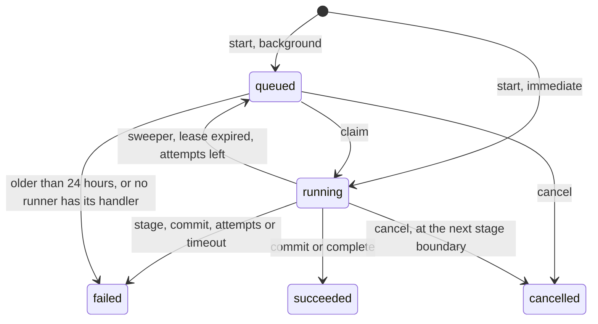
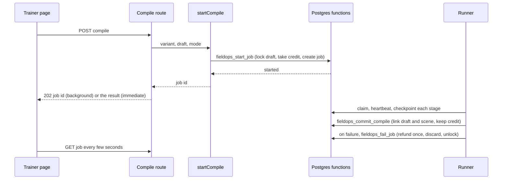

# Field operations War Room: prerequisites (WS0)

**Status:** v1.1, 25 Oct 2026, reconciled with master 10.8 items 20 to 30. Not built.
**Workstream:** WS0
**Depends on:** [the master plan](00-master-plan.md)
**Flags:** `ENABLE_FIELDOPS_V2` (read once as `env.enableFieldopsV2`, defined here and reused by WS2 to WS5; it gates every `/api/warroom/field-ops/*` route this spec adds). No new flag. Settings: `FIELDOPS_JOBS_MAX_CONCURRENT`, `FIELDOPS_JOBS_MAX_ACTIVE_PER_USER`, `FIELDOPS_JOBS_LEASE_SECONDS`, `FIELDOPS_JOBS_HEARTBEAT_SECONDS`, `FIELDOPS_JOBS_SWEEP_SECONDS`.
**Migrations:** 218, 219
**Baseline:** verified against commit 588387f (3 Nov 2026); see the README.

## 1. Purpose, goals and non-goals

**Purpose.** WS0 removes the defects that sit under every other workstream and provides the engine and helpers they build on. It is the first slice of the programme (master section 6, slice A). Its first commit, the live map for wizard-built scenarios, needs no migration and ships alone; it helps every field-ops session that runs today.

**Goals**

1. **G0.1 A live map for wizard-built scenarios (journey 13.1).** Participants and spectators always get the interactive `MapView`. The trainer gets the live map by default and the static scene as an optional "Scene preview". The exit gate counts only entry and exit pins that a team in the session can claim, so it can no longer lock the map (journey 13.9).
2. **G0.2 Participants never receive the answer key on the map paths.** An allow-list projection of the scene row (master 10.8 item 12) and a casualty projection that drops the true triage colour and the other answer-key fields. What stays exposed is named in section 9.2.
3. **G0.3 A durable job engine.** Persisted jobs and stages (migration 219), a claim with a lease, a heartbeat and a sweeper, retry per stage, stage checkpoints so a restarted server resumes, concurrency caps, and a scope so a development server never claims a production job.
4. **G0.4 A locked, draft-state compile with exact credits (journey 7.1, 7.3, 7.5; D24, D27).** One active compile per draft, the draft status `compiling`, `assertDraftEditable` refusing writes with 409 `DRAFT_COMPILING`, one credit taken at the start and refunded exactly once on a failure before the commit, and one commit function that makes the draft scenario visible to its owner and settles the credit in one transaction.
5. **G0.5 The legacy `/persist` route on the engine.** Same request, same success body, run in an `immediate` mode, with today's inline path kept as the fallback while 218 or 219 is missing.
6. **G0.6 Publish state (D24).** `scenarios.publish_state` (migration 218) and its effect on every existing reader: lists, single read, session creation, clone, edits and the dashboard.
7. **G0.7 Validated draft input (journey 5.4).** Schemas, caps, merge rules and a status whitelist on the legacy draft endpoints, a size ceiling for corporate drafts, a generic envelope check for `setup_v2` (`validateSetupV2Envelope`, D15), and new-page drafts hidden from the legacy picker.
8. **G0.8 Helpers for everyone.** `server/lib/schemaFeatures.ts (new)`, `code: 'VALIDATION_FAILED'` on `validate()` 400 bodies, `env.enableFieldopsV2`, the trainer guard `requireFieldopsTrainer`, `shared/fieldOps/setupEnvelopeLimits.ts (new)` with the setup caps, and `shared/fieldOps/jobs.ts (new)` with the job vocabulary; on the client a jobs API module, a pure polling helper, the `useFieldOpsJob` hook and `describeJob` copy, all kept apart from `frontend/src/lib/api.ts`.

**Non-goals**

- Closing the `rts_scene_configs` select policy `USING (true)` and its public storage bucket (`migrations/163_rts_scene_configs.sql:66-74`, master risk 14). On the live project the policy applies to every role and the anon role holds SELECT, so the public anon key alone, with no sign-in, reads every scene row (read-only check, 25 Oct 2026). Closing it is not additive, so it is the owner's decision and a gate before production (WS4 request R4.9). WS0 names it in section 9.2 and does not change it.
- The privacy programme (`docs/privacy/`, master section 1): the whole-row `GET /api/scenarios/:id` for active scenarios (journey 8.1), the hazard, state and event payloads (journey 13.2), cross-trainer reads (journey 8.3) and the casualty `PATCH` that accepts `conditions` (journey 13.3). WS0 changes only what the live map makes reachable and what drafts need.
- Owner checks between trainers on `/api/rts-scenes` (journey 4.1). WS0 makes those routes staff-only; ownership is a request to WS4 (section 15.4).
- The `v2` compile variant, the Review page and publishing new-flow scenarios (WS5, master 10.8 item 4); the `fieldops_radar` and `fieldops_blueprint` job kinds (WS2); the `setup_v2` column and its schema (WS2, migration 225).
- Any change to `SceneCanvasView` itself, to the corporate wizard's behaviour, or to the corporate durable-builds plan (`docs/durable-warroom-builds-plan.md` is a pattern only; it assumes migration 209, which is taken, master risk 12).
- Deleting the legacy field-ops wizard (D25).

## 2. Decisions and assumptions

**Added 4 Nov 2026. Build this first: idle sessions end by themselves (master D37).** A session with no human activity for 30 minutes ends, after a warning at 25, and any session ends 12 hours after it started. This protects the AI budget for every session type, so task T0.23 ships alone, as commit 0, before anything else in this spec (sections 6.15 and 7.5, AC0.42 to AC0.47). It needs no migration and no flag; setting `SESSION_IDLE_END_MINUTES=0` and `SESSION_MAX_HOURS=0` turns it off.

**Added 3 Nov 2026.** WS9's living world (`11-living-world.md`) asks two things of this spec, and both need no change to WS0's design: WS9 builds its own table detectors with WS0's helpers, and `shutdown` calls WS9's `stopWorldRuntime()` right after `stopJobEngine()` (section 6.10, answered in section 15.3).

### 2.1 Master decisions this spec implements

| ID | Status | What it means here |
| --- | --- | --- |
| D15 | Assumed (D15) | `validateSetupV2Envelope` refuses more than 10 agencies, 6 pressure bodies, 3 adversaries, 6 devices or 5 involved buildings before WS2's detailed schema runs. The numbers are `SETUP_V2_ENVELOPE_LIMITS.caps` in `shared/fieldOps/setupEnvelopeLimits.ts (new)` (section 6.8). WS0 owns them (master 10.8 item 23): WS2's `SETUP_LIMITS` takes these caps and the 262,144-byte ceiling from that constant with a parity test, and WS6's `DEVICE_CAP` is 6. |
| D23 | Assumed (D23) | Migrations 218 and 219 are additive and idempotent. Every reader works before they are applied (section 5.5). |
| D24 | Assumed (D24) | A compiled field-ops scenario is written with `publish_state = 'draft'` and `is_active = false`. Only an explicit action publishes it: the legacy commit (inside its transaction) or WS5's publish routes. |
| D25 | Assumed (D25) | The new page is `/warroom/field-ops` (WS2). WS0 keeps the legacy wizard working and hides new-page drafts from its list, without editing `frontend/src/pages/WarRoom.tsx`. |
| D27 | Assumed (D27) | One scenario credit is taken when a compile starts (admins pay nothing, as today) and refunded exactly once if the job ends before WS0's commit. After the commit the credit is kept. The rule lives in SQL, on the job row. |

### 2.2 WS0 design decisions (Proposed)

| # | Decision | Why |
| --- | --- | --- |
| P0.1 | Participants and spectators always render `MapView`; the trainer's map shows `MapView` by default with a "Scene preview" toggle that renders `SceneCanvasView` when a scene exists. | `MapView` is the only session-aware, realtime map with the response layer, and it already outlines the trainer's building through the stud overlay (section 3.1). Rebuilding `SceneCanvasView` into a live map would duplicate about 2,200 lines of interaction code. Option comparison in section 6.5.1. |
| P0.2 | The scene projection is an allow-list of columns and of the keys inside `exits`, `interior_walls` and `stairwells`; the casualty projection is an allow-list of columns plus a deny-list of answer keys inside `conditions`. | Master 10.8 item 12 asks for an allow-list so later columns stay hidden. `conditions` is an open bag the engines write at runtime and the player UI reads a dozen of its keys (section 3.2), so an allow-list there would silently blank live data; the answer keys are a short, named list with a test. |
| P0.3 | A job's `scope` is `production` only when `NODE_ENV=production` and the process runs on Render (`RENDER` is set); otherwise `local:<hostname>`. A runner claims only jobs of its own scope. | One Supabase project serves every environment (finding 17.17). `server/env.ts:44` already treats `RENDER` as the deploy marker, and `RUN_BACKGROUND_ENGINES` (`server/env.ts:104-114`) exists because a development server once ran production engines. |
| P0.4 | `immediate` jobs run inside the request that started them and are never refused for process capacity; they count against the per-trainer cap and use up process capacity for background claims. | The legacy route must keep its response (G0.5) and was never capped; background jobs are the new load the cap protects. |
| P0.5 | `FIELDOPS_JOBS_MAX_CONCURRENT=0` disables the engine: no claims, the legacy route uses its inline path, and the field-ops routes answer 503 `JOBS_UNAVAILABLE`. | An operational switch without a new flag (the master allocates none to WS0). |
| P0.6 | `publish_state` is `NOT NULL DEFAULT 'published'`, with a check that a draft is never active. | The constant default is the backfill (existing rows and every insert that omits the column get `published`, as `is_bot` did in `migrations/207_teammate_bots.sql:15-16`). The check keeps drafts out of the read policy "Anyone authenticated can view active scenarios" (`migrations/002_rls_policies.sql:44-46`) whatever code runs. |
| P0.7 | A new-page draft is marked by `input.sim_mode = 'field_ops_v2'` (`FIELDOPS_V2_SIM_MODE`). The legacy list query excludes it; the legacy write endpoints refuse it with 409 `DRAFT_WRONG_FLOW`. | `sim_mode` already marks corporate drafts (`frontend/src/pages/SocialCrisisWizard.tsx:804`); WS2 writes exactly `{ sim_mode: 'field_ops_v2', scenario_type }` (master 10.8 item 6). |
| P0.8 | Drafts are excluded from every scenario list, admins included; admins keep `GET /api/scenarios/:id`. | Journey Design 5: a draft "is not in the library and cannot be launched". WS5's Review reads drafts through its own routes. |
| P0.9 | 219 enables row level security on `warroom_wizard_drafts` with no policy. | The compile lock is a status on that row; a browser holding the anon key must not be able to flip it. No client queries the table directly (only `server/routes/warroom.ts` does). The live project already has row level security on for this table with no policy (read-only check, 25 Oct 2026), so on it the statement is an idempotent no-op that records the state; a database built from the repository's migrations alone gets it here. WS2's migration 225 need not repeat it. |
| P0.10 | The compile lock is a draft status plus a partial unique index on active jobs per draft and lock key; writes check it twice: `assertDraftEditable` on the loaded row and a conditional update that refuses a row that became `compiling` in between. | Journey 7.5's fix is a compare-and-set; the index makes a second active compile impossible even if two starts race. |

### 2.3 Assumptions

- **Assumed (D27):** the refund on a legacy compile follows the same rule as v2. Today the route refunds in an in-process `catch` (`server/routes/warroom.ts:1184-1188`); after WS0 the refund happens in SQL when the job fails or is cancelled, and never twice.
- **Assumed (D24):** a scenario created outside the field-ops compile (quick generate, the corporate wizard, `POST /api/scenarios`, clone) is `published` by default and keeps today's `is_active` behaviour.
- **Assumed (D23):** the owner applies 218 before 219; 219 refuses to run otherwise (section 5.2).
- **Assumed (D15):** the generic caps apply only to `setup_v2`; the legacy field-ops input keeps the legacy limits of `/generate` (`server/routes/warroom.ts:74-133`) and a team cap of 12 (journey 5.4's fix).

## 3. Current state (verified)

All line numbers are at commit `7c16bde` (25 Oct 2026). `server/routes/warroom.ts` and `frontend/src/pages/WarRoom.tsx` changed after the journey document was written (their edits are committed in `56d4035`), so their lines differ from the journey document's.

### 3.1 Which map a session shows (journey 13.1)

- **Verified.** The session page calls `getSceneConfig` once and stores the answer with `setHasSceneConfig` (`frontend/src/pages/SessionView.tsx:1029-1038`). The route returns the whole `rts_scene_configs` row of the session's scenario, `select('*')` with `.maybeSingle()`, to anyone `assertSessionAccess` admits (`server/routes/sessions.ts:970-1000`).
- **Verified.** Three places choose the map on that one boolean: the spectator view renders `SceneCanvasView` when it is true and `MapView` when it is false (`frontend/src/pages/SessionView.tsx:1485-1538`); the participant's map module does the same, gated by `id && !isTrainer` (`frontend/src/pages/SessionView.tsx:2193-2279`); and the trainer's "Trainer Map" card does the same inside the trainer grid (`frontend/src/pages/SessionView.tsx:2564-2680`). `isTrainer` is true for the `trainer` and `admin` roles (`frontend/src/hooks/useRoleVisibility.ts:34`).
- **Verified.** The legacy wizard's layout step cannot be left without a saved scene: `stepValid` requires `rtsSceneId` at step 3 (`frontend/src/pages/WarRoom.tsx:526-538`). So every wizard-built scenario has a scene row and every one of its sessions renders `SceneCanvasView`.
- **Verified.** `SceneCanvasView` declares `sessionId` and `showAllPins` but destructures only `scenarioId`, `height`, `fillHeight` and `onLoaded` (`frontend/src/components/COP/SceneCanvasView.tsx:35-42`, `frontend/src/components/COP/SceneCanvasView.tsx:82-87`). It loads scenario-level data once, by scenario id, through `getScenarioCasualties`, `getScenarioLocations`, `getScenarioHazards` and `getBuildingStuds` (`frontend/src/components/COP/SceneCanvasView.tsx:153-166`). It has no WebSocket subscription and makes no decision, placement, claim or assessment call.
- **Verified.** `MapView` is session-aware: it loads the session's pins and claims through `getLocations` (`frontend/src/components/COP/MapView.tsx:646-687`), the session's hazards, casualties, placements and floor plans (`frontend/src/components/COP/MapView.tsx:1082-1143`), refreshes them every 30 seconds (`frontend/src/components/COP/MapView.tsx:1145-1191`) and listens to `location.claimed`, `placement.*`, `casualty.*` and the adversary events (`frontend/src/components/COP/MapView.tsx:761-781`).
- **Verified.** `MapView` already outlines a wizard-built scenario's building: `BuildingStudOverlay` (`frontend/src/components/COP/MapView.tsx:1637-1645`) reads `GET /api/scenarios/:id/building-studs` (`server/routes/scenarios.ts:3389-3446`), whose grids come from the trainer scene's `building_polygon` whenever a scene is linked (`loadClassifiedGrids`, `server/services/buildingStudService.ts:781-825`).
- **Verified.** Compile turns the scene's exits into entry and exit pins, its hazards into hazard rows and its planted items into the device pool (journey chapter 7). The pins are written with `claimable_by: ['all']` (`server/services/warroomPersistenceService.ts:305`), so `MapView` can claim them.

### 3.2 What participants receive today

| Path | What it returns to a participant | Evidence |
| --- | --- | --- |
| `GET /api/sessions/:id/scene-config` | The whole scene row, including `planted_items` (the bomb-squad answer key), `enrichment_result`, `hazard_zones` (every hazard, before it appears) and `wall_inspection_points` | `server/routes/sessions.ts:970-1000` (**Verified**) |
| `GET /api/scenarios/:id/scene-config` | The same whole row, to any signed-in user, with no session, role or owner check | `server/routes/scenarios.ts:3364-3383` (**Verified**) |
| `GET /api/rts-scenes/:id`, `GET /api/rts-scenes?scenario_id=` | The whole row by id, and a list of scene ids by scenario, to any signed-in user; `PATCH`, `DELETE` and the image upload have no role check either | `server/routes/rtsScenes.ts:73-121`, `server/routes/rtsScenes.ts:124-258` (**Verified**) |
| `SceneCanvasView` for a participant | The scene and its building studs load; casualties, locations and hazards come from trainer-only routes (`server/routes/scenarios.ts:446-543`), fail with 403 and are replaced by empty arrays (`frontend/src/components/COP/SceneCanvasView.tsx:160-162`). The static preview therefore shows the building, exits and walls, and paints every wall point that holds a planted device red with a bomb icon (`frontend/src/components/COP/SceneCanvasView.tsx:964-969`) with a "Planted Devices" list on click (`frontend/src/components/COP/SceneCanvasView.tsx:1209-1227`) | **Verified** |
| `GET /api/sessions/:id/casualties` (and one casualty, the `PATCH` and the `assess` responses) | Every column; `conditions` minus only `treatment_requirements`, `transport_prerequisites` and `contraindications`, so `triage_color`, `triage_category`, `ideal_response_sequence`, `required_ppe`, `required_equipment`, `expected_time_to_treat_minutes`, `recommended_transport` and `deterioration_timeline` reach the browser | `server/routes/casualties.ts:10-28`, `server/routes/casualties.ts:40-75`, `server/routes/casualties.ts:147-160`, `server/routes/casualties.ts:255-274`; the keys are written at compile (`server/services/warroomAiService.ts:4140-4154`) and by the engines (`server/services/injectSchedulerService.ts:2120`) (**Verified**) |
| `GET /api/sessions/:id/hazards?include_zones=true` | The hazard zones, which the route itself calls ground truth, to any caller who adds the parameter | `server/routes/hazards.ts:9-13`, `server/routes/hazards.ts:75-76` (**Verified**) |

The player map does not paint the true colour: an unassessed casualty is grey and labelled "UNASSESSED" (`frontend/src/components/COP/CasualtyPin.tsx:46-70`, `frontend/src/components/COP/CasualtyPin.tsx:95-106`), and `SceneCanvasView` fixes `trueTag` to `untagged` (`frontend/src/components/COP/SceneCanvasView.tsx:199-241`) and paints every entry of `rawCasualties` grey (`frontend/src/components/COP/SceneCanvasView.tsx:856-858`). The true colour is still in every participant's payload, which is the leak (journey 13.2). The player UI reads these `conditions` keys of a casualty or crowd: `mobility`, `consciousness`, `breathing`, `pulse`, `bleeding`, `visible_injuries`, `visible_description`, `injury_description`, `accessibility`, `injuries`, `player_triage_color`, `behavior`, `movement_direction`, `bottleneck`, `mixed_wounded` and `crowd_origin` (search of `frontend/src/components/COP/` and `frontend/src/pages/SessionView.tsx`, **Verified**).

### 3.3 The exit gate

- **Verified.** `MapView` renders hazards, casualties and crowds only when `allExitsClaimed`, which is `bypassExitGate || (entryExitPins.length > 0 && entryExitPins.every(claimed))` (`frontend/src/components/COP/MapView.tsx:754-759`, used at `frontend/src/components/COP/MapView.tsx:1877-1936`). Zero entry and exit pins, or one pin no team in the session can claim, therefore leaves the operational layer hidden for the whole session, with the "Plan Your Pathways" banner (`frontend/src/components/COP/MapView.tsx:2089-2117`). The trainer and spectator views pass `bypassExitGate` (`frontend/src/pages/SessionView.tsx:1502`, `frontend/src/pages/SessionView.tsx:2640`).
- **Verified.** A claim is allowed when `claimable_by` is empty, contains `all`, or contains the team (`server/routes/locations.ts:57-60`); only one claim per pin per session is accepted (`server/routes/locations.ts:43-55`).
- **Verified.** The locations route already counts claims, but over every entry and exit pin, and reports `all_exits_claimed: false` when there are none (`server/routes/sessions.ts:1147-1158`). No client reads `exit_claim_progress` or `all_exits_claimed` (search of `frontend/src/`).
- **Verified.** The entry and exit pins are derived from the loaded locations by an effect that calls `setEntryExitPins` (`frontend/src/components/COP/MapView.tsx:721-752`).
- **Verified.** The `location.claimed` handler also calls only `setEntryExitPins` (`frontend/src/components/COP/MapView.tsx:828-842`), while the adversary handlers call `setScenarioLocations` (for example `frontend/src/components/COP/MapView.tsx:930-944`). The effect then rebuilds the pins from locations that never saw the claim, which is the second half of journey 13.9.

### 3.4 The legacy compile and credits (journey 7.1, 7.3, 7.5)

The legacy wizard's `CompileStep` calls `wizardDraftPersist` and waits for one response (`frontend/src/components/WarRoom/CompileStep.tsx:27-30`); the client method posts to the route and expects `{ data: { scenarioId, draft_id } }` (`frontend/src/lib/api.ts:2320-2327`). The route, `POST /api/warroom/wizard/drafts/:id/persist` (`server/routes/warroom.ts:1096-1221`), does this, in order (**Verified**):

1. Refuses non-staff with 403 and answers 500 when no AI provider is configured (`server/routes/warroom.ts:1103-1106`).
2. Loads the draft and refuses a non-owner who is not an admin (`server/routes/warroom.ts:1108-1119`).
3. Un-links a previous scenario and resets `status` to `draft` before any other check (`server/routes/warroom.ts:1120-1126`), which is journey 7.4.
4. Answers 400 when `geo_result`, `phase1_preview` or `doctrines` is missing (`server/routes/warroom.ts:1127-1130`).
5. Builds the generator inputs: a clone of `geo_result` with the geocode override, the teams through `buildUserTeams`, and the doctrines preferring `validated_doctrines` (`server/routes/warroom.ts:1132-1156`).
6. Consumes one scenario credit unless the caller is an admin (`server/routes/warroom.ts:1158-1170`), answering 402 with `NO_SCENARIO_CREDITS_BODY` (`server/routes/warroom.ts:31-34`).
7. Runs `stageGenerateAndPersist` and, if it throws, refunds in the same process (`server/routes/warroom.ts:1172-1189`).
8. Writes the scenario id onto the spend row, marks the draft `persisted`, points the scene row at the new scenario and answers `{ data: { scenarioId, draft_id } }` (`server/routes/warroom.ts:1191-1214`).

Nothing prevents a second request from starting a second compile and a second charge while the first runs (journey 7.5). A deploy or crash between steps 6 and 8 leaves the credit spent and no refund (journey 7.3); the shutdown handler force-exits after 10 seconds (`server/index.ts:333-337`).

- **Verified.** `stageGenerateAndPersist` loads the trainer scene by `scene_context.rts_scene_id` (`server/services/warroomService.ts:1181-1193`), runs the generator, then calls `persistWarroomScenario` (`server/services/warroomService.ts:1689-1694`), then schedules a deferred building backfill and research linking (`server/services/warroomService.ts:1696-1728`), and returns `{ scenarioId, payload }` (`server/services/warroomService.ts:1730`).
- **Verified.** `persistWarroomScenario` inserts the scenario row first, with `is_active` set true, before any child row (`server/services/warroomPersistenceService.ts:72-92`), writes the children one statement at a time, and on a thrown error deletes the scenario without checking the result (`server/services/warroomPersistenceService.ts:706-709`). `PersistOptions` carries only the centre, radius and buildings (`server/services/warroomPersistenceService.ts:39-44`).
- **Verified.** Credits live in the append-only `credit_ledger` (`migrations/193_payment_portal.sql:55-71`). `consume_credit` takes a per-trainer advisory lock, checks the balance, inserts the minus-one spend row and returns the funding invoice (`migrations/193_payment_portal.sql:126-178`); it is revoked from the public roles (`migrations/193_payment_portal.sql:181-185`) and the billing tables have row level security with no policy (`migrations/193_payment_portal.sql:190-195`). `consumeCredit` wraps it, and `refundCredit` inserts a plus-one `refund` row against the same invoice and only logs if that insert fails (`server/services/creditService.ts:60-124`). `isAdmin` is the only bypass (`server/services/creditService.ts:31`). Balances are summed in `getBalances` and served by `GET /api/billing/credits` (`server/routes/billing.ts:383-389`) to the client's `getCredits` (`frontend/src/lib/api.ts:2612-2617`).
- **Verified.** The other scenario-credit spenders are the quick-generate routes (`server/routes/warroom.ts:275-314`) and the corporate compile (`server/routes/socialCrisisWarroom.ts:1056`); session creation spends a session credit (`server/routes/sessions.ts:1261-1275`). WS0 changes none of them.

### 3.5 Draft endpoints and input (journey 5.4)

| Endpoint | Today | Evidence |
| --- | --- | --- |
| `GET /api/warroom/wizard/drafts` | The caller's 20 newest drafts of every kind, with `input` | `server/routes/warroom.ts:463-493` |
| `POST /api/warroom/wizard/drafts` | `input` is `z.record(z.string(), z.unknown())`; staff only; 402 without a scenario credit | `server/routes/warroom.ts:495-539` |
| `GET /api/warroom/wizard/drafts/:id` | Owner or admin; returns `input`, `geo_result`, `phase1_preview`, `doctrines` and the step columns | `server/routes/warroom.ts:541-575` |
| `PATCH /api/warroom/wizard/drafts/:id` | `status` is any string, `input` any record, shallow-merged over the stored `input`; `validated_doctrines` and `deterioration_preview` unbounded | `server/routes/warroom.ts:577-640`, merge at `server/routes/warroom.ts:609-624` |
| `DELETE /api/warroom/wizard/drafts/:id` | Owner or admin; deletes the row | `server/routes/warroom.ts:642-678` |
| `POST .../geocode-validate`, `POST .../research-doctrines` | Read the stored `input` as cast, run several model calls, write the step columns | `server/routes/warroom.ts:680-812`, `server/routes/warroom.ts:814-1094` |

- **Verified.** The strict schema of `/generate` caps `prompt` at 2,000 characters, `duration_minutes` at 20 to 240, `inject_profiles` at 2 to 35 and both device counts at 0 to 10 (`server/routes/warroom.ts:74-133`); the draft endpoints apply none of it. The generator loops `numWindows` times, one per five minutes of duration (`server/services/warroomAiService.ts:2163-2165`), and fills arrays sized by the device counts with `fill` (`server/services/warroomAiService.ts:7062-7065`), which is how a huge value stalls the one process (journey 5.4).
- **Verified.** The legacy page sends `teams` as names only on the location step (`frontend/src/pages/WarRoom.tsx:424`) and as objects elsewhere (`frontend/src/pages/WarRoom.tsx:196-206`); on resume it rebuilds names into default objects (`frontend/src/pages/WarRoom.tsx:275-290`), which is journey 3.1. The `/warroom-legacy` page spreads the options of `buildOptions` (`frontend/src/pages/WarRoomLegacy.tsx:481-501`) and a `scene_context` summary (`frontend/src/pages/WarRoomLegacy.tsx:693-723`) into the draft input.
- **Verified.** No client sends `status` in a `PATCH`: the client method allows it (`frontend/src/lib/api.ts:2206-2224`) but every call passes only `current_step`, `input`, `validated_doctrines` or `deterioration_preview` (search of `frontend/src/`).
- **Verified.** Corporate drafts share the table and the endpoints and carry `sim_mode` set to `social_media` by `buildDraftInput` (`frontend/src/pages/SocialCrisisWizard.tsx:802-841`); their input holds the uploaded document text and every generated artefact, saved by `saveDraftState` (`frontend/src/pages/SocialCrisisWizard.tsx:881-927`).
- **Verified.** On resume the legacy page calls `navigate` to send a corporate draft to its own wizard (`frontend/src/pages/WarRoom.tsx:262-265`), and its draft picker lists corporate drafts with its own through `resumeDraft` (`frontend/src/pages/WarRoom.tsx:630-645`).
- **Verified.** `warroom_wizard_drafts.status` is free text with default `draft` and no check (`migrations/160_warroom_wizard_drafts.sql:5-27`), and migration 160 does not enable row level security on the table. The live project nevertheless has it on, with no policy, so it was enabled outside the repository (read-only check, 25 Oct 2026).
- **Verified (live project, read-only, 25 Oct 2026).** The largest corporate draft input is 488,757 bytes and the average about 37 KB; the largest legacy field-ops input is 1,802 bytes. Whole field-ops draft rows reach 6.15 MB because of the step columns, so every new reader selects only the columns it needs.

### 3.6 Scenario readers and the publish state

`scenarios` has no publish state today. The readers that drafts affect (**Verified**):

| Reader | What it does today | Evidence |
| --- | --- | --- |
| `GET /api/scenarios` (library, `Sessions` page, create-session picker) | Admins see every row, trainers their own, everyone else only active rows | `server/routes/scenarios.ts:208-337`, visibility at `server/routes/scenarios.ts:219-226`; callers `frontend/src/lib/scenarioLibraryApi.ts:75-83` and `frontend/src/pages/Sessions.tsx:92` |
| `GET /api/scenarios/:id` | The whole row; non-staff are refused only when the row is inactive | `server/routes/scenarios.ts:340-366` |
| `POST /api/sessions` | Loads the scenario by id only, then consumes a session credit | `server/routes/sessions.ts:1237-1275` |
| `POST /api/scenarios/:id/clone` | Staff, no owner check; copies chosen columns and template injects; the copy is inactive | `server/routes/scenarios.ts:1763-1906` |
| `PATCH /api/scenarios/:id` | Owner or admin; content fields pass `canEditScenario`, `is_active` and the map fields do not | `server/routes/scenarios.ts:1532-1658`, content list at `server/routes/scenarios.ts:1561-1589` |
| Content edits through `guardScenarioEdit` | Staff, owner, then `canEditScenario` (live session or no session credits gives 423) | `server/routes/scenarios.ts:39-69`, `server/services/scenarioEditService.ts:35-80` |
| Other mutating routes (pins, regenerate, retry, maps, backfill, delete) | Owner or role checks only, no edit lock | `server/routes/scenarios.ts:618`, `server/routes/scenarios.ts:1668`, `server/routes/scenarios.ts:1909`, `server/routes/scenarios.ts:2132`, `server/routes/scenarios.ts:2543`, `server/routes/scenarios.ts:3036`, `server/routes/scenarios.ts:3259`, `server/routes/scenarios.ts:3325`, `server/routes/scenarios.ts:3452` |
| `GET /api/dashboard/stats` | `dashboard_stats` counts every scenario of the trainer, or of everyone for an admin | `server/routes/dashboard.ts:10-40`, `migrations/213_perf_stage1_indexes_and_rpcs.sql:53-69` |
| The read policy for browsers | "Anyone authenticated can view active scenarios" | `migrations/002_rls_policies.sql:44-46` |

The library calls an inactive scenario a "Draft" today (`frontend/src/pages/Scenarios.tsx:170`, `frontend/src/pages/Scenarios.tsx:206-207`). That word now has two meanings; section 15.1 records the risk.

### 3.7 Helpers, environment and boot

- **Verified.** Missing-schema detection is copied per service. `insertTeamRowsWithOrgColumns` matches the error message against a regular expression and retries without the two columns (`server/services/socialCrisisPersistenceService.ts:61-96`); the pressure engine keeps a module-level tri-state `pageColumnsSupported` that, once false, stays false until the process restarts (`server/services/pressureEngineService.ts:122-147`).
- **Verified.** `validate()` answers 400 `{ error: 'Validation failed', details: [{ field, message }] }` with no `code` (`server/lib/validation.ts:22-31`). Its readers: the client's `handleResponse` appends `details` to the message (`frontend/src/lib/api.ts:100-133`), `issuesFromServer` maps `details[].field` or `details[].path` onto Setup fields (`frontend/src/components/Scenario/setupValidation.ts:573-715`), and the corporate wizard calls it on a 400 (`frontend/src/pages/SocialCrisisWizard.tsx:638`, `frontend/src/pages/SocialCrisisWizard.tsx:1243`). None branches on a top-level `code`, so adding one is safe.
- **Verified.** Flags are read once into `env` (`server/env.ts:51-190`); the pattern for "on in development, off in production" is `enableTeammateBots` (`server/env.ts:152-157`). `runBackgroundEngines` is on in production unless `RUN_BACKGROUND_ENGINES=false` and off elsewhere unless it is `true` (`server/env.ts:104-114`); `server/index.ts` starts the schedulers only when it is on (`server/index.ts:76-111`).
- **Verified.** Routers are mounted in `server/index.ts`; `/api/warroom` is mounted at `server/index.ts:272` and `/api/warroom/social-crisis` after it at `server/index.ts:288`, so several routers already share a prefix. The JSON body limit is 10 MB (`server/index.ts:238`). Shutdown stops the schedulers, closes the server and exits after 10 seconds (`server/index.ts:313-341`).
- **Verified.** `requireStaff` exists for trainer-or-admin routes (`server/middleware/auth.ts:88-99`). `assertSessionAccess` admits the session's trainer, an admin or a participant and returns the session row with `trainer_id` (`server/lib/access.ts:40-78`); `assertScenarioOwner` admits the creator or an admin (`server/lib/access.ts:115-138`).
- **Verified.** The root `test` script lists every test file (`package.json:25`), and client tests sit in `frontend/tests/` (`frontend/tests/setupValidation.test.ts:1-21`). A shared module is tested from `server/lib/` with a `.js` suffix (`server/lib/authLinkError.test.ts:1-3`). Client modules kept out of `frontend/src/lib/api.ts` already exist with their own base URL and headers (`frontend/src/lib/scenarioLibraryApi.ts:1-20`).

### 3.8 Where the journey, the mockup and the code differ

| Source says | Code says | What this spec does |
| --- | --- | --- |
| Journey 13.1: the static preview "shows planted-device markers and the true triage colours" | Planted-device markers, yes. For a participant the casualties never load (trainer-only route, section 3.2), and for a trainer they are painted grey; the true colour is in the payload of `GET /api/sessions/:id/casualties`, not on screen | The code wins. The projection removes the colour from the payload (section 6.5) |
| Journey 13.2: the casualty pin "displays the true colour until the player tags" | An unassessed pin is grey and reads "UNASSESSED": `isUnassessed` picks the grey (`frontend/src/components/COP/CasualtyPin.tsx:64-70`) | The code wins; the payload leak is still fixed |
| Journey 5.4 and 7.5 cite lines 497, 1055 to 1176 and 1137 of the warroom route file | The edits committed in `56d4035` moved them: `wizardDraftCreateSchema` is at `server/routes/warroom.ts:495-499` and the persist handler at `server/routes/warroom.ts:1096-1221` | Lines here are at commit `7c16bde` |
| Journey 13.1 cites lines 494 and 495 of the legacy page for the scene requirement | That gate is now `stepValid` at `frontend/src/pages/WarRoom.tsx:526-538` | Same |
| The mockup shows "Scenario credits 3" before compile and "2" in Review (`docs/design/warroom/field-ops-setup.html:436`, `docs/design/warroom/field-ops-setup.html:1191`) | A compile takes one credit at the start (`server/routes/warroom.ts:1158-1170`) | Kept (D27); WS0's start function takes it in the same transaction that creates the job |

## 4. Target behaviour and acceptance criteria

### 4.1 Behaviour after WS0

| Area | Behaviour | Flag or condition |
| --- | --- | --- |
| Session map | Participants and spectators always get `MapView`. The trainer's map card shows the live `MapView` by default and offers "Live map" and "Scene preview" when the scenario has a scene; "Scene preview" renders today's `SceneCanvasView`. A spectator who is not staff gets the live map without `showAllPins` and without `bypassExitGate`. | None; ships first |
| Exit gate | The gate counts only entry and exit pins that some team assigned in the session may claim. With none, it is open. Claims are written into the loaded locations once, so a rebuild keeps them. | None |
| Answer key on the map paths | The scene row reaches anyone but the answer-key audience only through the allow-list projection; `/api/rts-scenes` is staff-only; casualty payloads drop the answer keys for participants; `include_zones` is honoured only for the answer-key audience. | None |
| Draft input | The legacy draft endpoints validate `input` by flow (legacy field ops, corporate, new page), cap sizes, normalise team names to stored team objects, accept only `status: 'draft'` from the client, refuse new-page drafts and hide them from the legacy list. | None |
| Publish state | Drafts are absent from every list, cannot be launched, cloned or edited through the standard routes, are 404 to everyone but their creator and admins, and do not count on the dashboard. | Migration 218 applied; before that, today's behaviour |
| Jobs | Long field-ops work runs as persisted jobs with stages, a lease, a heartbeat, a sweeper, retry per stage and checkpoints; a restart resumes from the last finished stage. A queued or running job whose kind or variant no runner of its scope has registered is failed and refunded by the sweeper (`JOB_HANDLER_MISSING`). Job rows are never deleted, so a finished job stays readable. | Migration 219 applied and `FIELDOPS_JOBS_MAX_CONCURRENT` above 0 |
| Compile | One active compile per draft; the draft is `compiling` while it runs and refuses writes with 409 `DRAFT_COMPILING`; one credit is taken at the start and refunded exactly once if the job ends before the commit; the commit links the draft, the scene and the ledger row and settles the credit in one transaction. A re-compile (`recompile: true`) of a draft that already has a scenario costs another credit; if it fails or is cancelled, the draft returns to `compiled` and keeps its previous scenario. | 218 and 219 applied |
| Legacy `/persist` | Same request and success body; runs the legacy variant on the engine in `immediate` mode; falls back to today's inline path when 218 or 219 is missing or the engine is off. | 218 and 219 applied |
| New routes | `GET /api/warroom/field-ops/jobs/:id`, `GET /api/warroom/field-ops/jobs`, `POST /api/warroom/field-ops/jobs/:id/cancel` and `POST /api/warroom/field-ops/drafts/:id/compile` with the body `{ variant, recompile?, retry_of? }`, all for trainers and admins only (`requireFieldopsTrainer`). | `ENABLE_FIELDOPS_V2`; 404 when off |

### 4.2 Acceptance criteria

1. **AC0.1** Given a session on a wizard-built scenario (one with a scene row), when a participant opens it, then the map module renders `MapView` and never `SceneCanvasView`, and no scene toggle is shown. Proved by `frontend/tests/sessionMapChoice.test.ts (new)`, case "participants always get the live map", and manual M1.
2. **AC0.2** Given the same session, when its trainer opens it, then the trainer map renders `MapView` with `showAllPins`, `hidePrebuiltZones` and `bypassExitGate` as today, the "Scene preview" toggle appears once the scene is known to exist, and choosing it renders `SceneCanvasView`. Proved by `sessionMapChoice.test.ts`, case "the trainer defaults to the live map and may preview the scene", and manual M2.
3. **AC0.3** Given `?spectator=true`, when staff open it, then `MapView` keeps `showAllPins` and `bypassExitGate`; when a participant opens it, then both are false. Proved by `sessionMapChoice.test.ts`, case "spectator props follow the role".
4. **AC0.4** Given a session in which no entry or exit pin can be claimed by any team assigned in the session, or no such pin exists, when a participant opens the map, then the gate is open: hazards, casualties and crowds render and the banner is absent. Proved by `server/lib/fieldOps/exitGate.test.ts (new)`, cases "no claimable pin opens the gate" and "no pins open the gate".
5. **AC0.5** Given three claimable pins of which one is claimed and one unclaimable pin, when the gate is computed, then it is closed with progress 1 of 3; when all three are claimed, then it is open. Proved by `exitGate.test.ts`, case "counts only claimable pins".
6. **AC0.6** Given a claim received by WebSocket and then an adversary event that rewrites the locations, when the entry and exit pins are derived again, then the claim is still there. Proved by `exitGate.test.ts`, case "a claim survives a rebuild", and manual M3.
7. **AC0.7** Given a scene row with `planted_items`, `enrichment_result`, `hazard_zones`, `wall_inspection_points`, `blast_site`, `pedestrian_count`, `created_by`, `authored`, `site_snapshot`, `draft_id`, an unknown future column and exits and walls carrying `photos` and `description`, when it is projected for a participant, then only the columns in `PARTICIPANT_SCENE_FIELDS` remain (they include `schema_version`, `involved_layouts`, `crowd_zones` and `crowd_headcount`, master 10.8 item 28) and the exits, walls and stairwells keep only their allow-listed keys. Proved by `server/lib/participantProjections.test.ts (new)`, case "the scene projection is an allow-list".
8. **AC0.8** Given a participant who is not the session's trainer or an admin, when `GET /api/sessions/:id/scene-config` answers, then the body is the projection; the session's trainer and admins get the full row. Given a caller who is not the scenario's creator or an admin, when `GET /api/scenarios/:id/scene-config` answers, then the body is the projection (404 when the scenario is a draft). Proved by `participantProjections.test.ts`, case "who sees the answer key", and manual M4.
9. **AC0.9** Given a signed-in participant, when any `/api/rts-scenes` route is called, then it answers 403 "Trainer or admin access required" and reads or writes nothing. Proved by manual M5.
10. **AC0.10** Given a casualty whose `conditions` hold `triage_color`, `triage_category` and the other keys of `CASUALTY_ANSWER_KEYS`, and whose row has `spawn_condition` and `parent_pin_id`, when a participant lists it, reads it, moves it or assesses it, then none of those keys come back and every key the player UI reads (section 3.2) does; the session's trainer gets today's response. Proved by `participantProjections.test.ts`, case "casualty answer keys never reach a participant", and manual M6.
11. **AC0.11** Given a participant who sends `include_zones=true` to the hazard routes, when they answer, then the zones are stripped; the session's trainer still gets them. Proved by `participantProjections.test.ts`, case "zones follow the answer-key audience", and manual M6.
12. **AC0.12** Given a `PATCH` of a legacy field-ops draft with `duration_minutes` 1e12, `real_bombs_count` 2e9, thirteen teams, `status: 'persisted'` or `status: 'anything'`, when it arrives, then the route answers 400 `VALIDATION_FAILED` with a `details[].field` per problem and writes nothing. Proved by `server/lib/fieldOps/draftInputSchemas.test.ts (new)`, case "journey 5.4 values are refused".
13. **AC0.13** Given a stored draft whose `teams` are objects, when a `PATCH` sends `teams` as names, then the merged `teams` are the stored objects for known names and default objects for new names, in the order sent. Proved by `draftInputSchemas.test.ts`, case "team names resolve to stored teams".
14. **AC0.14** Given a corporate draft (`sim_mode: 'social_media'`), when its merged `input` is larger than 5,000,000 bytes, then 400 `VALIDATION_FAILED` with the detail code `too_large`; any shape under the ceiling is accepted unchanged. Proved by `draftInputSchemas.test.ts`, case "corporate drafts get only a size ceiling".
15. **AC0.15** Given a new-page draft (`sim_mode: 'field_ops_v2'`), when the legacy `PATCH`, geocode, research or persist route is called, then it answers 409 `DRAFT_WRONG_FLOW` and writes nothing; and the legacy list never returns it. Proved by `draftInputSchemas.test.ts`, case "flow classification", and manual M7.
16. **AC0.16** Given a `setup_v2` value with 11 agencies, 7 pressure bodies, 4 adversaries, 7 devices, 6 involved buildings, a 12,001-character string, more than 262,144 bytes, nesting deeper than 12, more than 1,000 items in an array or `schema_version` 3, when `validateSetupV2Envelope` runs, then it returns `ok: false` with one issue per problem and the matching code; a valid value returns `ok: true` and its size in bytes. Proved by `server/lib/fieldOps/setupEnvelope.test.ts (new)`.
17. **AC0.17** Given any request that fails `validate()`, when it answers 400, then the body carries `code: 'VALIDATION_FAILED'` and the same `error` and `details` as before. Proved by `server/lib/validation.test.ts (new)`.
18. **AC0.18** Given a detector whose probe reports a missing column, when it is asked twice within 60 seconds, then the probe runs once and both answers are false; after 60 seconds it probes again; once it has answered true it never probes again; a network error is not cached; and concurrent callers share one probe. Proved by `server/lib/schemaFeatures.test.ts (new)`.
19. **AC0.19** Given migration 218 is not applied, when the scenario list, the single read, session creation, clone, the edit routes and the dashboard run, then their queries carry no `publish_state` and their answers are today's. Proved by `server/services/scenarioPublishState.test.ts (new)`, case "a missing column changes nothing", and manual M8.
20. **AC0.20** Given 218 is applied and a draft scenario exists, when another trainer reads it, then 404; when its creator or an admin reads it, then 200; when anyone lists scenarios, then it is absent; when a session is created on it, then 409 `SCENARIO_IS_DRAFT` before any credit moves; when it is cloned, patched (including `is_active: true`) or edited through a standard route, then 409 `SCENARIO_IS_DRAFT`; and the dashboard does not count it. Proved by `scenarioPublishState.test.ts`, case "draft refusals use one body", and manual M8.
21. **AC0.21** Given 218 is applied, when any statement sets `is_active = true` on a row whose `publish_state` is `draft`, then the database rejects it with the check `scenarios_draft_not_active`. Proved by manual M9, on the migration applied twice on a scratch database.
22. **AC0.22** Given a draft whose status is `compiling`, when a `PATCH`, `DELETE`, geocode, research or compile start arrives, then it answers 409 `DRAFT_COMPILING` and writes nothing; and given a draft that becomes `compiling` between the read and the write of a `PATCH`, then the conditional update refuses the same way. Proved by `server/services/fieldOps/drafts/draftGuards.test.ts (new)` and manual M10.
23. **AC0.23** Given a trainer with one scenario credit, when two compile starts for one draft arrive together, then exactly one job and one spend row are created and the other start answers 409 `DRAFT_COMPILING`. Proved by `scripts/fieldops-jobs-smoke.ts (new)`, case "double start", run as manual M11.
24. **AC0.24** Given a running job whose stage fails without a retry left, when the runner ends it, then `fieldops_fail_job` refunds the credit once (a second call answers `already_finished` and writes nothing), restores the draft status for the legacy variant, sets `failed` for a variant that asks for it, or returns the draft to `compiled` when it already has a scenario (master 10.8 item 20), and deletes the uncommitted draft scenario after detaching any scene that points at it. Proved by `server/services/fieldOps/jobs/jobRunner.test.ts (new)`, case "a failed stage fails the job once", and the smoke script, case "refund exactly once".
25. **AC0.25** Given a job whose first stage is checkpointed, when the process stops and the lease expires, then the sweeper requeues the job, a runner claims it, the first stage is not run again and the second receives the first stage's output. Proved by `jobRunner.test.ts`, case "a resumed job skips finished stages", the smoke script, case "requeue after the lease expires", and manual M12.
26. **AC0.26** Given a compile job whose commit succeeds, then the job's credit is `kept`, the spend row carries the scenario id, the draft points at the scenario with status `persisted` (legacy) or `compiled` (v2), the scene row points at the scenario when it belongs to the draft's author, and a cancel answers 409 `JOB_NOT_CANCELLABLE`. Proved by the smoke script, case "commit keeps the credit", and `server/routes/fieldOpsJobs.test.ts (new)`, case "cancel outcomes".
27. **AC0.27** Given `ENABLE_FIELDOPS_V2` off, when a route this spec adds is called, then it answers 404 `{ error: 'Not found' }`; with it on, `GET /api/warroom/field-ops/jobs/:id` answers `{ data: FieldOpsJobView }` to the job's creator or an admin and 404 `JOB_NOT_FOUND` to anyone else. Proved by `fieldOpsJobs.test.ts`, cases "flag off hides the routes" and "a job is visible to its creator and admins".
28. **AC0.28** Given a compile start on the field-ops route, when the variant is `legacy` or unregistered, then 400 `COMPILE_VARIANT_UNKNOWN`; when the variant's `enabled()` is false, then 404 `FIELDOPS_DISABLED`; when the draft already has a scenario and the body does not carry `recompile: true`, then 409 `ALREADY_COMPILED` with the variant's `alreadyCompiledMessage`; when the variant's `assertReady` fails, then 400 `DRAFT_NOT_READY` with the variant's `details` and no credit moves; otherwise 202 `{ data: { job_id } }`. Proved by `fieldOpsJobs.test.ts`, case "compile start outcomes".
29. **AC0.29** Given 218 and 219 are applied and the engine is on, when the legacy wizard compiles, then the response is `{ data: { scenarioId, draft_id } }`, the job (kind `fieldops_compile`, variant `legacy`) succeeded, the scenario is published and active, and a second click during the compile answers 409 `DRAFT_COMPILING`; given 219 is missing, then the route runs today's inline path. Proved by `server/services/fieldOps/compile/legacyCompileVariant.test.ts (new)` and manual M13.
30. **AC0.30** Given a local development server, when its runner claims or sweeps, then it passes its own `local:<hostname>` scope and never claims, requeues or ends a job of another scope. Proved by `server/lib/fieldOps/jobSettings.test.ts (new)`, case "scope", `jobRunner.test.ts`, case "claims use the runner's scope", and the smoke script, case "requeue after the lease expires".
31. **AC0.31** Given `FIELDOPS_JOBS_MAX_CONCURRENT` 2 and one `immediate` job running, when the runner ticks, then it claims at most one job; an `immediate` start is never refused for process capacity; and a trainer who already has `FIELDOPS_JOBS_MAX_ACTIVE_PER_USER` active jobs gets 429 `TOO_MANY_JOBS`. Proved by `jobRunner.test.ts`, case "capacity", and the smoke script, case "per-trainer cap".
32. **AC0.32** Given a job view, when the client polls, then `nextPollDelay` gives 2 seconds during the first minute, 5 seconds after, 15 seconds while the tab is hidden, a doubling back-off up to 30 seconds after errors and `null` once the job is finished; and `describeJob` returns the copy of section 7.3 for every status. Proved by `frontend/tests/fieldOpsJobPolling.test.ts (new)` and `frontend/tests/fieldOpsDescribeJob.test.ts (new)`.
33. **AC0.33** Given settings that are missing, not numbers or out of range, when they are read, then the defaults and bounds of section 10.1 apply and the heartbeat never exceeds a third of the lease; and `ENABLE_FIELDOPS_V2` is on in development unless set to `false` and off in production unless set to `true`. Proved by `jobSettings.test.ts`, cases "defaults and bounds" and "flag defaults".
34. **AC0.34** Given a running job, when the process receives SIGTERM, then the runner stops claiming, aborts the stage signals and releases its leases, so the next sweep requeues the job. Proved by `jobRunner.test.ts`, case "stop releases leases", and manual M12.
35. **AC0.35** Given a scene row with `schema_version` 2, when a scene-config route answers someone outside the answer-key audience, then the body is the projection plus `photos` from WS4's `listRuntimeScenePhotos(sceneId)` (master 10.8 item 28); a row with `schema_version` 1 or none gets no `photos` key; and `authored`, `site_snapshot` and `draft_id` never appear. Proved by `participantProjections.test.ts`, case "v2 rows keep the runtime columns and get photos", and manual M4.
36. **AC0.36** Given a compile start, when the body carries a key other than `variant`, `recompile` and `retry_of`, then 400 `VALIDATION_FAILED`; when `retry_of` names a job that is not a failed or cancelled `fieldops_compile` job of the same draft and variant, then 400 `VALIDATION_FAILED` with a detail on the field `retry_of`; when the body is valid, then the job row stores `retry_of` and every stage sees `job.recompile` and `job.retry_of` as sent. Proved by `fieldOpsJobs.test.ts`, case "start body", and `jobRunner.test.ts`, case "the stage context".
37. **AC0.37** Given a draft with status `compiled` and a `scenario_id`, and a re-compile started with `recompile: true`, when that job fails or is cancelled before the commit, then the credit is refunded once, the draft returns to `compiled` with the same `scenario_id`, and the previous scenario is neither deleted nor changed. Proved by the smoke script, case "a failed re-compile keeps the compiled draft".
38. **AC0.38** Given a queued or running job whose kind or variant is not in the handler list that a runner of the same scope passes to the sweep, when the job has been waiting longer than the 10-minute grace, then the sweep fails it with `JOB_HANDLER_MISSING`, refunds its credit and releases its draft; a younger job, or one of another scope, is untouched. Proved by the smoke script, case "unregistered handler", and `jobRunner.test.ts`, case "the sweep passes the registered handlers".
39. **AC0.39** Given a job, when `GET /api/warroom/field-ops/jobs/:id` answers, then the view carries each stage's status and summary, a `progress` object with `stage`, `stage_index`, `stage_count`, `message`, `done`, `total` and `percent`, `error.code` when the job failed, and `credit_refunded`; and a job that finished more than 24 hours earlier is still returned in full. Proved by `jobView.test.ts`, case "progress and refund fields", and the smoke script, case "finished jobs stay readable".
40. **AC0.40** Given a signed-in user whose role is neither `trainer` nor `admin`, when a route this spec adds is called with the flag on, then it answers 403 `{ error: 'Only trainers can use the War Room', code: 'FORBIDDEN' }` from `requireFieldopsTrainer` and reads nothing. Proved by `fieldOpsJobs.test.ts`, case "participants are refused".
41. **AC0.41** Given no environment variables at all, when `server/lib/schemaFeatures.ts (new)` is imported, then it loads without importing `server/env.ts`, directly or through the logger, and a detector reports its first negative answer through the `log` option it was given (master 10.8 item 5). Proved by `schemaFeatures.test.ts`, case "imports nothing from env".
42. **AC0.42** **Added 4 Nov 2026.** Given the default settings and a session that started at 10:00 with its last human activity at 10:20, when `decideIdleAction` runs, then it answers:
    - `none` at 10:44;
    - `warn` with `idle` and `endsAt` 10:50 at 10:45;
    - `none` at 10:46 when `warnedFor` holds `idle` (**updated 8 Nov 2026**: `warnedFor` is now a list);
    - `end` with `idle` and `idleMinutes` 30 at 10:50.

    Given no human activity at all, the idle clock runs from 10:00. Given steady activity, it answers `warn` with `max_duration` at 21:55 and `end` with `max_duration` at 22:00. **Updated 8 Nov 2026:** at 21:57, with activity at 21:56 and `warnedFor` holding `max_duration`, it answers `none`. With `SESSION_IDLE_END_MINUTES=0` the idle rule never fires; with `SESSION_MAX_HOURS=0` the limit never fires; with `SESSION_IDLE_WARN_MINUTES=0` there is no warning. Proved by `server/services/sessionIdleSweeper.test.ts (new)`, case "the rule".
43. **AC0.43** **Added 4 Nov 2026.** Given a session whose only rows in the last hour are chat from a bot account, NPC chat (`sender_id` null, `sender_stakeholder_id` set), engine events (`actor_id` null), the sweeper's own warning and a bot's social post, when `latestHumanActivity` runs, then it answers null. Given one chat message, decision, player action, social post, event or participant join by a human, it answers that row's time. Given a query that fails, it answers the current time. Proved by `sessionIdleSweeper.test.ts`, case "what counts as a person", against an in-memory fake of the store's queries.
44. **AC0.44** **Added 4 Nov 2026.** Given a session idle for 30 minutes, when `runIdleSweep` runs, then:
    - `completeIfRunning` is called once;
    - `onEnded` runs the snapshot and the AI-teammate hook;
    - one `status_update` event with `metadata.kind` `idle_auto_end` is recorded;
    - `session.auto_ended` is broadcast with the settings.

    Given the trainer ended or paused the session between the read and the write (`completeIfRunning` answers false), nothing else happens. Given an error in one session, the next session is still swept. Given a warning already recorded since the last activity, no second warning is recorded. Proved by `sessionIdleSweeper.test.ts`, case "a sweep".
45. **AC0.45** **Added 4 Nov 2026.** Given a running session, when its participant presses "I'm still here" (`POST /api/sessions/:id/keepalive`), then one `status_update` event with the participant as `actor_id` and `metadata.kind` `idle_keepalive` is recorded, `session.idle_cleared` is broadcast, and the answer is 204. A second press within 60 seconds records nothing. A bot account gets 204 and nothing is recorded. A session that is not running answers 409 `SESSION_NOT_RUNNING`. The access check before it is the route's existing `assertSessionAccess`. Proved by `sessionIdleSweeper.test.ts`, case "I'm still here", and manual step M14 for the route's 403 and 404.
46. **AC0.46** **Added 4 Nov 2026.** Given the events `session.idle_warning`, then `session.idle_cleared`, then `session.idle_warning` and `session.auto_ended`, when they reach `idleNoticeReducer`, then the state goes from hidden to warning, back to hidden, to warning, then to ended. **Updated 8 Nov 2026:** a `session.idle_cleared` that arrives while the 12-hour warning shows leaves that warning showing, and one that arrives after the end leaves the end showing. `idleNoticeCopy` gives the four texts of section 7.5, the "I'm still here" button only for the idle warning, and the After-Action Review link only to the trainer. On staging, a session left alone shows the warning at 25 minutes and ends at 30 on all four screens (manual step M14). Proved by `frontend/tests/sessionIdleNotice.test.ts (new)` and manual step M14.
47. **AC0.47** **Added 8 Nov 2026.** Given a session that started at 10:00, a 12-hour warning recorded at 21:55 and a player acting every minute after it, when the sweeps of 21:56 to 21:59 run, then none records a second 12-hour warning. Given an idle warning recorded at 10:45 and a player's chat message at 10:47, when the sweep of 10:48 runs, then it records one `status_update` event with `metadata.kind` `idle_cleared` and broadcasts `session.idle_cleared` once, and the sweep of 10:49 records and broadcasts nothing. Given an idle warning answered with "I'm still here" instead, no clear is recorded, because the press already broadcast one. Given a session that started at 00:00 with its last human activity at 11:28, the idle warning at 11:53 and the 12-hour warning at 11:55 are each recorded once, and the session ends at 11:58 with `idle`. Proved by `sessionIdleSweeper.test.ts`, cases "the markers" and "a sweep".

## 5. Data model

WS0 owns migrations 218 and 219 (master section 9). Apply 218 first; 219 checks for it. Both are written for the one shared Supabase project: the code of section 6 detects whether each is applied (section 5.5) and keeps today's behaviour until it is.

### 5.1 Migration 218: `migrations/218_scenario_publish_state.sql (new)`

```sql
-- Migration 218: the publish state of a scenario (D24).
-- WS0, docs/field-ops/01-prerequisites.md section 5.1.
--
-- Additive and idempotent. The constant default is the backfill: every existing row, and every
-- insert that omits the column, is 'published', so code that predates this migration is unaffected.
-- A draft can never be active (scenarios_draft_not_active), which keeps drafts out of the browser
-- read policy "Anyone authenticated can view active scenarios" (migrations/002_rls_policies.sql).
--
-- Rollback, after the code that reads the column is reverted (it also works without the column):
--   DROP FUNCTION IF EXISTS public.fieldops_publish_scenario_row(UUID);
--   DROP INDEX IF EXISTS public.idx_scenarios_drafts_by_owner;
--   ALTER TABLE public.scenarios DROP CONSTRAINT IF EXISTS scenarios_draft_not_active;
--   ALTER TABLE public.scenarios DROP CONSTRAINT IF EXISTS scenarios_publish_state_check;
--   ALTER TABLE public.scenarios DROP COLUMN IF EXISTS publish_state;
BEGIN;

ALTER TABLE public.scenarios
  ADD COLUMN IF NOT EXISTS publish_state TEXT NOT NULL DEFAULT 'published';

ALTER TABLE public.scenarios DROP CONSTRAINT IF EXISTS scenarios_publish_state_check;
ALTER TABLE public.scenarios
  ADD CONSTRAINT scenarios_publish_state_check CHECK (publish_state IN ('draft', 'published'));

ALTER TABLE public.scenarios DROP CONSTRAINT IF EXISTS scenarios_draft_not_active;
ALTER TABLE public.scenarios
  ADD CONSTRAINT scenarios_draft_not_active CHECK (publish_state <> 'draft' OR is_active IS NOT TRUE);

-- Drafts by owner, for the dashboard count and WS5's draft lists. Small: drafts are few.
CREATE INDEX IF NOT EXISTS idx_scenarios_drafts_by_owner
  ON public.scenarios (created_by, created_at DESC)
  WHERE publish_state = 'draft';

COMMENT ON COLUMN public.scenarios.publish_state IS
  'draft: written by a field-ops compile; hidden from lists, cannot be launched, never active. published: every other scenario (the default). docs/field-ops/01-prerequisites.md.';

-- Browsers keep reading scenarios through the existing policy only. A no-op when row level
-- security is already on, as migrations/002_rls_policies.sql set it.
ALTER TABLE public.scenarios ENABLE ROW LEVEL SECURITY;

-- publishScenarioRow (master 10.8 item 4): marks one draft published and active in one statement.
-- Returns the resulting state, or NULL when the row does not exist. Called by the legacy commit
-- inside its transaction (migration 219); WS5 publishes new-flow scenarios with its own function.
CREATE OR REPLACE FUNCTION public.fieldops_publish_scenario_row(p_scenario_id UUID)
RETURNS TEXT
LANGUAGE plpgsql
SET search_path = ''
AS $$
DECLARE
  v_state TEXT;
BEGIN
  UPDATE public.scenarios
     SET publish_state = 'published', is_active = true
   WHERE id = p_scenario_id AND publish_state = 'draft'
  RETURNING publish_state INTO v_state;
  IF v_state IS NULL THEN
    SELECT s.publish_state INTO v_state FROM public.scenarios s WHERE s.id = p_scenario_id;
  END IF;
  RETURN v_state;
END;
$$;

COMMENT ON FUNCTION public.fieldops_publish_scenario_row(UUID) IS
  'publishScenarioRow: draft to published and active for one scenario. Server-only.';

REVOKE EXECUTE ON FUNCTION public.fieldops_publish_scenario_row(UUID) FROM PUBLIC, anon, authenticated;
GRANT EXECUTE ON FUNCTION public.fieldops_publish_scenario_row(UUID) TO service_role;

COMMIT;
```

### 5.2 Migration 219: `migrations/219_fieldops_jobs.sql (new)`

The functions run with the caller's rights (the service role, which bypasses row level security) and set an empty `search_path`, so every name is schema-qualified. Each function is revoked from the public roles and granted to `service_role`, as `migrations/193_payment_portal.sql:181-185` does for `consume_credit`.

```sql
-- Migration 219: persisted field-ops jobs and stages, the compile lock and the credit rule (D27).
-- WS0, docs/field-ops/01-prerequisites.md section 5.2.
--
-- Requires 218 (scenarios.publish_state). Additive and idempotent. The server reaches every object
-- with the service role only: the tables have row level security with no policy, and table
-- privileges and EXECUTE are revoked from PUBLIC, anon and authenticated. Row level security is
-- also enabled on warroom_wizard_drafts: no client reads it, and the lock must not be writable from
-- a browser holding the anon key. The live project already has it on, so there the statement is a
-- no-op that records the state. No table here has a foreign key to scenarios (master 10.8 item 21).
--
-- Rollback (first set FIELDOPS_JOBS_MAX_CONCURRENT=0 and wait until no job is queued or running):
--   DROP FUNCTION IF EXISTS public.fieldops_release_leases(UUID);
--   DROP FUNCTION IF EXISTS public.fieldops_sweep_jobs(TEXT, INTEGER, INTEGER, TEXT[], INTEGER);
--   DROP FUNCTION IF EXISTS public.fieldops_cancel_job(UUID, UUID, BOOLEAN);
--   DROP FUNCTION IF EXISTS public.fieldops_fail_job(UUID, UUID, TEXT, TEXT, TEXT);
--   DROP FUNCTION IF EXISTS public.fieldops_complete_job(UUID, UUID, JSONB);
--   DROP FUNCTION IF EXISTS public.fieldops_commit_compile(UUID, UUID, UUID, UUID, TEXT, BOOLEAN, JSONB);
--   DROP FUNCTION IF EXISTS public.fieldops_reserve_scenario_id(UUID, UUID, UUID);
--   DROP FUNCTION IF EXISTS public.fieldops_checkpoint_stage(UUID, UUID, TEXT, TEXT, JSONB, JSONB, TEXT, TEXT, INTEGER);
--   DROP FUNCTION IF EXISTS public.fieldops_heartbeat(UUID, UUID, INTEGER, TEXT, INTEGER, INTEGER, INTEGER);
--   DROP FUNCTION IF EXISTS public.fieldops_claim_jobs(UUID, TEXT, TEXT[], INTEGER, INTEGER);
--   DROP FUNCTION IF EXISTS public.fieldops_start_job(TEXT, TEXT, TEXT, TEXT, UUID, UUID, TEXT, BOOLEAN, TEXT, JSONB, JSONB, INTEGER, INTEGER, BOOLEAN, UUID, INTEGER, TEXT, UUID);
--   DROP TABLE IF EXISTS public.fieldops_job_stages;
--   DROP TABLE IF EXISTS public.fieldops_jobs;
--   DROP FUNCTION IF EXISTS public.fieldops_set_updated_at();
--   Row level security on warroom_wizard_drafts stays on: only the service role reads that table.
BEGIN;

DO $$
BEGIN
  IF NOT EXISTS (
    SELECT 1 FROM information_schema.columns
     WHERE table_schema = 'public' AND table_name = 'scenarios' AND column_name = 'publish_state'
  ) THEN
    RAISE EXCEPTION 'Apply migrations/218_scenario_publish_state.sql before 219_fieldops_jobs.sql';
  END IF;
END $$;

CREATE TABLE IF NOT EXISTS public.fieldops_jobs (
  id UUID PRIMARY KEY DEFAULT gen_random_uuid(),
  kind TEXT NOT NULL CHECK (kind ~ '^[a-z][a-z0-9_]{2,63}$'),
  variant TEXT CHECK (variant IS NULL OR variant ~ '^[a-z][a-z0-9_]{0,31}$'),
  mode TEXT NOT NULL DEFAULT 'background' CHECK (mode IN ('background', 'immediate')),
  scope TEXT NOT NULL CHECK (char_length(scope) BETWEEN 1 AND 200),
  status TEXT NOT NULL DEFAULT 'queued'
    CHECK (status IN ('queued', 'running', 'succeeded', 'failed', 'cancelled')),
  created_by UUID NOT NULL REFERENCES public.user_profiles(id) ON DELETE CASCADE,
  created_by_role TEXT NOT NULL DEFAULT 'trainer' CHECK (created_by_role IN ('trainer', 'admin')),
  draft_id UUID REFERENCES public.warroom_wizard_drafts(id) ON DELETE SET NULL,
  retry_of UUID REFERENCES public.fieldops_jobs(id) ON DELETE SET NULL,
  lock_key TEXT CHECK (lock_key IS NULL OR lock_key ~ '^[a-z][a-z0-9_]{1,31}$'),
  params JSONB NOT NULL DEFAULT '{}'::jsonb CHECK (jsonb_typeof(params) = 'object'),
  draft_status_before TEXT,
  draft_status_on_fail TEXT NOT NULL DEFAULT 'restore'
    CHECK (draft_status_on_fail IN ('restore', 'failed')),
  stage_count INTEGER NOT NULL CHECK (stage_count BETWEEN 1 AND 20),
  current_stage TEXT,
  progress_message TEXT CHECK (progress_message IS NULL OR char_length(progress_message) <= 160),
  progress_done INTEGER CHECK (progress_done IS NULL OR progress_done >= 0),
  progress_total INTEGER CHECK (progress_total IS NULL OR progress_total >= 0),
  progress_percent INTEGER NOT NULL DEFAULT 0 CHECK (progress_percent BETWEEN 0 AND 100),
  attempt INTEGER NOT NULL DEFAULT 0 CHECK (attempt >= 0),
  max_attempts INTEGER NOT NULL DEFAULT 3 CHECK (max_attempts BETWEEN 1 AND 10),
  lease_owner UUID,
  lease_expires_at TIMESTAMPTZ,
  heartbeat_at TIMESTAMPTZ,
  cancel_requested_at TIMESTAMPTZ,
  credit_state TEXT NOT NULL DEFAULT 'none'
    CHECK (credit_state IN ('none', 'taken', 'refunded', 'kept')),
  credit_ledger_id UUID,
  credit_invoice_id UUID,
  refund_ledger_id UUID,
  scenario_id UUID,
  scene_id UUID,
  scenario_discarded_at TIMESTAMPTZ,
  result JSONB,
  error_code TEXT CHECK (error_code IS NULL OR error_code ~ '^[A-Z][A-Z0-9_]{1,63}$'),
  error_message TEXT CHECK (error_message IS NULL OR char_length(error_message) <= 2000),
  created_at TIMESTAMPTZ NOT NULL DEFAULT now(),
  started_at TIMESTAMPTZ,
  finished_at TIMESTAMPTZ,
  updated_at TIMESTAMPTZ NOT NULL DEFAULT now(),
  CONSTRAINT fieldops_jobs_credit_ledger CHECK (credit_state = 'none' OR credit_ledger_id IS NOT NULL),
  CONSTRAINT fieldops_jobs_refund_ledger CHECK (credit_state <> 'refunded' OR refund_ledger_id IS NOT NULL),
  CONSTRAINT fieldops_jobs_running_has_owner CHECK (status <> 'running' OR lease_owner IS NOT NULL),
  CONSTRAINT fieldops_jobs_finished_at CHECK (
    (status IN ('succeeded', 'failed', 'cancelled')) = (finished_at IS NOT NULL)
  )
);

CREATE TABLE IF NOT EXISTS public.fieldops_job_stages (
  job_id UUID NOT NULL REFERENCES public.fieldops_jobs(id) ON DELETE CASCADE,
  stage_key TEXT NOT NULL CHECK (stage_key ~ '^[a-z][a-z0-9_]{1,47}$'),
  ordinal INTEGER NOT NULL CHECK (ordinal BETWEEN 0 AND 19),
  label TEXT NOT NULL CHECK (char_length(label) BETWEEN 1 AND 120),
  weight INTEGER NOT NULL DEFAULT 1 CHECK (weight BETWEEN 1 AND 100),
  status TEXT NOT NULL DEFAULT 'pending'
    CHECK (status IN ('pending', 'running', 'succeeded', 'failed', 'skipped')),
  attempts INTEGER NOT NULL DEFAULT 0 CHECK (attempts >= 0),
  max_attempts INTEGER NOT NULL DEFAULT 1 CHECK (max_attempts BETWEEN 1 AND 5),
  output JSONB CHECK (output IS NULL OR octet_length(output::text) <= 8388608),
  summary JSONB NOT NULL DEFAULT '{}'::jsonb
    CHECK (jsonb_typeof(summary) = 'object' AND octet_length(summary::text) <= 16384),
  error_code TEXT CHECK (error_code IS NULL OR error_code ~ '^[A-Z][A-Z0-9_]{1,63}$'),
  error_message TEXT CHECK (error_message IS NULL OR char_length(error_message) <= 2000),
  started_at TIMESTAMPTZ,
  finished_at TIMESTAMPTZ,
  updated_at TIMESTAMPTZ NOT NULL DEFAULT now(),
  PRIMARY KEY (job_id, stage_key),
  CONSTRAINT uq_fieldops_job_stages_ordinal UNIQUE (job_id, ordinal)
);

-- One active job per draft and lock key: the database half of the compile lock (journey 7.5).
CREATE UNIQUE INDEX IF NOT EXISTS uq_fieldops_jobs_active_lock
  ON public.fieldops_jobs (draft_id, lock_key)
  WHERE lock_key IS NOT NULL AND draft_id IS NOT NULL AND status IN ('queued', 'running');
CREATE INDEX IF NOT EXISTS idx_fieldops_jobs_claim
  ON public.fieldops_jobs (scope, created_at) WHERE status = 'queued';
CREATE INDEX IF NOT EXISTS idx_fieldops_jobs_lease
  ON public.fieldops_jobs (lease_expires_at) WHERE status = 'running';
CREATE INDEX IF NOT EXISTS idx_fieldops_jobs_active_by_user
  ON public.fieldops_jobs (created_by) WHERE status IN ('queued', 'running');
CREATE INDEX IF NOT EXISTS idx_fieldops_jobs_user_recent
  ON public.fieldops_jobs (created_by, created_at DESC);
CREATE INDEX IF NOT EXISTS idx_fieldops_jobs_draft_recent
  ON public.fieldops_jobs (draft_id, created_at DESC) WHERE draft_id IS NOT NULL;
CREATE INDEX IF NOT EXISTS idx_fieldops_jobs_discard
  ON public.fieldops_jobs (finished_at)
  WHERE scenario_id IS NOT NULL AND scenario_discarded_at IS NULL AND status IN ('failed', 'cancelled');

COMMENT ON TABLE public.fieldops_jobs IS
  'WS0 persisted jobs. One row per long field-ops operation; status, lease, credit state and result. Server-only.';
COMMENT ON COLUMN public.fieldops_jobs.scope IS
  'production, or local:<hostname>. A runner claims and requeues only jobs of its own scope.';
COMMENT ON COLUMN public.fieldops_jobs.credit_state IS
  'none (admin or a kind without credit), taken, refunded (once, before the commit), kept (after it).';
COMMENT ON COLUMN public.fieldops_jobs.scenario_id IS
  'The scenario the persist stage reserved or wrote. No foreign key: an uncommitted draft scenario is deleted on failure.';
COMMENT ON TABLE public.fieldops_job_stages IS
  'WS0 job stages: status, attempts, checkpoint output (pruned when the job ends) and a small summary.';

ALTER TABLE public.fieldops_jobs ENABLE ROW LEVEL SECURITY;
ALTER TABLE public.fieldops_job_stages ENABLE ROW LEVEL SECURITY;
ALTER TABLE public.warroom_wizard_drafts ENABLE ROW LEVEL SECURITY;
REVOKE ALL ON TABLE public.fieldops_jobs FROM PUBLIC, anon, authenticated;
REVOKE ALL ON TABLE public.fieldops_job_stages FROM PUBLIC, anon, authenticated;

CREATE OR REPLACE FUNCTION public.fieldops_set_updated_at()
RETURNS TRIGGER
LANGUAGE plpgsql
SET search_path = ''
AS $$
BEGIN
  NEW.updated_at := now();
  RETURN NEW;
END;
$$;

DROP TRIGGER IF EXISTS trg_fieldops_jobs_updated_at ON public.fieldops_jobs;
CREATE TRIGGER trg_fieldops_jobs_updated_at
  BEFORE UPDATE ON public.fieldops_jobs
  FOR EACH ROW EXECUTE FUNCTION public.fieldops_set_updated_at();

DROP TRIGGER IF EXISTS trg_fieldops_job_stages_updated_at ON public.fieldops_job_stages;
CREATE TRIGGER trg_fieldops_job_stages_updated_at
  BEFORE UPDATE ON public.fieldops_job_stages
  FOR EACH ROW EXECUTE FUNCTION public.fieldops_set_updated_at();

-- Start a job: lock the draft, check the per-trainer cap, take the credit and create the rows, all
-- in one transaction. Outcomes: started, draft_not_found, draft_compiling, too_many_jobs, no_credits,
-- invalid_stages, retry_of_invalid. Nothing is written unless the outcome is started. p_retry_of must
-- name a failed or cancelled job of the same kind, variant and draft (master 10.8 item 20).
CREATE OR REPLACE FUNCTION public.fieldops_start_job(
  p_kind TEXT,
  p_variant TEXT,
  p_mode TEXT,
  p_scope TEXT,
  p_created_by UUID,
  p_draft_id UUID,
  p_lock_key TEXT,
  p_lock_draft BOOLEAN,
  p_draft_status_on_fail TEXT,
  p_params JSONB,
  p_stages JSONB,
  p_max_attempts INTEGER,
  p_max_active_per_user INTEGER,
  p_consume_credit BOOLEAN,
  p_worker UUID,
  p_lease_seconds INTEGER,
  p_created_by_role TEXT,
  p_retry_of UUID
) RETURNS TABLE (started_job_id UUID, outcome TEXT)
LANGUAGE plpgsql
SET search_path = ''
AS $$
DECLARE
  v_job_id UUID;
  v_draft_status TEXT;
  v_active INTEGER;
  v_ledger_id UUID;
  v_invoice_id UUID;
  v_stage JSONB;
  v_ordinal INTEGER := 0;
  v_immediate BOOLEAN := (p_mode = 'immediate');
BEGIN
  IF p_mode NOT IN ('background', 'immediate') THEN
    RAISE EXCEPTION 'fieldops_start_job: unknown mode %', p_mode;
  END IF;
  IF p_lock_draft AND p_draft_id IS NULL THEN
    RAISE EXCEPTION 'fieldops_start_job: a draft lock needs a draft id';
  END IF;
  IF p_created_by_role IS NULL OR p_created_by_role NOT IN ('trainer', 'admin') THEN
    RAISE EXCEPTION 'fieldops_start_job: role % may not start a job', p_created_by_role;
  END IF;
  IF jsonb_typeof(p_stages) IS DISTINCT FROM 'array'
     OR jsonb_array_length(p_stages) < 1
     OR jsonb_array_length(p_stages) > 20 THEN
    RETURN QUERY SELECT NULL::UUID, 'invalid_stages'::TEXT;
    RETURN;
  END IF;
  IF p_retry_of IS NOT NULL AND NOT EXISTS (
    SELECT 1 FROM public.fieldops_jobs r
     WHERE r.id = p_retry_of
       AND r.kind = p_kind
       AND r.variant IS NOT DISTINCT FROM p_variant
       AND r.draft_id IS NOT DISTINCT FROM p_draft_id
       AND r.status IN ('failed', 'cancelled')
  ) THEN
    RETURN QUERY SELECT NULL::UUID, 'retry_of_invalid'::TEXT;
    RETURN;
  END IF;

  IF p_draft_id IS NOT NULL THEN
    SELECT d.status INTO v_draft_status
      FROM public.warroom_wizard_drafts d
     WHERE d.id = p_draft_id
     FOR UPDATE;
    IF NOT FOUND THEN
      RETURN QUERY SELECT NULL::UUID, 'draft_not_found'::TEXT;
      RETURN;
    END IF;
    IF p_lock_draft AND v_draft_status = 'compiling' THEN
      RETURN QUERY SELECT NULL::UUID, 'draft_compiling'::TEXT;
      RETURN;
    END IF;
    IF p_lock_key IS NOT NULL AND EXISTS (
      SELECT 1 FROM public.fieldops_jobs j
       WHERE j.draft_id = p_draft_id AND j.lock_key = p_lock_key
         AND j.status IN ('queued', 'running')
    ) THEN
      RETURN QUERY SELECT NULL::UUID, 'draft_compiling'::TEXT;
      RETURN;
    END IF;
  END IF;

  PERFORM pg_advisory_xact_lock(hashtext('fieldops_jobs:' || p_created_by::TEXT));
  SELECT count(*) INTO v_active
    FROM public.fieldops_jobs j
   WHERE j.created_by = p_created_by AND j.status IN ('queued', 'running');
  IF v_active >= p_max_active_per_user THEN
    RETURN QUERY SELECT NULL::UUID, 'too_many_jobs'::TEXT;
    RETURN;
  END IF;

  IF p_consume_credit THEN
    SELECT c.ledger_id, c.funding_invoice_id INTO v_ledger_id, v_invoice_id
      FROM public.consume_credit(p_created_by, 'scenario', 'scenario_generated', NULL, NULL) c;
    IF v_ledger_id IS NULL THEN
      RETURN QUERY SELECT NULL::UUID, 'no_credits'::TEXT;
      RETURN;
    END IF;
  END IF;

  INSERT INTO public.fieldops_jobs (
    kind, variant, mode, scope, status, created_by, created_by_role, draft_id, retry_of, lock_key, params,
    draft_status_before, draft_status_on_fail, stage_count, max_attempts, attempt,
    lease_owner, lease_expires_at, heartbeat_at, started_at,
    credit_state, credit_ledger_id, credit_invoice_id
  ) VALUES (
    p_kind, p_variant, p_mode, p_scope,
    CASE WHEN v_immediate THEN 'running' ELSE 'queued' END,
    p_created_by, p_created_by_role, p_draft_id, p_retry_of, p_lock_key, COALESCE(p_params, '{}'::jsonb),
    CASE WHEN p_lock_draft THEN v_draft_status ELSE NULL END,
    p_draft_status_on_fail, jsonb_array_length(p_stages), p_max_attempts,
    CASE WHEN v_immediate THEN 1 ELSE 0 END,
    CASE WHEN v_immediate THEN p_worker ELSE NULL END,
    CASE WHEN v_immediate THEN now() + make_interval(secs => p_lease_seconds) ELSE NULL END,
    CASE WHEN v_immediate THEN now() ELSE NULL END,
    CASE WHEN v_immediate THEN now() ELSE NULL END,
    CASE WHEN p_consume_credit THEN 'taken' ELSE 'none' END,
    v_ledger_id, v_invoice_id
  )
  RETURNING id INTO v_job_id;

  FOR v_stage IN SELECT e.value FROM jsonb_array_elements(p_stages) AS e LOOP
    INSERT INTO public.fieldops_job_stages (job_id, stage_key, ordinal, label, weight, max_attempts)
    VALUES (
      v_job_id,
      v_stage ->> 'key',
      v_ordinal,
      v_stage ->> 'label',
      COALESCE((v_stage ->> 'weight')::INTEGER, 1),
      COALESCE((v_stage ->> 'max_attempts')::INTEGER, 1)
    );
    v_ordinal := v_ordinal + 1;
  END LOOP;

  IF p_lock_draft THEN
    UPDATE public.warroom_wizard_drafts SET status = 'compiling', error = NULL WHERE id = p_draft_id;
  END IF;

  RETURN QUERY SELECT v_job_id, 'started'::TEXT;
END;
$$;

-- Claim queued jobs of one scope and of the handlers this process registered ('kind' or
-- 'kind:variant'), oldest first. Expired leases are requeued by the sweeper, not here.
CREATE OR REPLACE FUNCTION public.fieldops_claim_jobs(
  p_worker UUID,
  p_scope TEXT,
  p_handlers TEXT[],
  p_limit INTEGER,
  p_lease_seconds INTEGER
) RETURNS TABLE (claimed_job_id UUID)
LANGUAGE plpgsql
SET search_path = ''
AS $$
BEGIN
  IF p_limit IS NULL OR p_limit < 1 THEN
    RETURN;
  END IF;
  RETURN QUERY
  WITH picked AS (
    SELECT j.id
      FROM public.fieldops_jobs j
     WHERE j.scope = p_scope
       AND j.status = 'queued'
       AND j.cancel_requested_at IS NULL
       AND j.attempt < j.max_attempts
       AND (j.kind || COALESCE(':' || j.variant, '')) = ANY (p_handlers)
     ORDER BY j.created_at
     LIMIT p_limit
     FOR UPDATE SKIP LOCKED
  ), claimed AS (
    UPDATE public.fieldops_jobs u
       SET status = 'running',
           lease_owner = p_worker,
           lease_expires_at = now() + make_interval(secs => p_lease_seconds),
           heartbeat_at = now(),
           attempt = u.attempt + 1,
           started_at = COALESCE(u.started_at, now())
      FROM picked
     WHERE u.id = picked.id
    RETURNING u.id
  )
  SELECT claimed.id FROM claimed;
END;
$$;

-- Extend the lease. Returns ok, cancel_requested (the runner stops at the next boundary) or lost.
-- A progress report (p_progress_message set) replaces the stage's done and total, NULL included;
-- a plain lease heartbeat keeps them. The percentage never decreases within a job.
CREATE OR REPLACE FUNCTION public.fieldops_heartbeat(
  p_job_id UUID,
  p_worker UUID,
  p_lease_seconds INTEGER,
  p_progress_message TEXT,
  p_done INTEGER,
  p_total INTEGER,
  p_percent INTEGER
) RETURNS TEXT
LANGUAGE plpgsql
SET search_path = ''
AS $$
DECLARE
  v_job public.fieldops_jobs%ROWTYPE;
BEGIN
  SELECT * INTO v_job FROM public.fieldops_jobs WHERE id = p_job_id FOR UPDATE;
  IF NOT FOUND OR v_job.status <> 'running' OR v_job.lease_owner IS DISTINCT FROM p_worker THEN
    RETURN 'lost';
  END IF;
  UPDATE public.fieldops_jobs
     SET lease_expires_at = now() + make_interval(secs => p_lease_seconds),
         heartbeat_at = now(),
         progress_message = COALESCE(left(p_progress_message, 160), progress_message),
         progress_done = CASE WHEN p_progress_message IS NULL THEN progress_done ELSE GREATEST(p_done, 0) END,
         progress_total = CASE WHEN p_progress_message IS NULL THEN progress_total ELSE GREATEST(p_total, 0) END,
         progress_percent = GREATEST(progress_percent, LEAST(100, GREATEST(0, COALESCE(p_percent, 0))))
   WHERE id = p_job_id;
  IF v_job.cancel_requested_at IS NOT NULL THEN
    RETURN 'cancel_requested';
  END IF;
  RETURN 'ok';
END;
$$;

-- Record a stage transition for the worker that holds the lease. 'running' counts an attempt.
CREATE OR REPLACE FUNCTION public.fieldops_checkpoint_stage(
  p_job_id UUID,
  p_worker UUID,
  p_stage_key TEXT,
  p_status TEXT,
  p_output JSONB,
  p_summary JSONB,
  p_error_code TEXT,
  p_error_message TEXT,
  p_lease_seconds INTEGER
) RETURNS TEXT
LANGUAGE plpgsql
SET search_path = ''
AS $$
DECLARE
  v_job public.fieldops_jobs%ROWTYPE;
BEGIN
  IF p_status NOT IN ('running', 'succeeded', 'failed', 'skipped') THEN
    RAISE EXCEPTION 'fieldops_checkpoint_stage: unknown status %', p_status;
  END IF;
  SELECT * INTO v_job FROM public.fieldops_jobs WHERE id = p_job_id FOR UPDATE;
  IF NOT FOUND OR v_job.status <> 'running' OR v_job.lease_owner IS DISTINCT FROM p_worker THEN
    RETURN 'lost';
  END IF;
  UPDATE public.fieldops_job_stages s
     SET status = p_status,
         attempts = s.attempts + CASE WHEN p_status = 'running' THEN 1 ELSE 0 END,
         started_at = CASE WHEN p_status = 'running' THEN now() ELSE s.started_at END,
         finished_at = CASE WHEN p_status = 'running' THEN NULL ELSE now() END,
         output = CASE WHEN p_status = 'succeeded' THEN p_output ELSE s.output END,
         summary = CASE WHEN p_status IN ('succeeded', 'skipped')
                        THEN COALESCE(p_summary, '{}'::jsonb) ELSE s.summary END,
         error_code = CASE WHEN p_status = 'failed' THEN p_error_code ELSE NULL END,
         error_message = CASE WHEN p_status = 'failed' THEN left(p_error_message, 2000) ELSE NULL END
   WHERE s.job_id = p_job_id AND s.stage_key = p_stage_key;
  IF NOT FOUND THEN
    RAISE EXCEPTION 'fieldops_checkpoint_stage: job % has no stage %', p_job_id, p_stage_key;
  END IF;
  UPDATE public.fieldops_jobs
     SET current_stage = p_stage_key,
         progress_done = CASE WHEN p_status = 'running' THEN NULL ELSE progress_done END,
         progress_total = CASE WHEN p_status = 'running' THEN NULL ELSE progress_total END,
         lease_expires_at = now() + make_interval(secs => p_lease_seconds),
         heartbeat_at = now()
   WHERE id = p_job_id;
  RETURN 'ok';
END;
$$;

-- Reserve the scenario id a multi-statement persist will insert (legacy), or record the id a
-- single-transaction persist wrote (WS5). Returns the job's scenario id, or NULL when the lease is lost.
CREATE OR REPLACE FUNCTION public.fieldops_reserve_scenario_id(
  p_job_id UUID,
  p_worker UUID,
  p_scenario_id UUID
) RETURNS UUID
LANGUAGE plpgsql
SET search_path = ''
AS $$
DECLARE
  v_job public.fieldops_jobs%ROWTYPE;
  v_id UUID;
BEGIN
  SELECT * INTO v_job FROM public.fieldops_jobs WHERE id = p_job_id FOR UPDATE;
  IF NOT FOUND OR v_job.status <> 'running' OR v_job.lease_owner IS DISTINCT FROM p_worker THEN
    RETURN NULL;
  END IF;
  IF v_job.scenario_id IS NOT NULL THEN
    IF p_scenario_id IS NOT NULL AND p_scenario_id <> v_job.scenario_id THEN
      RAISE EXCEPTION 'fieldops_reserve_scenario_id: job % already holds scenario %', p_job_id, v_job.scenario_id;
    END IF;
    RETURN v_job.scenario_id;
  END IF;
  v_id := COALESCE(p_scenario_id, gen_random_uuid());
  UPDATE public.fieldops_jobs SET scenario_id = v_id WHERE id = p_job_id;
  RETURN v_id;
END;
$$;

-- The commit (D24, D27): in one transaction, check the uncommitted draft scenario, publish it when
-- the variant asks (legacy: publishScenarioRow), point the wizard draft and the scene at it, stamp
-- the spend row, keep the credit and finish the job. Outcomes: committed, already_committed, lost,
-- scenario_mismatch, scenario_missing.
CREATE OR REPLACE FUNCTION public.fieldops_commit_compile(
  p_job_id UUID,
  p_worker UUID,
  p_scenario_id UUID,
  p_scene_id UUID,
  p_draft_status TEXT,
  p_publish BOOLEAN,
  p_result JSONB
) RETURNS TEXT
LANGUAGE plpgsql
SET search_path = ''
AS $$
DECLARE
  v_job public.fieldops_jobs%ROWTYPE;
  v_owner UUID;
  v_draft_owner UUID;
  v_scene_linked BOOLEAN := false;
BEGIN
  IF p_draft_status NOT IN ('compiled', 'persisted') THEN
    RAISE EXCEPTION 'fieldops_commit_compile: % is not a compiled draft status', p_draft_status;
  END IF;
  SELECT * INTO v_job FROM public.fieldops_jobs WHERE id = p_job_id FOR UPDATE;
  IF NOT FOUND THEN
    RETURN 'lost';
  END IF;
  IF v_job.status = 'succeeded' AND v_job.scenario_id = p_scenario_id THEN
    RETURN 'already_committed';
  END IF;
  IF v_job.status <> 'running' OR v_job.lease_owner IS DISTINCT FROM p_worker THEN
    RETURN 'lost';
  END IF;
  IF v_job.scenario_id IS NOT NULL AND v_job.scenario_id <> p_scenario_id THEN
    RETURN 'scenario_mismatch';
  END IF;
  SELECT s.created_by INTO v_owner
    FROM public.scenarios s
   WHERE s.id = p_scenario_id AND s.publish_state = 'draft'
   FOR UPDATE;
  IF NOT FOUND OR v_owner IS DISTINCT FROM v_job.created_by THEN
    RETURN 'scenario_missing';
  END IF;

  IF p_publish THEN
    PERFORM public.fieldops_publish_scenario_row(p_scenario_id);
  END IF;

  IF v_job.draft_id IS NOT NULL THEN
    UPDATE public.warroom_wizard_drafts d
       SET scenario_id = p_scenario_id, status = p_draft_status, error = NULL
     WHERE d.id = v_job.draft_id
    RETURNING d.created_by INTO v_draft_owner;
  END IF;

  IF p_scene_id IS NOT NULL THEN
    UPDATE public.rts_scene_configs c
       SET scenario_id = p_scenario_id
     WHERE c.id = p_scene_id
       AND (c.created_by IS NULL OR c.created_by = COALESCE(v_draft_owner, v_job.created_by));
    v_scene_linked := FOUND;
  END IF;

  IF v_job.credit_state = 'taken' THEN
    UPDATE public.credit_ledger l SET scenario_id = p_scenario_id WHERE l.id = v_job.credit_ledger_id;
  END IF;

  UPDATE public.fieldops_job_stages s SET output = NULL WHERE s.job_id = p_job_id;
  UPDATE public.fieldops_jobs j
     SET status = 'succeeded',
         scenario_id = p_scenario_id,
         scene_id = CASE WHEN v_scene_linked THEN p_scene_id ELSE NULL END,
         credit_state = CASE WHEN j.credit_state = 'taken' THEN 'kept' ELSE j.credit_state END,
         result = COALESCE(p_result, '{}'::jsonb) || jsonb_build_object(
           'scenario_id', p_scenario_id,
           'draft_id', v_job.draft_id,
           'scene_id', CASE WHEN v_scene_linked THEN p_scene_id ELSE NULL END,
           'published', p_publish),
         lease_owner = NULL,
         lease_expires_at = NULL,
         progress_message = NULL,
         progress_percent = 100,
         finished_at = now()
   WHERE j.id = p_job_id;
  RETURN 'committed';
END;
$$;

-- Finish a job of a kind without a commit step; the runner passes the last stage's summary.
CREATE OR REPLACE FUNCTION public.fieldops_complete_job(
  p_job_id UUID,
  p_worker UUID,
  p_result JSONB
) RETURNS TEXT
LANGUAGE plpgsql
SET search_path = ''
AS $$
DECLARE
  v_job public.fieldops_jobs%ROWTYPE;
BEGIN
  SELECT * INTO v_job FROM public.fieldops_jobs WHERE id = p_job_id FOR UPDATE;
  IF NOT FOUND OR v_job.status <> 'running' OR v_job.lease_owner IS DISTINCT FROM p_worker THEN
    RETURN 'lost';
  END IF;
  IF v_job.draft_status_before IS NOT NULL AND v_job.draft_id IS NOT NULL THEN
    UPDATE public.warroom_wizard_drafts d
       SET status = v_job.draft_status_before
     WHERE d.id = v_job.draft_id AND d.status = 'compiling';
  END IF;
  UPDATE public.fieldops_job_stages s SET output = NULL WHERE s.job_id = p_job_id;
  UPDATE public.fieldops_jobs j
     SET status = 'succeeded',
         credit_state = CASE WHEN j.credit_state = 'taken' THEN 'kept' ELSE j.credit_state END,
         result = COALESCE(p_result, '{}'::jsonb),
         lease_owner = NULL,
         lease_expires_at = NULL,
         progress_message = NULL,
         progress_percent = 100,
         finished_at = now()
   WHERE j.id = p_job_id;
  RETURN 'completed';
END;
$$;

-- End a job that has not committed: refund a taken credit exactly once, discard the uncommitted
-- draft scenario (after detaching any scene that points at it, because rts_scene_configs.scenario_id
-- cascades on delete), unlock the draft and record the error. p_worker NULL forces the end (sweeper,
-- cancel of a queued job). Outcomes: failed, cancelled, already_finished, lost, not_found.
CREATE OR REPLACE FUNCTION public.fieldops_fail_job(
  p_job_id UUID,
  p_worker UUID,
  p_error_code TEXT,
  p_error_message TEXT,
  p_final_status TEXT
) RETURNS TEXT
LANGUAGE plpgsql
SET search_path = ''
AS $$
DECLARE
  v_job public.fieldops_jobs%ROWTYPE;
  v_refund_id UUID;
  v_scenario_id UUID;
  v_summary_id TEXT;
  v_discarded BOOLEAN := false;
BEGIN
  IF p_final_status NOT IN ('failed', 'cancelled') THEN
    RAISE EXCEPTION 'fieldops_fail_job: % is not failed or cancelled', p_final_status;
  END IF;
  SELECT * INTO v_job FROM public.fieldops_jobs WHERE id = p_job_id FOR UPDATE;
  IF NOT FOUND THEN
    RETURN 'not_found';
  END IF;
  IF v_job.status IN ('succeeded', 'failed', 'cancelled') THEN
    RETURN 'already_finished';
  END IF;
  IF p_worker IS NOT NULL AND v_job.status = 'running' AND v_job.lease_owner IS DISTINCT FROM p_worker THEN
    RETURN 'lost';
  END IF;

  IF v_job.credit_state = 'taken' THEN
    INSERT INTO public.credit_ledger (trainer_id, credit_type, delta, reason, invoice_id, scenario_id, session_id)
    VALUES (v_job.created_by, 'scenario', 1, 'refund', v_job.credit_invoice_id, NULL, NULL)
    RETURNING id INTO v_refund_id;
  END IF;

  v_scenario_id := v_job.scenario_id;
  IF v_scenario_id IS NULL THEN
    SELECT s.summary ->> 'scenario_id' INTO v_summary_id
      FROM public.fieldops_job_stages s
     WHERE s.job_id = p_job_id AND s.stage_key = 'persist' AND s.status = 'succeeded';
    IF v_summary_id ~ '^[0-9a-fA-F]{8}-[0-9a-fA-F]{4}-[0-9a-fA-F]{4}-[0-9a-fA-F]{4}-[0-9a-fA-F]{12}$' THEN
      v_scenario_id := v_summary_id::UUID;
    END IF;
  END IF;

  IF v_scenario_id IS NOT NULL THEN
    BEGIN
      IF NOT EXISTS (
        SELECT 1 FROM public.warroom_wizard_drafts d WHERE d.scenario_id = v_scenario_id
      ) THEN
        -- Unlink every scene first: legacy scene rows carry no draft_id, and rts_scene_configs.scenario_id
        -- cascades on delete (163_rts_scene_configs.sql:9). WS4's sweeper removes an unlinked commit copy
        -- after 24 hours (05, AC4.27; master 10.8 item 33).
        UPDATE public.rts_scene_configs c SET scenario_id = NULL WHERE c.scenario_id = v_scenario_id;
        DELETE FROM public.scenarios s WHERE s.id = v_scenario_id AND s.publish_state = 'draft';
      END IF;
      v_discarded := true;
    EXCEPTION WHEN OTHERS THEN
      v_discarded := false;
    END;
  END IF;

  -- A draft that already has a scenario (a re-compile) goes back to compiled, or to persisted for a
  -- legacy draft, whatever the variant asks: its previous scenario is still there (master 10.8 item 20).
  IF v_job.draft_status_before IS NOT NULL AND v_job.draft_id IS NOT NULL THEN
    UPDATE public.warroom_wizard_drafts d
       SET status = CASE
                      WHEN d.scenario_id IS NOT NULL THEN
                        CASE WHEN v_job.draft_status_before = 'persisted' THEN 'persisted' ELSE 'compiled' END
                      WHEN p_final_status = 'failed' AND v_job.draft_status_on_fail = 'failed' THEN 'failed'
                      ELSE v_job.draft_status_before
                    END,
           error = CASE WHEN p_final_status = 'failed' THEN left(p_error_message, 500) ELSE d.error END
     WHERE d.id = v_job.draft_id AND d.status = 'compiling';
  END IF;

  UPDATE public.fieldops_job_stages s SET output = NULL WHERE s.job_id = p_job_id;
  UPDATE public.fieldops_jobs j
     SET status = p_final_status,
         error_code = p_error_code,
         error_message = left(p_error_message, 2000),
         credit_state = CASE WHEN v_refund_id IS NOT NULL THEN 'refunded' ELSE j.credit_state END,
         refund_ledger_id = COALESCE(v_refund_id, j.refund_ledger_id),
         scenario_id = COALESCE(j.scenario_id, v_scenario_id),
         scenario_discarded_at = CASE WHEN v_discarded THEN now() ELSE j.scenario_discarded_at END,
         lease_owner = NULL,
         lease_expires_at = NULL,
         progress_message = NULL,
         finished_at = now()
   WHERE j.id = p_job_id;
  RETURN p_final_status;
END;
$$;

-- Cancel: a queued job ends now (refunded); a running job is asked to stop at its next boundary.
-- Outcomes: cancelled, cancel_requested, not_found (also for another trainer's job), not_cancellable.
CREATE OR REPLACE FUNCTION public.fieldops_cancel_job(
  p_job_id UUID,
  p_user UUID,
  p_is_admin BOOLEAN
) RETURNS TEXT
LANGUAGE plpgsql
SET search_path = ''
AS $$
DECLARE
  v_job public.fieldops_jobs%ROWTYPE;
BEGIN
  SELECT * INTO v_job FROM public.fieldops_jobs WHERE id = p_job_id FOR UPDATE;
  IF NOT FOUND OR (NOT p_is_admin AND v_job.created_by IS DISTINCT FROM p_user) THEN
    RETURN 'not_found';
  END IF;
  IF v_job.status IN ('succeeded', 'failed', 'cancelled') THEN
    RETURN 'not_cancellable';
  END IF;
  IF v_job.status = 'queued' THEN
    PERFORM public.fieldops_fail_job(p_job_id, NULL, 'CANCELLED', 'Cancelled by the trainer.', 'cancelled');
    RETURN 'cancelled';
  END IF;
  UPDATE public.fieldops_jobs j
     SET cancel_requested_at = COALESCE(j.cancel_requested_at, now())
   WHERE j.id = p_job_id;
  RETURN 'cancel_requested';
END;
$$;

-- The sweeper. First, own-scope jobs whose 'kind' or 'kind:variant' is not in p_handlers (the
-- handlers this runner registered), that are older than the grace and that no live lease holds, are
-- failed and refunded with JOB_HANDLER_MISSING (master 10.8 item 20); the grace covers the overlap
-- of two releases during a deploy. Then, for jobs whose lease expired or that are older than
-- p_max_age_minutes: time out, finish a requested cancel, fail when the attempts are spent, else
-- requeue (own scope only). Then retry discards that failed, and prune checkpoint output of
-- finished jobs. A local sweeper touches only its own scope; the production sweeper also ends
-- abandoned jobs of any scope.
CREATE OR REPLACE FUNCTION public.fieldops_sweep_jobs(
  p_scope TEXT,
  p_max_age_minutes INTEGER,
  p_output_retention_days INTEGER,
  p_handlers TEXT[],
  p_unregistered_grace_minutes INTEGER
) RETURNS TABLE (swept_job_id UUID, action TEXT)
LANGUAGE plpgsql
SET search_path = ''
AS $$
DECLARE
  v_row RECORD;
BEGIN
  IF p_handlers IS NOT NULL AND cardinality(p_handlers) > 0 THEN
    FOR v_row IN
      SELECT j.id
        FROM public.fieldops_jobs j
       WHERE j.status IN ('queued', 'running')
         AND j.scope = p_scope
         AND NOT ((j.kind || COALESCE(':' || j.variant, '')) = ANY (p_handlers))
         AND (j.status = 'queued' OR j.lease_expires_at < now())
         AND j.created_at < now() - make_interval(mins => GREATEST(COALESCE(p_unregistered_grace_minutes, 10), 1))
       ORDER BY j.created_at
       LIMIT 100
       FOR UPDATE SKIP LOCKED
    LOOP
      PERFORM public.fieldops_fail_job(
        v_row.id, NULL, 'JOB_HANDLER_MISSING', 'This server can no longer run this job.', 'failed');
      swept_job_id := v_row.id;
      action := 'handler_missing';
      RETURN NEXT;
    END LOOP;
  END IF;

  FOR v_row IN
    SELECT j.id, j.scope, j.attempt, j.max_attempts, j.cancel_requested_at, j.created_at
      FROM public.fieldops_jobs j
     WHERE j.status IN ('queued', 'running')
       AND (j.scope = p_scope OR p_scope = 'production')
       AND ((j.status = 'running' AND j.lease_expires_at < now())
            OR j.created_at < now() - make_interval(mins => p_max_age_minutes))
     ORDER BY j.created_at
     LIMIT 100
     FOR UPDATE SKIP LOCKED
  LOOP
    IF v_row.created_at < now() - make_interval(mins => p_max_age_minutes) THEN
      PERFORM public.fieldops_fail_job(v_row.id, NULL, 'JOB_TIMEOUT', 'The job did not finish in time.', 'failed');
      swept_job_id := v_row.id;
      action := 'timed_out';
      RETURN NEXT;
    ELSIF v_row.cancel_requested_at IS NOT NULL THEN
      PERFORM public.fieldops_fail_job(v_row.id, NULL, 'CANCELLED', 'Cancelled by the trainer.', 'cancelled');
      swept_job_id := v_row.id;
      action := 'cancelled';
      RETURN NEXT;
    ELSIF v_row.attempt >= v_row.max_attempts THEN
      PERFORM public.fieldops_fail_job(
        v_row.id, NULL, 'ATTEMPTS_EXHAUSTED', 'The server stopped during this job too many times.', 'failed');
      swept_job_id := v_row.id;
      action := 'exhausted';
      RETURN NEXT;
    ELSIF v_row.scope = p_scope THEN
      UPDATE public.fieldops_jobs j
         SET status = 'queued', lease_owner = NULL, lease_expires_at = NULL
       WHERE j.id = v_row.id;
      swept_job_id := v_row.id;
      action := 'requeued';
      RETURN NEXT;
    END IF;
  END LOOP;

  FOR v_row IN
    SELECT j.id, j.scenario_id
      FROM public.fieldops_jobs j
     WHERE j.status IN ('failed', 'cancelled')
       AND (j.scope = p_scope OR p_scope = 'production')
       AND j.scenario_id IS NOT NULL
       AND j.scenario_discarded_at IS NULL
     ORDER BY j.finished_at
     LIMIT 50
     FOR UPDATE SKIP LOCKED
  LOOP
    BEGIN
      IF NOT EXISTS (
        SELECT 1 FROM public.warroom_wizard_drafts d WHERE d.scenario_id = v_row.scenario_id
      ) THEN
        UPDATE public.rts_scene_configs c SET scenario_id = NULL WHERE c.scenario_id = v_row.scenario_id;
        DELETE FROM public.scenarios s WHERE s.id = v_row.scenario_id AND s.publish_state = 'draft';
      END IF;
      UPDATE public.fieldops_jobs j SET scenario_discarded_at = now() WHERE j.id = v_row.id;
      swept_job_id := v_row.id;
      action := 'discarded';
      RETURN NEXT;
    EXCEPTION WHEN OTHERS THEN
      swept_job_id := v_row.id;
      action := 'discard_failed';
      RETURN NEXT;
    END;
  END LOOP;

  UPDATE public.fieldops_job_stages s
     SET output = NULL
    FROM public.fieldops_jobs j
   WHERE s.job_id = j.id
     AND (j.scope = p_scope OR p_scope = 'production')
     AND s.output IS NOT NULL
     AND j.finished_at < now() - make_interval(days => p_output_retention_days);
  RETURN;
END;
$$;

-- On SIGTERM: expire this worker's leases now, so the next sweep requeues its running jobs.
CREATE OR REPLACE FUNCTION public.fieldops_release_leases(p_worker UUID)
RETURNS INTEGER
LANGUAGE plpgsql
SET search_path = ''
AS $$
DECLARE
  v_count INTEGER;
BEGIN
  UPDATE public.fieldops_jobs j
     SET lease_expires_at = now()
   WHERE j.lease_owner = p_worker AND j.status = 'running';
  GET DIAGNOSTICS v_count = ROW_COUNT;
  RETURN v_count;
END;
$$;

REVOKE EXECUTE ON FUNCTION public.fieldops_set_updated_at() FROM PUBLIC, anon, authenticated;
REVOKE EXECUTE ON FUNCTION public.fieldops_start_job(TEXT, TEXT, TEXT, TEXT, UUID, UUID, TEXT, BOOLEAN, TEXT, JSONB, JSONB, INTEGER, INTEGER, BOOLEAN, UUID, INTEGER, TEXT, UUID) FROM PUBLIC, anon, authenticated;
REVOKE EXECUTE ON FUNCTION public.fieldops_claim_jobs(UUID, TEXT, TEXT[], INTEGER, INTEGER) FROM PUBLIC, anon, authenticated;
REVOKE EXECUTE ON FUNCTION public.fieldops_heartbeat(UUID, UUID, INTEGER, TEXT, INTEGER, INTEGER, INTEGER) FROM PUBLIC, anon, authenticated;
REVOKE EXECUTE ON FUNCTION public.fieldops_checkpoint_stage(UUID, UUID, TEXT, TEXT, JSONB, JSONB, TEXT, TEXT, INTEGER) FROM PUBLIC, anon, authenticated;
REVOKE EXECUTE ON FUNCTION public.fieldops_reserve_scenario_id(UUID, UUID, UUID) FROM PUBLIC, anon, authenticated;
REVOKE EXECUTE ON FUNCTION public.fieldops_commit_compile(UUID, UUID, UUID, UUID, TEXT, BOOLEAN, JSONB) FROM PUBLIC, anon, authenticated;
REVOKE EXECUTE ON FUNCTION public.fieldops_complete_job(UUID, UUID, JSONB) FROM PUBLIC, anon, authenticated;
REVOKE EXECUTE ON FUNCTION public.fieldops_fail_job(UUID, UUID, TEXT, TEXT, TEXT) FROM PUBLIC, anon, authenticated;
REVOKE EXECUTE ON FUNCTION public.fieldops_cancel_job(UUID, UUID, BOOLEAN) FROM PUBLIC, anon, authenticated;
REVOKE EXECUTE ON FUNCTION public.fieldops_sweep_jobs(TEXT, INTEGER, INTEGER, TEXT[], INTEGER) FROM PUBLIC, anon, authenticated;
REVOKE EXECUTE ON FUNCTION public.fieldops_release_leases(UUID) FROM PUBLIC, anon, authenticated;

GRANT EXECUTE ON FUNCTION public.fieldops_start_job(TEXT, TEXT, TEXT, TEXT, UUID, UUID, TEXT, BOOLEAN, TEXT, JSONB, JSONB, INTEGER, INTEGER, BOOLEAN, UUID, INTEGER, TEXT, UUID) TO service_role;
GRANT EXECUTE ON FUNCTION public.fieldops_claim_jobs(UUID, TEXT, TEXT[], INTEGER, INTEGER) TO service_role;
GRANT EXECUTE ON FUNCTION public.fieldops_heartbeat(UUID, UUID, INTEGER, TEXT, INTEGER, INTEGER, INTEGER) TO service_role;
GRANT EXECUTE ON FUNCTION public.fieldops_checkpoint_stage(UUID, UUID, TEXT, TEXT, JSONB, JSONB, TEXT, TEXT, INTEGER) TO service_role;
GRANT EXECUTE ON FUNCTION public.fieldops_reserve_scenario_id(UUID, UUID, UUID) TO service_role;
GRANT EXECUTE ON FUNCTION public.fieldops_commit_compile(UUID, UUID, UUID, UUID, TEXT, BOOLEAN, JSONB) TO service_role;
GRANT EXECUTE ON FUNCTION public.fieldops_complete_job(UUID, UUID, JSONB) TO service_role;
GRANT EXECUTE ON FUNCTION public.fieldops_fail_job(UUID, UUID, TEXT, TEXT, TEXT) TO service_role;
GRANT EXECUTE ON FUNCTION public.fieldops_cancel_job(UUID, UUID, BOOLEAN) TO service_role;
GRANT EXECUTE ON FUNCTION public.fieldops_sweep_jobs(TEXT, INTEGER, INTEGER, TEXT[], INTEGER) TO service_role;
GRANT EXECUTE ON FUNCTION public.fieldops_release_leases(UUID) TO service_role;

COMMIT;
```

### 5.3 Shared types

`shared/fieldOps/jobs.ts (new)` is owned by WS0. It holds types, constants and pure helpers only and imports nothing (master 10.7). WS1's `shared/fieldOps/vocabulary.ts (new)` re-exports `PublishState` and `DraftStatus` from it (master 10.1).

```ts
// shared/fieldOps/jobs.ts (new). WS0. No imports: the browser build type-checks shared/.

export const PUBLISH_STATES = ['draft', 'published'] as const;
export type PublishState = (typeof PUBLISH_STATES)[number];

/** The draft lifecycle the new page and the engine speak (master 10.1). */
export const DRAFT_STATUSES = ['draft', 'compiling', 'compiled', 'failed'] as const;
export type DraftStatus = (typeof DRAFT_STATUSES)[number];

/** What warroom_wizard_drafts.status may hold: the legacy compile still writes 'persisted'. */
export const STORED_DRAFT_STATUSES = ['draft', 'compiling', 'compiled', 'failed', 'persisted'] as const;
export type StoredDraftStatus = (typeof STORED_DRAFT_STATUSES)[number];

/** The only status a client may write through the legacy PATCH. */
export const CLIENT_DRAFT_STATUSES = ['draft'] as const;

/** input.sim_mode of a draft made by /warroom/field-ops (master 10.8 item 6). */
export const FIELDOPS_V2_SIM_MODE = 'field_ops_v2';
/** input.sim_mode of a corporate-crisis draft (frontend/src/pages/SocialCrisisWizard.tsx). */
export const CORPORATE_SIM_MODE = 'social_media';

export const JOB_STATUSES = ['queued', 'running', 'succeeded', 'failed', 'cancelled'] as const;
export type JobStatus = (typeof JOB_STATUSES)[number];
export const TERMINAL_JOB_STATUSES = ['succeeded', 'failed', 'cancelled'] as const;

export const JOB_STAGE_STATUSES = ['pending', 'running', 'succeeded', 'failed', 'skipped'] as const;
export type JobStageStatus = (typeof JOB_STAGE_STATUSES)[number];

export const JOB_MODES = ['background', 'immediate'] as const;
export type JobMode = (typeof JOB_MODES)[number];

export const CREDIT_STATES = ['none', 'taken', 'refunded', 'kept'] as const;
export type CreditState = (typeof CREDIT_STATES)[number];

/** The compile job kind. Variants: 'legacy' (WS0) and 'v2' (WS5). */
export const FIELDOPS_COMPILE_KIND = 'fieldops_compile';

/** Every code a WS0 route or job can answer with (section 6.14). */
export const FIELDOPS_JOB_ERROR_CODES = [
  'VALIDATION_FAILED',
  'FORBIDDEN',
  'DRAFT_NOT_FOUND',
  'DRAFT_WRONG_FLOW',
  'DRAFT_COMPILING',
  'DRAFT_NOT_READY',
  'ALREADY_COMPILED',
  'COMPILE_VARIANT_UNKNOWN',
  'NO_SCENARIO_CREDITS',
  'TOO_MANY_JOBS',
  'JOBS_UNAVAILABLE',
  'AI_NOT_CONFIGURED',
  'JOB_NOT_FOUND',
  'JOB_NOT_CANCELLABLE',
  'STAGE_FAILED',
  'STAGE_TIMEOUT',
  'COMMIT_FAILED',
  'ATTEMPTS_EXHAUSTED',
  'JOB_TIMEOUT',
  'CANCELLED',
  'SCENARIO_IS_DRAFT',
  'FIELDOPS_DISABLED',
  'JOB_HANDLER_MISSING',
] as const;
export type FieldOpsJobErrorCode = (typeof FIELDOPS_JOB_ERROR_CODES)[number];

export interface FieldOpsErrorBody {
  error: string;
  code: FieldOpsJobErrorCode;
  details?: unknown[];
}

export interface FieldOpsJobStageView {
  key: string;
  label: string;
  status: JobStageStatus;
  attempts: number;
  max_attempts: number;
  weight: number;
  started_at: string | null;
  finished_at: string | null;
  /** Counts and ids only; never document text or device specifics (master 10.5). */
  summary: Record<string, unknown>;
  error: { code: string; message: string } | null;
}

export interface FieldOpsJobView {
  id: string;
  kind: string;
  variant: string | null;
  mode: JobMode;
  status: JobStatus;
  draft_id: string | null;
  /** The failed or cancelled job this one retries (the start body's retry_of), else null. */
  retry_of: string | null;
  /** The committed scenario; null until the job has succeeded. */
  scenario_id: string | null;
  /** The field names of WS5's CompileProgress, plus the stage label and the finished-stage count. */
  progress: {
    /** Key of the stage running now, else of the next one to run, else of the last one. */
    stage: string;
    stage_label: string;
    /** 0-based position of that stage. */
    stage_index: number;
    stage_count: number;
    completed_stages: number;
    /** The latest progress line from the stage, at most 160 characters. */
    message: string | null;
    /** The stage's own count from progress(message, done, total); null when it gave none. */
    done: number | null;
    total: number | null;
    /** 0 to 100, weighted by stage weight, never decreasing within a job; 100 once it has succeeded. */
    percent: number;
  };
  stages: FieldOpsJobStageView[];
  /** For a compile, the persist stage's summary plus scenario_id, draft_id, scene_id and published. */
  result: Record<string, unknown> | null;
  error: { code: string; message: string } | null;
  credit: CreditState;
  /** True once the job's credit was refunded (credit is 'refunded'). */
  credit_refunded: boolean;
  cancel_requested: boolean;
  /** Times the job was claimed; above 1 means it resumed after a restart. */
  attempt: number;
  created_at: string;
  started_at: string | null;
  finished_at: string | null;
  updated_at: string;
  heartbeat_at: string | null;
}

export function isTerminalJobStatus(status: string | null | undefined): boolean {
  return (TERMINAL_JOB_STATUSES as readonly string[]).includes(status ?? '');
}

/** A stored value outside the vocabulary (old drafts accepted any string) reads as 'draft'. */
export function normaliseStoredDraftStatus(value: unknown): StoredDraftStatus {
  return (STORED_DRAFT_STATUSES as readonly unknown[]).includes(value)
    ? (value as StoredDraftStatus)
    : 'draft';
}

/** The new-page view of a stored status: the legacy 'persisted' is 'compiled'. */
export function toDraftStatus(value: unknown): DraftStatus {
  const stored = normaliseStoredDraftStatus(value);
  return stored === 'persisted' ? 'compiled' : stored;
}

export function simModeOf(input: unknown): string | null {
  if (!input || typeof input !== 'object' || Array.isArray(input)) return null;
  const mode = (input as { sim_mode?: unknown }).sim_mode;
  return typeof mode === 'string' ? mode : null;
}
```

`shared/fieldOps/exitGate.ts (new)` is owned by WS0 and used by the locations route and by `MapView`:

```ts
// shared/fieldOps/exitGate.ts (new). WS0. Pure; no imports.

export interface ExitGatePin {
  id: string;
  claimed_by_team: string | null;
  /** Set by the locations route: false when no team assigned in the session may claim the pin. */
  claimable_in_session?: boolean;
}

export interface ExitGateState {
  open: boolean;
  claimed: number;
  total: number;
}

/** True when a team assigned in the session may claim a pin with this claimable_by. */
export function isPinClaimableInSession(
  claimableBy: readonly string[] | null | undefined,
  sessionTeams: readonly string[],
): boolean {
  if (sessionTeams.length === 0) return false;
  if (!claimableBy || claimableBy.length === 0 || claimableBy.includes('all')) return true;
  return claimableBy.some((team) => sessionTeams.includes(team));
}

/** Counts only claimable pins; open when nothing is claimable or everything claimable is claimed. */
export function exitGateState(pins: readonly ExitGatePin[]): ExitGateState {
  const gated = pins.filter((pin) => pin.claimable_in_session !== false);
  const claimed = gated.filter((pin) => Boolean(pin.claimed_by_team)).length;
  return { open: gated.length === 0 || claimed >= gated.length, claimed, total: gated.length };
}

export interface LocationClaim {
  location_id: string;
  claimed_by_team: string | null;
  claimed_as: string | null;
  claim_exclusivity: string | null;
}

type Claimable = {
  id: string;
  claimed_by_team?: string | null;
  claimed_as?: string | null;
  claim_exclusivity?: string | null;
};

/** Writes a claim into the loaded locations, so every later rebuild of the pins keeps it. */
export function applyClaim<T extends Claimable>(rows: readonly T[], claim: LocationClaim): T[] {
  return rows.map((row) =>
    row.id === claim.location_id
      ? {
          ...row,
          claimed_by_team: claim.claimed_by_team,
          claimed_as: claim.claimed_as,
          claim_exclusivity: claim.claim_exclusivity,
        }
      : row,
  );
}
```

### 5.4 Lifecycles



- **Draft status.** A compile start moves the draft from any status but `compiling` to `compiling` and stores the status before on the job (`draft_status_before`). The commit sets `persisted` (legacy) or `compiled` (v2). A failure or a cancel restores the status before, except that a variant with `draftStatusOnFail: 'failed'` (WS5's v2) sets `failed` on a failure, and that a draft which already has a `scenario_id` (a re-compile) always returns to `compiled`, or to `persisted` when that was its status before (master 10.8 item 20). Only kinds that lock the draft touch the status.
- **Credit state.** `none` (an admin, or a kind that takes no credit), else `taken` at the start; `taken` becomes `kept` at the commit or completion, or `refunded` at a failure or cancel, each at most once because the transition is guarded by `credit_state = 'taken'` under the row lock.
- **Scenario.** The persist stage writes a scenario with `publish_state = 'draft'` and `is_active = false` whose id the job records (`fieldops_reserve_scenario_id`, or the persist summary). Nothing points at it until the commit. A failure detaches any scene that points at it and deletes it; the sweeper retries a delete that failed. A draft's previous scenario is never this one, so a failed re-compile leaves it alone.
- **Retention.** WS0 never deletes job or stage rows. Only the checkpoint `output` is cleared, when the job ends (the sweep clears any left after 7 days), so `loadJob` and the job route return a finished job's status, error, result and stage summaries for as long as the row exists, which is far beyond the 24 hours WS2 asks for. A trainer's jobs go only when the trainer's profile is deleted (`created_by` cascades).

### 5.5 Before the migrations are applied

| Object | Detector (section 6.2) | While it is missing |
| --- | --- | --- |
| `scenarios.publish_state` (218) | `publishStateDetector`: `select('publish_state').limit(1)` on `scenarios` | Lists are unfiltered, no draft check runs, no query names the column, and the legacy `/persist` uses its inline path. Exactly today's behaviour. |
| `fieldops_jobs` and the 219 functions | `jobsTableDetector`: `select('id').limit(1)` on `fieldops_jobs` | The runner idles and probes again after 60 seconds; the new routes answer 503 `JOBS_UNAVAILABLE`; the legacy `/persist` uses its inline path. An RPC that answers "function not found" is treated as missing too and marks the detector. |
| Row level security on `warroom_wizard_drafts` (219) | none needed | The table stays as it is today; nothing in the server depends on the setting. |

## 6. Server

### 6.1 Module map

| Module | Owner | Purpose |
| --- | --- | --- |
| `server/lib/schemaFeatures.ts (new)` | WS0 | Missing-schema helpers for every spec (master 10.8 item 5) |
| `server/lib/validation.ts` | touched | `VALIDATION_FAILED` on the 400 body, and `validationErrorBody` for routes that validate by hand |
| `server/lib/fieldOps/jobSettings.ts (new)` | WS0 | Pure parsing of the `FIELDOPS_JOBS_*` settings, the job scope and the `ENABLE_FIELDOPS_V2` default |
| `server/lib/fieldOps/requireFieldopsFlag.ts (new)` | WS0 | `requireFieldopsFlag`, `requireFieldopsV2` and the trainer-or-admin guard `requireFieldopsTrainer`, for every field-ops route |
| `server/lib/participantProjections.ts (new)` | WS0 | Scene and casualty projections and the answer-key audience rule |
| `server/lib/fieldOps/draftInputSchemas.ts (new)` | WS0 | zod schemas, caps, flow classification and merge rules for the legacy draft endpoints |
| `server/lib/fieldOps/setupEnvelope.ts (new)` | WS0 | `validateSetupV2Envelope`; the limits it applies are in `shared/fieldOps/setupEnvelopeLimits.ts (new)` |
| `server/services/scenarioPublishState.ts (new)` | WS0 | Publish-state detection, draft checks for the readers, the draft-refusal body, `publishScenarioRow` |
| `server/services/fieldOps/drafts/draftGuards.ts (new)` | WS0 | `assertDraftEditable` and `updateDraftIfEditable` |
| `server/services/fieldOps/jobs/` (new) | WS0 | `jobTypes.ts`, `jobRegistry.ts`, `jobStore.ts`, `jobRunner.ts`, `jobView.ts`, `jobEngine.ts` |
| `server/services/fieldOps/compile/` (new) | WS0 | `compileVariants.ts`, `compileKind.ts`, `startCompile.ts`, `legacyCompileInputs.ts`, `legacyCompileVariant.ts`, `legacyPersist.ts` |
| `server/routes/fieldOpsJobs.ts (new)` | WS0 | The four routes of section 6.13 |
| `shared/fieldOps/jobs.ts (new)`, `shared/fieldOps/exitGate.ts (new)` | WS0 | Section 5.3 |
| `shared/fieldOps/setupEnvelopeLimits.ts (new)` | WS0 | `SETUP_V2_ENVELOPE_LIMITS`, the one source of the D15 caps and the byte ceiling (section 6.8, master 10.8 item 23) |

### 6.2 Schema features: `server/lib/schemaFeatures.ts (new)`

The existing services detect a missing column by matching messages and cache "missing" until a restart (section 3.7). The shared helpers recognise the error codes PostgreSQL and PostgREST use, cache a positive answer for the life of the process (migrations are additive, so a present object stays present), and cache a negative answer for a short time, so applying a migration takes effect without a restart.

```ts
// server/lib/schemaFeatures.ts (new). WS0. Used by every spec (master 10.8 item 5).
// No imports. server/lib/logger.ts imports ../env.js, so the logger is passed in, never imported.

/** The fields of a PostgREST or PostgreSQL error that the helpers read. */
export interface SchemaErrorLike {
  code?: string | null;
  message?: string | null;
  details?: string | null;
  hint?: string | null;
}

/** 42703 (undefined_column) or PGRST204 (column not in the schema cache); optional column filter. */
export function isMissingColumnError(error: SchemaErrorLike | null | undefined, column?: string): boolean;

/** 42P01 (undefined_table) or PGRST205 (table not in the schema cache); optional relation filter. */
export function isMissingRelationError(error: SchemaErrorLike | null | undefined, relation?: string): boolean;

/** 42883 (undefined_function) or PGRST202 (function not in the schema cache). WS0-owned addition. */
export function isMissingFunctionError(error: SchemaErrorLike | null | undefined, fn?: string): boolean;

export interface SchemaDetector {
  readonly name: string;
  /** Resolves true when the object exists. Never throws. */
  isAvailable(): Promise<boolean>;
  /** Called by code that met a missing-schema error on a real query: the next call probes again. */
  markMissing(): void;
  /** Tests only. */
  reset(): void;
}

export interface DetectorOptions {
  /** How long a negative answer is trusted. Default 60,000 ms. */
  missingTtlMs?: number;
  /** Which errors mean "missing". Default: column, relation or function missing. */
  isMissing?: (error: SchemaErrorLike) => boolean;
  /** Clock for tests. Default Date.now. */
  now?: () => number;
  /** Where warnings go: server callers pass `logger` from server/lib/logger.ts, tests a spy. Default: none. */
  log?: { warn(fields: Record<string, unknown>, message: string): void };
}

export function createCachedDetector(
  name: string,
  probe: () => PromiseLike<{ error: SchemaErrorLike | null }>,
  options?: DetectorOptions,
): SchemaDetector;
```

Rules:

1. Matching: a helper is true when `error.code` is one of its codes, or when the message matches its fallback pattern: `/column .* does not exist|could not find the '[^']+' column/i` for columns, `/relation .* does not exist|could not find the table/i` for relations and `/function .* does not exist|could not find the function/i` for functions. With a name filter, the message must also contain that name (case-insensitive), or the code must match and the message be empty.
2. Caching: the first `isAvailable()` runs the probe. No error caches `true` for good. A missing-schema error caches `false` until `missingTtlMs` passes and reports `fieldops_schema_missing { feature: name }` through `options.log.warn` once per transition. Any other error is not cached, is reported the same way and answers `false`, so a database blip never switches a feature on.
5. Imports: none. The module never loads `server/env.ts`, directly or through `server/lib/logger.ts`, so pure tests and shared code can use it with no environment set (master 10.8 item 5). WS0's own detectors are built in `server/services/scenarioPublishState.ts (new)` and `server/services/fieldOps/jobs/jobEngine.ts (new)`, which pass `{ log: logger }`.
3. Concurrency: callers that arrive while a probe is in flight share its promise.
4. `markMissing()` sets the cached answer to `false` with a fresh TTL. A caller that gets a missing-schema error from a real query calls it, then takes the fallback path for that request.

The existing ad hoc detectors in `server/services/socialCrisisPersistenceService.ts` and `server/services/pressureEngineService.ts` stay as they are; moving them is not WS0's work.

### 6.3 `validate()` gains `VALIDATION_FAILED`

```ts
// server/lib/validation.ts (touched): additive. The 400 body keeps error and details unchanged.
export const VALIDATION_FAILED = 'VALIDATION_FAILED' as const;

export interface ValidationDetail {
  field: string;
  message: string;
  /** Present only in bodies built by validationErrorBody. */
  code?: string;
}

/** The body validate() sends, for routes that validate by hand (merged input, stored input). */
export function validationErrorBody(details: ValidationDetail[]): {
  error: 'Validation failed';
  code: typeof VALIDATION_FAILED;
  details: ValidationDetail[];
};
```

`validate()` keeps its behaviour and adds the code beside `details` in the object it sends (`server/lib/validation.ts:24-30`). The readers listed in section 3.7 ignore the new field, so no client changes. Routes in this set that validate a value themselves call `validationErrorBody` so every 400 of this kind has one shape.

### 6.4 Environment and settings

`server/env.ts` (touched) gains one flag and the job settings, read once at boot:

```ts
// server/env.ts (touched), inside the env object, after the teammate-bot block.
// ---------- Field operations War Room (docs/field-ops/00-master-plan.md section 8) ----------
// ON in development, OFF in production unless ENABLE_FIELDOPS_V2=true. Off: the
// /api/warroom/field-ops routes answer 404 and the new page is absent.
enableFieldopsV2: readFieldopsV2Flag(process.env, nodeEnv),
// Persisted jobs (docs/field-ops/01-prerequisites.md section 10.1). Pure parsing, clamped.
...readFieldopsJobSettings(process.env, { nodeEnv, hostname: os.hostname() }),
```

```ts
// server/lib/fieldOps/jobSettings.ts (new). WS0. Pure: no imports from server/env.ts.
export interface FieldopsJobSettings {
  fieldopsJobsMaxConcurrent: number;     // 0 disables the engine (P0.5)
  fieldopsJobsMaxActivePerUser: number;
  fieldopsJobsLeaseSeconds: number;
  fieldopsJobsHeartbeatSeconds: number;  // never more than a third of the lease
  fieldopsJobsSweepSeconds: number;
  fieldopsJobsScope: string;             // 'production' or 'local:<hostname>'
}

export const JOB_SETTING_BOUNDS = {
  FIELDOPS_JOBS_MAX_CONCURRENT: { fallback: 2, min: 0, max: 8 },
  FIELDOPS_JOBS_MAX_ACTIVE_PER_USER: { fallback: 2, min: 1, max: 10 },
  FIELDOPS_JOBS_LEASE_SECONDS: { fallback: 120, min: 30, max: 900 },
  FIELDOPS_JOBS_HEARTBEAT_SECONDS: { fallback: 20, min: 5, max: 300 },
  FIELDOPS_JOBS_SWEEP_SECONDS: { fallback: 30, min: 10, max: 600 },
} as const;

/** Missing or non-integer values use the fallback; integers are clamped to [min, max]. */
export function readIntSetting(raw: string | undefined, bounds: { fallback: number; min: number; max: number }): number;

/** 'production' only for NODE_ENV=production on Render (RENDER set); otherwise 'local:<hostname>'. */
export function resolveJobScope(input: { nodeEnv: string; render: string | undefined; hostname: string }): string;

export function readFieldopsJobSettings(
  source: Record<string, string | undefined>,
  context: { nodeEnv: string; hostname: string },
): FieldopsJobSettings;

/** 'true' turns it on anywhere; outside production it is on unless 'false' (the enableTeammateBots rule). */
export function readFieldopsV2Flag(source: Record<string, string | undefined>, nodeEnv: string): boolean;
```

`readFieldopsJobSettings` clamps the heartbeat to `floor(lease / 3)` after reading both, and trims the hostname to 120 characters so the scope fits its check. `server/env.ts` imports `os` from `node:os` and the two readers from `./lib/fieldOps/jobSettings.js`. The flag property name follows master 10.7 rule 5.

`server/lib/fieldOps/requireFieldopsFlag.ts (new)`:

```ts
// server/lib/fieldOps/requireFieldopsFlag.ts (new). WS0. Reused by WS2 to WS5 for their routes.
import type { RequestHandler } from 'express';
import { env } from '../../env.js';

/** Answers 404 { error: 'Not found' }, the body of the app's 404 handler, when the flag is off. */
export function requireFieldopsFlag(isOn: () => boolean): RequestHandler;

export const requireFieldopsV2: RequestHandler = requireFieldopsFlag(() => env.enableFieldopsV2);

/**
 * After requireAuth: lets `trainer` and `admin` through and answers anyone else with
 * 403 { error: 'Only trainers can use the War Room', code: 'FORBIDDEN' }, the legacy wizard's text.
 */
export const requireFieldopsTrainer: RequestHandler;
```

The gate is per route, not `router.use`, because several routers share the `/api/warroom/field-ops` prefix (master 10.8 item 3) and a router-level 404 would swallow requests meant for a router mounted after it.

`requireFieldopsTrainer` answers WS3's request for one trainer guard. It reads `req.user?.role` as `requireStaff` does (`server/middleware/auth.ts:88-99`) but sends a coded body, so every field-ops 403 for a role reads the same in every router, WS2 to WS8 (section 15.4). Ownership stays each router's own check, with its own 404 so a draft's existence is not revealed. The flag-off answer stays the app's bare 404 `{ error: 'Not found' }`, which WS2 and WS3 assert; `FIELDOPS_DISABLED` comes only from the compile start when the flag is on and a variant's `enabled()` is false (section 6.11).

### 6.5 The live map and the participant projections (journey 13.1)

#### 6.5.1 Options

| Option | What it takes | Verdict |
| --- | --- | --- |
| A. `MapView` for live play; `SceneCanvasView` becomes the trainer's "Scene preview" | Three render sites in `frontend/src/pages/SessionView.tsx`, one pure chooser and a toggle; no change to either map component's data path | **Chosen** (P0.1). The live map already outlines the trainer's building (section 3.1); exits arrive as claimable pins; the trainer keeps the scene view one click away |
| B. Make `SceneCanvasView` session-aware: session data, WebSocket, claims, tagging, placements and the response panel | Re-implementing in a 1,461-line canvas component what `MapView` does in about 2,200 lines, then keeping two live maps in step | Rejected: the largest change, a second source of game-rule bugs, and the static preview the trainer uses would change too |
| C. `MapView` plus a scene overlay layer (interior walls, stairwells) | Option A plus a new Leaflet layer fed by the participant projection | Deferred: useful but not needed to unblock play; WS4 owns the scene's runtime drawing, and the projection now carries what it needs (master 10.8 item 28) |

Option A also serves the AI agencies of WS7, which act through the same public routes as people (journey Design 3, "Depends on 13.1").

#### 6.5.2 `server/lib/participantProjections.ts (new)`

```ts
// server/lib/participantProjections.ts (new). WS0. Pure: no database access.
import type { AccessUser } from './access.js';

/** Columns of rts_scene_configs a participant may receive (master 10.8 item 12). */
export const PARTICIPANT_SCENE_FIELDS = [
  'id',
  'scenario_id',
  'name',
  'building_polygon',
  'building_name',
  'center_lat',
  'center_lng',
  'exits',
  'interior_walls',
  'stairwells',
  'updated_at',
  // WS4's runtime columns (migrations 232 and 233; master 10.8 item 28). Absent until those are
  // applied; schema_version is 1 on every scene the legacy editor saves.
  'schema_version',
  'involved_layouts',
  'crowd_zones',
  'crowd_headcount',
] as const;

/** WS4's authoring columns: never on a projection (master 10.8 item 28). The test checks the overlap is empty. */
export const SCENE_AUTHORING_FIELDS = ['authored', 'site_snapshot', 'draft_id'] as const;

/** Keys kept inside each array column; everything else (photos, descriptions) is dropped. */
export const PARTICIPANT_SCENE_ITEM_FIELDS = {
  exits: ['id', 'center', 'pos', 'width', 'edgeIndex', 'status', 'exitType'],
  interior_walls: ['id', 'start', 'end', 'hasDoor', 'doorWidth', 'doorPosition', 'material'],
  stairwells: ['id', 'pos', 'connectsFloors', 'blocked'],
} as const;

export type ParticipantScene = Partial<Record<(typeof PARTICIPANT_SCENE_FIELDS)[number], unknown>> & {
  /** v2 rows only: WS4's RuntimeScenePhoto entries, signed for 900 seconds. */
  photos?: readonly unknown[];
};

/**
 * Allow-list projection; a column added later is absent unless a spec adds it here on purpose.
 * options.photos is attached as `photos` only when row.schema_version === 2.
 */
export function projectSceneForParticipant(
  row: Record<string, unknown> | null,
  options?: { photos?: readonly unknown[] },
): ParticipantScene | null;

/** conditions keys that answer the game: the true triage colour and the ideal response. */
export const CASUALTY_ANSWER_KEYS = [
  'triage_color',
  'triage_category',
  'treatment_requirements',
  'transport_prerequisites',
  'contraindications',
  'ideal_response_sequence',
  'required_ppe',
  'required_equipment',
  'expected_time_to_treat_minutes',
  'recommended_transport',
  'deterioration_timeline',
] as const;

/** Columns of scenario_casualties a participant may receive. */
export const PARTICIPANT_CASUALTY_FIELDS = [
  'id',
  'scenario_id',
  'session_id',
  'casualty_type',
  'location_lat',
  'location_lng',
  'floor_level',
  'headcount',
  'conditions',
  'status',
  'assigned_team',
  'linked_decision_id',
  'appears_at_minutes',
  'player_triage_color',
  'assessed_by',
  'assessed_at_minutes',
  'destination_lat',
  'destination_lng',
  'destination_label',
  'movement_speed_mpm',
  'destination_reached_status',
  'created_at',
  'updated_at',
] as const;

/** Column allow-list, then conditions minus CASUALTY_ANSWER_KEYS (P0.2). */
export function projectCasualtyForParticipant(row: Record<string, unknown>): Record<string, unknown>;

/** The session's trainer or an admin: the audience that may see a session's answer key. */
export function canSeeSessionAnswerKey(user: AccessUser, session: { trainer_id: string | null }): boolean;

/** The scenario's creator or an admin: the audience that may see a scenario's scene row whole. */
export function canSeeScenarioAnswerKey(user: AccessUser, scenario: { created_by: string | null }): boolean;
```

`projectSceneForParticipant` copies only the listed columns, maps each array column's items through its key list (dropping items that are not objects), and returns `null` for `null`. `involved_layouts` and `crowd_zones` are copied as WS4 stores them: WS4 writes them as projections without device data (master 10.8 item 28), and WS4's `SCENE_PARTICIPANT_COLUMNS_WS4` test checks that this projection keeps its four columns. The module stays pure: the routes fetch the photos and pass them in. `projectCasualtyForParticipant` never mutates its input. A spec that writes a new answer-key field into casualty `conditions` adds it to `CASUALTY_ANSWER_KEYS` in the same change (section 9.1). The audience rule is the session's trainer or an admin, not the `trainer` role, because a trainer can be a participant in another trainer's session (`server/lib/access.ts:60-76`).

#### 6.5.3 Route changes

| Route | Today | After WS0 |
| --- | --- | --- |
| `GET /api/sessions/:id/scene-config` (`server/routes/sessions.ts:970-1000`) | Whole row to every session member | Whole row when `canSeeSessionAnswerKey`, otherwise `projectSceneForParticipant(row, { photos })`, where `photos` is fetched only for a row with `schema_version` 2 (see below). Access check and `{ data }` shape unchanged |
| `GET /api/scenarios/:id/scene-config` (`server/routes/scenarios.ts:3364-3383`, one `maybeSingle` read) | Whole row to any signed-in user | Loads `created_by` and, when 218 is applied, `publish_state` of the scenario. Whole row when `canSeeScenarioAnswerKey`; 404 `{ error: 'Scenario not found' }` when the scenario is a draft and the caller is neither; otherwise the projection, with `photos` for a v2 row as on the session route |
| Every `/api/rts-scenes` route (`server/routes/rtsScenes.ts:10`, `server/routes/rtsScenes.ts:73`, `server/routes/rtsScenes.ts:94`, `server/routes/rtsScenes.ts:124`, `server/routes/rtsScenes.ts:199-202`, `server/routes/rtsScenes.ts:243`) | `requireAuth` only | `requireAuth, requireStaff` (403 "Trainer or admin access required"). Every caller is a staff page: the Scene Editor, both wizards and the debug page (callers of `frontend/src/lib/rts/sceneConfigApi.ts`) |
| `GET /api/sessions/:id/casualties`, `GET .../casualties/:casualtyId`, `PATCH .../casualties/:casualtyId`, `POST .../assess` (`server/routes/casualties.ts:40-279`) | `stripGroundTruth` for everyone | Unchanged for the answer-key audience; `projectCasualtyForParticipant` for everyone else, on every row returned |
| `GET /api/sessions/:id/hazards` and `GET .../hazards/:hazardId` (`server/routes/hazards.ts:16-110`) | `include_zones=true` from any caller returns zones | `include_zones` is honoured only for the answer-key audience; the detail route keeps stripping zones for everyone |
| `GET /api/sessions/:id/locations` (`server/routes/sessions.ts:1002-1165`) | Counts every entry and exit pin | See section 6.5.4 |

The casualty and hazard routes already load the session through `assertSessionAccess`, whose row carries `trainer_id` (`server/lib/access.ts:206-216`), so the audience check costs no query.

**Photos for v2 rows (master 10.8 item 28).** When the projected row has `schema_version` 2, both scene-config routes call WS4's `listRuntimeScenePhotos(sceneId)` (exported by `server/services/fieldOps/layout/index.ts (new)`, owned by WS4), which returns `RuntimeScenePhoto` entries with a position and a URL signed for 900 seconds, and pass them as `options.photos`. A legacy row (`schema_version` 1, or no column before 232) makes no call and gets no `photos` key. If the call throws, the route logs `fieldops_scene_photos_failed { scene_id }` at warn and answers without `photos`, so a storage error never blanks the map. The answer-key audience gets the whole row with the same `photos` key added, because the trainer's "Scene preview" draws them too (WS4's `SceneCanvasView` change).

#### 6.5.4 The locations route and the exit gate

`GET /api/sessions/:id/locations` (touched) loads the distinct `team_name` values of `session_teams` for the session (one query, next to the claims query at `server/routes/sessions.ts:1051-1063`). For each entry and exit row it adds `claimable_in_session: isPinClaimableInSession(row.claimable_by, sessionTeams)`. It computes `exit_claim_progress` and `all_exits_claimed` with `exitGateState` over those rows, so both now count only claimable pins and `all_exits_claimed` is `true` when there is nothing to claim. No client reads either field today (section 3.3), so the change of meaning is safe. Every other field and filter is unchanged.

### 6.6 Publish state in the existing readers (D24)

```ts
// server/services/scenarioPublishState.ts (new). WS0.
import { createCachedDetector, type SchemaDetector } from '../lib/schemaFeatures.js';
import type { PublishState } from '../../shared/fieldOps/jobs.js';

export const publishStateDetector: SchemaDetector; // probes scenarios.publish_state

export const SCENARIO_IS_DRAFT_MESSAGE =
  'This scenario is a draft. Review and publish it in the War Room first.';

export function scenarioIsDraftBody(message?: string): {
  error: string;
  code: 'SCENARIO_IS_DRAFT';
};

/** True for a row whose publish_state is 'draft'; false when the column is absent. */
export function isDraftRow(row: { publish_state?: unknown } | null | undefined): boolean;

/** Appends ', publish_state' to a select list when the column exists. */
export function withPublishState(columns: string, detector?: SchemaDetector): Promise<string>;

/** Adds .neq('publish_state', 'draft') when the column exists; otherwise returns the query unchanged. */
export function excludeDraftScenarios<Q extends { neq(column: string, value: string): Q }>(
  query: Q,
  detector?: SchemaDetector,
): Promise<Q>;

/** One primary-key read; false when the column or the row is missing. */
export function isDraftScenario(scenarioId: string, detector?: SchemaDetector): Promise<boolean>;

/** Count of draft scenarios, of one owner or of everyone (null); 0 when the column is missing. */
export function countDraftScenarios(ownerId: string | null, detector?: SchemaDetector): Promise<number>;

/** publishScenarioRow: rpc('fieldops_publish_scenario_row'). Used by tests and the runbook (section 10.5). */
export function publishScenarioRow(scenarioId: string): Promise<PublishState | null>;
```

`publishScenarioRow` is master 10.8 item 4's rule for legacy compiles. Its production path is inside the commit transaction: the legacy variant sets `commit.publish: true` and `fieldops_commit_compile` calls `fieldops_publish_scenario_row` (section 5.2), so a legacy scenario is published in the same transaction that links it. The TypeScript wrapper exists for the smoke script and the runbook. Publishing a new-flow scenario is WS5's.

| Reader | Change when 218 is applied | Status and body |
| --- | --- | --- |
| `GET /api/scenarios` | `excludeDraftScenarios(query)` for every role, admins included (P0.8) | Unchanged shape |
| `GET /api/scenarios/:id` | After the fetch: a draft whose `created_by` is not the caller answers 404 unless the caller is an admin | 404 `{ error: 'Scenario not found' }`, the route's existing body |
| `GET /api/scenarios/:id/scene-config` | Section 6.5.3 | 404 for a draft to others |
| `POST /api/sessions` | The scenario select uses `withPublishState('initial_state, category')`; a draft is refused before the credit | 409 `scenarioIsDraftBody('This scenario is a draft. Publish it before you launch a session.')` |
| `POST /api/scenarios/:id/clone` | The full-row read already includes the column; a draft source is refused before any insert | 409 `scenarioIsDraftBody()` |
| `PATCH /api/scenarios/:id` | The owner read uses `withPublishState('created_by')`; any patch of a draft is refused, so `is_active: true` on a draft never reaches the database | 409 `scenarioIsDraftBody('A draft cannot be edited or activated here. Review and publish it in the War Room.')` |
| `guardScenarioEdit` routes (injects, teams, objectives, image) | `canEditScenario` returns `reason: 'draft'` first; the guard maps it | 409 `scenarioIsDraftBody()`; the live-session and credit locks keep 423 |
| Pins, regenerate, retry, maps, backfill and delete routes (section 3.6) | `assertNotDraftScenario(id)` right after the existing owner or role check | 409 `scenarioIsDraftBody()` |
| `GET /api/scenarios/:id/editability` | Returns `{ editable: false, reason: 'draft' }` for a draft | 200 |
| `GET /api/dashboard/stats` | Subtracts `countDraftScenarios(admin ? null : user.id)` from `scenarios` | Unchanged shape |

Master 10.8 item 27 adds a second refusal on the same standard routes: WS8 answers 409 `FIELDOPS_EDITOR_REQUIRED` for a published new-flow scenario, whether or not its editor flag is on. The two checks never compete, because a draft is never published; WS0's draft check runs first and WS0 adds nothing for WS8's.

`server/services/scenarioEditService.ts` (touched):

```ts
export type EditLockReason = 'ok' | 'live_session' | 'no_session_credits' | 'draft';

/** The standard edit routes refuse drafts; Review edits drafts through WS5's routes (master 10.8 item 4). */
export async function assertNotDraftScenario(
  scenarioId: string,
): Promise<{ ok: true } | { ok: false; status: 409; body: { error: string; code: 'SCENARIO_IS_DRAFT' } }>;
```

`canEditScenario` calls `isDraftScenario` before the live-session query and, for a draft, returns `{ editable: false, reason: 'draft', session_credits, live_session_id: null }` with the balance read as today. The two typed readers of `reason` on the client (`frontend/src/lib/api.ts:413`, `frontend/src/components/Scenario/SocialScenarioEditor.tsx:110`) serve corporate scenarios, which are never drafts, so they need no change. WS8's editor never reads the client's editability type: it refuses drafts with 409 `SCENARIO_IS_DRAFT` itself and reports locks through its own `EditorLock`, so nothing is asked of WS8 here.

### 6.7 Draft input validation for the legacy endpoints (journey 5.4)

```ts
// server/lib/fieldOps/draftInputSchemas.ts (new). WS0.
import { z } from 'zod';

export const LEGACY_DRAFT_LIMITS = {
  inputMaxBytes: 262_144,          // the largest legacy field-ops input on the live project is 1,802 bytes
  sceneContextMaxBytes: 65_536,    // the /warroom-legacy scene summary
  teamsMax: 12,                    // journey 5.4's fix
  sidecarMaxBytes: 1_000_000,      // validated_doctrines and deterioration_preview, each
  corporateInputMaxBytes: 5_000_000, // the only check for corporate drafts; the largest live one is 488,757 bytes
} as const;

export const legacyDraftTeamSchema = z
  .object({
    team_name: z.string().trim().min(1).max(100),
    // 2,000 rather than /generate's 500: the legacy textarea has no maxLength
    // (frontend/src/pages/WarRoom.tsx:1182-1183), and a refused save would lose the trainer's text.
    team_description: z.string().max(2000).optional(),
    min_participants: z.number().int().min(1).max(50).optional(),
    max_participants: z.number().int().min(1).max(50).optional(),
    is_investigative: z.boolean().optional(),
  })
  .refine(
    (t) =>
      t.min_participants === undefined ||
      t.max_participants === undefined ||
      t.min_participants <= t.max_participants,
    { message: 'min_participants must not exceed max_participants', path: ['min_participants'] },
  );

const slug = z.string().regex(/^[a-z0-9_]{1,64}$/);

/** Known keys are capped like /generate (server/routes/warroom.ts:74-133); unknown keys pass, inside the byte cap. */
export const legacyFieldOpsDraftInputSchema = z.looseObject({
  prompt: z.string().max(2000).optional(),
  custom_incident_text: z.string().max(2000).optional(),
  scenario_type: slug.nullable().optional(),
  setting: slug.nullable().optional(),
  terrain: slug.nullable().optional(),
  location: z.string().max(500).nullable().optional(),
  venue_name: z.string().max(200).nullable().optional(),
  weapon_type: z.string().max(100).nullable().optional(),
  complexity_tier: z.enum(['minimal', 'standard', 'full', 'rich']).optional(),
  duration_minutes: z.number().int().min(20).max(240).optional(),
  include_adversary_pursuit: z.boolean().optional(),
  inject_profiles: z.array(z.string().min(1).max(50)).min(2).max(35).optional(),
  secondary_devices_count: z.number().int().min(0).max(10).optional(),
  real_bombs_count: z.number().int().min(0).max(10).optional(),
  teams: z
    .array(z.union([legacyDraftTeamSchema, z.string().trim().min(1).max(100)]))
    .max(LEGACY_DRAFT_LIMITS.teamsMax)
    .optional(),
  geocode_override: z
    .object({
      lat: z.number().min(-90).max(90),
      lng: z.number().min(-180).max(180),
      display_name: z.string().max(300).optional(),
    })
    .nullable()
    .optional(),
  scene_context: z
    .looseObject({ rts_scene_id: z.string().uuid().optional() })
    .nullable()
    .optional(),
});

/** What the new page writes into the legacy input column (master 10.8 item 6). */
export const fieldOpsV2LegacyInputSchema = z.strictObject({
  sim_mode: z.literal('field_ops_v2'),
  scenario_type: z.enum(['bombing', 'car_bomb', 'suicide_bombing', 'bombing_mall']).nullable(),
});

export const wizardDraftCreateBodySchema = z.object({
  body: z.object({ input: z.record(z.string(), z.unknown()).default({}) }),
});

export const wizardDraftPatchBodySchema = z.object({
  params: z.object({ id: z.string().uuid() }),
  body: z.object({
    status: z.enum(['draft']).optional(),
    current_step: z.number().int().min(1).max(11).optional(),
    input: z.record(z.string(), z.unknown()).optional(),
    validated_doctrines: z.record(z.string(), z.unknown()).optional(),
    deterioration_preview: z.unknown().optional(),
  }),
});

export type DraftFlow = 'legacy' | 'corporate' | 'v2';

/** From the stored and the incoming input; 'conflict' when a patch would change sim_mode. */
export function classifyDraftFlow(stored: unknown, incoming: unknown): DraftFlow | 'conflict';

/** Shallow merge (today's rule) plus the team rule below. Pure; never mutates its inputs. */
export function mergeLegacyDraftInput(
  stored: Record<string, unknown> | null,
  incoming: Record<string, unknown>,
): Record<string, unknown>;

export type DraftInputCheck =
  | { ok: true; input: Record<string, unknown> }
  | { ok: false; status: 400 | 409; body: { error: string; code: string; details?: unknown[] } };

/** The whole check of a create or a patch, by flow (table below). */
export function checkDraftInput(flow: DraftFlow | 'conflict', merged: Record<string, unknown>): DraftInputCheck;

/** Byte length of the UTF-8 JSON of a value. */
export function jsonBytes(value: unknown): number;
```

Rules:

| Flow | How it is recognised | Check |
| --- | --- | --- |
| `corporate` | stored or incoming `input.sim_mode === 'social_media'` | `jsonBytes(merged) <= corporateInputMaxBytes`; nothing else |
| `v2` | stored or incoming `input.sim_mode === 'field_ops_v2'` | On create: `fieldOpsV2LegacyInputSchema`. On every legacy write route: refused with 409 `DRAFT_WRONG_FLOW`, "This draft belongs to the new field operations setup. Open it there." |
| `legacy` | no `sim_mode` on either side | `legacyFieldOpsDraftInputSchema`, then `jsonBytes(merged) <= inputMaxBytes` and `jsonBytes(scene_context) <= sceneContextMaxBytes` |
| `conflict` | the incoming `sim_mode` differs from a stored one | 400 `VALIDATION_FAILED`, `{ field: 'body.input.sim_mode', message: 'sim_mode cannot change', code: 'immutable' }` |

**Merge rules.** The incoming keys replace the stored keys of the same name, as today (`server/routes/warroom.ts:613-618`); a key sent as `null` stays `null`. When the incoming `teams` contains names, each name is replaced by the stored team object with the same trimmed `team_name` (first match), or by `{ team_name, team_description: '', min_participants: 1, max_participants: 10, is_investigative: false }`, the defaults the legacy page uses on resume (`frontend/src/pages/WarRoom.tsx:278-287`). The stored value is always an array of objects after a merge, which repairs journey 3.1 without a client change. The merged value, not only the patch, is validated, because the generator reads the merged value.

**Status whitelist.** The only status a client may write is `draft` (`CLIENT_DRAFT_STATUSES`). `compiling`, `compiled`, `failed` and `persisted` are written by the engine's SQL only.

**Route changes in `server/routes/warroom.ts` (touched).** Each change is a few lines that call the modules above, so the file, which another session also edits, changes little:

| Route | Change |
| --- | --- |
| `GET /wizard/drafts` | Adds `.or('input->>sim_mode.is.null,input->>sim_mode.neq.field_ops_v2')` before the order and limit, so new-page drafts never reach the legacy picker. **Verified**: the project's PostgREST accepts this filter (a read-only call on 25 Oct 2026 to `/rest/v1/warroom_wizard_drafts?select=id&limit=0&or=(input->>sim_mode.is.null,input->>sim_mode.neq.field_ops_v2)` answered 200, while control calls with an unknown operator and an unknown column answered 400 `PGRST100` and 400 `42703`, so the filter was parsed and resolved against `input`). The `is.null` branch keeps drafts with no `sim_mode`, which `neq` alone would drop |
| `POST /wizard/drafts` | Validates with `wizardDraftCreateBodySchema`, then `checkDraftInput(classifyDraftFlow(null, input), input)` |
| `PATCH /wizard/drafts/:id` | Validates with `wizardDraftPatchBodySchema`; loads `status` with the row; refuses `v2` (409) and `compiling` (409); merges, checks and writes with `updateDraftIfEditable`; caps the two sidecars at `sidecarMaxBytes` |
| `DELETE /wizard/drafts/:id` | Loads `status`; refuses `compiling` with 409 `DRAFT_COMPILING` |
| `POST .../geocode-validate`, `POST .../research-doctrines` | After the owner check: refuse `v2` and `compiling`; parse the stored `input` with `legacyFieldOpsDraftInputSchema` (400 `VALIDATION_FAILED` with `validationErrorBody`); the final draft update adds `.neq('status', 'compiling')` and answers 409 when it matched no row |
| `POST .../persist` | Section 6.12 |

### 6.8 `validateSetupV2Envelope`

WS2's zod schema validates the exact shape of `setup_v2` (migration 225, WS2). Before it runs, the generic envelope check bounds the work and applies D15. The limits live in `shared/` so the browser and WS2's shared schema read the same numbers; WS0 owns them (master 10.8 item 23):

```ts
// shared/fieldOps/setupEnvelopeLimits.ts (new). WS0. No imports (master 10.7).
// The one source of the D15 caps and the byte ceiling: WS2's SETUP_LIMITS takes its values from here.
export const SETUP_V2_ENVELOPE_LIMITS = {
  maxBytes: 262_144,        // WS2's setupMaxBytes is this value
  maxDepth: 12,
  maxArrayItems: 1_000,     // above WS3's 500-vertex polygons
  maxStringChars: 12_000,   // equals brief.description's limit (master 10.2)
  maxKeysPerObject: 200,
  maxNodes: 50_000,         // stops the walk early on a pathological value
  caps: { agencies: 10, pressure: 6, adversaries: 3, devices: 6, involved: 5 }, // D15
} as const;

export type SetupEnvelopeCapKey = keyof typeof SETUP_V2_ENVELOPE_LIMITS.caps;
```

```ts
// server/lib/fieldOps/setupEnvelope.ts (new). WS0. Pure. Used by WS2's save route.
import { SETUP_V2_ENVELOPE_LIMITS } from '../../../shared/fieldOps/setupEnvelopeLimits.js';
export { SETUP_V2_ENVELOPE_LIMITS };

export type EnvelopeIssueCode =
  | 'not_object'
  | 'schema_version'
  | 'too_large'
  | 'too_deep'
  | 'too_many_items'
  | 'string_too_long'
  | 'too_many_keys'
  | 'cap_exceeded';

export interface EnvelopeIssue {
  field: string;          // 'body.setup_v2.agencies', the same form as validate() details
  code: EnvelopeIssueCode;
  message: string;
  limit?: number;
}

export type EnvelopeResult = { ok: true; bytes: number } | { ok: false; issues: EnvelopeIssue[] };

export function validateSetupV2Envelope(value: unknown, fieldPrefix?: string): EnvelopeResult;
```

Rules:

1. A value that is not a plain object fails with `not_object` and nothing else is checked. `schema_version` must equal 2.
2. One iterative walk (no recursion) counts nodes, depth, array lengths, string lengths and keys per object; it stops after `maxNodes` nodes with `too_large`. Each kind of problem is reported once, at the first path where it occurs.
3. The caps apply where the arrays are, when present: `agencies`, `pressure`, `adversaries` and `devices` at the top level and `site.involved`. A cap issue reads, for example, "At most 10 agencies."
4. When the walk passes, `bytes` is the UTF-8 length of `JSON.stringify(value)`; above `maxBytes` the result is `too_large`. WS2 maps `too_large` to its 413 `SETUP_TOO_LARGE` and every other issue to 400 `VALIDATION_FAILED` with the issues as `details`.
5. One source (master 10.8 item 23): WS2's `SETUP_LIMITS` in `shared/fieldOps/setup.ts (new)`, owned by WS2, imports `SETUP_V2_ENVELOPE_LIMITS` and takes `setupMaxBytes` and its agency, pressure, adversary, device and involved-building caps from it, and WS2's parity test asserts they are equal. WS6's `DEVICE_CAP` is 6, the same as `caps.devices`. A change to a cap is made here and nowhere else.

### 6.9 Draft guards: `server/services/fieldOps/drafts/draftGuards.ts (new)`

```ts
// server/services/fieldOps/drafts/draftGuards.ts (new). WS0. Used by the legacy routes and by WS2.
export const DRAFT_COMPILING_MESSAGE =
  'This draft is compiling. Changes are paused until the build finishes.';

export type DraftEditability =
  | { ok: true }
  | { ok: false; status: 409; body: { error: string; code: 'DRAFT_COMPILING'; details: [] } };

/** Pure: refuses a row whose status is 'compiling' (master 10.8 item 1). */
export function assertDraftEditable(draft: { status: string | null }): DraftEditability;

/**
 * Conditional update: .eq('id', draftId).neq('status', 'compiling'). A draft that started compiling
 * between the read and the write matches no row and gets the same 409.
 */
export async function updateDraftIfEditable<T>(
  draftId: string,
  payload: Record<string, unknown>,
  select: string,
): Promise<{ ok: true; row: T } | { ok: false; status: 404 | 409 | 500; body: { error: string; code?: string } }>;
```

### 6.10 The job engine: `server/services/fieldOps/jobs/` (new)

#### 6.10.1 Types and registry

```ts
// server/services/fieldOps/jobs/jobTypes.ts (new). WS0.
import type { Logger } from 'pino';
import type { CreditState, JobMode, JobStageStatus, JobStatus } from '../../../../shared/fieldOps/jobs.js';

/** A fieldops_jobs row (section 5.2). */
export interface JobRow {
  id: string;
  kind: string;
  variant: string | null;
  mode: JobMode;
  scope: string;
  status: JobStatus;
  created_by: string;
  created_by_role: 'trainer' | 'admin';
  draft_id: string | null;
  retry_of: string | null;
  lock_key: string | null;
  params: Record<string, unknown>;
  draft_status_before: string | null;
  draft_status_on_fail: 'restore' | 'failed';
  stage_count: number;
  current_stage: string | null;
  progress_message: string | null;
  progress_done: number | null;
  progress_total: number | null;
  progress_percent: number;
  attempt: number;
  max_attempts: number;
  lease_owner: string | null;
  lease_expires_at: string | null;
  heartbeat_at: string | null;
  cancel_requested_at: string | null;
  credit_state: CreditState;
  credit_ledger_id: string | null;
  credit_invoice_id: string | null;
  refund_ledger_id: string | null;
  scenario_id: string | null;
  scene_id: string | null;
  scenario_discarded_at: string | null;
  result: Record<string, unknown> | null;
  error_code: string | null;
  error_message: string | null;
  created_at: string;
  started_at: string | null;
  finished_at: string | null;
  updated_at: string;
}

/** A fieldops_job_stages row. */
export interface JobStageRow {
  job_id: string;
  stage_key: string;
  ordinal: number;
  label: string;
  weight: number;
  status: JobStageStatus;
  attempts: number;
  max_attempts: number;
  output: unknown;
  summary: Record<string, unknown>;
  error_code: string | null;
  error_message: string | null;
  started_at: string | null;
  finished_at: string | null;
  updated_at: string;
}

export interface StageResult {
  /** Counts and ids, at most 16 KB, shown in the job view. Never document text or device specifics. */
  summary: Record<string, unknown>;
  /** Checkpoint for later stages; omit it when there is nothing to keep (WS5 keeps its own). Above 8,000,000 bytes it is dropped and logged. */
  output?: unknown;
}

/** What a stage knows about its job, in WS5's names (master 10.8 item 20). */
export interface StageJob {
  id: string;
  kind: string;
  variant: string | null;
  mode: JobMode;
  /** Always set for a compile; null only for a kind that runs without a draft. */
  draft_id: string | null;
  /** fieldops_jobs.created_by and created_by_role. */
  user_id: string;
  user_role: 'trainer' | 'admin';
  /** The first claim, or the start of an immediate job. */
  started_at: string;
  params: Readonly<Record<string, unknown>>;
  /** The start body's recompile, stored as params.recompile. */
  recompile: boolean;
  /** The start body's retry_of: a failed or cancelled job of the same kind, variant and draft. */
  retry_of: string | null;
}

export interface StageContext {
  job: Readonly<StageJob>;
  /** This stage's attempt, 1-based, counted across restarts (fieldops_job_stages.attempts). */
  attempt: number;
  worker: string;
  /** Aborted on lease loss, cancellation, timeout or shutdown; reason is one of those words. */
  signal: AbortSignal;
  /**
   * One line for the job view (cut to 160 characters) and the stage's own count. Writes through
   * fieldops_heartbeat at most once a second; a call inside that second is folded into the next write.
   */
  progress(message: string, done?: number, total?: number): Promise<void>;
  /** The summary of a finished stage of this job, else null. */
  summaryOf(stageKey: string): Readonly<Record<string, unknown>> | null;
  /** The checkpoint output of a finished stage of this job, else undefined. */
  outputOf(stageKey: string): unknown;
  /** Reserve (no argument) or record (an id) the scenario this job writes; throws when the lease is lost. */
  reserveScenarioId(scenarioId?: string): Promise<string>;
  log: Logger;
}

export interface JobStageDefinition {
  key: string;                    // ^[a-z][a-z0-9_]{1,47}$, unique in the kind
  label: string;                  // at most 120 characters; describeJob shows it
  weight?: number;                // 1 to 100, default 1; drives progress.percent
  maxAttempts: number;            // 1 to 5, counted across restarts (fieldops_job_stages.attempts)
  timeoutMs: number;
  /** Which thrown errors are retried in process. Default: none. A restart always resumes the stage. */
  retryable?: (error: unknown) => boolean;
  run(ctx: StageContext): Promise<StageResult>;
}

export interface CommitContext {
  job: Readonly<JobRow>;
  worker: string;
  summaries: Readonly<Record<string, Record<string, unknown>>>;
  log: Logger;
}

export interface CommitOutcome {
  scenarioId: string;
  sceneId: string | null;
  result: Record<string, unknown>;
}

export interface JobKindDefinition {
  kind: string;                   // ^[a-z][a-z0-9_]{2,63}$
  /** 'kind' or 'kind:variant' keys this definition runs: the claim filter. */
  handlers(): string[];
  locksDraft: boolean;
  lockKey: string | null;         // one active job per draft and lock key
  consumesCredit: boolean;        // one scenario credit at the start; admins never pay
  maxJobAttempts: number;         // claims across restarts; default 3
  draftStatusOnFail(job: Pick<JobRow, 'variant'>): 'restore' | 'failed';
  stagesFor(job: Pick<JobRow, 'kind' | 'variant' | 'params'>): readonly JobStageDefinition[];
  /** Kinds with a commit step. Without one, the runner passes the last stage's summary to completeJob. */
  commit?(ctx: CommitContext): Promise<CommitOutcome>;
  /** Best effort after the commit or completion; an error is logged and never fails the job. */
  onCommitted?(ctx: CommitContext, outcome: CommitOutcome | null): Promise<void>;
}
```

```ts
// server/services/fieldOps/jobs/jobRegistry.ts (new). WS0.
/** Called at module import by the module that defines the kind (master 10.8 item 3). Throws on a duplicate. */
export function registerJobKind(definition: JobKindDefinition): void;
export function getJobKind(kind: string): JobKindDefinition | undefined;
/** Every handler key of every registered kind; passed to fieldops_claim_jobs. */
export function registeredHandlers(): string[];
export function resetJobRegistryForTests(): void;
```

A kind registered at import is enough for the boot sweeper: `server/index.ts` imports the routers before its body runs, the routers import the kinds, and the engine starts in the body (section 6.10.5). WS2's `fieldops_radar` and `fieldops_blueprint` kinds have no commit step and do not lock the draft. Any kind may set `consumesCredit: false` and `locksDraft: false` and run on any draft, a published scenario's source draft included (WS8's kinds do). `lockKey` gives one active job per draft and key through `uq_fieldops_jobs_active_lock`, so kinds with different keys run side by side on one draft, whether or not they lock it.

#### 6.10.2 The store

```ts
// server/services/fieldOps/jobs/jobStore.ts (new). WS0. The only module that calls the 219 functions.
import type { SupabaseClient } from '@supabase/supabase-js';

export interface StartJobInput {
  kind: string;
  variant: string | null;
  mode: JobMode;
  scope: string;
  createdBy: string;
  createdByRole: 'trainer' | 'admin';
  draftId: string | null;
  /** A failed or cancelled job of the same kind, variant and draft; checked in SQL. */
  retryOf: string | null;
  lockKey: string | null;
  lockDraft: boolean;
  draftStatusOnFail: 'restore' | 'failed';
  params: Record<string, unknown>;
  stages: Array<{ key: string; label: string; weight: number; max_attempts: number }>;
  maxAttempts: number;
  maxActivePerUser: number;
  consumeCredit: boolean;
  worker: string;          // the holder of an immediate job's first lease
  leaseSeconds: number;
}

export type StartJobOutcome =
  | { outcome: 'started'; jobId: string }
  | { outcome: 'draft_not_found' | 'draft_compiling' | 'too_many_jobs' | 'no_credits' | 'invalid_stages' | 'retry_of_invalid' };

/** What a progress report writes; percent is computed by the runner (section 6.10.3). */
export interface JobProgressReport {
  message: string;
  done: number | null;
  total: number | null;
  percent: number;
}

export interface JobListFilter {
  createdBy: string | null; // null: every trainer (admins)
  draftId?: string;
  kind?: string;
  status?: JobStatus;
  active?: boolean;
  limit: number;
}

export interface JobStore {
  startJob(input: StartJobInput): Promise<StartJobOutcome>;
  claimJobs(input: { worker: string; scope: string; handlers: string[]; limit: number; leaseSeconds: number }): Promise<string[]>;
  loadJob(jobId: string): Promise<{ job: JobRow; stages: JobStageRow[] } | null>;
  listJobs(filter: JobListFilter): Promise<Array<{ job: JobRow; stages: JobStageRow[] }>>;
  /** progress null: a plain lease heartbeat, which keeps the stored message, done and total. */
  heartbeat(jobId: string, worker: string, leaseSeconds: number, progress: JobProgressReport | null): Promise<'ok' | 'lost' | 'cancel_requested'>;
  checkpoint(input: {
    jobId: string;
    worker: string;
    stageKey: string;
    status: 'running' | 'succeeded' | 'failed' | 'skipped';
    output?: unknown;
    summary?: Record<string, unknown>;
    errorCode?: string;
    errorMessage?: string;
    leaseSeconds: number;
  }): Promise<'ok' | 'lost'>;
  reserveScenarioId(jobId: string, worker: string, scenarioId: string | null): Promise<string | null>;
  commitCompile(input: {
    jobId: string;
    worker: string;
    scenarioId: string;
    sceneId: string | null;
    draftStatus: 'compiled' | 'persisted';
    publish: boolean;
    result: Record<string, unknown>;
  }): Promise<'committed' | 'already_committed' | 'lost' | 'scenario_mismatch' | 'scenario_missing'>;
  completeJob(jobId: string, worker: string, result: Record<string, unknown>): Promise<'completed' | 'lost'>;
  failJob(jobId: string, worker: string | null, code: FieldOpsJobErrorCode, message: string, finalStatus: 'failed' | 'cancelled'): Promise<string>;
  cancelJob(jobId: string, userId: string, isAdmin: boolean): Promise<'cancelled' | 'cancel_requested' | 'not_found' | 'not_cancellable'>;
  sweep(input: {
    scope: string;
    maxAgeMinutes: number;
    retentionDays: number;
    /** registeredHandlers(): own-scope jobs outside this list are failed after the grace. */
    handlers: string[];
    unregisteredGraceMinutes: number;
  }): Promise<Array<{ jobId: string; action: string }>>;
  releaseLeases(worker: string): Promise<number>;
}

export function createSupabaseJobStore(client: SupabaseClient): JobStore;
```

`createSupabaseJobStore` calls the functions with `client.rpc(name, { p_... })` and reads rows with `select`. A unique violation (`23505`) from `fieldops_start_job` (two starts that both passed the checks) maps to `draft_compiling`. A missing-function or missing-relation error calls `jobsTableDetector.markMissing()` and throws `JobsUnavailableError`, which the routes answer with 503 and the legacy route turns into its inline path. `loadJob` and `listJobs` select the stages ordered by `ordinal`.

#### 6.10.3 The runner

```ts
// server/services/fieldOps/jobs/jobRunner.ts (new). WS0.
export interface JobRunnerDeps {
  store: JobStore;
  kinds: { get(kind: string): JobKindDefinition | undefined; handlers(): string[] };
  worker: string;
  scope: string;
  settings: {
    maxConcurrent: number;
    leaseSeconds: number;
    heartbeatSeconds: number;
    sweepSeconds: number;
  };
  available(): Promise<boolean>;      // jobsEngineEnabled
  clock?: { now(): number; setTimeout: typeof setTimeout; clearTimeout: typeof clearTimeout };
  logger?: Logger;
}

export interface JobRunner {
  /** Runs a job this worker already holds (immediate mode); resolves with the final row. */
  runHeld(jobId: string): Promise<JobRow>;
  /** One sweep, when one is due, then one claim round up to the free capacity. */
  tick(): Promise<void>;
  /** Asks for a tick soon, after a background start in this process. */
  kick(): void;
  start(options: { claim: boolean }): void;
  stop(): Promise<void>;
  runningCount(): number;
}

export function createJobRunner(deps: JobRunnerDeps): JobRunner;
```

Running one job (`runHeld`, and every claimed job):

1. Load the job and its stages. Stop unless it is `running` and this worker holds the lease.
2. Find the kind and its stages. An unknown kind or variant fails the job with `JOB_HANDLER_MISSING` and refunds it (the claim filter makes this rare; the sweep catches the jobs no runner claims). Stages whose keys or order differ from the stored rows (the code changed under a resumed job) fail it with `STAGE_FAILED` and the message "The steps of this job changed. Start it again."
3. Start the heartbeat: every `heartbeatSeconds`, `heartbeat(job, worker, leaseSeconds, null)`, and after a `ctx.progress` call, at most once a second, `heartbeat(job, worker, leaseSeconds, { message, done, total, percent })`. The percentage is `round(100 x (weights of the stages before this one + this stage's weight x min(1, done / total)) / all weights)`, with no share for this stage when `done` or `total` is missing or `total` is 0, which is the formula of WS5's `compilePercent`: with WS5's `COMPILE_STAGE_WEIGHT` as the stage weights the two agree, and SQL keeps the larger of the stored and the new value. `lost` aborts the stage signal with reason `lease_lost`. `cancel_requested` sets the run's cancel flag and aborts the signal with reason `cancelled`: a stage that honours the signal stops early, one that does not (the legacy stages) runs to its end, and in both cases no further stage and no commit starts.
4. For each stage in order:
   1. A `succeeded` or `skipped` row is not run again: its output and summary are what `ctx.outputOf` and `ctx.summaryOf` return to later stages.
   2. A cancel request ends the job: `failJob(..., 'CANCELLED', 'Cancelled by the trainer.', 'cancelled')`.
   3. `attempts >= maxAttempts` fails the job with `ATTEMPTS_EXHAUSTED`, "{label} failed {n} times."
   4. `checkpoint(running)` counts the attempt. `lost` stops the run without writing anything else.
   5. `run(ctx)` races `timeoutMs`, with `ctx.attempt` set to the stage row's `attempts` after step 4.4 and `ctx.job` built from the row (`params.recompile === true` gives `recompile`); on time-out the stage signal aborts with reason `timeout`.
   6. On success the output is measured with `jsonBytes`; above 8,000,000 bytes it is stored as `null` with `summary.checkpoint: 'skipped_too_large'`, so a restart re-runs that stage. Then `checkpoint(succeeded)`.
   7. On a thrown error: reason `lease_lost` or `shutdown` stops the run silently (the next holder resumes); `cancelled` ends the job as in 4.2; a time-out records `STAGE_TIMEOUT`, anything else `STAGE_FAILED`, with the error message cut to 500 characters, through `checkpoint(failed)`. When `retryable(error)` is true and attempts remain, the runner waits `min(5 s x 2^(attempts - 1), 60 s)` (abortable) and goes back to 4.3; otherwise it fails the job with that code and message.
5. After the last stage, unless the cancel flag is set (then the job ends as in 4.2): a kind with `commit` gets up to three tries at 2 and 4 seconds apart. `committed` and `already_committed` succeed; `lost` stops; `scenario_mismatch` and `scenario_missing` fail the job with `COMMIT_FAILED` at once; transport errors retry and then fail with `COMMIT_FAILED`. A kind without `commit` calls `completeJob` with the last stage's summary (master 10.8 item 3).
6. `onCommitted` runs, best effort. The heartbeat stops. The final row is returned.

Claiming (`tick`, every `sweepSeconds` when claiming is on, and on `kick`):

1. Nothing happens while `available()` is false.
2. When `sweepSeconds` have passed since the last sweep, `sweep({ scope, maxAgeMinutes: 1440, retentionDays: 7, handlers: registeredHandlers(), unregisteredGraceMinutes: 10 })` runs (own-scope jobs that no registered handler can run are failed and refunded after 10 minutes; jobs older than 24 hours time out; outputs of finished jobs older than 7 days are pruned) and each action is logged. The 10 minutes cover a deploy, when the old release, which may not know a new variant, still sweeps. A local runner's sweep touches only its own scope; only the production sweep also ends abandoned jobs of other scopes, and no sweep ever requeues another scope's job.
3. Capacity is `maxConcurrent - runningCount()`, where running counts both immediate and claimed jobs in this process. When it is above 0, `claimJobs({ worker, scope, handlers, limit: min(capacity, 5), leaseSeconds })` claims and each claimed job runs as above. An immediate job is never refused for capacity (P0.4).

Stopping (`stop`, on SIGTERM): clear the timers, abort every stage signal with reason `shutdown`, call `releaseLeases(worker)` so the next sweep, on whichever instance, requeues the jobs within `sweepSeconds`, and wait at most 5 seconds for the runs to settle. The process exits 10 seconds after SIGTERM in any case (`server/index.ts:333-337`).

#### 6.10.4 The job view

```ts
// server/services/fieldOps/jobs/jobView.ts (new). WS0. Pure.
export function toJobView(job: JobRow, stages: readonly JobStageRow[]): FieldOpsJobView;
```

The view omits `scope`, `lease_owner`, `params`, the ledger ids and `draft_status_before`. `scenario_id` is set only when the job has succeeded. `progress.stage` and `progress.stage_index` name the stage that is running, else the first one not finished, else the last; `completed_stages` counts `succeeded` and `skipped` rows; `done` and `total` are the job row's `progress_done` and `progress_total`; `percent` is 100 for a succeeded job and otherwise the larger of `progress_percent` and the weight of the finished rows over the total weight, so it never goes backwards. `credit_refunded` is `credit === 'refunded'`. Stage errors and the job error are `{ code, message }` or `null`.

#### 6.10.5 Wiring

```ts
// server/services/fieldOps/jobs/jobEngine.ts (new). WS0.
export const WORKER_ID: string;                  // crypto.randomUUID() once per process
export const jobsTableDetector: SchemaDetector;  // probes fieldops_jobs
/** FIELDOPS_JOBS_MAX_CONCURRENT > 0, 218 present and 219 present. */
export function jobsEngineEnabled(): Promise<boolean>;
export function getJobStore(): JobStore;          // createSupabaseJobStore(supabaseAdmin)
export function getJobRunner(): JobRunner;        // the process singleton
/** Called once from server/index.ts after the background-engines block. */
export function startJobEngine(): void;
/** Called first in shutdown() in server/index.ts. */
export function stopJobEngine(): Promise<void>;
```

`startJobEngine` starts the runner with claiming on when `fieldopsJobsMaxConcurrent > 0` and either the scope is local or `env.runBackgroundEngines` is true, so a production process started with `RUN_BACKGROUND_ENGINES=false` serves HTTP and runs immediate jobs only. It logs `fieldops_jobs_engine_started { worker, scope, claim }`. A local server claims only `local:<hostname>` jobs, so it can never take a production job, whatever its `RUN_BACKGROUND_ENGINES` says (P0.3).

`server/index.ts` (touched) gains three lines: the import and mount of `fieldOpsJobsRouter` at `/api/warroom/field-ops`, placed before the `warroomRouter` mount (`server/index.ts:272`), `startJobEngine()` after the block guarded by `runBackgroundEngines` (`server/index.ts:84-111`), and `await stopJobEngine()` as the first step of `shutdown` (`server/index.ts:314-322`). **Added 3 Nov 2026:** WS9's `await stopWorldRuntime()` comes right after it (`11-living-world.md` section 6.11), so with the runner's 5-second wait the world keeps at least 5 of the 10 seconds before the process exits.

### 6.11 The compile kind and its variants (master 10.8 items 2, 3 and 20)

```ts
// server/services/fieldOps/compile/compileVariants.ts (new). WS0. WS5 adopts these names (master 10.8 item 20).
import type { Logger } from 'pino';
import type { AccessUser } from '../../../lib/access.js';
import type { JobStageDefinition, StageJob } from '../jobs/jobTypes.js';

export interface CompileDraftRow {
  id: string;
  created_by: string | null;
  status: string;
  scenario_id: string | null;
  input: Record<string, unknown> | null;
  /** The variant's draftColumns, loaded by name. */
  [column: string]: unknown;
}

export interface ReadyDetail {
  field?: string;
  code?: string;
  message: string;
  [key: string]: unknown;
}

export type ReadyResult = { ok: true } | { ok: false; message: string; details?: ReadyDetail[] };

export interface ReadyContext {
  /** id, created_by, status, scenario_id, input and the variant's draftColumns; nothing else. */
  draft: CompileDraftRow;
  user: AccessUser;
  /** The start body's recompile: true (always true on the legacy /persist route). */
  recompile: boolean;
}

/** The summary the stage keyed 'persist' must return. It becomes the job's result (master 10.8 item 20). */
export interface PersistStageSummary {
  scenario_id: string;
  /** The scene to link at the commit. Absent: the draft's rts_scene_id. WS4 may return a copy's id. */
  scene_id?: string | null;
  [count: string]: unknown;
}

/** What a variant's onCommitted receives, after the commit transaction. */
export interface CommittedContext {
  job: Readonly<StageJob>;
  persistSummary: Readonly<PersistStageSummary>;
  scenarioId: string;
  /** The scene the commit linked, or null when it linked none. */
  sceneId: string | null;
  log: Logger;
}

export interface CompileVariant {
  key: string;                                   // 'legacy' is WS0's; 'v2' is WS5's
  /** False: the start answers 404 FIELDOPS_DISABLED. Jobs already started still resume and finish. */
  enabled(): boolean;
  /** Extra draft columns loaded for assertReady and the stages; for v2: setup_v2, setup_v2_rev, rts_scene_id. */
  draftColumns: readonly string[];
  assertReady(ctx: ReadyContext): ReadyResult | Promise<ReadyResult>;
  /** The 409 ALREADY_COMPILED text for a draft that has a scenario, when the start does not say recompile. */
  alreadyCompiledMessage?: string;
  /** Run in order; the last is keyed 'persist' and WS0's commit follows it. It must not point an existing scene at the uncommitted scenario. */
  stages: readonly JobStageDefinition[];
  /** Best effort after the commit; an error is logged and never fails the job. */
  onCommitted?(ctx: CommittedContext): Promise<void>;
  // WS0's optional settings. The defaults are v2's, so WS5 sets none of them; the legacy variant sets the first three.
  /** The drafts it compiles (section 6.7). Default 'v2'. */
  flow?: 'legacy' | 'v2';
  /** Default { draftStatus: 'compiled', publish: false }. */
  commit?: { draftStatus: 'compiled' | 'persisted'; publish: boolean };
  /** Default 'failed'. A draft that already has a scenario returns to compiled whatever this says (section 5.4). */
  draftStatusOnFail?: 'restore' | 'failed';
  /** Small, content-free values stored on the job at the start, for example a setup revision. */
  paramsFor?(draft: CompileDraftRow): Record<string, unknown>;
}

/** Used when a variant sets no alreadyCompiledMessage. */
export const DEFAULT_ALREADY_COMPILED_MESSAGE =
  'This draft already has a compiled scenario. Compiling again uses another scenario credit.';

/** Called at import by the module that defines the variant. Throws on a duplicate key. */
export function registerCompileVariant(variant: CompileVariant): void;
export function getCompileVariant(key: string): CompileVariant | undefined;
export function compileVariantKeys(): string[];
```

`server/services/fieldOps/compile/compileKind.ts (new)` registers `fieldops_compile` at import: its handlers are `fieldops_compile:<key>` for each registered variant, it locks the draft with lock key `compile`, takes one credit, allows three claims, and takes its stages, `draftStatusOnFail` and commit settings from the job's variant, with the defaults above. Its `commit` reads the `persist` summary: `scenario_id` must be a UUID (otherwise `COMMIT_FAILED`); the scene is the summary's `scene_id` when the key is present, else the draft's `rts_scene_id`; then it calls `commitCompile` with the variant's `draftStatus` and `publish` and the persist summary as `result`, to which the SQL adds `scenario_id`, `draft_id`, `scene_id` and `published` (master 10.8 item 20). Only this commit links a scene to a scenario, so a failed job never touches the trainer's scene (master 10.8 item 22). Its `onCommitted` calls the variant's with `{ job, persistSummary, scenarioId, sceneId, log }`.

```ts
// server/services/fieldOps/compile/startCompile.ts (new). WS0. Shared by both compile routes.
export type StartCompileOutcome =
  | { ok: true; jobId: string; mode: JobMode }
  | { ok: false; status: 400 | 402 | 404 | 409 | 429 | 503; body: FieldOpsErrorBody };

export async function startCompile(input: {
  user: AccessUser;
  draftId: string;
  variantKey: string;
  mode: JobMode;
  /** Only the legacy /persist route passes true (master 10.8 item 3). */
  allowLegacy: boolean;
  /** The start body's recompile; the legacy route always passes true, as re-persisting works today. */
  recompile: boolean;
  /** The start body's retry_of, else null. */
  retryOf: string | null;
}): Promise<StartCompileOutcome>;
```

`startCompile` checks, in this order, so that nothing is written and no credit moves until the last step:

1. The variant is registered, and is not `legacy` unless `allowLegacy`: else 400 `COMPILE_VARIANT_UNKNOWN`.
2. `variant.enabled()`: else 404 `{ error: 'Not found', code: 'FIELDOPS_DISABLED' }`.
3. `jobsEngineEnabled()`: else 503 `JOBS_UNAVAILABLE`. This is also the answer while 218 or 219 is missing, before any variant check runs, so a variant's own missing-schema code (WS5's `SCHEMA_MISSING`) never reports those two.
4. The draft exists and the caller created it or is an admin: else 404 `DRAFT_NOT_FOUND`, so another trainer's draft is not revealed, as WS4, WS5 and WS8 do; the legacy route keeps today's 403 for a draft it does not own. It loads only `id, created_by, status, scenario_id, input` and the variant's `draftColumns`, never `select('*')`: whole field-ops draft rows reach 6.15 MB (section 3.5).
5. The draft's flow matches the variant's `flow`: else 409 `DRAFT_WRONG_FLOW`.
6. `assertDraftEditable`: else 409 `DRAFT_COMPILING`.
7. The draft has a scenario and `recompile` is false: 409 `ALREADY_COMPILED` with the variant's `alreadyCompiledMessage`, else `DEFAULT_ALREADY_COMPILED_MESSAGE`.
8. `assertReady({ draft, user, recompile })`: `{ ok: false }` answers 400 `DRAFT_NOT_READY` with the variant's message and `details`.
9. `store.startJob` with the compile kind's settings (credit unless `isAdmin`), `createdByRole` from the user, `retryOf`, and `params` of `paramsFor(draft)` plus `recompile`: `draft_compiling` is 409, `no_credits` is 402 with `NO_SCENARIO_CREDITS` and today's message (`server/routes/warroom.ts:31-34`), `too_many_jobs` is 429 `TOO_MANY_JOBS`, `draft_not_found` is 404, and `retry_of_invalid` is 400 `VALIDATION_FAILED` with the detail `{ field: 'retry_of', message: 'retry_of must name a failed or cancelled compile of this draft.' }`.
10. Logs `fieldops_compile_started { job_id, variant, draft_id, mode, recompile, retry_of }`.



### 6.12 The legacy variant and `/persist` on the engine

**Splitting the pipeline.** `server/services/warroomService.ts` (touched) splits `stageGenerateAndPersist` into three exported steps, with no change of behaviour, so the engine can checkpoint between them:

```ts
// server/services/warroomService.ts (touched).
/** Everything before the persist call: today's lines 1177 to 1687. */
export async function stageGenerate(
  geoResult: ParseAndGeocodeResult,
  phase1Preview: Phase1Result,
  userTeams: ReturnType<typeof buildUserTeams>,
  doctrines: DoctrineResearchResult,
  options: WarroomGenerateOptions,
  openAiApiKey: string,
  onProgress?: WarroomProgressCallback,
): Promise<{ payload: WarroomScenarioPayload; center: { lat: number | null; lng: number | null } }>;

/** The persist call of today's lines 1689 to 1694, with the new options passed through. */
export async function stagePersist(
  payload: WarroomScenarioPayload,
  createdBy: string,
  input: {
    center: { lat: number | null; lng: number | null };
    osmBuildings?: OsmBuilding[];
    scenarioId?: string;
    isActive?: boolean;
    publishState?: PublishState;
  },
  onProgress?: WarroomProgressCallback,
): Promise<string>;

/** The deferred building backfill and research linking of today's lines 1696 to 1728; fire and forget. */
export function stageAfterPersist(
  scenarioId: string,
  geoResult: ParseAndGeocodeResult,
  options: WarroomGenerateOptions,
  center: { lat: number | null; lng: number | null },
): void;

/** Unchanged signature and behaviour: the three steps in order. */
export async function stageGenerateAndPersist(/* as today */): Promise<{ scenarioId: string; payload: WarroomScenarioPayload }>;
```

`PersistOptions` in `server/services/warroomPersistenceService.ts` (touched, `server/services/warroomPersistenceService.ts:39-44`) gains three optional fields, used only by the engine:

```ts
export interface PersistOptions {
  center_lat?: number;
  center_lng?: number;
  vicinity_radius_meters?: number;
  osmBuildings?: OsmBuilding[];
  /** Insert with this id (the job's reserved scenario id) instead of a database default. */
  scenarioId?: string;
  /** Default true, today's behaviour. The engine passes false. */
  isActive?: boolean;
  /** Written only when set, so callers that predate migration 218 never send the column. */
  publishState?: PublishState;
}
```

The insert at `server/services/warroomPersistenceService.ts:72-92` spreads `id` when `scenarioId` is set, uses `is_active: options.isActive ?? true`, and spreads `publish_state` when set. The quick-generate routes and the corporate wizard pass none of them.

**Inputs.** `server/services/fieldOps/compile/legacyCompileInputs.ts (new)` takes over `applyWizardGeocodeOverride` from `server/routes/warroom.ts:41-54` (the route imports it instead of defining it) and exports `buildLegacyCompileInputs(draft)`, the body of `server/routes/warroom.ts:1132-1156`: the cloned `geo_result` with the override, `buildUserTeams(input.teams)` and the doctrines that prefer `validated_doctrines`. Both the engine and the inline fallback call it, so there is one copy of that logic.

**The variant.** `server/services/fieldOps/compile/legacyCompileVariant.ts (new)` registers `legacy` at import:

| Field | Value |
| --- | --- |
| `enabled` | `() => true`: the legacy route runs on the engine whenever 218 and 219 are applied and the engine is on, whatever `ENABLE_FIELDOPS_V2` says (master 10.8 item 20) |
| `flow` | `legacy` |
| `draftColumns` | `geo_result`, `phase1_preview`, `doctrines`, `validated_doctrines` |
| `assertReady` | Today's three checks with today's messages, "Draft is missing geo_result", "Draft is missing phase1_preview" and "Draft is missing doctrines" (`server/routes/warroom.ts:1127-1130`); then the stored `input` must parse with `legacyFieldOpsDraftInputSchema`, else "The draft input is not valid." with one detail per issue |
| `alreadyCompiledMessage` | none, and the legacy route always passes `recompile: true`: a legacy re-compile is allowed and takes a new credit, as today |
| Stage 1 `generate` | Label "Generating the scenario", weight 9, `maxAttempts` 2, timeout 25 minutes, never retried in process. Loads the draft's columns, parses `input` again, builds the inputs, calls `stageGenerate` with `(message) => ctx.progress(message)` as the progress callback. Output `{ payload, center }`, which the persist stage reads with `ctx.outputOf('generate')`; summary `{ teams, time_injects, condition_injects, locations, hazards, casualties }` as counts |
| Stage 2 `persist` | Label "Saving the scenario", weight 1, `maxAttempts` 3, timeout 10 minutes, every error retried. Reserves the scenario id; deletes a draft row left with that id by an interrupted attempt (only when it is still `draft` and no wizard draft points at it, detaching any scene first, as the fail function does); reloads `geo_result` for `osmBuildings`; calls `stagePersist` with `{ scenarioId, isActive: false, publishState: 'draft' }`. Summary `{ scenario_id, scene_id }`, where `scene_id` is `input.scene_context.rts_scene_id` or null |
| `commit` | `{ draftStatus: 'persisted', publish: true }`: the commit publishes the row (publishScenarioRow), points the draft at it with status `persisted` and points the scene at it, as the route does today at `server/routes/warroom.ts:1191-1212` |
| `draftStatusOnFail` | `restore`: a failed or cancelled legacy compile leaves the draft as it was before, still linked to its previous scenario, which removes journey 7.4's un-link-first |
| `onCommitted` | `stageAfterPersist(...)` |

**The route.** In `POST /api/warroom/wizard/drafts/:id/persist` (touched) three lines go after the owner check at `server/routes/warroom.ts:1117-1119`: refuse a new-page draft with 409 `DRAFT_WRONG_FLOW`; then `if (await legacyPersistUsesEngine()) return runLegacyPersistOnEngine(req, res, draft);`; otherwise log `fieldops_legacy_persist_inline` and continue with today's code. `server/services/fieldOps/compile/legacyPersist.ts (new)`:

```ts
// server/services/fieldOps/compile/legacyPersist.ts (new). WS0.
/** jobsEngineEnabled(): FIELDOPS_JOBS_MAX_CONCURRENT > 0 and migrations 218 and 219 applied. */
export function legacyPersistUsesEngine(): Promise<boolean>;

/** Starts the legacy variant in immediate mode, runs it in this request and answers as today. */
export function runLegacyPersistOnEngine(
  req: AuthenticatedRequest,
  res: Response,
  draft: { id: string; created_by: string | null; input: unknown },
): Promise<void>;
```

| Outcome | Status | Body |
| --- | --- | --- |
| Succeeded | 200 | `{ data: { scenarioId, draft_id } }`, exactly today's body |
| `assertReady` refused | 400 | `{ error: <today's message>, code: 'DRAFT_NOT_READY', details? }` |
| Already compiling | 409 | `{ error: DRAFT_COMPILING_MESSAGE, code: 'DRAFT_COMPILING' }` |
| No credit | 402 | `NO_SCENARIO_CREDITS_BODY`, today's body |
| Too many active jobs | 429 | `{ error: 'You already have 2 builds running. Start this one when one of them finishes.', code: 'TOO_MANY_JOBS' }`, with the configured number |
| The job failed or was cancelled | 500 | `{ error: <job error message, or 'Persist failed'>, code: <job error code>, job_id }`; today's status, with two added fields |
| The engine became unavailable before the start (`JobsUnavailableError`) | As today | The route continues with today's inline path and its responses |

If the client disconnects, the job carries on in the process and commits; if the process stops, the sweeper requeues the job and any instance of the same scope finishes it, so the draft ends `persisted` and linked either way.

### 6.13 Routes: `server/routes/fieldOpsJobs.ts (new)`

The router is built by a factory so the route tests can pass fakes; the module exports the factory and the wired router, mounted at `/api/warroom/field-ops` in `server/index.ts`.

```ts
// server/routes/fieldOpsJobs.ts (new). WS0.
export interface FieldOpsJobsRouterDeps {
  auth: RequestHandler;                       // requireAuth
  flag: RequestHandler;                       // requireFieldopsV2
  trainer: RequestHandler;                    // requireFieldopsTrainer
  store: () => JobStore;
  available: () => Promise<boolean>;          // jobsEngineEnabled
  kick: () => void;                           // getJobRunner().kick
  startCompile: typeof startCompile;
  aiEnabled: () => boolean;                   // env.aiEnabled
}
export function createFieldOpsJobsRouter(deps: FieldOpsJobsRouterDeps): Router;
export const fieldOpsJobsRouter: Router;
```

```ts
// server/services/fieldOps/jobs/jobSchemas.ts (new). WS0. zod, server only (master 10.7 rule 2).
export const jobIdParamsSchema = z.object({ params: z.object({ id: z.string().uuid() }) });

export const listJobsQuerySchema = z.object({
  query: z.object({
    draft_id: z.string().uuid().optional(),
    kind: z.string().regex(/^[a-z][a-z0-9_]{2,63}$/).optional(),
    status: z.enum(['queued', 'running', 'succeeded', 'failed', 'cancelled']).optional(),
    active: z.enum(['true', 'false']).optional(),
    limit: z.coerce.number().int().min(1).max(50).default(20),
  }),
});

/** The start body of master 10.8 item 20: { variant, recompile?, retry_of? }. */
export const startCompileSchema = z.object({
  params: z.object({ id: z.string().uuid() }),
  body: z.strictObject({
    variant: z.string().regex(/^[a-z][a-z0-9_]{0,31}$/),
    recompile: z.boolean().optional(),
    retry_of: z.string().uuid().optional(),
  }),
});
```

Every route runs `auth`, then `flag` (404 `{ error: 'Not found' }` when `ENABLE_FIELDOPS_V2` is off), then `trainer` (`requireFieldopsTrainer`: 403 `{ error: 'Only trainers can use the War Room', code: 'FORBIDDEN' }`, the legacy routes' text), then `validate(...)`, then answers 503 `JOBS_UNAVAILABLE` ("Field-operations jobs are not available on this server yet.") when `available()` is false.

| Route | Request | Success | Errors |
| --- | --- | --- | --- |
| `GET /api/warroom/field-ops/jobs/:id` | `jobIdParamsSchema` | 200 `{ data: FieldOpsJobView }` | 404 `JOB_NOT_FOUND` when the job is missing or belongs to another trainer and the caller is not an admin |
| `GET /api/warroom/field-ops/jobs` | `listJobsQuerySchema`; `active=true` means queued or running | 200 `{ data: FieldOpsJobView[] }`, newest first; the caller's own jobs, or every trainer's for an admin | 400 `VALIDATION_FAILED` |
| `POST /api/warroom/field-ops/jobs/:id/cancel` | `jobIdParamsSchema`, no body | 200 `{ data: FieldOpsJobView }`, either `status: 'cancelled'` (it was queued) or `cancel_requested: true` (it was running) | 404 `JOB_NOT_FOUND`; 409 `JOB_NOT_CANCELLABLE` "This job has already finished." |
| `POST /api/warroom/field-ops/drafts/:id/compile` | `startCompileSchema`; `startCompile` with `mode: 'background'`, `allowLegacy: false`, `recompile: body.recompile === true` and `retryOf: body.retry_of ?? null` | 202 `{ data: { job_id } }`, then `kick()` | 503 `AI_NOT_CONFIGURED` when `aiEnabled()` is false; every `startCompile` outcome of section 6.11 |

The compile route lives in WS0's router because master 10.8 items 3 and 20 assign it to WS0; WS5's router (`fieldOpsCompile`) does not define it.

### 6.14 Error codes

| Code | Status | When | Message (for a person) |
| --- | --- | --- | --- |
| `VALIDATION_FAILED` | 400 | A body, query, param or stored value fails its schema | "Validation failed", with `details` |
| `FORBIDDEN` | 403 | A role other than trainer or admin (`requireFieldopsTrainer`, used by every field-ops router) | "Only trainers can use the War Room" |
| `DRAFT_NOT_FOUND` | 404 | No such draft, or another trainer's draft and the caller is not an admin | "Draft not found" |
| `FIELDOPS_DISABLED` | 404 | The flag is on but the variant's `enabled()` is false | "Not found" |
| `DRAFT_WRONG_FLOW` | 409 | A legacy route on a new-page draft, or a variant on a draft of the other flow | "This draft belongs to the new field operations setup. Open it there." or "This draft was made in the legacy wizard. Compile it there." |
| `DRAFT_COMPILING` | 409 | Any write to a `compiling` draft, or a second start | "This draft is compiling. Changes are paused until the build finishes." |
| `DRAFT_NOT_READY` | 400 | The variant's `assertReady` refused | The variant's message, with its `details` |
| `ALREADY_COMPILED` | 409 | The draft has a scenario and the start did not say `recompile: true` | The variant's `alreadyCompiledMessage`, else `DEFAULT_ALREADY_COMPILED_MESSAGE` |
| `COMPILE_VARIANT_UNKNOWN` | 400 | `legacy` or an unregistered variant on the field-ops route | "This compile is not available." |
| `NO_SCENARIO_CREDITS` | 402 | No scenario credit at the start | "No scenario credits. Invoice a client from Clients & billing to unlock the War Room." (today's text) |
| `TOO_MANY_JOBS` | 429 | The trainer already has `FIELDOPS_JOBS_MAX_ACTIVE_PER_USER` active jobs | "You already have {n} builds running. Start this one when one of them finishes." |
| `JOBS_UNAVAILABLE` | 503 | 218 or 219 missing, or the engine is off | "Field-operations jobs are not available on this server yet." |
| `AI_NOT_CONFIGURED` | 503 | No model provider configured | "The AI provider is not configured on this server." |
| `JOB_NOT_FOUND` | 404 | Missing, or another trainer's job | "Job not found" |
| `JOB_NOT_CANCELLABLE` | 409 | Cancel of a finished job | "This job has already finished." |
| `STAGE_FAILED` | job error | A stage threw and no retry was left | The stage's error message, cut to 500 characters |
| `STAGE_TIMEOUT` | job error | A stage ran past its `timeoutMs` | "{label} took too long and was stopped." |
| `COMMIT_FAILED` | job error | The commit could not complete | "The scenario was built but could not be saved." |
| `ATTEMPTS_EXHAUSTED` | job error | A stage or the job ran out of attempts | "{label} failed {n} times." or "The server stopped during this job too many times." |
| `JOB_TIMEOUT` | job error | Older than 24 hours and not finished | "The job did not finish in time." |
| `CANCELLED` | job error | The trainer cancelled | "Cancelled by the trainer." |
| `JOB_HANDLER_MISSING` | job error | No runner of the job's scope has its kind or variant registered (the sweep, after 10 minutes) | "This server can no longer run this job." |
| `SCENARIO_IS_DRAFT` | 409 | A standard route touched a draft scenario | Section 6.6 |
| `SESSION_NOT_RUNNING` | 409 | **Added 4 Nov 2026.** "I'm still here" was pressed on a session that is not `in_progress` (section 6.15) | "This session is not running." |

### 6.15 Idle sessions end by themselves (added 4 Nov 2026)

Master D37. This applies to every session, corporate and field ops, whatever the field-ops flags say, and ships on its own before any other WS0 commit (task T0.23, commit 0).

**Verified, 4 Nov 2026, why it is needed.** Four corporate sessions started on 29 Oct ran until 4 Nov with no human playing, while their engines and AI teammates kept calling the model, until the OpenAI balance ran out. Today a session ends only in three ways:

- the trainer's `PATCH /api/sessions/:id` with `status: 'completed'`, which sets `end_time`, snapshots the final state for the After-Action Review and pokes the AI-teammate service (`server/routes/sessions.ts:1513-1539`, `server/routes/sessions.ts:1626-1635`);
- `checkAndAutoCompleteSession`, which does the first two when every objective is resolved and `auto_complete_on_objectives` is on, off by default (`server/services/objectiveTrackingService.ts:270-330`);
- an admin's SQL.

Nothing ends a session for inactivity. The engines and the AI-teammate reconciler act on every `in_progress` session (`server/services/engineTicker.ts:41-48`, `server/index.ts:85-106`), so a forgotten session costs money for as long as it stays open. A `paused` session runs no engine, so it is left alone.

**The rule.** Once a minute, the sweeper looks at each `in_progress` session.

| Setting | Read as | Default | Range | Effect |
| --- | --- | --- | --- | --- |
| `SESSION_IDLE_END_MINUTES` | `env.sessionIdleEndMinutes` | 30 | 0 to 1,440 | Minutes without human activity before the session ends; 0 turns the idle rule off |
| `SESSION_IDLE_WARN_MINUTES` | `env.sessionIdleWarnMinutes` | 5 | 0 to 60 | How long before the end the warning is shown; 0 sends no warning |
| `SESSION_MAX_HOURS` | `env.sessionMaxHours` | 12 | 0 to 72 | Hours after `start_time` when any session ends, active or not; 0 turns the limit off |

With the defaults, a session with no human activity gets a warning at 25 minutes and ends at 30. Every session ends 12 hours after it started, with a warning 5 minutes before. The settings are read once at boot, like every other setting (master section 8), so a change needs a restart and no build.

**What counts as human activity.** The latest of these times, where "a human" is a `user_profiles` row with `is_bot = false`. The column is `boolean NOT NULL DEFAULT false`, and the AI teammates' pool accounts are the rows with `is_bot = true`, the rule `isBotUser` applies (`server/services/teammates/accounts.ts:303`).

| Source | Counts when | Verified in production on 4 Nov 2026 |
| --- | --- | --- |
| `sessions.start_time` | always: the clock starts at the start | |
| `session_participants.joined_at` | the participant is a human | indexed on `session_id` |
| `chat_messages.created_at` | `sender_id` is set and is a human | NPC and stakeholder replies have `sender_id` null and `sender_stakeholder_id` set (all 1,043 of them), as `server/services/stakeholderReplyService.ts:478-490` writes them, so they never count |
| `decisions.created_at` | `proposed_by` is a human | indexed on `session_id` |
| `player_actions.created_at` | `player_id` is a human | indexed on `session_id` |
| `social_posts.created_at` | `posted_by_user_id` is set and is a human | indexed on `session_id` |
| `session_events.created_at` | `actor_id` is set and is a human | engine events have `actor_id` null (309,251 of them), so they never count; the "I'm still here" press below is an event with the person as actor |

An open browser tab with nobody acting does not count, by design: a display left on would otherwise keep a session alive for days.

**The module.** `server/services/sessionIdleSweeper.ts (new)`:

```ts
// server/services/sessionIdleSweeper.ts (new). WS0, master D37. Runs only where env.runBackgroundEngines is true.
export interface IdleSettings {
  idleEndMinutes: number;   // env.sessionIdleEndMinutes; 0: no idle rule
  idleWarnMinutes: number;  // env.sessionIdleWarnMinutes; 0: no warning
  maxHours: number;         // env.sessionMaxHours; 0: no limit
}

export type IdleReason = 'idle' | 'max_duration';

export type IdleAction =
  | { kind: 'none' }
  | { kind: 'warn'; reason: IdleReason; endsAt: string }     // ISO time the session will end
  | { kind: 'end'; reason: IdleReason; idleMinutes: number };

/** Pure. The whole rule; the sweeper only gathers its inputs and carries out its answer. */
export function decideIdleAction(input: {
  now: number;                  // ms since the epoch
  startTime: string;            // sessions.start_time
  lastHumanAt: string | null;   // the latest time of the table above, after startTime; null when none
  warnedFor: readonly IdleReason[]; // the warnings that still stand, from readIdleMarkers
  settings: IdleSettings;
}): IdleAction;

/** The sweeper's and the keepalive's own session_events rows, read back. */
export interface IdleMarker {
  kind: 'idle_warning' | 'idle_cleared' | 'idle_keepalive'; // metadata.kind
  reason: IdleReason | null;    // metadata.reason of a warning; null for the other two
  created_at: string;
}

/** Pure. Which warnings still stand, and whether players came back after an idle warning nobody has cleared. */
export function readIdleMarkers(
  markers: readonly IdleMarker[],
  lastActiveIso: string,        // max(startTime, lastHumanAt)
): { warnedFor: IdleReason[]; clearIdleWarning: boolean };

/** The database reads and writes, injected so the sweep is tested without Supabase. */
export interface IdleSweepStore {
  listRunningSessions(): Promise<Array<{ id: string; start_time: string }>>;
  listBotUserIds(): Promise<string[]>;
  latestHumanActivity(sessionId: string, sinceIso: string, botIds: readonly string[]): Promise<string | null>;
  listIdleMarkers(sessionId: string, sinceIso: string): Promise<IdleMarker[]>;
  /** status 'completed' and end_time now(), only while status is still 'in_progress'; false when nothing changed. */
  completeIfRunning(sessionId: string): Promise<boolean>;
  /** actor_id is null for the sweeper's own rows, and the person's id for "I'm still here". */
  recordEvent(row: { session_id: string; event_type: 'trainer_alert' | 'status_update'; actor_id: string | null; description: string; metadata: Record<string, unknown> }): Promise<void>;
  isBotUser(userId: string): Promise<boolean>;
  latestKeepalive(sessionId: string, userId: string, sinceIso: string): Promise<string | null>;
}

/** The logic of POST /api/sessions/:id/keepalive, after the route's access check. */
export async function recordKeepalive(deps: {
  store: IdleSweepStore;
  broadcast: (sessionId: string, type: string, data: Record<string, unknown>) => void;
  now?: () => number;
}, input: { sessionId: string; sessionStatus: string; userId: string }): Promise<{ status: 204 | 409 }>;

export function createSupabaseIdleSweepStore(): IdleSweepStore;
export async function runIdleSweep(deps: {
  store: IdleSweepStore;
  settings: IdleSettings;
  now?: () => number;
  onEnded?: (sessionId: string) => Promise<void>; // the snapshot and the AI-teammate hook; injected in tests
  broadcast?: (sessionId: string, type: string, data: Record<string, unknown>) => void;
}): Promise<{ warned: number; ended: number }>;
export function startSessionIdleSweeper(): void; // setInterval(runIdleSweep, 60_000); a no-op when both rules are 0
export function stopSessionIdleSweeper(): void;
```

**Updated 8 Nov 2026**, after the first build was reviewed. `warnedFor` was a single reason read by `latestWarning` from the last activity onwards. That gave the 12-hour warning again at the next sweep after any action in its last five minutes, and made the two warnings alternate each minute when both were due. Now `warnedFor` is a list, and `listIdleMarkers` with the pure `readIdleMarkers` replaces `latestWarning`. The same markers also tell the sweeper when players came back by acting, so it can clear the warning on every screen (step 2 of the sweep below).

`decideIdleAction` follows these rules, in this order:

1. **The 12-hour limit.** When `maxHours` is above 0, the limit is `startTime + maxHours`. At or after it the answer is `end` with `max_duration`. From `idleWarnMinutes` before it, the answer is `warn` with `max_duration`, unless `warnedFor` holds `max_duration`.
2. **The idle rule.** When `idleEndMinutes` is above 0, the session has been idle since `lastActive = max(startTime, lastHumanAt)`. At or after `lastActive + idleEndMinutes` the answer is `end` with `idle`, and `idleMinutes` is the whole minutes since `lastActive`. From `idleWarnMinutes` before that, the answer is `warn` with `idle` and `endsAt = lastActive + idleEndMinutes`, unless `warnedFor` holds `idle`.
3. Otherwise `none`. A warning never moves the end: only human activity does, and the "I'm still here" press is human activity.

**Which warnings stand** (`readIdleMarkers`; **added 8 Nov 2026**). The markers are read from the session's `start_time`, and `lastActive` is `max(start_time, lastHumanAt)`:

- `warnedFor` holds `max_duration` when any warning with that reason exists. The limit never moves, so activity never repeats its warning.
- `warnedFor` holds `idle` when an idle warning is later than `lastActive`. Activity moves the idle end, so each quiet spell gets its own warning.
- `clearIdleWarning` is true when the latest idle warning is earlier than `lastActive` and no `idle_cleared` or `idle_keepalive` marker is later than that warning. Players came back by acting, and the screens still show the warning.

**The store's queries** (`createSupabaseIdleSweepStore`, with `supabaseAdmin`):

- `listRunningSessions`: `sessions` with `status = 'in_progress'` and `start_time` not null, `id, start_time`.
- `listBotUserIds`: `user_profiles` with `is_bot = true`, `id`, read once per sweep.
- `latestHumanActivity`: for each source of the table, one query. Each has `.eq('session_id', id)`, `.gt(<time column>, sinceIso)` and its "counts when" filter: `.not(<column>, 'is', null)` and, when there are bot ids, `.not(<column>, 'in', '(<ids>)')`. Each ends with `.order(<time column>, { ascending: false })` and `.limit(1)`. The answer is the largest time found, or null. `sinceIso` is the session's `start_time`. A failed query counts as activity now, so a database hiccup never ends a session.
- `listIdleMarkers` (**updated 8 Nov 2026**; it replaces `latestWarning`): `session_events` with `.in('metadata->>kind', ['idle_warning', 'idle_cleared', 'idle_keepalive'])` and `created_at > sinceIso`, newest first, at most 100 rows. Each row gives `{ kind, reason: metadata.reason or null, created_at }`. `sinceIso` is the session's `start_time`.
- `completeIfRunning`: `update({ status: 'completed', end_time: <now> }).eq('id', id).eq('status', 'in_progress').select('id')`. It answers true when one row came back, so a session the trainer ended or paused a moment earlier is left as it is.
- `recordEvent`: an insert into `session_events` with `actor_id` null, so the sweeper's own rows never count as human activity.

**A sweep** (`runIdleSweep`). Sessions are handled one after another, and a session whose last sweep is still running is skipped (the `inFlight` pattern of `server/services/engineTicker.ts:21-77`). For each session:

1. Read `lastHumanAt` and the markers since `start_time`, then `readIdleMarkers(markers, max(start_time, lastHumanAt))`, then call `decideIdleAction` with its `warnedFor`. (**Updated 8 Nov 2026**: this step read `latestWarning`.)
2. **Clear** (**added 8 Nov 2026**). When `clearIdleWarning` is true and the answer is not `end`, record a `status_update` event with the description "Player activity resumed, so the session continues." and `metadata: { kind: 'idle_cleared' }`. Broadcast `session.idle_cleared` with `{ session_id }`, and log `session_idle_cleared { sessionId }`. The clear comes before a warning in the same sweep, so the screens end up showing the warning.
3. **`warn`.** Record a `trainer_alert` event with `metadata: { kind: 'idle_warning', reason, ends_at }` and the warning copy of section 7.5 as its `description`. Broadcast `session.idle_warning` with `{ session_id, reason, ends_at, idle_end_minutes, idle_warn_minutes, max_hours }` through `getWebSocketService().broadcastToSession` (`server/services/websocketService.ts:62-73`). Log `session_idle_warning { sessionId, reason, endsAt }`.
4. **`end`.** Call `completeIfRunning`; when it answers false, stop. Otherwise do what the trainer's end does:
   - `snapshotFinalStateOnCompletion(sessionId)` (`server/services/scenarioStateService.ts:544-573`);
   - the AI-teammate hook `getTeammateBotService().onBotsChanged(sessionId)`, imported as `server/routes/sessions.ts:1626-1635` imports it.

   Then record a `status_update` event with `metadata: { kind: 'idle_auto_end', reason, idle_minutes, last_human_activity_at }` and the ended copy of section 7.5 as its `description`. Broadcast `session.auto_ended` with `{ session_id, reason, ended_at, idle_end_minutes, idle_warn_minutes, max_hours }`. Log `session_auto_ended { sessionId, reason, idleMinutes }`.
5. An error in one session is logged as `session_idle_sweep_failed { sessionId }` and never stops the others. No log line carries chat, post or decision text.

**Wiring.** `server/index.ts` (touched) calls `startSessionIdleSweeper()` inside the `if (env.runBackgroundEngines)` block, after `getTeammateBotService().startReconciler()` (`server/index.ts:85-106`), so only the one process that runs the engines sweeps. `shutdown` calls `stopSessionIdleSweeper()` beside `injectScheduler.stop()` (`server/index.ts:314-338`).

**The settings.** `server/env.ts` (touched) reads them after the teammate-bot settings (`server/env.ts:160-161`). It uses the pure `readSessionIdleSettings(process.env)` in `server/lib/sessionIdleSettings.ts (new)`, which calls `readIntSetting` from `server/lib/fieldOps/jobSettings.ts (new)` exactly as section 6.4 declares it: a missing or non-integer value takes the default, and an integer is clamped to the range. When T0.23 lands before commit 2, it creates `jobSettings.ts` with `readIntSetting` alone, and commit 2 adds the rest of that file.

**"I'm still here."** `POST /api/sessions/:id/keepalive` in `server/routes/sessions.ts` (touched), after `requireAuth`. The route does step 1 and hands the rest to `recordKeepalive`:

1. `assertSessionAccess(id, user, 'id, trainer_id, status')` (`server/lib/access.ts:40-78`): the trainer, an admin or a participant passes; anyone else gets its 404 or 403.
2. A session that is not `in_progress` answers 409 `{ error: 'This session is not running.', code: 'SESSION_NOT_RUNNING' }`.
3. A caller whose profile has `is_bot = true` answers 204 and records nothing, so an AI teammate can never keep a session alive.
4. When the caller already has an `idle_keepalive` event in the last 60 seconds, the route answers 204 and records nothing.
5. Otherwise it records a `status_update` event with `actor_id` set to the caller, the description "Still here" and `metadata: { kind: 'idle_keepalive' }`. It broadcasts `session.idle_cleared` with `{ session_id }` and answers 204.

**Existing database rules this design respects** (read in production on 4 Nov 2026). No migration is needed:

- `chat_messages_sender_present` requires a `sender_id` or a `sender_stakeholder_id`, so the warning is not written as a chat message;
- `session_events_event_type_check` already admits `trainer_alert` and `status_update`;
- every activity table above has an index on `session_id`.

## 7. Client

WS0 adds no page and no stylesheet. It changes the session page and the live map, and adds the jobs client modules that WS2 and WS5 build their screens on. The session page is not a redesigned surface; WS0 adds no emoji to it and uses its existing button classes.

### 7.1 The session map

```ts
// frontend/src/lib/sessionMapChoice.ts (new). WS0. Pure; tested from frontend/tests/.
export type SessionMapAudience = 'participant' | 'trainer' | 'spectator_staff' | 'spectator_participant';
export type TrainerMapMode = 'live' | 'scene';

export interface SessionMapChoice {
  view: 'live_map' | 'scene_preview';
  showSceneToggle: boolean;
  liveMap: { showAllPins: boolean; bypassExitGate: boolean; hidePrebuiltZones: boolean };
}

export function sessionMapAudience(input: { isSpectator: boolean; isStaff: boolean }): SessionMapAudience;

export function chooseSessionMap(input: {
  audience: SessionMapAudience;
  hasSceneConfig: boolean | null;
  trainerMapMode: TrainerMapMode;
}): SessionMapChoice;
```

| Audience | `view` | `showSceneToggle` | `liveMap` (`showAllPins`, `bypassExitGate`, `hidePrebuiltZones`) |
| --- | --- | --- | --- |
| `participant` | `live_map` | false | false, false, false (today's player props) |
| `trainer` | `scene_preview` only when `trainerMapMode` is `scene` and `hasSceneConfig` is true; else `live_map` | `hasSceneConfig === true` | true, true, true (today's trainer props, `frontend/src/pages/SessionView.tsx:2630-2640`) |
| `spectator_staff` | `live_map` | false | true, true, true (today's spectator props, `frontend/src/pages/SessionView.tsx:1493-1502`) |
| `spectator_participant` | `live_map` | false | false, false, true |

Changes in `frontend/src/pages/SessionView.tsx` (touched):

1. A state `trainerMapMode` (`'live'` by default) and `const choice = chooseSessionMap(...)`, with the audience from `isSpectator` and `isTrainer`.
2. The scene-config check (`frontend/src/pages/SessionView.tsx:1029-1038`) runs only for a trainer who is not in spectator mode; nobody else needs it.
3. The spectator view renders `MapView` with `choice.liveMap` and keeps `DemoMapAnimator`; the `SceneCanvasView` branch goes (`frontend/src/pages/SessionView.tsx:1485-1491`).
4. The participant's map module renders `MapView` whenever `mapModuleReady && mapHasBeenOpened`; the `SceneCanvasView` branch goes (`frontend/src/pages/SessionView.tsx:2227-2232`).
5. The trainer map card shows, when `choice.showSceneToggle` is true, a two-button group in its header next to "Backfill Buildings": **Live map** and **Scene preview** (`role="group"`, `aria-label="Trainer map view"`, `aria-pressed` on each button). In scene preview the card renders today's `SceneCanvasView` with `showAllPins`, hides "Inspect Studs", and shows one line under the header: "Scene preview: the scene as you laid it out, including planted devices. It does not update during the session, and players never see it." In live map it renders today's trainer `MapView` unchanged.

`SceneCanvasView` itself does not change, and the scenario detail view keeps using it as the trainer's read-only preview (`frontend/src/components/Scenario/ScenarioDetailView.tsx:2491`).

### 7.2 The live map's exit gate and claims

Changes in `frontend/src/components/COP/MapView.tsx` (touched), with the shared helpers of section 5.3:

1. `ScenarioLocationPin` (`frontend/src/components/COP/ScenarioLocationMarker.tsx:11-25`) and `EntryExitData` (`frontend/src/components/COP/EntryExitPin.tsx:7-17`) gain `claimable_in_session?: boolean`; the locations mapping passed to `setScenarioLocations` (`frontend/src/components/COP/MapView.tsx:655-673`) and the entry and exit derivation that feeds `setEntryExitPins` (`frontend/src/components/COP/MapView.tsx:721-752`) copy it.
2. The gate becomes `const gate = exitGateState(entryExitPins)`, `allExitsClaimed = bypassExitGate || gate.open` and `exitClaimProgress = { claimed: gate.claimed, total: gate.total }` (replacing `frontend/src/components/COP/MapView.tsx:754-759`). The banner shows only while `!allExitsClaimed && exitClaimProgress.total > 0`.
3. Claims are written once, into the loaded locations: the `location.claimed` handler, the claim success path and the "already claimed" refresh path call `setScenarioLocations((prev) => applyClaim(prev, claim))` instead of `setEntryExitPins` (`frontend/src/components/COP/MapView.tsx:828-842`, `frontend/src/components/COP/MapView.tsx:1945-1980`). The existing derivation effect then rebuilds the pins with the claim, so an adversary event can no longer erase it.

With every exit claimable and teams assigned, which is how compile writes them (section 3.1), the gate behaves as today.

### 7.3 The jobs client

All five modules are new, owned by WS0, and kept out of `frontend/src/lib/api.ts`, following `frontend/src/lib/scenarioLibraryApi.ts`.

```ts
// frontend/src/lib/fieldOps/fieldOpsHttp.ts (new). WS0. Base URL and auth as frontend/src/lib/scenarioLibraryApi.ts.
export class FieldOpsApiError extends Error {
  readonly status: number;
  readonly code: string | null;
  readonly details: unknown[];
  constructor(message: string, status: number, code: string | null, details: unknown[]) {
    super(message);
    this.name = 'FieldOpsApiError';
    this.status = status;
    this.code = code;
    this.details = details;
  }
}

/**
 * JSON request with the Supabase bearer token. Resolves to the parsed body as the server sent it, so callers
 * read its `data`; a 204 or an empty body resolves to undefined. A non-2xx answer throws FieldOpsApiError with
 * the body's `error`, `code` (null when absent) and `details`.
 */
export function fieldOpsRequest<T>(
  path: string,
  init?: { method?: 'GET' | 'POST' | 'PATCH' | 'DELETE'; body?: unknown; signal?: AbortSignal },
): Promise<T>;
```

```ts
// frontend/src/lib/fieldOps/jobsApi.ts (new). WS0.
import type { FieldOpsJobView, JobStatus } from '@shared/fieldOps/jobs';

export function getFieldOpsJob(jobId: string, signal?: AbortSignal): Promise<FieldOpsJobView>;
export function listFieldOpsJobs(filter: {
  draftId?: string;
  kind?: string;
  status?: JobStatus;
  active?: boolean;
  limit?: number;
}): Promise<FieldOpsJobView[]>;
export function cancelFieldOpsJob(jobId: string): Promise<FieldOpsJobView>;
/** POST /api/warroom/field-ops/drafts/:id/compile with { variant, recompile?, retry_of? }; WS5 calls it with variant 'v2'. */
export function startFieldOpsCompile(
  draftId: string,
  variant: string,
  options?: { recompile?: boolean; retryOf?: string },
): Promise<{ job_id: string }>;
```

`FieldOpsApiError` and `fieldOpsRequest` are the one error class and request helper of the field-ops client: WS8 already imports them from `frontend/src/lib/fieldOps/fieldOpsHttp.ts (new)`, and WS1 and WS5 do the same rather than declare their own (master 10.8 item 31). The constructor order is `(message, status, code, details)`. The helper never unwraps `{ data }`: each API module does, as WS8's `fieldOpsEditorApi.ts` shows (`09-after-publish.md` section 7.6), and a route that answers 204, such as WS1's match feedback, resolves to undefined.

```ts
// frontend/src/lib/fieldOps/jobPolling.ts (new). WS0. Pure; no timers inside.
import type { FieldOpsJobView, JobStatus } from '@shared/fieldOps/jobs';

export const POLL_DEFAULTS = {
  fastMs: 2_000,
  slowMs: 5_000,
  fastWindowMs: 60_000,
  hiddenMs: 15_000,
  errorBaseMs: 2_000,
  errorMaxMs: 30_000,
} as const;

export interface PollInput {
  status: JobStatus | null;   // null: nothing loaded yet
  sinceStartMs: number;       // since the hook started polling
  consecutiveErrors: number;
  hidden: boolean;            // document.visibilityState === 'hidden'
}

/** Milliseconds until the next poll, or null to stop (finished job). */
export function nextPollDelay(input: PollInput, options?: Partial<typeof POLL_DEFAULTS>): number | null;

/** Drops an answer older than the one already shown, so out-of-order responses never move a job backwards. */
export function isNewerJobView(previous: FieldOpsJobView | null, next: FieldOpsJobView): boolean;
```

Polling rules: `null` status polls at once (0); a finished status stops (`null`); errors back off as `min(errorBaseMs x 2^(errors - 1), errorMaxMs)`; a hidden tab waits `hiddenMs`; otherwise `fastMs` during the first `fastWindowMs`, then `slowMs`. A finished view is always newer than an unfinished one; otherwise the later `updated_at` wins. There is no give-up clock: the server owns failure (the lesson of `docs/durable-warroom-builds-plan.md`, section 0).

```ts
// frontend/src/hooks/useFieldOpsJob.ts (new). WS0.
import type { FieldOpsJobView } from '@shared/fieldOps/jobs';
import type { FieldOpsApiError } from '../lib/fieldOps/fieldOpsHttp';
import type { JobDescription } from '../lib/fieldOps/describeJob';
import type { POLL_DEFAULTS } from '../lib/fieldOps/jobPolling';

export interface UseFieldOpsJobResult {
  job: FieldOpsJobView | null;
  description: JobDescription | null;  // describeJob(job)
  error: FieldOpsApiError | null;      // the last error; cleared by the next success
  polling: boolean;
  refresh(): Promise<void>;
  cancel(): Promise<void>;             // cancelFieldOpsJob, then refresh
}

export function useFieldOpsJob(
  jobId: string | null,
  options?: { enabled?: boolean; poll?: Partial<typeof POLL_DEFAULTS>; onSettled?: (job: FieldOpsJobView) => void },
): UseFieldOpsJobResult;
```

The hook schedules each poll with `nextPollDelay`, aborts the request in flight and clears its timer on unmount or when `jobId` changes, listens to `visibilitychange` to slow down and to poll once on return, stops on a finished job (calling `onSettled` once) and stops on a 404 `JOB_NOT_FOUND`. WS5's `CompilePanel` may pass `poll: { fastMs: 3000, slowMs: 3000 }` for its 3-second cadence.

```ts
// frontend/src/lib/fieldOps/describeJob.ts (new). WS0. Pure copy; WS5 may override per screen.
import type { FieldOpsJobView } from '@shared/fieldOps/jobs';

export interface JobDescription {
  tone: 'progress' | 'success' | 'error' | 'muted';
  headline: string;
  detail: string;
  stepText: string | null;   // "Step 1 of 2: Generating the scenario"
  canCancel: boolean;
  canRetry: boolean;
}

export function describeJob(job: FieldOpsJobView): JobDescription;
export function formatJobDuration(ms: number): string; // "45 s", "4 min 12 s"
```

Copy deck (`{n}` is `progress.stage_index + 1`, `{total}` is `progress.stage_count` and `{label}` is `progress.stage_label`; the refund sentence follows `credit`):

| State | `headline` | `detail` | `stepText` | `canCancel`, `canRetry` |
| --- | --- | --- | --- | --- |
| `queued`, `attempt` 0 | "Waiting to start" | "Another build is running on the server. Yours starts as soon as a slot is free. You can leave this page." | null | true, false |
| `queued`, `attempt` above 0 | "Resuming" | "The server restarted during your build. It carries on from the last step that finished. Nothing is charged twice." | "Step {n} of {total}: {label}" | true, false |
| `running` | "Building" | "You can leave this page. The build carries on and saves its result to your draft." plus the progress message when there is one | "Step {n} of {total}: {label}" | true, false |
| `running` with `cancel_requested` | "Stopping" | "The build stops when the current step ends." | "Step {n} of {total}: {label}" | false, false |
| `succeeded` | "Done" | "Finished in {duration}." | null | false, false |
| `failed`, `NO_SCENARIO_CREDITS` | "The build stopped" | "You have no scenario credits left." plus the refund sentence | null | false, true |
| `failed`, `STAGE_TIMEOUT` | "The build stopped" | "{label} took too long and was stopped." plus the refund sentence | null | false, true |
| `failed`, `ATTEMPTS_EXHAUSTED`, `JOB_TIMEOUT`, `COMMIT_FAILED` or `JOB_HANDLER_MISSING` | "The build stopped" | The job's error message plus the refund sentence | null | false, true |
| `failed`, any other code | "The build stopped" | "{label} failed: {message}" plus the refund sentence | null | false, true |
| `cancelled` | "Cancelled" | "No scenario was created." plus the refund sentence | null | false, true |

The refund sentence is "Your scenario credit was refunded." when `credit` is `refunded`, "Your scenario credit was used." when it is `kept`, and nothing when it is `none`. `tone` is `progress` for queued and running, `success` for succeeded, `error` for failed and `muted` for cancelled.

### 7.4 What the existing pages show

- **The legacy wizard's compile step** keeps its spinner and its success screen; a refusal shows in its "Compilation failed" panel through `handleResponse`'s message (`frontend/src/components/WarRoom/CompileStep.tsx:31-33`). The new messages it can show are the 409 and 429 texts of section 6.14.
- **The legacy wizard's saves** that the server now refuses show its existing "Not saved — retry" notice (`frontend/src/pages/WarRoom.tsx:237-240`). Section 15.2 asks whether the legacy page should show the field message; WS0 does not edit that page.
- **The create-session modal** shows the 409 `SCENARIO_IS_DRAFT` message as its error (`frontend/src/components/Forms/CreateSessionModal.tsx:93-99`); a draft can reach it only through a typed `?create=` address, because drafts are not listed.
- **The corporate wizard** is unchanged: its drafts are far below the ceiling.

### 7.5 The idle-session notice (added 4 Nov 2026)

The warning and the end of section 6.15 reach people through one small banner on the four screens where a session is played or run:

| Screen | Component (touched) | `role` passed |
| --- | --- | --- |
| `/sessions/:id` | `frontend/src/pages/SessionView.tsx` | `trainer` for the session's trainer or an admin, else `player` |
| `/sim/:sessionId/trainer` | `frontend/src/components/SimDevice/TrainerSimDashboard.tsx` | `trainer` |
| `/sim/:sessionId/device` | `frontend/src/components/SimDevice/DeviceShell.tsx` | `player` |
| `/sim/:sessionId/desktop` | `frontend/src/components/SimDevice/DesktopShell.tsx` | `player` |

```ts
// frontend/src/components/Session/sessionIdleNoticeModel.ts (new). WS0. Pure; tested from frontend/tests/.
export type IdleNoticeState =
  | { kind: 'hidden' }
  | { kind: 'warning'; reason: 'idle' | 'max_duration'; endsAt: string }
  | { kind: 'ended'; reason: 'idle' | 'max_duration' };

/** session.idle_warning shows the warning, session.idle_cleared hides an idle warning only, session.auto_ended shows the end. */
export function idleNoticeReducer(state: IdleNoticeState, event: { type: string; data: Record<string, unknown> }): IdleNoticeState;

/** The banner's words, from the state, the settings in the event and the viewer's role. */
export function idleNoticeCopy(
  state: IdleNoticeState,
  input: { role: 'trainer' | 'player'; idleEndMinutes: number; idleWarnMinutes: number; maxHours: number; formatTime: (iso: string) => string },
): { text: string; action: 'still_here' | 'open_aar' | null } | null;
```

**Updated 8 Nov 2026:** `session.idle_cleared` hides only the idle warning; a 12-hour warning and the end stay. The sweeper now also sends a clear when players come back by acting (section 6.15, step 2 of the sweep), and activity does not move the 12-hour limit.

`frontend/src/components/Session/SessionIdleNotice.tsx (new)` takes `{ sessionId: string; role: 'trainer' | 'player' }`. It subscribes with `useWebSocket({ sessionId, eventTypes: ['session.idle_warning', 'session.idle_cleared', 'session.auto_ended'], onEvent })` (`frontend/src/hooks/useWebSocket.ts:25-26`) and feeds each event to `idleNoticeReducer`. A warning is a `role="status"` strip across the top; the end is a `role="alert"` strip. `sendKeepalive(sessionId)` in `frontend/src/components/Session/sessionIdleApi.ts (new)` posts to `/api/sessions/:id/keepalive` with its own `apiUrl` and `getAuthHeaders`, the local helpers each SimDevice component already keeps (`frontend/src/components/SimDevice/DeviceShell.tsx:15-31`), so `frontend/src/lib/api.ts` stays untouched, as section 14.2 requires. Times are shown with `toLocaleTimeString([], { hour: '2-digit', minute: '2-digit' })`. The warning events carry the three settings as `idle_end_minutes`, `idle_warn_minutes` and `max_hours`, so the client hard-codes no number.

**Copy.**

| State | Text | Action |
| --- | --- | --- |
| Warning, idle | "No player activity for {idleEnd − idleWarn} minutes. This session ends automatically at {time} unless someone acts." | Button "I'm still here", which calls `sendKeepalive(sessionId)` and shows "Thanks, the session continues." until the next event |
| Warning, the 12-hour limit | "This session reaches its {maxHours}-hour limit at {time} and will end then." | none |
| Ended, idle | "This session has ended: no player activity for {idleEnd} minutes." | Trainer: link "Open the After-Action Review" (`/sessions/:id/aar`). Player: none |
| Ended, the limit | "This session has ended: it reached its {maxHours}-hour limit." | As above |

The same warning text, with the time in UTC, is the `description` of the `trainer_alert` event. The ended text is the `description` of the `status_update` event, so the trainer's event history shows why the session ended.

## 8. AI and LLM contracts

Not applicable: WS0 adds no prompt, no response schema and no model call. The legacy variant's `generate` stage wraps today's pipeline unchanged (`stageGenerate`, section 6.12), so its calls, models and token limits are today's. Two effects on cost follow from the engine and are bounded on purpose: a `generate` stage interrupted by a restart runs again from its start (at most once, `maxAttempts` 2), and a thrown error in `generate` is never retried in process, because the shared chat client already retries each call and a whole re-run costs about a hundred calls (journey chapter 7, "Rule of thumb"). WS5 sets its own call and time caps for `v2` (`FIELDOPS_COMPILE_MAX_LLM_CALLS`, `FIELDOPS_COMPILE_MAX_MINUTES`); WS0's per-stage `timeoutMs` and the 24-hour job limit are the outer bounds.

## 9. Security, privacy and safety

### 9.1 What participants never receive after WS0

| Data | Where it was exposed | How WS0 closes it |
| --- | --- | --- |
| Planted devices (`planted_items`), the enrichment and the full hazard list of the scene | The two scene-config routes, `/api/rts-scenes`, and the static preview players were shown | Allow-list projection for anyone outside the answer-key audience; `/api/rts-scenes` staff-only; players no longer mount `SceneCanvasView` |
| The true triage colour and the ideal treatment of each casualty | Every casualty response | `projectCasualtyForParticipant`; the answer-key audience keeps today's response |
| Hazard zones | `include_zones=true` from any caller | Honoured only for the answer-key audience |
| WS4's authoring columns (`authored`, `site_snapshot`, `draft_id`) and any later scene column | Would have reached players through `select('*')` | Absent from the allow-list (master 10.8 items 12 and 28); WS4's four runtime columns are on it on purpose, and `SCENE_AUTHORING_FIELDS` is tested never to be |
| Draft scenarios | Would have been readable like any row | 404 to everyone but the creator and admins; never active, so outside the browser read policy |

Rules for later specs: a new scene column is hidden unless the owning spec adds it to `PARTICIPANT_SCENE_FIELDS` and explains why; a new answer-key field in casualty `conditions` is added to `CASUALTY_ANSWER_KEYS` in the same change; a projection test case is added with either.

### 9.2 What stays exposed, and why

| Exposure | Why it stays | Owner |
| --- | --- | --- |
| The `rts_scene_configs` select policy `USING (true)` and the public bucket `rts-scene-images` (`migrations/163_rts_scene_configs.sql:66-74`): the policy applies to every role and the anon role holds SELECT, so the public anon key alone, with no sign-in, reads every scene row through PostgREST, planted devices included (read-only check on the live project, 25 Oct 2026) | Closing it is not additive, so it is the owner's decision and a gate before production (master risk 14, WS4 request R4.9). WS0 does not touch it | Owner, WS4 |
| `GET /api/scenarios/:id` returns the whole row of an active scenario, `insider_knowledge` and `sweep_device_pool` included, to any signed-in user (`server/routes/scenarios.ts:340-366`, journey 8.1), and the browser read policy does the same for active rows (`migrations/002_rls_policies.sql:44-46`) | The privacy programme's work (master section 1); WS0 adds only the draft 404 | Privacy programme |
| Hazard rows (`select('*')`: requirements and deterioration), `state.updated` broadcasts, decision consistency results, the session row's device pools, and the `is_live` flag on device events (journey 13.2) | Not on the paths the live map change opens; each needs its own serialiser | Privacy programme |
| A participant may still `PATCH` a casualty's `conditions` and `status` (`server/routes/casualties.ts:105-165`, journey 13.3) | A write-path fix, not a read projection; the player UI sends only coordinates | Privacy programme |
| Any trainer may read, edit or delete any trainer's scene through `/api/rts-scenes` (journey 4.1); WS0 removes only non-staff access | Owner checks belong with the scene store | WS4 (section 15.4) |
| For a v2 scene, the trainer's photos and the points they are pinned to reach players (master 10.8 item 28) | The ruling puts them on the runtime map; no device record travels with them, but a photo shows whatever the trainer chose to photograph | WS4 |
| Spectator mode is still a URL parameter; a participant spectator now gets the participant map, but points of interest and cordons are filtered on the client, as for every player | The server already ships those pins to every player (`server/routes/sessions.ts:1118-1145`); filtering them is the privacy programme's | Privacy programme |
| `GET /api/scenarios/:id/building-studs` marks studs that hold any pin, undiscovered casualties included (journey 8.2) | `MapView` needs the grid; occupancy is a separate fix | Privacy programme |

### 9.3 The job tables, the draft table and the functions

- `fieldops_jobs` and `fieldops_job_stages` have row level security on with no policy, and table privileges revoked from `PUBLIC`, `anon` and `authenticated` (section 5.2). The server uses the service role (`server/lib/supabaseAdmin.ts`).
- Every 218 and 219 function revokes `EXECUTE` from the public roles and grants it to `service_role` only, so a browser cannot call `fieldops_start_job`, take a credit or end someone's job through PostgREST.
- Row level security on `warroom_wizard_drafts` (P0.9) closes direct browser reads and writes of drafts, which hold corporate document text today and `setup_v2` after WS2; it also keeps the compile lock out of a browser's reach. The live project already has it on; 219 makes the repository say so.
- Every route checks the role with `requireFieldopsTrainer`, then ownership (`created_by` or admin) in code; a job id or a draft id alone gives nothing to another trainer (404).

### 9.4 Credits

The credit moves only inside SQL: `consume_credit` in the start transaction, a plus-one `refund` row in the fail transaction guarded by `credit_state = 'taken'`, and the spend row's `scenario_id` in the commit transaction. A crash anywhere leaves either a job with a taken credit, which the sweeper finishes (resume, or fail and refund), or nothing at all. Admins never consume credits, as today (`server/services/creditService.ts:31`). The per-trainer cap and the per-draft lock stop the double charge of journey 7.5.

### 9.5 Input, logging and safety

- Every new body, query and param goes through `validate()` with the schemas of sections 6.7 and 6.13; stored draft input is parsed again before any model call; corporate input has a byte ceiling; `setup_v2` has the envelope check.
- `scenario_type`, `setting` and `terrain` in a legacy draft must match `^[a-z0-9_]{1,64}$`, which also stops a draft value from carrying a path into a template lookup (journey 2.2, 8.14).
- Logs carry ids, counts, codes and durations only (master 10.5). Stage summaries and progress lines reach the trainer's own browser and follow the same rule; no stage writes document text, descriptions or device specifics into a summary, a progress line or an error message it authors. Model error text is cut to 500 characters before it is stored.
- Safety: WS0 handles no device content. Its only device-related change removes planted-device positions and descriptions from participants' payloads.

## 10. Flags, rollout and observability

### 10.1 Flag and settings

| Name | Read as | Default | Range | Effect |
| --- | --- | --- | --- | --- |
| `ENABLE_FIELDOPS_V2` | `env.enableFieldopsV2` | on in development, off in production | `true` or `false` | Gates the four routes of section 6.13 (404 when off). Does not gate the live map, the projections, the draft validation, the publish state or the legacy route on the engine |
| `FIELDOPS_JOBS_MAX_CONCURRENT` | `env.fieldopsJobsMaxConcurrent` | 2 | 0 to 8 | Jobs running at once in one process; 0 turns the engine off (P0.5) |
| `FIELDOPS_JOBS_MAX_ACTIVE_PER_USER` | `env.fieldopsJobsMaxActivePerUser` | 2 | 1 to 10 | Queued or running jobs per trainer; above it, 429 `TOO_MANY_JOBS` |
| `FIELDOPS_JOBS_LEASE_SECONDS` | `env.fieldopsJobsLeaseSeconds` | 120 | 30 to 900 | How long a claim lasts without a heartbeat |
| `FIELDOPS_JOBS_HEARTBEAT_SECONDS` | `env.fieldopsJobsHeartbeatSeconds` | 20 | 5 to 300, and at most a third of the lease | How often a running job renews its lease |
| `FIELDOPS_JOBS_SWEEP_SECONDS` | `env.fieldopsJobsSweepSeconds` | 30 | 10 to 600 | How often the runner sweeps and claims |
| (derived) | `env.fieldopsJobsScope` | `production` on Render with `NODE_ENV=production`, else `local:<hostname>` | none | Which jobs this process may claim and requeue |
| `SESSION_IDLE_END_MINUTES` | `env.sessionIdleEndMinutes` | 30 | 0 to 1,440 | **Added 4 Nov 2026.** Minutes without human activity before any session ends; 0 turns the idle rule off (section 6.15) |
| `SESSION_IDLE_WARN_MINUTES` | `env.sessionIdleWarnMinutes` | 5 | 0 to 60 | **Added 4 Nov 2026.** How long before the end the warning is shown; 0 sends no warning |
| `SESSION_MAX_HOURS` | `env.sessionMaxHours` | 12 | 0 to 72 | **Added 4 Nov 2026.** Hours after the start when any session ends; 0 turns the limit off |

With the defaults, a job whose process dies is requeued between 120 and 150 seconds later. The legacy wizard's compile has no flag: it moves onto the engine when 218 and 219 are applied and the engine is on, and back to its inline path when either is not.

### 10.2 Rollout

**Added 4 Nov 2026. Before step 1: commit 0, idle sessions end by themselves (no migration, no flag).** Deploy with the defaults. On staging, start a session and leave it: the warning shows at 25 minutes and the session ends at 30 on all four screens (M14). Press "I'm still here" in a second session and see it continue. Then production, where the next sweep ends any session already idle for 30 minutes.

1. **Commit 1, the live map (no migration).** Deploy. Run M1 to M6 on a staging session of a wizard-built scenario. Then production. This is useful to every session at once and is independent of everything else.
2. **Commits 2 and 3, helpers and draft validation (no migration).** Before deploying commit 3, run the read-only checks of section 10.3 on the shared database; raise a limit if a live draft would exceed it.
3. **Commit 4 with migration 218.** Deploy the code first (it works without the column), then apply 218, then run M8 and M9.
4. **Commit 5 with migration 219.** Deploy with `ENABLE_FIELDOPS_V2` off in production, apply 219, run the smoke script against a development server sharing the database (M11), then turn the flag on in development and staging only. The engine runs from this point; with no variant other than `legacy` registered, the field-ops compile route answers 400 `COMPILE_VARIANT_UNKNOWN` until WS5 ships.
5. **Commit 6, the legacy route on the engine.** Deploy; run M12 and M13 on staging, including a restart in the middle of a compile; watch the events of section 10.5 for a day; then production.

### 10.3 Read-only checks before commit 3

Run by the owner on the shared project (read-only):

```sql
SELECT COALESCE(input ->> 'sim_mode', 'legacy') AS flow,
       count(*) AS drafts,
       max(octet_length(input::text)) AS max_input_bytes,
       max(octet_length(COALESCE(validated_doctrines::text, ''))) AS max_validated_doctrines_bytes,
       max(octet_length(COALESCE(deterioration_preview::text, ''))) AS max_deterioration_bytes
  FROM public.warroom_wizard_drafts
 GROUP BY 1;

SELECT status, count(*) FROM public.warroom_wizard_drafts GROUP BY status;

SELECT count(*) FILTER (WHERE jsonb_array_length(COALESCE(input -> 'teams', '[]'::jsonb)) > 12) AS over_team_cap,
       count(*) FILTER (WHERE CASE
                                WHEN jsonb_typeof(input -> 'duration_minutes') = 'number'
                                THEN (input -> 'duration_minutes')::numeric NOT BETWEEN 20 AND 240
                                ELSE false
                              END) AS bad_duration
  FROM public.warroom_wizard_drafts
 WHERE input ->> 'sim_mode' IS NULL
   AND jsonb_typeof(COALESCE(input -> 'teams', '[]'::jsonb)) = 'array';
```

The ceilings must sit at least twice above the largest live value; a legacy draft outside a cap can still be opened and edited if the merge touches only valid keys, and is refused at compile with `DRAFT_NOT_READY` and the field named. The first query was run read-only on 25 Oct 2026: the largest corporate input was 488,757 bytes (average about 37 KB) against the 5,000,000-byte ceiling, and the largest legacy field-ops input 1,802 bytes against 262,144. Re-run all three queries before commit 3, because drafts keep arriving.

### 10.4 Rollback

- **The live map:** revert commit 1. Nothing is stored.
- **The engine:** set `FIELDOPS_JOBS_MAX_CONCURRENT=0` and restart. New starts answer 503, the legacy route runs inline, and no process claims. Jobs already active are not claimed again; the sweeper still times them out (with refund) after 24 hours, and the owner can end them sooner with the runbook below.
- **The routes:** set `ENABLE_FIELDOPS_V2=false`.
- **The migrations:** each file states its rollback; the code tolerates their absence (section 5.5). Roll back 219 before 218.

### 10.5 Runbook

- **A job that should not be running:** `SELECT public.fieldops_fail_job('<job id>', NULL, 'CANCELLED', 'Ended by an administrator.', 'cancelled');` refunds a taken credit once, discards the uncommitted scenario and unlocks the draft. Calling it twice does nothing the second time.
- **A legacy compile committed but not visible in the library** (should not happen, because the publish is in the commit transaction): `publishScenarioRow` from a server shell, or `SELECT public.fieldops_publish_scenario_row('<scenario id>');`.
- **Credits:** `SELECT credit_state, count(*) FROM public.fieldops_jobs GROUP BY 1;` shows taken credits of active jobs, refunds and kept credits; every `refunded` row has a `refund_ledger_id`.

### 10.6 Observability

All events use the existing pino logger with ids, counts, codes and durations only (master 10.5).

| Event | Level | Fields |
| --- | --- | --- |
| `fieldops_schema_missing` | warn | `feature` |
| `fieldops_jobs_engine_started` | info | `worker`, `scope`, `claim` |
| `fieldops_compile_started` | info | `job_id`, `variant`, `draft_id`, `mode`, `recompile`, `retry_of` |
| `fieldops_job_claimed` | info | `job_id`, `kind`, `attempt` |
| `fieldops_job_stage_started` | info | `job_id`, `stage`, `attempt` |
| `fieldops_job_stage_succeeded` | info | `job_id`, `stage`, `ms`, `output_bytes` |
| `fieldops_job_stage_failed` | warn | `job_id`, `stage`, `attempt`, `code`, `retrying` |
| `fieldops_job_checkpoint_skipped` | warn | `job_id`, `stage`, `output_bytes` |
| `fieldops_job_lease_lost` | warn | `job_id`, `stage` |
| `fieldops_job_committed` | info | `job_id`, `scenario_id`, `ms`, `credit_state` |
| `fieldops_job_failed` | warn | `job_id`, `code`, `credit_state` |
| `fieldops_job_cancelled` | info | `job_id`, `credit_state` |
| `fieldops_jobs_swept` | info, warn when anything failed | counts of `handler_missing`, `requeued`, `timed_out`, `exhausted`, `cancelled`, `discarded`, `discard_failed` |
| `fieldops_legacy_persist_inline` | info | `draft_id`, `reason` |
| `fieldops_draft_write_refused` | info | `draft_id`, `code` |
| `fieldops_scene_photos_failed` | warn | `scene_id` |
| `session_idle_warning` | info | **Added 4 Nov 2026.** `sessionId`, `reason`, `endsAt` |
| `session_auto_ended` | info | **Added 4 Nov 2026.** `sessionId`, `reason`, `idleMinutes` |
| `session_idle_cleared` | info | **Added 8 Nov 2026.** `sessionId` |
| `session_idle_sweep_failed` | warn | **Added 4 Nov 2026.** `sessionId` |

Watch after each release: `fieldops_job_failed` by code, any `discard_failed`, any `handler_missing` (a variant that was removed or renamed while jobs of it were waiting), any `fieldops_job_lease_lost` outside a deploy, and `fieldops_legacy_persist_inline` with reason `engine_unavailable` after 219 is applied.

## 11. Tests

All unit tests use `node:test` through `tsx`, as the root script does (`package.json:25`). Tests of `shared/` modules sit in `server/lib/fieldOps/` and import with a `.js` suffix (master 10.7 rule 3); client tests sit in `frontend/tests/`. **Every new test file below is added to the `test` script in `package.json`.** Like the existing service tests, the route and runner tests import modules that read `server/env.ts`, so they need the `.env` that `npm test` already needs; none of them reaches the network or the database.

### 11.1 Unit and route tests

| File | Cases (inputs, expected outputs, edges and failures) |
| --- | --- |
| `server/lib/schemaFeatures.test.ts (new)` | `isMissingColumnError`: `42703`, `PGRST204`, the two message forms, the column filter matching and not matching, `null`. `isMissingRelationError`: `42P01`, `PGRST205`, a message form. `isMissingFunctionError`: `PGRST202`, `42883`. Detector with a fake clock: a missing answer is cached for 60 s then probed again; a present answer is never probed again; a network error (`fetch failed`) is not cached and answers false; three concurrent callers share one probe; `markMissing` forces a probe after the TTL; one warn through a `log` spy per transition, and none when no `log` is given; "imports nothing from env": the file's source has no `import` line, and a child `tsx` process with an empty environment imports it and builds a detector without throwing |
| `server/lib/validation.test.ts (new)` | A failing schema answers 400 with `error`, `details` as before and `code: 'VALIDATION_FAILED'` (fake `res`); a passing schema calls `next` and assigns the parsed body; `validationErrorBody` builds the same shape |
| `server/lib/fieldOps/jobSettings.test.ts (new)` | "defaults and bounds": empty source gives 2, 2, 120, 20, 30; `'abc'`, `'1.5'`, `'-3'` and `'999'` give the fallback or the clamp; a heartbeat of 100 with a lease of 120 becomes 40; "scope": production on Render, production without `RENDER` is local, development is local, a 300-character hostname is cut to 120; "flag defaults" for `ENABLE_FIELDOPS_V2` in both environments with `true`, `false` and unset |
| `server/lib/fieldOps/jobs.test.ts (new)` | `isTerminalJobStatus` for every status and `null`; `normaliseStoredDraftStatus` keeps the five stored values and turns `'anything'`, `null` and `3` into `draft`; `toDraftStatus('persisted')` is `compiled`; `simModeOf` for objects, arrays, `null` and non-string modes; every list is free of duplicates |
| `server/lib/fieldOps/exitGate.test.ts (new)` | "no pins open the gate"; "no claimable pin opens the gate" (pins with `claimable_in_session: false`); "counts only claimable pins" (3 claimable, 1 claimed, 1 unclaimable gives closed, 1 of 3; all claimed gives open); `isPinClaimableInSession` for empty, `all`, a named team, another team and no session teams; "a claim survives a rebuild": `applyClaim` then a second `applyClaim` for another pin keeps both, and the input array is not mutated |
| `server/lib/participantProjections.test.ts (new)` | "the scene projection is an allow-list": a row with every 163 and 164 column plus WS4's `schema_version`, `involved_layouts`, `crowd_zones`, `crowd_headcount`, `authored`, `site_snapshot` and `draft_id` and an invented column keeps only `PARTICIPANT_SCENE_FIELDS`, so the four runtime columns stay and the rest go, exits lose `photos` and `description`, walls lose `photos` and `description`, a non-object exit is dropped, `null` gives `null`, and `SCENE_AUTHORING_FIELDS` shares no name with `PARTICIPANT_SCENE_FIELDS`; "v2 rows keep the runtime columns and get photos": with `options.photos` of two entries a `schema_version` 2 row gets `photos` with both, a `schema_version` 1 row and a row without the column get no `photos` key, and no `options` gives no `photos`; "casualty answer keys never reach a participant": a row with all of `CASUALTY_ANSWER_KEYS`, `spawn_condition` and `parent_pin_id` comes back without them and with `mobility`, `breathing`, `visible_description`, `injuries`, `accessibility` and `player_triage_color` intact, and the input is not mutated; "who sees the answer key": the session's trainer and an admin yes, another trainer and a participant no; the scenario's creator and an admin yes, others no; "zones follow the answer-key audience" through the same predicate |
| `server/lib/fieldOps/draftInputSchemas.test.ts (new)` | "journey 5.4 values are refused": `duration_minutes` 1e12 and 19, `real_bombs_count` 2e9, 13 teams, `inject_profiles` of 1 and 36, `scenario_type` `'../x'`, a 2,001-character `prompt`, a 70 KB `scene_context`, a 300 KB input, `status: 'persisted'` and `'anything'` each give a detail with the right field; "team names resolve to stored teams": stored objects plus incoming `['Medical Triage', 'New Team']` give the stored object and a default object in that order; "corporate drafts get only a size ceiling": any shape under 5,000,000 bytes passes unchanged, one byte over fails with `too_large`; "flow classification": none, `social_media`, `field_ops_v2`, and a change of `sim_mode` (`conflict`); `fieldOpsV2LegacyInputSchema` accepts exactly the two keys and refuses a third key or `scenario_type: 'knife_attack'`; a valid legacy input from `frontend/src/pages/WarRoom.tsx:196-206` and one from `/warroom-legacy` pass |
| `server/lib/fieldOps/setupEnvelope.test.ts (new)` | One case per issue code: a string or array value, `schema_version` 3, 262,145 bytes, depth 13, an array of 1,001 items, a 12,001-character string, an object of 201 keys, 11 agencies, 7 pressure bodies, 4 adversaries, 7 devices, 6 involved buildings; several problems give one issue each; the node budget stops a 100,000-node value early with `too_large`; a valid sample from master 10.2 returns `ok: true` with its byte length; field paths use `body.setup_v2.` by default; the server module's `SETUP_V2_ENVELOPE_LIMITS` is the same object as the one in `shared/fieldOps/setupEnvelopeLimits.ts (new)`, whose caps are 10, 6, 3, 6 and 5 and whose `maxBytes` is 262,144 |
| `server/services/scenarioPublishState.test.ts (new)` | With a fake detector: "a missing column changes nothing": `withPublishState` returns the list unchanged and `excludeDraftScenarios` never calls `neq`; with the column, it calls `neq('publish_state', 'draft')` once; `isDraftRow` for `draft`, `published`, missing and `null`; "draft refusals use one body": `scenarioIsDraftBody()` and its message variants carry `SCENARIO_IS_DRAFT` |
| `server/services/fieldOps/drafts/draftGuards.test.ts (new)` | `assertDraftEditable` refuses `compiling` with the exact body and accepts `draft`, `compiled`, `failed`, `persisted`, `null` and junk; `updateDraftIfEditable` with a fake client: a matched row returns it, no matched row on a `compiling` draft returns 409, no row at all returns 404, a client error returns 500 |
| `server/services/fieldOps/jobs/jobRunner.test.ts (new)` | A fake store that applies the SQL rules in memory, and a fake clock. "a resumed job skips finished stages"; "a failed stage fails the job once" (`failJob` called once with `STAGE_FAILED`, a second fail is `already_finished`); "retryable errors retry with back-off" (5 s then 10 s, then success); "attempts are counted across restarts" (a stage at `attempts` = `maxAttempts` fails with `ATTEMPTS_EXHAUSTED`); "a time-out records `STAGE_TIMEOUT`"; "a lost lease stops without writing"; "a cancel request ends the job as cancelled"; "the commit gets the scenario and scene from the persist summary", including an absent `scene_id` key falling back to the draft's scene; "a kind without commit completes with the last summary"; "an output over 8,000,000 bytes is not stored"; "`onCommitted` errors are logged only"; "capacity" (`maxConcurrent` 2 with one immediate run claims at most 1); "claims use the runner's scope"; "stop releases leases" (signals aborted with `shutdown`, `releaseLeases` called once); "the stage context": `job` carries `user_id`, `user_role`, `started_at`, `recompile` from `params.recompile` and `retry_of`, `attempt` is 2 on a second attempt, `summaryOf` and `outputOf` return a finished stage's values and `null` or `undefined` for others, and three `progress` calls inside one second give one heartbeat write with the last message, its `done` and `total`, and the `percent` of section 6.10.3 (weights 2, 6 and 4 with the second stage at 3 of 6 give 42; a `total` of 0 gives 17); "the sweep passes the registered handlers" (`registeredHandlers()` and a 10-minute grace); "an unregistered kind fails with `JOB_HANDLER_MISSING`" |
| `server/services/fieldOps/jobs/jobView.test.ts (new)` | Stages ordered by ordinal; "progress and refund fields": `stage`, `stage_label` and `stage_index` of the running stage, `completed_stages`, `done` and `total` from the row, and `percent` of 90 with weights 9 and 1 once the first is done, never below a higher stored `progress_percent`, and 100 for a succeeded job; `credit_refunded` true only for `refunded`; `retry_of` passed through; `scenario_id` hidden until succeeded; internal columns absent; error objects and `cancel_requested` |
| `server/services/fieldOps/compile/legacyCompileVariant.test.ts (new)` | `enabled()` is true with `ENABLE_FIELDOPS_V2` off; `assertReady` with each missing column gives today's message; an invalid stored input gives `DRAFT_NOT_READY` details; stage keys, labels, weights, attempts and the commit settings; the `generate` stage with a fake `stageGenerate` returns counts only in its summary; the `persist` stage with fake `stagePersist` and store reserves first, deletes a leftover draft row, passes `isActive: false` and `publishState: 'draft'`, and returns `scenario_id` and `scene_id` |
| `server/routes/fieldOpsJobs.test.ts (new)` | An Express app with `createFieldOpsJobsRouter(fakes)` on an ephemeral port, called with `fetch`. "flag off hides the routes" (404 `{ error: 'Not found' }` on all four); "participants are refused" (403 `{ error: 'Only trainers can use the War Room', code: 'FORBIDDEN' }` on all four, and no store call); `available()` false gives 503; "start body" (an extra key, a non-boolean `recompile` and a malformed `retry_of` give 400 `VALIDATION_FAILED`; `retry_of_invalid` from the store gives 400 with the `retry_of` detail; a valid body reaches `startCompile` with `recompile` and `retryOf`); "a job is visible to its creator and admins" (another trainer gets 404); list filters and the `limit` bound; "cancel outcomes" (`cancelled`, `cancel_requested`, `not_cancellable` as 409, `not_found` as 404); "compile start outcomes" (legacy and unknown variants 400, a variant whose `enabled()` is false 404 `FIELDOPS_DISABLED`, another trainer's draft 404 `DRAFT_NOT_FOUND`, `DRAFT_NOT_READY` with details, `ALREADY_COMPILED` with the variant's message unless `recompile` is true, 402, 409, 429, 202 with `job_id` and one `kick`) |
| `frontend/tests/sessionMapChoice.test.ts (new)` | "participants always get the live map" with `hasSceneConfig` `true`, `false` and `null`; "the trainer defaults to the live map and may preview the scene" (toggle only when the scene exists; `scene` mode without a scene stays live); "spectator props follow the role"; `sessionMapAudience` for the four combinations |
| `frontend/tests/fieldOpsJobPolling.test.ts (new)` | 0 before anything loads; 2,000 ms at 10 s; 5,000 ms at 61 s; 15,000 ms when hidden; 2,000, 4,000, 8,000, 16,000 and 30,000 ms after one to five errors; `null` for each finished status; option overrides; `isNewerJobView` with an older `updated_at`, a newer one and a finished view arriving before a running one |
| `server/services/sessionIdleSweeper.test.ts (new)` | **Added 4 Nov 2026.** "the rule" (AC0.42): `decideIdleAction` at each minute of AC0.42, the 12-hour limit, and each setting at 0. "what counts as a person" (AC0.43): an in-memory fake of the six sources, with bot, NPC, engine and human rows, and a failing query answering now. "a sweep" (AC0.44): `runIdleSweep` with a fake store, a fixed clock and spies for `onEnded` and `broadcast`; a lost compare-and-set, an error in one of two sessions, no repeated warning. "I'm still here" (AC0.45): `recordKeepalive` for a person, a second press within 60 seconds, a bot and a session that is not running. "settings": `readSessionIdleSettings` gives 30, 5 and 12 from an empty source, clamps `'5000'` to 1,440 and reads `'abc'` as the default. **Added 8 Nov 2026:** "the markers" (AC0.47): `readIdleMarkers` with a 12-hour warning older than the last activity (it stands), an idle warning older than the last activity with and without a later `idle_cleared` or `idle_keepalive` (clear only without), and an idle warning newer than the last activity (it stands, no clear). "a sweep" adds the cases of AC0.47, with a fake store whose `listIdleMarkers` reads back the events the sweep records |
| `frontend/tests/sessionIdleNotice.test.ts (new)` | **Added 4 Nov 2026.** `idleNoticeReducer` over the event sequence of AC0.46; `idleNoticeCopy` for the four texts of section 7.5 with a fixed `formatTime`, the button only for the idle warning, the After-Action Review link only for the trainer. **Added 8 Nov 2026:** a `session.idle_cleared` while the 12-hour warning shows, and one after the end, change nothing |
| `frontend/tests/fieldOpsDescribeJob.test.ts (new)` | Every row of the copy deck in section 7.3, with the step text ("Step 1 of 2" for `stage_index` 0 and `stage_count` 2) and the refund sentence for `none`, `refunded` and `kept`; `formatJobDuration` for 45 s, 60 s and 252 s |

### 11.2 Fixtures

- A scene row with every column of `migrations/163_rts_scene_configs.sql` and `migrations/164_rts_enrichment_result.sql`, planted items at two wall points, and two invented future columns; kept in `participantProjections.test.ts`.
- A casualty row built from the keys the compile writes (`server/services/warroomAiService.ts:4140-4154`).
- Legacy draft inputs copied from the shapes in `frontend/src/pages/WarRoom.tsx:196-206` and `frontend/src/pages/WarRoomLegacy.tsx:547-556`, and a corporate input with every key of `frontend/src/pages/SocialCrisisWizard.tsx:802-841`.
- An in-memory `JobStore` in `jobRunner.test.ts` that enforces the lease owner, the stage attempt counter, the credit transitions and the commit outcomes of section 5.2, so the runner is tested against the rules rather than against mocks of single calls.

### 11.3 The smoke script

`scripts/fieldops-jobs-smoke.ts (new)` runs against a development server's database (the shared project) with a test trainer created for the run and one scenario credit granted with `reason = 'admin_adjustment'`. It is run by hand (M11) and is not in `npm test`. Cases: "double start" (two concurrent `fieldops_start_job` calls: one `started`, one `draft_compiling`, one spend row); "refund exactly once" (fail, then fail again: one refund row); "commit keeps the credit" (a fake draft scenario inserted as a draft, a commit links the draft and stamps the spend row); "requeue after the lease expires" (a running job with a past lease is requeued by `fieldops_sweep_jobs` of its scope, ignored by another local scope, and a production job is left alone by a local sweep); "per-trainer cap"; "cancel a queued job" (cancelled and refunded); "timeout after 24 hours" (a back-dated job); "a failed re-compile keeps the compiled draft" (a `compiled` draft with a `scenario_id`, a job started with `p_lock_draft` and failed: the draft is `compiled` again with the same `scenario_id`, the old scenario is still there, one refund row); "unregistered handler" (a queued job of kind `fieldops_compile` and variant `zz_test`, created 11 minutes ago, is failed by a sweep whose handler list lacks it, with `JOB_HANDLER_MISSING` and one refund row, while one created 5 minutes ago is untouched); "finished jobs stay readable" (a job finished with `finished_at` back-dated 25 hours is still read in full with its stage summaries after a sweep). It removes every row it created at the end.

### 11.4 Manual acceptance

1. **M1** As a participant in a session of a wizard-built scenario: the live map loads, the exits are claimable, and hazards and casualties appear once every claimable exit is claimed.
2. **M2** As that session's trainer: the trainer map opens on Live map; Scene preview shows the scene with its planted devices and the helper line; Live map returns.
3. **M3** Claim an exit, then cause an adversary sighting event: the claim stays on the map.
4. **M4** As the participant, call both scene-config routes: no `planted_items`, `hazard_zones`, `enrichment_result` or `wall_inspection_points`; as the trainer, the whole row. Once WS4's 232 and 233 are applied, repeat on a v2 scene: `photos` with signed URLs for both, and no `authored`, `site_snapshot` or `draft_id` for the participant.
5. **M5** As the participant, call `GET /api/rts-scenes/<id>` and `PATCH /api/rts-scenes/<id>`: 403 for both, row unchanged.
6. **M6** As the participant, list casualties: no `triage_color`; call hazards with `include_zones=true`: no `zones`. As the trainer: both as before.
7. **M7** Create a draft with input `{ sim_mode: 'field_ops_v2', scenario_type: null }`: the legacy picker does not list it; the legacy `PATCH` answers 409 `DRAFT_WRONG_FLOW`.
8. **M8** Before 218: the library, a session start, a clone and an edit behave as before. After 218, with a draft row inserted for trainer A: trainer B gets 404 on `GET /api/scenarios/:id`; A and an admin get 200; the library and the session picker omit it; a session start answers 409 and no ledger row appears; clone, `PATCH` (including `is_active: true`) and an inject edit answer 409; the dashboard count is one lower than the row count.
9. **M9** In SQL, setting `is_active = true` on that draft fails with `scenarios_draft_not_active`.
10. **M10** During a legacy compile, save the draft from a second tab: "Not saved — retry"; the server log shows `fieldops_draft_write_refused` with `DRAFT_COMPILING`.
11. **M11** Run the smoke script: every case passes and the cleanup leaves no rows.
12. **M12** Start a legacy compile on a development server, stop the server during "Generating the scenario" (SIGTERM, then a second run with a hard kill), restart it: the job is requeued within 150 seconds, resumes, and the draft ends `persisted` with one scenario in the library and one spend row.
13. **M13** On staging with 218 and 219: the legacy wizard compiles end to end with the same success screen and the scenario in the library; a second click during the compile shows the 409 message; with `FIELDOPS_JOBS_MAX_CONCURRENT=0` the inline path compiles as before.
14. **M14** **Added 4 Nov 2026.** On staging, with the defaults, start one corporate and one field-ops session with a person in each, then stop acting. At 25 minutes the warning shows on `/sessions/:id`, the trainer dashboard, the phone and the desktop screens. In the corporate session, press "I'm still here": the warning goes and the session continues. Leave the field-ops one: at 30 minutes it is completed, the trainer's banner links to the After-Action Review, the AAR opens with its final state, and the AI teammates stop within a minute. Call the keepalive route as a stranger (403) and for an unknown session id (404).

### 11.5 Additions to the `test` script

Append, in this order, to the file list of the `test` script in `package.json` (`package.json:25`):

```text
server/lib/schemaFeatures.test.ts
server/lib/validation.test.ts
server/lib/fieldOps/jobSettings.test.ts
server/lib/fieldOps/jobs.test.ts
server/lib/fieldOps/exitGate.test.ts
server/lib/participantProjections.test.ts
server/lib/fieldOps/draftInputSchemas.test.ts
server/lib/fieldOps/setupEnvelope.test.ts
server/services/scenarioPublishState.test.ts
server/services/fieldOps/drafts/draftGuards.test.ts
server/services/fieldOps/jobs/jobRunner.test.ts
server/services/fieldOps/jobs/jobView.test.ts
server/services/fieldOps/compile/legacyCompileVariant.test.ts
server/routes/fieldOpsJobs.test.ts
frontend/tests/sessionMapChoice.test.ts
frontend/tests/fieldOpsJobPolling.test.ts
frontend/tests/fieldOpsDescribeJob.test.ts
```

**Added 4 Nov 2026.** Task T0.23 appends its two files first, because commit 0 lands before the others: `server/services/sessionIdleSweeper.test.ts (new)` and `frontend/tests/sessionIdleNotice.test.ts (new)`.

## 12. Tasks

The order follows the brief: the live map alone first, then the helpers, then 218, then 219 and the engine, then the legacy route on the engine. Each task adds its test files to `package.json` as it creates them.

1. **T0.1 The shared exit gate and the locations route.**
   - Goal: the gate counts only pins a team in the session may claim; the server marks each entry and exit pin.
   - Files: `shared/fieldOps/exitGate.ts (new)`, `server/lib/fieldOps/exitGate.test.ts (new)`, `server/routes/sessions.ts` (touched), `package.json` (touched).
   - Steps: write the module of section 5.3; in `GET /api/sessions/:id/locations` load the session's distinct team names next to the claims query, add `claimable_in_session` to entry and exit rows, and compute `exit_claim_progress` and `all_exits_claimed` with `exitGateState`.
   - Done when: for a session with no team assignments the route answers `all_exits_claimed: true` and `claimable_in_session: false` on every exit; with teams and `claimable_by: ['all']` every exit is claimable.
   - Tests: `exitGate.test.ts`. Commit: 1.
2. **T0.2 The live map's gate and claims.**
   - Goal: `MapView` uses the shared gate and writes claims once.
   - Files: `frontend/src/components/COP/MapView.tsx`, `frontend/src/components/COP/ScenarioLocationMarker.tsx`, `frontend/src/components/COP/EntryExitPin.tsx` (touched).
   - Steps: the three changes of section 7.2.
   - Done when: `npx tsc --noEmit` is clean in `frontend/`; M1 and M3 pass.
   - Tests: the helpers are covered by `exitGate.test.ts`; manual M1 and M3. Commit: 1.
3. **T0.3 Participant projections on the server.**
   - Goal: the answer key leaves no route a participant can call on the map paths.
   - Files: `server/lib/participantProjections.ts (new)`, `server/lib/participantProjections.test.ts (new)`, `server/routes/sessions.ts`, `server/routes/scenarios.ts`, `server/routes/casualties.ts`, `server/routes/hazards.ts`, `server/routes/rtsScenes.ts` (touched).
   - Steps: write the module of section 6.5.2, with WS4's four runtime columns on the allow-list from the start (before 232 and 233 they are absent and simply not copied) and the pure `options.photos` handling; apply the route changes of section 6.5.3; the draft 404 on the scenario scene-config route waits for T0.13, and the photo call waits for T0.22.
   - Done when: M4, M5 and M6 pass; the trainer's views are unchanged.
   - Tests: `participantProjections.test.ts`. Commit: 1.
4. **T0.4 The session map choice.**
   - Goal: participants and spectators get the live map; the trainer can preview the scene.
   - Files: `frontend/src/lib/sessionMapChoice.ts (new)`, `frontend/tests/sessionMapChoice.test.ts (new)`, `frontend/src/pages/SessionView.tsx` (touched).
   - Steps: the module and the five page changes of section 7.1.
   - Done when: M1 and M2 pass; `npm test` and the frontend type check are clean.
   - Tests: `sessionMapChoice.test.ts`. Commit: 1.
5. **T0.5 Schema features.**
   - Goal: one way to detect a missing column, table or function, for every spec.
   - Files: `server/lib/schemaFeatures.ts (new)`, `server/lib/schemaFeatures.test.ts (new)`.
   - Steps: section 6.2, with no import in the file; WS0's own detectors (T0.12, T0.15) pass `{ log: logger }`.
   - Done when: the detector cases of AC0.18 and the import check of AC0.41 pass.
   - Tests: `schemaFeatures.test.ts`. Commit: 2.
6. **T0.6 `VALIDATION_FAILED`.**
   - Goal: every `validate()` 400 carries the code.
   - Files: `server/lib/validation.ts` (touched), `server/lib/validation.test.ts (new)`.
   - Steps: section 6.3.
   - Done when: the corporate wizard's issue pinning still works (`frontend/tests/setupValidation.test.ts` passes unchanged) and a 400 carries the code.
   - Tests: `validation.test.ts`. Commit: 2.
7. **T0.7 The flag, the settings and the route gate.**
   - Goal: `env.enableFieldopsV2`, the job settings, `requireFieldopsV2` and the trainer guard `requireFieldopsTrainer` that every field-ops router uses.
   - Files: `server/lib/fieldOps/jobSettings.ts (new)`, `server/lib/fieldOps/jobSettings.test.ts (new)`, `server/lib/fieldOps/requireFieldopsFlag.ts (new)`, `server/env.ts` (touched).
   - Steps: section 6.4. The repository has no environment example file, so the defaults live in `JOB_SETTING_BOUNDS` and in section 10.1 only.
   - Done when: the server boots with no new variable set and logs nothing new; the AC0.33 cases pass.
   - Tests: `jobSettings.test.ts`. Commit: 2.
8. **T0.8 The shared job vocabulary.**
   - Goal: `shared/fieldOps/jobs.ts (new)` for WS1, WS2, WS5 and the client.
   - Files: `shared/fieldOps/jobs.ts (new)`, `server/lib/fieldOps/jobs.test.ts (new)`.
   - Steps: section 5.3; no import in the file.
   - Done when: `npx tsc --noEmit` is clean at the root and in `frontend/`.
   - Tests: `jobs.test.ts`. Commit: 2.
9. **T0.9 Draft input schemas and the legacy endpoints.**
   - Goal: journey 5.4 closed on the legacy draft endpoints; new-page drafts hidden from the legacy picker.
   - Files: `server/lib/fieldOps/draftInputSchemas.ts (new)`, `server/lib/fieldOps/draftInputSchemas.test.ts (new)`, `server/routes/warroom.ts` (touched).
   - Steps: run the checks of section 10.3; write the module of section 6.7; apply its route table, including the `or` filter on `input->>sim_mode`, which the live PostgREST accepts (section 6.7).
   - Done when: AC0.12 to AC0.15 pass; the legacy wizard and the corporate wizard save, resume and compile as before (manual, on staging).
   - Tests: `draftInputSchemas.test.ts`. Commit: 3.
10. **T0.10 Draft guards.**
    - Goal: `assertDraftEditable` and the conditional update, used by every legacy write route now and by WS2 later.
    - Files: `server/services/fieldOps/drafts/draftGuards.ts (new)`, `server/services/fieldOps/drafts/draftGuards.test.ts (new)`, `server/routes/warroom.ts` (touched).
    - Steps: section 6.9; wire them into `PATCH`, `DELETE`, geocode and research as in section 6.7.
    - Done when: a draft set to `compiling` by hand in a development database refuses all four with 409.
    - Tests: `draftGuards.test.ts`. Commit: 3.
11. **T0.11 The `setup_v2` envelope.**
    - Goal: `validateSetupV2Envelope` for WS2, and `SETUP_V2_ENVELOPE_LIMITS` as the one source of the caps (master 10.8 item 23).
    - Files: `shared/fieldOps/setupEnvelopeLimits.ts (new)`, `server/lib/fieldOps/setupEnvelope.ts (new)`, `server/lib/fieldOps/setupEnvelope.test.ts (new)`.
    - Steps: section 6.8; the constant goes in the shared file, with no import, and the server module imports and re-exports it.
    - Done when: AC0.16 passes.
    - Tests: `setupEnvelope.test.ts`. Commit: 3.
12. **T0.12 Migration 218 and the publish-state module.**
    - Goal: the column, its checks and the module every reader uses.
    - Files: `migrations/218_scenario_publish_state.sql (new)`, `server/services/scenarioPublishState.ts (new)`, `server/services/scenarioPublishState.test.ts (new)`.
    - Steps: copy the SQL of section 5.1 into the file; write the module of section 6.6.
    - Done when: the migration applies twice without error on a scratch database (a Supabase branch or a local Postgres, never the shared project); the module's tests pass with the column present and absent.
    - Tests: `scenarioPublishState.test.ts`. Commit: 4.
13. **T0.13 Drafts in the existing readers.**
    - Goal: every reader of section 6.6 behaves as its table says.
    - Files: `server/routes/scenarios.ts`, `server/routes/sessions.ts`, `server/routes/dashboard.ts`, `server/services/scenarioEditService.ts` (touched).
    - Steps: the list filter, the 404, the scene-config draft 404, the session refusal before the credit, clone, `PATCH`, the guard mapping, `assertNotDraftScenario` on each mutating route, the editability reason and the dashboard subtraction.
    - Done when: M8 and M9 pass after 218 is applied, and M8's first half passes before it.
    - Tests: `scenarioPublishState.test.ts`; manual M8 and M9. Commit: 4.
14. **T0.14 Migration 219.**
    - Goal: the tables and functions of section 5.2.
    - Files: `migrations/219_fieldops_jobs.sql (new)`.
    - Steps: copy the SQL; apply it to a development branch or the shared project after 218.
    - Done when: the parser check is clean; applying it twice is a no-op; applying it before 218 raises the guard's message.
    - Tests: the smoke script (T0.19). Commit: 5.
15. **T0.15 The job engine.**
    - Goal: registry, store, runner, view and wiring.
    - Files: `server/services/fieldOps/jobs/jobTypes.ts (new)`, `server/services/fieldOps/jobs/jobRegistry.ts (new)`, `server/services/fieldOps/jobs/jobStore.ts (new)`, `server/services/fieldOps/jobs/jobRunner.ts (new)`, `server/services/fieldOps/jobs/jobView.ts (new)`, `server/services/fieldOps/jobs/jobEngine.ts (new)`, `server/services/fieldOps/jobs/jobRunner.test.ts (new)`, `server/services/fieldOps/jobs/jobView.test.ts (new)`.
    - Steps: section 6.10, with the stage context in WS5's names (`job`, `attempt`, `progress`, `summaryOf`), the progress throttle and percentage, and the sweep's handler list.
    - Done when: the runner and view tests pass against the in-memory store, including the unit halves of AC0.38 and AC0.39.
    - Tests: `jobRunner.test.ts`, `jobView.test.ts`. Commit: 5.
16. **T0.16 The compile kind, the variant registry and `startCompile`.**
    - Goal: master 10.8 items 2, 3 and 20 as code.
    - Files: `server/services/fieldOps/compile/compileVariants.ts (new)`, `server/services/fieldOps/compile/compileKind.ts (new)`, `server/services/fieldOps/compile/startCompile.ts (new)`.
    - Steps: section 6.11, with the variant defaults, `recompile`, `retry_of` and the persist summary as the job's result.
    - Done when: a fake variant registered in a test is offered by the route and refused when it is `legacy`, answers 404 `FIELDOPS_DISABLED` when its `enabled()` is false, and refuses a compiled draft with `ALREADY_COMPILED` unless the body says `recompile: true`.
    - Tests: `fieldOpsJobs.test.ts` (T0.17). Commit: 5.
17. **T0.17 The routes and the server wiring.**
    - Goal: the four routes, the mount and the engine's start and stop.
    - Files: `server/routes/fieldOpsJobs.ts (new)`, `server/services/fieldOps/jobs/jobSchemas.ts (new)`, `server/routes/fieldOpsJobs.test.ts (new)`, `server/index.ts` (touched).
    - Steps: sections 6.10.5 and 6.13.
    - Done when: AC0.27, AC0.28, AC0.36 and AC0.40 pass; with 219 absent the server boots, logs `fieldops_schema_missing` once and the routes answer 503.
    - Tests: `fieldOpsJobs.test.ts`. Commit: 5.
18. **T0.18 The jobs client.**
    - Goal: the modules WS2 and WS5 build on.
    - Files: `frontend/src/lib/fieldOps/fieldOpsHttp.ts (new)`, `frontend/src/lib/fieldOps/jobsApi.ts (new)`, `frontend/src/lib/fieldOps/jobPolling.ts (new)`, `frontend/src/lib/fieldOps/describeJob.ts (new)`, `frontend/src/hooks/useFieldOpsJob.ts (new)`, `frontend/tests/fieldOpsJobPolling.test.ts (new)`, `frontend/tests/fieldOpsDescribeJob.test.ts (new)`.
    - Steps: section 7.3.
    - Done when: AC0.32 passes; `tsc && vite build` succeeds in `frontend/`.
    - Tests: the two client tests. Commit: 5.
19. **T0.19 The smoke script.**
    - Goal: the SQL rules proved against a real database.
    - Files: `scripts/fieldops-jobs-smoke.ts (new)`.
    - Steps: section 11.3.
    - Done when: M11 passes on the development database, including the cases of AC0.37, AC0.38 and AC0.39, and leaves no rows behind.
    - Tests: the script itself. Commit: 5.
20. **T0.20 Splitting the legacy pipeline.**
    - Goal: checkpointable steps with no change of behaviour.
    - Files: `server/services/warroomService.ts`, `server/services/warroomPersistenceService.ts` (touched), `server/services/fieldOps/compile/legacyCompileInputs.ts (new)`, `server/routes/warroom.ts` (touched, to import `applyWizardGeocodeOverride` and call `buildLegacyCompileInputs`).
    - Steps: section 6.12, "Splitting the pipeline" and "Inputs".
    - Done when: a legacy compile with the engine off (inline path) produces the same scenario shape as before on staging (same tables filled, same counts for the same draft within the generator's own variation).
    - Tests: `legacyCompileVariant.test.ts` (T0.21) uses the split functions. Commit: 6.
21. **T0.21 The legacy variant and `/persist` on the engine.**
    - Goal: G0.5.
    - Files: `server/services/fieldOps/compile/legacyCompileVariant.ts (new)`, `server/services/fieldOps/compile/legacyCompileVariant.test.ts (new)`, `server/services/fieldOps/compile/legacyPersist.ts (new)`, `server/routes/warroom.ts` (touched).
    - Steps: section 6.12, "The variant" and "The route"; import `compileKind.ts` and `legacyCompileVariant.ts` from `server/routes/fieldOpsJobs.ts (new)` so both register at boot.
    - Done when: AC0.29 passes, with M12 and M13.
    - Tests: `legacyCompileVariant.test.ts`. Commit: 6.
22. **T0.22 Trainer photos on v2 scene projections.**
    - Goal: AC0.35 (master 10.8 item 28), once WS4's photos exist.
    - Files: `server/routes/sessions.ts`, `server/routes/scenarios.ts` (touched); it imports `listRuntimeScenePhotos` from `server/services/fieldOps/layout/index.ts (new)`, which WS4 creates.
    - Steps: section 6.5.3, "Photos for v2 rows". Land it after WS4's migrations 232 and 233 and its layout module.
    - Done when: AC0.35 and the v2 half of M4 pass; a thrown photo call logs `fieldops_scene_photos_failed` and the map still loads.
    - Tests: `participantProjections.test.ts` (the pure half, from T0.3); manual M4. Commit: 7.
23. **T0.23 Idle sessions end by themselves (added 4 Nov 2026; master D37). Build this first.**
    - Goal: sections 6.15 and 7.5; AC0.42 to AC0.47.
    - **Updated 8 Nov 2026**, after the first build was reviewed: a revision touches only `server/services/sessionIdleSweeper.ts`, `server/services/sessionIdleSweeper.test.ts`, `frontend/src/components/Session/sessionIdleNoticeModel.ts` and `frontend/tests/sessionIdleNotice.test.ts`. It brings in the list `warnedFor`, `listIdleMarkers` and `readIdleMarkers`, the sweep's clear step (section 6.15), the reducer's change (section 7.5), the updates to AC0.42 and AC0.46, and AC0.47.
    - Files:
      - new: `server/services/sessionIdleSweeper.ts (new)`, `server/lib/sessionIdleSettings.ts (new)`, `server/lib/fieldOps/jobSettings.ts (new)` (`readIntSetting` only, when commit 2 has not landed), `frontend/src/components/Session/SessionIdleNotice.tsx (new)`, `frontend/src/components/Session/sessionIdleNoticeModel.ts (new)`, `frontend/src/components/Session/sessionIdleApi.ts (new)`, `server/services/sessionIdleSweeper.test.ts (new)`, `frontend/tests/sessionIdleNotice.test.ts (new)`;
      - touched: `server/env.ts`, `server/index.ts`, `server/routes/sessions.ts` (the keepalive route only), `frontend/src/pages/SessionView.tsx`, `frontend/src/components/SimDevice/TrainerSimDashboard.tsx`, `frontend/src/components/SimDevice/DeviceShell.tsx`, `frontend/src/components/SimDevice/DesktopShell.tsx` (one `SessionIdleNotice` each), `package.json` (the two test files).
    - Steps:
      1. The settings and their reader, with their test.
      2. `decideIdleAction` and its test, before anything that touches the database.
      3. The store and `runIdleSweep` against a fake store, then the Supabase store.
      4. `recordKeepalive` and the route.
      5. The wiring in `server/index.ts`.
      6. The pure notice model and its test, then the component and its four mounts.
    - Done when: AC0.42 to AC0.47 pass; `npm test`, `npx tsc --noEmit` and `npm --prefix frontend run build` pass; on a development server with `RUN_BACKGROUND_ENGINES=true` pointed at a Supabase branch, never the shared project (its engines would sweep production sessions), a session left alone is warned at 25 minutes and completed at 30; M14 passes on staging.
    - Tests: `server/services/sessionIdleSweeper.test.ts (new)`, `frontend/tests/sessionIdleNotice.test.ts (new)`; manual M14. Commit: 0.

## 13. Commit plan and backtracking

Seven commits, each deployable alone, in this order; the seventh waits for WS4's layout module. **Added 4 Nov 2026:** commit 0, the idle-session rule, comes before all of them and needs none of them. Each one passes `npm test`, `npx tsc --noEmit` at the root and `tsc && vite build` in `frontend/` before it lands.

| Commit | Tasks | What it ships | Backtracking |
| --- | --- | --- | --- |
| **0** "sessions: end idle sessions automatically" (**added 4 Nov 2026**; it lands first, alone) | T0.23 | Master D37: the warning at 25 minutes, the end at 30, the 12-hour limit, "I'm still here" | Set `SESSION_IDLE_END_MINUTES=0` and `SESSION_MAX_HOURS=0` on Render and restart: no build is needed, and the sweeper does nothing. To remove the code, revert commit 0. Sessions it ended stay completed with their final snapshot; an admin can set one back to `in_progress` with the existing `PATCH /api/sessions/:id` if it was ended by mistake |
| **1** "field-ops WS0: live map for wizard-built scenarios, exit gate, participant projections" | T0.1 to T0.4 | 13.1, 13.9 and the payload projections; no migration, no flag | Revert commit 1; it stores nothing. If only the page change misbehaves, revert `frontend/src/pages/SessionView.tsx` and `frontend/src/lib/sessionMapChoice.ts (new)` alone and keep the server projections, which are safe on their own |
| **2** "field-ops WS0: schema features, VALIDATION_FAILED, flag and settings, job vocabulary" | T0.5 to T0.8 | Helpers with no user-visible change except the added `code` | Revert commit 2; nothing depends on it until commit 3. The `code` field is additive, so leaving it is also safe |
| **3** "field-ops WS0: validated draft input, draft guards, setup envelope" | T0.9 to T0.11 | Journey 5.4 on the legacy endpoints; new-page drafts hidden from the legacy picker | If a real draft is refused, raise the constant in `LEGACY_DRAFT_LIMITS` in a hotfix, or revert commit 3. Data written meanwhile stays valid for the old code: team names become objects, which the legacy page already reads |
| **4** "field-ops WS0: scenarios.publish_state (migration 218) and drafts in the readers" | T0.12, T0.13 | The column and every reader's draft rule | Revert commit 4 first; the old code ignores the column. No draft rows exist before commit 6 or WS5, so dropping the column with 218's rollback loses nothing |
| **5** "field-ops WS0: persisted jobs (migration 219), engine, compile route, jobs client" | T0.14 to T0.19 | The engine, the routes behind `ENABLE_FIELDOPS_V2`, the client modules | Set `FIELDOPS_JOBS_MAX_CONCURRENT=0` (no deploy needed) or `ENABLE_FIELDOPS_V2=false`; then revert commit 5 if needed. The tables can stay unused; drop them with 219's rollback only when no job is queued or running |
| **6** "field-ops WS0: legacy /persist on the engine" | T0.20, T0.21 | G0.5 | Set `FIELDOPS_JOBS_MAX_CONCURRENT=0`: the route goes back to its inline path at once. To revert the code, first drain: wait until `SELECT count(*) FROM public.fieldops_jobs WHERE status IN ('queued','running')` is 0 (or end jobs with the runbook), because a reverted server no longer has the `legacy` variant and could not resume them. The pipeline split is behaviour-neutral, so reverting it restores the old composition exactly |
| **7** "field-ops WS0: trainer photos on v2 scene projections" | T0.22 | AC0.35, after WS4's migrations 232 and 233 and its layout module | Revert commit 7; the projections fall back to commit 1's, without `photos`, and nothing is stored |

If commit 6 must be rolled back after legacy jobs have committed, nothing is lost: those scenarios are published and their drafts are `persisted`, exactly as the inline path leaves them.

## 14. File map

### 14.1 New files (created by WS0)

| File | Task | Purpose |
| --- | --- | --- |
| `migrations/218_scenario_publish_state.sql (new)` | T0.12 | Section 5.1 |
| `migrations/219_fieldops_jobs.sql (new)` | T0.14 | Section 5.2 |
| `shared/fieldOps/jobs.ts (new)` | T0.8 | Job and draft vocabulary, `FieldOpsJobView` |
| `shared/fieldOps/exitGate.ts (new)` | T0.1 | Exit gate helpers |
| `shared/fieldOps/setupEnvelopeLimits.ts (new)` | T0.11 | `SETUP_V2_ENVELOPE_LIMITS`, the one source of the setup caps |
| `server/lib/schemaFeatures.ts (new)` | T0.5 | Missing-schema helpers |
| `server/lib/participantProjections.ts (new)` | T0.3 | Scene and casualty projections |
| `server/lib/fieldOps/jobSettings.ts (new)` | T0.7 | Settings and scope |
| `server/lib/fieldOps/requireFieldopsFlag.ts (new)` | T0.7 | `requireFieldopsV2` and `requireFieldopsTrainer` |
| `server/lib/fieldOps/draftInputSchemas.ts (new)` | T0.9 | Legacy draft schemas and merge rules |
| `server/lib/fieldOps/setupEnvelope.ts (new)` | T0.11 | `validateSetupV2Envelope` |
| `server/services/scenarioPublishState.ts (new)` | T0.12 | Draft checks for readers, `publishScenarioRow` |
| `server/services/fieldOps/drafts/draftGuards.ts (new)` | T0.10 | `assertDraftEditable`, `updateDraftIfEditable` |
| `server/services/fieldOps/jobs/jobTypes.ts (new)` | T0.15 | Engine types |
| `server/services/fieldOps/jobs/jobRegistry.ts (new)` | T0.15 | `registerJobKind` |
| `server/services/fieldOps/jobs/jobStore.ts (new)` | T0.15 | The 219 functions |
| `server/services/fieldOps/jobs/jobRunner.ts (new)` | T0.15 | Claim, heartbeat, stages, retry, commit |
| `server/services/fieldOps/jobs/jobView.ts (new)` | T0.15 | `toJobView` |
| `server/services/fieldOps/jobs/jobEngine.ts (new)` | T0.15 | Detector, singletons, start and stop |
| `server/services/fieldOps/jobs/jobSchemas.ts (new)` | T0.17 | Route schemas |
| `server/services/fieldOps/compile/compileVariants.ts (new)` | T0.16 | `CompileVariant`, `registerCompileVariant` |
| `server/services/fieldOps/compile/compileKind.ts (new)` | T0.16 | The `fieldops_compile` kind |
| `server/services/fieldOps/compile/startCompile.ts (new)` | T0.16 | The shared start |
| `server/services/fieldOps/compile/legacyCompileInputs.ts (new)` | T0.20 | Inputs for the legacy pipeline |
| `server/services/fieldOps/compile/legacyCompileVariant.ts (new)` | T0.21 | The `legacy` variant |
| `server/services/fieldOps/compile/legacyPersist.ts (new)` | T0.21 | `/persist` on the engine |
| `server/routes/fieldOpsJobs.ts (new)` | T0.17 | The four routes |
| `frontend/src/lib/sessionMapChoice.ts (new)` | T0.4 | Which map the session page shows |
| `frontend/src/lib/fieldOps/fieldOpsHttp.ts (new)` | T0.18 | Requests and `FieldOpsApiError` |
| `frontend/src/lib/fieldOps/jobsApi.ts (new)` | T0.18 | Job routes client |
| `frontend/src/lib/fieldOps/jobPolling.ts (new)` | T0.18 | Pure polling helper |
| `frontend/src/lib/fieldOps/describeJob.ts (new)` | T0.18 | Job copy |
| `frontend/src/hooks/useFieldOpsJob.ts (new)` | T0.18 | The polling hook |
| `scripts/fieldops-jobs-smoke.ts (new)` | T0.19 | Manual database smoke test |
| `server/services/sessionIdleSweeper.ts (new)` | T0.23 | **Added 4 Nov 2026.** The idle rule, the sweep, its store and `recordKeepalive` (section 6.15) |
| `server/lib/sessionIdleSettings.ts (new)` | T0.23 | **Added 4 Nov 2026.** `readSessionIdleSettings` |
| `frontend/src/components/Session/SessionIdleNotice.tsx (new)` | T0.23 | **Added 4 Nov 2026.** The banner (section 7.5) |
| `frontend/src/components/Session/sessionIdleNoticeModel.ts (new)` | T0.23 | **Added 4 Nov 2026.** The pure reducer and copy |
| `frontend/src/components/Session/sessionIdleApi.ts (new)` | T0.23 | **Added 4 Nov 2026.** `sendKeepalive` |

The seventeen test files of section 11.5 are new as well, in the folders that rule 3 of master 10.7 sets. **Added 4 Nov 2026:** so are T0.23's two, `server/services/sessionIdleSweeper.test.ts (new)` and `frontend/tests/sessionIdleNotice.test.ts (new)`. T0.23 also creates `server/lib/fieldOps/jobSettings.ts (new)` when it lands before T0.6, with `readIntSetting` alone.

### 14.2 Touched files

| File | Task | Change |
| --- | --- | --- |
| `frontend/src/pages/SessionView.tsx` | T0.4; **added 4 Nov 2026:** T0.23 | Live map for players and spectators, the trainer's scene toggle; T0.23 adds one `SessionIdleNotice` |
| `frontend/src/components/COP/MapView.tsx` | T0.2 | Shared gate, claims written once |
| `frontend/src/components/COP/ScenarioLocationMarker.tsx`, `frontend/src/components/COP/EntryExitPin.tsx` | T0.2 | `claimable_in_session` on two types |
| `server/routes/sessions.ts` | T0.1, T0.3, T0.13, T0.22; **added 4 Nov 2026:** T0.23 | Scene projection, exit gate fields, draft refusal at session creation, v2 photos; T0.23 adds `POST /api/sessions/:id/keepalive` |
| `server/routes/scenarios.ts` | T0.3, T0.13, T0.22 | Scene projection, draft rules of section 6.6, v2 photos |
| `server/routes/casualties.ts`, `server/routes/hazards.ts`, `server/routes/rtsScenes.ts` | T0.3 | Projections, `include_zones` rule, staff only |
| `server/routes/dashboard.ts` | T0.13 | Draft count subtracted |
| `server/routes/warroom.ts` (one of the five files another session edits; README) | T0.9, T0.10, T0.20, T0.21 | Calls into the new modules: schemas, flow, guards, list filter, the engine branch of `/persist`, the moved geocode helper |
| `server/services/scenarioEditService.ts` | T0.13 | `draft` reason, `assertNotDraftScenario` |
| `server/services/warroomService.ts` | T0.20 | `stageGenerate`, `stagePersist`, `stageAfterPersist` |
| `server/services/warroomPersistenceService.ts` | T0.20 | Three optional `PersistOptions` fields |
| `server/lib/validation.ts` | T0.6 | `VALIDATION_FAILED`, `validationErrorBody` |
| `server/env.ts` | T0.7 | `enableFieldopsV2` and the job settings |
| `server/index.ts` | T0.17; **added 4 Nov 2026:** T0.23 | Mount, start and stop; T0.23 starts and stops the idle sweeper |
| `server/env.ts` | **Added 4 Nov 2026.** T0.23 | The three idle settings |
| `frontend/src/components/SimDevice/TrainerSimDashboard.tsx`, `frontend/src/components/SimDevice/DeviceShell.tsx`, `frontend/src/components/SimDevice/DesktopShell.tsx` | **Added 4 Nov 2026.** T0.23 | One `SessionIdleNotice` each |
| `package.json` | every task with tests | The `test` script list |

WS0 does not edit `frontend/src/pages/WarRoom.tsx`, `frontend/src/lib/api.ts`, `frontend/src/design/warroom.css` or `frontend/src/hooks/useRoleVisibility.ts`, four of the five files another session edits (README).

### 14.3 Files of other workstreams that WS0 uses

They do not exist yet, so they keep the `(new)` marker; their owners create them (master 10.8 item 29).

| File | Owner | How WS0 uses it |
| --- | --- | --- |
| `server/services/fieldOps/layout/index.ts (new)` | WS4 | T0.22 imports `listRuntimeScenePhotos` for v2 scene rows |
| `shared/fieldOps/setup.ts (new)` | WS2 | Holds `SETUP_LIMITS`, which imports `SETUP_V2_ENVELOPE_LIMITS` from WS0's shared file (section 6.8); WS0 does not import it |

## 15. Risks and open questions

### 15.1 Risks

| # | Risk | Mitigation |
| --- | --- | --- |
| R0.1 | The legacy `generate` checkpoint is large (the whole generated payload, with the OSM vicinity in `insider_knowledge`) and a request that size may be slow or refused | The runner measures it and above 8,000,000 bytes skips the checkpoint, so a restart re-runs that stage; the database check is the backstop; outputs are cleared at the end of every job |
| R0.2 | `WarroomScenarioPayload` does not survive a JSON round trip (an `undefined` that matters, a `Date`, a `Map`) | The legacy variant test persists a captured payload after `JSON.parse(JSON.stringify(...))` with a fake client and compares the rows; the payload is built from model JSON, so a difference is unlikely |
| R0.3 | The legacy page still holds one HTTP request for the whole compile; a proxy that cuts idle responses after 100 seconds (journey 5.3) shows "Unknown error" while the job carries on | Unchanged from today, but no longer harmful: the job commits and the draft reads "Compiled" on reload, and a retry meanwhile gets 409 instead of a second charge. Polling from the legacy page is out of scope (D25) |
| R0.4 | A machine that sets both `NODE_ENV=production` and `RENDER` by hand would claim production jobs | The scope rule is stated in section 10.1; the lease still prevents two runners from working on one job |
| R0.5 | A future answer key written into casualty `conditions` is missed by the deny-list | The rule of section 9.1 and the projection test; the writer of any new key adds it in the same change (section 15.4). Today none is missing: WS5's casualty rows add only `illustrative`, which is not an answer key, and WS6 writes no casualty rows |
| R0.6 | "Draft" now means two things: the library's label for an inactive scenario (`frontend/src/pages/Scenarios.tsx:170`) and the publish state | Publish-state drafts never reach the library; the wording on WS5's Review is the UI sheet's to settle |
| R0.7 | PostgREST may refuse the `or` filter on a JSON path in the legacy list | Closed: the live project accepts it (section 6.7, checked on 25 Oct 2026); AC0.15 ("the legacy list never returns it") still guards a regression |
| R0.8 | Enabling row level security on `warroom_wizard_drafts` breaks a direct browser read nobody has found | It is already on in the live project, so 219 changes nothing there; the search found no direct reader (only `server/routes/warroom.ts` uses the table) for any other database built from the migrations |
| R0.9 | The per-trainer cap of 2 refuses a third compile of a busy trainer or an admin running demonstrations | The setting goes up to 10 without a deploy |
| R0.10 | A restart during `generate` repeats about a hundred model calls | One repeat at most (`maxAttempts` 2), and the checkpoint after `generate` protects the rest |
| R0.11 | The scene is not locked during a compile, so editing it meanwhile changes what the legacy compile reads | As today; the scene store is WS4's |
| R0.12 | Deleting an uncommitted scenario would cascade to a scene pointing at it (`migrations/163_rts_scene_configs.sql:9`) | The fail and sweep functions detach scenes before the delete, and a variant's persist stage must not point an existing scene at its uncommitted scenario (section 6.11) |
| R0.13 | During a deploy the old release still sweeps and does not know a variant the new release added, so it could fail the new variant's queued jobs as unregistered | The sweep fails such a job only after 10 minutes and only when no live lease holds it; a deploy's overlap is shorter. A job failed this way is refunded, and the trainer starts it again |
| R0.14 | **Added 4 Nov 2026.** A real exercise goes quiet, for example during a long briefing, and the idle rule ends it | The warning at 25 minutes on every screen, the "I'm still here" button, a threshold the owner can raise without a build (`SESSION_IDLE_END_MINUTES`), and an admin can set an ended session back to `in_progress` |
| R0.15 | **Added 4 Nov 2026.** Some human activity is written to a table the rule does not read, so a played session looks idle | The rule reads the six sources where every player action recorded today lands (section 6.15). A feature that records players elsewhere adds its table to `latestHumanActivity` in the same change, and M14 is repeated |
| R0.16 | **Added 8 Nov 2026.** At a booth demonstration, the live world's only players between visitors are its two AI players, so a quiet half hour at the stand ends the world mid-block | For the event days, set `SESSION_IDLE_END_MINUTES=0` on Render; the 12-hour limit stays on. Remove the setting after the event. If booth events become regular, a later task can exempt booth worlds instead |

### 15.2 Open questions

1. **Spectator mode.** Should `?spectator=true` be limited to staff altogether? WS0 keeps it and gives non-staff spectators the participant map.
2. **Corporate ceiling.** Answered on 25 Oct 2026: the largest live corporate draft input is 488,757 bytes (average about 37 KB), so 5,000,000 bytes leaves a tenfold margin. Section 10.3 re-runs the check before commit 3.
3. **Live policies.** Answered on 25 Oct 2026: `warroom_wizard_drafts` has row level security on with no policy, so 219's statement only records it; `rts_scene_configs` has a select policy `USING (true)` for every role and the anon role holds SELECT, so the anon key alone reads every scene row (section 9.2, master risk 14).
4. **PostgREST filter.** Answered on 25 Oct 2026: the project's PostgREST accepts `or=(input->>sim_mode.is.null,input->>sim_mode.neq.field_ops_v2)` (a read-only call to the live project, section 6.7), so no fallback is needed.
5. **Legacy save messages.** The legacy page shows a fixed "Not saved — retry" when the server refuses a save. Should it show the field message? That needs an edit of `frontend/src/pages/WarRoom.tsx`, which WS0 avoids.
6. **Admins and the cap.** Admins pay no credit (D27 keeps today's rule), but the per-trainer job cap applies to them. Is that wanted for demonstrations?
7. **Other deployments.** Is the Render instance the only server that runs with `NODE_ENV=production`? If a second one is added (a preview API), the scope rule needs a second production scope.

### 15.3 Requests made of WS0

| From | Request | Answer | Where |
| --- | --- | --- | --- |
| WS1 (02) | `createCachedDetector`, `isMissingColumnError` and `isMissingRelationError` in a module with no `server/env.ts` import; `PublishState` and `DraftStatus` from `shared/fieldOps/jobs.ts (new)`; `code: 'VALIDATION_FAILED'` from `validate()` | Accepted (master 10.8 item 5). `server/lib/schemaFeatures.ts (new)` imports nothing at all; callers pass the logger as `options.log` | Sections 5.3, 6.2 and 6.3; T0.5, T0.6, T0.8; AC0.17, AC0.41 |
| WS2 (03), R2 | Let `validateSetupV2Envelope` read its byte ceiling from WS2's `SETUP_LIMITS.setupMaxBytes` rather than a second constant | Declined: master 10.8 item 23 sets the other direction. WS0 owns `SETUP_V2_ENVELOPE_LIMITS` in `shared/fieldOps/setupEnvelopeLimits.ts (new)`, and WS2's `SETUP_LIMITS` takes `setupMaxBytes` and the caps from it with a parity test, so there is still one cap | Section 6.8, rule 5; T0.11 |
| WS2 (03), R4 | `loadJob` reads a finished job's `status` and `error_code` for at least 24 hours; `retryable`, `maxAttempts` and `timeoutMs` stay on stage definitions | Accepted: job and stage rows are never deleted, only checkpoint outputs are cleared, and the three fields stay | Sections 5.4, 6.10.1 and 6.10.2; AC0.39 |
| WS3 (04) | One trainer-or-admin guard that answers 403 `FORBIDDEN` with "Only trainers can use the War Room", or each router keeps its own | Accepted: `requireFieldopsTrainer` in `server/lib/fieldOps/requireFieldopsFlag.ts (new)` | Section 6.4; T0.7; AC0.40 |
| WS4 (05), R4.2 | `schema_version`, `involved_layouts`, `crowd_zones` and `crowd_headcount` on the participant allow-list; `photos` from `listRuntimeScenePhotos(sceneId)` for v2 rows; never `authored`, `site_snapshot` or `draft_id` | Accepted (master 10.8 item 28). The columns are listed from commit 1; both scene-config routes add the photos to v2 rows, the trainer's whole row included, once WS4's module exists | Sections 6.5.2, 6.5.3 and 9.1; T0.3, T0.22; AC0.7, AC0.35 |
| WS4 (05), R4.7 | `assertDraftEditable`, the schema detectors, `env.enableFieldopsV2`, `VALIDATION_FAILED` in `validate()` and a readable `scenarios.publish_state` | Accepted: each exists under that name | Sections 5.1, 6.2, 6.3, 6.4, 6.6 and 6.9 |
| WS5 (06) | Confirm or rename the variant contract: `enabled()`, `draftColumns`, `assertReady` returning `details`, `alreadyCompiledMessage`, stages with `maxAttempts`, `timeoutMs` and `run`, `summaryOf`, `onCommitted` | Modified (master 10.8 item 20). Every name is kept: `assertReady(ctx)` takes `{ draft, user, recompile }` and `onCommitted(ctx)` takes `{ job, persistSummary, scenarioId, sceneId, log }`. WS0 adds optional `weight` and `retryable` on stages, `outputOf`, `reserveScenarioId` and `log` on the stage context, and optional `flow`, `commit`, `draftStatusOnFail` and `paramsFor`, whose defaults are v2's. `run` returns `{ summary, output? }`, and `job.draft_id` may be null because kinds without a draft share the type | Sections 6.10.1 and 6.11; T0.15, T0.16 |
| WS5 (06) | Start body `{ variant: 'v2', recompile?, retry_of? }`; `ALREADY_COMPILED` for a compiled draft unless `recompile` is true | Accepted (master 10.8 item 20). `retry_of` must name a failed or cancelled compile of the same draft and variant, else 400 `VALIDATION_FAILED` on the field `retry_of` | Sections 6.11 and 6.13; AC0.28, AC0.36 |
| WS5 (06) | A failed or cancelled re-compile puts the draft back to `compiled` when its `scenario_id` is set | Accepted (master 10.8 item 20), in `fieldops_fail_job`, whatever the variant's `draftStatusOnFail` says | Sections 5.2 and 5.4; AC0.24, AC0.37 |
| WS5 (06) | The persist stage's summary is the job's result, `scene_id` comes from it, and the commit sets `compiled` | Accepted (master 10.8 items 2 and 20); the SQL adds `scenario_id`, `draft_id`, `scene_id` and `published` to that result | Section 6.11; AC0.26 |
| WS5 (06) | The sweeper fails and refunds any job whose variant is not registered | Accepted (master 10.8 item 20), with the code `JOB_HANDLER_MISSING`, after a 10-minute grace that covers a deploy (R0.13) | Sections 5.2 and 6.10.3; AC0.38 |
| WS5 (06) | `FieldOpsJobView` carries each stage's status and summary, `progress` in the `CompileProgress` shape, `error.code` and whether the credit was refunded | Modified (master 10.8 item 20): `progress` uses `CompileProgress`'s names, `stage`, `stage_index`, `stage_count`, `message`, `done`, `total` and `percent`, plus `stage_label` and `completed_stages`; `stage` is a plain string and `message` may be null. `credit_refunded` is added | Sections 5.3, 6.10.3 and 6.10.4; AC0.39 |
| WS5 (06) | Any foreign key to `scenarios` is `ON DELETE CASCADE` or `ON DELETE SET NULL` | Accepted (master 10.8 item 21): no WS0 table has a foreign key to `scenarios`; `draft_id` and `retry_of` on `fieldops_jobs` are `ON DELETE SET NULL` | Section 5.2 |
| WS6 (07), X6.13 | `isMissingRelationError` recognises PostgREST's missing-table answer for tables 237 to 241, and detectors re-check after about 60 seconds | Accepted (master 10.8 item 5): `PGRST205` and `42P01` for any table; a negative answer is re-checked after 60 seconds | Section 6.2; AC0.18 |
| WS8 (09) | `registerJobKind` accepts a kind with `consumesCredit: false` and `locksDraft: false` whose draft is a published scenario's source draft, and `lockKey` gives one active job per draft and key | Accepted | Sections 5.2 and 6.10.1 |
| WS8 (09) | Export the client job poller Review uses; drop the request that WS8 widen the editability reason type | Accepted: `useFieldOpsJob`, `nextPollDelay` and `isNewerJobView` are exported, and WS0's editability request is withdrawn | Sections 6.6 and 7.3 |
| WS9 (11, section 15.3) | **Added 3 Nov 2026.** Detectors for 249 to 255 (`fieldops_spread_materials`, `fieldops_world_models`, `fieldops_world_sessions`, `fieldops_world_events`, `fieldops_road_graphs`, `fieldops_world_knowledge`, `fieldops_weather_presets`) in master 10.8 item 5's list; at least 3 of the 10 shutdown seconds after `stopJobEngine` for `stopWorldRuntime` | Modified for the detectors: item 5 names WS0's helpers, not a list of tables, so WS9 builds its own with `createCachedDetector` and `isMissingRelationError`, which answer for any table, as WS6 does for 237 to 241. Accepted for shutdown: `stopJobEngine` waits at most 5 seconds (section 6.10), so `stopWorldRuntime()`, called right after it, has at least 5 of the 10 | Sections 6.2 and 6.10 |
| Name `names_only` (cited by WS3) | A name attributed to WS0 | Not WS0's: it is WS3's own value of `SITE_SEARCH_MODES`. WS0 supplies only `isMissingRelationError` and `isMissingFunctionError`, which make WS3 pick that mode. WS3's text is right | None |
| Name `SCHEMA_MISSING` (cited by WS5) | A name attributed to WS0 | Not WS0's: it is WS5's readiness code. On WS0's start route a missing 218 or 219 answers 503 `JOBS_UNAVAILABLE` before `assertReady` runs, so there WS5's code is reached only for 234 to 236; WS5's rows that list 218 and 219 under it should say so | Section 6.11, step 3 |

### 15.4 Requests WS0 makes of other specs

Only the requests still open after master 10.8 items 20 to 33. Answered in the second reconciliation:
- One role refusal and one client error class: master 10.8 item 31 makes `requireFieldopsTrainer` and `FieldOpsApiError` the only ones, and WS1, WS2, WS5, WS6, WS7 and WS8 use them.
- WS5 gives each v2 stage `weight: COMPILE_STAGE_WEIGHT[key]`, and reserves the scenario id before its write with `ctx.reserveScenarioId()` (`06-compile-and-review.md` sections 6.2 and 6.4.12).
- WS5's AC5.1 expects the bare 404 while the flag is off.
- WS4 adds owner checks to every `/api/rts-scenes` verb (`05-layout-step.md` AC4.23).
- WS7 plays on `MapView` with participant payloads and never calls `/api/rts-scenes` (`08-people-or-ai.md` section 6.8).

| To | Request | Why |
| --- | --- | --- |
| WS5 (06), WS6 (07) | Whoever writes a new answer-key field into casualty `conditions` adds it to `CASUALTY_ANSWER_KEYS` in the same change, with a projection test case. None is needed today: `illustrative` is not one, and WS6 writes no casualty rows | Section 9.1; R0.5 |

## 16. Definition of done

WS0 is done when all of the following hold, in addition to master section 11:

1. AC0.1 to AC0.41 pass, each through the test or manual step named beside it. **Added 4 Nov 2026:** AC0.42 to AC0.47 too, and commit 0 has been in production for a day with `session_auto_ended` lines only for sessions nobody was playing.
2. `npm test` passes with the seventeen new files in the script (section 11.5); `npx tsc --noEmit` is clean at the root; `tsc && vite build` succeeds in `frontend/`; the migrations apply twice without error on a scratch database (a Supabase branch or a local Postgres, never the shared project); `node scripts/verify-field-ops-specs.mjs --only=01` passes.
3. M1 to M13 have been run on staging and recorded with their dates; the smoke script leaves no rows behind.
4. Migrations 218 and 219 are applied in that order, each applied twice without change, with their rollbacks rehearsed on a development branch.
5. With `ENABLE_FIELDOPS_V2` off in production, the four new routes answer 404; with `FIELDOPS_JOBS_MAX_CONCURRENT=0`, the legacy wizard compiles through its inline path exactly as before.
6. No log line from WS0 code carries document text, descriptions, device specifics or model output (checked by reading the events of section 10.6).
7. The items of section 9.2 are recorded with their owners, and master risk 14 (the `rts_scene_configs` policy) is put to the owner as a production gate.
8. Journey findings 13.1, 13.9, 5.4, 7.1, 7.3 and 7.5 are marked fixed in the journey document's register with the commit ids; 13.2 is marked partly fixed (casualty payloads, zones and scenes).
9. Every request of section 15.3 is built as answered there, and every request of section 15.4 has an answer from its owner or a change in the master plan's log.
