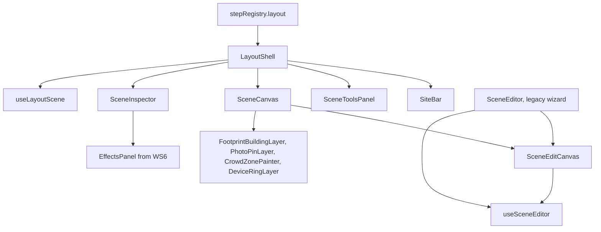

# Lay out the scene: the layout step opens with the site (WS4)

**Status:** v1, 25 Oct 2026. Not built.
**Workstream:** WS4
**Depends on:** `00-master-plan.md`, `01-prerequisites.md`, `04-site-picker.md`
**Flags:** `ENABLE_FIELDOPS_V2` and `VITE_ENABLE_FIELDOPS_V2`
**Migrations:** 233, 234 (**updated 8 Nov 2026**: every field-ops number moved up by one; master section 9)
**Baseline:** verified against commit 1cd539a (8 Nov 2026); see the README.

## 1. Purpose, goals and non-goals

**Purpose.** WS4 turns the second half of today's Scene Editor into step 2 of the new field-ops wizard, "Lay out the scene". The step opens with the site the trainer chose on the setup screen already loaded (D7): the primary building outlined, its neighbours and the streets around it, and the other buildings involved at footprint level (D9). There is nothing to search, type or pick. The trainer places exits, interior walls and stairwells, adds hazards, walks the site taking photos, positions the devices she described in Setup and paints where the crowd stands (D10). The result is stored as a versioned `SceneConfigV2` in `rts_scene_configs`, and WS5 compiles from it.

**Goals**

1. **Open with the site.** `LayoutShell` reads `setup_v2.site` (WS3's `SiteSelection`) and WS3's `loadSiteArea`, and shows the editor ready to use. With `ENABLE_FIELDOPS_V2` on, the map phase (country list, place search, coordinates, radius box, source switch, Fetch Buildings, pick list, draw and trace) is never shown on this path.
2. **One edit phase, extracted, unchanged.** The edit-phase state and canvas are extracted from `frontend/src/components/SceneEditor/SceneEditor.tsx` into a hook and a canvas component that both the legacy wizard and `LayoutShell` use. With the flag off the legacy wizard behaves exactly as today (master risk 10).
3. **Crowd zones.** The "Pedestrians" box goes; the headcount comes from `setup_v2.incident.people_present`; the trainer paints circles or polygons with a density and a label; a pure function splits the headcount across them.
4. **Footprint-level buildings.** Exits and wall points for every involved building are generated from its footprint, scored against the street centre-lines; hazards, devices and crowd zones can be placed in them.
5. **Devices from Setup.** Each `DeviceSpec` from Setup appears as a pin to position. Effect rings are read-only previews from WS6's hook; the legacy manual radius returns only when physics is off.
6. **Persistence that restores everything.** `schema_version`, size caps, autosave with optimistic concurrency, revisions, a full restore (streets and neighbours included), and exact rules for a site that changes after layout work has begun.
7. **No Google (D14).** Street View and `VITE_GOOGLE_MAPS_API_KEY` leave the field-ops path. Trainer photos go to a private bucket, re-encoded with their metadata removed, and are read through short-lived signed URLs.
8. **Clean hand-offs.** `loadSceneForCompile`, `getLayoutReadiness`, `buildTrainerScene` and `resolveSceneForCommit` for WS5; `toCrowdZoneInputs`, `confinementAt`, `allocateCrowd` and `simToLatLng` for WS6; a published, read-only mode of `LayoutShell` with a read route by scenario for WS8 (master 10.8 item 11), and `copySceneForSeededDraft`, which gives a draft seeded from a published scenario its own copy of that scenario's scene.
9. **Accessible.** Every placement can be made from the keyboard through a list view and a "Place by form" dialog; icons come from `WrIcon` (D28).

**Non-goals**

- Choosing, outlining or tracing the site, the radius and the buildings involved: WS3 (`04-site-picker.md`).
- The setup screen, its lanes and readiness list: WS2 (`03-setup-screen.md`).
- Calculating effects, bands or casualties, and storing overrides of calculated values: WS6 (`07-device-and-physics.md`). WS4 draws what WS6 returns.
- Compile, Review and publish: WS5 (`06-compile-and-review.md`). Editing a published scenario: WS8 (`09-after-publish.md`).
- Interior walls and stairwells for involved buildings; more than the two floors today's stairwells link.
- Closing the permissive read policy on `rts_scene_configs`: an owner decision, raised as request R4.9 and made a production gate (section 9). **Updated 8 Nov 2026:** migration 218 closed the read policy in production; the rest of R4.9 is open (section 9.2).
- Fixing the legacy wizard's own scene bugs (journey findings 4.4, 4.5 and 4.13 on the legacy path); the new path avoids them by design.
- Any model call. WS4 asks no model for anything (section 8).

## 2. Decisions and assumptions

**Added 3 Nov 2026.** One addition, asked for by WS5's revision (`06-compile-and-review.md` section 15.4) and used by WS9's living world (`11-living-world.md`): a hazard may say what is burning or stored there (D36). `SceneHazard` gains an optional `material`, a contents key of WS9's spread library, chosen in the hazard panel. A hazard without one keeps its type's stored behaviour, so nothing already built changes. The addition is in sections 5.4, 5.7, 5.8, 7.7 and 7.15, AC4.30 and task T4.20, and is answered in section 15.3; section 15.4 asks WS9 for the list of keys.

### 2.1 Master decisions this spec rests on

| ID | Status | What it means here |
| --- | --- | --- |
| D3 | Decided | The layout step does not look at doctrines. A team with no doctrine never blocks laying out the scene. |
| D5 | Decided | No building, road or address data is fetched live. The layout reads the saved tables through WS3's `loadSiteArea`; the map background is the OpenStreetMap tile layer through the existing proxy. |
| D7 | Decided | The step opens with the site loaded. Hazards, photos, devices and crowd zones are placed here. |
| D8 | Decided | Devices are described in Setup. The layout adds only where each one is. |
| D9 | Decided | Involved buildings are handled at footprint level with generated exits and wall points; only the primary building has the full interior. |
| D10 | Decided | The headcount is set in Setup; where people stand is painted here. |
| D13 | Assumed | A site with no saved map data stops with a plain message. The layout has no live fallback either. |
| D14 | Assumed | Street View goes. The trainer's photos are the only wall-point and hazard imagery. |
| D15 | Assumed | At most 5 involved buildings and 6 devices; WS4's limits equal these caps. |
| D22 | Assumed | Rings drawn from an unreviewed calculator carry WS6's "Unreviewed model" label. |
| D23 | Assumed | Migrations 233 and 234 are additive and idempotent. |
| D24 | Assumed | Compile writes a draft scenario; a scene bound to a published scenario becomes read-only on this step. |
| D25 | Assumed | The step lives only on the new page `/warroom/field-ops`; the legacy wizard keeps its own flow. |
| D28 | Assumed | The mockup's layout wins on structure and copy; its emoji become `WrIcon` glyphs; its device sentence with named materials is replaced by WS6's safe summary (safety). |

### 2.2 WS4 design decisions (Proposed)

| # | Decision | Why |
| --- | --- | --- |
| L1 | Extract the edit phase into `useSceneEditor` (state and handlers), `SceneEditCanvas` (map, canvas and floating panels) and `sceneSiteLoader` (pure loader). The legacy `SceneEditor` composes them and keeps its map phase and save. | Master risk 10: one implementation, tested loader, no behaviour change with the flag off. |
| L2 | The trainer's work is one validated JSONB, `authored`, plus `crowd_zones` in its own column. Every save also writes the legacy columns as a projection. | Existing readers (runtime canvas, building studs, the legacy generator) keep working; WS0's participant allow-list can expose crowd zones without the answer key. |
| L3 | Optimistic concurrency on `layout_rev`; autosave 1.5 s after the last change; revisions on create, manual save, restore, site change and at most every 5 minutes of autosave; the newest 50 kept. | Fixes journey 4.5 (silent loss) without a revision per keystroke. |
| L4 | Photos are re-encoded by `sharp` to JPEG at most 1,600 px on the long edge, which drops all metadata; stored in the private bucket `fieldops-scene-photos`; read through signed URLs valid for 900 seconds; deleted or orphaned photos kept 30 days. | D14, journey 4.6, privacy (section 9). |
| L5 | Crowd allocation fills painted zones in line with their capacity (area times density) with the largest-remainder rule; people above total capacity are "unassigned" and spread through the primary building. | Counts always sum to the headcount and match the mockup's "the rest is spread to suit the venue". |
| L6 | Every device from Setup must be placed before compile. Decoys stay a layout-only item at a wall point. | Positions drive physics and the bomb-squad sweep; a decoy has no physics. |
| L7 | A radius change or added involved buildings sync automatically. A changed primary building, or removed buildings with items in them, open a dialog with exact copy. Every sync first saves a revision. | Journey 4.4 corrupts scenes when the building changes; positions are kept by their map location, never by stale metres. |
| L8 | The sim origin stays the vertex mean of the primary polygon, as today. | Six copies of the projection depend on it (journey "Two coordinate systems"); WS4 adds one shared copy and no new convention. |
| L9 | In v2 the canvas draws wall points, crowd zones, footprint layers and device rings in a second pass after `renderRTS`, which stays unchanged. | `renderRTS` draws wall points with emoji glyphs through `fillText` (`frontend/src/lib/rts/renderer.ts:1170-1174`); the runtime canvas also uses it. |
| L10 | With the flag on the edit-phase tile layer goes through the tile proxy. | D5 says "through our tile proxy"; today only the map phase does (section 3.12). |
| L11 | Item ids in v2 are `<prefix>-<8 hex>` from `crypto.randomUUID()` and unique across the scene. | WS5 stamps `scene_item_id` on compiled pins (master 10.8 item 18); legacy exit ids repeat after a reload (journey 4.16). |
| L12 | The v2 rows are refused by the legacy `/api/rts-scenes` routes, and every verb of those routes checks the owner (creator or admin). | Those routes have no owner checks (section 3.5); WS0 makes them staff-only and leaves ownership to WS4; v2 rows hold device positions. |
| L13 | On a compiled draft the layout opens read-only with WS5's "Reopen for editing" action; the server refuses layout writes while the draft is `compiled`. | Setup is read-only once compiled (WS2), and WS5's reopen detaches the scene and discards the draft scenario (06 section 6.5). |
| L14 | The layout draws the site with WS3's map layers (`SiteTiles`, `SiteRingLayer`, `SiteStreetsLayer`, `SiteFootprintsLayer`, `SITE_MAP_STYLE`). | One look for the site on both screens; tiles through the proxy with `crossOrigin="anonymous"` (D5). |
| L15 | WS8 gets an editable published mode of `LayoutShell` whose `onSave` hands the layout back, and a pure mapper, `toSceneSaveColumns`, that produces exactly the columns a WS4 save writes. | Published scenarios are edited only in WS8's editor (master 10.8 item 27), with its own revisions and audit. |
| L16 | For live play, a read-only `FieldOpsSceneOverlay` on `MapView` draws a v2 scene's walls, stairwells, involved footprints, crowd zones and photo pins from the participant projection. | WS0 chose `MapView` for live play and left the scene overlay to WS4 (`01-prerequisites.md` section 6.5.1, option C); master 10.8 item 28 gives participants the columns it needs. |

### 2.3 Where the journey or the mockup and the code differ

- The journey says the map shows tiles "through our own proxy". That is true of the map phase only (`frontend/src/components/SceneEditor/SceneEditor.tsx:1870-1876`); the edit phase loads `tile.openstreetmap.org` directly (`frontend/src/components/SceneEditor/SceneEditor.tsx:2259-2264`). The code wins; L10 aligns the new path with D5. **Verified.**
- The brief mentions a floors tool. There is none: a stairwell always links floors 0 and 1 (`connectsFloors` at `frontend/src/components/SceneEditor/SceneEditor.tsx:1254`), and `Stairwell` carries only that pair (`frontend/src/lib/rts/types.ts:608-617`). WS4 keeps that and adds a `floor` number on placed devices only, for WS6. **Verified.**
- The mockup shows "Select / move" moving every item. In the code exits and walls cannot be dragged: `findDraggableAt` returns a wall but `applyElementDrag` has no wall branch, and exits are never hit-tested (`frontend/src/components/SceneEditor/SceneEditor.tsx:967-1037`). The legacy edit phase keeps that; v2 adds dragging for devices, crowd zones and involved-building exits only. **Verified.**
- The mockup's inspector names an explosive material and quantities. The spec replaces that text with WS6's safe display summary (section 9).
- The mockup has no service-entry tool, decoy, list view, place-by-form dialog or revisions; the code has service entries (`frontend/src/components/SceneEditor/SceneEditor.tsx:2001-2006`) and decoys (`frontend/src/components/SceneEditor/SceneEditor.tsx:2452-2455`). They are kept or added, and the UI sheet records them as its rows 6.86 to 6.90 (`10-ui-spec-sheet.md`).

### 2.4 Master rulings applied in this spec

| Master 10.8 item | Where it lands here |
| --- | --- |
| 5: WS0's detectors, with a negative answer re-checked after about a minute | Section 5.10: applying 233 and 234 needs no restart |
| 16: device pool and answer key kept out of `scenarios` columns | Section 6.12: `buildTrainerScene` gives the generator no planted items and returns the planted devices separately |
| 21: foreign keys to `scenarios` cascade or set null | Migrations 233 and 234 add no foreign key to `scenarios`; the existing `scenario_id` cascades (`migrations/163_rts_scene_configs.sql:9`) |
| 22: the layout survives a replaced draft scenario | Section 6.12: `resolveSceneForCommit` takes `replacingScenarioId`, never links a scene itself, and `detachAuthoringScene` is called by WS5 before any delete |
| 24: one `moderateDeviceText(text, options?)` | Sections 6.4 and 6.6: device notes pass `{ field: 'location_note' }`, decoy descriptions `{ maxLength: 200 }` |
| 27: published scenarios edited only in WS8's editor | Sections 6.5 and 6.13: layout routes refuse writes to a published scene; WS8 uses the editable published mode and the save mapper |
| 28: the participant projection gains `schema_version`, `involved_layouts`, `crowd_zones`, `crowd_headcount` and the photos | Sections 6.10, 6.11 and 7.16 |
| 29: file maps list other workstreams' files with their owner, keeping `(new)` | Section 14.3 |
| 31: one refusal for a wrong role, from WS0's `requireFieldopsTrainer` | Sections 6.1 and 6.3: the scene router's trainer check and its 403 `FORBIDDEN` |
| 33: a scene copy left by a failed job is removed by WS4 | Section 6.11: the photo sweeper deletes it with its photo rows (AC4.27) |

## 3. Current state (verified)

Everything in this section was read on the baseline. Line numbers are as on disk on 25 Oct 2026.

### 3.1 Where the layout lives today

- **Verified.** `SceneEditor` is mounted only by the legacy field-ops wizard (`frontend/src/pages/WarRoom.tsx:5`), at step 3 (`frontend/src/pages/WarRoom.tsx:1269-1283`), with `initialSceneId`, `weaponType` and an `onSave` that stores the scene id and config in page state.
- **Verified.** The wizard keeps the scene pointer inside the draft's free-form input, `scene_context.rts_scene_id` (`frontend/src/pages/WarRoom.tsx:202`), restores it on resume and swallows a failed load (`frontend/src/pages/WarRoom.tsx:293-325`). Its Next gate on step 3 checks only that `rtsSceneId` is set (`frontend/src/pages/WarRoom.tsx:533-534`).
- **Verified.** The draft column `warroom_wizard_drafts.rts_scene_id` exists (`migrations/163_rts_scene_configs.sql:62-63`) but no current code writes it: every server read takes the id from `input.scene_context` (`server/routes/warroom.ts:716-717`, `server/routes/warroom.ts:895`, `server/routes/warroom.ts:1204-1206`, `server/services/warroomService.ts:1185-1186`).
- **Verified.** `SceneSetup` belongs to the `/warroom-legacy` page (`frontend/src/pages/WarRoomLegacy.tsx:7`) and `SceneDesigner` is imported by nothing (search of `frontend/src`).

### 3.2 The two phases of `SceneEditor`

- **Verified.** The component (2,761 lines) holds both phases in one function: `phase` starts as `'map'` (`frontend/src/components/SceneEditor/SceneEditor.tsx:425`). The map phase renders at `frontend/src/components/SceneEditor/SceneEditor.tsx:1518-1972`; the edit phase from `frontend/src/components/SceneEditor/SceneEditor.tsx:1974` to the end.
- **Verified.** The map phase geolocates through the browser and calls the public geocoder for the country (`frontend/src/components/SceneEditor/SceneEditor.tsx:672-703`), searches it as the trainer types (`handleSearchInput` at `frontend/src/components/SceneEditor/SceneEditor.tsx:707-748`) and fetches buildings from the staff-only diagnostic route (`handleFetch` at `frontend/src/components/SceneEditor/SceneEditor.tsx:766-795`). Picking a building resets the elements and enters the edit phase (`selectBuilding` at `frontend/src/components/SceneEditor/SceneEditor.tsx:810-832`); drawing or tracing does the same (`handleDrawComplete` at `frontend/src/components/SceneEditor/SceneEditor.tsx:836-874`).
- **Verified.** Everything placed lives in sim space: metres from the vertex mean of the polygon, x east, y south (`projectPolygon` at `frontend/src/lib/evacuation/geometry.ts:3-22`). Studs are generated every 3 m over the polygon's box plus 150 m (`generateStudsForPolygon` at `frontend/src/components/SceneEditor/SceneEditor.tsx:277-321`) and placements snap to a stud within 6 m (`snapToStud` at `frontend/src/components/SceneEditor/SceneEditor.tsx:597-611`).

### 3.3 Edit-phase inventory

All paths in this table are in `frontend/src/components/SceneEditor/SceneEditor.tsx` unless named. The last column is **Proposed**.

| Tool | Where it is today | With `ENABLE_FIELDOPS_V2` on (flag off: unchanged) |
| --- | --- | --- |
| Back to Map | button calling `backToMap` at `frontend/src/components/SceneEditor/SceneEditor.tsx:1986-1991` | Removed. The site bar's "Change site" and the bar's "Back to setup" open Setup's site lane. |
| Primary outline (cyan) | `selectedGrid` polygon at `frontend/src/components/SceneEditor/SceneEditor.tsx:2277-2288` | Kept. The polygon comes from `setup_v2.site.primary.polygon` and is not editable here. |
| Streets | `displayRoadPolylines` at `frontend/src/components/SceneEditor/SceneEditor.tsx:2266-2276`; a reload passes none (`setFetchResult` at `frontend/src/components/SceneEditor/SceneEditor.tsx:632`) | Read from WS3's site area on every load, with the neighbouring footprints. |
| Place exit | `place_exit` button at `frontend/src/components/SceneEditor/SceneEditor.tsx:1995-2000`; `place_exit` placement at `frontend/src/components/SceneEditor/SceneEditor.tsx:1181-1202` | Kept. Snaps to the nearest edge of the primary or an involved footprint within 10 m. v2 adds "Delete this exit". |
| Place service entry | `place_service_entry` at `frontend/src/components/SceneEditor/SceneEditor.tsx:2001-2006` and `frontend/src/components/SceneEditor/SceneEditor.tsx:1203-1224` | Kept, primary building only. |
| Blast site | `place_blast_site` at `frontend/src/components/SceneEditor/SceneEditor.tsx:2007-2012` and `frontend/src/components/SceneEditor/SceneEditor.tsx:1225-1227` | Removed. Placing the main device from Setup sets the blast site. |
| Place stairwell | `place_stairwell` at `frontend/src/components/SceneEditor/SceneEditor.tsx:2013-2018` and `frontend/src/components/SceneEditor/SceneEditor.tsx:1248-1259` | Kept, primary building only, floors 0 and 1 as today. |
| Draw interior wall | `draw_wall` at `frontend/src/components/SceneEditor/SceneEditor.tsx:2019-2035` and `frontend/src/components/SceneEditor/SceneEditor.tsx:1260-1284`; wall panel with `activeWall` at `frontend/src/components/SceneEditor/SceneEditor.tsx:2653-2757` | Kept, primary building only. |
| Wall points | `generateWallPoints` at `frontend/src/components/SceneEditor/SceneEditor.tsx:822-829`; `handleWallPointClick` hit at `frontend/src/components/SceneEditor/SceneEditor.tsx:1170-1178`; `activeWallPoint` panel at `frontend/src/components/SceneEditor/SceneEditor.tsx:2320-2466` | Kept on the primary; generated for involved buildings; drawn by `PhotoPinLayer`; no Street View. |
| Six hazards | `HAZARD_DEFS` buttons at `frontend/src/components/SceneEditor/SceneEditor.tsx:2037-2047`; `place_hazard_` placement at `frontend/src/components/SceneEditor/SceneEditor.tsx:1228-1247`; `activeHazard` panel at `frontend/src/components/SceneEditor/SceneEditor.tsx:2468-2651` | Kept. `WrIcon` glyphs; placeable in any building or outdoors; photos through the upload API. |
| Take Photo and Gallery on a wall point | `handlePhotoUpload` at `frontend/src/components/SceneEditor/SceneEditor.tsx:2364-2391` and `frontend/src/components/SceneEditor/SceneEditor.tsx:914-930` (a data URL in the JSON) | Replaced by `PhotoPanel` uploads to the private bucket. |
| Take Photo and Gallery on a hazard | `hazardPhotoRef` at `frontend/src/components/SceneEditor/SceneEditor.tsx:2547-2603` (data URLs) | Same as above. |
| Plant threat (`PlantedItem`) | `handlePlantItem` at `frontend/src/components/SceneEditor/SceneEditor.tsx:2409-2464` and `frontend/src/components/SceneEditor/SceneEditor.tsx:932-948` | Real and secondary devices come only from Setup. The panel offers "Place a device from setup here" and "Add a decoy". |
| Blast radius slider (5 to 100 m, default 20) | `blastRadius` at `frontend/src/components/SceneEditor/SceneEditor.tsx:2049-2060`; default at `frontend/src/components/SceneEditor/SceneEditor.tsx:489` | Removed from the tools. Physics on: WS6's rings. Physics off: the same slider, in `SceneInspector`. |
| Weapon presets (ten) and free text | `localWeaponType` at `frontend/src/components/SceneEditor/SceneEditor.tsx:2062-2094` | Removed. The device is described in Setup; no `weapon_type` is written. |
| Operational zones (hot, warm, cold) | `gameZones` at `frontend/src/components/SceneEditor/SceneEditor.tsx:2096-2146`; defaults 25, 50, 100 m at `frontend/src/components/SceneEditor/SceneEditor.tsx:496-502` | Moved to `SceneInspector`, with "Suggest from the calculated bands". |
| Pedestrians (10 to 5,000, default 120) | `pedestrianCount` at `frontend/src/components/SceneEditor/SceneEditor.tsx:2151-2161` | Removed. The Setup headcount shows read-only; crowd zones replace it. |
| Stats | `simStuds` count block at `frontend/src/components/SceneEditor/SceneEditor.tsx:2163-2174` | Replaced by the inspector's "This scene" and the bar's counts. |
| Inspect studs | `studInspectMode` at `frontend/src/components/SceneEditor/SceneEditor.tsx:2176-2233` | Shown only in a development build. |
| Save Scene and Update Scene | `handleSave` button at `frontend/src/components/SceneEditor/SceneEditor.tsx:2235-2244` | Autosave plus "Save scene" in the bar. |
| Tile layer | `TileLayer` at `frontend/src/components/SceneEditor/SceneEditor.tsx:2259-2264` (direct) | Through the proxy, `/api/tiles/{z}/{x}/{y}.png`. |
| Canvas and handlers | `handleCanvasMouseDown` at `frontend/src/components/SceneEditor/SceneEditor.tsx:2290-2309`; handlers at `frontend/src/components/SceneEditor/SceneEditor.tsx:1039-1299`; `renderRTS` loop at `frontend/src/components/SceneEditor/SceneEditor.tsx:1423-1489` | Kept. v2 adds pointer events, a second drawing pass and keyboard moves. |
| Placement hint | `activeMode` hint at `frontend/src/components/SceneEditor/SceneEditor.tsx:2310-2317` promises Esc, which has no handler | v2 handles Esc. |

### 3.4 How a scene is saved and loaded

- **Verified.** The client calls `createSceneConfig` (POST, `frontend/src/lib/rts/sceneConfigApi.ts:54-80`), `loadSceneConfig` (`frontend/src/lib/rts/sceneConfigApi.ts:82-88`) and `updateSceneConfig` (PATCH, `frontend/src/lib/rts/sceneConfigApi.ts:104-117`). `uploadSceneImage` (`frontend/src/lib/rts/sceneConfigApi.ts:119-134`) is never called.
- **Verified.** `handleSave` POSTs the first time and PATCHes after (`frontend/src/components/SceneEditor/SceneEditor.tsx:1312-1399`). The PATCH sends the elements only, never the polygon, name or centre (`updateSceneConfig` call at `frontend/src/components/SceneEditor/SceneEditor.tsx:1345-1356`), which is journey finding 4.4. A failure is only logged (`console.error` at `frontend/src/components/SceneEditor/SceneEditor.tsx:1378-1379`).
- **Verified.** Reloading (`loadSceneConfig` effect at `frontend/src/components/SceneEditor/SceneEditor.tsx:615-668`) restores the polygon with no roads, the elements, the blast object and the wall points, and a failed load is swallowed by an empty `.catch` (`frontend/src/components/SceneEditor/SceneEditor.tsx:665-667`).

### 3.5 The table, its migrations and its routes

- **Verified.** Two migrations touch the table: `migrations/163_rts_scene_configs.sql` (the table at lines 7-39, indexes at 41-45, the `updated_at` trigger at 48-59, the draft column at 62-63, the public bucket `rts-scene-images` at 65-68, RLS and policies at 70-89) and `migrations/164_rts_enrichment_result.sql` (`enrichment_result` at lines 4-5). No other migration mentions it.
- **Verified.** The read policy is `FOR SELECT USING (true)` (`migrations/163_rts_scene_configs.sql:73-74`); insert, update and delete are allowed when `created_by = auth.uid()` (`migrations/163_rts_scene_configs.sql:76-89`). Checked on the live project on 25 Oct 2026 (master risk 14): RLS is on, the read policy applies to every role and `anon` holds SELECT, so the public anon key alone, with no sign-in, reads every scene row, planted devices included; the bucket `rts-scene-images` is public. **Updated 8 Nov 2026:** migration 218, applied in production, replaced the read policy with one for the scene's creator and admins; the bucket is still public, and insert, update and delete are unchanged (section 9.2).
- **Verified.** `scenario_id` cascades on scenario delete (`migrations/163_rts_scene_configs.sql:9`); the draft column `rts_scene_id` is `ON DELETE SET NULL` (`migrations/163_rts_scene_configs.sql:63`).
- **Verified.** `server/routes/rtsScenes.ts` is mounted at `/api/rts-scenes` (`rtsScenesRouter` at `server/index.ts:299`). Every verb uses `requireAuth` alone (journey finding 4.1); WS0 adds `requireStaff` to every verb (`01-prerequisites.md` section 6.5.3) and leaves ownership between trainers to WS4 (section 6.10):

| Verb and path | Behaviour | Where |
| --- | --- | --- |
| POST `/api/rts-scenes` | Validates only the `buildingPolygon` length; stores the caller as `created_by` | `server/routes/rtsScenes.ts:10-70` |
| GET `/api/rts-scenes/:id` | Returns the whole row by id through `supabaseAdmin` | `server/routes/rtsScenes.ts:73-91` |
| GET `/api/rts-scenes` | The newest 50 rows of all users; the `createdBy` filter is optional | `server/routes/rtsScenes.ts:94-121` |
| PATCH `/api/rts-scenes/:id` | Filters on the id alone; `allowedFields` include `scenario_id` and `enrichment_result` | `server/routes/rtsScenes.ts:124-196` |
| POST `/api/rts-scenes/:id/upload-image` | Stores a base64 image and returns a public URL from `uploadRtsSceneImage` | `server/routes/rtsScenes.ts:199-240` |
| DELETE `/api/rts-scenes/:id` | `delete()` filtered on the id alone | `server/routes/rtsScenes.ts:243-258` |
- **Verified.** Scenes are read by scenario in three places, each with `select('*')` or a fixed column list: `GET /api/scenarios/:id/scene-config` (`server/routes/scenarios.ts:3382-3401`), `GET /api/sessions/:id/scene-config` (`server/routes/sessions.ts:976-1005`) and `loadClassifiedGrids` (`server/services/buildingStudService.ts:781-818`). The debug page lists and deletes scenes (`listSceneConfigs` at `frontend/src/pages/DebugRTSSim.tsx:1225`).
- **Verified.** The legacy persist re-parents the one scene row to the newest scenario (`server/routes/warroom.ts:1204-1212`), journey finding 4.13.
- **Verified.** The server parses JSON up to 10 MB for every route (`express.json` at `server/index.ts:255`).

### 3.6 How compile reads the scene today

- **Verified.** When `scene_context.rts_scene_id` is set, `warroomService.ts` loads the row and builds a `TrainerScene` (`server/services/warroomService.ts:1181-1340`; the interface at `server/services/warroomAiService.ts:1361-1411`). Positions go through `simToLatLng` (`server/services/warroomService.ts:73-85`); planted items take their position from their wall point and are dropped without one (`plantedItems` at `server/services/warroomService.ts:1214-1243`); exits are read from each `exitsRaw` entry's position (`server/services/warroomService.ts:1264-1266`), which the editor adds on save (`exitsWithPos` at `frontend/src/components/SceneEditor/SceneEditor.tsx:1343`).
- **Verified.** Any blast site plus a building name makes the narration "INDOOR" with no point-in-polygon test (`indoorContext` at `server/services/warroomService.ts:1363-1367`), journey finding 4.12.
- **Verified.** Casualties for a trainer scene come from `generateContextAwareCasualties`: count tiers from `pedestrianCount` (`server/services/warroomAiService.ts:7980-7984`) and fixed bands at 33 and 66 per cent of the hand-set radius (`killR` and `critR` at `server/services/warroomAiService.ts:7986-7987`). It runs only when the trainer scene has a blast site; crowd pins are skipped for trainer scenes (`generateContextAwareCasualties` call at `server/services/warroomAiService.ts:8368-8387`). The LLM `assessWeaponLethality` (`server/services/warroomAiService.ts:1623-1635`) serves only the non-trainer path.
- **Verified.** Planted items become the bomb-squad sweep pool and one tip inject each (`sweepDevicePool` at `server/services/warroomAiService.ts:8586-8633`).

### 3.7 The runtime canvas

- **Verified.** `SceneCanvasView` (1,461 lines) is mounted by `SessionView` (`frontend/src/pages/SessionView.tsx:1488`, `frontend/src/pages/SessionView.tsx:2236`, `frontend/src/pages/SessionView.tsx:2632`) and by `ScenarioDetailView` (`frontend/src/components/Scenario/ScenarioDetailView.tsx:2491`). It loads the scene with `getSceneConfig` (`frontend/src/components/COP/SceneCanvasView.tsx:159`), which calls `/api/scenarios/:id/scene-config` (`frontend/src/lib/api.ts:695-698`). WS0 changes the choice of map (`01-prerequisites.md`, P0.1): participants and spectators always get the live `MapView`, which already outlines the building through `BuildingStudOverlay` (`frontend/src/components/COP/MapView.tsx:1637-1645`), and `SceneCanvasView` becomes the trainer's "Scene preview".
- **Verified.** It loads `planted_items` for everyone (`frontend/src/components/COP/SceneCanvasView.tsx:332-336`) and lists them in the wall-point panel (`plantedItems` at `frontend/src/components/COP/SceneCanvasView.tsx:1209-1227`), journey finding 4.3.
- **Verified.** It fetches Street View for the active wall point when a key is set (`fetchStreetViewImage` effect at `frontend/src/components/COP/SceneCanvasView.tsx:450-475`).
- **Verified.** Its evacuation preview spawns `pedestrian_count` people (`startEvacuation` at `frontend/src/components/COP/SceneCanvasView.tsx:650-673`) uniformly inside the polygon (`spawnPedestrians` at `frontend/src/lib/evacuation/engine.ts:194-237`).

### 3.8 Google and photos

- **Verified.** `GOOGLE_MAPS_KEY` is read from `VITE_GOOGLE_MAPS_API_KEY` in the editor (`frontend/src/components/SceneEditor/SceneEditor.tsx:55`) and in the runtime canvas (`frontend/src/components/COP/SceneCanvasView.tsx:8`). `handleWallPointClick` calls `fetchStreetViewImage` (`frontend/src/components/SceneEditor/SceneEditor.tsx:884-907`), which calls Google's metadata and image endpoints and caches in IndexedDB (`frontend/src/lib/rts/wallInspection.ts:232-266`). The no-key text is at `frontend/src/components/SceneEditor/SceneEditor.tsx:2349-2359`.
- **Verified.** Trainer photos are data URLs written into the scene JSON (`handlePhotoUpload` at `frontend/src/components/SceneEditor/SceneEditor.tsx:914-930`; hazard photos through `readAsDataURL` at `frontend/src/components/SceneEditor/SceneEditor.tsx:2553-2569`). Scene enrichment sends each hazard photo to the vision model at high detail (`image_url` at `server/services/rtsSceneEnrichmentService.ts:259-261`), journey finding 4.6.

### 3.9 Libraries and patterns WS4 reuses

- **Verified.** `sharp` 0.33 is a root dependency (`package.json:99`) already used on the server (`server/services/scenarioMapImageService.ts:6`). `multer` 2 is a root dependency (`package.json:89`) with a memory-storage, size-limited, single-file pattern and a `MulterError` handler (`uploadPdf` at `server/routes/trainerAgreements.ts:226-248`) and a per-user limiter (`perUserLimit` at `server/routes/trainerAgreements.ts:215-224`).
- **Verified.** A private bucket with a size and type limit is created in `migrations/212_trainer_agreements.sql:74-76`; files are read through signed URLs (`createSignedUrl` with `SIGNED_URL_SECONDS` at `server/routes/trainerAgreements.ts:166-172`; the constant is 300 seconds, defined near the top of the same file).
- **Verified.** A flag-gated router answers 404 when its flag is off (`enableTeammateBots` gate at `server/routes/teammateBots.ts:25-33`). `requireStaff` admits trainers and admins (`server/middleware/auth.ts:88-100`). `validate()` returns a 400 with no `code` (`server/lib/validation.ts:5-31`). Background work is gated by `runBackgroundEngines` (`server/env.ts:115-117`).
- **Verified.** The saved map tables carry `highway_type` and `coordinates_json` for roads and `footprint_polygon_json` for buildings (`migrations/193_singapore_local_osm_cache.sql:5-40`).
- **Verified.** Files under `shared/` import each other with a `.js` suffix (`shared/roleVisibility.ts:1`); the frontend imports them through the `@shared` alias (`frontend/vite.config.ts:10`). Client tests run under `node:test` and import pure modules from `frontend/src` (`frontend/tests/setupValidation.test.ts:1-14`).

### 3.10 Icons

- **Verified.** `WrIcon` renders one stroke path per name (`frontend/src/components/UI/WarRoomIcon.tsx:97-121`). The names include `image`, `users`, `fire`, `bolt`, `bio`, `alert`, `sparkle`, `grid`, `layers`, `target`, `eye-off`, `list`, `save`, `map`, `check`, `arrow`, `arrow-l`, `edit`, `shield`, `expand`, `trash` and `upload`; there is no camera glyph (`PATHS` at `frontend/src/components/UI/WarRoomIcon.tsx:11-93`).
- **Verified.** `HAZARD_DEFS` icons are emoji (`frontend/src/lib/rts/types.ts:619-626`) and the tool buttons print them (`frontend/src/components/SceneEditor/SceneEditor.tsx:2045`). The renderer draws hazards with vector icons (`drawSvgIcon` at `frontend/src/lib/rts/renderer.ts:911-912`) but wall points with emoji glyphs (`fillText` at `frontend/src/lib/rts/renderer.ts:1143` and `frontend/src/lib/rts/renderer.ts:1174`).

### 3.11 Journey findings this spec closes on the new path

| Finding | How |
| --- | --- |
| 4.1, 4.2, 4.3 (scene access) | v2 rows refused by the legacy routes (L12); WS0's participant allow-list; the read-policy gate R4.9 |
| 4.4 (changing building corrupts the scene) | The site-change rules, which keep items by map position (section 6.7) |
| 4.5 (silent save failure, no autosave) | Autosave, a visible save state, a leave guard and revisions |
| 4.6 (photos as base64 in JSON) | The private photo store |
| 4.10 (the gate is too weak) | `LayoutReadiness` blockers: a placed main device and an exit |
| 4.12 (always narrated indoors) | `confinementAt` tells WS5 whether the main device is inside a building |
| 4.13 (scene re-parented on re-compile) | `resolveSceneForCommit` copies a scene owned by another scenario |
| 4.16 (Esc, exits cannot be removed, repeated ids) | Esc, exit deletion and unique ids in v2 |

## 4. Target behaviour and acceptance criteria

### 4.1 The step, as the trainer meets it (Proposed)

1. On Setup she picks the site (WS3), sets "People present" and describes the devices, then presses **Lay out the scene**. WS2's page mounts `stepRegistry.layout`, which is `LayoutShell`.
2. `LayoutShell` loads the draft's scene. The first time there is none, so it asks the server to create one from `setup_v2.site`: the primary polygon, and for each involved building a generated footprint layout (exits and wall points). The draft's `rts_scene_id` now points at the new row.
3. It loads the site area (neighbouring footprints and streets) through WS3's `loadSiteArea` and opens the editor: the primary building in cyan, involved buildings in amber marked "footprint level", neighbours in beige, streets in blue, a faint dashed ring at the site radius. The site bar reads "Site loaded from setup" with the place, "saved map data", the radius and the building count.
4. She places exits, walls and stairwells on the primary building; hazards anywhere; she taps wall points and hazards and takes photos, which upload at once. Each device from Setup is listed under "Devices — from setup" and is positioned by clicking the map or a wall point. With physics on the inspector shows WS6's rings and numbers for the selected device; with physics off it shows the legacy radius slider.
5. She paints crowd zones (circle or polygon, density, label). The tools panel shows the headcount from Setup and how many people fall in painted zones; the rest are spread through the primary building.
6. Every change autosaves 1.5 seconds after she stops. "Save scene" saves at once and records a revision. Leaving with unsaved changes asks first.
7. **Compile and review** takes her to WS5's step, which refuses to start while `getLayoutReadiness` reports a blocker (an unplaced device, no exit, a changed site).
8. If she goes back to Setup and changes the site, the next visit compares the stored site with the new one and either syncs silently (radius, added buildings) or asks with the dialog in section 7.10.
9. Once the scenario built from this draft is published, the step opens read-only; WS8 shows the same view by scenario.

### 4.2 States of the step

| State | When | What the trainer sees | Way out |
| --- | --- | --- | --- |
| `loading` | Draft, scene or site area in flight | The site bar skeleton and "Loading the site from setup…" | Waits |
| `no_site` | `setup_v2.site` is null | "Set the site in Setup first. The layout step opens with the building, its neighbours and the streets you chose there." | "Go to Setup" |
| `no_saved_data` | WS3 reports no saved map data for the site (D13) | "There is no saved map data for this area. Choose a site inside the saved map data (Singapore) in Setup." | "Change site" |
| `area_failed` | The site-area request failed | "The streets and neighbouring buildings could not be loaded." | "Try again", or "Continue without them" (editor opens with the primary and involved outlines only) |
| `scene_failed` | Loading or creating the scene failed | "Your saved layout could not be loaded. Nothing has been changed." | "Try again" |
| `store_unavailable` | The server answers 503 `LAYOUT_STORE_UNAVAILABLE` | "The layout store is not ready on this server yet." | "Back to setup" |
| `site_changed` | The scene's site fingerprint differs from Setup's and the change needs a decision | The site-change dialog over a dimmed editor | The dialog's three buttons |
| `ready` | Otherwise | The editor | |
| `read_only` | The draft is compiling or compiled, or the bound scenario is published | The editor without tools and a banner: "Compiling. The layout is read-only until the build finishes."; "This draft has been compiled. Reopen it to change the layout."; or "This scenario is published. Changes are made in the scenario editor." | On a compiled draft, "Reopen for editing" (WS5's confirmation, then WS5's `reopenDraft`, then `refreshDraft`); otherwise the banner link |

### 4.3 Acceptance criteria

1. **AC4.1** Given a draft with `setup_v2.site` set and no scene, when `POST /api/warroom/field-ops/scene/drafts/:draftId` runs, then a row with `schema_version = 2`, `draft_id` set, the primary polygon in `building_polygon`, one generated layout per involved building and `layout_rev = 1` exists, and the draft's `rts_scene_id` is that row's id. Test: `server/services/fieldOps/layout/sceneStore.test.ts (new)`, case "creates a scene from the site and links the draft".
2. **AC4.2** Given a saved v2 scene and a site area with three streets, when the editor hydrates, then exits, walls, stairwells, hazards, devices, decoys, crowd zones and operational zones equal the saved ones and the road list has three entries (not `[]`). Test: `frontend/tests/sceneSiteLoader.test.ts (new)`, case "v2 hydration restores streets and every element".
3. **AC4.3** Given a legacy row, when the extracted loader hydrates it, then the result equals what the effect at `frontend/src/components/SceneEditor/SceneEditor.tsx:620-663` produced (roads empty, stored wall points kept even when empty, pedestrian count defaulting to 120). Test: `frontend/tests/sceneSiteLoader.test.ts (new)`, case "legacy hydration is unchanged".
4. **AC4.4** Given `ENABLE_FIELDOPS_V2` is off, when any route under `/api/warroom/field-ops/scene` is called, then it answers 404 `{ error: 'Not found' }` from WS0's `requireFieldopsV2`, the body of the app's 404 handler. Test: `server/routes/fieldOpsScene.test.ts (new)`, case "flag off answers 404".
5. **AC4.5** Given a scene at rev 4, when a PUT with `base_rev: 4` arrives, then it answers 200 with `rev: 5`; when a second PUT with `base_rev: 4` arrives, then it answers 409 `SCENE_REV_CONFLICT` with `current_rev: 5` and nothing is written. Test: `sceneStore.test.ts`, case "optimistic concurrency".
6. **AC4.6** Given an `authored` body whose JSON is 512,001 bytes, when it is saved, then the answer is 413 `SCENE_TOO_LARGE`; given 61 hazards, the answer is 400 `VALIDATION_FAILED` with a detail on `authored.hazards`. Test: `server/lib/fieldOps/layoutSchemas.test.ts (new)`, cases "size cap" and "count caps".
7. **AC4.7** Given revisions 1, 3 and 5, when revision 3 is restored with `base_rev: 5`, then `authored` and `crowd_zones` equal revision 3's, `layout_rev` is 6 and a revision with reason `restore` exists. Test: `sceneStore.test.ts`, case "restore".
8. **AC4.8** Given zones with capacities 100, 50 and 0 and a headcount of 120, when `allocateCrowd` runs, then the counts are 80, 40 and 0 and `unassigned` is 0; with a headcount of 400 they are 100, 50 and 0 with 250 unassigned; with a null headcount every count is 0 and `headcount_source` is `missing`. Test: `server/lib/fieldOps/crowd.test.ts (new)`.
9. **AC4.9** Given an L-shaped footprint whose south edge runs 6 m from a residential road, when `generateFootprintLayout` runs, then the first exit lies on the south edge, every outward normal points outside the polygon, exits are at least 15 m apart and at most 6, and wall points are about 12 m apart and at most 60; a 4 m by 4 m footprint gets exactly one exit; a two-point footprint gets status `degenerate` and none. Test: `server/lib/fieldOps/footprintLayout.test.ts (new)`.
10. **AC4.10** Given two devices in Setup and only the main one placed, when readiness is computed, then `ok` is false with the blocker `DEVICE_NOT_PLACED` naming the second device; with both placed and no primary exit the blocker is `NO_EXITS`. Test: `server/lib/fieldOps/layoutReadiness.test.ts (new)`.
11. **AC4.11** Given WS6's hook returns rings of 8, 22, 70 and 85 m for a device at a known position, when `ringsToCanvasCircles` maps them with a known render context, then four circles come back in ascending radius with the styles of section 7.9; given the hook status `disabled`, the legacy band radius is drawn instead. Test: `frontend/tests/layoutRings.test.ts (new)`.
12. **AC4.12** Given the v2 sources, when they are scanned, then no file under `frontend/src/components/FieldOps/Layout/` or the three extracted modules imports `fetchStreetViewImage` or reads `VITE_GOOGLE_MAPS_API_KEY`, and none contains an emoji; and `HAZARD_ICON` in `frontend/src/components/UI/WarRoomIcon.tsx` maps the six hazard keys to the glyphs of the UI sheet. Test: `frontend/tests/fieldOpsLayoutStatic.test.ts (new)`. Manual step M6 confirms no request to `maps.googleapis.com`.
13. **AC4.13** Given a JPEG with EXIF and GPS tags, when it is uploaded for a wall point, then the stored object is a JPEG with no EXIF block, at most 1,600 px on its long edge, at `<sceneId>/<photoId>.jpg` in `fieldops-scene-photos`, and the answer carries a signed URL; a GIF answers 400 `PHOTO_TYPE_UNSUPPORTED`; 13 MB answers 413 `PHOTO_TOO_LARGE`; a seventh photo on one target answers 409 `PHOTO_LIMIT_REACHED`. Test: `server/services/fieldOps/layout/scenePhotos.test.ts (new)`.
14. **AC4.14** Given a scene whose site changes only in radius, when the change is classified, then it is `radius_only` and applies without a prompt; given a new primary polygon, when `planSiteSync` runs with `keep_fitting`, then an exit 2 m from the new outline is kept and re-snapped, a wall with an end outside is dropped, a hazard keeps its latitude and longitude, and the report counts both; with `start_again` the primary exits, walls, stairwells and decoys are empty and hazards, devices and crowd zones remain. Test: `server/lib/fieldOps/siteChange.test.ts (new)`.
15. **AC4.15** Given a v2 scene with a placed main device, one placed secondary device, one decoy and one involved building, when `buildTrainerScene` runs with bands from WS5, then `blastSite` is the main device's latitude and longitude carrying those `bands`; hazards and the primary and involved `exits` each carry their `sceneItemId`; `involvedBuildings` has one entry and `crowdZones` one per painted zone with its `people`; `plantedItems` is empty; `extras.plantedDevices` holds the main and the secondary device and `extras.decoys` the decoy; every `photos` array is empty. Test: `server/services/fieldOps/layout/trainerScene.test.ts (new)`.
16. **AC4.16** Given a scene with no `scenario_id`, when `resolveSceneForCommit` runs for scenario S, then it answers `reused` with the same id and writes nothing; given a row bound to S or to the `replacingScenarioId`, `reused` and nothing written; given a row bound to another scenario, a new row with `scenario_id` null, `draft_id` null, `source_scene_id` set and copied photo rows, answered `copied`. In no case does it set `scenario_id`: WS0's commit links the scene (master 10.8 item 22). Test: `server/services/fieldOps/layout/compileHandoff.test.ts (new)`.
17. **AC4.17** Given a scene bound to a published scenario, when a PUT or a photo upload arrives, then it answers 409 `SCENE_READ_ONLY`; `GET /api/warroom/field-ops/scene/by-scenario/:scenarioId` answers 200 to its creator and to an admin and 404 to another trainer. Test: `sceneStore.test.ts`, cases "read-only once published" and "by-scenario access".
18. **AC4.18** Given only a keyboard, when the trainer opens "Place by form", chooses "Combustible", "12 m" and "north-east" and confirms, then a hazard exists at the point `pointFromBearing` returns and the live region announces it. Test: `frontend/tests/layoutPlacement.test.ts (new)` for the geometry; manual step M9 for the dialog and the announcement.
19. **AC4.19** Given a participant, when any scene route is called, then the answer is 403 `FORBIDDEN` from WS0's `requireFieldopsTrainer`; given a trainer who did not create the draft or the scene, the answer is 404 `DRAFT_NOT_FOUND` or `SCENE_NOT_FOUND`. Test: `sceneStore.test.ts`, case "access".
20. **AC4.20** Given migration 234 is not applied, when a scene route runs, then it answers 503 `LAYOUT_STORE_UNAVAILABLE` and the legacy `/api/rts-scenes` routes behave as before. Test: `sceneStore.test.ts`, case "store unavailable"; `server/services/fieldOps/layout/legacyGuard.test.ts (new)`, case "no column, no filter".
21. **AC4.21** Given a draft whose status is `compiling`, when a PUT, site sync, restore or photo upload arrives, then it answers 409 `DRAFT_COMPILING` from WS0's `assertDraftEditable`. Test: `sceneStore.test.ts`, case "compile lock".
22. **AC4.22** Given a v2 row, when the legacy `GET /api/rts-scenes/:id`, PATCH, DELETE or upload is called with its id, then each answers 404, and the legacy list omits it. Test: `legacyGuard.test.ts`, case "v2 rows are hidden from the legacy routes".
23. **AC4.23** Given a legacy scene created by trainer A, when trainer B calls `GET /api/rts-scenes/:id`, PATCH, DELETE or the image upload on it, then each answers 404 and nothing changes, and B's `GET /api/rts-scenes` lists only B's scenes; an admin keeps access to every scene. Test: `legacyGuard.test.ts`, case "owner checks on every legacy verb".
24. **AC4.24** Given a draft whose status is `compiled`, when a PUT, site sync, restore or photo upload arrives, then it answers 409 `SCENE_READ_ONLY` with `details: [{ reason: 'compiled' }]`, and the load view's `read_only` is `compiled`. Test: `sceneStore.test.ts`, case "read-only on a compiled draft"; manual M13 for the reopen action.
25. **AC4.25** Given a published scene, an edited `authored` and crowd zones, when `toSceneSaveColumns` runs, then it returns exactly the columns `saveScene` would write for the same input (`authored`, `crowd_zones`, `crowd_headcount`, `involved_layouts`, the legacy projection, `layout_rev` plus one, `layout_saved_at`) and no column whose name starts with `site_`. Test: `server/services/fieldOps/layout/sceneSaveMapper.test.ts (new)`.
26. **AC4.26** Given a v2 row carrying every column, when WS0's `projectSceneForParticipant` runs, then the result holds `schema_version`, `involved_layouts`, `crowd_zones` and `crowd_headcount` and none of `authored`, `site_snapshot`, `draft_id` and `planted_items`; and each `listRuntimeScenePhotos` entry carries its target, its latitude and longitude and a signed URL. Test: `legacyGuard.test.ts`, case "participant projection of a v2 row"; `scenePhotos.test.ts`, case "runtime photos carry positions".
27. **AC4.27** Given a copy made by `resolveSceneForCommit` whose job failed (no `scenario_id`, no `draft_id`) and older than 24 hours, when the sweeper runs, then the copy and its photo rows are removed and objects another row still uses stay. Test: `compileHandoff.test.ts`, case "unlinked copies are swept".
28. **AC4.28** Given a live session of a compiled v2 scenario, when a participant opens the map, then `FieldOpsSceneOverlay` draws the interior walls, stairwells, involved footprints, crowd zones (behind a toggle) and photo pins from the participant projection, and draws nothing for a legacy scene. Test: `frontend/tests/sceneOverlayModel.test.ts (new)` for the pure `sceneOverlayModel`; manual M14.
29. **AC4.29** Given a published scenario whose v2 scene has two live photos and one the trainer deleted, and a draft that WS2's `createSeededDraft` made for the scenario's creator, when WS8 calls `copySceneForSeededDraft` for that draft and scenario, then a new row exists with `draft_id` the seeded draft, `scenario_id` null, `source_scene_id` the published row, `created_by` the caller, `layout_rev = 1` and the published row's `authored`, `crowd_zones`, `site_snapshot` and `site_fingerprint`; it has two photo rows with the published rows' `storage_path` and `copied_from` set, and no storage object is added; the draft's `rts_scene_id` is the new row, whose revision 1 has reason `created`; and the published row and its photo rows are unchanged. A second call answers the same row and writes nothing; a draft another trainer owns answers `DRAFT_NOT_FOUND`, a caller who is not an admin and created neither the scenario nor its scene answers `SCENARIO_SCENE_NOT_FOUND`, and a draft that already has another scene answers `SCENE_EXISTS`, each writing nothing. Once the published scene is deleted, the photo sweep keeps the objects the copy still uses. Test: `server/services/fieldOps/layout/compileHandoff.test.ts (new)`, case "copy for a seeded draft"; `server/services/fieldOps/layout/scenePhotos.test.ts (new)`, case "the folder sweep keeps objects a copy uses".
30. **AC4.30** **Added 3 Nov 2026.** Given a v2 scene with one hazard whose `material` is `fuel_flammable_liquid` and one without the key, when it is saved and read back, then the first keeps its key, the second has none, and the legacy `hazard_zones` carry no `material`. Given a key outside WS9's list, the save answers 400 `VALIDATION_FAILED` at `authored.hazards.N.material`; given a malformed key, it answers the same at that path from the schema. Test: `layoutSchemas.test.ts`, case "hazard material".

## 5. Data model

### 5.1 Where everything lives (Proposed)

| Data | Where | Readers |
| --- | --- | --- |
| The trainer's layout (`SceneConfigV2Authored`) | `rts_scene_configs.authored` (233) | WS4 routes, WS5 through `loadSceneForCompile`, WS8 through the by-scenario route. Never participants. |
| The site the layout was built on | `rts_scene_configs.site_snapshot` and `site_fingerprint` (233) | WS4 site-change rules |
| Involved-building footprints with their exits and wall points | `authored.involved` (source) and `rts_scene_configs.involved_layouts` (233, a projection without device data) | The runtime canvas through WS0's projection |
| Crowd zones and the headcount used | `rts_scene_configs.crowd_zones` and `crowd_headcount` (234) | WS6 through `toCrowdZoneInputs`; the runtime canvas |
| Photos | `rts_scene_photos` rows (234) and objects in the private bucket `fieldops-scene-photos` (234) | Signed URLs only |
| Revisions | `rts_scene_revisions` (233) | WS4 restore |
| Compatibility projection | the legacy columns of migration 163, written on every v2 save (section 5.8) | `SceneCanvasView`, `loadClassifiedGrids`, anything that reads a scene by scenario |
| Draft to scene | `warroom_wizard_drafts.rts_scene_id` (existing) and `rts_scene_configs.draft_id` (233) | WS4, WS5 (`draftColumns`) |

The sim origin of every v2 position is the vertex mean of `site.primary.polygon` (L8). Latitude and longitude pairs are `[lat, lng]` everywhere, as in master 10.1.

### 5.2 Migration 233: `migrations/233_rts_scene_configs_v2.sql (new)`

```sql
-- Migration 233: field-ops v2 layout columns on rts_scene_configs, and layout revisions (WS4).
--
-- A v2 layout (docs/field-ops/05-layout-step.md, section 5) is stored next to the legacy columns,
-- which every v2 save keeps writing as a projection so that existing readers keep working.
-- Legacy rows get schema_version 1 and NULL or empty values in the new columns; nothing else
-- about them changes. One Supabase project serves every environment, so this file is additive and
-- idempotent, and the code answers 503 LAYOUT_STORE_UNAVAILABLE until 233 and 234 are applied.
--
-- SECURITY: the server reads and writes these columns with the service role. Migration 218 limits
-- the read policy to the scene's creator and admins, so the anon key reads none of them; the rest
-- of request R4.9 (the write policies, anon's grants, the public bucket) is the owner's decision.
-- rts_scene_revisions has RLS enabled and no policy. No foreign key to scenarios is added
-- (master 10.8 item 21).
--
-- Rollback, by hand and in this order:
--   DROP TABLE IF EXISTS rts_scene_revisions;
--   DROP INDEX IF EXISTS uq_rts_scene_configs_v2_scenario;
--   DROP INDEX IF EXISTS uq_rts_scene_configs_v2_draft;
--   ALTER TABLE rts_scene_configs DROP CONSTRAINT IF EXISTS rts_scene_configs_v2_shape;
--   ALTER TABLE rts_scene_configs
--     DROP COLUMN IF EXISTS source_scene_id, DROP COLUMN IF EXISTS layout_saved_at,
--     DROP COLUMN IF EXISTS layout_rev, DROP COLUMN IF EXISTS involved_layouts,
--     DROP COLUMN IF EXISTS authored, DROP COLUMN IF EXISTS site_fingerprint,
--     DROP COLUMN IF EXISTS site_snapshot, DROP COLUMN IF EXISTS draft_id,
--     DROP COLUMN IF EXISTS schema_version;

ALTER TABLE rts_scene_configs
  ADD COLUMN IF NOT EXISTS schema_version SMALLINT NOT NULL DEFAULT 1
    CHECK (schema_version IN (1, 2)),
  ADD COLUMN IF NOT EXISTS draft_id UUID
    REFERENCES warroom_wizard_drafts(id) ON DELETE SET NULL,
  ADD COLUMN IF NOT EXISTS site_snapshot JSONB
    CHECK (site_snapshot IS NULL OR jsonb_typeof(site_snapshot) = 'object'),
  ADD COLUMN IF NOT EXISTS site_fingerprint TEXT
    CHECK (site_fingerprint IS NULL OR char_length(site_fingerprint) BETWEEN 1 AND 128),
  ADD COLUMN IF NOT EXISTS authored JSONB
    CHECK (authored IS NULL OR (jsonb_typeof(authored) = 'object'
      AND octet_length(authored::text) <= 1048576)),
  ADD COLUMN IF NOT EXISTS involved_layouts JSONB NOT NULL DEFAULT '[]'::jsonb
    CHECK (jsonb_typeof(involved_layouts) = 'array'),
  ADD COLUMN IF NOT EXISTS layout_rev INTEGER NOT NULL DEFAULT 0
    CHECK (layout_rev >= 0),
  ADD COLUMN IF NOT EXISTS layout_saved_at TIMESTAMPTZ,
  ADD COLUMN IF NOT EXISTS source_scene_id UUID
    REFERENCES rts_scene_configs(id) ON DELETE SET NULL;

-- A v2 row always carries its layout and the site it was built on.
DO $$
BEGIN
  IF NOT EXISTS (
    SELECT 1 FROM pg_constraint WHERE conname = 'rts_scene_configs_v2_shape'
  ) THEN
    ALTER TABLE rts_scene_configs
      ADD CONSTRAINT rts_scene_configs_v2_shape CHECK (
        schema_version = 1
        OR (authored IS NOT NULL AND site_snapshot IS NOT NULL AND site_fingerprint IS NOT NULL)
      );
  END IF;
END
$$;

-- One v2 scene per draft, and one v2 scene per scenario. Partial, so legacy rows (which may
-- already share a scenario) are untouched and the indexes cannot fail to build.
CREATE UNIQUE INDEX IF NOT EXISTS uq_rts_scene_configs_v2_draft
  ON rts_scene_configs (draft_id)
  WHERE schema_version = 2 AND draft_id IS NOT NULL;

CREATE UNIQUE INDEX IF NOT EXISTS uq_rts_scene_configs_v2_scenario
  ON rts_scene_configs (scenario_id)
  WHERE schema_version = 2 AND scenario_id IS NOT NULL;

COMMENT ON COLUMN rts_scene_configs.schema_version IS
  '1 = legacy Scene Editor row; 2 = field-ops layout (SceneConfigV2, docs/field-ops/05-layout-step.md).';
COMMENT ON COLUMN rts_scene_configs.draft_id IS
  'The field-ops wizard draft that authors this v2 scene. NULL for legacy rows and for copies made at commit.';
COMMENT ON COLUMN rts_scene_configs.site_snapshot IS
  'The SiteSelection (setup_v2.site) the layout was built on.';
COMMENT ON COLUMN rts_scene_configs.site_fingerprint IS
  'siteFingerprint(site_snapshot) from shared/fieldOps/site.ts; compared with the draft to detect a changed site.';
COMMENT ON COLUMN rts_scene_configs.authored IS
  'SceneConfigV2Authored: everything the trainer placed. Holds device positions: never exposed to participants.';
COMMENT ON COLUMN rts_scene_configs.involved_layouts IS
  'Projection of authored.involved (footprints, exits, wall points). No device data; safe for the runtime canvas.';
COMMENT ON COLUMN rts_scene_configs.layout_rev IS
  'Optimistic-concurrency revision of a v2 layout; every successful save adds one.';
COMMENT ON COLUMN rts_scene_configs.source_scene_id IS
  'For a copy made by resolveSceneForCommit or copySceneForSeededDraft: the scene it was copied from.';

CREATE TABLE IF NOT EXISTS rts_scene_revisions (
  id UUID PRIMARY KEY DEFAULT gen_random_uuid(),
  scene_id UUID NOT NULL REFERENCES rts_scene_configs(id) ON DELETE CASCADE,
  rev INTEGER NOT NULL CHECK (rev >= 1),
  reason TEXT NOT NULL
    CHECK (reason IN ('created', 'autosave', 'manual', 'restore', 'site_sync', 'copied')),
  authored JSONB NOT NULL
    CHECK (jsonb_typeof(authored) = 'object' AND octet_length(authored::text) <= 1048576),
  crowd_zones JSONB NOT NULL DEFAULT '[]'::jsonb
    CHECK (jsonb_typeof(crowd_zones) = 'array'),
  site_snapshot JSONB NOT NULL,
  site_fingerprint TEXT NOT NULL CHECK (char_length(site_fingerprint) BETWEEN 1 AND 128),
  byte_size INTEGER NOT NULL DEFAULT 0 CHECK (byte_size >= 0),
  saved_by UUID REFERENCES user_profiles(id) ON DELETE SET NULL,
  saved_at TIMESTAMPTZ NOT NULL DEFAULT now(),
  CONSTRAINT uq_rts_scene_revisions_scene_rev UNIQUE (scene_id, rev)
);

CREATE INDEX IF NOT EXISTS idx_rts_scene_revisions_scene_saved
  ON rts_scene_revisions (scene_id, saved_at DESC);

ALTER TABLE rts_scene_revisions ENABLE ROW LEVEL SECURITY;

COMMENT ON TABLE rts_scene_revisions IS
  'Saved states of a v2 layout for restore. The newest 50 per scene are kept. Service role only.';
```

### 5.3 Migration 234: `migrations/234_rts_scene_crowd_and_photos.sql (new)`

```sql
-- Migration 234: crowd zones, scene photos and the private photo bucket (WS4).
--
-- crowd_zones holds where people stand (CrowdZone[]); crowd_headcount is the Setup headcount the
-- last save used. rts_scene_photos indexes the trainer's photos, which live in the private bucket
-- fieldops-scene-photos as re-encoded JPEGs with no metadata, read only through signed URLs that
-- the server issues. Additive and idempotent; the code detects a missing table or column.
--
-- SECURITY: rts_scene_photos has RLS enabled and no policy. The bucket is private and this file
-- creates no storage.objects policy, so the anon and authenticated keys cannot read or list it.
--
-- Rollback, by hand: empty the bucket through the Storage API first, then
--   DELETE FROM storage.buckets WHERE id = 'fieldops-scene-photos';
--   DROP TABLE IF EXISTS rts_scene_photos;
--   ALTER TABLE rts_scene_configs
--     DROP COLUMN IF EXISTS crowd_headcount, DROP COLUMN IF EXISTS crowd_zones;

ALTER TABLE rts_scene_configs
  ADD COLUMN IF NOT EXISTS crowd_zones JSONB NOT NULL DEFAULT '[]'::jsonb
    CHECK (jsonb_typeof(crowd_zones) = 'array'),
  ADD COLUMN IF NOT EXISTS crowd_headcount INTEGER
    CHECK (crowd_headcount IS NULL OR crowd_headcount BETWEEN 0 AND 1000000);

COMMENT ON COLUMN rts_scene_configs.crowd_zones IS
  'CrowdZone[] painted in the field-ops layout step. No device data; safe for the runtime canvas.';
COMMENT ON COLUMN rts_scene_configs.crowd_headcount IS
  'setup_v2.incident.people_present when the layout was last saved; NULL when Setup had none.';

CREATE TABLE IF NOT EXISTS rts_scene_photos (
  id UUID PRIMARY KEY DEFAULT gen_random_uuid(),
  scene_id UUID NOT NULL REFERENCES rts_scene_configs(id) ON DELETE CASCADE,
  target_kind TEXT NOT NULL CHECK (target_kind IN ('wall_point', 'hazard')),
  target_id TEXT NOT NULL CHECK (char_length(target_id) BETWEEN 1 AND 120),
  storage_path TEXT NOT NULL CHECK (char_length(storage_path) BETWEEN 1 AND 300),
  mime TEXT NOT NULL DEFAULT 'image/jpeg' CHECK (mime = 'image/jpeg'),
  width INTEGER NOT NULL CHECK (width BETWEEN 1 AND 4096),
  height INTEGER NOT NULL CHECK (height BETWEEN 1 AND 4096),
  bytes INTEGER NOT NULL CHECK (bytes BETWEEN 1 AND 5242880),
  sha256 TEXT NOT NULL CHECK (sha256 ~ '^[0-9a-f]{64}$'),
  copied_from UUID REFERENCES rts_scene_photos(id) ON DELETE SET NULL,
  created_by UUID REFERENCES user_profiles(id) ON DELETE SET NULL,
  created_at TIMESTAMPTZ NOT NULL DEFAULT now(),
  deleted_at TIMESTAMPTZ,
  deleted_reason TEXT CHECK (deleted_reason IS NULL OR deleted_reason IN ('trainer', 'orphaned')),
  CONSTRAINT rts_scene_photos_deleted_pair CHECK ((deleted_at IS NULL) = (deleted_reason IS NULL))
);

CREATE INDEX IF NOT EXISTS idx_rts_scene_photos_target
  ON rts_scene_photos (scene_id, target_kind, target_id, created_at)
  WHERE deleted_at IS NULL;

CREATE INDEX IF NOT EXISTS idx_rts_scene_photos_storage_path
  ON rts_scene_photos (storage_path);

CREATE INDEX IF NOT EXISTS idx_rts_scene_photos_deleted_at
  ON rts_scene_photos (deleted_at)
  WHERE deleted_at IS NOT NULL;

ALTER TABLE rts_scene_photos ENABLE ROW LEVEL SECURITY;

COMMENT ON TABLE rts_scene_photos IS
  'Trainer photos for v2 scene wall points and hazards. Objects are in the private bucket fieldops-scene-photos; a scene copy, made at commit or for a seeded draft, shares the objects of its source. Service role only.';

INSERT INTO storage.buckets (id, name, public, file_size_limit, allowed_mime_types)
VALUES ('fieldops-scene-photos', 'fieldops-scene-photos', false, 5242880, ARRAY['image/jpeg'])
ON CONFLICT (id) DO NOTHING;
```

### 5.4 Shared types: `shared/fieldOps/layout.ts (new)`

Owned by WS4. Types, limits and labels only; no imports outside `shared/` (master 10.7). `SiteSelection` is WS3's, `InvolvedBuildingKind` and `EffectSource` come from WS1's `shared/fieldOps/vocabulary.ts (new)`.

```ts
// shared/fieldOps/layout.ts (new). Owned by WS4.
import type { SiteSelection } from './site.js';
import type { EffectSource, InvolvedBuildingKind } from './vocabulary.js';

export const SCENE_SCHEMA_VERSION = 2 as const;
export const FOOTPRINT_GENERATOR_VERSION = 1 as const;

export const LAYOUT_LIMITS = {
  maxPolygonVertices: 400,
  maxSimExtentM: 2000,
  maxExits: 60,
  maxInteriorWalls: 300,
  maxStairwells: 40,
  maxHazards: 60,
  maxDecoys: 12,
  maxInvolvedBuildings: 5,          // D15
  maxDevices: 6,                    // D15; equals WS6's DEVICE_CAP
  maxGeneratedExitsPerInvolved: 6,
  maxExitsPerInvolved: 12,
  maxWallPointsPerInvolved: 60,
  maxCrowdZones: 20,                // so toCrowdZoneInputs gives at most 21 inputs, WS6's calc cap (X6.8)
  maxCrowdZonePoints: 64,
  crowdCircleMinRadiusM: 2,
  crowdCircleMaxRadiusM: 400,
  maxLabelChars: 80,
  maxNoteChars: 200,
  maxDeviceNoteChars: 160,          // WS6's DEVICE_LIMITS.textMax.location_note
  maxDescriptionChars: 1000,
  maxAuthoredBytes: 512_000,
  maxPhotosPerTarget: 6,
  maxPhotosPerScene: 120,
  maxRevisionsKept: 50,
  revisionMinIntervalMs: 300_000,
  autosaveDebounceMs: 1_500,
} as const;

export const PHOTO_LIMITS = {
  maxUploadBytes: 12 * 1024 * 1024,
  maxStoredBytes: 5 * 1024 * 1024,
  maxEdgePx: 1600,
  minEdgePx: 64,
  maxInputPixels: 40_000_000,
  jpegQuality: 82,
  urlTtlSeconds: 900,
  retentionDays: 30,
  acceptedMime: ['image/jpeg', 'image/png', 'image/webp'] as const,
} as const;

/** Metres in the primary building's sim space: origin at the vertex mean of the primary polygon, x east, y south. */
export interface SimPoint {
  x: number;
  y: number;
}

export const HAZARD_TYPE_KEYS = [
  'combustible',
  'ignitable',
  'debris_risk',
  'falling_object',
  'electrical',
  'chemical',
] as const;
export type HazardTypeKey = (typeof HAZARD_TYPE_KEYS)[number];

export type SpatialContext = 'inside_building' | 'road' | 'open_air';

/** 'primary', an involved building's key ('osm:<id>' or 'drawn:<hash>'), or null for open ground. */
export type SceneBuildingKey = string | null;

/** Same shape as ExitDef in frontend/src/lib/evacuation/types.ts. Primary building only. */
export interface SceneExit {
  id: string;
  center: SimPoint;
  width: number;
  edgeIndex: number;
  description: string;
  status: 'open' | 'blocked' | 'congested' | 'unknown';
  photos: string[];                  // always [] in v2: photos live in rts_scene_photos
  exitType?: 'public' | 'service';
}

/** Same shape as InteriorWall in frontend/src/lib/rts/types.ts. Primary building only. */
export interface SceneWall {
  id: string;
  start: SimPoint;
  end: SimPoint;
  hasDoor: boolean;
  doorWidth: number;
  doorPosition: number;
  description: string;
  material: string;
  photos: string[];                  // always [] in v2
  studId?: string;
  insideBuilding?: boolean;
  spatialContext?: SpatialContext;
}

/** Same shape as Stairwell in frontend/src/lib/rts/types.ts. Primary building only. */
export interface SceneStairwell {
  id: string;
  pos: SimPoint;
  connectsFloors: [number, number];
  blocked: boolean;
  label: string;
  studId?: string;
  insideBuilding?: boolean;
  spatialContext?: SpatialContext;
}

/** HazardZone from frontend/src/lib/rts/types.ts plus the building it sits in. */
export interface SceneHazard {
  id: string;
  pos: SimPoint;
  radius: number;
  hazardType: HazardTypeKey;
  severity: 'low' | 'medium' | 'high';
  label: string;
  description: string;
  photos: string[];                  // always [] in v2
  studId?: string;
  insideBuilding?: boolean;
  spatialContext?: SpatialContext;
  building_key: SceneBuildingKey;    // recomputed by the server on every save
  material?: string | null;          // added 3 Nov 2026: a contents key of WS9's CONTENTS_MATERIAL_OPTIONS; absent or null keeps the type's default
}

/** WallInspectionPoint from frontend/src/lib/rts/wallInspection.ts without its image fields. */
export interface SceneWallPoint {
  id: string;
  wallIndex: number;
  lat: number;
  lng: number;
  cameraLat: number;
  cameraLng: number;
  heading: number;
  simPos: SimPoint;
}

export interface FootprintExit {
  id: string;                        // 'inv<k>-exit-<edge>-<n>' when generated, '<prefix>-<8 hex>' when added
  sim: SimPoint;
  lat: number;
  lng: number;
  edge_index: number;                // edge of this footprint
  width_m: number;                   // 3 when generated
  label: string;                     // 'Exit 1', 'Exit 2', in perimeter order
  origin: 'generated' | 'trainer';
}

export interface FootprintBuildingLayout {
  building_key: string;
  label: string;
  kind: InvolvedBuildingKind;
  polygon: Array<[number, number]>;
  footprint_hash: string;            // WS3's ringFingerprint(polygon)
  generator_version: typeof FOOTPRINT_GENERATOR_VERSION;
  status: 'ok' | 'tiny' | 'degenerate';
  road_scored: boolean;
  area_m2: number;
  exits: FootprintExit[];
  wall_points: SceneWallPoint[];     // regenerated from the footprint, never edited
  edited: boolean;
}

export interface PlacedDevice {
  id: string;                        // 'pd-<8 hex>'
  device_id: string;                 // the DeviceSpec id in setup_v2.devices (WS6)
  position: SimPoint;
  anchor: { kind: 'free' } | { kind: 'wall_point'; wall_point_id: string };
  floor: number;                     // storey, 0 = ground, -5 to 80
  building_key: SceneBuildingKey;    // recomputed by the server on every save
  note: string;                      // up to 160 characters, trainer only; moderateDeviceText(note, { field: 'location_note' })
}
// No effects and no overrides on a placement (WS6's X6.8): overrides live in DeviceSpec.effect_overrides.

/** A suspicious item that is not a device; the legacy PlantedItem with threatLevel 'decoy'. */
export interface SceneDecoy {
  id: string;                        // 'planted-<8 hex>'
  wall_point_id: string;             // a primary or involved wall point
  description: string;               // up to 200 characters: what players find; moderateDeviceText(text, { maxLength: 200 })
}

export const OPERATIONAL_ZONE_TYPES = ['hot', 'warm', 'cold'] as const;
export type OperationalZoneType = (typeof OPERATIONAL_ZONE_TYPES)[number];
export interface OperationalZone {
  type: OperationalZoneType;
  radius_m: number;                  // 5 to 200
  centre: SimPoint | null;           // null follows the main device
}

export const CROWD_DENSITIES = ['sparse', 'moderate', 'dense', 'packed'] as const;
export type CrowdDensity = (typeof CROWD_DENSITIES)[number];

export type CrowdZoneShape =
  | { kind: 'circle'; centre: SimPoint; radius_m: number }
  | { kind: 'polygon'; points: SimPoint[] };

export interface CrowdZone {
  id: string;                        // 'cz-<8 hex>'
  label: string;                     // 1 to 80 characters
  density: CrowdDensity;
  shape: CrowdZoneShape;
  building_key: SceneBuildingKey;    // recomputed by the server from the zone's centroid
}

export interface SceneConfigV2Authored {
  schema_version: typeof SCENE_SCHEMA_VERSION;
  primary: { exits: SceneExit[]; interior_walls: SceneWall[]; stairwells: SceneStairwell[] };
  hazards: SceneHazard[];
  involved: FootprintBuildingLayout[];
  devices: PlacedDevice[];
  decoys: SceneDecoy[];
  operational_zones: OperationalZone[];   // exactly one of each type
  manual_radius_m: number | null;         // physics off only; 5 to 100; null means 20
}

export interface SceneConfigV2 {
  id: string;
  schema_version: typeof SCENE_SCHEMA_VERSION;
  draft_id: string | null;
  scenario_id: string | null;
  created_by: string | null;
  rev: number;
  saved_at: string | null;
  site: SiteSelection;
  site_fingerprint: string;
  authored: SceneConfigV2Authored;
  crowd_zones: CrowdZone[];
  crowd_headcount: number | null;
  source_scene_id: string | null;
}

export type SceneSetting = 'primary_interior' | 'involved_interior' | 'outdoor';

/** What WS6 receives for each place where people stand. */
export interface CrowdZoneInput {
  zone_id: string;                   // a CrowdZone id, or 'remainder'
  source: 'painted' | 'remainder';
  label: string;
  count: number;
  polygon: SimPoint[];               // circles as 32-sided polygons; the latLngToSim frame of site.primary.polygon (X6.9)
  area_m2: number;
  centroid: SimPoint;
  setting: SceneSetting;
  building_key: SceneBuildingKey;
}

export interface CrowdAllocation {
  headcount: number;
  headcount_source: 'setup' | 'missing';
  zones: Array<{ zone_id: string; area_m2: number; capacity: number; count: number }>;
  assigned: number;
  unassigned: number;                // headcount - assigned, never negative
  background: 'primary_building' | 'none';
}

/** Where a point sits, for WS6's confinement and shielding assumptions. */
export interface ConfinementContext {
  setting: SceneSetting;
  building_key: SceneBuildingKey;
  building_kind: InvolvedBuildingKind | 'primary' | null;
  floor: number;
  enclosure: 'enclosed' | 'semi_enclosed' | 'open';
  nearest_wall_m: number | null;     // null when no wall or building edge is within 50 m
  walls_within_10m: number;
  glazed_walls_within_20m: number;   // interior walls with material 'glass' (primary only)
}

export const EFFECT_RING_KEYS = ['lethal', 'serious', 'minor', 'fragments', 'thermal'] as const;
export type EffectRingKey = (typeof EFFECT_RING_KEYS)[number];
export interface EffectRing {
  key: EffectRingKey;
  label: string;                     // WS6's text, for example 'Lethal ≤ 8 m'
  radius_m: number;
}

/** The drawing contract WS6's hook returns per device; WS6's toEffectRingSet builds it (07 section 5.3). */
export interface EffectRingSet {
  device_id: string;
  rings: EffectRing[];               // ascending radius, at most five
  source: EffectSource;
  unreviewed: boolean;               // D22
  summary: string;                   // WS6's safe one-line summary, at most 160 characters
  casualty_estimate: { total: number; critical_or_fatal: number } | null;
}

export const LAYOUT_ISSUE_CODES = [
  'SCENE_MISSING',
  'SITE_NOT_SET',
  'SITE_CHANGED',
  'MAIN_DEVICE_NOT_PLACED',
  'DEVICE_NOT_PLACED',
  'NO_EXITS',
  'DEVICE_PLACEMENT_ORPHANED',
  'PEOPLE_PRESENT_MISSING',
  'CROWD_OVERFLOW',
  'CROWD_ZONES_OVERLAP',
  'ITEM_OUTSIDE_SITE',
  'INVOLVED_DEGENERATE',
] as const;
export type LayoutIssueCode = (typeof LAYOUT_ISSUE_CODES)[number];

export interface LayoutIssue {
  code: LayoutIssueCode;
  level: 'blocker' | 'warning' | 'note';
  message: string;
  item_ids: string[];
}

export interface LayoutCounts {
  exits: number;
  involved_exits: number;
  walls: number;
  stairwells: number;
  hazards: number;
  devices_placed: number;
  devices_total: number;
  decoys: number;
  crowd_zones: number;
  photos: number;
  wall_points: number;
}

export interface LayoutReadiness {
  ok: boolean;                       // true when blockers is empty
  site_status: 'match' | 'changed' | 'no_site' | 'no_scene';
  blockers: LayoutIssue[];
  warnings: LayoutIssue[];
  notes: LayoutIssue[];
  counts: LayoutCounts;
}

export interface ScenePhotoView {
  id: string;
  target_kind: 'wall_point' | 'hazard';
  target_id: string;
  url: string;                       // signed, PHOTO_LIMITS.urlTtlSeconds
  expires_at: string;
  width: number;
  height: number;
  created_at: string;
}

export type SiteSyncDecision = 'apply' | 'keep_fitting' | 'start_again';

/** Body of GET /drafts/:draftId, POST /drafts/:draftId and GET /by-scenario/:scenarioId. */
export interface SceneLoadView {
  scene: SceneConfigV2 | null;
  readiness: LayoutReadiness;
  photos: ScenePhotoView[];
  read_only: null | 'compiling' | 'compiled' | 'published' | 'copy';   // 'copy': a commit copy, edited only by WS8
}

/** One trainer photo for the runtime: what WS0's participant projection carries (master 10.8 item 28). */
export interface RuntimeScenePhoto {
  target_kind: 'wall_point' | 'hazard';
  target_id: string;
  lat: number;                       // where to draw the pin: the wall point or the hazard
  lng: number;
  url: string;                       // signed, PHOTO_LIMITS.urlTtlSeconds
  expires_at: string;
}

export interface SceneSaveResult {
  scene_id: string;
  rev: number;
  saved_at: string;
  readiness: LayoutReadiness;
  dropped: Array<{ code: 'DEVICE_PLACEMENT_ORPHANED'; item_ids: string[] }>;
}

export interface SceneRevisionSummary {
  rev: number;
  reason: 'created' | 'autosave' | 'manual' | 'restore' | 'site_sync' | 'copied';
  saved_at: string;
  saved_by: string | null;
  counts: LayoutCounts;
}
```

### 5.5 Pure modules and their exports

| File | Exports (all pure, no I/O) |
| --- | --- |
| `shared/fieldOps/sceneGeometry.ts (new)` | `latLngToSim(lat, lng, primaryRing): SimPoint`; `simToLatLng(point, primaryRing): { lat: number; lng: number }`; `projectRing(ring, primaryRing): SimPoint[]`; `ringAreaM2(points)`; `pointInRing(point, points)`; `distanceToSegment(point, a, b)`; `nearestEdgePoint(point, verts): { edgeIndex, point, dist, t }`; `ringCentroid(points)`; `circleToRing(centre, radiusM, sides = 32)`; `isSimpleRing(points)`; `normaliseRing(ring)` (drops a closing duplicate and points under 0.5 m apart); `buildingKeyOf(ref: BuildingRef)`; `classifyPoint(geometry, point): { setting, building_key, building_kind }`; `confinementAt(geometry, point, floor = 0): ConfinementContext` |
| `shared/fieldOps/wallPoints.ts (new)` | `generateWallPointsForRing(ring, projectedVerts, opts: { spacingM?: number; idPrefix?: string; maxPoints?: number }): SceneWallPoint[]`, the same placement and ids as `generateWallPoints` (`frontend/src/lib/rts/wallInspection.ts:84-182`) when called with the defaults |
| `shared/fieldOps/footprintLayout.ts (new)` | `generateFootprintLayout(input: FootprintLayoutInput): FootprintBuildingLayout`; `HIGHWAY_WEIGHT`; `FOOTPRINT_RULES` (section 6.8) |
| `shared/fieldOps/crowd.ts (new)` | `CROWD_DENSITY_PPM2`; `zoneAreaM2(shape)`; `allocateCrowd(zones, headcount): CrowdAllocation`; `crowdGeometryOf(scene: SceneConfigV2): CrowdGeometryInput`; `toCrowdZoneInputs(geometry: CrowdGeometryInput, headcount): CrowdZoneInput[]`, where `CrowdGeometryInput` is `SceneGeometryInput & { crowdZones: CrowdZone[] }`, so the runtime canvas can call it without the answer key; `crowdSpawnPoints(inputs, primaryVerts, maxPeople, seed): SimPoint[]` |
| `shared/fieldOps/layoutReadiness.ts (new)` | `computeLayoutReadiness(input: { scene: SceneConfigV2 | null; setup: FieldOpsSetupV2 | null; photoCount: number }): LayoutReadiness`; `LAYOUT_ISSUE_COPY` |
| `shared/fieldOps/layoutValidation.ts (new)` | `measureAuthoredBytes(authored)`; `authoredCrossChecks(authored, ctx: { primaryWallPointIds: ReadonlySet<string>; deviceIds: readonly string[] })`; `validateSceneAuthored(input, ctx): LayoutValidationIssue[]` (the browser's hand-written mirror of the zod schema) |
| `shared/fieldOps/siteChange.ts (new)` | `diffSiteForScene(sceneSite, setupSite): SiteChange`; `planSiteSync(scene, newSite, decision, ctx): SiteSyncPlan` (section 6.7) |

`geometry` above is `SceneGeometryInput`, defined in `sceneGeometry.ts`:

```ts
// shared/fieldOps/sceneGeometry.ts (new). Owned by WS4.
import type { BuildingRef } from './site.js';
import type { InvolvedBuildingKind } from './vocabulary.js';
import type { ConfinementContext, SceneBuildingKey, SceneSetting, SceneWall, SimPoint } from './layout.js';

export interface SceneGeometryInput {
  primaryRing: Array<[number, number]>;
  involved: Array<{ building_key: string; kind: InvolvedBuildingKind; polygon: Array<[number, number]> }>;
  interiorWalls: SceneWall[];
}

export const EARTH_M_PER_DEG = 111_320;

/** Same formula as projectPolygon (frontend/src/lib/evacuation/geometry.ts) and simToLatLng (server/services/warroomService.ts). */
export function latLngToSim(lat: number, lng: number, primaryRing: Array<[number, number]>): SimPoint {
  const refLat = primaryRing.reduce((s, p) => s + p[0], 0) / primaryRing.length;
  const refLng = primaryRing.reduce((s, p) => s + p[1], 0) / primaryRing.length;
  const mPerDegLng = EARTH_M_PER_DEG * Math.cos((refLat * Math.PI) / 180);
  return { x: (lng - refLng) * mPerDegLng, y: (refLat - lat) * EARTH_M_PER_DEG };
}

export function simToLatLng(point: SimPoint, primaryRing: Array<[number, number]>): { lat: number; lng: number } {
  const refLat = primaryRing.reduce((s, p) => s + p[0], 0) / primaryRing.length;
  const refLng = primaryRing.reduce((s, p) => s + p[1], 0) / primaryRing.length;
  const mPerDegLng = EARTH_M_PER_DEG * Math.cos((refLat * Math.PI) / 180);
  return { lat: refLat - point.y / EARTH_M_PER_DEG, lng: refLng + point.x / mPerDegLng };
}

export declare function buildingKeyOf(ref: BuildingRef): string;
export declare function classifyPoint(
  geometry: SceneGeometryInput,
  point: SimPoint,
): { setting: SceneSetting; building_key: SceneBuildingKey; building_kind: InvolvedBuildingKind | 'primary' | null };
export declare function confinementAt(geometry: SceneGeometryInput, point: SimPoint, floor?: number): ConfinementContext;
```

The `declare` lines give the signatures; the bodies follow these rules:

- `buildingKeyOf` returns `osm:<osm_id>` when the ref has an id, else `drawn:` followed by WS3's `ringFingerprint(polygon)` (`r1_` and 16 hex digits), so a drawn building keeps its key when its ring is rotated or reversed; WS3's `involvedKey` rests on the same fingerprint.
- `classifyPoint` tests the primary ring first (in sim space), then each involved ring in site order; the first containing ring wins; otherwise `outdoor` with a null key.
- `confinementAt`: `setting` and keys from `classifyPoint`; `nearest_wall_m` is the shortest distance to an edge of the containing ring and, inside the primary, to any interior wall; outdoors it is the distance to the nearest edge of any primary or involved ring, or null beyond 50 m. `walls_within_10m` counts those edges and walls within 10 m. `glazed_walls_within_20m` counts primary interior walls with `material === 'glass'` within 20 m. `enclosure` is `enclosed` inside a building, `semi_enclosed` outdoors within 5 m of a building edge, else `open`; WS6 turns `semi_enclosed` into its own confinement value `street_canyon` (`07-device-and-physics.md` section 6.4). `floor` is passed through.

### 5.6 Readiness rules

| Code | Level | Rule | Message |
| --- | --- | --- | --- |
| `SCENE_MISSING` | blocker | No scene for the draft | "Lay out the scene before you compile." |
| `SITE_NOT_SET` | blocker | `setup_v2.site` is null | "Set the site in Setup first." |
| `SITE_CHANGED` | blocker | `scene.site_fingerprint` differs from WS3's `siteFingerprint(setup.site)` | "The site changed in Setup. Open the layout to review what moves." |
| `MAIN_DEVICE_NOT_PLACED` | blocker | Setup has a device and `devices[0]` has no placement | "Place Device 1 (main) on the map." |
| `DEVICE_NOT_PLACED` | blocker | Any other Setup device has no placement | "Place Device {n} on the map or remove it in Setup." |
| `NO_EXITS` | blocker | `authored.primary.exits` is empty | "Place at least one exit on {building}." |
| `DEVICE_PLACEMENT_ORPHANED` | warning | A placement names a device no longer in Setup (dropped on the next save) | "A placed device was removed in Setup and has been taken off the map." |
| `PEOPLE_PRESENT_MISSING` | warning | `setup_v2.incident.people_present` is null | "No headcount in Setup, so nobody is placed in the crowd zones." |
| `CROWD_OVERFLOW` | note | `allocation.unassigned > 0` | "{n} people are outside the painted zones and are spread through {building}." |
| `CROWD_ZONES_OVERLAP` | warning | Two zones overlap by more than 10 per cent of the smaller one's area (sampled on a 1 m grid) | "{a} and {b} overlap; people in the overlap count in both." |
| `ITEM_OUTSIDE_SITE` | warning | A hazard, device or crowd-zone centroid is further from `site.centre` than `site.radius_m` | "{n} items are outside the site radius." |
| `INVOLVED_DEGENERATE` | warning | An involved footprint has fewer than three usable points | "{label} has no usable outline, so it has no exits or wall points." |

`{building}` is `site.primary.name`, else `site.place_label`. Counts and messages use the en-GB number format.

### 5.7 Server validation: `server/lib/fieldOps/layoutSchemas.ts (new)`

zod 4 rejects non-finite numbers by default, so no `.finite()` is needed.

```ts
// server/lib/fieldOps/layoutSchemas.ts (new). Owned by WS4.
import { z } from 'zod';
import {
  CROWD_DENSITIES,
  HAZARD_TYPE_KEYS,
  LAYOUT_LIMITS as L,
  OPERATIONAL_ZONE_TYPES,
} from '../../../shared/fieldOps/layout.js';
import { INVOLVED_BUILDING_KINDS } from '../../../shared/fieldOps/vocabulary.js';
import { authoredCrossChecks } from '../../../shared/fieldOps/layoutValidation.js';
import { isSimpleRing } from '../../../shared/fieldOps/sceneGeometry.js';

const itemId = z.string().max(64).regex(/^[a-z][a-z0-9]{0,15}(?:-[a-z0-9]{1,24}){1,4}$/);
const text = (max: number) => z.string().max(max);
const coord = z.number().min(-L.maxSimExtentM).max(L.maxSimExtentM);
const point = z.strictObject({ x: coord, y: coord });
const latLng = z.tuple([z.number().min(-90).max(90), z.number().min(-180).max(180)]);
const noPhotos = z.array(z.string()).max(0);
const spatial = z.enum(['inside_building', 'road', 'open_air']).optional();
const buildingKey = z.string().max(80).nullable();

export const sceneExitSchema = z.strictObject({
  id: itemId,
  center: point,
  pos: point.optional(),
  width: z.number().min(0.5).max(20),
  edgeIndex: z.number().int().min(0).max(L.maxPolygonVertices),
  description: text(L.maxDescriptionChars),
  status: z.enum(['open', 'blocked', 'congested', 'unknown']),
  photos: noPhotos,
  exitType: z.enum(['public', 'service']).optional(),
});

export const sceneWallSchema = z.strictObject({
  id: itemId,
  start: point,
  end: point,
  hasDoor: z.boolean(),
  doorWidth: z.number().min(0.5).max(10),
  doorPosition: z.number().min(0).max(1),
  description: text(L.maxDescriptionChars),
  material: text(40),
  photos: noPhotos,
  studId: z.string().max(64).optional(),
  insideBuilding: z.boolean().optional(),
  spatialContext: spatial,
});

export const sceneStairwellSchema = z.strictObject({
  id: itemId,
  pos: point,
  connectsFloors: z.tuple([z.number().int().min(-5).max(80), z.number().int().min(-5).max(80)]),
  blocked: z.boolean(),
  label: text(L.maxLabelChars),
  studId: z.string().max(64).optional(),
  insideBuilding: z.boolean().optional(),
  spatialContext: spatial,
});

export const sceneHazardSchema = z.strictObject({
  id: itemId,
  pos: point,
  radius: z.number().min(2).max(50),
  hazardType: z.enum(HAZARD_TYPE_KEYS),
  severity: z.enum(['low', 'medium', 'high']),
  label: text(L.maxLabelChars),
  description: text(L.maxDescriptionChars),
  photos: noPhotos,
  studId: z.string().max(64).optional(),
  insideBuilding: z.boolean().optional(),
  spatialContext: spatial,
  building_key: buildingKey,
  material: z.string().regex(/^[a-z_]{2,40}$/).nullable().optional(), // added 3 Nov 2026; membership checked below
});

const wallPointSchema = z.strictObject({
  id: itemId,
  wallIndex: z.number().int().min(0).max(L.maxPolygonVertices),
  lat: z.number().min(-90).max(90),
  lng: z.number().min(-180).max(180),
  cameraLat: z.number().min(-90).max(90),
  cameraLng: z.number().min(-180).max(180),
  heading: z.number().min(0).max(360),
  simPos: point,
});

const footprintExitSchema = z.strictObject({
  id: itemId,
  sim: point,
  lat: z.number().min(-90).max(90),
  lng: z.number().min(-180).max(180),
  edge_index: z.number().int().min(0).max(L.maxPolygonVertices),
  width_m: z.number().min(0.5).max(20),
  label: text(L.maxLabelChars),
  origin: z.enum(['generated', 'trainer']),
});

export const footprintLayoutSchema = z.strictObject({
  building_key: z.string().regex(/^(osm|drawn):[A-Za-z0-9_-]{1,40}$/),
  label: text(L.maxLabelChars),
  kind: z.enum(INVOLVED_BUILDING_KINDS),
  polygon: z.array(latLng).max(L.maxPolygonVertices),
  footprint_hash: z.string().min(1).max(128),
  generator_version: z.literal(1),
  status: z.enum(['ok', 'tiny', 'degenerate']),
  road_scored: z.boolean(),
  area_m2: z.number().min(0).max(1_000_000),
  exits: z.array(footprintExitSchema).max(L.maxExitsPerInvolved),
  wall_points: z.array(wallPointSchema).max(L.maxWallPointsPerInvolved),
  edited: z.boolean(),
});

export const placedDeviceSchema = z.strictObject({
  id: itemId,
  device_id: z.string().min(1).max(64),
  position: point,
  anchor: z.discriminatedUnion('kind', [
    z.strictObject({ kind: z.literal('free') }),
    z.strictObject({ kind: z.literal('wall_point'), wall_point_id: itemId }),
  ]),
  floor: z.number().int().min(-5).max(80),
  building_key: buildingKey,
  note: text(L.maxDeviceNoteChars),
});

export const sceneDecoySchema = z.strictObject({
  id: itemId,
  wall_point_id: itemId,
  description: text(L.maxNoteChars).min(1),
});

export const operationalZoneSchema = z.strictObject({
  type: z.enum(OPERATIONAL_ZONE_TYPES),
  radius_m: z.number().min(5).max(200),
  centre: point.nullable(),
});

export const crowdZoneSchema = z.strictObject({
  id: itemId,
  label: text(L.maxLabelChars).min(1),
  density: z.enum(CROWD_DENSITIES),
  shape: z.discriminatedUnion('kind', [
    z.strictObject({
      kind: z.literal('circle'),
      centre: point,
      radius_m: z.number().min(L.crowdCircleMinRadiusM).max(L.crowdCircleMaxRadiusM),
    }),
    z.strictObject({
      kind: z.literal('polygon'),
      points: z
        .array(point)
        .min(3)
        .max(L.maxCrowdZonePoints)
        .refine(isSimpleRing, 'A crowd zone outline must not cross itself'),
    }),
  ]),
  building_key: buildingKey,
});

export const sceneAuthoredSchema = z.strictObject({
  schema_version: z.literal(2),
  primary: z.strictObject({
    exits: z.array(sceneExitSchema).max(L.maxExits),
    interior_walls: z.array(sceneWallSchema).max(L.maxInteriorWalls),
    stairwells: z.array(sceneStairwellSchema).max(L.maxStairwells),
  }),
  hazards: z.array(sceneHazardSchema).max(L.maxHazards),
  involved: z.array(footprintLayoutSchema).max(L.maxInvolvedBuildings),
  devices: z.array(placedDeviceSchema).max(L.maxDevices),
  decoys: z.array(sceneDecoySchema).max(L.maxDecoys),
  operational_zones: z.array(operationalZoneSchema).length(3),
  manual_radius_m: z.number().min(5).max(100).nullable(),
});

export const crowdZonesSchema = z.array(crowdZoneSchema).max(L.maxCrowdZones);

const uuid = z.string().uuid();

export const getDraftSceneRequest = z.object({ params: z.object({ draftId: uuid }) });
export const createDraftSceneRequest = z.object({ params: z.object({ draftId: uuid }) });
export const saveSceneRequest = z.object({
  params: z.object({ sceneId: uuid }),
  body: z.strictObject({
    base_rev: z.number().int().min(0),
    reason: z.enum(['autosave', 'manual']),
    authored: sceneAuthoredSchema,
    crowd_zones: crowdZonesSchema,
  }),
});
export const siteSyncRequest = z.object({
  params: z.object({ sceneId: uuid }),
  body: z.strictObject({
    base_rev: z.number().int().min(0),
    decision: z.enum(['apply', 'keep_fitting', 'start_again']),
    removed_building_items: z.enum(['keep', 'remove']).default('keep'),
    dry_run: z.boolean().default(false),
  }),
});
export const restoreRequest = z.object({
  params: z.object({ sceneId: uuid }),
  body: z.strictObject({ rev: z.number().int().min(1), base_rev: z.number().int().min(0) }),
});
export const sceneIdRequest = z.object({ params: z.object({ sceneId: uuid }) });
export const photoUploadFields = z.strictObject({
  target_kind: z.enum(['wall_point', 'hazard']),
  target_id: itemId,
});
export const photoDeleteRequest = z.object({ params: z.object({ sceneId: uuid, photoId: uuid }) });
export const byScenarioRequest = z.object({ params: z.object({ scenarioId: uuid }) });
```

The save handler runs `authoredCrossChecks` after the schema passes, with the primary wall-point ids regenerated from the stored site and the device ids of `setup_v2.devices`. Each issue becomes a `details` entry of a 400 `VALIDATION_FAILED` (or `DUPLICATE_ITEM_ID` when the only issue is a repeated id). The checks: every id is unique across the whole layout; each operational-zone type appears once; a decoy's wall point exists; a device placement's wall-point anchor exists; at most one placement per `device_id`. Placements whose `device_id` is not in Setup are not an error: they are dropped and returned in `dropped`.

**Added 3 Nov 2026.** One more cross-check: a hazard's `material`, when set, must be a key of WS9's `CONTENTS_MATERIAL_OPTIONS` (`shared/fieldOps/world.ts (new)`, requested in section 15.4); otherwise the detail is at `authored.hazards.N.material`, "Choose what is burning or stored here from the list." Until WS9's constant exists, the schema's format check is the only check. The pure `validateSceneAuthored` applies the same rule, so the parity test still holds.

### 5.8 The legacy projection written on every v2 save

`projectToLegacyColumns(scene, wallPointsWithPhotos)` in `server/services/fieldOps/layout/legacyProjection.ts (new)` is pure and builds these column values:

| Column (migration 163) | Value for a v2 row |
| --- | --- |
| `name` | `site.place_label`, cut to 120 characters |
| `building_polygon` | `site.primary.polygon` |
| `building_name` | `site.primary.name`, else `site.place_label` |
| `center_lat`, `center_lng` | the vertex mean of the primary polygon |
| `exits` | `authored.primary.exits`, each with `pos` equal to `center` (the generator reads `pos`) |
| `interior_walls`, `stairwells` | as authored |
| `hazard_zones` | `authored.hazards` with `photos: []` and `insideBuilding` and `spatialContext` from `classifyPoint`. **Added 3 Nov 2026:** without `material`, which the legacy shape does not have |
| `blast_site` | when the main device is placed: `{ x, y, radius: manual_radius_m ?? 20, weaponType: null, gameZones, locationDescription: site.place_label }`, where `gameZones` maps `operational_zones` to `{ type, radius, center? }` with `center` omitted when null; else null |
| `wall_inspection_points` | primary wall points then every involved building's, each with `imageUrl: null`, `cached: false` and `imageSource` `'custom'` when it has a photo, else `'none'` |
| `planted_items` | one entry per placed non-main device (`threatLevel: 'secondary_device'`) and per decoy (`'decoy'`), with `concealmentDifficulty: 'moderate'`, `detonationTimer: null`, `discovered: false`, `assessed: false`, `assessmentCorrect: null`, `aiResponse: null`; a device's `wallPointId` is its anchor, else the nearest wall point within 15 m, else `free-<placement id>`; its `description` is empty |
| `pedestrian_count` | `crowd_headcount`, else 120 |
| `casualty_clusters` | `[]` |
| `involved_layouts` (233) | `authored.involved` |

Involved exits are not written to `exits`: the renderer orients an exit along `edgeIndex` of the primary polygon, which would place them wrongly.

### 5.9 Stored or regenerated

| Item | Stored | Regenerated |
| --- | --- | --- |
| Primary polygon, involved polygons | In `site_snapshot` (from Setup) | Never in the layout step |
| Streets and neighbouring footprints | Not stored (master section 4) | Read from WS3's `loadSiteArea` on every open |
| Primary wall points | Projected into `wall_inspection_points` | From the primary polygon with `generateWallPointsForRing`, same ids as today |
| Involved exits | In `authored.involved[].exits` | When the footprint hash or the generator version changes and `edited` is false |
| Involved wall points | In `authored.involved[].wall_points` | Whenever the footprint hash or the generator version changes |
| Studs | Not stored | From the primary polygon, as today |
| Everything the trainer places | In `authored` and `crowd_zones` | Never |
| Crowd counts | `crowd_headcount` only | `allocateCrowd` on every read |
| Photos | Rows and objects | Signed URLs on every read |

### 5.10 Before the migrations are applied

`server/services/fieldOps/layout/sceneStore.ts (new)` builds `layoutStoreReady` with WS0's `createCachedDetector` (`server/lib/schemaFeatures.ts (new)`): it probes `rts_scene_configs` for `authored` and `crowd_zones` and `rts_scene_photos` for `id`, and treats `isMissingColumnError` or `isMissingRelationError` as not ready. A negative answer is re-checked after about a minute (master 10.8 item 5), so applying the migrations needs no restart. Every scene route checks it first and answers 503 `LAYOUT_STORE_UNAVAILABLE` until both migrations are in. The legacy guard (section 6.10) uses a second detector for `schema_version` and does nothing while the column is missing, so the legacy routes keep working before, during and after the migrations.

## 6. Server

### 6.1 Router, mounting and gates (Proposed)

`server/routes/fieldOpsScene.ts (new)` exports `fieldOpsSceneRouter`. `server/index.ts` mounts it with `app.use('/api/warroom/field-ops/scene', fieldOpsSceneRouter)` on the line before the `/api/warroom` mount (`warroomRouter` at `server/index.ts:289`), so the legacy router never sees these paths. Middleware, in order:

1. WS0's `requireFieldopsV2` on every route (`server/lib/fieldOps/requireFieldopsFlag.ts (new)`): when `env.enableFieldopsV2` is false it answers 404 `{ error: 'Not found' }`, the body of the app's 404 handler. It is applied per route, as WS0 asks, rather than with `router.use`.
2. `requireAuth`, then WS0's trainer-or-admin guard `requireFieldopsTrainer` (`server/lib/fieldOps/requireFieldopsFlag.ts (new)`, `01-prerequisites.md` AC0.40, master 10.8 item 31), which answers 403 `{ error: 'Only trainers can use the War Room', code: 'FORBIDDEN' }` for anything but `trainer` and `admin` (the roles `requireStaff` admits at `server/middleware/auth.ts:88-100`, with a coded body). The router keeps no role check of its own; ownership stays its own check, answering 404 (section 6.5).
3. Per-route `validate()` with the schemas of section 5.7.
4. A handler wrapper that turns a thrown `SceneStoreError` into `{ error, code, details }` with its status, and anything else into 500 `{ error: 'Something went wrong with the scene. Your last save is safe.', code: 'INTERNAL' }` after logging the ids.

Literal sub-paths (`/drafts`, `/by-scenario`) are registered before `/:sceneId`. Rate limits use the `perUserLimit` pattern (`server/routes/trainerAgreements.ts:215-224`): saves 1,800 an hour per user, photo uploads 240 an hour per user; the global limiter (`limiter` at `server/index.ts:196-214`) still applies.

### 6.2 Endpoints

All paths are under `/api/warroom/field-ops/scene`. Success bodies are `{ data }` (master 10.3).

| Method and path | Body | Success | Errors |
| --- | --- | --- | --- |
| GET `/drafts/:draftId` | none | 200 `SceneLoadView` (`scene` null when the draft has none) | 404 `DRAFT_NOT_FOUND`, 400 `DRAFT_NOT_V2`, 503 `LAYOUT_STORE_UNAVAILABLE` |
| POST `/drafts/:draftId` | none | 201 `SceneLoadView` | 400 `SITE_NOT_SET`, 409 `SCENE_EXISTS` (details carry `scene_id`), 409 `DRAFT_COMPILING`, 404, 503 |
| GET `/by-scenario/:scenarioId` | none | 200 `SceneLoadView` with `read_only` set when the scenario is published | 404 `SCENARIO_SCENE_NOT_FOUND`, 503 |
| PUT `/:sceneId` | `{ base_rev, reason, authored, crowd_zones }` | 200 `SceneSaveResult` | 400 `VALIDATION_FAILED`, `DUPLICATE_ITEM_ID`, `DEVICE_NOTE_REJECTED`; 409 `SCENE_REV_CONFLICT` (details carry `current_rev`), `SITE_CHANGED` (details carry the `SiteChange`), `SCENE_READ_ONLY`, `DRAFT_COMPILING`; 413 `SCENE_TOO_LARGE`; 404 `SCENE_NOT_FOUND` |
| POST `/:sceneId/site-sync` | `{ base_rev, decision, removed_building_items, dry_run }` | 200 `{ change, report, applied, scene? }` | 400 `SITE_NOT_SET`, `DECISION_NOT_ALLOWED`; 409 `SCENE_REV_CONFLICT`, `SCENE_READ_ONLY`, `DRAFT_COMPILING` |
| GET `/:sceneId/revisions` | none | 200 `SceneRevisionSummary[]`, newest first | 404 |
| POST `/:sceneId/restore` | `{ rev, base_rev }` | 200 `SceneLoadView` | 404 `REVISION_NOT_FOUND`; 409 `SCENE_REV_CONFLICT`, `SCENE_READ_ONLY`, `DRAFT_COMPILING` |
| GET `/:sceneId/photos` | none | 200 `ScenePhotoView[]` with fresh signed URLs | 404 |
| POST `/:sceneId/photos` | multipart: `file`, `target_kind`, `target_id` | 201 `ScenePhotoView` | 400 `PHOTO_TYPE_UNSUPPORTED`, `PHOTO_INVALID`, `PHOTO_TARGET_UNKNOWN`, `VALIDATION_FAILED`; 413 `PHOTO_TOO_LARGE`; 409 `PHOTO_LIMIT_REACHED`, `SCENE_READ_ONLY`, `DRAFT_COMPILING`; 503 `PHOTO_STORE_UNAVAILABLE` |
| DELETE `/:sceneId/photos/:photoId` | none | 200 `{ deleted: true }` | 404 `PHOTO_NOT_FOUND`; 409 `SCENE_READ_ONLY`, `DRAFT_COMPILING` |

### 6.3 Error codes

| Code | Status | Message for a person |
| --- | --- | --- |
| (no code) | 404 | `{ error: 'Not found' }` from WS0's `requireFieldopsV2` when the flag is off |
| `FORBIDDEN` | 403 | Only trainers can use the War Room (WS0's `requireFieldopsTrainer`) |
| `DRAFT_NOT_FOUND` | 404 | That draft does not exist or is not yours. |
| `DRAFT_NOT_V2` | 400 | This draft was made with the older wizard. |
| `SCENE_NOT_FOUND` | 404 | That scene does not exist or is not yours. |
| `SCENARIO_SCENE_NOT_FOUND` | 404 | This scenario has no laid-out scene. |
| `REVISION_NOT_FOUND` | 404 | That saved version no longer exists. |
| `PHOTO_NOT_FOUND` | 404 | That photo no longer exists. |
| `SITE_NOT_SET` | 400 | Set the site in Setup first. |
| `SCENE_EXISTS` | 409 | This draft already has a scene. |
| `SCENE_REV_CONFLICT` | 409 | The scene was changed in another tab or window. Reload to see the latest version. |
| `SITE_CHANGED` | 409 | The site changed in Setup. Review the change before saving. |
| `DECISION_NOT_ALLOWED` | 400 | That choice does not apply to this change of site. |
| `SCENE_READ_ONLY` | 409 | This scene can no longer be changed here. `details: [{ reason }]` with `compiled` (reopen the draft first), `published` (use the scenario editor) or `copy` |
| `DRAFT_COMPILING` | 409 | The scenario is being built. The scene is read-only until it finishes. (WS0's code) |
| `VALIDATION_FAILED` | 400 | Some of the scene could not be saved. (WS0 adds the code to `validate()`) |
| `DUPLICATE_ITEM_ID` | 400 | Two items in the scene share an id. Reload the scene. |
| `DEVICE_NOTE_REJECTED` | 400 | A device note or decoy description contains detail the platform does not store. Describe what players see, not how anything is made. |
| `SCENE_TOO_LARGE` | 413 | The scene is too large to save. Remove some items or descriptions. |
| `PHOTO_TYPE_UNSUPPORTED` | 400 | Use a JPEG, PNG or WebP photo. |
| `PHOTO_INVALID` | 400 | That file could not be read as a photo. |
| `PHOTO_TARGET_UNKNOWN` | 400 | Save the scene before adding a photo to this item. |
| `PHOTO_TOO_LARGE` | 413 | That photo is larger than 12 MB. |
| `PHOTO_LIMIT_REACHED` | 409 | This item already has 6 photos, or the scene has 120. Delete one to add another. |
| `LAYOUT_STORE_UNAVAILABLE` | 503 | The layout store is not ready on this server yet. |
| `PHOTO_STORE_UNAVAILABLE` | 503 | Photos cannot be stored on this server yet. |
| `INTERNAL` | 500 | Something went wrong with the scene. Your last save is safe. |

### 6.4 Service modules

```ts
// server/services/fieldOps/layout/sceneStore.ts (new). Owned by WS4.
import type { FieldOpsSetupV2 } from '../../../../shared/fieldOps/setup.js';
import type {
  CrowdZone,
  SceneConfigV2Authored,
  SceneLoadView,
  SceneRevisionSummary,
  SceneSaveResult,
  SiteSyncDecision,
} from '../../../../shared/fieldOps/layout.js';
import type { SiteChange, SiteSyncReport } from '../../../../shared/fieldOps/siteChange.js';

export type SceneErrorCode =
  | 'DRAFT_NOT_FOUND' | 'DRAFT_NOT_V2' | 'SCENE_NOT_FOUND' | 'SCENARIO_SCENE_NOT_FOUND'
  | 'REVISION_NOT_FOUND' | 'PHOTO_NOT_FOUND' | 'SITE_NOT_SET' | 'SCENE_EXISTS'
  | 'SCENE_REV_CONFLICT' | 'SITE_CHANGED' | 'DECISION_NOT_ALLOWED' | 'SCENE_READ_ONLY'
  | 'DUPLICATE_ITEM_ID' | 'DEVICE_NOTE_REJECTED' | 'SCENE_TOO_LARGE' | 'VALIDATION_FAILED'
  | 'PHOTO_TYPE_UNSUPPORTED' | 'PHOTO_INVALID' | 'PHOTO_TARGET_UNKNOWN' | 'PHOTO_TOO_LARGE'
  | 'PHOTO_LIMIT_REACHED' | 'LAYOUT_STORE_UNAVAILABLE' | 'PHOTO_STORE_UNAVAILABLE';

export class SceneStoreError extends Error {
  readonly code: SceneErrorCode;
  readonly status: number;
  readonly details: unknown[];
  constructor(code: SceneErrorCode, status: number, message: string, details: unknown[] = []) {
    super(message);
    this.code = code;
    this.status = status;
    this.details = details;
  }
}

/** Everything the store needs from outside, injected so tests run without a database. */
export interface SceneCtx {
  user: { id: string; role: string };
  repo: SceneRepo;                                   // supabaseAdmin-backed in production
  assertDraftEditable(draftId: string): Promise<void>; // WS0; throws its 409 DRAFT_COMPILING
  loadSiteArea(site: FieldOpsSetupV2['site']): Promise<SiteAreaForLayout | null>; // WS3's loadSiteArea through toSiteAreaForLayout
  moderateDeviceText(                                // WS6, shared/fieldOps/deviceModeration.ts (master 10.8 item 24)
    text: string,
    options?: { field?: 'location_note'; maxLength?: number },
  ): { ok: true; text: string } | { ok: false; code: string; reason: string };
  now(): Date;
}

/**
 * Built by toSiteAreaForLayout(area) from WS3's SiteArea (04 section 6.10): buildings as they are,
 * one road per clipped segment (osm_id, name, highway, the segment as coordinates). Null when the
 * read fails or the area's coverage is not 'inside' (the no_saved_data state).
 */
export interface SiteAreaForLayout {
  buildings: Array<{ osm_id: string; name: string | null; polygon: Array<[number, number]> }>;
  roads: Array<{ osm_id: string; name: string | null; highway: string; coordinates: Array<[number, number]> }>;
}

export interface SceneRepo {
  layoutStoreReady(): Promise<boolean>;
  loadDraft(draftId: string): Promise<DraftForLayout | null>;
  loadScene(sceneId: string): Promise<SceneRow | null>;
  loadSceneByScenario(scenarioId: string): Promise<SceneRow | null>;
  scenarioPublishState(scenarioId: string): Promise<'draft' | 'published' | null>;
  insertScene(row: NewSceneRow): Promise<SceneRow>;  // throws SceneStoreError SCENE_EXISTS on the draft index
  linkDraft(draftId: string, sceneId: string): Promise<void>;
  updateSceneIfRev(sceneId: string, baseRev: number, values: SceneUpdate): Promise<SceneRow | null>;
  insertRevision(rev: NewRevision): Promise<void>;    // ignores a duplicate (scene_id, rev)
  latestRevision(sceneId: string): Promise<{ rev: number; saved_at: string } | null>;
  loadRevision(sceneId: string, rev: number): Promise<RevisionRow | null>;
  listRevisions(sceneId: string): Promise<RevisionRow[]>;
  pruneRevisions(sceneId: string, keep: number): Promise<number>;
  countLivePhotos(sceneId: string, target?: { kind: string; id: string }): Promise<number>;
}

export interface DraftForLayout {
  id: string;
  created_by: string | null;
  status: string;
  setup_v2: FieldOpsSetupV2 | null;
  rts_scene_id: string | null;
}

export function loadDraftScene(ctx: SceneCtx, draftId: string): Promise<SceneLoadView>;
export function createDraftScene(ctx: SceneCtx, draftId: string): Promise<SceneLoadView>;
export function loadSceneByScenario(ctx: SceneCtx, scenarioId: string): Promise<SceneLoadView>;
export function saveScene(
  ctx: SceneCtx,
  sceneId: string,
  body: { base_rev: number; reason: 'autosave' | 'manual'; authored: SceneConfigV2Authored; crowd_zones: CrowdZone[] },
): Promise<SceneSaveResult>;
export function syncSceneSite(
  ctx: SceneCtx,
  sceneId: string,
  body: { base_rev: number; decision: SiteSyncDecision; removed_building_items: 'keep' | 'remove'; dry_run: boolean },
): Promise<{ change: SiteChange; report: SiteSyncReport; applied: boolean; scene?: SceneLoadView }>;
export function listSceneRevisions(ctx: SceneCtx, sceneId: string): Promise<SceneRevisionSummary[]>;
export function restoreSceneRevision(ctx: SceneCtx, sceneId: string, body: { rev: number; base_rev: number }): Promise<SceneLoadView>;
```

`SceneRow`, `NewSceneRow`, `SceneUpdate`, `NewRevision` and `RevisionRow` mirror the columns of sections 5.2 and 5.3 one to one and are declared in the same file. The `export function` lines are signatures; each body follows sections 6.5 to 6.7.

### 6.5 Access and read-only rules

- **Draft routes.** The draft must exist and its `created_by` must be the caller, unless the caller is an admin; otherwise 404 `DRAFT_NOT_FOUND`. A draft with no `setup_v2` is 400 `DRAFT_NOT_V2`. The existing draft PATCH answers 403 to a stranger (`server/routes/warroom.ts:605-607`); the new routes answer 404 so they do not confirm that a draft exists, as master 10.8 item 4 does for scenarios.
- **Scene routes.** The row must exist with `schema_version = 2` and `created_by` equal to the caller, unless admin; otherwise 404 `SCENE_NOT_FOUND`.
- **By scenario.** The scenario's v2 scene, readable by the scene's or the scenario's creator and by admins.
- **Writes are refused** with 409 `SCENE_READ_ONLY` when the row is a commit copy (`draft_id` is null; reason `copy`), when its draft's status is `compiled` (reason `compiled`; WS5's reopen returns the draft to `draft` first, L13), or when it is bound to a scenario whose `publish_state` (WS0's column) is `published` (reason `published`; master 10.8 item 27 sends those edits to WS8's editor); and with WS0's 409 `DRAFT_COMPILING` when `assertDraftEditable` throws. A missing `publish_state` column means "not published".

### 6.6 Creating and saving

**Create from the site** (`createDraftScene`):

1. Check the store (503), load the draft (404, 400), call `assertDraftEditable`.
2. If `rts_scene_id` points at an existing v2 row, answer 409 `SCENE_EXISTS` with its id.
3. `site` is `setup_v2.site`; 400 `SITE_NOT_SET` when null.
4. `area = await ctx.loadSiteArea(site)`; a failure gives null and the event `fieldops_scene_area_unavailable`.
5. For each of at most five involved buildings, `generateFootprintLayout({ ref, primaryRing: site.primary.polygon, roads: area?.roads ?? [] })`.
6. `authored` is empty lists, the involved layouts, the operational zones hot 25 m, warm 50 m and cold 100 m with null centres, and `manual_radius_m: null`.
7. Insert the row with `schema_version: 2`, `draft_id`, `created_by`, `site_snapshot`, `site_fingerprint` (WS3's `siteFingerprint`), `authored`, `crowd_zones: []`, `crowd_headcount` (Setup's `people_present`), `involved_layouts`, the legacy projection, `layout_rev: 1` and `layout_saved_at`. A unique violation on `uq_rts_scene_configs_v2_draft` (a second tab) becomes 409 `SCENE_EXISTS`.
8. Set the draft's `rts_scene_id`, write revision 1 with reason `created`, log `fieldops_scene_created`, answer 201.

**Save** (`saveScene`):

1. Store check, load and access, read-only checks, `assertDraftEditable`.
2. If WS3's `siteFingerprint(setup_v2.site)` differs from the row's `site_fingerprint`, answer 409 `SITE_CHANGED` with `diffSiteForScene` in the details. The client then shows the site-change dialog.
3. If `measureAuthoredBytes(authored)` exceeds 512,000, answer 413 `SCENE_TOO_LARGE`.
4. Run `authoredCrossChecks`; any issue is a 400.
5. Pass every device note through WS6's `moderateDeviceText(note, { field: 'location_note' })` and every decoy description through `moderateDeviceText(description, { maxLength: 200 })` (master 10.8 item 24); a refusal is 400 `DEVICE_NOTE_REJECTED` naming the item and carrying WS6's `code`.
6. Normalise: copy `place_label` and each involved building's `label` from `setup_v2.site` into `site_snapshot` and `authored.involved` (WS3's `siteFingerprint` ignores names, so a rename never raises `SITE_CHANGED`); drop placements whose `device_id` is not in `setup_v2.devices` (returned in `dropped`); recompute `building_key`, `insideBuilding` and `spatialContext` of hazards, devices and crowd zones with `classifyPoint`; regenerate involved wall points (and unedited exits) whose `footprint_hash` or `generator_version` is stale; set every `photos` array to `[]`.
7. Build the legacy projection (section 5.8).
8. `updateSceneIfRev(sceneId, base_rev, ...)` writes everything with `layout_rev = base_rev + 1` only where `layout_rev = base_rev`. No row back means 409 `SCENE_REV_CONFLICT` with the current rev.
9. Mark photos whose target no longer exists as `orphaned`, and revive orphaned photos (not trainer-deleted ones) whose target is back.
10. Write a revision when `reason` is `manual` or the newest revision is older than five minutes; prune to the newest 50.
11. Answer 200 with the new rev, `saved_at`, readiness and `dropped`; log `fieldops_scene_saved`.

Every write (create, save, site sync, restore) sets `crowd_headcount` from the draft's `setup_v2.incident.people_present` at that moment, so the runtime canvas never reads a stale headcount.

**Restore** writes the current state as a `manual` revision when the newest revision is older than the current rev, then writes the chosen revision's `authored`, `crowd_zones`, `site_snapshot` and `site_fingerprint` with a conditional update, records a `restore` revision, revives photos whose targets are back and marks the rest orphaned. When the restored site differs from Setup's, the next load shows the site-change dialog.

### 6.7 When the site changes after layout work has begun

`diffSiteForScene(sceneSite, setupSite)` classifies the change with WS3's `ringFingerprint` per polygon:

```ts
// shared/fieldOps/siteChange.ts (new). Owned by WS4.
export type SiteChange =
  | { kind: 'same' }
  | { kind: 'cleared' }
  | { kind: 'radius_only'; from_m: number; to_m: number }
  | { kind: 'involved_only'; added: string[]; removed: string[]; relabelled: string[]; items_in_removed: number }
  | { kind: 'primary_changed'; from_label: string; to_label: string; added: string[]; removed: string[] };

export interface SiteSyncReport {
  kept: Record<'exits' | 'walls' | 'stairwells' | 'hazards' | 'devices' | 'decoys' | 'crowd_zones', number>;
  dropped: Record<'exits' | 'walls' | 'stairwells' | 'hazards' | 'devices' | 'decoys' | 'crowd_zones', number>;
  photos_moved: number;
  photos_orphaned: number;
}

export interface SiteSyncPlan {
  authored: SceneConfigV2Authored;
  crowd_zones: CrowdZone[];
  site: SiteSelection;
  report: SiteSyncReport;
  photo_moves: Array<{ from_target_id: string; to_target_id: string }>;
  orphaned_target_ids: string[];
}
```

The building keys in `added`, `removed` and `relabelled` come from `buildingKeyOf`. A centre-only move with the same polygons counts as `radius_only`.

| Change | Decision | What is kept | What is dropped | What the trainer is asked |
| --- | --- | --- | --- | --- |
| `same` | none | Everything | Nothing | Nothing |
| `cleared` | none | The scene is untouched | Nothing | The `no_site` state |
| `radius_only` | `apply`, sent by the client on load | Everything; items beyond the new radius raise `ITEM_OUTSIDE_SITE` | Nothing | Nothing; a toast: "Site radius updated from Setup to {r} m." |
| `involved_only`, no items in removed buildings | `apply`, automatic | Everything; added buildings get generated layouts; labels and kinds update | Removed buildings' layouts and their wall-point photos (orphaned) | Nothing; a toast: "Buildings involved updated from Setup." |
| `involved_only`, items in removed buildings | `apply` with `removed_building_items` | With `keep`: the items, now on open ground | With `remove`: the items in the removed footprints | The dialog, variant B (section 7.10) |
| `primary_changed` | `keep_fitting` | Exits within 3 m of the new outline (re-snapped); walls and stairwells inside it; hazards, devices, crowd zones and zone centres at the same map position; photos and decoys moved to the nearest new wall point within 6 m | Exits further than 3 m, walls or stairwells outside the outline, decoys with no wall point within 6 m | The dialog, variant A |
| `primary_changed` | `start_again` | Hazards, devices, crowd zones and zone centres at the same map position | Primary exits, walls, stairwells and decoys; device anchors become free; wall-point photos are orphaned | The dialog, variant A |

`planSiteSync` is pure. Every position moves by its map location, never by its stale metres: `reproject(p) = latLngToSim(simToLatLng(p, oldRing).lat, simToLatLng(p, oldRing).lng, newRing)`, the identity when the ring is unchanged. Exits are re-snapped with `nearestEdgePoint` (added to `sceneGeometry.ts`, clamping `t` to 0.05 to 0.95 as `nearestEdge` does at `frontend/src/lib/evacuation/geometry.ts:44-68`). An involved building whose key is unchanged and whose hash is unchanged keeps its layout; a new hash regenerates it and keeps only trainer-added exits within 3 m of the new outline. Before applying, the server writes the current state as a `site_sync` revision, so the layout as it was can always be restored; a dry run (`dry_run: true`) returns the report without writing.

### 6.8 Footprint-level buildings: generating exits and wall points

`generateFootprintLayout` in `shared/fieldOps/footprintLayout.ts (new)`:

```ts
// shared/fieldOps/footprintLayout.ts (new). Owned by WS4.
import type { BuildingRef } from './site.js';
import type { InvolvedBuildingKind } from './vocabulary.js';
import type { FootprintBuildingLayout } from './layout.js';

export interface FootprintLayoutInput {
  ref: BuildingRef & { kind: InvolvedBuildingKind; label: string };
  primaryRing: Array<[number, number]>;
  roads: Array<{ highway: string; coordinates: Array<[number, number]> }>;
}

export const FOOTPRINT_RULES = {
  minEdgeForExitM: 3,
  roadSearchM: 40,
  exitSpacingM: 15,
  perimeterPerExitM: 60,
  twoExitEdgeM: 40,
  exitWidthM: 3,
  clearAheadM: 2,
  normalProbeM: 0.5,
  tinyAreaM2: 25,
  tinyPerimeterM: 20,
  wallPointSpacingM: 12,
  minEdgeForWallPointM: 6,
} as const;

export const HIGHWAY_WEIGHT: Record<string, number> = {
  footway: 1, pedestrian: 1, living_street: 1, steps: 0.6,
  primary: 0.9, secondary: 0.9, tertiary: 0.8, residential: 0.8, unclassified: 0.8,
  service: 0.6, trunk: 0.4, trunk_link: 0.2, motorway: 0.2, motorway_link: 0.2,
};
export const DEFAULT_HIGHWAY_WEIGHT = 0.5;

export declare function generateFootprintLayout(input: FootprintLayoutInput): FootprintBuildingLayout;
```

The algorithm, in order:

```text
generateFootprintLayout(input):
  key    ← buildingKeyOf(input.ref);  prefix ← 'inv' + first 6 hex of FNV-1a(key)
  ring   ← normaliseRing(input.ref.polygon)        // drop a closing duplicate; merge points < 0.5 m apart
  if ring has < 3 points: return layout(status 'degenerate', area 0, exits [], wall_points [])
  verts  ← projectRing(ring, input.primaryRing)     // primary sim space, so the canvas draws it directly
  area   ← |shoelace(verts)|;  perimeter ← sum of edge lengths
  if area < 1 m²: return layout(status 'degenerate')
  for each edge i (a = verts[i], b = verts[(i+1) mod n]):
    len ← |b - a|;  dir ← (b - a) / len;  mid ← (a + b) / 2
    n1  ← (dir.y, -dir.x)
    if pointInRing(mid + 0.5·n1, verts) is false: normal ← n1           // works for concave outlines
    else if pointInRing(mid - 0.5·n1, verts) is false: normal ← -n1
    else: normal ← orientation normal (sign of the shoelace area)       // sliver fallback
    clearAhead ← pointInRing(mid + 2·normal, verts) is false            // skips notches under about 2 m
  tiny ← area < 25 m² or perimeter < 20 m
  if tiny:
    exits ← [ one exit at the midpoint of the longest edge ]
  else:
    for each edge with len ≥ 3 m and clearAhead:
      road ← 0
      for each road segment s within 40 m of mid whose closest point c satisfies (c - mid)·normal > 0:
        d ← |c - mid|;  align ← |dir · direction(s)|
        road ← max(road, (1 - d/40) · align · (HIGHWAY_WEIGHT[s.highway] or 0.5))
      score ← 0.6·road + 0.4·min(1, len/30)
    target ← clamp(round(perimeter / 60), 1, 6)
    candidates ← edges by score descending (ties: longer first, then lower index);
                 each gives the positions t = 1/2, or t = 1/3 and 2/3 when len ≥ 40 m
    for each candidate position p, while |exits| < target:
      if no chosen exit lies within 15 m of p: choose p
    if exits is empty: exits ← [ midpoint of the best-scoring edge ]   // never zero exits
  exits are 3 m wide, labelled 'Exit 1'... in perimeter order, id '<prefix>-exit-<edge>-<k>',
    with lat and lng from simToLatLng(p, input.primaryRing)
  spacing ← 12 m;  count ← Σ over edges ≥ 6 m of max(1, floor(len / spacing))
  if count > 60: spacing ← perimeter / 60
  wall_points ← generateWallPointsForRing(ring, verts, { spacingM: spacing, idPrefix: prefix + '-wp', maxPoints: 60 })
  return layout(status tiny ? 'tiny' : 'ok', area, exits, wall_points,
                road_scored: input.roads.length > 0, footprint_hash: ringFingerprint(input.ref.polygon),
                generator_version: 1, edited: false)
```

**Placing hazards and devices in these buildings.** The canvas accepts a hazard, a device or a crowd zone anywhere on the map. On save the server sets its `building_key` with `classifyPoint`; inside an involved footprint that is the building's key, and `spatialContext` is `inside_building`. The trainer may move, add or delete exits on an involved building: the "Place exit" tool snaps to the nearest edge of the primary or any involved outline within 10 m, and an exit on an involved outline is stored in that layout with `origin: 'trainer'` and sets `edited`. Interior walls and stairwells can only be placed inside the primary building; elsewhere the tools show "Interior walls and stairwells are for the primary building only."

**How they render** (section 7.7): footprints filled `#F8C766` with a `#D97706` outline and the label "{label} · footprint level"; generated exits as green bars on the outline; wall points as white dots, which take photos and decoys exactly like the primary's.

**The wording**, shown in the tools panel under "Structure" whenever the site has involved buildings: "Only the primary building has a full interior. The other buildings involved are handled at footprint level: their exits and wall points are generated from the outline, and you can place hazards, devices and crowd zones in them."

### 6.9 Crowd allocation

```text
CROWD_DENSITY_PPM2 = { sparse: 0.5, moderate: 1, dense: 2, packed: 4 }      // people per m², planning values

allocateCrowd(zones, headcount):
  H ← headcount if it is a finite integer ≥ 0, else 0
  source ← headcount is null or undefined ? 'missing' : 'setup'
  for each zone i: area_i ← zoneAreaM2(zone.shape);  cap_i ← floor(area_i × CROWD_DENSITY_PPM2[density_i])
  C ← Σ cap_i
  if H = 0 or C = 0:         count_i ← 0
  else if H ≤ C:
    quota_i ← H × cap_i / C;  count_i ← floor(quota_i);  R ← H - Σ count_i
    add 1 to the R zones with the largest (quota_i - count_i); ties go to the earlier zone
  else:                      count_i ← cap_i
  assigned ← Σ count_i;  unassigned ← H - assigned
  background ← unassigned > 0 ? 'primary_building' : 'none'
```

Invariants, tested: `assigned + unassigned = H`; `0 ≤ count_i ≤ cap_i`; the same input gives the same output. Overlapping zones are counted independently and raise `CROWD_ZONES_OVERLAP`. The densities are planning values of the kind crowd-safety guidance uses (for example Fruin's levels of service); they are constants to tune, not a model of a particular venue.

`toCrowdZoneInputs(geometry, headcount)` (WS5 and WS6 pass `crowdGeometryOf(scene)`) returns one `CrowdZoneInput` per painted zone, in authored order, with circles as 32-sided polygons and `setting` and `building_key` from `classifyPoint` at the centroid; then, when `unassigned > 0`, one `remainder` input whose polygon is the primary outline, labelled "Spread through {building}". The consumers are WS6's casualty calculation (`toCrowdZoneInputs`), WS5 (`buildTrainerScene` extras) and the runtime canvas (`crowdSpawnPoints`, section 7.12).

### 6.10 The legacy routes and v2 rows

`server/services/fieldOps/layout/legacyGuard.ts (new)` exports `schemaVersionColumnPresent()` (a WS0 cached detector), `isV2Scene(id)` (false whenever the column is missing) and `loadOwnedLegacyScene(id, user)`. WS0 puts `requireStaff` on every verb (`01-prerequisites.md` section 6.5.3); WS4 adds the owner check on every verb (journey finding 4.1):

| Verb of `/api/rts-scenes` | Check after WS0's `requireStaff` | Refusal |
| --- | --- | --- |
| GET by id, PATCH, DELETE, image upload | The row exists, is not a v2 row, and its `created_by` is the caller, unless the caller is an admin (`loadOwnedLegacyScene`) | The existing 404 body, whose `error` reads "Scene config not found" (`server/routes/rtsScenes.ts:82-84`), so a stranger cannot tell that a scene exists |
| GET list | `.eq('created_by', user.id)` unless the caller is an admin, whose `created_by` and `scenario_id` filters still apply; `.neq('schema_version', 2)` when the column is present | None: the list is narrowed |
| POST | Unchanged: the caller becomes `created_by` | As today |

PATCH also stops accepting `scenario_id` from a body: no client sends it (the legacy persist sets it on the server, `server/routes/warroom.ts:1204-1212`), and accepting it lets a trainer attach a scene to another trainer's scenario. `enrichment_result` stays allowed because the debug page saves it (`frontend/src/pages/DebugRTSSim.tsx:1078`). A trainer's own legacy scenes behave as before; the debug page lists the caller's own scenes, every scene for an admin.

Master 10.8 item 28 puts `schema_version`, `involved_layouts`, `crowd_zones` and `crowd_headcount` into WS0's `PARTICIPANT_SCENE_FIELDS`, and for v2 rows the projection adds `photos` from `listRuntimeScenePhotos` (section 6.11); `authored`, `site_snapshot` and `draft_id` are never on it. `legacyGuard.ts` exports the same four names as `SCENE_PARTICIPANT_COLUMNS_WS4`, and its test checks that WS0's `projectSceneForParticipant` keeps them and drops the rest (AC4.26).

### 6.11 Photos

**Upload pipeline** (`server/services/fieldOps/layout/scenePhotos.ts (new)`, route `POST /:sceneId/photos`):

1. `multer({ storage: multer.memoryStorage(), limits: { fileSize: PHOTO_LIMITS.maxUploadBytes, files: 1, fields: 4, fieldSize: 200 } }).single('file')`, wrapped as at `server/routes/trainerAgreements.ts:231-248`: `LIMIT_FILE_SIZE` is 413 `PHOTO_TOO_LARGE`, any other `MulterError` is 400 `PHOTO_INVALID`.
2. Validate the fields with `photoUploadFields`; check access, read-only and the compile lock.
3. The target must exist in the saved scene: a hazard id in `authored.hazards`, or a wall-point id among the primary's regenerated points and the involved layouts' points. Otherwise 400 `PHOTO_TARGET_UNKNOWN` (the client saves before uploading, section 7.8).
4. Six live photos on the target, or 120 in the scene, is 409 `PHOTO_LIMIT_REACHED` with `details: [{ scope: 'target' }]` or `'scene'`.
5. `processPhoto(buffer)`:

```text
processPhoto(buffer):
  meta ← await sharp(buffer, { failOn: 'error', limitInputPixels: 40_000_000 }).metadata()
  if meta.format ∉ { 'jpeg', 'png', 'webp' }: throw PHOTO_TYPE_UNSUPPORTED     // the declared MIME type is ignored
  if (meta.pages ?? 1) > 1 or meta.width < 64 or meta.height < 64: throw PHOTO_INVALID
  { data, info } ← await sharp(buffer, { failOn: 'error', limitInputPixels: 40_000_000 })
                     .rotate()                                                 // applies the camera orientation
                     .resize({ width: 1600, height: 1600, fit: 'inside', withoutEnlargement: true })
                     .flatten({ background: '#ffffff' })
                     .jpeg({ quality: 82, mozjpeg: true })
                     .toBuffer({ resolveWithObject: true })
  // No withMetadata or keepMetadata call: sharp writes no EXIF, GPS, XMP or IPTC data unless asked.
  if data.length > 5 MB: throw PHOTO_INVALID
  return { buffer: data, width: info.width, height: info.height, bytes: data.length, sha256: hex(sha256(data)) }
```

6. Store at `<sceneId>/<photoId>.jpg` in `fieldops-scene-photos` with `contentType: 'image/jpeg'` and `upsert: false`; a missing bucket is 503 `PHOTO_STORE_UNAVAILABLE`.
7. Insert the `rts_scene_photos` row; if that fails, remove the object and answer 500.
8. Answer 201 with a signed URL valid for 900 seconds; log `fieldops_scene_photo_uploaded`.

**Delete** marks the row `deleted_reason: 'trainer'` and removes the object at once unless another row still references the same path: a copy made at commit or for a seeded draft (section 6.12) shares the objects of the scene it was copied from, so a delete in either one leaves the object for the other. **Orphaned** photos (their target left the layout) keep their object for 30 days so that a restore can revive them. **The sweep**, `sweepScenePhotos()`, runs 10 minutes after boot and then every 6 hours when `env.enableFieldopsV2` and `env.runBackgroundEngines` are both true (`startScenePhotoSweeper()` called from `server/index.ts`). Each run hard-deletes at most 500 rows deleted more than 30 days ago, removes each object no remaining row references, then checks at most 100 top-level folders of the bucket and, in a folder whose scene row no longer exists (a scene deleted by cascade), removes every object that no remaining row references, so a copy keeps its photos after the scene it was copied from is deleted. It also deletes at most 20 unlinked copies, v2 rows with no `scenario_id`, no `draft_id`, a `source_scene_id` and a `created_at` older than 24 hours, with their photo rows; objects another row still uses stay. Such a row is the copy of a compile whose job failed (AC4.27), or a seeded draft's copy whose draft was deleted while no scenario used the copy, because deleting a draft sets `draft_id` to null.

**Reading** is always through `signScenePhotos(sceneId)` (owner and admin, inside `SceneLoadView` and `GET /:sceneId/photos`) or `listRuntimeScenePhotos(sceneId)` (for WS0's participant projection, master 10.8 item 28), which returns `RuntimeScenePhoto` entries with the latitude and longitude of their wall point or hazard, because the projection carries no `wall_inspection_points`. Both sign with `createSignedUrl(path, 900)` as `server/routes/trainerAgreements.ts:166-172` does.

### 6.12 Hand-off functions

`server/services/fieldOps/layout/index.ts (new)` re-exports what other workstreams call:

```ts
// server/services/fieldOps/layout/index.ts (new). Owned by WS4.
export { loadSceneForCompile, getLayoutReadiness, resolveSceneForCommit, detachAuthoringScene } from './compileHandoff.js';
export { copySceneForSeededDraft, type SeededSceneResult } from './compileHandoff.js';
export { buildTrainerScene, type TrainerSceneExtras } from './trainerScene.js';
export { loadSceneByScenario } from './sceneStore.js';
export { listRuntimeScenePhotos, signScenePhotos } from './scenePhotos.js';
export { SCENE_PARTICIPANT_COLUMNS_WS4 } from './legacyGuard.js';
export { toSceneSaveColumns, type SceneSaveColumns } from './sceneSaveMapper.js';
```

```ts
// server/services/fieldOps/layout/compileHandoff.ts (new). Owned by WS4.
import type { LayoutReadiness, SceneConfigV2 } from '../../../../shared/fieldOps/layout.js';

export type SceneForCompile =
  | { status: 'ok'; scene: SceneConfigV2; readiness: LayoutReadiness }
  | { status: 'missing' | 'not_owned' | 'store_unavailable'; scene: null; readiness: LayoutReadiness };

/**
 * WS5's inputs stage calls loadSceneForCompile(sceneId, ownerId) with the draft's rts_scene_id (in its
 * draftColumns) and the draft owner. 'not_owned' when the row's created_by is not ownerId (WS5 maps it
 * to its SCENE_NOT_OWNED); 'missing' when there is no v2 row.
 */
export declare function loadSceneForCompile(sceneId: string, ownerId: string): Promise<SceneForCompile>;

/**
 * WS5's assertReady: when ok is false WS5 answers its LAYOUT_NOT_READY with the blockers' messages as details.
 * Callers that already hold the scene and the setup use the pure computeLayoutReadiness instead.
 */
export declare function getLayoutReadiness(draftId: string): Promise<LayoutReadiness>;

/**
 * WS5's persist stage (master 10.8 item 22). Returns the id WS5 puts in its persist summary as scene_id.
 * Never writes scenario_id: only WS0's commit links a scene to a scenario, so a failed job never touches one.
 * Reuses a scene that is unlinked, linked to scenarioId, or linked only to replacingScenarioId (the draft
 * scenario this compile replaces); copies, unlinked, a scene linked to any other scenario. Idempotent.
 */
export declare function resolveSceneForCommit(args: {
  sceneId: string;
  scenarioId: string;
  replacingScenarioId: string | null;
  userId: string;
}): Promise<{ sceneId: string; action: 'reused' | 'copied' }>;

/** Called by WS5 before it deletes any draft scenario (master 10.8 item 22): unlinks the draft's authoring scene. */
export declare function detachAuthoringScene(scenarioId: string): Promise<number>;

/** What copySceneForSeededDraft answers. A refusal writes nothing and carries the status and message of section 6.3. */
export type SeededSceneResult =
  | { ok: true; sceneId: string; photosCopied: number }   // photosCopied: the live photo rows the copy holds
  | {
      ok: false;
      code: 'LAYOUT_STORE_UNAVAILABLE' | 'DRAFT_NOT_FOUND' | 'DRAFT_NOT_V2' | 'SCENARIO_SCENE_NOT_FOUND' | 'SCENE_EXISTS';
      status: 503 | 404 | 400 | 409;
      message: string;
    };

/**
 * WS8's "Start a new scenario from this one", called after WS2's createSeededDraft(user, seed) and before WS8
 * answers the browser. Copies the v2 scene of sourceScenarioId into a new authoring row of the seeded draft and
 * points the draft at it. A repeated call for the same draft and source answers the same row.
 */
export declare function copySceneForSeededDraft(args: {
  user: { id: string; role: string };
  draftId: string;                     // the draft_id createSeededDraft answered
  sourceScenarioId: string;            // the seed's source_scenario_id
}): Promise<SeededSceneResult>;
```

`resolveSceneForCommit`:

```text
row ← the scene (SceneStoreError SCENE_NOT_FOUND unless it exists with schema_version = 2)
if row.scenario_id is null
   or row.scenario_id = scenarioId                       // a retried stage after the commit linked it
   or row.scenario_id = replacingScenarioId:             // a re-compile of the same draft
  return { sceneId, action: 'reused' }                   // nothing written; WS0's commit links it
existing ← the v2 row with source_scene_id = sceneId, draft_id IS NULL and
           (scenario_id IS NULL or scenario_id = scenarioId), created by an earlier attempt of this job
if existing: return { sceneId: existing.id, action: 'copied' }        // a retried persist stage
copy ← INSERT every layout and legacy column of row with scenario_id = NULL, draft_id = NULL,
        source_scene_id = row.id, created_by = row.created_by (WS0's commit checks it), layout_rev = 1
copy each live rts_scene_photos row with scene_id = copy.id, the same storage_path and copied_from set
write revision 1 of the copy with reason 'copied'; log fieldops_scene_resolved_for_commit
return { sceneId: copy.id, action: 'copied' }
```

The function never points an existing scene at the uncommitted scenario, which WS0's variant contract forbids (`01-prerequisites.md` R0.12): WS0's `fieldops_commit_compile` links `scene_id` in the same transaction as the commit, only when the scene's `created_by` is the draft owner. A copy left by a failed job is unlinked and is swept after 24 hours (section 6.11). After a copy the draft keeps pointing at the original row.

`detachAuthoringScene(scenarioId)` runs the statement below and returns the count. WS5's SQL functions that delete a draft scenario (`fieldops_discard_draft_scenario`, `fieldops_reopen_draft`) run the same statement inside their own transaction; the two forms must stay identical. Without it, deleting a draft scenario would cascade-delete the trainer's layout (`migrations/163_rts_scene_configs.sql:9`).

```text
UPDATE rts_scene_configs SET scenario_id = NULL
 WHERE scenario_id = <scenario id> AND draft_id IS NOT NULL AND schema_version = 2;
```

**`copySceneForSeededDraft`** gives a draft made by WS2's `createSeededDraft(user, seed)` (`03-setup-screen.md` AC2.31 and its section 6.4, "Seeded create") its own copy of the published scene, for WS8's **Start a new scenario from this one** (`09-after-publish.md` section 4.4). WS8's server code calls it once `createSeededDraft` has answered `{ ok: true, draft_id }`, with the same user and the seed's `source_scenario_id`, and before WS8 answers the browser, so the trainer cannot open the draft before its scene exists. It lives beside `resolveSceneForCommit` because the two copy paths share one private step, `insertSceneCopy(source, values)`: insert every layout and legacy column of the source row with the given values, then copy each live photo row with the same `storage_path` and `copied_from` set. Objects are shared, never duplicated, and section 6.11 keeps an object while any row still references it.

```text
copySceneForSeededDraft({ user, draftId, sourceScenarioId }):
  layout store not ready                                      → LAYOUT_STORE_UNAVAILABLE (503)
  draft ← the draft;  missing, or created_by ≠ user.id         → DRAFT_NOT_FOUND (404)
                                                                 // no admin exception: createSeededDraft made the caller its owner
  draft.setup_v2 is null                                      → DRAFT_NOT_V2 (400)
  source ← the v2 row with scenario_id = sourceScenarioId
  source missing, or the caller is not an admin and created
    neither that row nor the scenario                         → SCENARIO_SCENE_NOT_FOUND (404)   // the by-scenario rule, section 6.5
  existing ← the v2 row with draft_id = draftId
  if existing and existing.source_scene_id = source.id:      // a repeated call, or one cut short
    copy the live photo rows of source that existing lacks (matched by copied_from);
    point the draft at existing when its rts_scene_id is null; write revision 1 when it is missing
    return { ok: true, sceneId: existing.id, photosCopied }
  if existing, or draft.rts_scene_id is set                   → SCENE_EXISTS (409)
  copy ← insertSceneCopy(source, { scenario_id: NULL, draft_id: draftId, source_scene_id: source.id,
           created_by: user.id, crowd_headcount: draft.setup_v2.incident.people_present,
           layout_rev: 1, layout_saved_at: now })
         // a unique violation on uq_rts_scene_configs_v2_draft (a concurrent call) → SCENE_EXISTS (409)
  set the draft's rts_scene_id to copy.id; if that fails, delete copy (its photo rows and revisions cascade) and throw
  write revision 1 of copy with reason 'created'; log fieldops_scene_seeded
  return { ok: true, sceneId: copy.id, photosCopied }
```

The copy is an authoring row like any other. It has a `draft_id`, so it is not a commit copy and the layout step edits it (section 6.5). It starts at `layout_rev` 1 with one revision, because the published scene's revisions and WS8's editor history stay with the published scenario; the published row and its photo rows are only read. Its `site_snapshot` and `site_fingerprint` are the source's; the seeded draft's site comes from WS8's stored setup copy, whose site is fixed after publish, so they match, and if they ever differ the site-change rules of section 6.7 apply on the next open. Placements keep their `device_id`; one whose device is not in the seeded draft's setup is dropped on the first save, as in section 6.6. Its `created_by` is the caller, so when the seeded draft compiles, `loadSceneForCompile` answers `ok`, `resolveSceneForCommit` reuses the unlinked row, and WS0's commit links it, because its `created_by` is the draft owner. Device positions in `authored` reach only a caller who could already read them through the by-scenario route. After any refusal but `SCENE_EXISTS` the draft has no scene, and opening its layout creates one from the site as for any draft (section 6.6); whether to keep that draft is WS8's decision.

**`buildTrainerScene(scene, setup, opts?)`** in `server/services/fieldOps/layout/trainerScene.ts (new)` returns `{ trainerScene: TrainerScene; extras: TrainerSceneExtras }`, where `TrainerScene` is the existing interface (`server/services/warroomAiService.ts:1361-1411`) with the optional v2 fields WS5 adds to it (`06-compile-and-review.md` section 6.11):

| `TrainerScene` field | Built from |
| --- | --- |
| `rtsSceneId` | `scene.id` |
| `blastSite` | the placement of `setup.devices[0]`: `simToLatLng(position)`, `radius: opts.blastRadiusM ?? authored.manual_radius_m ?? 20`, and `bands: opts.bands` (WS5 passes the main device's bands from `CompileEffects`, or `legacyBandsFromRadius` of that radius); null when unplaced |
| `casualtyPlan` | `opts.casualtyPlan` (WS6's plan through WS5), else not set |
| `hazards` | `authored.hazards`: `id` and `sceneItemId` (both the hazard id), latitude and longitude of `pos`, `hazardType`, `severity`, `description`, `radius`, and `photos` from `opts.photoUrls` (signed URLs WS5 may request) else `[]` |
| `exits` | primary exits (latitude and longitude of `center`, `width`, `status`, `description`), then involved exits (`width_m`, status `unknown`, description "{building label} · {exit label}"); each with `id` and `sceneItemId` equal to the exit id |
| `involvedBuildings` | one per involved layout: `sceneItemId` (the `building_key`), `label`, `kind`, `polygon` as `[lat, lng]` pairs |
| `crowdZones` | one per painted zone: `sceneItemId` (the zone id), `label`, `polygon` as `[lat, lng]` pairs (circles as 32-sided polygons), `people` from `allocateCrowd`; the unassigned remainder is not a zone here (WS6 receives it through `toCrowdZoneInputs`) |
| `buildingPolygon`, `buildingName` | `site.primary.polygon`; `site.primary.name`, else `site.place_label` |
| `pedestrianCount` | `setup.incident.people_present`, else `scene.crowd_headcount`, else 120 |
| `plantedItems` | `[]`: the generator never sees a device (master 10.8 item 16, `06-compile-and-review.md` section 6.11); the planted devices go to WS5 in `extras.plantedDevices` and `extras.decoys` |
| `interiorWalls` | `authored.primary.interior_walls` with `photos: []` |
| `enrichment` | not set. **Added 3 Nov 2026:** WS5's pins stage builds the fire-spread timeline itself from stored parameters (master 10.8 item 35) |

```ts
// server/services/fieldOps/layout/trainerScene.ts (new). Owned by WS4.
import type { TrainerScene } from '../../warroomAiService.js';
import type { FieldOpsSetupV2 } from '../../../../shared/fieldOps/setup.js';
import type { InvolvedBuildingKind } from '../../../../shared/fieldOps/vocabulary.js';
import type {
  ConfinementContext,
  CrowdAllocation,
  CrowdZoneInput,
  SceneConfigV2,
  SceneSetting,
} from '../../../../shared/fieldOps/layout.js';

export interface TrainerSceneExtras {
  crowd: CrowdZoneInput[];
  allocation: CrowdAllocation;
  /** Every planted device, for WS5's device pool and WS6's effects; never given to the generator. */
  plantedDevices: Array<{
    scene_item_id: string;             // the PlacedDevice id
    device_id: string;
    device_index: number;              // index in setup_v2.devices; 0 is the main device
    is_main: boolean;
    lat: number;
    lng: number;
    floor: number;
    wall_point_id: string | null;      // the anchor, else the nearest wall point within 15 m, else null
    building_key: string | null;
    confinement: ConfinementContext;
  }>;
  /** Decoys at wall points: the pool's 'decoy' entries; their description is the trainer's checked text. */
  decoys: Array<{ scene_item_id: string; wall_point_id: string; lat: number; lng: number; description: string }>;
  involved: Array<{
    building_key: string;
    label: string;
    kind: InvolvedBuildingKind;
    polygon: Array<[number, number]>;
    exits: Array<{ id: string; lat: number; lng: number }>;
  }>;
  /** Where the main device is, so the narration says indoors only when it is inside (journey 4.12). */
  mainDeviceSetting: SceneSetting | null;
  /** Every id WS5 stamps as scene_item_id on compiled pins (master 10.8 item 18). */
  sceneItemIds: string[];
}

export declare function buildTrainerScene(
  scene: SceneConfigV2,
  setup: FieldOpsSetupV2,
  opts?: {
    blastRadiusM?: number;
    bands?: { lethalM: number; seriousM: number; minorM: number; fragmentsM: number | null };
    casualtyPlan?: import('../../../../shared/fieldOps/compile.js').CompileCasualtyPlan | null;
    photoUrls?: ReadonlyMap<string, string[]>;
  },
): { trainerScene: TrainerScene; extras: TrainerSceneExtras };
```

Device positions are answer-key data: `buildTrainerScene` returns them to WS5 in memory only, and WS5 stores them under master 10.8 item 16 (the pool in `scenario_physics_snapshots.device_pool`, never in a `scenarios` column). The readiness detail codes `SCENE_NOT_OWNED` and `LAYOUT_NOT_READY` are WS5's (`06-compile-and-review.md` section 6.2); WS4 supplies the outcome (`loadSceneForCompile`'s `not_owned`, `LayoutReadiness.blockers`) and the messages (`LAYOUT_ISSUE_COPY`). WS6's casualty plan names a zone by WS4's `CrowdZone` id, or `remainder`, in its `crowd_zone_id` field; `crowd_zone_id`, `by_band` and `casualtyBandsToTriage` are WS5's and WS6's names.

**WS6** imports `toCrowdZoneInputs`, `allocateCrowd`, `confinementAt` and `simToLatLng` from `shared/fieldOps/crowd.ts (new)` and `shared/fieldOps/sceneGeometry.ts (new)` (master 10.8 item 11).

**WS8** uses `GET /api/warroom/field-ops/scene/by-scenario/:scenarioId`, `LayoutShell` in its editable published mode (section 7.2), `toSceneSaveColumns` (section 6.13) and `copySceneForSeededDraft` for **Start a new scenario from this one** (above).

### 6.13 The save mapper for WS8

Published scenarios are edited only in WS8's editor (master 10.8 item 27), which writes through its own allow-list, revisions and audit. So WS4's routes refuse those writes (section 6.5), and WS4 exports the pure function that turns an edited layout into exactly the columns a WS4 save writes.

```ts
// server/services/fieldOps/layout/sceneSaveMapper.ts (new). Owned by WS4. Pure: no I/O.
import type { FieldOpsSetupV2 } from '../../../../shared/fieldOps/setup.js';
import type { CrowdZone, SceneConfigV2, SceneConfigV2Authored } from '../../../../shared/fieldOps/layout.js';

/** Every column saveScene writes; never a column whose name starts with 'site_', nor id, scenario_id or draft_id. */
export interface SceneSaveColumns {
  authored: SceneConfigV2Authored;
  crowd_zones: CrowdZone[];
  crowd_headcount: number | null;
  involved_layouts: SceneConfigV2Authored['involved'];
  layout_rev: number;                // scene.rev + 1
  layout_saved_at: string;           // ISO time passed in
  name: string;
  building_polygon: Array<[number, number]>;
  building_name: string;
  center_lat: number;
  center_lng: number;
  exits: unknown[];
  interior_walls: unknown[];
  stairwells: unknown[];
  hazard_zones: unknown[];
  blast_site: Record<string, unknown> | null;
  wall_inspection_points: unknown[];
  planted_items: unknown[];
  pedestrian_count: number;
  casualty_clusters: [];
}

export type SceneSaveMapResult =
  | { ok: true; columns: SceneSaveColumns; dropped: Array<{ code: 'DEVICE_PLACEMENT_ORPHANED'; item_ids: string[] }> }
  | { ok: false; code: 'VALIDATION_FAILED' | 'DUPLICATE_ITEM_ID' | 'SCENE_TOO_LARGE'; details: unknown[] };

export declare function toSceneSaveColumns(input: {
  scene: SceneConfigV2;              // the stored scene, for its site and rev
  authored: SceneConfigV2Authored;   // what the editor's LayoutShell handed to onSave
  crowd_zones: CrowdZone[];
  setup: FieldOpsSetupV2;            // WS8's stored setup copy: devices and people present
  photoTargetIds: ReadonlySet<string>; // wall points with a photo, for the projection's imageSource
  savedAt: string;
}): SceneSaveMapResult;
```

`saveScene` (section 6.6) calls `toSceneSaveColumns` for its steps 3, 4, 6 and 7, so the two can never differ; moderation (step 5) stays in the caller because it is not pure, and WS8 runs WS6's `moderateDeviceText` itself before mapping. The site columns (`site_snapshot`, `site_fingerprint`) are never in the result, which matches WS8's allow-list seed that excludes every `site_` column (`09-after-publish.md` section 6.8). WS4 keeps that prefix: every site column it adds to `rts_scene_configs`, now or later, starts with `site_`, so the seed keeps it out without naming it (WS8's request, section 15.3). For a published scene the site is fixed, so `name`, `building_polygon`, `building_name`, `center_lat` and `center_lng` come out unchanged and WS8 may skip them. The result also includes `blast_site` (the main device's position, section 5.8), which WS8's seed allows, so moving the main device in a published layout moves the legacy blast site that the scene preview and the building studs read.

## 7. Client

### 7.1 Files and the component tree (Proposed)

| File | Role |
| --- | --- |
| `frontend/src/components/FieldOps/Layout/LayoutShell.tsx (new)` | The step: loading states, site bar, three-column grid, bottom bar; also the published mode |
| `frontend/src/components/FieldOps/Layout/SiteBar.tsx (new)` | "Site loaded from setup", place, radius, buildings, "Change site" |
| `frontend/src/components/FieldOps/Layout/SceneToolsPanel.tsx (new)` | Structure, hazards, devices, photos and crowd tools |
| `frontend/src/components/FieldOps/Layout/SceneCanvas.tsx (new)` | `SceneEditCanvas` plus the v2 layers, pointer events and keyboard |
| `frontend/src/components/FieldOps/Layout/SceneInspector.tsx (new)` | Device, effects, override or legacy radius, operational zones, scene totals, readiness |
| `frontend/src/components/FieldOps/Layout/FootprintBuildingLayer.tsx (new)` | Involved and neighbouring footprints (Leaflet) and their exits (canvas) |
| `frontend/src/components/FieldOps/Layout/PhotoPinLayer.tsx (new)` | Wall points and photo pins, drawn without emoji |
| `frontend/src/components/FieldOps/Layout/CrowdZonePainter.tsx (new)` | Painting, drawing and editing crowd zones |
| `frontend/src/components/FieldOps/Layout/DeviceRingLayer.tsx (new)` | Device pins and WS6's rings |
| `frontend/src/components/FieldOps/Layout/PhotoPanel.tsx (new)` | Take, choose, view and delete photos for one target |
| `frontend/src/components/FieldOps/Layout/SceneItemList.tsx (new)` | The list view of every placed item |
| `frontend/src/components/FieldOps/Layout/PlaceByFormDialog.tsx (new)` | Keyboard placement |
| `frontend/src/components/FieldOps/Layout/SiteChangeDialog.tsx (new)` | The site-change decision |
| `frontend/src/components/FieldOps/Layout/RevisionsDialog.tsx (new)` | List and restore saved versions |
| `frontend/src/components/FieldOps/Layout/useLayoutScene.ts (new)` | Loading, autosave, conflicts, site sync, photos |
| `frontend/src/components/FieldOps/Layout/placementMath.ts (new)` | Pure: bearings, edge positions, compass labels, position descriptions |
| `frontend/src/components/FieldOps/Layout/deviceRingMath.ts (new)` | Pure: rings to canvas circles |
| `frontend/src/components/FieldOps/Layout/layoutCopy.ts (new)` | Every string of the step |
| `frontend/src/components/FieldOps/Layout/layoutTypeParity.ts (new)` | Compile-time checks that the shared types match the legacy frontend types |
| `frontend/src/components/FieldOps/Layout/FieldOpsSceneOverlay.tsx (new)` | The read-only scene overlay on `MapView` for live play (section 7.16) |
| `frontend/src/components/FieldOps/Layout/sceneOverlayModel.ts (new)` | Pure: the participant projection to overlay shapes |
| `frontend/src/components/SceneEditor/useSceneEditor.ts (new)` | The extracted edit-phase state and handlers |
| `frontend/src/components/SceneEditor/SceneEditCanvas.tsx (new)` | The extracted map, canvas and floating panels |
| `frontend/src/components/SceneEditor/sceneSiteLoader.ts (new)` | The extracted loader, pure |
| `frontend/src/lib/fieldOps/layoutApi.ts (new)` | Client calls to the scene routes |
| `frontend/src/lib/fieldOps/footprintDraw.ts (new)` | Pure canvas drawing of footprint exits, shared by the layer and the runtime canvas |
| `frontend/src/design/fieldops-layout.css (new)` | The `fo-` styles of the step |



### 7.2 `LayoutShell`

```ts
// frontend/src/components/FieldOps/Layout/LayoutShell.tsx (new). Owned by WS4.
import type { CrowdZone, SceneConfigV2Authored } from '@shared/fieldOps/layout';
import type { StepMountProps } from '../stepRegistry';

export type LayoutShellProps =
  | (StepMountProps & { mode?: 'edit' })
  | {
      mode: 'published';
      scenarioId: string;
      liveSession?: boolean;
      /** WS8's editor: when set, the tools work on a local copy and "Use these changes" hands it back. */
      onSave?: (next: { authored: SceneConfigV2Authored; crowd_zones: CrowdZone[] }) => Promise<void>;
      onCancel?: () => void;
    };
```

`frontend/src/components/FieldOps/stepRegistry.ts (new)` is WS2's; WS4 replaces its stand-in import line, `import { LayoutShell } from './standIns'`, with `import { LayoutShell } from './Layout/LayoutShell'` (master 10.8 item 7). From WS2's `StepMountProps` (`03-setup-screen.md` section 7.3) the shell reads `draftId`, `draftStatus`, `role`, `setup`, `readOnly` (true while the draft is compiling or compiled), `setHero` (with WS2's `StepHeroContent`), `flushSave`, `goToStep(key, focus?)` (a promise; focus `site` or `devices`), `refreshDraft` and `refreshCredits`. It never calls `updateSetup`: the only setup writes in this step are the device overrides, which WS6's `EffectsPanel` saves (section 7.8).

- **Hero** (through `setHero`, mockup lines 1013-1015): eyebrow "Lay out the scene · step 2 of 3"; title `site.place_label`; chips "Site loaded from setup", "Nothing to search or pick", "Works on a phone, on site".
- **Body**: `SiteBar`, then a grid of three columns (250 px, the canvas, 300 px; one column under 1,100 px, mockup lines 339 and 360-363) with `SceneToolsPanel`, `SceneCanvas` and `SceneInspector`, then the bottom bar.
- **Bottom bar** (mockup lines 1173-1179, WS2's `StepActionBar`): counts "{n} exits", "{n} devices", "{n} hazards", "{n} photos"; the save indicator; "Back to setup" (`arrow-l`, calls `goToStep('setup')`); "Saved versions" (opens `RevisionsDialog`, UI row 6.90); "Save scene" (`save`, calls `saveNow`); "Compile and review" (`arrow`, calls `goToStep('compile')`). The compile step itself enforces readiness.
- **Compiled draft** (L13): `readOnly` is true and the draft status is `compiled`, so the tools are hidden and the banner reads "This draft has been compiled. Reopen it to change the layout." with "Reopen for editing". The button shows WS5's confirmation ("Reopen this draft for editing? The compiled scenario and any changes you made on this page are discarded. Compiling again uses another scenario credit.", with **Reopen for editing** and **Cancel**), then calls WS5's `reopenDraft(draftId)` from `frontend/src/components/FieldOps/Compile/compileApi.ts (new)`, then `refreshDraft()`; the step unlocks once the draft is `draft` again. While compiling the banner has no button.
- **Published mode**: loads `GET /by-scenario/:scenarioId`; the site bar shows the pill "Published · read-only" instead of "Change site"; when `liveSession` is true a banner reads "A session is live. The scene cannot be changed while it runs." Without `onSave` it is read-only: no tools panel, no bottom bar, floating panels read-only with photos viewable. In both published modes, read-only and editable, the inspector shows a device's override read-only (section 7.8, WS6's request X6.14).
- **Editable published mode** (WS8's editor, L15): with `onSave` and no live session, the tools work on a local copy and nothing autosaves; the bottom bar shows "Cancel" (calls `onCancel`) and "Use these changes" (calls `onSave({ authored, crowd_zones })` and shows "Preparing the preview…" until it settles). WS8 maps the result with `toSceneSaveColumns` (section 6.13) and applies it through its editor. Photos stay viewable but cannot be added or deleted in this mode in version 1, because a photo is not a column of the layout and WS4's photo routes refuse a published scene.
- **States and copy**: section 4.2.

| Save state | Indicator text |
| --- | --- |
| saved | "All changes saved · {hh:mm}" |
| dirty | "Unsaved changes" |
| saving | "Saving…" |
| retrying | "Not saved · retrying" |
| error | "Not saved: {server message}" |
| conflict | "Changed in another tab. Reload to continue." with a "Reload" button |

### 7.3 Extracting the edit phase (master risk 10)

The extraction moves code; it rewrites nothing. With the flag off the legacy wizard must look and behave exactly as before.

| Code today (`frontend/src/components/SceneEditor/SceneEditor.tsx`) | Moves to |
| --- | --- |
| `StudPoint`, `generateStudsForPolygon`, `pointInPoly` (lines 103-110 and 277-333) | `useSceneEditor.ts`, exported |
| Scene state and render refs (lines 483-556) | `useSceneEditor` |
| `projectedVerts`, `simStuds`, `toSim`, `snapToStud` (lines 577-611) | `useSceneEditor` |
| Wall-point callbacks (lines 884-952) | `useSceneEditor`; the Street View call becomes the injected `loadWallPointImage` |
| Canvas interaction (lines 956-1308), resize and render loop (lines 1403-1500) | `useSceneEditor`, with the extension points below |
| Edit-phase map, canvas and floating panels (lines 2247-2758) | `SceneEditCanvas.tsx` |
| Scene load effect (lines 615-668) | stays, but calls `legacyRowToHydration` from `sceneSiteLoader.ts` and then `editor.hydrate` |
| Map phase, tools column (lines 1984-2245) and `handleSave` | stay in `SceneEditor.tsx`, legacy only |

```ts
// frontend/src/components/SceneEditor/useSceneEditor.ts (new). Owned by WS4.
export interface SceneEditorOptions {
  grid: { buildingName: string | null; polygon: [number, number][] } | null;
  active: boolean;                                   // legacy: phase === 'edit'
  initialWeaponType?: string | null;                 // legacy only
  onWeaponTypeChange?: (weaponType: string) => void; // legacy only
  newItemId?: (prefix: string) => string;            // default reproduces today's ids
  loadWallPointImage?: (wp: WallInspectionPoint) => Promise<string | null>; // legacy: Street View; v2: absent
  extensions?: SceneEditorExtensions;                // v2 only
}

export interface SceneEditorExtensions {
  hitTest?(sim: Vec2): { type: string; id: string } | null;        // before the built-in hit test
  drag?(target: { type: string; id: string }, snapped: { pos: Vec2; stud: StudPoint | null }): boolean;
  click?(mode: string, sim: Vec2, snapped: { pos: Vec2; stud: StudPoint | null }): boolean;
  exitTargets?(): Array<{ key: string; verts: Vec2[] }>;            // outlines 'Place exit' may snap to
  rtsOverrides?(): { blastSite: Vec2 | null; showBlastZone: boolean; hideWallPoints: boolean };
  afterRender?(ctx: CanvasRenderingContext2D, rc: RenderContext): void;
}

export declare function useSceneEditor(options: SceneEditorOptions): SceneEditorApi;
```

`SceneEditorApi` returns every state value, setter, ref and handler the moved JSX uses, plus `hydrate(h: EditorHydration)` and `resetForBuilding(polygon)` (the resets of `selectBuilding` and `handleDrawComplete`). Parity rules: with no `extensions` every branch runs as today; the default `newItemId` keeps `exit-${++exitIdCounter}` and the `Date.now()` ids; the legacy `SceneEditor` passes `loadWallPointImage` only when `VITE_GOOGLE_MAPS_API_KEY` is set, which reproduces the early return at `frontend/src/components/SceneEditor/SceneEditor.tsx:892-895`. `useSceneEditor.ts`, `SceneEditCanvas.tsx` and `sceneSiteLoader.ts` never import `fetchStreetViewImage`; only `SceneEditor.tsx` does. `BuildingDrawHandler.tsx` and `buildingAutoTrace.ts` stay in `frontend/src/components/SceneEditor/`, imported by the legacy map phase and by WS3's `SiteMap`; when the legacy map phase is retired (D25), they move with WS3's picker rather than being deleted (WS3's request).

```ts
// frontend/src/components/SceneEditor/sceneSiteLoader.ts (new). Owned by WS4. Pure: no React, Leaflet or Supabase.
export interface EditorHydration {
  grid: { buildingIndex: 0; buildingName: string | null; polygon: [number, number][]; studs: [] };
  roadPolylines: Array<{ name: string; highwayType: string; coordinates: [number, number][]; distanceFromCenterM: number }>;
  exits: ExitDef[];
  interiorWalls: InteriorWall[];
  hazardZones: HazardZone[];
  stairwells: Stairwell[];
  plantedItems: PlantedItem[];
  pedestrianCount: number;
  blastSite: Vec2 | null;
  blastRadius: number | null;
  weaponType: string | null;
  locationDescription: string | null;
  gameZones: Array<{ type: string; radius: number; center?: Vec2 }> | null;
  wallPoints: WallInspectionPoint[];
}

/** Exactly what the effect at SceneEditor.tsx lines 620-663 restores; null when the polygon has under 3 points. */
export declare function legacyRowToHydration(row: Record<string, unknown>): EditorHydration | null;

/** The v2 restore: streets from the site area, involved items kept out of `exits`. */
export declare function v2SceneToHydration(
  scene: SceneConfigV2,
  area: { roads: Array<{ name: string | null; highway: string; coordinates: Array<[number, number]> }> } | null,
): EditorHydration;
```

`legacyRowToHydration` keeps today's quirks on purpose: roads empty, stored wall points kept even when the stored array is empty, `pedestrian_count || 120`. `v2SceneToHydration` maps the site area's roads to `roadPolylines` (distance from the site centre computed), takes `exits`, walls and stairwells from `authored.primary`, hazards from `authored.hazards`, wall points from `generateWallPointsForRing` plus every involved layout's points, decoys and non-main devices to `plantedItems` as the projection does, and the main device to `blastSite`.

### 7.4 `SiteBar`

```ts
export interface SiteBarProps {
  site: SiteSelection;
  mode: 'edit' | 'published';
  dataUpdated: boolean;           // site.data_version differs from the site area's data_version (WS3)
  onChangeSite?: () => void;      // goToStep('setup', 'site')
}
```

When `dataUpdated` is true the bar adds "The saved map data has been updated since this site was set." (`04-site-picker.md` section 6.10). The building names come from the selection, never from the area, so a re-import cannot rename or move a building already laid out.

Copy (mockup lines 1021-1027): "[`check`] Site loaded from setup" · "**{place_label}** · saved map data · {radius_m} m radius" · pill "{n} buildings involved · 1 full layout" (title: "The primary building has the full interior layout; the others are handled at footprint level."), or "1 building · full layout" when nothing else is involved · button "[`map`] Change site".

### 7.5 `SceneToolsPanel`

```ts
export interface SceneToolsPanelProps {
  activeMode: string;
  onMode(mode: string): void;
  counts: LayoutCounts;
  hazardCounts: Record<HazardTypeKey, number>;
  devices: Array<{ device_id: string; label: string; placed: boolean }>;  // from setup_v2.devices, in order
  headcount: number | null;
  allocation: CrowdAllocation;
  hasInvolved: boolean;
  crowdShape: 'circle' | 'polygon';
  onCrowdShape(shape: 'circle' | 'polygon'): void;
  readOnly: boolean;
}
```

| Group heading | Button | `WrIcon` | Mode | Status at the right |
| --- | --- | --- | --- | --- |
| Structure | Select / move | `pointer` (new glyph) | `select` | none |
| Structure | Place exit | `exit` (new glyph) | `place_exit` | exits (primary and involved) |
| Structure | Place service entry | `shield` | `place_service_entry` | service entries |
| Structure | Draw interior wall | `wall` (new glyph) | `draw_wall` | walls |
| Structure | Place stairwell | `stairs` (new glyph) | `place_stairwell` | stairwells |
| Hazards | Combustible, Ignitable, Debris risk, Falling object risk, Electrical, Chemical | `HAZARD_ICON`: `fire`, `burst` (new), `debris` (new), `hazard`, `bolt`, `bio` | `place_hazard_<key>` | count of that type |
| Devices — from setup | "Device {n} · main" or "Device {n} · secondary" | `target` for the main device, `eye-off` for the others | `place_device:<device_id>` | "placed" or "not placed" |
| Photos | "Wall points · {count}" | `camera` (new glyph) | `select` | "{n} photos" |
| Crowd | Paint crowd zone, with a Circle or Polygon switch | `users` | `paint_crowd_circle` or `paint_crowd_polygon` | zones |

Help lines, exact: under Structure (when involved buildings exist) the D9 wording of section 6.8; under Devices when Setup has none, "No devices in Setup. Add them there to place them here."; under Photos, "Walk the site. Tap a wall point or a hazard, then Take photo. Photos you take are attached to that point." (mockup line 1051); under Crowd, "**{headcount} people**, set in Setup. Paint zones where they cluster; the rest is spread to suit the venue." (mockup line 1054) followed by "{assigned} in painted zones · {unassigned} spread through the building", or, with no headcount, "No headcount in Setup. Set People present there to spread people across the zones." Hazard labels use the mockup's sentence case, not `HAZARD_DEFS` labels. "List view" and "Place by form" live in `SceneInspector` (UI rows 6.88 and 6.89, section 7.8).

The seven new glyphs and `HAZARD_ICON` are WS4's additions to `frontend/src/components/UI/WarRoomIcon.tsx` (UI sheet section 12), drawn in the file's 24 by 24 stroke style:

```ts
// Additions to PATHS in frontend/src/components/UI/WarRoomIcon.tsx. Owned by WS4 (UI sheet section 12.2).
  pointer: 'M5 3l13 7-6 1.5L9.5 18z M12 11.5l6 6',
  exit: 'M13 4H5v16h8 M10 12h10 M17 9l3 3-3 3',
  wall: 'M5 19L19 5 M3 21l4-4 M17 7l4-4',
  stairs: 'M3 20h5v-5h5v-5h5V5h3',
  burst: 'M12 2l1.8 5.6L19 5l-2.6 5.2L22 12l-5.6 1.8L19 19l-5.2-2.6L12 22l-1.8-5.6L5 19l2.6-5.2L2 12l5.6-1.8L5 5l5.2 2.6z',
  debris: 'M3 17h8v4H3z M13 17h8v4h-8z M8 12h8v4H8z M7 8l3-4 3 3',
  camera: 'M4 8h4l2-3h4l2 3h4v11H4z M12 13.5m-3.5 0a3.5 3.5 0 1 0 7 0a3.5 3.5 0 1 0-7 0',

// New export beside TEAM_ICON, INCIDENT_ICON and PRESSURE_ICON (UI sheet section 12.3).
import type { HazardType } from '../../lib/rts/types';
export const HAZARD_ICON: Record<HazardType, WrIconName> = {
  combustible: 'fire',
  ignitable: 'burst',
  debris_risk: 'debris',
  falling_object: 'hazard',
  electrical: 'bolt',
  chemical: 'bio',
};
```

### 7.6 `SceneCanvas` and its layers

```ts
export interface SceneCanvasProps {
  editor: SceneEditorApi;
  scene: SceneConfigV2;
  area: SiteArea | null;                      // WS3's SiteArea from GET /api/warroom/field-ops/site/area
  rings: Record<string, EffectRingSet>;       // from WS6's hook, keyed by device id
  physicsStatus: 'disabled' | 'idle' | 'loading' | 'ready' | 'error';
  photos: ScenePhotoView[];
  selection: { type: string; id: string } | null;
  onSelect(selection: { type: string; id: string } | null): void;
  onAuthoredChange(next: { authored: SceneConfigV2Authored; crowd_zones: CrowdZone[] }): void;
  readOnly: boolean;
}
```

Drawing order, back to front:

1. WS3's `SiteTiles` (`frontend/src/components/FieldOps/Site/siteMapLayers.tsx (new)`): tiles through the proxy, `/api/tiles/{z}/{x}/{y}.png` behind `VITE_API_URL`, with `crossOrigin="anonymous"` and the zoom limits of the map phase (`frontend/src/components/SceneEditor/SceneEditor.tsx:1870-1876`), passed to `SceneEditCanvas` as its tile layer (L14).
2. WS3's layers as `leafletOverlays`: `SiteRingLayer` at `site.centre` and `site.radius_m` (`SITE_MAP_STYLE.ring`, today's `Circle` ring at `frontend/src/components/SceneEditor/SceneEditor.tsx:1883-1893`); `SiteFootprintsLayer` with the area's neighbouring buildings, not interactive; `SiteStreetsLayer` with the area's `roads` (their `highway` and `segments`); then the involved footprints from the selection with `SITE_MAP_STYLE.involved` and the tooltip "{label} · footprint level", and the primary outline with `SITE_MAP_STYLE.primary`. `SceneEditCanvas` then receives `roadPolylines={[]}` so streets are drawn once.
3. `renderRTS`, unchanged, through `useSceneEditor`. `rtsOverrides` passes the main device's position as the blast site, `showBlastZone` true only while physics is off (so the legacy bands show with the legacy radius), and hides the wall points.
4. `afterRender`, in this order: `FootprintBuildingLayer` (involved exits as green `#16A34A` bars across the outline, mockup line 1084); `CrowdZonePainter` (zones outlined `#A855F7` dashed 5 4 with a 14 per cent fill and their label and count, mockup lines 1087-1088, plus the shape being drawn); `PhotoPinLayer` (every wall point as a white dot with a `#334155` outline; one with photos as a dark `#0E1A2B` pin carrying the `camera` glyph, mockup lines 1139-1144; the selected point ringed); `DeviceRingLayer` (section 7.9).

Interactions added through `extensions` (v2 only): placing a device (`place_device:<id>` mode; within 3 m of a wall point the device anchors to it); painting a circle (press for the centre, release for the radius, at least 2 m) or a polygon (click points, close on the first point, Enter or a double click; Esc cancels; Backspace removes the last point; at most 64 points; a crossing outline is refused with "A crowd zone outline must not cross itself."); dragging devices, crowd zones (by their centre handle) and involved exits (along their outline); "Place exit" snapping to the primary or an involved outline within 10 m; walls and stairwells refused outside the primary outline with the message of section 6.8. Pointer events replace mouse events in v2 so a finger can drag on a phone. The canvas container has `tabIndex={0}`, `role="application"`, `aria-roledescription="scene editor"` and the keyboard of section 7.11.

### 7.7 Photos: `PhotoPanel`

The floating wall-point and hazard panels of `SceneEditCanvas` take a `wallPointPanel` and a `hazardPhotos` slot. In v2 the slots render `PhotoPanel`; the legacy slots are absent, so the legacy panels render exactly as today. **Added 3 Nov 2026:** the hazard panel also takes a `hazardMaterial` slot, which v2 fills with a "Contents" select (copy in section 7.15). Its first option, the default, is null, and the others are WS9's `CONTENTS_MATERIAL_OPTIONS` in their order. Choosing one writes `material` on the hazard. The legacy panel has no slot, so it is unchanged. With the flag off nothing about photos changes: the legacy wizard still fetches Street View when a key is set, still stores trainer photos as data URLs inside the scene JSON (section 3.8), and the runtime canvas keeps its Street View path for legacy rows.

```ts
export interface PhotoPanelProps {
  target: { kind: 'wall_point' | 'hazard'; id: string; label: string };
  photos: ScenePhotoView[];
  onUpload(file: File): Promise<void>;
  onDelete(photoId: string): Promise<void>;
  readOnly: boolean;
}
```

- **Buttons**: "Take photo" (`<input type="file" accept="image/jpeg,image/png,image/webp" capture="environment">`) and "Choose a photo" (no `capture`).
- **Before upload**: a file over 12 MB or of another type is refused in the browser with the server's wording; a JPEG over 3 MB is first drawn to a canvas at most 2,048 px on its long edge and exported at quality 0.85 to save mobile data. The server re-encodes in every case.
- **Flow**: if the scene is dirty, `saveNow()` first (the target must exist on the server); then the upload; while it runs, "Uploading…"; on success the thumbnail appears.
- **Empty**: "No photos yet. Walk the site and take one here."
- **Notice**, shown above the buttons until the trainer dismisses it once per browser: "Photos are shown to players in sessions run from this scenario. Avoid people's faces and vehicle registration plates."
- **Errors**: the server messages of section 6.3; a network failure reads "The photo could not be uploaded. Check your connection and try again."
- **Wall-point panel in v2** (replacing Street View and "Plant Threat"): title "Wall point {n} · {compass} side"; `PhotoPanel`; "Place a device from setup here" (a select of devices, then "Place", which anchors the device to this point); "Add a decoy" with a description field (placeholder: "What players find here, shown in their report") and "Add decoy". Decoys at this point are listed with a delete button.

### 7.8 `SceneInspector`

```ts
export interface SceneInspectorProps {
  scene: SceneConfigV2;
  setupDevices: Array<{ device_id: string; label: string; is_main: boolean }>;
  selectedDeviceId: string | null;
  rings: Record<string, EffectRingSet>;
  physicsStatus: 'disabled' | 'idle' | 'loading' | 'ready' | 'error';
  readiness: LayoutReadiness;
  onManualRadius(radiusM: number): void;
  onZones(zones: OperationalZone[]): void;
  onShowItem(itemId: string): void;
  onOpenList(): void;              // UI row 6.88
  onOpenPlaceByForm(): void;       // UI row 6.89
  effects: {                       // WS6's useDeviceEffects result, passed to EffectsPanel
    details: Record<string, unknown>;
    casualties: unknown;
    refresh(): void;
  };
  draftId: string | null;          // the draft; in published mode the scene's draft_id, the source draft (null for a commit copy)
  published: boolean;              // LayoutShell's published mode, read-only or editable: the override is read-only (X6.14)
  readOnly: boolean;
}
```

Sections, top to bottom (mockup lines 1151-1170):

1. **Device**: heading "Device {n} · main" (or the selected device) with the pills "Placed" or "Not placed" and the source pill from `EffectRingSet.source` ("Calculated", "Stored", "Assumed", "Manual"); WS6's one-line `summary`. With no device selected: "Select a device to see its effects."
2. **Effects at this position**: WS6's `EffectsPanel` (`frontend/src/components/FieldOps/Devices/EffectsPanel.tsx (new)`) with `variant="inspector"`, `result` and `casualties` from the hook's `details` and `casualties`, `comparison` as WS6's section 7.10 describes, and `override: { draftId, deviceId, readOnly: readOnly || published }`, or `null` when `draftId` is null. The panel owns the numbers, the "illustrative" casualty estimate, the "Unreviewed model" label (D22) and the override, which it validates with `validateEffectOverrides` and saves into the device's `DeviceSpec.effect_overrides` with WS6's `saveDeviceOverrides` (a PATCH of WS2's setup route with `base_rev` and one retry, choice DC6). Nothing about an override is stored in the layout (WS6's X6.8). In `LayoutShell`'s published mode, read-only or editable, the override is always read-only (WS6's request X6.14): `draftId` is then the source draft, which is never written after publish, and a published scenario's overrides change only in WS8's Devices section, through `DevicesCard`'s published mode. While physics is off (`physicsStatus === 'disabled'`) this section shows the legacy slider instead: "Blast radius (legacy bands)", 5 to 100 m, default 20, saved as `authored.manual_radius_m`, with the help "Bands at a third and two thirds of the radius, as in the legacy wizard."
3. **Operational zones**: the hot, warm and cold sliders (5 to 200 m) moved from the tools column; "Reset to the device" clears a centre; "Suggest from the calculated bands" (only with rings) sets hot to the serious ring, warm to the minor ring and cold to the larger of the fragments and minor rings times 1.5, each rounded up to 5 m.
4. **This scene**: "{exits} exits · {walls} walls · {stairwells} stairwells · {hazards} hazards · {zones} crowd zones · {photos} photos" ("Saved versions" is in the bottom bar, UI row 6.90).
5. **Place without pointing** (UI rows 6.88 and 6.89): "List view" (`list`) opens `SceneItemList` and "Place by form" (`plus`) opens `PlaceByFormDialog` (section 7.11).
6. **Before you compile**: blockers then warnings from `LayoutReadiness`, each with "Show me", which selects and centres the item.

`RevisionsDialog` lists the newest 50 versions as "{date time} · {reason in words} · {counts}" with "Restore" on each; restoring asks "Restore the scene as it was at {time}? The current layout is kept as a saved version first." with "Restore" and "Cancel".

### 7.9 `DeviceRingLayer` and WS6's hook

WS6's hook, as WS6 finalised it (`frontend/src/components/FieldOps/Devices/useDeviceEffects.ts (new)`, `07-device-and-physics.md` section 7.9):

```ts
// WS6's useDeviceEffects, consumed by WS4 (not redefined here).
export declare function useDeviceEffects(args: {
  draftId: string;
  placements: Array<{ device_id: string; lat: number; lng: number; floor: number; confinement: ConfinementContext }>;
  crowd: CrowdZoneInput[];
}): {
  status: 'disabled' | 'idle' | 'loading' | 'ready' | 'error';
  byDevice: Record<string, EffectRingSet>;   // WS6's toEffectRingSet of each estimate, keyed by DeviceSpec id
  details: Record<string, unknown>;          // WS6's DeviceEffectResult per device, for EffectsPanel
  casualties: unknown;                       // WS6's CalcResult casualties: the zones figure
  error: string | null;
  refresh: () => void;
};
```

The hook posts `source: 'draft'` to WS6's calc route, so the rings follow the stored devices, overrides included, once `EffectsPanel` has saved them. WS6's `EffectRingSetShape` is structurally WS4's `EffectRingSet`.

`SceneCanvas` builds `placements` with `confinementAt` and `simToLatLng` and `crowd` with `toCrowdZoneInputs(crowdGeometryOf(scene), headcount)`, debounced by 500 ms while dragging. `deviceRingMath.ringsToCanvasCircles(set, centre, rc)` maps a ring set to canvas circles: centre `cx = (x - rc.bounds.minX) * rc.scale + rc.padX`, `cy = (y - rc.bounds.minY) * rc.scale + rc.padY`, radius `r = radius_m * rc.scale` (the inverse of `toSim` at `frontend/src/components/SceneEditor/SceneEditor.tsx:588-595`), sorted by radius and skipping circles under 3 px.

| Ring | Outline | Fill | Line |
| --- | --- | --- | --- |
| `lethal` | `#B91C1C` | `rgba(185,28,28,.42)` | solid 1.8 |
| `serious` | `#F97316` | `rgba(249,115,22,.22)` | solid 1.6 |
| `minor` | `#EAB308` | `rgba(250,204,21,.16)` | dashed 5 4 |
| `fragments` | `#7C3AED` | none | dashed 6 5 |
| `thermal` | `#DC2626` | none | dotted 2 3 |

The values follow mockup lines 1119-1123. Each ring is labelled with WS6's text at its north edge, so colour is never the only cue. The main device's pin is a `#7F1D1D` dot with a white centre (mockup line 1124); other devices are a white circle with a `#D97706` dashed outline and the `eye-off` glyph (mockup line 1130 without its emoji); every pin carries "Device {n}". An unplaced device draws nothing. With physics off no rings are drawn (the legacy bands come from `renderRTS`).

### 7.10 `SiteChangeDialog`

**Variant A: the primary building changed.** Title: "The site has changed since you laid out the scene". Body: "In Setup you chose **{to_label}** instead of **{from_label}**. Exits, interior walls and stairwells belong to the old building's outline." Then the dry-run report: "If you keep what still fits: {kept} items stay where they are on the map and {dropped} are removed." with a disclosure "Show what changes" listing kept and removed counts per kind. Buttons: "Keep what still fits" (primary), "Start the building again", "Back to Setup". Under "Start the building again": "Exits, interior walls, stairwells and decoys are cleared and wall-point photos are set aside. Hazards, devices and crowd zones stay where they are on the map." Footer: "Either way, the layout as it was is saved as a version you can restore."

**Variant B: buildings removed with items in them.** Title: "{label} is no longer involved". Body: "{n} items were placed in it." Buttons: "Keep them where they are" (primary) and "Remove them". Footer as variant A.

The dialog traps focus, starts on the primary button, and "Back to Setup" calls `goToStep('setup', 'site')` without changing the scene.

### 7.11 Accessibility

- **List view** (`SceneItemList`): a table grouped as Exits, Walls, Stairwells, Hazards, Devices, Decoys, Crowd zones, with the columns Item, Where (`describePosition`, for example "12 m north-east of the building centre, inside {building}"), Photos and Actions ("Edit", "Move", "Delete"). Every action is a button; "Move" opens "Place by form" for that item.
- **Place by form** (`PlaceByFormDialog`): "What" (exit, service entry, stairwell, one of the six hazards, a device from Setup, a crowd zone as a circle); "Where", by one of three methods: "On an outline" (building, then an edge such as "Edge 3 · north side · 24 m", then the position along it from 5 to 95 per cent), "From the building centre" (distance 0 to 500 m and one of 16 compass directions), or "At a wall point" (for example "Wall point 7 · north side"). Crowd zones add the radius, density and label; devices add the floor. "Place" adds the item, announces it and returns focus to its list row. The geometry is `placementMath.pointFromBearing` (bearing clockwise from north: `dx = d·sin(b)`, `dy = -d·cos(b)`, because sim y points south), `pointOnEdge` and `edgeCompassLabel` (the outward normal's compass point).
- **Keyboard on the canvas**: Tab reaches the canvas; arrow keys move the selected movable item by 1 m (Shift: 5 m); Delete removes it (a device asks first); Enter opens the selected wall point's or hazard's panel; Esc cancels the active tool or closes the open panel.
- **Announcements**: one `aria-live="polite"` region announces placements, moves, deletions and save results.
- **Controls**: tool buttons carry `aria-pressed`; each group is a `role="group"` labelled by its heading; icon-only buttons have an `aria-label`; `WrIcon` glyphs are `aria-hidden` unless given a title (`frontend/src/components/UI/WarRoomIcon.tsx:97-121`); focus rings follow the design brief.

### 7.12 The runtime canvas

After WS0's change of map (section 3.7), `SceneCanvasView` is the trainer's "Scene preview" and the scenario detail view, both answer-key audiences that receive the whole row; live play is `MapView` with the overlay of section 7.16. `frontend/src/components/COP/SceneCanvasView.tsx` changes, all inert for legacy rows:

1. `SceneConfigData` (`frontend/src/components/COP/SceneCanvasView.tsx:62-80`) gains optional `schema_version`, `involved_layouts`, `crowd_zones` and `crowd_headcount`. For a v2 row the photos come from `GET /api/warroom/field-ops/scene/by-scenario/:scenarioId` (`SceneLoadView.photos`), because photos are not a column of the row.
2. When `schema_version === 2` the Street View effect returns at once, a selected wall point shows its first photo (others as thumbnails), and the empty text is "No photo of this point." instead of the two Google messages.
3. Involved footprints are drawn as Leaflet polygons in the amber of section 7.6 and their exits with `drawFootprintExits` from `frontend/src/lib/fieldOps/footprintDraw.ts (new)`; their wall points already come through `wall_inspection_points`.
4. A "Show crowd zones" toggle draws each zone and "{label} · {count}" from `allocateCrowd(crowd_zones, crowd_headcount)`.
5. The evacuation preview seeds people from the zones: `spawnPoints = crowdSpawnPoints(toCrowdZoneInputs(geometry, crowd_headcount), projectedVerts, 1500, seed)`, with the seed an FNV-1a hash of the scenario id. `PolygonSimConfig` (`frontend/src/lib/evacuation/types.ts:27-34`) gains an optional `spawnPoints`, which `spawnPedestrians` (`frontend/src/lib/evacuation/engine.ts:194-237`) uses instead of random sampling when present.

`crowdSpawnPoints` keeps only inputs inside the primary building, scales the counts down to at most 1,500 with the largest-remainder rule, and samples each input's polygon with a seeded generator (mulberry32), rejecting points outside the zone or the primary outline (at most 50 tries per person).

### 7.13 Client API and data hook

`frontend/src/lib/fieldOps/layoutApi.ts (new)` follows `frontend/src/lib/rts/sceneConfigApi.ts:1-16` for the base URL and the bearer token and exports `getDraftScene`, `createDraftScene`, `saveScene`, `syncSite`, `listRevisions`, `restoreRevision`, `listPhotos`, `uploadPhoto` (multipart through `FormData`), `deletePhoto` and `getSceneByScenario`. Each throws `LayoutApiError { status, code, message, details }`; a 400 without a code (before WS0 adds `VALIDATION_FAILED`) is read as `VALIDATION_FAILED`.

`useLayoutScene({ draftId, setup, readOnly })` returns `{ state, scene, area, readiness, photos, save, update, saveNow, reload, resolveSiteChange, uploadPhoto, deletePhoto, listRevisions, restore }`:

- **Load**: get the draft's scene; when there is none and the site is set, create it; fetch the site area through WS3's client call in parallel. Compare fingerprints: `radius_only` and `involved_only` without items in removed buildings sync with `apply` and a toast; other changes set `site_changed`.
- **Autosave**: `update(next)` replaces local state, marks it dirty and saves 1,500 ms after the last change, one request at a time; a change during a save queues one more.
- **Failures**: `SCENE_REV_CONFLICT` stops autosave and shows the conflict state; `SITE_CHANGED` re-runs the comparison; `DRAFT_COMPILING` and `SCENE_READ_ONLY` switch to read-only and call `refreshDraft()`, so the compiled-draft banner appears; other 4xx keep the changes and show the message until the next edit; network failures retry after 2, 4, 8, 16 and then every 30 seconds.
- **Leaving**: a `beforeunload` guard while dirty or saving; leaving through `goToStep` flushes first.

### 7.14 Stylesheet

`frontend/src/design/fieldops-layout.css (new)` is imported by `LayoutShell.tsx` and holds the classes below, ported from the mockup's layout CSS (`docs/design/warroom/field-ops-setup.html:335-363`) onto the existing tokens (`--border`, `--surface`, `--success`, `--f-org`). No new colour tokens.

| Class | From the mockup | Used by |
| --- | --- | --- |
| `.fo-sitebar`, `.fo-sitebar .fo-ok` | `.sitebar`, `.sitebar .ok` | `SiteBar` |
| `.fo-lay-grid` | `.lay-grid`, one column under 1,100 px | `LayoutShell` |
| `.fo-tools`, `.fo-tools h6`, `.fo-tbtn`, `.fo-tbtn.on`, `.fo-tbtn .fo-st` | `.tools`, `.tbtn`, `.st` | `SceneToolsPanel` |
| `.fo-canvas` | `.canvas` | `SceneCanvas` |
| `.fo-insp`, `.fo-insp .fo-sec` | `.insp`, `.insp .sec` | `SceneInspector` |
| `.fo-ctabar`, `.fo-save`, `.fo-save.is-error`, `.fo-save.is-conflict` | `.ctabar` | `LayoutShell` |
| `.fo-lay-banner`, `.fo-dialog`, `.fo-list`, `.fo-photo-grid`, `.fo-help` | new, on the `wr-` primitives; the banner is `fo-lay-banner` because WS2's `fo-banner` is on the same page (03, section 7.10) | the read-only banner, dialogs, list, photos |

### 7.15 Copy for the rows the UI sheet added

The UI sheet adds five rows that are not in the mockup and leaves their copy to WS4 (`10-ui-spec-sheet.md` rows 6.86 to 6.90).

| UI row | Element | Copy |
| --- | --- | --- |
| 6.86 | Place service entry | Tool "Place service entry"; the new item's description "Service entry: staff and responder access only" (today's text at `frontend/src/components/SceneEditor/SceneEditor.tsx:1218`, without its dash) |
| 6.87 | Decoy item | Heading "Add a decoy"; help "A suspicious item that is not a device. Players find it at this wall point."; field "What players find here", placeholder "What players find here, shown in their report"; button "Add decoy"; list row "Decoy · {description}" with "Delete" |
| 6.88 | Scene items list | Button "List view"; dialog title "Everything in the scene"; groups "Exits", "Walls", "Stairwells", "Hazards", "Devices", "Decoys", "Crowd zones"; empty "Nothing placed yet."; actions "Edit", "Move", "Delete" |
| 6.89 | Place by form | Button "Place by form"; title "Place an item without the map"; fields "What" and "Where"; methods "On an outline", "From the building centre", "At a wall point"; inputs "Edge", "Position along the edge", "Distance (m)", "Direction", "Wall point", "Radius (m)", "Density", "Label", "Floor"; buttons "Place" and "Cancel"; announcement "{item} placed {position}." |
| 6.90 | Saved versions | Button "Saved versions"; dialog title "Saved versions"; row "{date time} · {reason} · {counts}" with the reasons "Created", "Autosaved", "Saved", "Restored", "Before a site change", "Copied at compile"; "Restore"; confirmation "Restore the scene as it was at {time}? The current layout is kept as a saved version first." with "Restore" and "Cancel" |
| **Added 3 Nov 2026.** Not yet a UI row | The hazard's contents (section 7.7) | Label "Contents"; first option "Usual for this hazard type"; the other options are WS9's labels; help "What is burning or stored here. It changes how fire and smoke spread from this hazard."; the cross-check's message "Choose what is burning or stored here from the list." |

### 7.16 The scene overlay on `MapView` for live play

WS0 makes `MapView` the live map for participants, spectators and AI agencies and defers a scene overlay to WS4 (`01-prerequisites.md` section 6.5.1, option C). `FieldOpsSceneOverlay` (`frontend/src/components/FieldOps/Layout/FieldOpsSceneOverlay.tsx (new)`) is that overlay, for v2 scenes only (L16).

- **Mount**: one element in `frontend/src/components/COP/MapView.tsx`, next to `BuildingStudOverlay` (`frontend/src/components/COP/MapView.tsx:1637-1645`): `{sessionId && <FieldOpsSceneOverlay sessionId={sessionId} />}`, plus its import.
- **Data**: `api.sessions.getSceneConfig(sessionId)` (`getSceneConfig` at `frontend/src/lib/api.ts:875-880`), which WS0 answers with the participant projection (master 10.8 item 28) or the whole row for the answer-key audience. It renders nothing unless `schema_version === 2`, so legacy live play is unchanged.
- **Model**: the pure `sceneOverlayModel(projection)` in `frontend/src/components/FieldOps/Layout/sceneOverlayModel.ts (new)` returns `null` for a legacy row, otherwise the shapes in latitude and longitude: interior walls and stairwells through `simToLatLng` against `building_polygon`; involved footprints and their exits from `involved_layouts`; crowd zones with `allocateCrowd(crowd_zones, crowd_headcount)` counts; photo pins at each `photos[]` position.
- **Drawing**: walls as `#334155` lines 2 px wide with a gap where `hasDoor`; stairwells as small `#3B82F6` squares; involved footprints with `SITE_MAP_STYLE.involved` and green exit marks; crowd zones behind a "Crowd zones" toggle that starts off, outlined `#A855F7` with "{label} · {count}"; photo pins with the `camera` glyph, each opening its photo in a popup. Nothing is interactive except the pins and the toggle.
- **Never drawn**: devices, decoys, planted items, operational zones or the scene's hazards. Hazards reach players through WS0's hazards route; device positions are the answer key.
- **AI agencies** read the same projection through the API (WS7) and draw nothing.

## 8. AI and LLM contracts

Not applicable: WS4 makes no model call and sends no layout text, photo or position to a model; every position comes from the trainer (master 10.8 item 17), and whether compile shows photos to a model is WS5's decision through `buildTrainerScene`'s `photoUrls` option.

## 9. Security, privacy and safety

### 9.1 Who can do what

| Action | Trainer who owns the draft or scene | Other trainer | Admin | Participant | Anon key |
| --- | --- | --- | --- | --- | --- |
| Load, create, save, sync, restore a v2 scene | Yes | 404 | Yes | 403 | No route |
| Upload, list, delete photos | Yes | 404 | Yes | 403 | Private bucket, no policy |
| Read by scenario (published mode) | Yes (scene or scenario creator) | 404 | Yes | 403 | No route |
| Copy a scenario's scene into a seeded draft (`copySceneForSeededDraft`, called by WS8's server code) | Yes, into her own draft, when she created the scenario or its scene | `SCENARIO_SCENE_NOT_FOUND` | Yes, into her own draft | 403 (WS8's route) | No route |
| See crowd zones, involved footprints and photos at runtime | Through WS0's projection | Same | Same | Same, for sessions they can access | No |
| See device positions (`authored`, `planted_items`) | WS4 routes only | No | Yes | Never (WS0's allow-list) | Yes until migration 218, with no sign-in, through the read policy (live check of 25 Oct 2026): gate R4.9. **Updated 8 Nov 2026:** no longer, because 218 limits reads to the creator and admins |
| Read or change a v2 row through `/api/rts-scenes` | 404 | 404 | 404 | 403 (WS0's `requireStaff`) | Not applicable |
| Read or change a legacy scene through `/api/rts-scenes` | Yes | 404 (owner check, section 6.10) | Yes | 403 (WS0's `requireStaff`) | Not applicable |

### 9.2 The permissive read policy: an owner decision and a production gate

**Verified.** `rts_scene_configs` has `FOR SELECT USING (true)` and owner-scoped insert, update and delete policies (`migrations/163_rts_scene_configs.sql:73-89`), and the bucket `rts-scene-images` is public (`migrations/163_rts_scene_configs.sql:65-68`). Checked on the live project on 25 Oct 2026 (master risk 14): RLS is on, the read policy applies to every role and `anon` holds SELECT, so the public anon key alone, with no sign-in, reads every scene row today, planted devices included, and would read the new `authored` column with device positions; a signed-in user can also insert rows of their own and update or delete them without the server's validation. Closing this is not additive, so it is the owner's decision, and it should be done soon on its own because it affects every existing scene.

**Updated 8 Nov 2026.** Migration 218 (the launch security fix, applied in production) replaced the select policy with one for the scene's creator and admins. The anon key now reads no scene row, and a signed-in user reads only their own. The other statements below are still open: the owner-scoped insert, update and delete policies, `anon`'s grants and the public bucket. Whether they still gate `ENABLE_FIELDOPS_V2` in production is the owner's call; as written, the gate stands until they are applied.

**Request R4.9** (to the owner, through the master plan): allocate a migration number after 249 for the statements below, and approve them. Until they are applied in production, `ENABLE_FIELDOPS_V2` stays off in production. The server uses the service role, so no server code changes; the legacy public image URLs in `wall_photo_urls` would stop resolving once the bucket is private, which the owner should weigh (the editor never calls the upload route, section 3.4).

```text
DROP POLICY IF EXISTS rts_scene_configs_select ON rts_scene_configs;
DROP POLICY IF EXISTS rts_scene_configs_insert ON rts_scene_configs;
DROP POLICY IF EXISTS rts_scene_configs_update ON rts_scene_configs;
DROP POLICY IF EXISTS rts_scene_configs_delete ON rts_scene_configs;
REVOKE ALL ON rts_scene_configs FROM anon;
UPDATE storage.buckets SET public = false WHERE id = 'rts-scene-images';
```

Meanwhile three things limit exposure through the application: the legacy-route guard and owner checks (section 6.10), WS0's participant allow-list (master 10.8 items 12 and 28), and the fact that v2 rows exist only on servers where the flag is on. None of them closes the anon-key path, which reads the table directly.

### 9.3 Photos and privacy

- Stored only in the private bucket `fieldops-scene-photos`, with no `storage.objects` policy; read only through signed URLs valid for 900 seconds, issued after the access checks above.
- Re-encoded by `sharp` without `withMetadata`, so EXIF, GPS, XMP and IPTC data never reach storage (AC4.13 checks the output). The declared MIME type is ignored; the format comes from the decoded image. `limitInputPixels` caps decompression at 40 megapixels; `failOn: 'error'` refuses damaged files.
- The trainer is told, before her first upload, that players see the photos and to avoid faces and registration plates (section 7.7).
- A trainer's delete removes the object at once unless another scene's photo row still uses it (a copy made at commit or for a seeded draft shares the objects of its source); orphaned photos are kept 30 days for restore, then swept; a scene removed by cascade loses, at the next sweep, the objects in its folder that no copy still uses.
- Photo bytes, URLs and file names never appear in logs; only ids, sizes and timings do.

### 9.4 Input bounds

- Every body passes the zod schemas of section 5.7 and the cross-checks; `authored` is capped at 512,000 bytes and every list and string has a limit (`LAYOUT_LIMITS`). The database checks are a second line (1 MB).
- Item ids match one pattern and are unique across the scene, so WS5's `scene_item_id` stamps cannot collide.
- Uploads are limited by `multer` before decoding (12 MB, one file, four short fields).
- The footprint generator is linear in vertices times road segments, capped at 400 vertices per footprint and five footprints; `crowdSpawnPoints` is capped at 1,500 people and 50 tries each; overlap sampling uses a 1 m grid bounded by the zones' boxes.
- Saves and uploads have per-user limits (section 6.1).

### 9.5 Devices: safety

- The layout stores where a device is, its floor and a short trainer note; never what it is made of. Specifics stay in Setup (`DeviceSpec`, WS6).
- Device notes are checked on the server with WS6's `moderateDeviceText(note, { field: 'location_note' })` and decoy descriptions with `moderateDeviceText(description, { maxLength: 200 })` (master 10.8 item 24); a refusal answers `DEVICE_NOTE_REJECTED` with the copy in section 6.3.
- The inspector shows WS6's safe summary, not the mockup's sentence naming a material and quantities.
- The legacy plant placeholder that describes a hiding place (`frontend/src/components/SceneEditor/SceneEditor.tsx:2440`) is not used in v2; the decoy field reads "What players find here, shown in their report".
- No code suggests where a device should go; the trainer places every pin herself.
- Device positions are answer-key data: hidden from participants, returned to WS5 in memory, and never written to `scenarios` columns (master 10.8 item 16).

### 9.6 Logging

Event names start with `fieldops_scene_` (section 10.3). Logged: ids (scene, draft, scenario, photo), counts, byte sizes, revisions, durations, error codes. Never logged: labels, descriptions, notes, decoy text, coordinates, photo content, URLs.

## 10. Flags, rollout and observability

### 10.1 Flags

| Flag | Where read | Effect in WS4 |
| --- | --- | --- |
| `ENABLE_FIELDOPS_V2` | `env.enableFieldopsV2` (WS0, `server/env.ts`) | On: the scene router serves and the photo sweeper runs (with `runBackgroundEngines`). Off: every route under `/api/warroom/field-ops/scene` answers 404 `{ error: 'Not found' }` through WS0's `requireFieldopsV2`; the sweeper does not start. Read once at boot, so a flip needs a restart (master section 8) |
| `VITE_ENABLE_FIELDOPS_V2` | the client build (WS2's page) | The `/warroom/field-ops` page, and so `LayoutShell`, exists only when on. Off: the legacy wizard and `SceneEditor` are the only scene UI, unchanged |
| `ENABLE_FIELDOPS_PHYSICS` | WS6, through `physicsEnabledFor(role)` and the hook status; in production `true` behaves as `admin` until the D22 review (master section 8) | Ready: WS6's rings and `EffectsPanel` in the inspector. `disabled`: the legacy radius slider and the legacy bands drawn by `renderRTS` |

Not flagged, on purpose: the legacy-route guard (it only hides v2 rows and does nothing before migration 233) and the extraction refactor (no behaviour change).

### 10.2 Rollout

1. **Development**: apply 233 and 234; flags on by default (master section 8).
2. **Staging**: run the manual acceptance steps of section 11.4, including the legacy parity checklist with `VITE_ENABLE_FIELDOPS_V2` off and on.
3. **Production gates**, all required before the flag goes on in production: request R4.9 decided and applied; WS0's participant allow-list live; the legacy parity checklist passed on staging; the photo sweeper observed completing a run on staging.
4. **Production, owner's account first**, then everyone, as master section 12 describes.

**Rollback**: turn `ENABLE_FIELDOPS_V2` off and restart the server (flags are read at boot), and rebuild the client with `VITE_ENABLE_FIELDOPS_V2` off. The routes answer 404 and the page disappears; v2 rows, revisions and photos stay valid and hidden from the legacy routes. Reverting code is section 13.

### 10.3 Observability

| Event | Level | Fields |
| --- | --- | --- |
| `fieldops_scene_created` | info | `scene_id`, `draft_id`, `involved`, `road_scored`, `ms` |
| `fieldops_scene_area_unavailable` | warn | `draft_id`, `scene_id`, `error_code` |
| `fieldops_scene_saved` | info | `scene_id`, `rev`, `reason`, `bytes`, `counts`, `dropped`, `ms` |
| `fieldops_scene_save_rejected` | warn | `scene_id`, `code`, `details_count` |
| `fieldops_scene_save_conflict` | info | `scene_id`, `base_rev`, `current_rev` |
| `fieldops_scene_site_synced` | info | `scene_id`, `change`, `decision`, `dry_run`, `kept`, `dropped`, `photos_moved` |
| `fieldops_scene_restored` | info | `scene_id`, `from_rev`, `to_rev` |
| `fieldops_scene_photo_uploaded` | info | `scene_id`, `photo_id`, `target_kind`, `bytes_in`, `bytes_out`, `width`, `height`, `ms` |
| `fieldops_scene_photo_rejected` | warn | `scene_id`, `code`, `bytes_in` |
| `fieldops_scene_photo_deleted` | info | `scene_id`, `photo_id`, `object_removed` |
| `fieldops_scene_photo_sweep` | info | `rows`, `objects`, `folders`, `ms` |
| `fieldops_scene_resolved_for_commit` | info | `scene_id`, `scenario_id`, `action`, `photos_copied` |
| `fieldops_scene_seeded` | info | `scene_id`, `draft_id`, `source_scene_id`, `source_scenario_id`, `photos_copied`, `repeated` |
| `fieldops_scene_store_unavailable` | warn | `missing` (column or table name) |

Watch on staging and after release: the share of saves answered 409 `SCENE_REV_CONFLICT` (expected under 1 per cent), `fieldops_scene_save_rejected` by code, photo rejections by code, the 95th percentile of save `ms` (target under 400 ms) and of upload `ms` (target under 3 s for a 5 MB photo).

## 11. Tests

Every new test file below must be added to the explicit list in the root `test` script (`package.json:25`), which runs `node --import tsx --test <files>`. Tests of `shared/` modules live in `server/lib/fieldOps/` and import with a `.js` suffix (master 10.7 rule 3). No test touches the database, storage or a model: the store takes an injected `SceneRepo`, the photo service an injected storage client.

### 11.1 Fixtures

`server/lib/fieldOps/fixtures/layoutFixtures.ts (new)` exports, built in code:

- `SITE_A`: a `SiteSelection` in Singapore with a 60 m by 40 m rectangular primary building, one L-shaped involved car park 30 m south, `radius_m: 150`.
- `ROADS_A`: three road lines: a residential road 6 m south of the car park, a footway along the primary building's west side, a motorway 35 m east.
- `AUTHORED_FULL`: a valid `SceneConfigV2Authored` with every kind of item (two exits, a service entry, two walls, a stairwell, one hazard of each type, the car park's generated layout, a main and a secondary placement, a decoy, the three zones).
- `CROWD_ZONES_A`: a 10 m circle (dense) and a 20 m by 10 m polygon (moderate).
- `LEGACY_ROW_A`: a legacy row as `SceneEditor` saves it today, and `LEGACY_ROW_EMPTY_POINTS` with `wall_inspection_points: []`.
- `SETUP_A`: a `FieldOpsSetupV2` holding `SITE_A`, `people_present: 1800` and two devices (ids `dev-main`, `dev-two`).

Client tests import these from the server path, as `frontend/tests/setupValidation.test.ts:16` already imports server code.

### 11.2 Server and shared tests

| File | Cases |
| --- | --- |
| `server/lib/fieldOps/sceneGeometry.test.ts (new)` | `latLngToSim` then `simToLatLng` returns the input within 1e-9 degrees on five polygons; `projectRing` equals `projectPolygon` (`frontend/src/lib/evacuation/geometry.ts:3-22`) for the primary ring; `pointInRing` on a concave U; `nearestEdgePoint` clamps `t` to 0.05 and 0.95 as `nearestEdge` does; `circleToRing` area within 1 per cent of πr²; `isSimpleRing` refuses a bow-tie; `normaliseRing` drops a closing duplicate and points under 0.5 m apart; `buildingKeyOf` is stable and differs for different drawn outlines; `classifyPoint` gives primary, involved and outdoor; `confinementAt` gives `enclosed`, `semi_enclosed` 4 m from a wall and `open` 20 m away, counts walls within 10 m and glass walls within 20 m |
| `server/lib/fieldOps/wallPoints.test.ts (new)` | With the defaults, `generateWallPointsForRing` equals `generateWallPoints` (`frontend/src/lib/rts/wallInspection.ts:84-182`) on ten polygons, ids included; with `idPrefix` and `maxPoints: 60` a 300 m perimeter gives at most 60 points |
| `server/lib/fieldOps/footprintLayout.test.ts (new)` | AC4.9; a rectangle with a road on one side gets its first exit on that side; a U with a 1.5 m notch gets no exit on the notch edges; a footprint beside only the motorway scores lower than beside the footway; ids are identical over two runs and do not depend on the building's place in the involved list; `footprint_hash` equals WS3's `ringFingerprint`; `road_scored` is false with no roads |
| `server/lib/fieldOps/crowd.test.ts (new)` | AC4.8; 200 seeded random cases keep `assigned + unassigned = headcount` and `0 ≤ count ≤ capacity`; the same input gives the same output; `zoneAreaM2` for a circle and a polygon; `toCrowdZoneInputs` adds one `remainder` input only when people are unassigned, with the primary outline; `crowdSpawnPoints` returns at most `maxPeople` points, all inside the primary outline, identical for the same seed |
| `server/lib/fieldOps/layoutReadiness.test.ts (new)` | One case per code in section 5.6, including AC4.10; `ok` is true only with no blocker; counts match `AUTHORED_FULL` |
| `server/lib/fieldOps/siteChange.test.ts (new)` | AC4.14; `same`; `cleared`; `involved_only` with added, removed and relabelled keys and `items_in_removed`; `keep_fitting` moves wall-point photos to the nearest point within 6 m and orphans the rest; `start_again` frees device anchors; a dry-run plan equals the applied plan |
| `server/lib/fieldOps/layoutSchemas.test.ts (new)` | AC4.6; `AUTHORED_FULL` passes; every limit in `LAYOUT_LIMITS` refuses one past it; unknown keys are refused; a crossing polygon zone is refused; a corpus of 40 valid and invalid layouts gets the same verdict from the zod schema and from `validateSceneAuthored` (the parity test of master 10.7 rule 2). **Added 3 Nov 2026** (AC4.30): "hazard material", with the corpus gaining a hazard with a known key, one with an unknown key and one with a malformed key |
| `server/services/fieldOps/layout/legacyProjection.test.ts (new)` | Each row of section 5.8; involved exits are not in `exits`; `blast_site` is null with no main placement; a secondary device's `wallPointId` is its anchor, else the nearest point within 15 m, else `free-<id>` |
| `server/services/fieldOps/layout/sceneStore.test.ts (new)` | AC4.1, AC4.5, AC4.7, AC4.17, AC4.19, AC4.20, AC4.21; a second create answers `SCENE_EXISTS`; a save with a changed site answers `SITE_CHANGED`; an orphaned placement is dropped and reported; two autosaves within five minutes write one revision and a manual save always writes one; revisions are pruned to 50; a rejected note answers `DEVICE_NOTE_REJECTED`; AC4.24 (a compiled draft refuses writes with the reason `compiled`); a renamed involved building is copied into the layout on save without `SITE_CHANGED` |
| `server/services/fieldOps/layout/scenePhotos.test.ts (new)` | AC4.13 with images made by `sharp` in the test (a 4,000 by 3,000 JPEG carrying EXIF through `withExif`, a transparent PNG, a GIF, a 63 by 63 JPEG); the output has no `exif` in `metadata()`; a PNG comes out as a flattened JPEG; a stubbed `pages: 2` is refused; a failed row insert removes the stored object; a delete keeps an object a copy still uses; "runtime photos carry positions" (AC4.26); "the folder sweep keeps objects a copy uses" (AC4.29): once the source scene's row is gone, the sweep removes only the objects in its folder that no remaining row references |
| `server/services/fieldOps/layout/trainerScene.test.ts (new)` | AC4.15; `extras.crowd` counts sum to the headcount; `crowdZones` people equal the allocation and exclude the remainder; `mainDeviceSetting` is `outdoor` for a main device outside every outline; `sceneItemIds` are unique; without `opts.bands` the `bands` field is absent |
| `server/services/fieldOps/layout/compileHandoff.test.ts (new)` | AC4.16; a scene linked to the `replacingScenarioId` is reused with nothing written; a retried persist stage returns the same copy; the fake store records no write of `scenario_id` in any case; `detachAuthoringScene` unbinds only rows with a `draft_id`; `loadSceneForCompile` answers `not_owned` for another owner; readiness for a draft with no scene has `SCENE_MISSING`; AC4.27; AC4.29, "copy for a seeded draft": the copy's columns, photo rows and revision 1, the draft link, no write to the published row, a repeated call that writes nothing, a call cut short after the insert that the next call completes without copying a photo twice, a failed draft link that deletes the copy, and the refusals `DRAFT_NOT_FOUND`, `SCENARIO_SCENE_NOT_FOUND` and `SCENE_EXISTS` |
| `server/services/fieldOps/layout/legacyGuard.test.ts (new)` | AC4.20 (no column, no filter, `isV2Scene` false); AC4.22; AC4.23 (owner checks on every verb, the narrowed list, an admin sees all); a PATCH body with `scenario_id` leaves it unchanged; AC4.26 (WS0's `projectSceneForParticipant` on a v2 row) |
| `server/services/fieldOps/layout/sceneSaveMapper.test.ts (new)` | AC4.25; the mapper and `saveScene` give equal columns for the fixture; an orphaned placement is dropped and reported; an oversized layout gives `SCENE_TOO_LARGE`; no `site_` column ever appears |
| `server/routes/fieldOpsScene.test.ts (new)` | AC4.4 through WS0's `requireFieldopsV2` with a stub request and response; a participant gets 403 `FORBIDDEN` from WS0's `requireFieldopsTrainer`; a `SceneStoreError` becomes `{ error, code, details }` with its status; an unknown error becomes 500 `INTERNAL`; `LIMIT_FILE_SIZE` becomes 413 `PHOTO_TOO_LARGE` |

### 11.3 Client tests

| File | Cases |
| --- | --- |
| `frontend/tests/sceneSiteLoader.test.ts (new)` | AC4.2; AC4.3; a polygon of two points gives null; a row without wall points gets generated ones while `LEGACY_ROW_EMPTY_POINTS` keeps its empty list |
| `frontend/tests/layoutPlacement.test.ts (new)` | `pointFromBearing` at 10 m for north, east, south, west and north-east; `pointOnEdge` clamps to 5 and 95 per cent; `edgeCompassLabel` on a square; `describePosition` text for primary, involved and outdoor points (AC4.18) |
| `frontend/tests/layoutRings.test.ts (new)` | AC4.11; circles under 3 px are skipped; the order is ascending |
| `frontend/tests/fieldOpsLayoutStatic.test.ts (new)` | AC4.12: reads every file under `frontend/src/components/FieldOps/Layout/` and the three extracted modules and finds no `fetchStreetViewImage`, no `VITE_GOOGLE_MAPS_API_KEY`, no `maps.googleapis.com` and no character matching `\p{Extended_Pictographic}`; reads `frontend/src/components/UI/WarRoomIcon.tsx` as text and finds `HAZARD_ICON` with the six keys and the seven new glyph names |
| `frontend/tests/sceneOverlayModel.test.ts (new)` | AC4.28: `sceneOverlayModel` returns null for a legacy projection; for a v2 projection, walls and stairwells in latitude and longitude, involved footprints with exits, crowd counts summing to the allocation, photo pins at their positions, and no device, decoy or hazard |

`frontend/src/components/FieldOps/Layout/layoutTypeParity.ts (new)` is checked by the frontend build, not by a test: it exports type aliases that fail to compile if `SceneExit`, `SceneWall`, `SceneStairwell`, `SceneHazard` and `SceneWallPoint` stop being assignable to and from `ExitDef`, `InteriorWall`, `Stairwell`, `HazardZone` and `WallInspectionPoint` (ignoring `building_key` and the image fields), and if `HAZARD_TYPE_KEYS` differs from `HazardType`.

### 11.4 Manual acceptance (staging)

1. **M1** Open the layout from Setup with `SITE_A`-like data: the site bar reads as in section 7.4, the car park is amber with "footprint level", streets and neighbours show, and there is no search, coordinate or radius control.
2. **M2** Place two exits, a wall, a stairwell and three hazards; reload the browser: everything returns, streets included.
3. **M3** On a phone in portrait, take a photo at a wall point and at a hazard; open the stored object through its signed URL and confirm with an EXIF reader that it has no camera or GPS data.
4. **M4** Place both devices: with physics on, the rings and labels draw; with physics off, the legacy slider and bands appear.
5. **M5** Paint a circle and a polygon; the tools panel shows the split of 1,800; change "People present" in Setup and come back: the numbers follow.
6. **M6** With the browser's network panel open for the whole step: no request to `maps.googleapis.com` or to the public geocoder.
7. **M7** Open the draft in two tabs and edit both: the second tab shows the conflict state; "Reload" recovers it.
8. **M8** Change the primary building in Setup: variant A appears with counts; "Keep what still fits" applies them; "Saved versions" lists the `site_sync` version, and restoring it brings the old layout back (and the dialog again, since Setup's site differs).
9. **M9** With the keyboard alone and a screen reader (NVDA or VoiceOver): place a hazard by form, move it with the arrow keys, delete it; each step is announced.
10. **M10** Legacy parity with `VITE_ENABLE_FIELDOPS_V2` off: in the legacy wizard, use every row of the table in section 3.3 (flag-off column), Street View with a key set, planting, the first save (POST) and an update (PATCH), resume from the draft, and "Back to Map" then another building. Each behaves as before the extraction.
11. **M11** Leave Device 2 unplaced and go to compile: WS5's step shows "Place Device 2 on the map or remove it in Setup."; place it and compile starts.
12. **M12** Publish the scenario: the layout step opens read-only; WS8's view by scenario renders the same scene. There and in WS8's editable mode, the inspector shows a device's override read-only, and it can be changed only in WS8's Devices section (X6.14).
13. **M13** Compile a draft, open the layout: the compiled banner shows; "Reopen for editing" shows WS5's confirmation, and after it the tools return and the scene is intact (AC4.24).
14. **M14** Run a session of the compiled scenario as a participant: `MapView` shows the walls, stairwells, the car park footprint with its exits, the photo pins and, behind the toggle, the crowd zones; no device or decoy appears; a legacy session's map is unchanged (AC4.28).
15. **M15** As a second trainer, open `/api/rts-scenes/<first trainer's scene id>` and list `/api/rts-scenes`: 404 and an empty list; as an admin, both work (AC4.23).

## 12. Tasks

Tasks are in build order. WS0's helpers, WS3's site contract and WS2's step registry may be stubs when T4.1 starts (master section 6); every task names what it waits for.

1. **T4.1 Shared layout types.**
   - Goal: the contract other workstreams compile against.
   - Files: `shared/fieldOps/layout.ts (new)`, `frontend/src/components/FieldOps/Layout/layoutTypeParity.ts (new)`.
   - Steps: write section 5.4 exactly; write the parity aliases of section 11.3; import `SiteSelection` from WS3's `shared/fieldOps/site.ts (new)` and the vocabulary from WS1's `shared/fieldOps/vocabulary.ts (new)` (stub both with the master's sketch types if they are not merged yet).
   - Done when: `npx tsc --noEmit` passes at the root and `npm run build` passes in `frontend/`; no file under `shared/fieldOps/` imports a package.
   - Tests: none at runtime; the parity aliases are the check. Commit 1.
2. **T4.2 Geometry, wall points and footprint layouts.**
   - Goal: the pure geometry WS4 and WS6 share, and the D9 generator.
   - Files: `shared/fieldOps/sceneGeometry.ts (new)`, `shared/fieldOps/wallPoints.ts (new)`, `shared/fieldOps/footprintLayout.ts (new)`, `server/lib/fieldOps/fixtures/layoutFixtures.ts (new)`, `server/lib/fieldOps/sceneGeometry.test.ts (new)`, `server/lib/fieldOps/wallPoints.test.ts (new)`, `server/lib/fieldOps/footprintLayout.test.ts (new)`, `package.json`.
   - Steps: implement sections 5.5 and 6.8; port `generateWallPoints` line for line with the two options; add the fixtures; register the three test files.
   - Done when: the three test files pass and AC4.9 holds.
   - Tests: as listed in section 11.2. Commit 1.
3. **T4.3 Crowd, readiness, validation and site change.**
   - Goal: the remaining pure logic.
   - Files: `shared/fieldOps/crowd.ts (new)`, `shared/fieldOps/layoutReadiness.ts (new)`, `shared/fieldOps/layoutValidation.ts (new)`, `shared/fieldOps/siteChange.ts (new)`, `server/lib/fieldOps/crowd.test.ts (new)`, `server/lib/fieldOps/layoutReadiness.test.ts (new)`, `server/lib/fieldOps/siteChange.test.ts (new)`, `package.json`.
   - Steps: implement sections 5.6, 6.7 and 6.9; `LAYOUT_ISSUE_COPY` holds the messages of section 5.6.
   - Done when: AC4.8, AC4.10 and AC4.14 pass.
   - Tests: as listed. Commit 1.
4. **T4.4 Migrations.**
   - Goal: storage for v2 layouts, crowd zones, revisions and photos.
   - Files: `migrations/233_rts_scene_configs_v2.sql (new)`, `migrations/234_rts_scene_crowd_and_photos.sql (new)`.
   - Steps: copy sections 5.2 and 5.3; parse them with the PostgreSQL grammar; apply them by hand on a scratch database (a Supabase branch or a local Postgres, never the shared project), twice, to prove idempotence.
   - Done when: both apply twice without error; `rts_scene_configs` shows the new columns with legacy rows at `schema_version = 1`; the bucket exists with `public = false`.
   - Tests: the SQL parse; AC4.20 later covers the code side. Commit 2.
5. **T4.5 Server schemas.**
   - Goal: validation of every request body.
   - Files: `server/lib/fieldOps/layoutSchemas.ts (new)`, `server/lib/fieldOps/layoutSchemas.test.ts (new)`, `package.json`.
   - Steps: write section 5.7; add the parity corpus.
   - Done when: AC4.6 and the parity cases pass.
   - Tests: as listed. Commit 2.
6. **T4.6 Scene store and legacy projection.**
   - Goal: create, load, save, revisions, restore and site sync.
   - Files: `server/services/fieldOps/layout/sceneStore.ts (new)`, `server/services/fieldOps/layout/legacyProjection.ts (new)`, `server/services/fieldOps/layout/siteSync.ts (new)`, `server/services/fieldOps/layout/sceneStore.test.ts (new)`, `server/services/fieldOps/layout/legacyProjection.test.ts (new)`, `package.json`.
   - Steps: implement sections 6.4 to 6.7 with a Supabase-backed `SceneRepo` and an in-memory one for tests; `siteSync.ts` wraps `planSiteSync` and applies photo moves; call WS0's `assertDraftEditable` and detectors and WS3's `loadSiteArea` (waits for WS0 and WS3, or their stubs).
   - Done when: AC4.1, AC4.5, AC4.7, AC4.17, AC4.19 to AC4.21 pass.
   - Tests: as listed. Commit 2.
7. **T4.7 Router and mount.**
   - Goal: the HTTP surface.
   - Files: `server/routes/fieldOpsScene.ts (new)`, `server/routes/fieldOpsScene.test.ts (new)`, `server/index.ts`, `package.json`.
   - Steps: sections 6.1 to 6.3; mount before `/api/warroom`.
   - Done when: AC4.4 passes; with the flag on, `GET /api/warroom/field-ops/scene/drafts/:id` answers 200 for the owner on development.
   - Tests: as listed. Commit 2.
8. **T4.8 Photos.**
   - Goal: the private photo store.
   - Files: `server/services/fieldOps/layout/scenePhotos.ts (new)`, `server/services/fieldOps/layout/scenePhotos.test.ts (new)`, `server/routes/fieldOpsScene.ts (new)` (photo routes), `server/index.ts` (start the sweeper), `package.json`.
   - Steps: section 6.11; confirm in the installed `sharp` that `withExif` exists for the fixture (0.33 adds it) and that output carries no metadata by default.
   - Done when: AC4.13 passes and a sweep run on development logs `fieldops_scene_photo_sweep`.
   - Tests: as listed. Commit 3.
9. **T4.9 Hand-off and the legacy guard.**
   - Goal: what WS5, WS6, WS8 and WS0 call; v2 rows hidden from the legacy routes, and owner checks on every legacy verb.
   - Files: `server/services/fieldOps/layout/compileHandoff.ts (new)`, `server/services/fieldOps/layout/trainerScene.ts (new)`, `server/services/fieldOps/layout/legacyGuard.ts (new)`, `server/services/fieldOps/layout/index.ts (new)`, `server/routes/rtsScenes.ts`, the three test files, `package.json`.
   - Steps: sections 6.10 and 6.12; in `server/routes/rtsScenes.ts`, after WS0's `requireStaff`, add `loadOwnedLegacyScene` to GET by id, PATCH, upload and DELETE, narrow the list to the caller's scenes unless admin, filter out v2 rows, and drop `scenario_id` from the PATCH allow-list; `resolveSceneForCommit` takes `replacingScenarioId` and never writes `scenario_id` (master 10.8 item 22); add `copySceneForSeededDraft` for WS8's **Start a new scenario from this one**, with the copy step `insertSceneCopy` shared with `resolveSceneForCommit` (section 6.12).
   - Done when: AC4.15, AC4.16, AC4.22, AC4.23, AC4.27 and AC4.29 pass; the legacy wizard still saves and loads its own scene on development (M10, M15).
   - Tests: `trainerScene.test.ts`, `compileHandoff.test.ts`, `legacyGuard.test.ts`. Commit 3.
10. **T4.10 Extract the edit phase.**
    - Goal: one edit phase for both wizards, unchanged behaviour (master risk 10).
    - Files: `frontend/src/components/SceneEditor/useSceneEditor.ts (new)`, `frontend/src/components/SceneEditor/SceneEditCanvas.tsx (new)`, `frontend/src/components/SceneEditor/sceneSiteLoader.ts (new)`, `frontend/src/components/SceneEditor/SceneEditor.tsx`, `frontend/tests/sceneSiteLoader.test.ts (new)`, `package.json`.
    - Steps: move the code as in section 7.3, in this order: pure helpers, loader, hook, canvas; after each step build and click through M10.
    - Done when: AC4.2 (with a fixture scene) and AC4.3 pass; `npm run build` passes in `frontend/`; M10 passes with the flag off.
    - Tests: `sceneSiteLoader.test.ts`; manual M10. Commit 4.
11. **T4.11 Client data layer.**
    - Goal: talking to the scene routes.
    - Files: `frontend/src/lib/fieldOps/layoutApi.ts (new)`, `frontend/src/components/FieldOps/Layout/useLayoutScene.ts (new)`.
    - Steps: section 7.13.
    - Done when: on development, opening the step creates a scene once, edits save within 2 seconds and a second tab gets the conflict state (M7).
    - Tests: manual M2 and M7 (the hook is a thin layer over tested server rules). Commit 5.
12. **T4.12 The step's frame.**
    - Goal: `LayoutShell`, `SiteBar`, `SceneToolsPanel`, `SceneInspector`, the stylesheet and the registry line.
    - Files: `LayoutShell.tsx`, `SiteBar.tsx`, `SceneToolsPanel.tsx`, `SceneInspector.tsx`, `RevisionsDialog.tsx`, `layoutCopy.ts` under `frontend/src/components/FieldOps/Layout/` (all new), `frontend/src/design/fieldops-layout.css (new)`, `frontend/src/components/FieldOps/stepRegistry.ts (new)` (WS2's file, one import line), `frontend/src/components/UI/WarRoomIcon.tsx` (seven glyphs and `HAZARD_ICON`).
    - Steps: sections 7.2, 7.4, 7.5, 7.8, 7.14 and 7.15; `SceneInspector` embeds WS6's `EffectsPanel` when available and the legacy slider otherwise; the compiled-draft banner calls WS5's `reopenDraft`.
    - Done when: M1, M4, M5 and M13 pass on development; every state of section 4.2 is reachable by forcing the condition; AC4.24's banner and AC4.12's icon check pass.
    - Tests: manual M1, M4, M5. Commit 5.
13. **T4.13 Canvas, layers and photos.**
    - Goal: `SceneCanvas` and its layers, `PhotoPanel`, the ring maths, the static test.
    - Files: `SceneCanvas.tsx`, `FootprintBuildingLayer.tsx`, `PhotoPinLayer.tsx`, `CrowdZonePainter.tsx`, `DeviceRingLayer.tsx`, `PhotoPanel.tsx`, `deviceRingMath.ts` under `frontend/src/components/FieldOps/Layout/` (all new), `frontend/src/lib/fieldOps/footprintDraw.ts (new)`, `frontend/tests/layoutRings.test.ts (new)`, `frontend/tests/fieldOpsLayoutStatic.test.ts (new)`, `package.json`.
    - Steps: sections 7.6, 7.7 and 7.9; draw the site with WS3's `siteMapLayers.tsx` (tiles through `/api/tiles` with `crossOrigin="anonymous"`); wire `useDeviceEffects` from WS6 behind its `disabled` status.
    - Done when: AC4.11 and AC4.12 pass; M2, M3 and M6 pass.
    - Tests: as listed. Commit 5.
14. **T4.14 Accessibility and the site-change dialog.**
    - Goal: the keyboard path and the dialog.
    - Files: `SceneItemList.tsx`, `PlaceByFormDialog.tsx`, `SiteChangeDialog.tsx`, `placementMath.ts` under `frontend/src/components/FieldOps/Layout/` (all new), `frontend/tests/layoutPlacement.test.ts (new)`, `package.json`.
    - Steps: sections 7.10 and 7.11.
    - Done when: AC4.18's test passes; M8 and M9 pass.
    - Tests: as listed. Commit 5.
15. **T4.15 Runtime canvas.**
    - Goal: v2 scenes in sessions: photos without Google, involved footprints, crowd zones, people seeded from the zones.
    - Files: `frontend/src/components/COP/SceneCanvasView.tsx`, `frontend/src/lib/evacuation/types.ts`, `frontend/src/lib/evacuation/engine.ts`.
    - Steps: section 7.12 (the trainer's scene preview; live play is T4.19).
    - Done when: the trainer's scene preview of a compiled v2 scenario on staging shows the footprints, the photos and the zones, the evacuation preview starts people in the zones, and a legacy scenario's preview looks as before.
    - Tests: `crowdSpawnPoints` cases in `server/lib/fieldOps/crowd.test.ts (new)`; manual M12 and a legacy session. Commit 6.
16. **T4.16 Close-out.**
    - Goal: the global definition of done (master section 11).
    - Files: `docs/field-ops-user-journey.html` (mark 4.4, 4.5, 4.6, 4.10 and 4.13 fixed on the new path, with the commit).
    - Steps: run section 16's checklist; confirm every test file is in `package.json`.
    - Done when: section 16 is all ticked. Commit 6.
17. **T4.17 The save mapper for WS8.**
    - Goal: one pure function behind both WS4's save and WS8's editor (L15).
    - Files: `server/services/fieldOps/layout/sceneSaveMapper.ts (new)`, `server/services/fieldOps/layout/sceneSaveMapper.test.ts (new)`, `server/services/fieldOps/layout/sceneStore.ts (new)` (calls it), `server/services/fieldOps/layout/index.ts (new)` (exports it), `package.json`.
    - Steps: section 6.13; move steps 3, 4, 6 and 7 of `saveScene` into `toSceneSaveColumns` and call it from `saveScene`.
    - Done when: AC4.25 passes and `sceneStore.test.ts` still passes unchanged.
    - Tests: `sceneSaveMapper.test.ts`. Commit 3.
18. **T4.18 The editable published mode.**
    - Goal: WS8's editor can change a published layout through `LayoutShell`.
    - Files: `frontend/src/components/FieldOps/Layout/LayoutShell.tsx (new)`.
    - Steps: section 7.2 (published mode with `onSave` and `onCancel`, local copy, no autosave, photos view-only); section 7.8 (in both published modes `SceneInspector` gets `published` and passes the override read-only, WS6's X6.14).
    - Done when: with a stub `onSave`, editing a published fixture and pressing "Use these changes" calls it once with the edited `authored` and `crowd_zones`, nothing is sent to WS4's save route or to WS2's setup route, and the override block is read-only (M12 extended).
    - Tests: manual M12; WS8's own editor tests cover the mapping. Commit 5.
19. **T4.19 The scene overlay for live play.**
    - Goal: participants and AI agencies on `MapView` see a v2 scene's non-secret parts (L16).
    - Files: `frontend/src/components/FieldOps/Layout/FieldOpsSceneOverlay.tsx (new)`, `frontend/src/components/FieldOps/Layout/sceneOverlayModel.ts (new)`, `frontend/tests/sceneOverlayModel.test.ts (new)`, `frontend/src/components/COP/MapView.tsx` (one element and its import), `package.json`.
    - Steps: section 7.16; waits for WS0's projection with master 10.8 item 28.
    - Done when: AC4.28 passes and M14 passes on staging.
    - Tests: `sceneOverlayModel.test.ts`. Commit 6.
20. **T4.20 The hazard's contents (added 3 Nov 2026).**
    - Goal: section 2's addition: `SceneHazard.material`, its checks, the projection rule, the panel's select and its copy.
    - Files: `shared/fieldOps/layout.ts (new)`, `server/lib/fieldOps/layoutSchemas.ts (new)`, `server/lib/fieldOps/layoutSchemas.test.ts (new)`, the legacy projection's module of section 5.8, and the hazard panel's slot in `SceneEditCanvas` (section 7.7).
    - Steps: the optional field and the format check; the cross-check once WS9's `CONTENTS_MATERIAL_OPTIONS` exists; the projection leaves the field out; the select in the v2 slot.
    - Done when: AC4.30 passes, and a scene saved before the field existed loads and saves unchanged.
    - Tests: `layoutSchemas.test.ts`, case "hazard material". Commit: whichever commit of section 13 touching these files has not landed yet, or its own after commit 6.

## 13. Commit plan and backtracking

| Commit | Tasks | What it contains | Safe to ship alone because | Backtracking |
| --- | --- | --- | --- | --- |
| Commit 1: `fieldops(ws4): shared layout contract, geometry, crowd and footprint logic` | T4.1 to T4.3 | Shared types and pure modules, fixtures, seven test files | Nothing imports it at runtime yet | `git revert` commit 1. Nothing depends on it until commit 2; other workstreams that compiled against the types keep a stub of `shared/fieldOps/layout.ts (new)` from section 5.4 |
| Commit 2: `fieldops(ws4): scene store, schemas, migrations 233 and 234, router` | T4.4 to T4.7 | Migrations, zod schemas, store, projection, site sync, router and mount | Routes answer 404 with the flag off and 503 before the migrations | Turn `ENABLE_FIELDOPS_V2` off first, then `git revert` commit 2. The migrations stay (additive, unused by legacy code); to remove them, run the rollback comments of 233 and 234 only after confirming no `schema_version = 2` rows are wanted |
| Commit 3: `fieldops(ws4): private scene photos, hand-off functions, legacy guard` | T4.8, T4.9, T4.17 | Photo pipeline and sweeper, `buildTrainerScene`, `resolveSceneForCommit`, `copySceneForSeededDraft`, the save mapper, the `rtsScenes.ts` guard and owner checks | The guard does nothing until a v2 row exists; photo routes are flag-gated | Revert commit 3. If WS5's v2 variant or WS8's **Start a new scenario from this one** already imports the hand-off functions, revert or disable it first; photos already stored stay in the private bucket and are swept once the code returns, or removed by emptying the bucket |
| Commit 4: `refactor(scene-editor): extract the edit phase into a hook and canvas` | T4.10 | The move-only extraction and the loader tests | No behaviour change; M10 proves it | Revert commit 4 alone and the legacy editor returns to one file. Commit 5 depends on it, so revert commit 5 first if it has landed |
| Commit 5: `fieldops(ws4): lay out the scene step` | T4.11 to T4.14, T4.18 | The step, its layers, photos panel, accessibility, stylesheet, registry line, the new glyphs, the editable published mode | Only reachable on the new page behind `VITE_ENABLE_FIELDOPS_V2` | Rebuild with `VITE_ENABLE_FIELDOPS_V2` off (Vercel) to hide it at once, then revert commit 5. Saved v2 scenes stay valid for a later re-apply |
| Commit 6: `fieldops(ws4): v2 scenes in the runtime canvas; close-out` | T4.15, T4.16, T4.19 | `SceneCanvasView`, evacuation spawn points, the `MapView` overlay, register updates | Every change is inert for legacy rows | Revert commit 6; the trainer's preview of a v2 scene falls back to the legacy drawing (no footprints, zones or trainer photos), the `MapView` overlay disappears, and legacy sessions are unaffected |

Each commit passes `npm test`, `npx tsc --noEmit` and the frontend build on its own. If a commit is reverted, re-run M10 on staging to confirm the legacy wizard is untouched.

## 14. File map

### 14.1 Files WS4 creates

| File | Task |
| --- | --- |
| `migrations/233_rts_scene_configs_v2.sql (new)` | T4.4 |
| `migrations/234_rts_scene_crowd_and_photos.sql (new)` | T4.4 |
| `shared/fieldOps/layout.ts (new)` | T4.1 |
| `shared/fieldOps/sceneGeometry.ts (new)` | T4.2 |
| `shared/fieldOps/wallPoints.ts (new)` | T4.2 |
| `shared/fieldOps/footprintLayout.ts (new)` | T4.2 |
| `shared/fieldOps/crowd.ts (new)` | T4.3 |
| `shared/fieldOps/layoutReadiness.ts (new)` | T4.3 |
| `shared/fieldOps/layoutValidation.ts (new)` | T4.3 |
| `shared/fieldOps/siteChange.ts (new)` | T4.3 |
| `server/lib/fieldOps/layoutSchemas.ts (new)` | T4.5 |
| `server/lib/fieldOps/fixtures/layoutFixtures.ts (new)` | T4.2 |
| `server/lib/fieldOps/sceneGeometry.test.ts (new)` | T4.2 |
| `server/lib/fieldOps/wallPoints.test.ts (new)` | T4.2 |
| `server/lib/fieldOps/footprintLayout.test.ts (new)` | T4.2 |
| `server/lib/fieldOps/crowd.test.ts (new)` | T4.3 |
| `server/lib/fieldOps/layoutReadiness.test.ts (new)` | T4.3 |
| `server/lib/fieldOps/siteChange.test.ts (new)` | T4.3 |
| `server/lib/fieldOps/layoutSchemas.test.ts (new)` | T4.5 |
| `server/services/fieldOps/layout/sceneStore.ts (new)` | T4.6 |
| `server/services/fieldOps/layout/legacyProjection.ts (new)` | T4.6 |
| `server/services/fieldOps/layout/siteSync.ts (new)` | T4.6 |
| `server/services/fieldOps/layout/scenePhotos.ts (new)` | T4.8 |
| `server/services/fieldOps/layout/compileHandoff.ts (new)` | T4.9 |
| `server/services/fieldOps/layout/trainerScene.ts (new)` | T4.9 |
| `server/services/fieldOps/layout/legacyGuard.ts (new)` | T4.9 |
| `server/services/fieldOps/layout/index.ts (new)` | T4.9 |
| `server/services/fieldOps/layout/sceneStore.test.ts (new)` | T4.6 |
| `server/services/fieldOps/layout/legacyProjection.test.ts (new)` | T4.6 |
| `server/services/fieldOps/layout/scenePhotos.test.ts (new)` | T4.8 |
| `server/services/fieldOps/layout/trainerScene.test.ts (new)` | T4.9 |
| `server/services/fieldOps/layout/compileHandoff.test.ts (new)` | T4.9 |
| `server/services/fieldOps/layout/legacyGuard.test.ts (new)` | T4.9 |
| `server/routes/fieldOpsScene.ts (new)` | T4.7, T4.8 |
| `server/routes/fieldOpsScene.test.ts (new)` | T4.7 |
| `frontend/src/components/SceneEditor/useSceneEditor.ts (new)` | T4.10 |
| `frontend/src/components/SceneEditor/SceneEditCanvas.tsx (new)` | T4.10 |
| `frontend/src/components/SceneEditor/sceneSiteLoader.ts (new)` | T4.10 |
| `frontend/src/lib/fieldOps/layoutApi.ts (new)` | T4.11 |
| `frontend/src/lib/fieldOps/footprintDraw.ts (new)` | T4.13 |
| `frontend/src/components/FieldOps/Layout/useLayoutScene.ts (new)` | T4.11 |
| `frontend/src/components/FieldOps/Layout/LayoutShell.tsx (new)` | T4.12 |
| `frontend/src/components/FieldOps/Layout/SiteBar.tsx (new)` | T4.12 |
| `frontend/src/components/FieldOps/Layout/SceneToolsPanel.tsx (new)` | T4.12 |
| `frontend/src/components/FieldOps/Layout/SceneInspector.tsx (new)` | T4.12 |
| `frontend/src/components/FieldOps/Layout/RevisionsDialog.tsx (new)` | T4.12 |
| `frontend/src/components/FieldOps/Layout/layoutCopy.ts (new)` | T4.12 |
| `frontend/src/components/FieldOps/Layout/layoutTypeParity.ts (new)` | T4.1 |
| `frontend/src/components/FieldOps/Layout/SceneCanvas.tsx (new)` | T4.13 |
| `frontend/src/components/FieldOps/Layout/FootprintBuildingLayer.tsx (new)` | T4.13 |
| `frontend/src/components/FieldOps/Layout/PhotoPinLayer.tsx (new)` | T4.13 |
| `frontend/src/components/FieldOps/Layout/CrowdZonePainter.tsx (new)` | T4.13 |
| `frontend/src/components/FieldOps/Layout/DeviceRingLayer.tsx (new)` | T4.13 |
| `frontend/src/components/FieldOps/Layout/PhotoPanel.tsx (new)` | T4.13 |
| `frontend/src/components/FieldOps/Layout/deviceRingMath.ts (new)` | T4.13 |
| `frontend/src/components/FieldOps/Layout/SceneItemList.tsx (new)` | T4.14 |
| `frontend/src/components/FieldOps/Layout/PlaceByFormDialog.tsx (new)` | T4.14 |
| `frontend/src/components/FieldOps/Layout/SiteChangeDialog.tsx (new)` | T4.14 |
| `frontend/src/components/FieldOps/Layout/placementMath.ts (new)` | T4.14 |
| `frontend/src/design/fieldops-layout.css (new)` | T4.12 |
| `frontend/tests/sceneSiteLoader.test.ts (new)` | T4.10 |
| `frontend/tests/layoutRings.test.ts (new)` | T4.13 |
| `frontend/tests/fieldOpsLayoutStatic.test.ts (new)` | T4.13 |
| `frontend/tests/layoutPlacement.test.ts (new)` | T4.14 |
| `server/services/fieldOps/layout/sceneSaveMapper.ts (new)` | T4.17 |
| `server/services/fieldOps/layout/sceneSaveMapper.test.ts (new)` | T4.17 |
| `frontend/src/components/FieldOps/Layout/FieldOpsSceneOverlay.tsx (new)` | T4.19 |
| `frontend/src/components/FieldOps/Layout/sceneOverlayModel.ts (new)` | T4.19 |
| `frontend/tests/sceneOverlayModel.test.ts (new)` | T4.19 |

### 14.2 Existing files WS4 changes

| File | Change | Task |
| --- | --- | --- |
| `frontend/src/components/SceneEditor/SceneEditor.tsx` | Composes `useSceneEditor`, `SceneEditCanvas` and `legacyRowToHydration`; keeps its map phase, tools column and save; no behaviour change | T4.10 |
| `frontend/src/components/COP/SceneCanvasView.tsx` | v2 photos without Google, involved footprints, crowd zones, spawn points | T4.15 |
| `frontend/src/lib/evacuation/types.ts` | Optional `spawnPoints` on `PolygonSimConfig` | T4.15 |
| `frontend/src/lib/evacuation/engine.ts` | `spawnPedestrians` uses `spawnPoints` when given | T4.15 |
| `server/routes/rtsScenes.ts` | The v2 guard and the owner check on four routes, the narrowed list, `scenario_id` out of the PATCH allow-list | T4.9 |
| `frontend/src/components/UI/WarRoomIcon.tsx` | Seven glyphs and `HAZARD_ICON` (WS3 adds `train` and `minus` to the same file) | T4.12 |
| `frontend/src/components/COP/MapView.tsx` | One `FieldOpsSceneOverlay` element and its import | T4.19 |
| `server/index.ts` | Mount `fieldOpsSceneRouter`; start the photo sweeper | T4.7, T4.8 |
| `package.json` | Every new test file in the `test` script | T4.2 to T4.15 |
| `docs/field-ops-user-journey.html` | Findings marked fixed on the new path | T4.16 |

### 14.3 Files other workstreams create that WS4 changes or depends on

| File | Owner | WS4's use |
| --- | --- | --- |
| `frontend/src/components/FieldOps/stepRegistry.ts (new)` | WS2 | One line changed: `layout` points at `LayoutShell` (T4.12) |
| `shared/fieldOps/site.ts (new)` | WS3 | Imports `SiteSelection`, `BuildingRef`, `siteFingerprint`, `ringFingerprint` |
| `shared/fieldOps/setup.ts (new)` | WS2 | Imports `FieldOpsSetupV2` |
| `shared/fieldOps/vocabulary.ts (new)` | WS1 | Imports `InvolvedBuildingKind`, `INVOLVED_BUILDING_KINDS`, `EffectSource` |
| `server/lib/schemaFeatures.ts (new)` | WS0 | `createCachedDetector`, `isMissingColumnError`, `isMissingRelationError` |
| `server/lib/fieldOps/requireFieldopsFlag.ts (new)` | WS0 | `requireFieldopsV2` and `requireFieldopsTrainer` on every scene route |
| `server/services/fieldOps/drafts/draftGuards.ts (new)` | WS0 | `assertDraftEditable` |
| `server/lib/participantProjections.ts (new)` | WS0 | `projectSceneForParticipant` and `PARTICIPANT_SCENE_FIELDS`, which gain WS4's four columns (master 10.8 item 28) |
| `frontend/src/components/FieldOps/Site/siteMapLayers.tsx (new)` | WS3 | `SiteTiles`, `SiteRingLayer`, `SiteStreetsLayer`, `SiteFootprintsLayer` |
| `frontend/src/components/FieldOps/Site/siteMapStyle.ts (new)` | WS3 | `SITE_MAP_STYLE` |
| `frontend/src/components/FieldOps/Devices/useDeviceEffects.ts (new)` | WS6 | The rings and details for the inspector |
| `frontend/src/components/FieldOps/Devices/EffectsPanel.tsx (new)` | WS6 | The inspector's effects and override |
| `shared/fieldOps/deviceModeration.ts (new)` | WS6 | `moderateDeviceText` (master 10.8 item 24) |
| `frontend/src/components/FieldOps/Compile/compileApi.ts (new)` | WS5 | `reopenDraft` from the compiled-draft banner |
| `shared/fieldOps/compile.ts (new)` | WS5 | `CompileCasualtyPlan` in `buildTrainerScene`'s options |

WS4 changes none of the five files another session edits (README) except through the step registry, which is new; `frontend/src/lib/api.ts` is left alone in favour of `frontend/src/lib/fieldOps/layoutApi.ts (new)`.

## 15. Risks and open questions

### 15.1 Risks

| # | Risk | Mitigation |
| --- | --- | --- |
| 1 | The extraction changes the legacy editor's behaviour (master risk 10) | Move-only commit 4 of its own; loader tests; the parity checklist M10 before and after; revert path in section 13 |
| 2 | The public anon key alone reads every scene row today, planted devices included, and would read v2 device positions (live check of 25 Oct 2026) until R4.9 is applied | Production gate and a request to close it soon (section 9.2); owner checks, the legacy guard and WS0's allow-list close the application paths meanwhile. **Updated 8 Nov 2026:** migration 218 closed the read half; the write policies, `anon`'s grants and the public bucket remain |
| 3 | WS3's site area changes shape | WS3 keeps `loadSiteArea` and its route stable (master 10.8 item 11); one adapter, `toSiteAreaForLayout`, on the server, and WS3's own layers on the client |
| 4 | Deleting a draft scenario cascades to the trainer's layout (`migrations/163_rts_scene_configs.sql:9`) | `detachAuthoringScene`, which WS5 calls before it deletes any draft scenario (master 10.8 item 22) |
| 5 | Re-projection after a primary change loses precision or misplaces items | Moves by map position; tests with 1e-9 degree tolerance; a `site_sync` revision before every change |
| 6 | Phones struggle with studs, layers and rings on large sites | Studs unchanged; second-pass layers draw only visible items; ring requests debounced 500 ms; measure on a mid-range phone at staging |
| 7 | iPhone photos arrive as HEIC and are refused | Browsers usually convert on upload; the refusal message names the accepted types; question Q4.2 |
| 8 | Generated exits look wrong on odd OpenStreetMap outlines | `tiny` and `degenerate` rules; the trainer can move, add and delete involved exits; `road_scored` shown in the inspector for the building |
| 9 | WS6's hook is not ready when WS4 ships (slice B) | The hook's `disabled` status falls back to the legacy slider and bands |
| 10 | Storage grows with photos | 6 per target, 120 per scene, 1,600 px JPEG, deletes remove objects, the 30-day sweep |
| 11 | Concurrent edits from two tabs or devices | Optimistic concurrency on `layout_rev`; a conflict state that never overwrites |

### 15.2 Open questions

| # | Question | Default in this spec |
| --- | --- | --- |
| Q4.1 | Should players see the trainer's photos at runtime, as they see wall-point images today? | Yes, with the notice of section 7.7 (D14) |
| Q4.2 | Is HEIC support needed? The installed `sharp` build is not assumed to decode it | No; JPEG, PNG and WebP only |
| Q4.3 | Are decoys a layout item, or should Setup describe them as devices? | Layout item at a wall point (L6) |
| Q4.4 | Should a published scenario's scene be editable after publish? | Only through WS8; the layout routes refuse (`SCENE_READ_ONLY`) |
| Q4.5 | Are the planning densities (0.5, 1, 2 and 4 people per m²) right for the venues trainers use? | Yes, as tunable constants |
| Q4.6 | Answered: WS0's trainer-or-admin guard is `requireFieldopsTrainer` (`01-prerequisites.md` AC0.40, master 10.8 item 31) | The scene router uses it on every route (section 6.1) |
| Q4.7 | Should players see the crowd zones on the live map? | Yes, behind a "Crowd zones" toggle that starts off (section 7.16) |

### 15.3 Requests made of WS4

| From | Request | Answer | Where |
| --- | --- | --- | --- |
| WS0, `01-prerequisites.md` section 15.4 | Add owner checks (creator or admin) to every `/api/rts-scenes` verb; WS0 made them staff-only | Accepted: every verb checks the owner after WS0's `requireStaff`; the list is narrowed; PATCH also stops accepting `scenario_id` | Section 6.10; T4.9; AC4.23 |
| WS0, `01-prerequisites.md` section 15.4 | Add a scene column to `PARTICIPANT_SCENE_FIELDS` only on purpose, with a projection test; consider a scene overlay for `MapView` | Accepted: exactly the four columns and the photos of master 10.8 item 28, with the test of AC4.26; the overlay is `FieldOpsSceneOverlay`, for v2 scenes only | Sections 6.10 and 7.16; T4.19; AC4.26, AC4.28 |
| WS0, `01-prerequisites.md` section 15.4 | `resolveSceneForCommit` returns the id WS5 puts in the persist summary as `scene_id`, and never points an existing scene at an uncommitted scenario | Accepted (master 10.8 item 22): it writes no `scenario_id`; a copy is created unlinked and swept if its job fails; WS0's commit links the scene | Sections 6.11 and 6.12; AC4.16, AC4.27 |
| WS1, `02-teams-and-doctrines.md` section 15.3 | List `shared/fieldOps/vocabulary.ts (new)` among the files used, not created; R4.10 (`INVOLVED_BUILDING_KINDS`) adopted | Accepted: section 14.3 lists it with its owner; R4.10 is closed | Section 14.3 |
| WS2, `03-setup-screen.md` section 15.4 | Implement `StepMountProps` as finalised and replace the stand-in import line; device edits from the inspector through `updateSetup({ device })`; list `stepRegistry.ts` and `setup.ts` without `(new)` | Modified: `StepMountProps` and the import line are adopted. The only device edits in this step are WS6's `EffectsPanel` overrides, which WS6 saves with `saveDeviceOverrides` through WS2's own setup route with `base_rev` and one retry (07 choice DC6); the layout step never calls `updateSetup`, and Setup re-reads the draft on return, so there is one writer at a time. The two files keep `(new)` with an Owner column (master 10.8 item 29) | Sections 7.2, 7.8 and 14.3 |
| WS3, `04-site-picker.md` section 15.5 | File map without `(new)` for `site.ts` and `schemaFeatures.ts`; build `SceneCtx.loadSiteArea` by flattening `roads[].segments`; draw with `siteMapLayers.tsx` and `siteMapStyle.ts`, tiles through `/api/tiles` with `crossOrigin="anonymous"`; move, not delete, the draw and trace files when the legacy map phase is retired | Modified for the file map (master 10.8 item 29 keeps the marker, with an Owner column); everything else Accepted | Sections 6.4, 7.3, 7.6 and 14.3; T4.13 |
| WS5, `06-compile-and-review.md` section 15.4 | `resolveSceneForCommit` with `replacingScenarioId`, reusing a scene owned only by that draft scenario; `buildTrainerScene` fills `sceneItemId` on hazards and exits, `involvedBuildings`, `crowdZones` and `blastSite.bands`, and returns the planted devices apart from the generator input; the layout read-only on a compiled draft with the reopen action | Accepted. `loadSceneForCompile` also takes WS5's call shape `(sceneId, ownerId)`; `bands` and `casualtyPlan` arrive through `buildTrainerScene`'s options; `plantedItems` is empty and the devices come back in `extras.plantedDevices` and `extras.decoys` | Sections 4.2, 6.5, 6.12 and 7.2; AC4.15, AC4.16, AC4.24 |
| WS5, `06-compile-and-review.md` section 15.4 | Who removes a scene copy that `resolveSceneForCommit` made for a compile whose job then failed: WS0's fail function or WS4's sweeper? | Answered by master 10.8 item 33: WS4's photo sweeper deletes such a copy (no `scenario_id`, no `draft_id`, a `source_scene_id`, older than 24 hours) with its photo rows and keeps the objects another row still uses; WS0's fail function keeps unlinking every scene of a scenario it discards | Section 6.11; AC4.27 |
| WS6, `07-device-and-physics.md` section 15.4 (X6.8) | Keep `PlacedDevice` free of effects and overrides; at most 20 painted crowd zones | Accepted: `PlacedDevice` has no such field; `LAYOUT_LIMITS.maxCrowdZones` is 20, so at most 21 inputs | Sections 5.4 and 7.8 |
| WS6, `07-device-and-physics.md` section 15.4 (X6.9) | Keep `CrowdZoneInput.polygon` in the `latLngToSim` frame of `site.primary.polygon` | Accepted: that is the only sim frame of the layout (L8) | Section 5.4 |
| WS6, `07-device-and-physics.md` sections 7.10 and 15.4 (X6.14) | In `LayoutShell`'s published mode, pass `EffectsPanel`'s `override` with `readOnly: true`; a published scenario's overrides change only in WS8's Devices section, through `DevicesCard`'s published mode | Accepted for both published modes, read-only and editable: `SceneInspector` gets `published` and passes `override` with `readOnly: true` and the scene's source draft as `draftId`, so the layout never writes that draft | Sections 7.2 and 7.8; T4.18; M12 |
| WS8, `09-after-publish.md` section 15.3 | An editable published `LayoutShell` with `onSave(authored)`; the pure save mapper with the legacy projection and `layout_rev`; keep the `site_` prefix | Modified: `onSave` receives `{ authored, crowd_zones }`, because crowd zones are stored beside `authored`; photos stay view-only in that mode in version 1, since WS4's photo routes refuse a published scene; the mapper is `toSceneSaveColumns`; the site columns are `site_snapshot` and `site_fingerprint` | Sections 6.13 and 7.2; T4.17, T4.18; AC4.25 |
| WS8, `09-after-publish.md` section 15.3 | Keep the `site_` prefix for the site columns of `rts_scene_configs`, because the allow-list seed excludes every `site_%` column; let a seeded wizard draft point at a copy of a published scene, for **Start a new scenario from this one** | Accepted. The site columns are `site_snapshot` and `site_fingerprint`, and any site column WS4 adds later keeps the prefix. `copySceneForSeededDraft({ user, draftId, sourceScenarioId })` copies the scenario's scene and its photo rows, sharing the objects, into a new authoring row owned by the caller, with `draft_id` the seeded draft and `scenario_id` null, and points the draft at it. WS8 calls it right after WS2's `createSeededDraft(user, seed)` (`03-setup-screen.md` AC2.31); the draft must be the caller's, and the caller must be an admin or have created the scenario or its scene | Sections 6.11, 6.12 and 6.13; T4.9; AC4.25, AC4.29 |
| UI sheet, `10-ui-spec-sheet.md` section 14.3 (not in the reconciliation list) | Write the keyboard path and the copy for rows 6.86 to 6.90; own `HAZARD_ICON` and the glyphs `pointer`, `exit`, `wall`, `stairs`, `burst`, `debris`, `camera` | Accepted | Sections 7.5, 7.11 and 7.15; T4.12 |
| WS9, `11-living-world.md` section 15.3 | **Added 3 Nov 2026.** The optional `material` on `SceneHazard` from WS9's contents keys; consider an optional `floor` on hazards, walls and crowd zones in a later version; mount WS9's world layer next to `FieldOpsSceneOverlay` in `MapView` | Accepted for `material` (the WS5 row below). The `floor` is noted for a later version: version 1 keeps one plan, as WS9's W5 assumes. The mount is WS9's own element in `MapView`, beside this spec's one element (section 7.16), so WS4 changes nothing for it | Sections 5.4 and 7.16 |
| WS5, `06-compile-and-review.md` section 15.4 | **Added 3 Nov 2026.** An optional `material` on `SceneHazard`, a key from WS9's material list chosen in the hazard inspector, which WS5 passes as `CompileSpreadHazard.material` | Accepted. It is chosen in the hazard panel, the floating panel where a hazard's other fields are edited, since the inspector of section 7.8 shows devices; WS9 reads the same field for the live world | Sections 5.4, 5.7, 5.8, 7.7 and 7.15; AC4.30; T4.20 |

**Names other specs attribute to WS4.** None of them is WS4's; where a citing spec words the ownership wrongly, the correction is given.

| Name | Cited at | Owner and answer |
| --- | --- | --- |
| `effect_overrides` | `03-setup-screen.md` section 5.9 | WS6's `DeviceSpec` field. Correction for 03: it is written by WS6's `EffectsPanel` through WS6's `saveDeviceOverrides` (07 choice DC6), not by WS4's inspector through `updateSetup`; `environment` likewise |
| `updateSetup` | `03-setup-screen.md` section 5.9 | WS2's `StepMountProps` function; WS4 never calls it (section 7.2) |
| `SCENE_NOT_OWNED`, `LAYOUT_NOT_READY` | `06-compile-and-review.md` section 6.2 | WS5's readiness codes, correctly listed in WS5's `READINESS_CODES`; WS4 supplies the outcome and the messages (section 6.12) |
| `street_canyon` | `07-device-and-physics.md` section 6.4 | WS6's confinement value, derived from WS4's `enclosure: 'semi_enclosed'` (section 5.5); correct as written |
| `crowd_zone_id`, `by_band` | `07-device-and-physics.md` section 6.7 | WS5's `CompileCasualtyPlan` fields; the zone id they carry is WS4's `CrowdZone.id` or `remainder` (section 6.12) |
| `casualtyBandsToTriage` | `07-device-and-physics.md` section 6.7 | WS6's helper |
| `toEffectRingSet`, `saveDeviceOverrides` | `07-device-and-physics.md` section 5.3 | WS6's functions, consumed through `useDeviceEffects` and `EffectsPanel` (sections 7.8 and 7.9) |

The first draft's requests R4.1 to R4.8 and R4.10 to R4.12 are settled: R4.1 by WS3 (`04-site-picker.md` section 6.10), R4.2 and R4.6 by master 10.8 items 28 and 22, R4.3 by WS6 (`07-device-and-physics.md` sections 7.9 and 7.10), R4.4 by WS2 (`03-setup-screen.md` section 7.3), R4.5 by WS5 (`06-compile-and-review.md` sections 6.2 and 6.4.12), R4.7 by master 10.8 item 5 and WS0's guards, R4.8 by WS8, R4.10 by WS1, R4.11 by master section 9 and R4.12 by the UI sheet's rows 6.86 to 6.90. The reconciliation's requests are settled too: R4.13 by WS8, whose allow-list seed for `rts_scene_configs` no longer excludes `blast_site` (`09-after-publish.md` section 6.8), and R4.14 by WS0, whose trainer-or-admin guard is `requireFieldopsTrainer` (`01-prerequisites.md` AC0.40, master 10.8 item 31).

### 15.4 Requests WS4 makes of other specs

**Added 3 Nov 2026.** R4.15 is answered: WS9 exports `CONTENTS_MATERIAL_OPTIONS` from `shared/fieldOps/world.ts (new)`, with a parity test against its seed file (`11-living-world.md` sections 5.10 and 15.5, AC9.57). It is no longer listed.

| To | Request | Why |
| --- | --- | --- |
| `00-master-plan.md` (owner) | R4.9: approve closing the read policy and the public bucket of `migrations/163_rts_scene_configs.sql` with the statements of section 9.2, under a migration number after 249, soon and on its own; keep `ENABLE_FIELDOPS_V2` off in production until it is applied. **Updated 8 Nov 2026:** migration 218 applied a narrower select policy in production; the other statements are still requested | Master risk 14: the anon key alone read every scene row until migration 218; not additive, so the owner decides |

## 16. Definition of done

- [ ] AC4.1 to AC4.29 pass, each with the test named in section 4.3. **Added 3 Nov 2026:** AC4.30 too.
- [ ] `npm test` passes with every file of sections 11.2 and 11.3 added to the `test` script in `package.json`; `npx tsc --noEmit` is clean at the root; the frontend build (`tsc && vite build`) is clean.
- [ ] `node scripts/verify-field-ops-specs.mjs --only=05 --deep --strict` passes.
- [ ] Migrations 233 and 234 apply twice without error on a scratch database (a Supabase branch or a local Postgres, never the shared project), and every scene route answers 503 before they are applied.
- [ ] With `ENABLE_FIELDOPS_V2` and `VITE_ENABLE_FIELDOPS_V2` off, the legacy wizard passes M10 and the scene routes answer 404.
- [ ] No Street View request and no `VITE_GOOGLE_MAPS_API_KEY` read on the new path (AC4.12, M6); no emoji in the new components.
- [ ] Stored photos carry no EXIF or GPS data (AC4.13, M3); the sweeper has completed a run on staging.
- [ ] No labels, notes, coordinates, photo data or URLs in logs (section 9.6).
- [ ] Request R4.9 is decided and applied before the flag is turned on in production; WS0's participant allow-list with master 10.8 item 28 is live.
- [ ] Every request in section 15.4 has an answer from its owner spec, and every request in section 15.3 has landed where its row says.
- [ ] The file map in section 14 matches what was touched; the journey findings of T4.16 are marked fixed with the commit.
