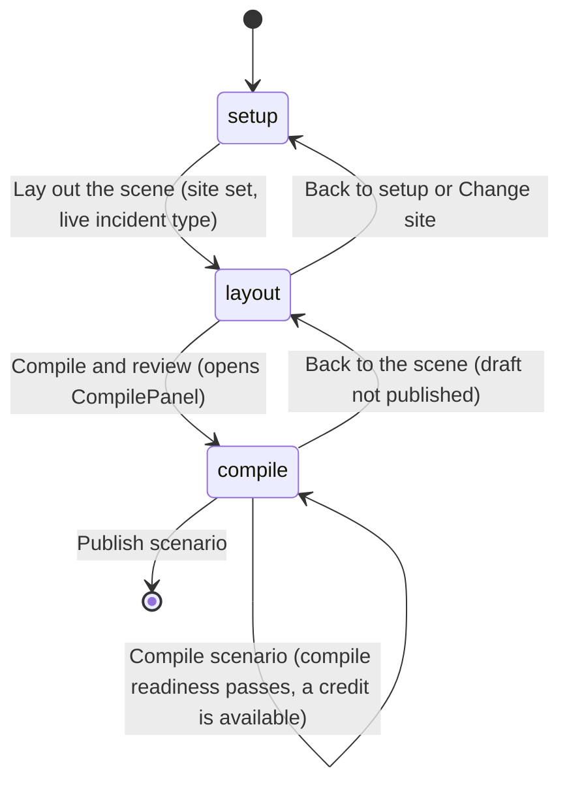
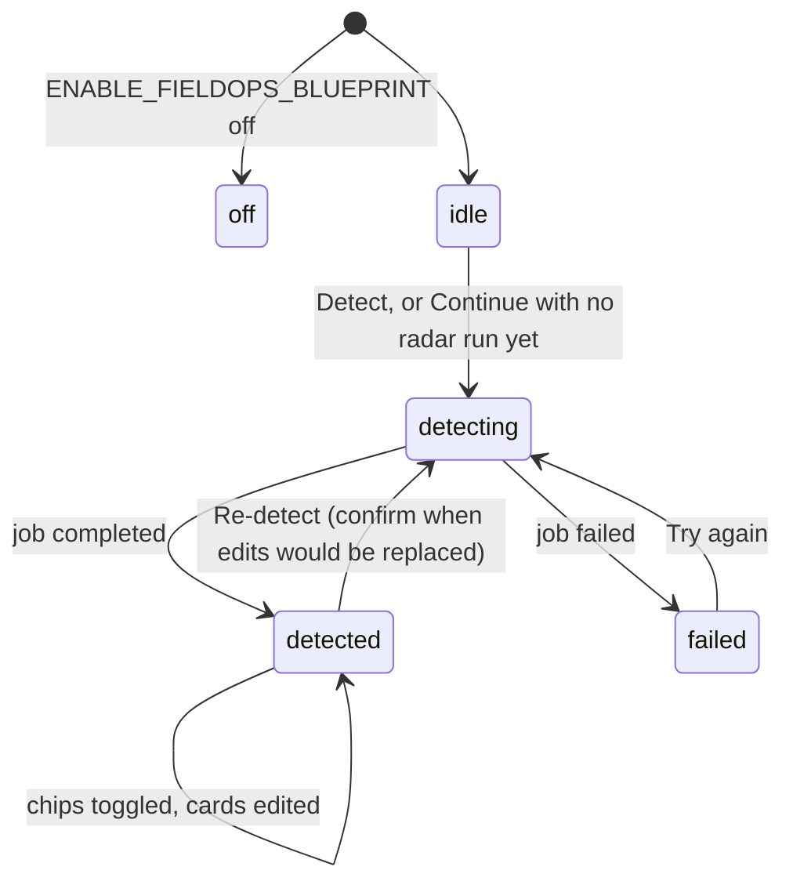
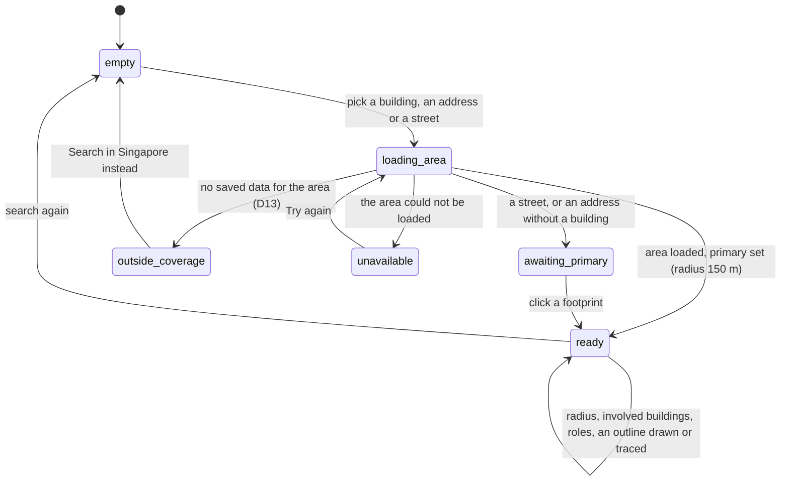

# Field operations War Room: UI spec sheet

**Status:** v1.1, 25 Oct 2026. Not built. Maps the approved mockup element by element. **Added 3 Nov 2026.** Brought up to date with the 3 Nov revisions of 02, 06 and 09 and with WS9's new spec (11), as additions only: every new or changed row, paragraph and list item starts with **Added 3 Nov 2026.**, and new sub-sections say "(added 3 Nov 2026)" after their title.
**Depends on:** the master plan and the nine workstream specs (01 to 09); every binding to a sibling contract names the owning spec. **Added 3 Nov 2026.** Also WS9's living world spec, `11-living-world.md`.
**Mockup:** `docs/design/warroom/field-ops-setup.html` (1,457 lines on disk on 25 Oct 2026; four states).
**Decisions:** D5, D14, D25 and D28. **Added 3 Nov 2026.** The additions rest on D29 to D35.
**Binding:** master plan 10.4 (canonical components) and 10.8 item 19 (stylesheets and icons).
**Baseline:** verified against commit a0fb07a (8 Nov 2026); see the README.

## 1. Purpose and how to use this sheet

**Purpose.** The approved mockup `docs/design/warroom/field-ops-setup.html` is a design study: four states behind a tab strip, hand-drawn SVG maps and a small script that fakes the interactions. This sheet maps it, element by element, to the production components, the data each one reads and writes, its states, its exact copy, its accessibility and its responsive behaviour. An engineer builds the screens in React from it; a reviewer checks the result against the mockup without guessing. It writes no code, migration or stylesheet of its own: every element belongs to the workstream spec named in its row.

**Audience.** The engineers of WS1 to WS8 who build these screens, and the reviewers who sign them off.

**How to read an element row** (sections 3 to 7):

| Column | Meaning |
| --- | --- |
| `#` | A stable id `S.NN`: the section, then the order in which the element is read. Rows marked "not in the mockup" are states or controls production needs that the study does not draw |
| Element | What it is |
| Mockup lines | Where it is, as `docs/design/warroom/field-ops-setup.html:START-END` on disk on 25 Oct 2026. In other tables of this sheet a bare `:NNN` is a line of the file cited in full earlier in the same table |
| Component | The canonical component of master 10.4 and its owning spec in brackets, or a name this sheet gave ("named by this sheet") with the spec that adopts it |
| Data binding | The contract field it shows or changes (master 10.2 and the owners' specs), relative to `setup_v2` on the draft unless it names another store; section 13 gives the routes |
| States | Every state the element can be in |
| Exact copy | The visible text and the accessible name, exactly; braces mark values from data. Section 9 gives each string a stable key |
| Notes | Differences from the mockup (with the reason under D28), accessibility points and anything still open |

**Tags.** **Verified** means read in the code or the mockup on the baseline, with a `path:line` citation. **Proposed** means a design choice this sheet makes, for the owning spec to adopt or overrule. **Assumed (Dn)** means a default that rests on an open decision in the master plan's log.

**The four states and who owns them.**

| State | Mockup lines | Production step | Owning specs |
| --- | --- | --- | --- |
| 1 Setup | `docs/design/warroom/field-ops-setup.html:428-932` | `stepRegistry.setup` in `FieldOpsWizard` | WS2 (page, hero, radar, incident, pressure and adversary lanes, readiness), WS1 (agency cards), WS3 (site lane), WS6 (devices and effects), WS7 (People or AI) |
| 2 No doctrine detected | `docs/design/warroom/field-ops-setup.html:934-1000` | `DoctrineDrawer` over Setup | WS1 |
| 3 Lay out the scene | `docs/design/warroom/field-ops-setup.html:1002-1181` | `stepRegistry.layout` | WS4, with WS6 (effects in the inspector) |
| 4 Review after compile | `docs/design/warroom/field-ops-setup.html:1184-1260` | `stepRegistry.compile`: `CompilePanel`, then `ReviewPage` and `PublishBar` | WS5, with WS0 (jobs and compile start) |
| After publish | not in the mockup | WS8's editor, pressure console and after-action panel; WS7's lobby, console, decision log and after-action label (section 7.1) | WS8, WS7 |
| **Added 3 Nov 2026.** The living world in a session | not in the mockup | WS9's map layers, status chip and units panel on the live map, the world console, the lobby card and the replay panel (section 7.1, rows 7.76 to 7.100) | WS9 |

The page frame (section 3) is WS2's. It renders under the suite's one navigation bar, `SuiteNav`, which carries the only brand mark (master 10.8 item 34), so the page draws none. The screens after publish are not in the mockup; section 7.1 gives each a row that points to its owner's copy, which is authoritative.

**Coverage.** The mockup holds 178 native interactive tags: 133 `button`, 19 `input`, 14 `select`, 4 `textarea` and 8 `a`. One of the 14 selects is a template inside the script, rendered once per involved building (`docs/design/warroom/field-ops-setup.html:1345`); none of the 8 anchors has an `href`. The set's checker counts 170, because it counts only anchors with an `href` and so none. There are also 36 non-native click targets: the drop zone, the add-role chip, three add cards, three add-tag chips, the scrim, 20 clickable footprints, three switch spans and four zoom spans. The full count is 214, and every one appears in exactly one row:

| State | `button` | `input` | `select` | `textarea` | `a` | Non-native | Rows that hold them |
| --- | --- | --- | --- | --- | --- | --- | --- |
| Frame strip | 4 | 0 | 0 | 0 | 0 | 0 | 3.02 to 3.05 |
| 1 Setup | 78 | 9 | 13 | 3 | 6 | 28 | the hero 4.04, 4.08, 4.09; the radar 4.25, 4.27 to 4.33, 4.46; the incident and devices 4.51 to 4.54, 4.60, 4.61, 4.64 to 4.66, 4.68, 4.69, 4.71, 4.72, 4.74, 4.75, 4.78, 4.79, 4.81, 4.82, 4.86, 4.88 to 4.91, 4.93, 4.95, 4.111, 4.112, 4.114; the site 4.120, 4.122 to 4.127, 4.131 to 4.133, 4.139, 4.142, 4.143, 4.150 to 4.152, 4.159, 4.162; the agencies 4.168, 4.170, 4.171, 4.177 to 4.179, 4.184, 4.186, 4.187, 4.191, 4.196, 4.197, 4.201 to 4.203, 4.206, 4.207, 4.211 to 4.213, 4.216, 4.217, 4.221 to 4.223, 4.226, 4.227, 4.231 to 4.233, 4.236, 4.237, 4.242, 4.243, 4.245, 4.247, 4.248, 4.250; pressure and adversaries 4.254 to 4.260, 4.266, 4.267, 4.272, 4.273, 4.278, 4.282 to 4.284, 4.289, 4.290, 4.294; readiness and the bar 4.300, 4.307, 4.308 |
| 2 Drawer | 18 | 10 | 1 | 1 | 0 | 5 | 5.01, 5.07, 5.15, 5.17, 5.18, 5.20, 5.21, 5.23 to 5.25, 5.27, 5.29 to 5.32, 5.34 to 5.36, 5.38 to 5.40, 5.42, 5.43, 5.46, 5.48, 5.49, 5.51 |
| 3 Lay out the scene | 18 | 0 | 0 | 0 | 0 | 3 | 6.09, 6.11 to 6.14, 6.16 to 6.21, 6.23, 6.24, 6.26, 6.30, 6.59, 6.70, 6.78 to 6.80 |
| 4 Review | 15 | 0 | 0 | 0 | 2 | 0 | 7.13, 7.15 to 7.23, 7.36, 7.42, 7.43, 7.45, 7.46, 7.50, 7.51 |
| Total | 133 | 19 | 14 | 4 | 8 | 36 | 214 elements |

A row can hold more than one element of the same kind when they form one visible unit: the two player-count inputs (4.178), a sequence step's two inputs and remove button (5.29 to 5.31), a storyline line and its edit button (7.15 to 7.22), the 18 ordinary footprints (4.150) and a map's two zoom buttons (4.159, 6.59). Every other row holds one element.

**Rows.** Sections 3 to 7 hold 569 element rows: 11 in section 3, 326 in section 4, 62 in section 5, 95 in section 6 and 75 in section 7. Of these, 494 map the mockup and 75 are marked "not in the mockup": production states and controls the study does not draw, and the screens after publish (section 7.1). Rows of the second kind hold no mockup element, so the counts above do not include them.

**Added 3 Nov 2026.** The 3 Nov additions add 50 rows, all marked "not in the mockup": 7 in section 4 (4.327 to 4.333, the agency's country, the doctrine's country and the two country warnings), 17 in section 5 (5.63 to 5.79, the drawer's three ways in, the library browser and the upload panel), 1 in section 6 (6.96, a hazard's contents) and 25 in section 7 (7.76 to 7.100, WS9's living world). Rows 4.43, 4.311, 7.30, 7.37, 7.38, 7.48, 7.64 and 7.66 gain marked additions. None of the new rows holds a mockup element, so the coverage table above is unchanged.

## 2. Design tokens and shared styles

### 2.1 Where the tokens come from

**Verified.** The mockup defines no global custom property of its own. It links `docs/design/warroom/shared.css` (`docs/design/warroom/field-ops-setup.html:8`) and sets three local properties inline: `--g` (the family colour of a lane, tile or card, 14 places, first at `docs/design/warroom/field-ops-setup.html:497`), `--i` (the reveal order, 26 places, first at `docs/design/warroom/field-ops-setup.html:439`) and `--c` (a legend swatch, 12 places, first at `docs/design/warroom/field-ops-setup.html:595`). Production already holds every token it uses: the colour tokens in `frontend/src/style.css:14-32` and the family colours, shadows and easing in `frontend/src/design/warroom.css:7-19`. No new token is needed; three are renamed in production.

| Token in the mockup | Value | Role | Mockup source | Production | Note |
| --- | --- | --- | --- | --- | --- |
| `--bg` | `#FAF8F4` | Page background, drawer body | `docs/design/warroom/shared.css:3` | `frontend/src/style.css:14` | Same value |
| `--surface` | `#FFFFFF` | Light card behind the lanes | `docs/design/warroom/shared.css:3` | `frontend/src/style.css:15` | Same |
| `--surface-2` | `#F4F1EA` | Tinted panels, hover rows, KPI tiles | `docs/design/warroom/shared.css:3` | `frontend/src/style.css:16` | Same |
| `--ink` | `#172033` | Body text | `docs/design/warroom/shared.css:3` | `frontend/src/style.css:17` | Same |
| `--muted` | `#6B7280` | Secondary text, labels | `docs/design/warroom/shared.css:3` | `frontend/src/style.css:18` | Fails 4.5:1 on `--surface-2` (section 10.6) |
| `--brand` | `#1E3A5F` | Buttons, links, selected segment | `docs/design/warroom/shared.css:4` | `frontend/src/style.css:19` | Same |
| `--brand-strong` | `#18304E` | Gradient end of primary buttons | `docs/design/warroom/shared.css:4` | `frontend/src/style.css:20` | Same |
| `--accent` | `#D97706` | Call to action, warning borders | `docs/design/warroom/shared.css:4` | `frontend/src/style.css:21` | White text on it fails 4.5:1 (section 10.6) |
| `--accent-strong` | `#B45309` | Unverified and "to do" text | `docs/design/warroom/shared.css:4` | `frontend/src/style.css:22` | Same |
| `--border` | `#E4DFD4` | Hairlines between rows and lanes | `docs/design/warroom/shared.css:5` | `frontend/src/style.css:23` | Same |
| `--border-strong` | `#D6CFC0` | Field and chip borders | `docs/design/warroom/shared.css:5` | `frontend/src/style.css:24` | Same |
| `--success` | `#15803D` | Verified, "ok" lines, done step | `docs/design/warroom/shared.css:5` | `frontend/src/style.css:25` | Same |
| `--danger` | `#B91C1C` | Remove, No doctrine detected | `docs/design/warroom/shared.css:5` | `frontend/src/style.css:27` | Same |
| `--deep` | `#0E1A2B` | Hero band, CTA bar, scrim tint | `docs/design/warroom/shared.css:6` | `--wr-deep` at `frontend/src/design/warroom.css:8` | Renamed in production |
| `--f-org` | `#1E3A5F` | Incident lane, agencies lane, selected tile | `docs/design/warroom/shared.css:8` | `frontend/src/design/warroom.css:9` | Same name |
| `--f-ai` | `#0F766E` | AI-operated card, switch on | `docs/design/warroom/shared.css:8` | `frontend/src/design/warroom.css:10` | Same name |
| `--f-pressure` | `#B45309` | Pressure lane | `docs/design/warroom/shared.css:8` | `frontend/src/design/warroom.css:11` | Same name |
| `--f-rival` | `#B91C1C` | Adversaries lane | `docs/design/warroom/shared.css:8` | `frontend/src/design/warroom.css:12` | Same name |
| `--f-intel` | `#4338CA` | Hint bar and the doctrine explainer | `docs/design/warroom/shared.css:8` | `frontend/src/design/warroom.css:13` | Same name |
| `--shadow-sm` | two-layer, 6 per cent | Cards, lane heads, panels | `docs/design/warroom/shared.css:9` | `--wr-shadow-sm` at `frontend/src/design/warroom.css:15` | `frontend/src/style.css:30` holds a different `--shadow-sm`; use the `--wr-` one |
| `--shadow-md` | soft drop | The light map card, card hover | `docs/design/warroom/shared.css:10` | `--wr-shadow-md` at `frontend/src/design/warroom.css:16` | `frontend/src/style.css:31` differs |
| `--shadow-lg` | deep drop | CTA bar, drawer, dropdown | `docs/design/warroom/shared.css:11` | `--wr-shadow-lg` at `frontend/src/design/warroom.css:17` | `frontend/src/style.css:32` differs |
| `--ease` | `cubic-bezier(.2,.7,.2,1)` | Lift, reveal, buttons | `docs/design/warroom/shared.css:12` | `--wr-ease` at `frontend/src/design/warroom.css:18` | Renamed |
| `--g` | per element | Family colour read by tiles, lane heads, counts | inline, `docs/design/warroom/field-ops-setup.html:497` | read by `.wr-tile` with a `--brand` fallback, `frontend/src/design/warroom.css:41-46` | Set from data (section 2.4) |
| `--i` | 0 to 10 | Reveal stagger | inline, `docs/design/warroom/field-ops-setup.html:439` | `.wr-reveal` uses 20 ms a step, `frontend/src/design/warroom.css:450-453`; the study uses 60 ms (`docs/design/warroom/shared.css:109`) | Section 2.6 keeps 60 ms on this page |
| `--c` | colour | Legend swatch | inline, `docs/design/warroom/field-ops-setup.html:595` | none | New `fo-` legend classes (section 2.7) |

`--warning` and `--f-crisis` exist in both files and are not used by this mockup.

### 2.2 Type scale

**Verified** from the mockup's style block. The family is Inter at 14 px with a 1.45 line height (`docs/design/warroom/shared.css:16`).

Counts, times, percentages and roster multipliers use the mono family (`docs/design/warroom/field-ops-setup.html:97`, `:201`, `:225`, `:298`). Production already loads both families (`frontend/src/style.css:1`).

| Size | Weight | Used by (mockup selector and line) | Production primitive |
| --- | --- | --- | --- |
| 28 px | 800, tracking -0.015em | Setup title `.hero h1` (`docs/design/warroom/field-ops-setup.html:25`) | `.wr-hero h1` is 30 px (`frontend/src/design/warroom.css:635-642`); section 2.6 |
| 26 px | 800 | Layout and Review titles `.rv-hero h1` (`docs/design/warroom/field-ops-setup.html:210`) | none; new |
| 20 px | 700, tabular | Review KPI numbers `.kpis b` (`docs/design/warroom/field-ops-setup.html:215`) | `.wr-kpis b` is 15 px (`frontend/src/design/warroom.css:1802-1807`) |
| 19 px | 800 | Drawer title `#drawer .dh h3` (`docs/design/warroom/field-ops-setup.html:181`) | none |
| 18 px | 700, tabular | CTA counts `.ctabar .s b` (`docs/design/warroom/field-ops-setup.html:151`) | `.wr-ctabar .s b` is 17 px (`frontend/src/design/warroom.css:1123-1129`) |
| 15 px | 800 | Lane titles `.lanehead h2` (`docs/design/warroom/field-ops-setup.html:65`) | `.wr-lanehead h2` (`frontend/src/design/warroom.css:1012-1020`) |
| 14 px | 800 | Inspector title `.insp h4` (`docs/design/warroom/field-ops-setup.html:350`) | none |
| 13.5 px | 400 to 800 | Hero lead and description, panel titles (`docs/design/warroom/field-ops-setup.html:26-27`, `:220`) | `.wr-hero .lead` (`frontend/src/design/warroom.css:643-648`) |
| 13 px | 400 | Compact fields `select.field, input.field` (`docs/design/warroom/field-ops-setup.html:103`) | `.wr-field` is 13.5 px (`frontend/src/design/warroom.css:219-231`) |
| 12.5 px | 600 to 700 | Card body, tiles, buttons, readiness rows (`docs/design/warroom/field-ops-setup.html:132`, `:156`) | `.wr-btn` (`frontend/src/design/warroom.css:108-127`) |
| 12 px | 600 | Help, lane intros, chips, step pills (`docs/design/warroom/field-ops-setup.html:17`, `:66`) | `.wr-help` (`frontend/src/design/warroom.css:278-282`) |
| 11.5 px | 600 to 700 | Small buttons, roster chips, doctrine pill, segments (`docs/design/warroom/field-ops-setup.html:96`, `:108`, `:113`) | `.wr-btn.sm` (`frontend/src/design/warroom.css:191-195`) |
| 11 px | 700 to 800, uppercase 0.08em | Field labels, lane counts, eyebrow (mono) (`docs/design/warroom/field-ops-setup.html:67`) | `.wr-lbl`, `.wr-eyebrow` (`frontend/src/design/warroom.css:210-218`, `:522-532`) |
| 10.5 px | 700 to 800, uppercase 0.1em | Radar group titles, group headings `h6`, versions (`docs/design/warroom/field-ops-setup.html:41`, `:261`) | `.wr-radar h5` (`frontend/src/design/warroom.css:800-808`) |
| 10 px | 800, uppercase 0.12em | Card kickers, KPI labels, tool headings (`docs/design/warroom/field-ops-setup.html:79`, `:216`, `:341`) | `.wr-node .kicker` (`frontend/src/design/warroom.css:1057-1067`) |
| 9.5 px | 800, uppercase 0.06em | Provenance and origin tags, tool counts (`docs/design/warroom/field-ops-setup.html:229`, `:267`, `:346`) | none |
| 9 px | 800, uppercase 0.08em | "illustrative" tag, "soon" marker, map labels (`docs/design/warroom/field-ops-setup.html:137`, `:279`, `:324`) | none |

### 2.3 Spacing, radii and shadows

**Verified** values from the mockup. Spacing: the page is centred at 1,380 px with 28 px side padding (`docs/design/warroom/field-ops-setup.html:13`, `:56`); the light card pads 22 px (`:57`); a lane is a 222 px head plus cards with an 18 px gap and 16 px vertical padding (`:58`); card grids gap 14 px (`:70`); a card pads 14 px (`:74`); field grids gap 10 px (`:101`); chip rows gap 6 px (`:42`). Radii: 999 px for pills, chips and the step pills; 22 px for the light card (`:57`); 18 px for the radar and the CTA bar (`:38`, `:150`); 16 px for cards, lane heads, tools, inspector and panels (`:61`, `:74`, `:340`, `:349`, `:218`); 14 px for the description box, map box, site bar and explainer (`:27`, `:308`, `:336`, `:186`); 12 px for tiles, effects panels and the hint bar (`:132`, `:138`, `:257`); 11 px for the document chip, fields, device tabs and building rows (`:31`, `:253`, `:300`); 9 to 10 px for segments, tool buttons and the doctrine pill (`:107`, `:343`, `:113`); 8 px for small buttons and roster chips (`:96`). Shadows: `--shadow-sm` on cards and lane heads, `--shadow-md` on the light card and on card hover, `--shadow-lg` on the CTA bar, the drawer and the place dropdown (`:57`, `:150`, `:176`, `:286`). Production maps them to `--wr-shadow-sm`, `--wr-shadow-md` and `--wr-shadow-lg` (section 2.1).

### 2.4 Colour roles for status chips and labels

| Role | Mockup selector (line) | Text | Border | Background | Production class (owner stylesheet) |
| --- | --- | --- | --- | --- | --- |
| Doctrine Verified | `.dp.ok` (`docs/design/warroom/field-ops-setup.html:116`) | `--success` | `--success` 30% in white | `--success` 7% in white | `fo-doctrine-pill verified` (02, `fieldops-agencies.css`) |
| Doctrine Unverified | `.dp.unv` (`:117`) | `--accent-strong` | `--accent` 40% | `--accent` 9% | `fo-doctrine-pill unverified` (02) |
| No doctrine detected | `.dp.none` (`:118`) | `--danger` | `--danger` 30% | `--danger` 6% | `fo-doctrine-pill none` (02) |
| Doctrine state in Review | `.pill.ok`, `.pill.warn` (`:1231-1236`) | as `.wr-pill.ok` and `.wr-pill.warn` | | | `.wr-pill.ok`, `.wr-pill.warn` (`frontend/src/design/warroom.css:342-351`) |
| Value origin: Yours | `.og.yours` (`:268`) | `#1E3A5F` | `#BFD0E6` | `#EEF4FB` | `fo-origin yours` (07, `fieldops-devices.css`) |
| Value origin: Library | `.og.lib` (`:269`) | `#475467` | `#D0D5DD` | `#F9FAFB` | `fo-origin library` (07) |
| Value origin: Assumed | `.og.ai` (`:270`) | `#B45309` | `#FDE68A` | `#FFFBEB` | `fo-origin assumed` (07); the mockup also uses this class for the effects-source text at `:610`, which production shows with `fo-effect-source` (07) |
| Provenance: Your document | `.src.fromdoc` (`:230`) | `#1E3A5F` | `#BFD0E6` | `#EEF4FB` | `fo-prov-tag document` (06, `fieldops-review.css`) |
| Provenance: Generated | `.src.gen` (`:231`) | `#667085` | `#D0D5DD` | `#F9FAFB` | `fo-prov-tag generated` (06) |
| Provenance: Doctrine | `.src.doctrine` (`:232`) | `#166534` | `#BBF7D0` | `#F0FDF4` | `fo-prov-tag doctrine` (06) |
| Provenance: Pressure | `.src.pressure` (`:233`) | `#B45309` | `#FDE68A` | `#FFFBEB` | `fo-prov-tag pressure` (06) |
| Provenance: Adversary | `.src.adv` (`:234`) | `#991B1B` | `#FECACA` | `#FEF2F2` | `fo-prov-tag adversary` (06) |
| Provenance: Yours (a trainer's edit) | not in the mockup; WS5's sixth tag (06, AC5.24) | `--f-intel` | `--f-intel` 35% | `--f-intel` 6% | `fo-prov-tag yours` (06, section 7.7, which takes this colour); 7.18:1 |
| Calculated, Placed | `.pill.ok` (`:584`, `:1152`) | as `.wr-pill.ok` | | | `.wr-pill.ok` |
| Illustrative figure | `.illus` (`:279`) | `--accent-strong` | dashed `--accent` 50% | none | `fo-illustrative` (07) |
| Unreviewed model (D22) | not in the mockup | as `.wr-pill.warn` | | | `fo-unreviewed` (07, sections 7.4 and 7.11), required while D22 holds |
| AI-drafted doctrine | not in the mockup (the drawer only promises the mark at `:963`) | `--f-ai` | `--f-ai` 35% | `--f-ai` 8% | `.wr-pill.fam` with `--g: var(--f-ai)` (`frontend/src/design/warroom.css:352-356`); **Proposed** |
| Radar chip on | `.rc.on` (`:46`) | white | amber 55% | amber 14% | `.wr-rc.on` (`frontend/src/design/warroom.css:834-840`) |
| Radar chip off | `.rc.off` (`:48`) | white at 40% opacity, struck through | | | `.wr-rc.off` (`frontend/src/design/warroom.css:841-844`) |
| Radar chip, will be generated | `.rc.gap` (`:50`) | white 75% | dashed | none | `fo-rc-gap` (03, `fieldops-setup.css`) |
| Radar chip, needs attention | `.rc.warnchip` (`:51`) | white | `rgba(252,165,165,.6)` | as `.on` | `fo-rc-warn` (03) |
| Readiness rows | `.ready li.ok`, `.todo`, `.info` (`:159`) | `#166534`; `#B45309` at 600; `#475467` | | | `fo-ready-row` with `is-ok`, `is-todo`, `is-info` (03, section 7.10) |
| Notices | `.share`, `.assume` (`:203`, `:280`) | `#7C4A03` | `#FDE68A` | `#FFFBEB` | `fo-notice`, scoped by each owner so the two copies cannot collide: `.fo-drawer .fo-notice` (02, section 7.9) and `.fo-devices .fo-notice` (07, section 7.11) |
| Hint and explainer | `.hintbar`, `.explain` (`:186`, `:257`) | `#344054`, title in `--f-intel` | `--f-intel` 22 to 25% | `--f-intel` 6% | `fo-hint` (07), `fo-explain` (02) |
| Lane accent | `--g` per lane (`:497`, `:617`, `:737`, `:841`, `:885`) | incident and agencies `--f-org`; site `#15803D`; pressure `--f-pressure`; adversaries `--f-rival` | | | set inline by `LaneHead` (section 3.6) |
| Agency tiles | `--g` per card (`:786`, `:795`, `:804`, `:813`, `:822`) | fire `#B45309`, medical `#B91C1C`, bomb disposal `#1E3A5F`, transport `#0F766E`, venue `#475467` | | | `ARCHETYPE_TONE` (section 12.3; adopted by WS1, 02 section 7.10) |

### 2.5 Map palette

The site map (state 1) and the scene canvas (state 3) are SVG drawings in the mockup. In production the site map is a Leaflet map on the existing tile proxy (D5) and the scene canvas is the Scene Editor's renderer; the values below become Leaflet path options and renderer constants.

| Layer | Mockup rule (line) | Stroke | Fill | Dash | Production today | Production target (owner) |
| --- | --- | --- | --- | --- | --- | --- |
| Search ring | `.ring` (`docs/design/warroom/field-ops-setup.html:333`) | `#22c55e`, 1.2 | `rgba(34,197,94,.08)` | 6 4 | **Verified** same colour, fill and dash, weight 1 (`frontend/src/components/SceneEditor/SceneEditor.tsx:1883-1893`) | `SiteMap` ring (04) |
| Centre dot | circle (`:720`) | `#22c55e`, 2 | `rgba(34,197,94,.65)` | none | **Verified** radius 8, fill opacity 0.6 (`frontend/src/components/SceneEditor/SceneEditor.tsx:1894-1903`) | `SiteMap` (04) |
| Streets | `.rd` over a casing and a white fill (`:319-321`) | `#1d4ed8`, 2.5, opacity 0.95 | none | none | **Verified** `#1d4ed8` at 0.95, weight by road type (`frontend/src/components/SceneEditor/SceneEditor.tsx:1908-1917`) | Blue centre lines only; the casing and white fill imitate tile roads and are dropped (04) |
| Street names | `.rl` (`:324`) | white halo 3 | `#1d4ed8`, 600 9 px | | Names come from the tiles | Tile labels; extra labels are WS3's choice (04) |
| Other footprints | `.b` (`:325`), hover `:326` | `#F59E0B`, 1.5 | `#EBDCC3`; hover `#F7D48F` | none | **Verified** `#f59e0b` weight 2, fill opacity 0.15 (`frontend/src/components/SceneEditor/SceneEditor.tsx:1921-1935`) | `SiteMap` footprint layer (04); on hover the fill rises to 0.35 and the weight to 3, so the outline reads against the tiles (04, section 7.3) |
| Involved buildings | `.b.inv` (`:327`) | `#D97706`, 2.2 | `#F8C766` | none | none | `SiteMap` (04), with the fill at 0.55 opacity so tile text stays readable (04, section 7.3) |
| Primary building | `.b.pri` (`:328`) | `#22D3EE`, 3 | `rgba(34,211,238,.28)` | none | none in the map phase | `SiteMap` (04); same cyan in `SceneCanvas` (05) |
| Ghost building outside the radius | `.b.ghostb.out` (`:330`) | `#9CA3AF`, 1.5 | none | 4 3 | none | `SiteMap` (04) |
| Out-of-radius footprints and streets | `.b.out`, `.road.out` (`:323`, `:329`) | hidden | | | | Not drawn (04) |
| Building labels | `.bl`, `.bl.cy` (`:331-332`) | white halo 3 | `#0E1A2B`; primary `#0E7490`, 700 9.5 px | | | Permanent labels on the primary and involved buildings, as Leaflet tooltips styled by `fo-sitemap-label` (04, section 7.9) |
| Map legend swatches | `.legend` (`:728`) | | primary `#22D3EE`; involved `#F8C766` on `#D97706`; other `#EBDCC3` on `#F59E0B`; streets `#1d4ed8` | | | `SiteMap` legend (04) |
| Primary building in the scene | polygon (`:1091`) | `#22D3EE`, 3 | `rgba(15,23,42,.10)` | none | renderer | `SceneCanvas` (05) |
| Interior walls | paths (`:1093-1095`) | `#334155`, 2.2, round caps | | | renderer | `SceneCanvas` (05) |
| Exits | rects (`:1100-1102`), labels E1 to E5 (`:1103`) | | `#16A34A` | | renderer | `SceneCanvas` (05) |
| Stairwells | rects (`:1106`), labels (`:1107`) | | `#3B82F6`, white labels | | renderer | `SceneCanvas` (05) |
| Wall points | circles (`:1110-1116`) | `#334155`, 1.2 | white, radius 3 | | **Verified** the renderer draws its own colours and an emoji glyph (`frontend/src/lib/rts/renderer.ts:1159-1174`) | Mockup style (05); section 12.2 |
| Footprint-level building | rect and label (`:1081-1082`); its wall points and exits (`:1083-1084`) | `#D97706`, 2 | `#F8C766` | | none | `SceneCanvas` (05), D9 |
| Crowd zones | ellipse and rect (`:1087-1088`) | `#A855F7`, 1.5 | `rgba(168,85,247,.16)` and `.12` | 5 4 | none | `SceneCanvas` (05), D10 |
| Calculated rings | group (`:1119-1126`) | fragments `#7C3AED` dashed 6 5; minor and glass `#EAB308` dashed 5 4; serious `#F97316`; lethal `#B91C1C` | none; `rgba(250,204,21,.16)`; `rgba(249,115,22,.22)`; `rgba(185,28,28,.42)` | | today a hand-set radius with fixed bands (journey, Design 4) | `SceneCanvas` rings from WS6's results (05, 07) |
| Effects bar and legend | `.bar` segments (`:594`, `:1156`), legend (`:595`, `:1157`) | | lethal `#B91C1C`; serious `#D97706`; minor and glass `#F1C27D`; fragments hatched `#C4B5FD` on `#E9E3FF`; track `#E6E0D2` (`:140`) | | none | `EffectsPanel` (07): the bar uses these tints, the rings use the stronger strokes above, one hue family per band |
| Hidden device marker | circle and glyph (`:1130`) | `#D97706`, 2 | white | 3 2 | none | `SceneCanvas` (05) with the `eye-off` glyph (section 12.2) |
| Hazard markers | circles (`:1134-1136`) | combustible `#f97316`, falling object `#eab308`, electrical `#3b82f6` | tints | | **Verified** the same colours in `HAZARD_DEFS` (`frontend/src/lib/rts/types.ts:619-626`) | Renderer icons (05) |
| Photo pins | circles with a camera glyph (`:1139-1144`) | white glyph | `#0E1A2B`, radius 9 | | none | `SceneCanvas` (05) |
| Map background, park, water | rect and paths (`:680-682`, `:1060`) | | `#F2EFE9`, `#CDEBB0`, `#AAD3DF` | | | Tile imagery through `/api/tiles` (D5); not drawn |

**Added 3 Nov 2026.** **The living world's layers (WS9).** They draw on the live map during a session, which the mockup does not show. Their values are drawing constants in WS9's `worldPalette.ts`, not tokens, and the cell ramps are those of the debug sandbox's `drawStudGrid` (`frontend/src/lib/rts/renderer.ts:209-305`), so a person who knows the debug page recognises them (11, sections 7.2 and 7.9). The panes, from the bottom: fog 390, cells 400, plumes 410, roads 420, crowd 430 and units 440, all above the tiles and below today's pins. Rows 7.77 to 7.83 bind them.

| Layer | Mockup rule (line) | Stroke | Fill | Dash | Production today | Production target (owner) |
| --- | --- | --- | --- | --- | --- | --- |
| **Added 3 Nov 2026.** Fog | not in the mockup | none | `rgba(14, 26, 43, 0.55)`, the `--wr-deep` ink, with the cover circles and seen cells cut out | none | none | `WorldFogLayer` (11); not drawn for the trainer |
| **Added 3 Nov 2026.** Cells: burning, heating, burnt out, wet | not in the mockup | none | burning `rgba(239, 68, 68, 0.7)` with an inner `rgba(251, 146, 60, 0.9)`; heating `rgba(251, 146, 60, 0.45)`; burnt out `rgba(75, 75, 75, 0.35)`; wet `rgba(59, 130, 246, 0.25)` | none | the debug page's ramps only | `WorldCellsLayer` (11) |
| **Added 3 Nov 2026.** Cells: smoke and gas | not in the mockup | none | smoke `rgba(55, 65, 81, a)`, with `a` from 0.10 to 0.64 by decile; gas `rgba(163, 230, 53, 0.08 + 0.035 × decile)` | none | the debug page's ramps only | `WorldCellsLayer` (11) |
| **Added 3 Nov 2026.** Cells: damaged, unsafe, collapsed | not in the mockup | none | damaged hatched `#D97706`; unsafe hatched `#B91C1C`; collapsed solid `#44403C` with a cross | none | the debug page's ramps only | `WorldCellsLayer` (11); last-known cells at half opacity |
| **Added 3 Nov 2026.** Plumes | not in the mockup | smoke `#6B7280`, toxic gas `#84CC16`, irritant `#EAB308` | the same hue at 0.12, 0.22 and 0.35 for light, moderate and dense | dashed when last-known | none | `WorldPlumesLayer` (11) |
| **Added 3 Nov 2026.** Road states | not in the mockup | closed `#B91C1C`, weight 4; cordoned `#2563EB`; jammed `#D97706`; slow `#EAB308` | none | closed 6 4; cordoned dashed | none | `WorldRoadsLayer` (11) |
| **Added 3 Nov 2026.** Crowd groups | not in the mockup | trapped `#B91C1C` ring; queued `#D97706` | WS4's crowd purple `#A855F7` | none | none | `WorldCrowdLayer` (11); the radius grows with the square root of the people, with an arrow to the target exit |
| **Added 3 Nov 2026.** Units | not in the mockup | own units ringed in white; the remaining path in the tone | a 22 px disc in the team's `ARCHETYPE_TONE` | the path dashed | none | `WorldUnitsLayer` (11); last-known units at half opacity |
| **Added 3 Nov 2026.** Device markers, trainer only | not in the mockup | `#D97706` | white | 3 2 | none | WS4's hidden-device marker, the "Hidden device marker" row of the first table, with `eye-off` (11, section 7.2) |

### 2.6 Production primitives the page reuses, and the deltas it overrides

**Proposed.** The page reuses the `wr-` primitives and, under D28, overrides only the measured differences, scoped under a page root class `fo-page` (named by this sheet; WS2 adopts it in `fieldops-setup.css`, 03 section 7.10) so the corporate wizard does not change.

| Mockup rule (line) | Production primitive (line) | Field-ops override in `fieldops-setup.css` |
| --- | --- | --- |
| `.hero` padding 20 28 46 (`docs/design/warroom/field-ops-setup.html:11`) | `.wr-hero` 18 28 40 (`frontend/src/design/warroom.css:604-606`) | `.fo-page .wr-hero` padding 20 px 28 px 46 px |
| `.hero h1` 28 px, margin 0 0 6, line height 1.1 (`:25`) | 30 px, margin 8 0 8 (`frontend/src/design/warroom.css:635-642`) | `.fo-page .wr-hero h1` as the mockup |
| `.hero .grid` gap 22 (`:23`) | gap 24 (`frontend/src/design/warroom.css:627-634`) | gap 22 px |
| `.hero textarea` min height 196, padding 14, radius 14, line height 1.6 (`:27`) | `.wr-field.onDark` (`frontend/src/design/warroom.css:265-277`) | `fo-brief-field` adds the four values |
| `.radar` padding 16 18 (`:38`); `.rc` padding 4 10 4 7 (`:43`) | `.wr-radar` 14 16 (`frontend/src/design/warroom.css:782-787`); `.wr-rc` 5 10 5 7 (`:785-800`) | as the mockup |
| `.wrap` margin bottom 60 (`:56`) | 56 (`frontend/src/design/warroom.css:946-952`) | 60 px |
| `.lanehead .vignette` 92 px (`:62`) | 96 px (`frontend/src/design/warroom.css:995-998`) | 92 px; 64 px at 1,100 px and below, as both |
| `.node .kicker` padding right 70 (`:79`) | none (`frontend/src/design/warroom.css:1057-1067`) | 70 px when the card has Edit and Remove |
| `div.add` min height 150 (`:126`) | `.wr-add` 140 (`frontend/src/design/warroom.css:1068-1101`) | 150 px |
| `.ctabar` gap 18, padding 14 18, `.s` 11 px, `.s b` 18 px (`:150-151`) | gap 14, padding 12 16, 10.5 px, 17 px (`frontend/src/design/warroom.css:1104-1129`) | as the mockup |
| `select.field, input.field` 38 px high, padding 8 10, 13 px (`:103`) | `.wr-field` (`frontend/src/design/warroom.css:219-231`) | `fo-field-compact` |
| `.reveal` 60 ms a step (`docs/design/warroom/shared.css:109`) | 20 ms (`frontend/src/design/warroom.css:450-453`) | `.fo-page .wr-reveal` 60 ms; off under reduced motion |
| `.btn.dashed` (`docs/design/warroom/shared.css:57`) | none in `frontend/src/design/warroom.css` | `fo-btn-dashed` |
| `.sw` switch (`docs/design/warroom/shared.css:100-103`) | none in `frontend/src/design/warroom.css` | `fo-switch`, a styled button element with the switch role (section 10.2); its off track has a `#8F8878` border for contrast (03, section 7.10) |

### 2.7 Class map: every mockup class and the stylesheet that owns it

This sheet creates no stylesheet. Each new class below is created by the spec that owns the component, in its `frontend/src/design/fieldops-<area>.css (new)` file, with the `fo-` prefix (master 7 and 10.8 item 19): 02 `frontend/src/design/fieldops-agencies.css (new)`, 03 `frontend/src/design/fieldops-setup.css (new)`, 04 `frontend/src/design/fieldops-site.css (new)`, 05 `frontend/src/design/fieldops-layout.css (new)`, 06 `frontend/src/design/fieldops-review.css (new)`, 07 `frontend/src/design/fieldops-devices.css (new)`, 08 `frontend/src/design/fieldops-lobby.css (new)` and 09 `frontend/src/design/fieldops-editor.css (new)`. A class used by more than one lane of the page lives in WS2's `fieldops-setup.css`, because `FieldOpsWizard` imports it once and every step renders inside that page. Where an owner's stylesheet names a class differently from this sheet's first reading, the owner's name is used. No element of this mockup maps to WS7's `fieldops-lobby.css` or WS8's `fieldops-editor.css`, because the screens after publish are not drawn; their classes, and the classes other owners add for elements the mockup does not draw, are in the second table. **Added 3 Nov 2026.** WS9 adds a ninth stylesheet, 11 `frontend/src/design/fieldops-world.css (new)`, for the living world's surfaces, which the mockup does not draw either (11, section 7.9); its classes are in the second table.

| Mockup selectors (lines) | Role | Production class | Owner |
| --- | --- | --- | --- |
| `.hero`, `.hero .top`, `.hero .grid` (`docs/design/warroom/field-ops-setup.html:11-23`) | Hero band and its two columns | `.wr-artband.wr-hero`, `.wr-hero-top`, `.wr-hero-grid` (`frontend/src/design/warroom.css:506-550`, `:575-605`) | exists; overrides in 2.6 (03) |
| `.brandmark`, `.sub` (`:14-15`) | Product mark and mode | none: the page draws no brand mark, and `.wr-brandmark` (`frontend/src/design/warroom.css:615-626`) is not used; the mode name moves to the hero's eyebrow (row 3.07; master 10.8 item 34) | dropped |
| `.steps span`, `.on`, `.done` (`:16-21`) | Step pills | `.wr-steps` (`frontend/src/design/warroom.css:696-741`) | exists |
| `.credits` (`:22`) | Credits chip | `.wr-credits` (`frontend/src/design/warroom.css:649-663`) | exists |
| `.hero .eyebrow`, `h1`, `.lead` (`:24-26`) | Hero copy | `.wr-eyebrow`, `.wr-hero h1`, `.wr-hero .lead` | exists |
| `.hero textarea` (`:27-28`) | Description box | `.wr-field.onDark` plus `fo-brief-field` | 03 |
| `.hero .meta` (`:29`) | Character and word counters | `fo-brief-meta` | 03 |
| `.hero .attach`, `.doc`, `.drop` (`:30-36`) | Document chip and drop zone | `fo-attach`, `fo-doc-chip`, `fo-drop` with `is-over` and `is-busy` | 03 |
| `.radar`, `h3`, `.tot`, `h5`, `.foot` (`:38-41`, `:52-54`) | Radar panel | `.wr-radar.wr-glass` (`frontend/src/design/warroom.css:782-861`) plus `fo-radar-total` | exists; 03 |
| `.rchips`, `.rc`, `.on`, `.off`, `.act`, `.cc` (`:42-49`) | Radar chips | `.wr-rchips`, `.wr-rc` (`frontend/src/design/warroom.css:809-847`); `.wr-cc.dark` (`:102-105`) | exists |
| `.rc.gap`, `.rc.warnchip` (`:50-51`) | Generated and warning chips | `fo-rc-gap`, `fo-rc-warn` | 03 |
| `.wrap`, `.map` (`:56-57`) | Light card under the hero | `.wr-wrap`, `.wr-map` (`frontend/src/design/warroom.css:946-959`) | exists |
| `.lane`, `.lanehead`, `.vignette`, `h2`, `p`, `.cnt`, `.inner > .btn` (`:58-68`) | Lane and lane head | `.wr-lane`, `.wr-lanehead`, `.wr-vignette` (`frontend/src/design/warroom.css:568-602`, `:947-1005`) | exists |
| `.lanehead .chk` (`:69`) | Checkbox row in a lane head | `fo-lane-check` | 03 |
| `.cards`, `.cards.three`, `.cards.incident` (`:70-71`, `:246`) | Card grids | `.wr-cards` (`frontend/src/design/warroom.css:1035-1039`); `fo-cards-single` | exists; 03 |
| `.toolbar` (`:72`) | Pressure-kind buttons | `fo-kind-toolbar` (`.wr-toolbar` at `frontend/src/design/warroom.css:2002` is the library toolbar, not this) | 03 |
| `.node`, `.node.ai`, `.node .kicker` (`:74-80`) | Card frame | `.wr-node`, `.wr-node.ai`, `.wr-node .kicker` (`frontend/src/design/warroom.css:1040-1067`) | exists |
| `.node.hq` (`:75`) | The open agency card | `fo-agency-open`, the look of `.wr-node.hq` (`frontend/src/design/warroom.css:1048-1053`); a compact card is `fo-agency-compact` (02, section 7.9) | 02 |
| `.node.warn` (`:77`) | Card that needs a doctrine | `.wr-node.wr-warn` (`frontend/src/design/warroom.css:300-302`) plus `fo-agency-warn` for the border | 02 |
| `.node .id`, `.mono`, `.tile`, `.nm`, `.mt`, `.soft`, `.acts`, `.foot`, `.opnote` (`:81-89`) | Card identity, actions and footer | `.wr-tile`, `.wr-mono` (`frontend/src/design/warroom.css:35-82`) plus `fo-card-id`, `fo-card-meta`, `fo-card-actions`, `fo-card-foot`; on agency cards the name and agency label inputs are `fo-agency-name-input` and the archetype line `fo-match-line` (02, section 7.9) | 03 (shared by every lane); 02 for the two agency classes |
| `.node .wants`, `.reg` (`:90-92`) | Pressure and adversary lines | `fo-card-line`, `fo-card-tag` | 03 |
| `.split`, `.fgrid`, `.row`, `.btnrow`, `.help` (`:93-105`, `:124`) | Layout helpers | `fo-split`, `fo-fgrid`, `fo-row`, `fo-btnrow`; `.wr-help` (`frontend/src/design/warroom.css:278-282`) | 03 |
| `.roster`, `.role`, `.role b`, `.role.add`, `.role.lead` (`:95-99`) | Roster chips | `fo-roster`, `fo-role` with `lead` and `add`, and the inline seat editor `fo-roster-editor` (02, section 7.9; `.wr-tm` at `frontend/src/design/warroom.css:387-438` is the corporate team chip and is not reused) | 02 |
| `.seg`, `.seg button.on`, `.node.ai .seg button.on` (`:107-111`) | People or AI segment | `.wr-seg.sm` (`frontend/src/design/warroom.css:2034-2080`) plus `fo-operation` | 08 |
| `.dp`, `.ver`, `.dp a`, `.ok`, `.unv`, `.none` (`:113-118`) | Doctrine pill | `fo-doctrine-pill` with `verified`, `unverified`, `retired` and `none`, and `fo-ver` for the version (02, section 7.9) | 02 |
| `.dpnote`, `.glance` (`:119-121`) | Doctrine note and the at-a-glance list | `fo-doctrine-note`, `fo-doctrine-glance` | 02 |
| `.node.saved .dp-missing`, `.node:not(.saved) .dp-saved`, `.node.gone` (`:78`, `:122-123`) | Script state switches | none: React renders one state | dropped |
| `div.add` (`:126-128`) | Dashed add card | `.wr-add` (`frontend/src/design/warroom.css:1068-1101`) rendered as a button element | exists |
| `.opts`, `.opts.four`, `.opt`, `.opt.sel` (`:131-134`, `:248`) | Incident type tiles | `fo-type-tiles`, `fo-type-tile` with `is-selected` (`.wr-inc` rows at `frontend/src/design/warroom.css:1494-1556` are the old step's rows) | 03 |
| `.soon` chips (`:135-137`) | Types we have not built | `fo-soon` | 03 |
| `.incsplit`, `.src-note`, `.optnote` (`:247`, `:249-250`) | Incident layout and inline source notes | `fo-incident-split`, `fo-src-note`, `fo-optional-note` | 03 |
| `.okline` (`:147`) | Green confirmation line | `fo-okline`; the site lane's found line is `fo-site-okline` (04, section 7.9) | 03; 04 |
| `.minimap` (`:145-146`) | Unused rule | none | dropped |
| `.ctabar`, `.s`, `.grow`, `.btn.ghost` (`:150-153`) | Action bar | `.wr-ctabar` (`frontend/src/design/warroom.css:1104-1157`), overrides in 2.6 | exists; 03 |
| `.ready`, `h4`, `li.ok`, `.todo`, `.info`, `li .btn` (`:154-162`) | Before you move on | `fo-ready`, `fo-ready-row` with `is-ok`, `is-todo` and `is-info` | 03 |
| `.note`, `.statetabs`, `.statetab`, `body[data-state]` rules (`:166-172`, `:353-358`) | Mockup state switcher | none | dropped (section 14) |
| `#scrim`, `#drawer`, `.dh`, `.db`, `.df`, `.close` (`:175-185`) | Drawer frame | `fo-drawer-scrim`, `fo-drawer`, `fo-drawer-head`, `fo-drawer-body`, `fo-drawer-foot`; the drawer is full width below 640 px (02, section 7.9) | 02 |
| `.explain`, `.dsec`, `.stp`, `.tags`, `.tag`, `.tag.no`, `.tag.addt`, `.closest`, `.share`, `.toggle` (`:186-205`) | Drawer content | `fo-explain`, `fo-drawer-section`, `fo-step-row`, `fo-good-row`, `fo-tags`, `fo-tag`, `fo-tag never`, `fo-tag-add`, `fo-closest`, `fo-switch-row`; the sharing notice is `.fo-drawer .fo-notice`, scoped because WS6 also styles a `fo-notice` (02, section 7.9). The switch and the dashed buttons are WS2's `fo-switch` and `fo-btn-dashed` | 02; 03 for the switch and dashed buttons |
| `.rv-hero`, `.chips`, `.pill` on dark (`:208-212`) | Compact hero for steps 2 and 3 | `fo-step-hero` with `.wr-pill` on dark | 03 |
| `.kpis` (`:213-216`) | Review counts | `fo-review-kpis` (`.wr-kpis` at `frontend/src/design/warroom.css:1791-1823` is four columns at poster scale) | 06 |
| `.rvgrid`, `.panel`, `.sub` (`:217-222`) | Review layout and panels | `fo-review-grid`, `fo-panel`, with `fo-sub` and `fo-spacer` scoped inside it (06, section 7.7) | 06 |
| `.tl .r`, `.t`, `.d`, `.src` (`:223-234`) | Storyline rows and provenance tags | `fo-story-row`, `fo-story-time`, `fo-story-detail`, `fo-prov-tag` | 06 |
| `.prov` (`:235-236`) | Provenance bar | `fo-prov-bar`, `fo-prov-legend` | 06 |
| `.tbl` (`:237-240`) | Doctrines table | `fo-review-table` (`.wr-table` at `frontend/src/design/warroom.css:2261` is the library list) | 06 |
| `.dir`, `.qt` (`:241-243`) | Notes we could not place | `fo-unplaced` | 06 |
| `.devnode .kicker`, `.devtabs`, `.dtab`, `.dtab.on`, `.dtab.add` (`:251-256`) | Device tabs | `fo-device-tabs`, `fo-device-tab` with `on` and `add`, inside the card's root `fo-devices` (07, section 7.11) | 07 |
| `.hintbar`, `.devsplit`, `.grp`, `h6`, `.chrow`, `.chrow.empty`, `.qty` (`:257-266`) | Device form | `fo-hint`, `fo-device-split`, `fo-device-group`, `fo-device-row` with `empty`, `fo-qty` | 07 |
| `.og` (`:267-270`) | Value origin tags | `fo-origin` | 07 |
| `.calc`, `.fx`, `.fx .hd`, `.bar`, `.lg`, `.ptbl`, `.casu`, `.illus`, `.assume` (`:138-144`, `:271-281`) | Effects panel and the assumption box | `fo-calc`, `fo-effects`, `fo-effect-source`, `fo-band-bar`, `fo-band-legend`, `fo-effects-table`, `fo-casualties`, `fo-illustrative`; the assumption box is `.fo-devices .fo-notice`, scoped so it cannot collide with WS1's drawer notice (07, section 7.11) | 07 |
| `.hide` (`:272`) | Hidden device panel | none: React renders the selected tab only | dropped |
| `.site`, `.site .ctl` (`:284-285`) | Site lane grid | `fo-site`, `fo-site-controls` | 04 |
| `.acwrap`, `.ac`, `.ac button`, `.ty`, `.ac .note` (`:286-295`) | Place dropdown | `fo-place-search`, `fo-place-list`, `fo-place-option` with `is-active` (the keyboard row) and `is-current` (the pick), `fo-place-type`, `fo-place-note` (04, section 7.9) | 04 |
| `.rad`, `.val` (`:296-298`) | Radius control | `fo-radius` | 04 |
| `.blist`, `.bld`, `.bld.primary`, `.sq`, `.bld select` (`:299-307`) | Buildings involved | `fo-buildings`, `fo-building`, `fo-building primary` | 04 |
| `.mapbox`, `.hud`, `.legend`, `.nudge` (`:308-318`) | Map box overlays | `fo-sitemap`, `fo-sitemap-hud`, `fo-sitemap-legend`, `fo-radius-nudge` | 04 |
| `.zoom`, `.attr` (`:310-314`) | Imitation zoom and attribution | Leaflet's own controls | dropped |
| `svg .rcase` to `svg .ring` (`:319-333`) | SVG map layers | Leaflet path options (section 2.5); the building labels `.bl` and `.bl.cy` become Leaflet tooltips styled by `fo-sitemap-label` and `fo-sitemap-label primary` (04, section 7.9) | 04 |
| `.sitebar` (`:336-338`) | Site loaded from setup | `fo-sitebar`, with `fo-ok` for the tick line (05, section 7.14) | 05 |
| `.lay-grid`, `.tools`, `.tbtn`, `.tbtn.on`, `.em`, `.st` (`:339-346`) | Layout grid and tool buttons | `fo-lay-grid`, `fo-tools` (its `h6` group headings), `fo-tbtn`, `fo-tbtn on`, `fo-st` for the count, WS4's names in place of this sheet's first `fo-layout-grid`, `fo-tool` and `fo-tool-count` (05, section 7.14) | 05 |
| `.canvas` (`:347-348`) | Scene canvas frame | `fo-canvas` | 05 |
| `.insp`, `.sec` (`:349-351`) | Inspector | `fo-insp`, `fo-sec`, WS4's names in place of this sheet's first `fo-inspector` and `fo-inspector-section` (05, section 7.14) | 05 |

**Classes for elements the mockup does not draw.** Each owner defines these in its own stylesheet; they are listed here so that one place names every `fo-` class of the set.

| Owner | Stylesheet | Classes | Source |
| --- | --- | --- | --- |
| WS1 | `frontend/src/design/fieldops-agencies.css (new)` | `fo-agency-compact`, `fo-agency-name-input`, `fo-match-line`, `fo-roster-editor`, `fo-doctrine-pill retired`, `fo-good-row`, `.fo-drawer .fo-notice`; for the admin approval screen `fo-admin-queue`, `fo-admin-panel` and `fo-diff`. **Added 3 Nov 2026.** The card's country field `fo-agency-country` and alias hint `fo-country-hint` (rows 4.327 and 4.328); the drawer's ways in `fo-ways`, on `.wr-seg` (row 5.64); the library browser's `fo-library-filters`, `fo-library-list` and `fo-library-row` (rows 5.65 to 5.68); the upload panel's `fo-upload`, `fo-upload-drop`, `fo-upload-notice` (the colours of the drawer's notice), `fo-upload-chip` and `fo-drafted-banner` (rows 5.69 to 5.74); WS1 named its chip `fo-upload-chip` so that `fo-doc-chip` stays WS2's alone (02, section 7.9). The compact card's country badge is the existing `.wr-cc.light` (`frontend/src/design/warroom.css:97-101`), as the mockup's pressure cards show a country (row 4.330) | 02, section 7.9 |
| WS2 | `frontend/src/design/fieldops-setup.css (new)` | `fo-hero-single`, `fo-privacy`, `fo-trunc`, `fo-rc-named`, `fo-named-type`, `fo-options`, `fo-banner` with `is-conflict`, `fo-chooser`, `fo-standin` | 03, section 7.10 |
| WS3 | `frontend/src/design/fieldops-site.css (new)` | `fo-site-okline`, `fo-site-outline-btn`, `fo-sitemap-label` with `primary`, `fo-site-modebar` (the draw and trace strip), `fo-site-state` (the outside-coverage and unavailable panel) | 04, section 7.9 |
| WS4 | `frontend/src/design/fieldops-layout.css (new)` | `fo-ctabar`, `fo-save` with `is-error` and `is-conflict`, `fo-banner`, `fo-dialog`, `fo-list`, `fo-photo-grid`, `fo-help` | 05, section 7.14 |
| WS5 | `frontend/src/design/fieldops-review.css (new)` | `fo-compile-stages`, `fo-compile-stage` with `done`, `running` and `failed`, `fo-compile-bar`, `fo-publish-list` | 06, section 7.7 |
| WS6 | `frontend/src/design/fieldops-devices.css (new)` | `fo-devices` (the card's root), `fo-unreviewed`, `fo-device-remove`, `fo-field-error`, `.fo-devices .fo-notice` | 07, section 7.11 |
| WS7 | `frontend/src/design/fieldops-lobby.css (new)` | `fo-operation-row`, `fo-operation-label`, `fo-operation-note`; the lobby's `fo-lobby-head`, `fo-lobby-controls`, `fo-lobby-grid`, `fo-seatcard` with `is-ai`, `fo-seat`, `fo-seat-state` with `ai`, `person` and `unavailable`, `fo-seat-issues`; the console's `fo-aic-row`, `fo-aic-status` with `running`, `paused`, `waiting` and `failed`, `fo-aic-actions`, `fo-aic-log`; the after-action label `fo-ai-chip` | 08, section 7.8 |
| WS8 | `frontend/src/design/fieldops-editor.css (new)` | The editor's `fo-ed-frame`, `fo-ed-sec`, `fo-ed-sec-head`, `fo-ed-help`, `fo-ed-revline`, `fo-ed-field`, `fo-ed-field-row`, `fo-ed-save` with `is-saving`, `is-saved` and `is-failed`, `fo-ed-notice` with `is-info` and `is-warn`, `fo-ed-tag` with `is-doc`, `is-doctrine`, `is-pressure`, `is-adversary`, `is-generated`, `is-yours` and `is-pursuit`, `fo-ed-row` with `is-linked`, `fo-ed-ladder`, `fo-ed-ladder-step` with `is-public`, `fo-ed-dialog`, `fo-ed-dialog-foot`, `fo-ed-diff`, `fo-ed-diff-entry` with `is-added`, `is-removed` and `is-changed`, `fo-ed-del`, `fo-ed-ins`, `fo-ed-hist`, `fo-ed-hist-row` and `fo-ed-toast`; the pressure screens' `fo-pr-console`, `fo-pr-body`, `fo-pr-status` with `is-waiting`, `is-active`, `is-answered`, `is-stood-down`, `is-finished` and `is-paused`, `fo-pr-aar` and `fo-pr-chip` | 09, section 7.7 |
| **Added 3 Nov 2026.** WS9 | `frontend/src/design/fieldops-world.css (new)` | `fo-world-chip`, `fo-world-units`, `fo-world-unit-row`, `fo-world-dispatch`, `fo-world-console`, `fo-world-lobby`, `fo-world-replay`, `fo-world-legend` and `fo-world-unreviewed` (rows 7.76 to 7.100), on the existing tokens with no new colour token. The world's map colours are drawing constants in WS9's `worldPalette.ts`, as the map palette of section 2.5 is, not tokens | 11, section 7.9 |

Every `fo-` class must also be listed in its owner's file map; a class this table assigns to a spec that does not create it is a cross-spec request (section 14.3). Two such points were raised and are answered: WS2's list now has `fo-cards-single` and `fo-field-compact` (03, section 7.10), and WS4's layout banner is `fo-lay-banner`, so `fo-banner` is WS2's alone on the page (05, section 7.14; section 14.3, item 13).

**Added 3 Nov 2026.** One point raised on 3 Nov is answered: WS1's upload panel first named its chip `fo-doc-chip`, the class of WS2's document chip in `fieldops-setup.css` (03, section 7.10), on the same page, because the drawer opens over Setup. WS1 renamed its chip `fo-upload-chip` (02, sections 7.5.3 and 7.9), so `fo-doc-chip` stays WS2's alone (section 14.3, item 20).

## 3. Page frame and navigation

### 3.1 The page and its route

- **Proposed (D25).** The new page is `FieldOpsWizard` in `frontend/src/pages/FieldOpsWizard.tsx (new)` (03), mounted at `/warroom/field-ops` by a new `Route` in `frontend/src/main.tsx`. WS2 places it inside the suite layout route, after the corporate wizard's route, with its role check nested as `/clients` nests one (03, section 7.1). **Verified:** every suite page renders inside that route, whose `ProtectedRoute` wraps `SuiteLayout` (`frontend/src/main.tsx:104-110`); `SuiteLayout` renders `SuiteNav` once above the page (`frontend/src/components/SuiteLayout.tsx:4-11`); `/warroom` and `/warroom/social-crisis`, which render `WarRoom` and `SocialCrisisWizard`, sit inside it (`frontend/src/main.tsx:138-139`), and `/clients` nests a second `ProtectedRoute` with `roles={['trainer', 'admin']}` (`frontend/src/main.tsx:113-120`). So the page renders under the one suite navigation bar and draws no brand mark of its own (master 10.8 item 34). The legacy field-ops steps and the corporate wizard stay untouched.
- **Flag.** The route exists only when `VITE_ENABLE_FIELDOPS_V2` is on, read the way the corporate page reads its client flag (**Verified** `frontend/src/pages/SocialCrisisWizard.tsx:237`); WS2 reads it once, through `isFieldOpsV2Enabled` in `frontend/src/components/FieldOps/entry.ts (new)` (03, section 7.1).
- **Flag off.** **Proposed:** `/warroom/field-ops` redirects to `/warroom`. The router has no catch-all route and only `/` redirects (`frontend/src/main.tsx:213`), so without the redirect a bookmarked link would render an empty page.
- **Entry.** Today the War Room sends the corporate path to `/warroom/social-crisis` and keeps field ops on its own steps (**Verified** `frontend/src/pages/WarRoom.tsx:548-559`). With the flag on, the field-operations path navigates to `/warroom/field-ops` instead, and `?legacy=1` keeps the old wizard; WS2 makes five small edits there, all keyed on the flag (03, section 7.1).
- **Resume.** `?draft=<id>` resumes a draft, as both existing pages do (**Verified** `frontend/src/pages/WarRoom.tsx:251-263`, `frontend/src/pages/SocialCrisisWizard.tsx:938-953`). **Proposed:** `&step=setup`, `&step=layout` or `&step=compile` selects the step, and each step change pushes a history entry so the browser's back button moves between steps.
- **Gates.** The page keeps the War Room's two gates, trainers only and the zero-credit screen (**Verified** `frontend/src/pages/WarRoom.tsx:482-497` and `frontend/src/pages/WarRoom.tsx:499-522`). Trainers only: the nested `ProtectedRoute` sends any other role to `/dashboard` (`frontend/src/main.tsx:52-91`), and every field-ops trainer route answers a wrong role with 403 `{ error: 'Only trainers can use the War Room', code: 'FORBIDDEN' }` from WS0's `requireFieldopsTrainer` (master 10.8 item 31), the legacy routes' text (`server/routes/warroom.ts:198-199`). The zero-credit screen is WS2's "No credits" page state, the legacy wall restyled (03, section 7.2).

| URL | Renders | Notes |
| --- | --- | --- |
| `/warroom/field-ops` | A new draft at Setup | The draft row is created on the first save (WS2) |
| `/warroom/field-ops?draft=<id>` | The draft at its stored step | A draft made by the legacy wizard is refused with 409 `LEGACY_DRAFT` and sent to `/warroom?draft=<id>&legacy=1`, a corporate draft to its own page (03, section 7.2; master 10.8 item 6 hides new drafts from the legacy list) |
| `/warroom/field-ops?draft=<id>&step=layout` | Lay out the scene | Falls back to Setup when the site is not set |
| `/warroom/field-ops?draft=<id>&step=compile` | `CompileReviewStep`: `CompilePanel` while not compiled, `ReviewPage` after | Master 10.4 |

### 3.2 Header and frame elements

The header repeats in each state: Setup (`docs/design/warroom/field-ops-setup.html:431-437`), Lay out the scene (`docs/design/warroom/field-ops-setup.html:1004-1010`) and Review (`docs/design/warroom/field-ops-setup.html:1186-1192`). Layout: a flex row, `max-width` 1,380 px, centred, `space-between` with a 16 px gap (`docs/design/warroom/field-ops-setup.html:13`): in the mockup the brandmark on the left, the step pills in the middle and the credits on the right. Production draws no brandmark (row 3.07): the top row is the step pills on the left, then the draft status and the credits on the right (03, section 7.2), as the corporate wizard's header now holds only its steps and its draft status (**Verified** `frontend/src/pages/SocialCrisisWizard.tsx:4206-4226`). At 1,100 px and below it keeps one row in the mockup; production wraps the credits under the pills at 768 px (section 11). Rows `3.NN` use the same columns as sections 4 to 7.

| # | Element | Mockup lines | Component | Data binding | States | Exact copy | Notes |
| --- | --- | --- | --- | --- | --- | --- | --- |
| 3.01 | Design-note strip | `docs/design/warroom/field-ops-setup.html:418-426` | none | none | always shown in the mockup | `frame.note` (section 9.1) | Mockup only: dropped (section 14) |
| 3.02 | State tab "1 · Setup" | `docs/design/warroom/field-ops-setup.html:421` | none | none | on at load | "1 · Setup" | Mockup only; `setState` (section 8.1) |
| 3.03 | State tab "2 · No doctrine detected" | `docs/design/warroom/field-ops-setup.html:422` | none | none | off | "2 · No doctrine detected" | Mockup only |
| 3.04 | State tab "3 · Lay out the scene" | `docs/design/warroom/field-ops-setup.html:423` | none | none | off | "3 · Lay out the scene" | Mockup only |
| 3.05 | State tab "4 · Review after compile" | `docs/design/warroom/field-ops-setup.html:424` | none | none | off | "4 · Review after compile" | Mockup only |
| 3.06 | Hero art band and its image | `docs/design/warroom/field-ops-setup.html:431-432`, `:1004-1005`, `:1186-1187` | `SetupHero` (03) on Setup; `StepHero` (named by this sheet; WS2 adopts it, 03 section 7.2) on the other two steps | Art from `SHELL_ART` (**Verified** `frontend/src/lib/scenarioArt.ts:330-349`): WS2 uses `artPath('21-command-post', 'full')` for Setup and `SHELL_ART.fieldScene` and `SHELL_ART.fieldCompile` for the other steps (03, section 7.3) | static | none (image `alt=""`) | The mockup's `art/crisis-multi-agency-sm.webp` and `art/crisis-site-response-sm.webp` exist only under `docs/design/warroom/art/`; production uses the public library (section 12.4) |
| 3.07 | Brandmark | `docs/design/warroom/field-ops-setup.html:434`, `:1007`, `:1189` | none: dropped | none | not rendered | none on the page; the mode name "War Room · Field operations" leads `StepHero`'s eyebrow (rows 4.01, 6.01, 7.01; key `frame.mode`) | A D28 difference that follows the owner's sitewide navigation (master 10.8 item 34; section 14.2, item 18). The page renders inside `SuiteLayout`, whose `SuiteNav` carries the one `BrandMark` and the links to the dashboard and the War Room (**Verified** `frontend/src/components/SuiteNav.tsx:37-64`); WS2 drops the row (03, section 7.2). The War Room and the corporate wizard dropped their own marks in commit 907bb66, so the corporate brand-mark button this row first cited no longer exists. The way out of the page is now the suite nav's links, which navigate inside the app, so WS2's `beforeunload` prompt (03, section 7.4) does not fire for them. The page sends a pending save when it unmounts, with `keepalive`, as the dropped save-first brandmark button would have (03, section 7.4, step 9) |
| 3.08 | Step pills | `docs/design/warroom/field-ops-setup.html:435`, `:1008`, `:1190` | `StepPills` (named by this sheet; WS2 adopts it, 03 section 7.2) on `.wr-steps` | The current key of WS2's `stepRegistry` (master 10.8 item 7) | upcoming; on; done | "Setup", "Lay out the scene", "Compile & review" | Spans, not links, as in the corporate shell (`frontend/src/pages/SocialCrisisWizard.tsx:4209-4220`). The done marker is the character U+2713 in the mockup; production uses `WrIcon` `check`, as `frontend/src/pages/SocialCrisisWizard.tsx:4215` does |
| 3.09 | Credits chip | `docs/design/warroom/field-ops-setup.html:436`, `:1009`, `:1191` | `CreditsChip` (named by this sheet; WS2 adopts it, 03 section 7.2) on `.wr-credits` | `api.billing.getCredits()` returns the scenario and session balances (**Verified** `frontend/src/lib/api.ts:2612-2617`) | loading; known; unknown when the request fails (as `frontend/src/pages/WarRoom.tsx:129-133` and `frontend/src/pages/WarRoom.tsx:807`); admin | "Scenario credits {n}" and "Session credits {n}"; "unknown"; for an admin "Admin · credits not used" (03, section 7.2) | Setup shows both; the other steps show scenario credits only, as the mockup does. The mockup drops from 3 to 2 after compile (D27); production reloads the balance when compile starts and ends, as the War Room does when a scenario id arrives (`frontend/src/pages/WarRoom.tsx:190-192`) |
| 3.10 | Draft save status | not in the mockup | `DraftStatusChip` (named by this sheet; WS2 adopts it, 03 section 7.2) in the top row with the step pills and the credits; the CTA bar repeats the state as its save hint (03, section 7.6) | The draft id, its revision and the last save time (03, section 5.7) | saving; saved; failed (the retry is a button); changed in another tab; refused with a message | "Saving…", "Saved", "Not saved — retry"; in the save hint also "Changed in another tab" and "Not saved: {message}" | The corporate shell shows draft status in its header too (`frontend/src/pages/SocialCrisisWizard.tsx:4221-4225`) |
| 3.11 | Read-only banner | not in the mockup | `SetupStep` in `FieldOpsWizard` (03, section 7.6) | Draft status compiling or compiled (`DraftStatus`, master 10.1); writes answer 409 `DRAFT_COMPILING` or `SETUP_LOCKED_COMPILED` (03, AC2.14) | shown while compiling; shown when compiled, with Reopen for editing | The banners of section 9.1: "This draft is being compiled. Setup is read-only until it finishes."; "This draft has been compiled. Open Review to change the scenario." with "Reopen for editing", which asks WS5's confirmation first (06, section 7.4) | Every editable Setup control is disabled meanwhile, Save draft is hidden and Lay out the scene becomes "Open Review" (03, section 7.6) |

### 3.3 The step shell

Following master 10.8 item 7, as WS2 writes it (03, section 7.3): WS2 creates `frontend/src/components/FieldOps/stepRegistry.ts (new)` with the keys `setup`, `layout` and `compile`; WS4 points `layout` at `LayoutShell` and WS5 points `compile` at `CompileReviewStep`; every step component implements WS2's `StepMountProps` and sets the page hero through its `setHero`. The mockup's `data-goto` buttons (section 8.1) become these transitions.

- **Setup to layout.** Allowed while a team still has no doctrine (D3). Blocked when no site is set (the layout opens with the site, D7) or when the incident type is one we have not built (D11).
- **Layout to compile.** "Compile & review" moves to the compile step through `goToStep('compile')`, which WS2 refuses only while the layout gate fails (03, section 7.3; 05, section 7.2). The compile itself starts from `CompilePanel`'s **Compile scenario** (row 7.59), which shows "Before you compile" until compile readiness passes: every agency has a doctrine (D3), the layout is ready (WS4's `getLayoutReadiness`, master 10.8 item 11) and the trainer has a scenario credit (D27) (06, section 7.3). A refused start answers 400 `DRAFT_NOT_READY` with `details` (master 10.8 item 2); the layout step lists its own blockers in the inspector (row 6.81).
- **Compile to review.** Automatic: `CompileReviewStep` shows `CompilePanel` until the job completes and `ReviewPage` after (master 10.4).
- **Saving.** Every transition saves first and stays put if the save fails, as the War Room's `goBack` and `goNext` do (**Verified** `frontend/src/pages/WarRoom.tsx:540-559`).

### 3.4 Frame components this sheet named

These have no canonical name in master 10.4. This sheet named them and WS2 (03) adopts all of them: the five frame pieces in `frontend/src/components/FieldOps/Shell/ (new)` (03, section 7.2) and `LaneHead`, with a `LaneShell` wrapper, in `frontend/src/components/WarRoom/lanes/ (new)` (03, section 7.8). WS2's props are the binding ones; the sketch below follows them.

| Component | What it renders | Props (sketch) | Used by |
| --- | --- | --- | --- |
| `StepPills` | The three step pills, from the registry | `current: 'setup' \| 'layout' \| 'compile'`, `done: string[]` | All steps |
| `CreditsChip` | Scenario and, on Setup, session credits; "unknown" on error; "Admin · credits not used" for an admin | `credits: { scenario: number; session: number } \| null`, `unknown: boolean`, `showSession: boolean` | All steps |
| `DraftStatusChip` | Draft save status, in the top row | `status: 'none' \| 'saving' \| 'saved' \| 'failed'`, `savedAt: string \| null`, `onRetry()` | All steps |
| `StepHero` | Compact hero: eyebrow led by the mode name "War Room · Field operations", title, lead, chips and actions | WS2's `StepHeroContent`: `eyebrow`, `title`, `lead`, `chips: string[]`, `art`, `body`, `actions` (03, section 7.3) | Layout, Review; Setup passes its own `body` |
| `LaneHead` | A lane's illustrated head: vignette, caption, title with icon, lead, count, actions | `family`, `art`, `caption`, `icon: WrIconName`, `title`, `lead`, `count`, `children` (03, section 7.8) | The five Setup lanes |
| `LaneShell` | The `wr-lane` wrapper around a head and its cards | `family`, `first?`, the head, `children` (03, section 7.8) | The five Setup lanes |
| `StepActionBar` | The dark action bar: counts on the left, actions on the right | `stats: Array<{ value: number \| string; label: string }>`, `children` | Setup; `LayoutShell` (05) renders its own content in it; `PublishBar` (06) is the Review content |

`LaneHead` reproduces the markup the corporate wizard writes inline (**Verified** `frontend/src/pages/SocialCrisisWizard.tsx:2462-2475`). WS2 extracts it, with `LaneShell`, for both wizards with no behaviour change to the corporate one, as master 7 requires, and proves the markup unchanged with a render test (03, section 7.8 and AC2.27).

### 3.5 The mockup-only state-tab strip

The strip (`docs/design/warroom/field-ops-setup.html:418-426`) labels the file a design study and offers four tabs that set `body[data-state]` (`docs/design/warroom/field-ops-setup.html:1269-1276`); CSS then shows one view (`docs/design/warroom/field-ops-setup.html:170-172`, `:353-358`). None of it ships. In production the trainer reaches the drawer (state 2) from "Create doctrine", the layout step (state 3) from "Lay out the scene" and Review (state 4) when the compile job completes.

## 4. State 1: Setup

The Setup view is `docs/design/warroom/field-ops-setup.html:428-932`: a dark hero (brief and radar), a light card holding five lanes, the readiness list and the action bar. The frame rows (steps, draft status, credits) are in section 3.2; the page draws no brandmark (row 3.07). Data bindings name fields of `FieldOpsSetupV2` (master 10.2) relative to the draft's `setup_v2` column; the contract owner is in brackets. The routes that load and save them are in section 13.

### 4.1 Hero, left column: the brief

Layout: the hero grid is two columns, `1.2fr 1fr`, gap 22 px, aligned to the top (`docs/design/warroom/field-ops-setup.html:23`); one column at 1,100 px and below (`docs/design/warroom/field-ops-setup.html:366`). The left column stacks the eyebrow, the title, the lead (at most 600 px wide), the description box (at least 196 px high, resizable vertically), a counter row with the two counters at either end, and the attachment row (wraps, gap 10 px), where the document chip grows (`flex: 1`, at least 260 px) and the drop zone takes its content width.

| # | Element | Mockup lines | Component | Data binding | States | Exact copy | Notes |
| --- | --- | --- | --- | --- | --- | --- | --- |
| 4.01 | Eyebrow | `docs/design/warroom/field-ops-setup.html:440` | `SetupHero` (03) | Step index from `stepRegistry` | static | "Scenario setup · step 1 of 3", led by the mode name "War Room · Field operations" | Mono, amber (`.wr-eyebrow`). The mode name moves here from the dropped brandmark row (row 3.07; master 10.8 item 34; 03, section 7.2). One line, "War Room · Field operations · Scenario setup · step 1 of 3", wrapping as a unit at 390 px (03, section 7.2) |
| 4.02 | Title | `docs/design/warroom/field-ops-setup.html:441` | `SetupHero` (03) | none | static | "What happened?" | The page's `h1`; it names the description box (section 10.1) |
| 4.03 | Lead | `docs/design/warroom/field-ops-setup.html:442` | `SetupHero` (03) | none | static | The lead of section 9.2 | Linked to the box by `aria-describedby` |
| 4.04 | Description box | `docs/design/warroom/field-ops-setup.html:443` | `SetupHero` (03) | `brief.description`, at most 12,000 characters (03, section 5.3) | empty with placeholder; typing; focus (amber ring); over the cap; read-only while compiling or compiled (03, AC2.14); field issue from readiness | WS2's neutral placeholder (section 9.2; 03, section 7.6) | The mockup's text is demo data and is not shipped (section 14.1); spell checking stays on |
| 4.05 | Description counter | `docs/design/warroom/field-ops-setup.html:444` | `SetupHero` (03) | Length of `brief.description` | normal; near the cap (above 11,000); over the cap | "{n} characters from your description"; near the cap "{n} of 12,000 characters" (03, section 7.6) | Left end of the counter row |
| 4.06 | Document counter | `docs/design/warroom/field-ops-setup.html:444` | `SetupHero` (03) | `brief.document.word_count` (03) | hidden with no document; shown | "{n} words from your document" | Right end of the counter row |
| 4.07 | Document chip | `docs/design/warroom/field-ops-setup.html:446` | `SetupHero` (03) | `brief.document` with `DocumentView.extract_ms` for the read time (03, section 5.7) | uploading; read; truncated (an amber warning with both numbers, 03 AC2.15); refused | File name is data; "· {words} words · read in {seconds} s"; the truncation warning of section 9.2 | Amber outline; the warning is `fo-trunc` (03, section 7.10) |
| 4.08 | Remove document | `docs/design/warroom/field-ops-setup.html:446` | `SetupHero` (03) | Clears the document | enabled; disabled while compiling | Accessible name "Remove document" | Icon-only `x`; the typed description stays |
| 4.09 | Drop zone | `docs/design/warroom/field-ops-setup.html:447` | `SetupHero` (03) | WS2's upload route writes the document (03, section 6.2) | idle; drag over; uploading; refused (03, AC2.16) | "Replace the document — PDF, DOCX or TXT"; with none, "Drop in your scenario document — PDF, DOCX or TXT" | The mockup's "Add another document — PDF, DOCX or TXT" assumes several; the contract holds one (03, section 3.7). A `div` in the mockup; production is a button that opens a hidden file input, plus a drop target. Absent when `ENABLE_FIELDOPS_BLUEPRINT` is off (03, AC2.3) |
| 4.10 | Upload notice | not in the mockup | `SetupHero` (03) | `capabilities.document_aliasing` adds a second sentence (03, section 7.6) | visible under the drop zone before any upload (03, AC2.17) | WS2's privacy notice (section 9.2) | **Assumed (D19)**; `fo-privacy` (03, section 7.10) |

### 4.2 Hero, right column: the footprint radar

Layout: a glass panel with 16 px by 18 px padding and an 18 px radius (`docs/design/warroom/field-ops-setup.html:38`). The title row puts the live dot, the title and, pushed right, the total (`docs/design/warroom/field-ops-setup.html:39-40`). Five groups follow, each a small uppercase heading (12 px above, 6 px below) and a wrapping chip row with a 6 px gap. The footer puts the note on the left and Re-detect on the right. The whole panel is absent when `ENABLE_FIELDOPS_BLUEPRINT` is off (master section 8).

| # | Element | Mockup lines | Component | Data binding | States | Exact copy | Notes |
| --- | --- | --- | --- | --- | --- | --- | --- |
| 4.11 | Radar panel | `docs/design/warroom/field-ops-setup.html:450` | `FootprintRadar` (03) | `footprint` (`FootprintProposal`, 03 section 5.4) and `RadarStatusView`, from the `fieldops_radar` job kind (master 10.8 item 1) | not run; reading ("Reading your document…" or "Reading your description…", 03 section 7.6); detected; failed ("We couldn't read your text just now. Your setup is unchanged.", 03 AC2.21); flag off | Before a run: WS2's intro and the button "Read my description" or "Read my document" (section 9.3; 03, section 7.6) | The not-run state follows the corporate radar (`frontend/src/pages/SocialCrisisWizard.tsx:2327-2353`); the mockup draws only the detected state. The radar also starts once by itself after an upload (03, section 4.1 item 4) |
| 4.12 | Radar title and live dot | `docs/design/warroom/field-ops-setup.html:451` | `FootprintRadar` (03) | Job status | the dot pulses only while reading; radar icon otherwise | "Detected from your document", or "Detected from your description" with no document (03, section 7.6) | The mockup animates the dot all the time; production pulses it only while the job runs, as the corporate radar does (`frontend/src/pages/SocialCrisisWizard.tsx:2316-2319`) |
| 4.13 | Radar total | `docs/design/warroom/field-ops-setup.html:451` | `FootprintRadar` (03) | Count of proposals | hidden before a run | "{n} items · evidence kept for review" | White at 45 per cent fails 4.5:1 (section 10.6) |
| 4.14 | Group heading: incident, crowd and device | `docs/design/warroom/field-ops-setup.html:452` | `FootprintRadar` (03) | none | static | "Incident, crowd & device" | A level-3 heading in the panel (section 10.1) |
| 4.15 | Chip: incident type | `docs/design/warroom/field-ops-setup.html:454` | `FootprintRadar` (03) | The proposed incident type (03) | live; not live (D11) | Type label (data) with "live type"; a stopped type reads "{type} is coming soon" (03, AC2.19) | Static chip with a tick. A stopped type withholds every other proposal (03, AC2.19) |
| 4.16 | Chip: people present and time | `docs/design/warroom/field-ops-setup.html:455` | `FootprintRadar` (03) | The proposed headcount and time label | stated; not stated (it moves to the generated group) | "{n} people" with the time label (data) | Static. A number the document does not state is never proposed (03, AC2.20) |
| 4.17 | Chip: main device summary | `docs/design/warroom/field-ops-setup.html:456` | `FootprintRadar` (03) | A `DeviceHint` with role main: its summary in the document's words, moderated (master 10.2) | stated | Data, with "placed" | WS6's `deviceSpecFromHint` turns the hint into a `DeviceSpec` (master 10.8 item 9) |
| 4.18 | Chip: charge | `docs/design/warroom/field-ops-setup.html:457` | `FootprintRadar` (03) | A `DeviceHintItem` in the charge group, with its amount only when stated | stated | Data, with "charge" | The mockup's demo value is not reproduced here |
| 4.19 | Chip: fragments | `docs/design/warroom/field-ops-setup.html:458` | `FootprintRadar` (03) | A `DeviceHintItem` in the fragments group | stated | Data, with "fragments" | As 4.18 |
| 4.20 | Chip: initiation | `docs/design/warroom/field-ops-setup.html:459` | `FootprintRadar` (03) | A `DeviceHintItem` in the initiation group | stated | Data, with "initiation" | As 4.18 |
| 4.21 | Chip: second device | `docs/design/warroom/field-ops-setup.html:460` | `FootprintRadar` (03) | A `DeviceHint` with role secondary and no items | named only; described | "Secondary device" with "not described · assumed" | Blanks are filled by library rules, never by a model (master 10.8 item 17) |
| 4.22 | Group heading: site | `docs/design/warroom/field-ops-setup.html:462` | `FootprintRadar` (03) | none | static | "Site — from the saved map data" | |
| 4.23 | Chip: primary building | `docs/design/warroom/field-ops-setup.html:464` | `FootprintRadar` (03) | WS3's `SiteHintResolution` (master 10.8 item 10), kept in WS2's radar ledger | resolved; ambiguous; not found; outside coverage (04, AC3.28 and AC3.18) | Place name (data) with "primary"; country badge "SG" | The badge is `.wr-cc.dark` (`frontend/src/design/warroom.css:102-105`) with the title "Singapore" |
| 4.24 | Chip: involved building | `docs/design/warroom/field-ops-setup.html:465` | `FootprintRadar` (03) | A proposed involved building and its distance (04) | resolved | Name (data) with "involved · {m} m" | Static |
| 4.25 | Chip button: building outside the radius | `docs/design/warroom/field-ops-setup.html:466` | `FootprintRadar` (03) | Involves or releases that building; involving it raises the radius (section 8.4) | off with a hidden tick; on | Name (data) with "{m} m · outside radius" | The only site chip that is a button (section 10.2) |
| 4.26 | Group heading: agencies | `docs/design/warroom/field-ops-setup.html:468` | `FootprintRadar` (03) | none | static | "Responding agencies — placed below" | |
| 4.27 | Chip button: police agency | `docs/design/warroom/field-ops-setup.html:470` | `FootprintRadar` (03) | Adds or removes a proposed `AgencyCard` (02) in WS2's `AgencyLane`; removed proposals stay removed on Re-detect (03, AC2.22) | on; off | Agency label (data) with the archetype's short label (02) | Hides or restores the card below (section 8.3) |
| 4.28 | Chip button: fire and rescue agency | `docs/design/warroom/field-ops-setup.html:471` | `FootprintRadar` (03) | As 4.27 | on; off | Data | |
| 4.29 | Chip button: medical agency | `docs/design/warroom/field-ops-setup.html:472` | `FootprintRadar` (03) | As 4.27 | on; off | Data | |
| 4.30 | Chip button: bomb disposal agency | `docs/design/warroom/field-ops-setup.html:473` | `FootprintRadar` (03) | As 4.27 | on; off | Data | |
| 4.31 | Chip button: rail operator | `docs/design/warroom/field-ops-setup.html:474` | `FootprintRadar` (03) | As 4.27 | on; off | Data | |
| 4.32 | Chip button: venue team with no doctrine | `docs/design/warroom/field-ops-setup.html:475` | `FootprintRadar` (03) | As 4.27, for a card whose doctrine is null (02) | on with a red outline (`fo-rc-warn`) | "{kind} · no doctrine" | The outline tells the trainer to act on the card |
| 4.33 | Chip button: unmatched proposal | `docs/design/warroom/field-ops-setup.html:476` | `FootprintRadar` (03) | A proposal with no archetype match (D26, below 0.60); adding it creates a card with no archetype (02) | off with a hidden tick; on | Data, with "no match" | In the mockup it names a card that does not exist (section 8.3) |
| 4.34 | Group heading: pressure and adversaries | `docs/design/warroom/field-ops-setup.html:478` | `FootprintRadar` (03) | none | static | "Pressure & adversaries" | |
| 4.35 | Chip: ministry | `docs/design/warroom/field-ops-setup.html:480` | `FootprintRadar` (03) | A proposed `PressureBody` (03) | static | Name (data) with the kind, "ministry" | Static in the mockup; removal is from the card (rows 4.260, 4.267 and 4.273) |
| 4.36 | Chip: community group | `docs/design/warroom/field-ops-setup.html:481` | `FootprintRadar` (03) | A proposed `PressureBody` | static | Data, with "community" | |
| 4.37 | Chip: media outlet | `docs/design/warroom/field-ops-setup.html:482` | `FootprintRadar` (03) | A proposed `PressureBody` of kind media (D20) | static | Data, with "media" | |
| 4.38 | Chip: perpetrator | `docs/design/warroom/field-ops-setup.html:483` | `FootprintRadar` (03) | A proposed `AdversaryInput` (03) | static | Data, with "adversary" | |
| 4.39 | Chip: hoax caller | `docs/design/warroom/field-ops-setup.html:484` | `FootprintRadar` (03) | A proposed `AdversaryInput` | static | Data, with "adversary" | |
| 4.40 | Group heading: generated | `docs/design/warroom/field-ops-setup.html:486` | `FootprintRadar` (03) | none | static | "Not in your document — will be generated" | |
| 4.41 | Generated chip: crowd spread | `docs/design/warroom/field-ops-setup.html:487` | `FootprintRadar` (03) | The proposal's gap list (03) | dashed | "Crowd spread" with "auto" | Becomes painted zones in the layout step (D10) |
| 4.42 | Generated chip: exercise length | `docs/design/warroom/field-ops-setup.html:487` | `FootprintRadar` (03) | The default for `options.duration_minutes` | dashed | "Exercise length" with "{n} min" | |
| 4.43 | Generated chip: weather | `docs/design/warroom/field-ops-setup.html:487` | `FootprintRadar` (03) | **Added 3 Nov 2026.** No weather in the document: compile states no weather the trainer did not give, so the chip shows no default (03, section 8.5, rule 13) | dashed | **Added 3 Nov 2026.** "Weather" with "not set" (03, sections 7.6 and 8.5) | **Added 3 Nov 2026.** Before 3 Nov this row bound the default of `options.weather`, shown as its value; the mockup's chip reads "Weather · clear" (`:487`). A D28 difference (section 14.2, item 57) |
| 4.44 | Generated chip: second device detail | `docs/design/warroom/field-ops-setup.html:487` | `FootprintRadar` (03) | Device fields left blank (07) | dashed | "Secondary device detail" with "assumed" | |
| 4.45 | Footer note | `docs/design/warroom/field-ops-setup.html:488` | `FootprintRadar` (03) | The first unmatched proposal | shown only when one exists | "{name} was suggested but matched no archetype — click to add it back." | |
| 4.46 | Re-detect | `docs/design/warroom/field-ops-setup.html:488` | `FootprintRadar` (03) | Starts a new radar run; the trainer's edited cards are kept and removed proposals stay removed (03, AC2.22) | enabled; running ("Reading…"); disabled while compiling; refused when the run budget is spent (03, AC2.21) | "Re-detect" | `.wr-btn.sm.onDark` (`frontend/src/design/warroom.css:164-172`), icon `radar` |

### 4.3 Lane 1: the incident

Layout, shared by all five lanes: a lane is a grid of a 222 px head and the cards, gap 18 px, 16 px top and bottom padding, with a hairline between lanes (`docs/design/warroom/field-ops-setup.html:58-60`). The head is sticky 12 px from the top (`docs/design/warroom/field-ops-setup.html:61`); its vignette is 92 px high with a 3 px bar in the lane colour along the bottom (`docs/design/warroom/field-ops-setup.html:62-63`). At 1,100 px and below the lane is one column, the head is not sticky and the vignette is 64 px (`docs/design/warroom/field-ops-setup.html:367-369`). In this lane the cards column is one column with a 14 px gap (`docs/design/warroom/field-ops-setup.html:246`). The incident card splits `1.8fr 1fr` with a 26 px gap (`docs/design/warroom/field-ops-setup.html:247`): four type tiles in a row (two at 1,100 px and below, `docs/design/warroom/field-ops-setup.html:362`) and, on the right, the crowd fields in two columns.

| # | Element | Mockup lines | Component | Data binding | States | Exact copy | Notes |
| --- | --- | --- | --- | --- | --- | --- | --- |
| 4.47 | Lane head: vignette and caption | `docs/design/warroom/field-ops-setup.html:499` | `LaneHead` inside `LaneShell` (named by this sheet; WS2 extracts both, 03 section 7.8) in `IncidentLane` (03) | none | static | "The incident" | Image `20-evacuation-sm.webp` from the public library, `alt=""`; lane colour `--f-org` |
| 4.48 | Lane title and intro | `docs/design/warroom/field-ops-setup.html:501-502` | `LaneHead` in `IncidentLane` (03) | none | static | "What happened"; "The incident type, who was there, and exactly what went off. Every device detail is optional." | Icon `target`; a level-2 heading |
| 4.49 | Lane count | `docs/design/warroom/field-ops-setup.html:503` | `LaneHead` in `IncidentLane` (03) | The incident type's label and the number of devices | no type yet; set | "{type} · {n} devices"; with no type "No type yet · {n} devices" (03, section 7.6) | "1 device" when singular |
| 4.50 | Kicker: incident type, with source note | `docs/design/warroom/field-ops-setup.html:511` | `IncidentLane` (03) | Whether the type still equals the radar's proposal | note shown; note hidden once the trainer changes it | "Incident type"; "read from your document" | `fo-src-note` in `--success` |
| 4.51 | Type tile: bombing | `docs/design/warroom/field-ops-setup.html:513` | `IncidentLane` (03) | `incident.type` = `bombing` (master 10.1) | idle; hover; selected; disabled while compiling | "Bombing (General)"; hint "Placed device · blast & fragmentation" | Labels match `INCIDENT_TYPES` (**Verified** `frontend/src/pages/WarRoom.tsx:34`); the four tiles are one radio group (section 10.2) |
| 4.52 | Type tile: car bomb | `docs/design/warroom/field-ops-setup.html:514` | `IncidentLane` (03) | `car_bomb` | as 4.51 | "Car Bomb / VBIED"; hint "Vehicle-borne · secondary sweep" | `frontend/src/pages/WarRoom.tsx:35` |
| 4.53 | Type tile: suicide bombing | `docs/design/warroom/field-ops-setup.html:515` | `IncidentLane` (03) | `suicide_bombing` | as 4.51 | "Suicide Bombing"; hint "Person-borne · crowd egress" | `frontend/src/pages/WarRoom.tsx:36-42` |
| 4.54 | Type tile: mall bombing | `docs/design/warroom/field-ops-setup.html:516` | `IncidentLane` (03) | `bombing_mall` | selected in the mockup | "Mall Bombing"; hint "Enclosed retail · multi-level evacuation" | `frontend/src/pages/WarRoom.tsx:43` |
| 4.55 | Soon chip: armed attack | `docs/design/warroom/field-ops-setup.html:518` | `IncidentLane` (03) | The stopped types of the Armed Attack group (master 10.1; `frontend/src/pages/WarRoom.tsx:44-57`) | static, not selectable | "Armed attack" with "soon" | Grey text fails 4.5:1 (section 10.6) |
| 4.56 | Soon chip: chemical or gas | `docs/design/warroom/field-ops-setup.html:518` | `IncidentLane` (03) | The CBRN group (`frontend/src/pages/WarRoom.tsx:58-59`) | static | "Chemical / gas" with "soon" | |
| 4.57 | Soon chip: hostage or hijack | `docs/design/warroom/field-ops-setup.html:518` | `IncidentLane` (03) | The Other group (`frontend/src/pages/WarRoom.tsx:60-61`) | static | "Hostage / hijack" with "soon" | |
| 4.58 | Help under the tiles | `docs/design/warroom/field-ops-setup.html:519` | `IncidentLane` (03) | none | static | "A type we have not built is named here and nothing is compiled — it is never squeezed into a bombing." | A stopped type from the document shows "{type} is coming soon" here and blocks the layout step (03, AC2.19) |
| 4.59 | Kicker: the crowd | `docs/design/warroom/field-ops-setup.html:522` | `IncidentLane` (03) | none | static | "The crowd" | |
| 4.60 | People present | `docs/design/warroom/field-ops-setup.html:524` | `IncidentLane` (03) | `incident.people_present`, a whole number or null (03) | from the document (note shown); edited; empty (generated); invalid | "People present"; "from your document" | A compact number input. The headcount is set here; where people stand is painted later (D10) |
| 4.61 | When | `docs/design/warroom/field-ops-setup.html:525` | `IncidentLane` (03) | `incident.when` with its day, time and label (03) | the document's time first; presets | "When"; options are WS2's `WHEN_PRESETS` plus the document's value (section 9.4) | WS2 owns the preset list (03, section 7.6) |
| 4.62 | Help under the crowd | `docs/design/warroom/field-ops-setup.html:527` | `IncidentLane` (03) | none | static | "Where they stand is spread to suit the venue and the time, and refined when you lay out the scene." | |
| 4.310 | Exercise length | not in the mockup | `IncidentLane` (03), in the options row `fo-options` | `options.duration_minutes` (master 10.2) | from the document or a default; chosen; read-only while compiling | "Exercise length"; 30, 45, 60, 90, 120, 180 or 240 minutes (03, section 7.6) | A D28 difference: the mockup has the value only as a radar gap chip (row 4.42), and `options` must be editable when documents are off or the radar has not run (03, section 7.12) |
| 4.311 | Weather | not in the mockup | `IncidentLane` (03), in `fo-options` | **Added 3 Nov 2026.** `options.weather`, the label, and `options.weather_setting`, WS9's `WeatherSetting`: a preset writes its label and its setting (`origin` 'preset'); the document's value writes the label only, with `weather_setting` null, so WS9 derives the setting from the words; "Not set" clears both (03, sections 5.2 and 7.6; AC2.35) | **Added 3 Nov 2026.** not set; a preset; the document's value, listed when it matches no preset | **Added 3 Nov 2026.** "Weather"; "Not set" first, then WS9's eight presets by label, "Clear day", "Clear night", "Hot afternoon", "Light rain", "Monsoon rain", "Afternoon thunderstorm", "Early-morning squall" and "Haze" (`BUILTIN_WEATHER_PRESETS`), then the document's value when it matches no preset; help "The live world uses this for wind, rain and visibility. Fine-tune it in the lobby." (03, section 7.6) | As row 4.310; the gap chip of row 4.43 remains. **Added 3 Nov 2026.** Before 3 Nov the options were "Generated", Clear, Rain, Thunderstorm, Haze and Overcast, plus the document's value. The finer fields (wind, rain, visibility, PSI) are set in WS9's lobby card and console, not on Setup (03, section 15.3; rows 7.94 and 7.99). A D28 difference (section 14.2, item 57) |

### 4.4 The devices card

Layout: one card under the incident card (`docs/design/warroom/field-ops-setup.html:532-612`). The kicker row pushes "every field optional" to the right (`docs/design/warroom/field-ops-setup.html:250`). Device tabs wrap with an 8 px gap (`docs/design/warroom/field-ops-setup.html:252`); the hint bar sits under them. The device panel splits `1.2fr 1fr`, gap 24 px (`docs/design/warroom/field-ops-setup.html:259`): the specifics form on the left in groups 14 px apart, the effects panel on the right; one column at 1,100 px and below. A group row (`chrow`) is a material or type select, a 116 px quantity, the origin tag and a 30 px remove button (`docs/design/warroom/field-ops-setup.html:262`). Safety: the controls are named here; their option lists are WS6's closed vocabularies and are not reproduced (common brief, section 6; master 10.8 item 17).

| # | Element | Mockup lines | Component | Data binding | States | Exact copy | Notes |
| --- | --- | --- | --- | --- | --- | --- | --- |
| 4.63 | Devices kicker | `docs/design/warroom/field-ops-setup.html:533` | `DevicesCard` (07) | none | static | "Devices · what exactly went off"; "every field optional" | Icon `bolt`; the card's root class is `fo-devices` (07, section 7.11) |
| 4.64 | Device tab: the main device | `docs/design/warroom/field-ops-setup.html:535` | `DevicesCard` (07) | The first device, which is the main one (master 10.2), and its timing | selected | "Device {n}"; subtitle "main · {timing}", for example "main · goes off at T+{m}" (07, section 7.7) | The tab pattern of section 10.2. The time comes from the trainer or the document, never from a model (master 10.8 item 17; 07, AC6.6) |
| 4.65 | Device tab: the second device | `docs/design/warroom/field-ops-setup.html:536` | `DevicesCard` (07) | The second device and its timing | not selected | "Device {n}"; subtitle "secondary · {timing}", for example "secondary · not scheduled" (07, section 7.7) | A D28 difference: the mockup's "secondary · hidden" becomes the timing, because no field records how a device is hidden (07, section 7.8 item 7) |
| 4.66 | Add a device | `docs/design/warroom/field-ops-setup.html:537` | `DevicesCard` (07) | Appends a blank secondary device (07, section 7.2; AC6.3) | enabled; disabled at `DEVICE_CAP`, six (D15), with the title "Up to 6 devices"; with no device yet, a dashed add tile instead | "device" with a plus icon; at the cap "Up to 6 devices." (07, AC6.1); with no device "Add the main device" | No handler in the mockup |
| 4.67 | Hint bar | `docs/design/warroom/field-ops-setup.html:539` | `DevicesCard` (07) | The open device's `summary` and its proposal's evidence quote (07, section 7.2 item 3) | static; with a second line when the device has a summary | The hint of section 9.5; a second line "From your document:" then the quote, in quotation marks (`setup.devices.hint.document`) | Icon `sparkle`, `--f-intel` tint |
| 4.312 | Remove device | not in the mockup | `DeviceForm` (07), in the form's header | Removes the device; removing the main device makes the next one the main device, whose blank timing resolves to the start (07, section 7.3) | idle; confirming (the second press confirms); in WS8's published mode the last device cannot be removed | "Remove device"; confirmation "Remove Device {n}?" with "Yes" and "No"; published mode title "A published scenario keeps at least one device." | Ghost button, `fo-device-remove` (07, section 7.11). Settles the sheet's question on removing a device (07, section 15.3) |
| 4.68 | Device type | `docs/design/warroom/field-ops-setup.html:545` | `DeviceForm` (07) | The device's type (07) | value; blank (assumed) | "Device type" | Options: WS6's vocabulary |
| 4.69 | Container | `docs/design/warroom/field-ops-setup.html:546` | `DeviceForm` (07) | The device's container (07) | value; blank; read from the trainer's words (Assumed until she confirms, 07 choice C1) | "Container"; a first option "Assumed: {resolved}" (07, section 7.3) | Options: WS6's vocabulary |
| 4.313 | Size | not in the mockup | `DeviceForm` (07) | The device's `size_class` (07, section 7.3) | value; "Not set" | "Size"; Small, Medium, Large or "Not set" | A D28 difference: an added control that keeps the journey's size shortcut (07, section 7.8 item 8) |
| 4.314 | Describe it | not in the mockup | `DeviceForm` (07) | `other_label`, at most 60 characters, moderated (07, section 7.3) | shown only when the type is Other; refused by moderation | "Describe it"; "Describe the device in a few words." when empty | The mockup's "Other (describe)…" option (`docs/design/warroom/field-ops-setup.html:545`) becomes this field |
| 4.70 | Group heading: charge | `docs/design/warroom/field-ops-setup.html:549` | `DeviceForm` (07) | none | static | "Explosive charge" | A level-4 heading (section 10.1) |
| 4.71 | Charge material | `docs/design/warroom/field-ops-setup.html:550` | `DeviceForm` (07) | A charge item's material (07) | value; blank | No visible label; accessible name "Charge material" | Library labels are names only (07, section 7.8 item 2) |
| 4.72 | Charge quantity and unit | `docs/design/warroom/field-ops-setup.html:550` | `DeviceForm` (07) | The item's net quantity in kg, within WS6's ranges (07, AC6.12) | value; blank; implausible (warning, row 4.108) | Unit "kg"; accessible name "Charge quantity in kilograms" | |
| 4.73 | Origin chip on the charge | `docs/design/warroom/field-ops-setup.html:550` | `ProvenanceChip` (07) | The value's `ValueOrigin` and its basis (master 10.1; 07 choice C2 and section 7.5) | Yours; Library; Assumed | "Yours", "Library", "Assumed", or a qualified form: "Yours · document", "Assumed · library", "Assumed · venue type", "Assumed · your layout", "Assumed · your words" (section 9.5) | Colours in section 2.4; each chip's title explains its origin (07, section 7.5) |
| 4.74 | Remove charge | `docs/design/warroom/field-ops-setup.html:550` | `DeviceForm` (07) | Removes the item | enabled | Accessible name "Remove charge" | The mockup names it "Remove ingredient"; icon `x` |
| 4.75 | Add another charge | `docs/design/warroom/field-ops-setup.html:551` | `DeviceForm` (07) | Appends a charge item | enabled; disabled at four charges (07, section 7.3) | "Add another charge"; at the cap "Up to 4 charges per device." | WS6 replaces the mockup's "Add another ingredient" (07, section 7.8 item 2); dashed small button |
| 4.76 | Equivalence line | `docs/design/warroom/field-ops-setup.html:552` | `DeviceForm` with WS6's result (07), `fo-calc` | The item's TNT-equivalent mass and the published factor (07) | shown with an entered charge; several charges | "≈ {kg} kg TNT-equivalent · factor {f} for {material}, a published value you can edit"; with several charges "≈ {kg} kg TNT-equivalent from {n} charges" | The factor is edited here: row 4.315 (07, sections 7.3 and 15.3) |
| 4.315 | Edit factor | not in the mockup | `DeviceForm` (07) | `charges[i].tnt_factor`, 0.1 to 2.5 (07, section 7.3) | closed; open with a number input; edited (the chip turns Yours); reset | "Edit factor", a link that opens a number input beside the line; "Reset to the published value"; error "Enter a factor between 0.1 and 2.5." | One row holds the link, its input and the reset link. Answers the mockup's "a published value you can edit", which had no control |
| 4.77 | Group heading: fragments and casing | `docs/design/warroom/field-ops-setup.html:555` | `DeviceForm` (07) | none | static | "Fragmentation & casing" | |
| 4.78 | Fragment type | `docs/design/warroom/field-ops-setup.html:556` | `DeviceForm` (07) | A fragment item's type (07) | value; blank | Accessible name "Fragment type" | Options: WS6's vocabulary |
| 4.79 | Fragment quantity | `docs/design/warroom/field-ops-setup.html:556` | `DeviceForm` (07) | Mass or count (07) | value; blank; a count only | Unit "kg"; accessible name "Fragment quantity"; with only a count "{n} pieces · from your document" (07, section 7.3) | |
| 4.80 | Origin chip on the fragments | `docs/design/warroom/field-ops-setup.html:556` | `ProvenanceChip` (07) | As 4.73 | as 4.73 | as 4.73 | |
| 4.81 | Remove fragments | `docs/design/warroom/field-ops-setup.html:556` | `DeviceForm` (07) | Removes the item | enabled | Accessible name "Remove fragments" | |
| 4.316 | Add fragments | not in the mockup | `DeviceForm` (07) | Appends a fragment row (07, section 7.3) | enabled; disabled at three rows | "Add fragments"; at the cap "Up to 3 fragment rows per device." | Dashed small button; an added control (07, section 7.8 item 8) |
| 4.82 | Casing | `docs/design/warroom/field-ops-setup.html:557` | `DeviceForm` (07) | The device's casing (07) | value; blank | "Casing" | Options: WS6's vocabulary |
| 4.83 | Group heading: other hazard materials | `docs/design/warroom/field-ops-setup.html:560` | `DeviceForm` (07) | none | static | "Other hazard materials" | |
| 4.84 | Empty state for other materials | `docs/design/warroom/field-ops-setup.html:561` | `DeviceForm` (07) | No other-hazard items | shown when empty | "None added — a vehicle’s fuel or a gas cylinder would go here" | Chemicals are recorded and labelled "not calculated in this release" (07, section 1) |
| 4.85 | Origin chip: assumed none | `docs/design/warroom/field-ops-setup.html:561` | `ProvenanceChip` (07) | The group's assumed value | Assumed | "Assumed: none"; "Assumed: {n} l fuel (vehicle, library)" when the preset has fuel (07, section 7.3) | |
| 4.86 | Add fuel, gas or chemical | `docs/design/warroom/field-ops-setup.html:562` | `DeviceForm` (07) | Appends an other-hazard item (07) | enabled; disabled at three | "Fuel, gas or chemical"; at the cap "Up to 3 other hazard materials per device." | Dashed small button with a plus |
| 4.87 | Group heading: initiation | `docs/design/warroom/field-ops-setup.html:565` | `DeviceForm` (07) | none | static | "Initiation" | The mockup's "Initiation & wiring" is shortened (07, section 7.8 item 3) |
| 4.88 | Main trigger | `docs/design/warroom/field-ops-setup.html:567` | `DeviceForm` (07) | An initiation category (07) | value; blank | "Main trigger" | Five category labels with no mechanism detail (07, section 7.8 item 3). These fields shape the bomb-squad exercise, not the blast (07, AC6.11) |
| 4.89 | Back-up trigger | `docs/design/warroom/field-ops-setup.html:568` | `DeviceForm` (07) | An initiation category (07) | value; blank | "Back-up trigger" | The mockup's "Dual" becomes a main plus a back-up category |
| 4.90 | Anti-handling | `docs/design/warroom/field-ops-setup.html:569` | `DeviceForm` (07) | A handling category (07) | value; blank | "Anti-handling" | Options: WS6's vocabulary |
| 4.91 | Goes off | `docs/design/warroom/field-ops-setup.html:570` | `DeviceForm` (07) | The timing (07, AC6.6) | value; blank; "After a delay…" shows a minutes input, 1 to 240 (07, section 7.3) | "Goes off" | Options: WS6's vocabulary |
| 4.92 | Notes label | `docs/design/warroom/field-ops-setup.html:572` | `DeviceForm` (07) | none | static | "Notes for the bomb-squad exercise" | Replaces the mockup's label and source note (07, section 7.8 item 4) |
| 4.93 | Notes for the bomb-squad exercise | `docs/design/warroom/field-ops-setup.html:573` | `DeviceForm` (07) | The responder note, at most 400 characters, checked by `moderateDeviceText` with `{ field }` (master 10.8 item 24; 07 choice C9) | empty; typing; over 400 characters; refused as instruction-like (07, AC6.18) | Help `setup.devices.notes.help`; refusal `effects.notes.refused`; "Keep this under 400 characters." (section 9.5) | The mockup's text is not reproduced or shipped (07, section 7.8 item 4) |
| 4.94 | Group heading: where it is | `docs/design/warroom/field-ops-setup.html:576` | `DeviceForm` (07) | none | static | "Where it is" | |
| 4.95 | Location note | `docs/design/warroom/field-ops-setup.html:577` | `DeviceForm` (07) | The location note, at most 160 characters, moderated (07, choice C9 and section 7.3); the exact position is set in the layout (D7) | empty; typing; over 160 characters; refused | A text field with the help of row 4.96; "Keep this under 160 characters." | The demo value is not shipped |
| 4.96 | Help under the location | `docs/design/warroom/field-ops-setup.html:578` | `DeviceForm` (07) | none | static | "The exact position is set when you lay out the scene. The calculation then adds the floor, the walls and the glass." | |
| 4.97 | Effects header | `docs/design/warroom/field-ops-setup.html:584` | `EffectsPanel` (07) | The result's `EffectSource` (master 10.1), from `POST /api/warroom/field-ops/physics/calc` (07, section 4.1 item 3) | calculated; recalculating ("Calculating…", the last result dimmed); error (`effects.error` with "Try again"); physics off (`effects.off`) | "Effects · {label}", "main device" for the first device and "Device {n}" otherwise; source pill "Calculated from your specifics", "Calculated with assumed inputs", "Calculated from assumed inputs" or "Includes manual values" (07, section 7.4) | Icon `target`: the mockup draws `book`, which WS6 replaces (07, section 7.8 item 1) |
| 4.98 | Effects row: charge | `docs/design/warroom/field-ops-setup.html:586` | `EffectsPanel` (07) | The entered charge and its origin | value with its chip | "Charge"; value is data | The demo value is not reproduced |
| 4.99 | Effects row: equivalence | `docs/design/warroom/field-ops-setup.html:587` | `EffectsPanel` (07) | The equivalence and the published factor | value with "Library" | "TNT equivalent" | Library only for a published value attached to the trainer's input (07, choice C2) |
| 4.100 | Effects row: fragments | `docs/design/warroom/field-ops-setup.html:588` | `EffectsPanel` (07) | The entered fragments | value with its chip | "Fragments" | |
| 4.101 | Effects row: container | `docs/design/warroom/field-ops-setup.html:589` | `EffectsPanel` (07) | The container | value with its chip | "Container" | |
| 4.102 | Effects row: goes off | `docs/design/warroom/field-ops-setup.html:590` | `EffectsPanel` (07) | The resolved timing and main trigger, display only (07, section 7.4) | value with its chip | "Goes off" | |
| 4.103 | Effects row: confinement | `docs/design/warroom/field-ops-setup.html:591` | `EffectsPanel` (07) | The venue's usual surroundings | value with "Assumed · venue type" | "Confinement" | |
| 4.104 | Effects row: height | `docs/design/warroom/field-ops-setup.html:592` | `EffectsPanel` (07) | An assumed height | value with "Assumed" | "Height" | |
| 4.105 | Band bar | `docs/design/warroom/field-ops-setup.html:594` | `EffectsPanel` (07) | The four radii, drawn to scale (WS6's `bandBarSegments`, 07 AC6.28) | | none visible | `role="img"` with an `aria-label` listing every radius (07, section 7.4); section 10.5 |
| 4.106 | Band legend | `docs/design/warroom/field-ops-setup.html:595` | `EffectsPanel` (07) | The radii in metres | four entries; a fifth with a thermal reach | "Lethal ≤ {m} m", "Serious ≤ {m} m", "Minor / glass ≤ {m} m", "Fragments ≤ {m} m"; "Fire ≤ {m} m" when there is a thermal reach | Band names are WS6's; each item's title gives the low-to-high range (07, section 7.4) |
| 4.317 | Assumed line | not in the mockup | `EffectsPanel` (07) | The result's assumed inputs (07, section 7.4 item 5) | shown when any input is assumed | "Assumed: {labels}. Change any of them on the left." | |
| 4.107 | Casualty line | `docs/design/warroom/field-ops-setup.html:596` | `EffectsPanel` (07), `fo-casualties` | The illustrative figure, the headcount spread over the primary footprint (07, choice C7) | shown; no headcount; no site | "≈ {n} casualties of {present} present · about {k} critical or fatal" with "illustrative"; otherwise `effects.casualties.noHeadcount` or `effects.casualties.noSite` (section 9.5) | The figure keeps "illustrative" and adds the low-to-high range as its title (07, section 7.8 item 9) |
| 4.108 | Plausibility line | `docs/design/warroom/field-ops-setup.html:597` | `EffectsPanel` (07) | WS6's container check, a warning and not a block | fits (green, `check`); does not fit (amber, `alert`) | "{charge} kg of charge plus {fragments} kg of fragments fits a {container}"; otherwise WS6's warning `effects.fitsNot` (section 9.5) | WS2's `fo-okline` (07, section 7.4) |
| 4.318 | More effects | not in the mockup | `EffectsPanel` (07) | Structural radii, the facade band, thermal contributors and every note (07, section 7.4 item 8) | closed; open | "More effects" | A `details` element, closed by default; an added control (07, section 7.8 item 8) |
| 4.109 | Help under the effects | `docs/design/warroom/field-ops-setup.html:598` | `EffectsPanel` (07) | none | static | "Recalculated when you plant the device: the scene adds the floor, walls and glass." | |
| 4.319 | Model and data footer | not in the mockup | `EffectsPanel` (07) | The calculator's `model_version` and `dataset_version` | static | "Model {model} · data {dataset}" | An added line (07, section 7.8 item 8) |
| 4.110 | Unreviewed model label | not in the mockup | `EffectsPanel` (07), `fo-unreviewed` | The estimate's review state (07, D22 row) | shown until the D22 review is approved | "Unreviewed model"; title `effects.unreviewed.title` | **Assumed (D22)**; beside the header pill |
| 4.111 | Second device: device type | `docs/design/warroom/field-ops-setup.html:606` | `DeviceForm` (07) | The second device's type | blank | "Device type" | Options: WS6's vocabulary |
| 4.112 | Second device: container | `docs/design/warroom/field-ops-setup.html:607` | `DeviceForm` (07) | The second device's container | blank | "Container" | |
| 4.113 | Assumption box | `docs/design/warroom/field-ops-setup.html:609` | `DevicesCard` (07), `.fo-devices .fo-notice` | Which of the second device's values are assumed, filled from the calculation's assumed summary (07, section 7.6; AC6.17) | shown for a blank device while physics is on | `device.assumed.body` (section 9.5), which WS6 adopts as final (07, section 7.7) | Replaces the mockup's sentence about where the device is hidden and when it goes off; it names no place and no time (master 10.8 item 17; 07, section 7.8 item 5) |
| 4.114 | Add specifics | `docs/design/warroom/field-ops-setup.html:610` | `DevicesCard` (07) | Opens the full form for that device | enabled | "Add specifics" | Icon `edit` |
| 4.115 | Effects source for the second device | `docs/design/warroom/field-ops-setup.html:610` | `DevicesCard`'s assumed panel (07, section 7.6), `fo-effect-source` | `EffectSource` and the two inner radii | shown when assumed | "Calculated from assumed inputs · lethal ≤ {m} m · serious ≤ {m} m" | The mockup's "AI-estimated effects" is replaced (07, choice C3 and section 7.8 item 6) |

### 4.5 Lane 2: the site

Layout: the lane colour is `#15803D` (`docs/design/warroom/field-ops-setup.html:617`) and its cards column is one column (`docs/design/warroom/field-ops-setup.html:626`). The card is a grid of a 330 px control column and the map, gap 18 px (`docs/design/warroom/field-ops-setup.html:284`); the control column stacks its blocks 14 px apart (`docs/design/warroom/field-ops-setup.html:285`). At 1,100 px and below the map moves under the controls (`docs/design/warroom/field-ops-setup.html:361`). The dropdown floats 4 px under the input across its full width, above the map (`z-index` 6, `docs/design/warroom/field-ops-setup.html:287`). The map box keeps the drawing's 400 by 250 aspect ratio and holds five overlays: zoom top left, HUD top right, the nudge centred 46 px from the top, the legend bottom left and the attribution bottom right (`docs/design/warroom/field-ops-setup.html:310-317`). The whole lane is WS3's `SiteLane` (04), which is the Scene Editor's map picker moved into Setup (D5).

| # | Element | Mockup lines | Component | Data binding | States | Exact copy | Notes |
| --- | --- | --- | --- | --- | --- | --- | --- |
| 4.116 | Lane head: vignette and caption | `docs/design/warroom/field-ops-setup.html:619` | `LaneHead` in `LaneShell`, inside `SiteLane` (04, section 7.7) | none | static | "The site" | Image `44-map-table-sm.webp`, `alt=""` |
| 4.117 | Lane title and intro | `docs/design/warroom/field-ops-setup.html:621-622` | `LaneHead` in `SiteLane` (04) | none | static | "Where"; "Type an address, landmark or street. The building, its neighbours and the streets are outlined from our saved map data." | Icon `map` |
| 4.118 | Lane count | `docs/design/warroom/field-ops-setup.html:623` | `LaneHead` in `SiteLane` (04) | The place label and radius of `SiteSelection` (04) | not set; set; follows the radius | "{place} · {m} m"; "Not set" before a primary exists (04, section 4.1 item 1) | Lane count text `#166534`, which WS3 adopts for contrast (04, section 7.7; section 10.6) |
| 4.119 | Search label | `docs/design/warroom/field-ops-setup.html:631` | `PlaceSearch` (04) | none | static | "Address, landmark or street" | Also the input's accessible name |
| 4.120 | Search input | `docs/design/warroom/field-ops-setup.html:633` | `PlaceSearch` (04) | `GET /api/warroom/field-ops/site/search` after two characters and 250 ms (`SITE_LIMITS`, 04 section 5.2; AC3.4) | empty; typing; results; no match; outside coverage; error; disabled while compiling | Label "Address, landmark or street"; placeholder "Search the saved map data" (04, section 7.7); no-data copy in section 9.6 | A combobox (section 10.2) carrying WS2's anchor `data-field="fo:site:search"` (04, section 7.5). No live geocoder is called (D5) |
| 4.121 | Dropdown list | `docs/design/warroom/field-ops-setup.html:634` | `PlaceSearch` (04) | Up to eight `SiteSearchResult` rows (04) | open while focused with results; too short; loading; empty; error; names-only mode (before the address migration) | A row each: "Type at least 2 characters.", "Searching the saved map data", "No matches in the saved map data. Try a street name, a postcode or a building name.", "Search is not available right now. Try again in a moment.", "Addresses are not searchable yet. Building and street names work." (04, section 7.7) | A listbox; closes on Escape, on Tab, on a pick and on an outside click (section 8.5) |
| 4.122 | Result: an address | `docs/design/warroom/field-ops-setup.html:635` | `PlaceSearch` (04) | A result of kind address, ranked first for a postcode or house number (04, AC3.2) | idle; highlighted | Address (data); "Address · {building}" | Icon `pin` |
| 4.123 | Result: a named building, highlighted | `docs/design/warroom/field-ops-setup.html:636` | `PlaceSearch` (04) | A result of kind building with its place class (04, section 5.3) | highlighted | Name (data); "{place class} · building" | Icon `building` |
| 4.124 | Result: a car park | `docs/design/warroom/field-ops-setup.html:637` | `PlaceSearch` (04) | A building result | idle | Data; "Car park · building" | Icon `layers` |
| 4.125 | Result: a station | `docs/design/warroom/field-ops-setup.html:638` | `PlaceSearch` (04) | A building result | idle | Data; "Station · building" | Icon `train`, a new glyph that WS3 adds (04, section 7.9; section 12.1) |
| 4.126 | Result: apartments | `docs/design/warroom/field-ops-setup.html:639` | `PlaceSearch` (04) | A building result | idle | Data; "Apartments · building" | Icon `building` |
| 4.127 | Result: a street | `docs/design/warroom/field-ops-setup.html:640` | `PlaceSearch` (04) | A result of kind street, listed last (04, AC3.1) | idle | Data; "Street · click a building after" | Icon `map`; picking it waits for a footprint click (04, AC3.8) |
| 4.128 | Dropdown note | `docs/design/warroom/field-ops-setup.html:641` | `PlaceSearch` (04) | none | at the foot of the list | "Addresses, building names and street names from the saved map data. A street opens the map there; then click the building." | Its mockup grey on `--surface-2` fails 4.5:1; WS3 sets it in `#475467` (04, section 7.9; section 10.6) |
| 4.129 | Found line | `docs/design/warroom/field-ops-setup.html:644` | `PlaceSearch` (04), `fo-site-okline` | Whether a primary building is set, and how (04, section 7.5) | found; street found; drawn; waiting for a primary; none | "Found in the saved map data · building outline loaded"; "Street found in the saved map data · click the building on the map"; "Drawn by you · not in the saved map data"; while waiting "Click the building on the map to make it the primary building." (04, sections 7.5 and 7.7) | Icon `check` |
| 4.130 | Radius label | `docs/design/warroom/field-ops-setup.html:648` | `RadiusControl` (04) | none | static | "Radius around the site" | |
| 4.131 | Smaller | `docs/design/warroom/field-ops-setup.html:649` | `RadiusControl` (04) | The radius minus 10 m | enabled; disabled at 50 m | Accessible name "Smaller" | `WrIcon` `minus`, a new glyph that WS3 adds (04, section 7.9) |
| 4.132 | Radius slider | `docs/design/warroom/field-ops-setup.html:649` | `RadiusControl` (04) | `radius_m`, 50 to 500 in 10 m steps, default 150 (`SITE_LIMITS`, master 10.8 item 10) | dragging; keyboard; at a bound | Accessible name "Radius in metres"; value text "{m} metres" | Accent `#16A34A` (`docs/design/warroom/field-ops-setup.html:297`). Shrinking is local; expanding beyond the loaded area fetches it 300 ms after the last change (04, AC3.9) |
| 4.133 | Larger | `docs/design/warroom/field-ops-setup.html:649` | `RadiusControl` (04) | The radius plus 10 m | enabled; disabled at 500 m | Accessible name "Larger" | The plus glyph of `WrIcon` |
| 4.134 | Radius value | `docs/design/warroom/field-ops-setup.html:649` | `RadiusControl` (04) | The radius | live | "{m} m" | Mono, right aligned, at least 52 px |
| 4.135 | Radius help | `docs/design/warroom/field-ops-setup.html:650` | `RadiusControl` (04) | none | static | "Starts at 150 m. Expand to pull in more streets and buildings, or shrink to trim the map." | |
| 4.136 | Buildings involved label and count | `docs/design/warroom/field-ops-setup.html:654` | `InvolvedBuildingsList` (04) | One plus the number of involved buildings | live | "Buildings involved"; the count is a number | The count includes the primary, as the script does (`docs/design/warroom/field-ops-setup.html:1340`) |
| 4.137 | Buildings list | `docs/design/warroom/field-ops-setup.html:655` | `InvolvedBuildingsList` (04) | The primary, then the involved buildings | rendered from data | none | The mockup fills it from script (`docs/design/warroom/field-ops-setup.html:1335-1349`) |
| 4.138 | Row: the primary building | `docs/design/warroom/field-ops-setup.html:1341-1347` | `InvolvedBuildingsList` (04) | The primary `BuildingRef` (04) | always first | Name (data), or "Unnamed building"; "Primary · full interior layout next" | Cyan swatch; no role control |
| 4.139 | Row: an involved building, with its role | `docs/design/warroom/field-ops-setup.html:1341-1347` | `InvolvedBuildingsList` (04) | An `InvolvedBuildingRef`: its `InvolvedBuildingKind` and `label` (04), defaulted from the place class | named; unnamed with an inline name box (04, section 4.1 item 6); refused beyond five (04, AC3.11) | "Involved · shown on the scene map"; "Unnamed in the map data · name it"; roles "Car park", "Station / transit", "Adjacent building", "Other"; role name "Role of {name}"; limit message in section 9.6 | The role select is the 14th select of the coverage count |
| 4.140 | Remove an involved building | not in the mockup | `InvolvedBuildingsList` (04) | Removes the building (04, section 4.1 item 6) | enabled | Accessible name "Remove {name}" | The mockup un-involves only by a second footprint click |
| 4.141 | Buildings help and the keyboard list | `docs/design/warroom/field-ops-setup.html:656` | `InvolvedBuildingsList` (04) | none | static | "Click footprints on the map to add them. The primary building gets the full interior layout next; the others get exits and wall points generated from their footprint."; under it "Add a building inside the radius" (04, AC3.29) | D9; the list is the keyboard path to the footprints |
| 4.142 | Draw a building | `docs/design/warroom/field-ops-setup.html:660` | `SiteLane` (04) | Draws an outline that becomes the primary, or the trainer chooses (04, AC3.12) | idle; drawing (the strip of row 4.321); choosing; refused when more than 500 m from the primary | "Not on the map? Draw it"; then "Use as the primary building" or "Add to the buildings involved" (04, section 7.6) | Icon `edit`; draw mode ends when focus leaves the map box (04, section 7.6). Reuses the Scene Editor's draw handler, `BuildingDrawHandler` (**Verified** imported at `frontend/src/components/SceneEditor/SceneEditor.tsx:51`; instructions at `frontend/src/components/SceneEditor/SceneEditor.tsx:1689-1716`) |
| 4.143 | Auto-trace | `docs/design/warroom/field-ops-setup.html:661` | `SiteLane` (04) | Traces an outline from the tiles | idle; tracing (the strip of row 4.321); accept or retry | "Auto-trace (magic wand)" | Icon `sparkle`. Reuses the existing trace (**Verified** `frontend/src/components/SceneEditor/SceneEditor.tsx:52`, flow at `frontend/src/components/SceneEditor/SceneEditor.tsx:1742-1834`); never opens the debug pop-up (04, AC3.12) |
| 4.144 | Map data note | `docs/design/warroom/field-ops-setup.html:663` | `SiteLane` (04) | `SITE_DATA_NOTE` and the active extract's date (04, AC3.26) | without a date; with a date | "Map data: saved OpenStreetMap for Singapore." then "Extract of {d MMM yyyy}." | Master 10.8 item 10; the mockup's "Nothing is fetched live." is dropped (section 14.2) |
| 4.145 | Map frame | `docs/design/warroom/field-ops-setup.html:666-667` | `SiteMap` (04) | The centre and radius of the selection; footprints and streets read again through `GET /api/warroom/field-ops/site/area` (04) | loading; ready; no saved data and unavailable (the panel of row 4.320); tiles failed | Accessible name "Site map: building outlines, streets and search radius" | Leaflet on the tile proxy, as the Scene Editor (**Verified** `frontend/src/components/SceneEditor/SceneEditor.tsx:1870-1876`); 380 px high, 300 px at 1,100 px and below (04, section 7.9) |
| 4.320 | Outside-coverage and unavailable panel | not in the mockup | `SiteLane` (04), `fo-site-state` | WS3's lane phases `outside_coverage` and `unavailable` (04, section 7.4) | outside coverage, from a search or from the document; the saved data could not be loaded | Outside coverage: "No saved map data for this area yet", the body of section 9.6, "Your document places the incident in {place}." when the radar found it, and "Search in Singapore instead"; unavailable: "The saved map data could not be loaded." with "Try again" (04, section 7.7) | A state the mockup does not draw (04, section 15.3 item 7; D13). Focus moves to the search box after "Search in Singapore instead" (04, section 7.10) |
| 4.146 | Base map | `docs/design/warroom/field-ops-setup.html:680` | `SiteMap` (04) | Tiles through `/api/tiles` (D5; **Verified** mounted at `server/index.ts:297`) | | none | The flat colour stands in for tiles |
| 4.147 | Park and water patches | `docs/design/warroom/field-ops-setup.html:681-682` | none | Tile imagery | | none | Dropped: the tiles draw them |
| 4.148 | Streets | `docs/design/warroom/field-ops-setup.html:684-693` | `SiteMap` (04) | `SiteAreaStreet` lines clipped to the ring (04) | inside drawn; outside hidden | none | Ten paths in the mockup |
| 4.149 | Street names | `docs/design/warroom/field-ops-setup.html:684-689` | `SiteMap` (04) | Road names (data) | | Data | The tiles carry names; extra labels are WS3's choice (section 2.5) |
| 4.150 | Other footprints | `docs/design/warroom/field-ops-setup.html:696-713` | `SiteMap` (04) | `SiteAreaBuilding` footprints inside the ring (04) | idle; hover; hidden outside | none | 18 polygons; a click inside the ring involves the building (section 8.4) |
| 4.151 | Ghost building outside the radius | `docs/design/warroom/field-ops-setup.html:714` | `SiteMap` (04) | A radar-proposed or formerly involved building outside the ring (04, section 4.1 item 7) | dashed grey outside; a normal footprint inside | none | Not clickable while outside (`docs/design/warroom/field-ops-setup.html:329`) |
| 4.152 | Involved building footprint | `docs/design/warroom/field-ops-setup.html:715` | `SiteMap` (04) | An involved building | involved; a click releases it | none | Amber |
| 4.153 | Primary building footprint | `docs/design/warroom/field-ops-setup.html:716` | `SiteMap` (04) | The primary's polygon | always shown; not clickable | none | Cyan, 3 px |
| 4.154 | Search ring | `docs/design/warroom/field-ops-setup.html:719` | `SiteMap` (04) | Centre and radius | redrawn on every radius change | none | Green dashed (section 2.5) |
| 4.155 | Centre dot | `docs/design/warroom/field-ops-setup.html:720` | `SiteMap` (04) | The centre, the vertex mean of the primary (04, AC3.7) | | none | |
| 4.156 | Label: primary building | `docs/design/warroom/field-ops-setup.html:721` | `SiteMap` (04) | The primary's name | | Data | Cyan label |
| 4.157 | Label: involved building | `docs/design/warroom/field-ops-setup.html:722` | `SiteMap` (04) | The involved building's label | | Data | |
| 4.158 | Label: ghost building | `docs/design/warroom/field-ops-setup.html:723` | `SiteMap` (04) | The ghost's name | while the ghost shows | Data | |
| 4.159 | Zoom control | `docs/design/warroom/field-ops-setup.html:725` | Leaflet's zoom control in `SiteMap` (04) | Map zoom | | "Zoom in", "Zoom out" | Two unwired spans in the mockup |
| 4.160 | HUD | `docs/design/warroom/field-ops-setup.html:726` | `SiteMap` (04) | The radius, every footprint that touches the ring and every street with a segment inside it (04, section 7.3) | live; loading | "{m} m · {b} buildings · {s} streets"; while an area loads "Loading the saved map data" | The script rewrites it at load to "150 m · 8 buildings · 4 streets" (`docs/design/warroom/field-ops-setup.html:1332`); a polite live region (section 10.4) |
| 4.161 | Radius nudge | `docs/design/warroom/field-ops-setup.html:727` | `RadiusNudge` (named by this sheet; WS3 builds it in `frontend/src/components/FieldOps/Site/RadiusNudge.tsx (new)`, 04 section 7.1) | The nearest ghost's distance; one nudge at a time (04, section 7.3) | while a ghost is outside and not involved; beyond 500 m; hidden in draw and trace modes | "{name} is {d} m away — outside the radius"; beyond the limit "{name} is {d} m away, beyond the 500 m limit", with no button | White pill, amber border |
| 4.162 | Nudge button | `docs/design/warroom/field-ops-setup.html:727` | `RadiusNudge` (04) | WS3's `expandTargetFor` and `includeBuilding` (04, AC3.10) | enabled | "Expand to {r} m" | 207 m rounds up to 220 m, as in the mockup |
| 4.163 | Map legend | `docs/design/warroom/field-ops-setup.html:728` | `SiteMap` (04) | none | static | "Primary", "Involved", "Other building", "Streets" | Swatches in section 2.5 |
| 4.321 | Draw and trace strip | not in the mockup | `SiteMap` (04), `fo-site-modebar` | The map's mode, `draw` or `trace` (04, section 7.3) | drawing; tracing, with the tolerance slider; traced, with its corner count; choosing primary or involved | Draw: "Click the map to place corners. Click the first corner, press Enter or double-click to finish. Esc cancels; Backspace removes the last corner." with "Cancel drawing". Trace: "Click a building on the map to trace its outline." with "Colour tolerance" from Tight (10) to Loose (40), "Cancel", then "Traced {n} corners." with "Use this outline", "Try again" and "Cancel" (04, section 7.6) | At the bottom of the map box; a state the mockup does not draw (04, section 15.3 item 7) |
| 4.164 | Attribution | `docs/design/warroom/field-ops-setup.html:729` | Leaflet's attribution control in `SiteMap` (04) | none | static | `© OpenStreetMap contributors` | The Scene Editor writes a shorter one (`frontend/src/components/SceneEditor/SceneEditor.tsx:1871`); the mockup's wording ships |

### 4.6 Lane 3: responding agencies

Layout: the cards grid is `repeat(auto-fill, minmax(300px, 1fr))` with a 14 px gap (`docs/design/warroom/field-ops-setup.html:70`). Under D28 exactly one card is open: it spans the full row with a 2 px `--f-org` border (`docs/design/warroom/field-ops-setup.html:75`) and splits `1.1fr 1fr`, gap 22 px (`docs/design/warroom/field-ops-setup.html:93`): identity, description, players and the investigative switch on the left; roster, People or AI, doctrine and the doctrine at a glance on the right. The other cards are compact: kicker, identity, roster chips, doctrine pill and a dashed footer with the People or AI segment. Every card has Edit and Remove in its top-right corner (`docs/design/warroom/field-ops-setup.html:87`); Edit on a compact card opens it and closes the open one. WS1 keeps Remove on the open card but draws no Edit there: the mockup's Edit has no action and the open card is already edited in place, a D28 difference for accessibility (02, section 7.12 item 10). Renaming and changing the type happen on the open card only (02, section 7.12 item 1). An AI card has a `--f-ai` border and kicker (`docs/design/warroom/field-ops-setup.html:76`, `:80`); a card with no doctrine has an amber border and glow (`docs/design/warroom/field-ops-setup.html:77`). The dashed add card ends the grid. The card is WS1's `AgencyCard` (02) hosted by WS2's `AgencyLane` (03, master 10.8 item 8).

| # | Element | Mockup lines | Component | Data binding | States | Exact copy | Notes |
| --- | --- | --- | --- | --- | --- | --- | --- |
| 4.165 | Lane head: vignette and caption | `docs/design/warroom/field-ops-setup.html:739` | `LaneHead` in `LaneShell`, inside `AgencyLane` (03, section 7.8) | none | static | "Your side" | Image `22-responders-sm.webp`, `alt=""` |
| 4.166 | Lane title and intro | `docs/design/warroom/field-ops-setup.html:741-742` | `LaneHead` in `AgencyLane` (03) | none | static | "Responding agencies"; "Every agency or unit that responds. Each has a doctrine, a roster of roles, and people or AI to run it." | Icon `shield` |
| 4.167 | Lane count | `docs/design/warroom/field-ops-setup.html:743` | `LaneHead` in `AgencyLane` (03) | The number of cards, the cap of 10 (D15) and the number of roster entries | live | "{n} of 10 · {r} roles" | The script counts roster entries, not seats (`docs/design/warroom/field-ops-setup.html:1280-1282`) |
| 4.168 | Add agency (lane head) | `docs/design/warroom/field-ops-setup.html:744` | `AgencyLane` (03) | Adds a card from WS1's `newAgencyCard`, which opens at once (03, section 7.6) | enabled; disabled at 10 with the title "Up to 10 agencies." | "Add agency" | Full-width small button |
| 4.169 | Open card frame | `docs/design/warroom/field-ops-setup.html:749` | `AgencyCard` (02), open | One `AgencyCard`; the People or AI control is WS1's `renderOperation` prop, filled by the lane (02, section 7.2; 03, section 7.7) | open | none | `fo-agency-open` (section 2.7). The first card opens by default and opening another closes it (03, section 7.6); **Proposed:** the last edited card stays open across reloads |
| 4.170 | Edit (open card) | `docs/design/warroom/field-ops-setup.html:750` | `AgencyCard` (02) | The card's open state (client only) | not rendered by WS1 on the open card (02, section 7.2) | Accessible name "Edit {name}" on compact cards | The mockup draws Edit on the open card too, with no action. WS1 drops it there for accessibility, because the open card is already edited in place (02, section 7.12 item 10; D28). Where it is drawn: `aria-expanded` (section 10.2) |
| 4.171 | Remove (open card) | `docs/design/warroom/field-ops-setup.html:750` | `AgencyCard` (02) | Removes the card; its radar chip turns off | enabled; disabled for the last card, because at least one agency remains (02, section 7.2), and while compiling | Accessible name "Remove {name}" | **Proposed:** an undo notice instead of a confirmation |
| 4.172 | Kicker | `docs/design/warroom/field-ops-setup.html:751` | `AgencyCard` (02) | `OperationMode` (master 10.1); the word after the dot is the `kicker` of WS7's `operationSegmentModel` (02, section 7.2) | People; AI-operated | "Responding agency · People" or "Responding agency · AI-operated" | Icon from `ARCHETYPE_ICON` (section 12.3), which WS1 adopts (02, section 7.10) |
| 4.173 | Monogram | `docs/design/warroom/field-ops-setup.html:754` | `AgencyCard` (02) | Initials of `agency_label`, else the archetype's tile (02, section 7.2) | | Data | The open card shows the monogram and compact cards the archetype tile, as the mockup does |
| 4.174 | Agency name | `docs/design/warroom/field-ops-setup.html:754` | `AgencyCard` (02) | `display_name` | text on compact cards; an inline input on the open card (row 4.322) | Data | The mockup shows text only; WS1 makes the name editable on the open card (02, section 7.12 item 1) |
| 4.322 | Agency name and agency label inputs | not in the mockup | `AgencyCard` (02), open card, `fo-agency-name-input` | `display_name` and `agency_label` | editing; a field issue (empty or duplicate name, 02 section 5.3.2) | Data | Answers the sheet's question on renaming (02, sections 7.2 and 7.12 item 1). A changed name re-matches when the field loses focus, at most once per card every two seconds (02, section 7.2) |
| 4.327 | **Added 3 Nov 2026.** Country field (open card) | not in the mockup | `AgencyCountryField`, exported from `AgencyCard.tsx` (02, section 7.1), `fo-agency-country` | `country`: an upper-case ISO 3166-1 alpha-2 code, or null (master 10.8 item 37). A card the lane adds takes `laneAgencyCountry(setup)`: the document's country, else the saved map data's country when a site is set, else null (03, section 7.7). A change is written through `onChange`; the lane then re-posts `match` for the card at once, still at most once every two seconds, and never replaces the card's doctrine (02, section 7.2; 03, section 7.7) | not set; set; a warning from WS1's rules, no country (row 4.332) or a doctrine from another country (row 4.333), shown at once as a field note (03, section 7.6) | Label "Country"; first option "Country not set", then the ASEAN members in `SEA_SEED_COUNTRIES` order, a separator, and every other country of `shared/countries.ts` by name; help "Doctrines from this country are offered first." (02, section 7.2) | Under the name and agency label inputs (row 4.322), with `data-field` `fo:agency:{id}:country` so a readiness row can jump to it. The mockup's agency cards have no country: a D28 difference for the data model (D29; section 14.2, item 50). WS8's editor renders the same field (row 7.64) |
| 4.328 | **Added 3 Nov 2026.** Alias hint (open card) | not in the mockup | `AgencyCard` (02), `fo-country-hint` | The last match result's `alias_country` and `alias_agency` (02, section 7.2) | hidden; shown when `alias_country` differs from the card's country; a card with no country and no hint shows nothing extra, because the warning of row 4.332 does the asking | "{alias_agency} is listed as an agency of {country}." with the button "Use {country}" (02, section 7.2) | A line under the country field. The button sets the country; the hint never changes the field by itself (02, section 7.2) |
| 4.175 | Archetype and match line | `docs/design/warroom/field-ops-setup.html:754` | `AgencyCard` (02), `fo-match-line` | `archetype_key`, the match confidence and method, and the evidence quote (03); labels follow the mockup (02, choice 11) | matched (0.85 and up); chosen by hand; suggested (0.60 to 0.85, D26); unmatched; no doctrine for the archetype; retired doctrine; doctrines off (02, section 7.2) | "Archetype {label} · matched {pct}%"; by hand "Archetype {label} · chosen by you"; suggested "Archetype {label}? · {pct}%"; unmatched row 4.238; the evidence "· “{quote}”" on the open card only | The quote's grey fails 4.5:1 (section 10.6). The line is in a polite live region, so a new match is announced (02, section 7.11) |
| 4.323 | Confirm and Change type | not in the mockup | `AgencyCard` (02), open card | `archetype_key` with match method `manual`; the doctrine is refilled from the archetype's best doctrines; `match-feedback` is posted (02, section 7.2) | Confirm only in the suggested state; Change type opens a menu of the closed archetype list, each with "no doctrine yet" where the library has none, and "No type" | "Confirm"; "Change type"; suggested note "Looks like {label}. Confirm it to find a doctrine for this team." | Answers the sheet's question on changing the archetype (02, section 7.12 item 1). The roster, players and switch are never overwritten by a later match |
| 4.176 | Description label | `docs/design/warroom/field-ops-setup.html:755` | `AgencyCard` (02) | none | static | "What this team does (yours to rewrite)" | The parenthesis is not uppercase |
| 4.177 | Description | `docs/design/warroom/field-ops-setup.html:756` | `AgencyCard` (02) | The card's description | typing; a field issue from WS1's readiness rules | Data | At least 78 px high (`docs/design/warroom/field-ops-setup.html:94`) |
| 4.178 | Players, from and to | `docs/design/warroom/field-ops-setup.html:758` | `AgencyCard` (02) | `min_players` and `max_players` | valid; from above to (error) | "Players" and "to"; accessible names "Fewest players" and "Most players" | Two 64 px number inputs |
| 4.179 | Investigative switch | `docs/design/warroom/field-ops-setup.html:759` | `AgencyCard` (02) | `is_investigative` | on; off | "Pursuit sub-game"; "Investigative team" | A styled span in the mockup; a switch in production (section 10.2) |
| 4.180 | Roster label | `docs/design/warroom/field-ops-setup.html:763` | `RosterEditor` (02) | none | static | "Roster — the roles players take" | |
| 4.181 | Roster chip: lead role | `docs/design/warroom/field-ops-setup.html:765` | `RosterEditor` (02) | A seat with `is_lead`, its label and `count_min` to `count_max` (master 10.2); one lead at most (02, assumption D16) | lead (amber tint) | Label (data); "×{n}" or "×{min}–{max}"; accessible name "{label}, {count} seats" with ", leads" for the lead (02, section 7.11) | Icon `user`, a new glyph that WS1 adds (02, section 7.10). On the open card a chip is a button that opens WS1's inline seat editor (row 4.324; 02, section 7.4); the mockup draws chips only |
| 4.182 | Roster chip: second role | `docs/design/warroom/field-ops-setup.html:766` | `RosterEditor` (02) | A seat | normal | Data; "×1" | |
| 4.183 | Roster chip: ranged role | `docs/design/warroom/field-ops-setup.html:767` | `RosterEditor` (02) | A seat with a range | normal | Data; "×2–8" | |
| 4.184 | Add a role | `docs/design/warroom/field-ops-setup.html:768` | `RosterEditor` (02), `fo-role add` | Opens the seat editor empty (02, section 7.4) | enabled; disabled at 12 seats with the title "Up to 12 roles." (02, assumption D15) | "role" with a plus icon | A `span` in the mockup; a button in production |
| 4.324 | Seat editor | not in the mockup | `RosterEditor` (02), `fo-roster-editor` | One roster seat: label, `count_min`, `count_max`, `is_lead`; marking a lead clears the lead elsewhere; a renamed seat keeps its key (02, section 7.4) | closed; open under the chips; a field issue | "Role", "From", "To", "Leads this agency"; "Save role", "Remove role", "Cancel"; help under the chips "Players take these seats in the lobby. A role does not change what a player can do yet." (D16) | Open card only; compact cards show the chips read-only |
| 4.185 | Operated by label | `docs/design/warroom/field-ops-setup.html:770` | `OperationSegment` (08) | none | static | "Operated by" | |
| 4.186 | People (open card) | `docs/design/warroom/field-ops-setup.html:771` | `OperationSegment` (08), its card variant | `OperationMode` people, the default (08, section 4.1 item 1) | selected | "People", with the `user` glyph | One radio group with 4.187 (section 10.2). The card variant carries the "Operated by" label and glyphs on both buttons, the mockup's own `user` and `bot` (08, section 7.2) |
| 4.187 | AI (open card) | `docs/design/warroom/field-ops-setup.html:771` | `OperationSegment` (08), its card variant | `OperationMode` ai, when `GET /api/field-ops/bots/availability` allows it (08, AC7.1) | not selected; unavailable (`aria-disabled`, described by the note); loading (disabled) | "AI", with the `bot` glyph; unavailable note "AI-operated agencies are not enabled on this server." | Master 10.8 item 8; 08, AC7.2. The unavailable button stays focusable with `aria-disabled="true"` and `aria-describedby` on the note, as WS7 accepts (08, sections 7.2 and 15.3) |
| 4.188 | Operation note (open card) | `docs/design/warroom/field-ops-setup.html:771` | `OperationSegment` (08) | The mode | People; AI; unavailable | "Players take the seats. Empty seats can be filled by AI in the lobby." or "Runs from its doctrine. Seats can still be filled by people in the lobby." | The script swaps the text (`docs/design/warroom/field-ops-setup.html:1418-1420`) |
| 4.189 | Doctrine label | `docs/design/warroom/field-ops-setup.html:772` | `AgencyCard` (02) | none | static | "Doctrine" | |
| 4.190 | Doctrine pill: Verified | `docs/design/warroom/field-ops-setup.html:773` | `DoctrinePill` (02) | The card's doctrine reference: id, version, status and title (master 10.2) | Verified | "Verified · {title}" with "v{n}" | Icon `check` |
| 4.329 | **Added 3 Nov 2026.** Doctrine pill: the doctrine's country | not in the mockup | `DoctrinePill` (02), its `countryLabel` prop | The card passes `countryName(doctrine.country)`, or "Any country" for a generic doctrine, from the doctrine's live status, `DoctrineRefStatus.country` (02, section 7.3) | on every pill that shows a doctrine (rows 4.190, 4.200, 4.210, 4.220, 4.230 and 4.244); no `countryLabel` passed, when nothing is shown | After the version text: "v2 · Singapore", "v1 · you, just now · Malaysia", "v3 · Any country"; the inline form adds the code as a badge after the status, "Verified v2 SG", with the country's name as its title (02, section 7.3) | The country is data. The mockup's pills show no country: a D28 difference for the data model (D29; section 14.2, item 55). The inline form is the one the drawer's closest list (rows 5.14 and 5.16) and the library browser (row 5.66) use |
| 4.191 | View doctrine (open card) | `docs/design/warroom/field-ops-setup.html:773` | `DoctrinePill` (02) | The doctrine id | enabled | "View"; accessible name "View doctrine {title}" | An anchor with no `href` in the mockup; a button that opens `DoctrineDrawer` in view mode (row 5.61; 02, sections 7.5 and 7.12 item 8) |
| 4.192 | At a glance: sequence | `docs/design/warroom/field-ops-setup.html:775` | `DoctrineGlance` (named by this sheet; WS1 exports it from `AgencyCard.tsx`, 02 section 7.2), `fo-doctrine-glance` | WS1's `doctrineGlance` of the assigned version (02, section 7.2) | | "Sequence"; the steps (data) joined with " → " | Open card only |
| 4.193 | At a glance: never | `docs/design/warroom/field-ops-setup.html:776` | `DoctrineGlance` (02) | The first never-do item (02) | | "Never"; the item (data) | |
| 4.194 | At a glance: hands to | `docs/design/warroom/field-ops-setup.html:777` | `DoctrineGlance` (02) | The hand-off targets (02) | | "Hands to"; the names (data) | |
| 4.195 | Compact card: fire and rescue, frame and kicker | `docs/design/warroom/field-ops-setup.html:783-785` | `AgencyCard` (02), compact | An `AgencyCard` | compact | "Agency · People" | Icon `fire` for the mockup's flame (section 12.1) |
| 4.196 | Edit (fire and rescue) | `docs/design/warroom/field-ops-setup.html:784` | `AgencyCard` (02) | Opens this card and closes the open one (D28) | collapsed | Accessible name "Edit {name}" | No name at all in the mockup (section 10.2) |
| 4.197 | Remove (fire and rescue) | `docs/design/warroom/field-ops-setup.html:784` | `AgencyCard` (02) | Removes the card | | Accessible name "Remove {name}" | |
| 4.198 | Identity (fire and rescue) | `docs/design/warroom/field-ops-setup.html:786` | `AgencyCard` (02) | Archetype tile, name, archetype and match | | Data; "Archetype {archetype} · matched {pct}%" | Tile tone from `ARCHETYPE_TONE` (section 12.3) |
| 4.330 | **Added 3 Nov 2026.** Compact card: the country in the meta line | not in the mockup | `AgencyCard` (02), compact; the existing `.wr-cc.light` badge | `country`, shown with `countryName` (02, sections 5.8 and 7.2) | on every compact card's identity row (rows 4.198, 4.208, 4.218, 4.228 and 4.238); set; not set | The code badge, then the name, for example "MY Malaysia"; with no country "Country not set" (02, section 7.2) | The meta line starts with it, in the style of the mockup's pressure cards (`docs/design/warroom/field-ops-setup.html:861`, the `cc light` badge). The badge's accessible name is the country's name, so the code is never read alone (02, section 7.11). A D28 difference for the data model (section 14.2, item 50) |
| 4.199 | Roster summary (fire and rescue) | `docs/design/warroom/field-ops-setup.html:787` | `RosterEditor` (02), read-only | The seats | | Data | Three chips, read-only while compact |
| 4.200 | Doctrine pill (fire and rescue) | `docs/design/warroom/field-ops-setup.html:788` | `DoctrinePill` (02) | The doctrine reference | Verified | "Verified · {title}" with "v{n}" | |
| 4.201 | View doctrine (fire and rescue) | `docs/design/warroom/field-ops-setup.html:788` | `DoctrinePill` (02) | The doctrine id | | "View" | As 4.191 |
| 4.202 | People (fire and rescue) | `docs/design/warroom/field-ops-setup.html:789` | `OperationSegment` (08), its compact variant | The mode | selected | "People" | The compact variant shows the control and the note in the card foot, with no label and no glyphs, as the mockup's compact cards do (08, section 7.2); so do the other compact cards' People and AI rows |
| 4.203 | AI (fire and rescue) | `docs/design/warroom/field-ops-setup.html:789` | `OperationSegment` (08) | The mode | not selected; unavailable | "AI" | As 4.187 |
| 4.204 | Operation note (fire and rescue) | `docs/design/warroom/field-ops-setup.html:789` | `OperationSegment` (08) | The mode | People | The people note of 4.188 | |
| 4.205 | Compact card: medical, frame and kicker | `docs/design/warroom/field-ops-setup.html:792-794` | `AgencyCard` (02), compact | An `AgencyCard` | compact | "Agency · People" | Icon `medic` for the mockup's cross (section 12.1) |
| 4.206 | Edit (medical) | `docs/design/warroom/field-ops-setup.html:793` | `AgencyCard` (02) | Opens this card | | Accessible name "Edit {name}" | |
| 4.207 | Remove (medical) | `docs/design/warroom/field-ops-setup.html:793` | `AgencyCard` (02) | Removes the card | | Accessible name "Remove {name}" | |
| 4.208 | Identity (medical) | `docs/design/warroom/field-ops-setup.html:795` | `AgencyCard` (02) | Tile, name, archetype and match | | Data | |
| 4.209 | Roster summary (medical) | `docs/design/warroom/field-ops-setup.html:796` | `RosterEditor` (02), read-only | The seats | | Data | |
| 4.210 | Doctrine pill (medical) | `docs/design/warroom/field-ops-setup.html:797` | `DoctrinePill` (02) | The doctrine reference | Verified | "Verified · {title}" with "v{n}" | |
| 4.211 | View doctrine (medical) | `docs/design/warroom/field-ops-setup.html:797` | `DoctrinePill` (02) | The doctrine id | | "View" | |
| 4.212 | People (medical) | `docs/design/warroom/field-ops-setup.html:798` | `OperationSegment` (08) | The mode | selected | "People" | |
| 4.213 | AI (medical) | `docs/design/warroom/field-ops-setup.html:798` | `OperationSegment` (08) | The mode | not selected; unavailable | "AI" | |
| 4.214 | Operation note (medical) | `docs/design/warroom/field-ops-setup.html:798` | `OperationSegment` (08) | The mode | People | The people note | |
| 4.215 | Compact card: bomb disposal, frame and kicker | `docs/design/warroom/field-ops-setup.html:801-803` | `AgencyCard` (02), compact | An `AgencyCard` | compact | "Agency · People" | Icon `wrench`, a new glyph |
| 4.216 | Edit (bomb disposal) | `docs/design/warroom/field-ops-setup.html:802` | `AgencyCard` (02) | Opens this card | | Accessible name "Edit {name}" | |
| 4.217 | Remove (bomb disposal) | `docs/design/warroom/field-ops-setup.html:802` | `AgencyCard` (02) | Removes the card | | Accessible name "Remove {name}" | |
| 4.218 | Identity (bomb disposal) | `docs/design/warroom/field-ops-setup.html:804` | `AgencyCard` (02) | Tile, name, archetype ("Bomb Disposal / EOD", 02 choice 11) and match | | Data | |
| 4.219 | Roster summary (bomb disposal) | `docs/design/warroom/field-ops-setup.html:805` | `RosterEditor` (02), read-only | The seats | | Data | |
| 4.220 | Doctrine pill (bomb disposal) | `docs/design/warroom/field-ops-setup.html:806` | `DoctrinePill` (02) | The doctrine reference | Verified | "Verified · {title}" with "v{n}" | |
| 4.221 | View doctrine (bomb disposal) | `docs/design/warroom/field-ops-setup.html:806` | `DoctrinePill` (02) | The doctrine id | | "View" | |
| 4.222 | People (bomb disposal) | `docs/design/warroom/field-ops-setup.html:807` | `OperationSegment` (08) | The mode | selected | "People" | |
| 4.223 | AI (bomb disposal) | `docs/design/warroom/field-ops-setup.html:807` | `OperationSegment` (08) | The mode | not selected; unavailable | "AI" | |
| 4.224 | Operation note (bomb disposal) | `docs/design/warroom/field-ops-setup.html:807` | `OperationSegment` (08) | The mode | People | The people note | |
| 4.225 | Compact card: rail operator, AI-operated, frame and kicker | `docs/design/warroom/field-ops-setup.html:810-812` | `AgencyCard` (02), compact | `OperationMode` ai | AI-operated: teal border and kicker | "Agency · AI-operated" | Icon `train`, a new glyph |
| 4.226 | Edit (rail operator) | `docs/design/warroom/field-ops-setup.html:811` | `AgencyCard` (02) | Opens this card | | Accessible name "Edit {name}" | |
| 4.227 | Remove (rail operator) | `docs/design/warroom/field-ops-setup.html:811` | `AgencyCard` (02) | Removes the card | | Accessible name "Remove {name}" | |
| 4.228 | Identity (rail operator) | `docs/design/warroom/field-ops-setup.html:813` | `AgencyCard` (02) | Tile, name, the `transport_operator` archetype (master 10.1) and match | | Data | |
| 4.229 | Roster summary (rail operator) | `docs/design/warroom/field-ops-setup.html:814` | `RosterEditor` (02), read-only | The seats, personas of one agency brain (D4); three AI seats, lead first (08, AC7.4) | AI seats show the `bot` glyph | Data | |
| 4.230 | Doctrine pill: Unverified (rail operator) | `docs/design/warroom/field-ops-setup.html:815` | `DoctrinePill` (02) | An unverified doctrine with its author and date (02) | Unverified | "Unverified · {title}" with "v{n} · written by another trainer, {d MMM}" | Icon `alert`. Usable while Unverified (D2) |
| 4.231 | View doctrine (rail operator) | `docs/design/warroom/field-ops-setup.html:815` | `DoctrinePill` (02) | The doctrine id | | "View" | |
| 4.232 | People (rail operator) | `docs/design/warroom/field-ops-setup.html:816` | `OperationSegment` (08) | The mode | not selected | "People" | |
| 4.233 | AI (rail operator) | `docs/design/warroom/field-ops-setup.html:816` | `OperationSegment` (08) | The mode | selected (teal) | "AI" | `docs/design/warroom/field-ops-setup.html:110` colours the selected AI button |
| 4.234 | Operation note (rail operator) | `docs/design/warroom/field-ops-setup.html:816` | `OperationSegment` (08) | The mode | AI | The AI note of 4.188 | |
| 4.235 | Compact card: venue team, frame and kicker | `docs/design/warroom/field-ops-setup.html:819-821` | `AgencyCard` (02), compact | A card without a doctrine | needs a doctrine (amber border); doctrine saved | "Agency · People" | Icon `mall` for the mockup's store (section 12.1) |
| 4.236 | Edit (venue team) | `docs/design/warroom/field-ops-setup.html:820` | `AgencyCard` (02) | Opens this card | | Accessible name "Edit {name}" | |
| 4.237 | Remove (venue team) | `docs/design/warroom/field-ops-setup.html:820` | `AgencyCard` (02) | Removes the card | | Accessible name "Remove {name}" | |
| 4.238 | Identity (venue team) | `docs/design/warroom/field-ops-setup.html:822` | `AgencyCard` (02) | No archetype, or an archetype with no doctrine yet (02, section 3.7); the closest candidate | unmatched; with no candidate; after saving a doctrine | "Archetype unmatched · closest is only {pct}%", or "Archetype unmatched" with no candidate; after saving "Archetype {label} · new doctrine, yours" (02, section 7.2) | The script rewrites the line on save to "new, yours" (`docs/design/warroom/field-ops-setup.html:1445`); WS1 says "new doctrine, yours", because the archetype comes from the closed list and is not new (02, section 7.12 item 2) |
| 4.239 | Roster summary (venue team) | `docs/design/warroom/field-ops-setup.html:823` | `RosterEditor` (02), read-only | The seats | | Data | |
| 4.240 | Doctrine pill: No doctrine detected | `docs/design/warroom/field-ops-setup.html:825` | `DoctrinePill` (02) | No doctrine: best candidate below 0.60 (D26), or an archetype with no doctrine yet (02, section 7.2) | none; retired ("Retired · {title}", 02 section 7.3) | "No doctrine detected" | Icon `alert`, red; the state is always in words (02, section 7.3) |
| 4.241 | Closest-doctrine note | `docs/design/warroom/field-ops-setup.html:826` | `AgencyCard` (02), `fo-doctrine-note` | The closest library doctrine and its score (02) | unmatched; no doctrine for the archetype; no candidate (only the last sentence); retired | "Closest existing: {title} ({pct}%) — too low to assume. A doctrine is the rulebook this team plays by."; for an archetype with no doctrine "There is no {label} doctrine in the library yet. Closest existing: {title} ({pct}%). A doctrine is the rulebook this team plays by."; retired "An admin retired this doctrine. Choose another before compile." (02, section 7.2) | |
| 4.331 | **Added 3 Nov 2026.** No doctrine for the card's country | not in the mockup | `AgencyCard` (02), state `no_doctrine_for_country` from `agencyCardView`, `fo-doctrine-note` | The archetype is set and the doctrine is null because the match result's `doctrine_state` is `other_country_only`: the archetype has usable doctrines, but only from other countries, or, for a card with no country, only country-specific ones (02, sections 6.5.1 and 7.2) | warn frame (amber border, as row 4.235); with a card country; with no card country | Archetype line "Archetype {label} · matched {pct}%"; pill "No doctrine detected" (row 4.240); note "There is no {label} doctrine for {country} in the library yet. Closest: {title} ({other country}, {pct}%). A doctrine is the rulebook this team plays by."; with no card country the first sentence reads "There is no {label} doctrine that fits any country yet. Say which country this agency is from to use its own."; actions "Create doctrine" and "Use closest anyway" (rows 4.242 and 4.243) (02, section 7.2) | WS1 sets the archetype label and the doctrine title in bold (02, section 7.2). "Use closest anyway" sets the other country's doctrine with match method `manual`; the card becomes `matched` with "chosen by you", and the warning of row 4.333 stays until the trainer picks a doctrine of the card's country or changes the country. "Create doctrine" opens the drawer on its "Write it" way, as the mockup draws it, with the other two ways above (row 5.64; 02, section 7.2). A seventh card state the mockup does not draw (section 14.2, item 55) |
| 4.242 | Create doctrine (on the card) | `docs/design/warroom/field-ops-setup.html:827` | `AgencyCard` (02) | Opens `DoctrineDrawer` for this card (section 5) | enabled | "Create doctrine" | Accent, icon `book`; focus moves into the drawer (section 10.3) |
| 4.243 | Use closest anyway | `docs/design/warroom/field-ops-setup.html:827` | `AgencyCard` (02) | Stores the closest doctrine's reference and its archetype with match method `manual`, keeps the measured confidence, and posts `used_closest` feedback (02, section 7.12 item 3) | enabled | "Use closest anyway" | The card then leaves the warn state: the archetype line reads "chosen by you" and the pill shows the doctrine's own status (02, section 7.2) |
| 4.244 | Doctrine pill after saving: Unverified, yours | `docs/design/warroom/field-ops-setup.html:830` | `DoctrinePill` (02) | The new doctrine, unverified, by this trainer | after "Save to library & use"; after "Use in this scenario only" | "Unverified · {title}" with "v{n} · you, just now"; for a private copy "v{n} · yours, this scenario only" (02, section 7.2) | Replaces 4.240 to 4.243 |
| 4.245 | View doctrine (venue team, after saving) | `docs/design/warroom/field-ops-setup.html:830` | `DoctrinePill` (02) | The doctrine id | | "View" | |
| 4.246 | Saved note | `docs/design/warroom/field-ops-setup.html:831` | `AgencyCard` (02) | Library or private copy (02, choice 5) | after saving | Library: "Saved to the shared library. Other trainers can use it now; it shows as Unverified until an admin approves it."; private: "Saved for this scenario only. You can share it to the library from the doctrine view." (02, section 7.2) | |
| 4.247 | People (venue team) | `docs/design/warroom/field-ops-setup.html:833` | `OperationSegment` (08) | The mode | selected | "People" | |
| 4.248 | AI (venue team) | `docs/design/warroom/field-ops-setup.html:833` | `OperationSegment` (08) | The mode | not selected; unavailable | "AI" | |
| 4.249 | Operation note (venue team) | `docs/design/warroom/field-ops-setup.html:833` | `OperationSegment` (08) | The mode | People | The people note | |
| 4.250 | Add an agency card | `docs/design/warroom/field-ops-setup.html:836` | `AgencyLane` (03) | As 4.168 | enabled; disabled at 10 with the title "Up to 10 agencies." | "Add an agency or team"; "Pick a type from the library, or write your own" | A `div` in the mockup; a button element in production, which `.wr-add` already styles (`frontend/src/design/warroom.css:1098-1101`) |
| 4.325 | Empty lane: the usual agencies | not in the mockup | `AgencyLane` (03) | WS1's suggestion for the live incident type, `POST /api/field-ops/teams/suggest`, asked once per type (03, section 7.7) | shown while the lane is empty and the type is live | "Add the usual agencies for {type}" with the suggested names (data) | One click adds the returned cards; nothing is written without that click (03, section 7.7) |

### 4.7 Lanes 4 and 5: pressure and adversaries

Layout: both lanes use the standard card grid (`docs/design/warroom/field-ops-setup.html:70`). A card is kicker, identity (42 px tile or monogram, name, meta line) and one to three "wants" lines, each with a 3 px left rule in the lane colour, 8 px apart (`docs/design/warroom/field-ops-setup.html:90-91`). The pressure lane head carries five dashed icon buttons, one per kind (`docs/design/warroom/field-ops-setup.html:848-854`); the adversaries lane head carries a checkbox (`docs/design/warroom/field-ops-setup.html:892`). Neither kind of card has a canonical component: this sheet named `PressureCard` and `AdversaryCard`, and WS2 builds both inside its `PressureLane` and `AdversaryLane` (03, section 7.6). WS2 drops the cards' meta lines: a pressure card shows its kind label and name, and an adversary card its pursuit state (03, section 7.12).

| # | Element | Mockup lines | Component | Data binding | States | Exact copy | Notes |
| --- | --- | --- | --- | --- | --- | --- | --- |
| 4.251 | Pressure lane head: vignette and caption | `docs/design/warroom/field-ops-setup.html:843` | `LaneHead` in `LaneShell`, inside `PressureLane` (03, section 7.8) | none | static | "Pressure" | Image `16-protest-lobby-sm.webp`; lane colour `--f-pressure` |
| 4.252 | Pressure lane title and intro | `docs/design/warroom/field-ops-setup.html:845-846` | `LaneHead` in `PressureLane` (03) | none | static | "Pressure"; "Ministries, communities and media leaning on the response. Engage them and they stand down — ignore them and they escalate." | Icon `fist` |
| 4.253 | Pressure lane count | `docs/design/warroom/field-ops-setup.html:847` | `LaneHead` in `PressureLane` (03) | The number of bodies and the cap of 6 (D15) | live | "{n} of 6" | Count text `#92400E` (section 10.6) |
| 4.254 | Add a ministry or regulator | `docs/design/warroom/field-ops-setup.html:849` | `PressureLane` (03), `fo-kind-toolbar` | Appends an empty `PressureBody` of kind regulator (master 10.1) | enabled; disabled at 6 (03, AC2.10) | Tooltip and accessible name "Add a ministry or regulator" (03, section 7.6) | Icon `landmark`. The mockup's titles name the kind only ("Ministry / regulator"); WS2's names say what the button does |
| 4.255 | Add a political actor | `docs/design/warroom/field-ops-setup.html:850` | `PressureLane` (03) | Kind political | as 4.254 | "Add a political actor" | Icon `podium` |
| 4.256 | Add a community group | `docs/design/warroom/field-ops-setup.html:851` | `PressureLane` (03) | Kind community group | as 4.254 | "Add a community group" | Icon `community` |
| 4.257 | Add an NGO | `docs/design/warroom/field-ops-setup.html:852` | `PressureLane` (03) | Kind NGO | as 4.254 | "Add an NGO" | Icon `leaf` |
| 4.258 | Add a media outlet | `docs/design/warroom/field-ops-setup.html:853` | `PressureLane` (03) | Kind media (D20) | as 4.254 | "Add a media outlet" | Icon `megaphone`, which WS2 adds to `PRESSURE_ICON` as `media: 'megaphone'` (03, section 7.6). There is no Union button, as in the mockup: a union is chosen in the card's Kind select, which offers D20's six kinds (03, sections 7.6 and 7.12) |
| 4.259 | Edit (ministry card) | `docs/design/warroom/field-ops-setup.html:859` | `PressureCard` (03) | Opens the card's form: "Name", "Kind", "What they want", "Escalation" (up to four steps, "Add a step"), "Stands down when" and "Presses" with agency toggles (03, section 7.6) | | Accessible name "Edit {name}" | No name in the mockup. The Kind select is where a union is chosen |
| 4.260 | Remove (ministry card) | `docs/design/warroom/field-ops-setup.html:859` | `PressureCard` (03) | Removes the body | | Accessible name "Remove {name}" | |
| 4.261 | Kicker (ministry card) | `docs/design/warroom/field-ops-setup.html:860` | `PressureCard` (03) | The body's kind | | "Ministry / regulator", the kind label (03, section 7.6) | The register word "statutory" is dropped: `PressureBody` has no register (03, section 7.12) |
| 4.262 | Identity (ministry card) | `docs/design/warroom/field-ops-setup.html:861` | `PressureCard` (03) | Kind tile and name | | Data | The country line is dropped (03, section 7.12) |
| 4.263 | Wants line (ministry) | `docs/design/warroom/field-ops-setup.html:862` | `PressureCard` (03), `fo-card-line` | What it wants | set; empty | "Wants:" then data; when empty "Wants: generated from your document" (03, section 7.6) | |
| 4.264 | Escalates line (ministry) | `docs/design/warroom/field-ops-setup.html:863` | `PressureCard` (03) | The escalation steps, joined with " → " | shown when there are steps | "Escalates:" then data | |
| 4.265 | Stands-down line (ministry) | `docs/design/warroom/field-ops-setup.html:864` | `PressureCard` (03) | The stand-down condition | shown when set | "Stands down when:" then data | |
| 4.326 | Presses line (every pressure card) | not in the mockup | `PressureCard` (03) | `targets_agency_ids` (master 10.2) | the target agencies; none chosen | "Presses:" then the agency names, or "every agency" (03, section 7.6) | One row for the line on every card |
| 4.266 | Edit (community card) | `docs/design/warroom/field-ops-setup.html:867` | `PressureCard` (03) | As 4.259 | | Accessible name "Edit {name}" | |
| 4.267 | Remove (community card) | `docs/design/warroom/field-ops-setup.html:867` | `PressureCard` (03) | Removes the body | | Accessible name "Remove {name}" | |
| 4.268 | Kicker (community card) | `docs/design/warroom/field-ops-setup.html:868` | `PressureCard` (03) | Kind community group | | "Community group" | "grassroots" dropped |
| 4.269 | Identity (community card) | `docs/design/warroom/field-ops-setup.html:869` | `PressureCard` (03) | Tile and name | | Data | |
| 4.270 | Wants line (community) | `docs/design/warroom/field-ops-setup.html:870` | `PressureCard` (03) | What it wants | | "Wants:" then data | |
| 4.271 | Escalates line (community) | `docs/design/warroom/field-ops-setup.html:871` | `PressureCard` (03) | The escalation steps | | "Escalates:" then data | No stand-down line: the field is empty |
| 4.272 | Edit (media card) | `docs/design/warroom/field-ops-setup.html:874` | `PressureCard` (03) | As 4.259 | | Accessible name "Edit {name}" | |
| 4.273 | Remove (media card) | `docs/design/warroom/field-ops-setup.html:874` | `PressureCard` (03) | Removes the body | | Accessible name "Remove {name}" | |
| 4.274 | Kicker (media card) | `docs/design/warroom/field-ops-setup.html:875` | `PressureCard` (03) | Kind media | | "Media outlet" | "aggressive" dropped |
| 4.275 | Identity (media card) | `docs/design/warroom/field-ops-setup.html:876` | `PressureCard` (03) | Tile and name | | Data | "live broadcast" has no field |
| 4.276 | Wants line (media) | `docs/design/warroom/field-ops-setup.html:877` | `PressureCard` (03) | What it wants | | "Wants:" then data | |
| 4.277 | Does line (media) | `docs/design/warroom/field-ops-setup.html:878` | `PressureCard` (03) | The escalation steps, joined with " → " | | "Does:" then data | WS2 keeps the mockup: "Does:" for a media outlet and "Escalates:" for the other kinds (03, sections 7.6 and 7.12) |
| 4.278 | Add a pressure body card | `docs/design/warroom/field-ops-setup.html:880` | `PressureLane` (03) | Opens a kind chooser, then appends | enabled; disabled at 6 | "Pressure body"; "Or accept a proposal from the radar", or "Ministries, communities and media" when documents are unavailable (03, section 7.6) | A `div` in the mockup; a button in production |
| 4.279 | Adversaries lane head: vignette and caption | `docs/design/warroom/field-ops-setup.html:887` | `LaneHead` in `LaneShell`, inside `AdversaryLane` (03, section 7.8) | none | static | "Adversaries" | Image `48-searchlight-sm.webp`; lane colour `--f-rival` |
| 4.280 | Adversaries lane title and intro | `docs/design/warroom/field-ops-setup.html:889-890` | `LaneHead` in `AdversaryLane` (03) | none | static | "Adversaries"; "People and groups working against the response. They drive the pursuit, false leads and rumours." | Icon `swords` |
| 4.281 | Adversaries lane count | `docs/design/warroom/field-ops-setup.html:891` | `LaneHead` in `AdversaryLane` (03) | The number of adversaries, at most 3 (D15) | live; none named with the box ticked | "{n} named"; "None named · 1 invented" (03, section 7.6) | |
| 4.282 | Invent one if none is named | `docs/design/warroom/field-ops-setup.html:892` | `AdversaryLane` (03) | `options.auto_adversary` (master 10.2) | checked; unchecked | "Invent one if none is named" | A native checkbox inside its label |
| 4.283 | Edit (perpetrator card) | `docs/design/warroom/field-ops-setup.html:897` | `AdversaryCard` (03) | Opens the card's form: label, kind, behaviour and pursuit (master 10.2) | | Accessible name "Edit {name}" | |
| 4.284 | Remove (perpetrator card) | `docs/design/warroom/field-ops-setup.html:897` | `AdversaryCard` (03) | Removes the adversary | | Accessible name "Remove {name}" | |
| 4.285 | Kicker (perpetrator card) | `docs/design/warroom/field-ops-setup.html:898` | `AdversaryCard` (03) | Kind perpetrator | | "Perpetrator" | |
| 4.286 | Identity (perpetrator card) | `docs/design/warroom/field-ops-setup.html:899` | `AdversaryCard` (03) | Initials monogram and name (03, section 7.6) | | Data | The meta line has no field; WS2 shows the pursuit state instead (row 4.288; 03, section 7.12) |
| 4.287 | Behaviour line (perpetrator) | `docs/design/warroom/field-ops-setup.html:900` | `AdversaryCard` (03) | Its behaviour | | "Behaviour:" then data | |
| 4.288 | Pursuit line | `docs/design/warroom/field-ops-setup.html:901` | `AdversaryCard` (03) | `pursuit` | perpetrators only; on; off | "Pursuit sub-game: on — sightings, false leads and gates are built at compile." or "Pursuit sub-game: off" (03, section 7.6) | WS2's wording; the mockup's "three gates" is a demo count |
| 4.289 | Edit (hoax card) | `docs/design/warroom/field-ops-setup.html:904` | `AdversaryCard` (03) | As 4.283 | | Accessible name "Edit {name}" | |
| 4.290 | Remove (hoax card) | `docs/design/warroom/field-ops-setup.html:904` | `AdversaryCard` (03) | Removes the adversary | | Accessible name "Remove {name}" | |
| 4.291 | Kicker (hoax card) | `docs/design/warroom/field-ops-setup.html:905` | `AdversaryCard` (03) | Kind hoax or copycat | | "Hoax" or "Copycat" | The mockup's "Hoax / copycat" names two kinds (section 14.2; 03, section 7.12) |
| 4.292 | Identity (hoax card) | `docs/design/warroom/field-ops-setup.html:906` | `AdversaryCard` (03) | Monogram and name | | Data | |
| 4.293 | Behaviour line (hoax) | `docs/design/warroom/field-ops-setup.html:907` | `AdversaryCard` (03) | Its behaviour | | "Behaviour:" then data | |
| 4.294 | Add an adversary card | `docs/design/warroom/field-ops-setup.html:909` | `AdversaryLane` (03) | Appends an `AdversaryInput` | enabled; disabled at 3 | "Adversary"; "Profile, behaviour, timing" | A `div` in the mockup; a button in production |

### 4.8 Before you move on, and the action bar

Layout: the readiness panel sits 14 px under the light card, white, 16 px radius, 12 px by 16 px padding (`docs/design/warroom/field-ops-setup.html:154`); rows are a grid with a 6 px gap, each an icon, the text and an optional button pushed right (`docs/design/warroom/field-ops-setup.html:156-160`). The action bar follows 18 px lower: counts on the left, a spacer, then Save draft and the primary action; it wraps on narrow screens (`docs/design/warroom/field-ops-setup.html:150-153`). It is not sticky in the mockup, and stays so on Setup (the corporate bar is sticky, `frontend/src/design/warroom.css:1153-1157`).

| # | Element | Mockup lines | Component | Data binding | States | Exact copy | Notes |
| --- | --- | --- | --- | --- | --- | --- | --- |
| 4.295 | Readiness heading | `docs/design/warroom/field-ops-setup.html:915` | `ReadinessList` (03) | none | static | "Before you move on" | A level-2 heading (section 10.1) |
| 4.296 | Row: incident type buildable | `docs/design/warroom/field-ops-setup.html:917` | `ReadinessList` (03) | A `ReadinessItem` from WS2's rules (03, section 5.6) | ok; blocker with gate layout when stopped or unset (03, AC2.19) | "Incident type is one we can build ({type})." | Icon `check` |
| 4.297 | Row: site set | `docs/design/warroom/field-ops-setup.html:918` | `ReadinessList` (03) | WS3's rule; no site is a layout blocker (03, AC2.24) | ok; blocker | "Site set from the saved map data: {place} plus {n} involved building, {m} m." | Plural "buildings" |
| 4.298 | Row: assumed device effects | `docs/design/warroom/field-ops-setup.html:919` | `ReadinessList` (03) | WS6's `devices.assumed` rule in `deviceReadinessRules`, one row per blank device while physics is on (master 10.8 item 9; 07, section 5.4) | info | "Device {n}'s effects are calculated from assumed inputs. Review them, or leave them and they stay labelled assumed." (07, section 5.4) | The mockup's "AI-estimated" sentence is replaced (07, choice C3 and section 7.8 item 6); icon `info`, the grey icon WS2 gives information rows (03, section 7.6) |
| 4.299 | Row: agency without a doctrine | `docs/design/warroom/field-ops-setup.html:920` | `ReadinessList` (03) | WS1's rule, a blocker with gate compile, so the layout step stays open (D3; 03 AC2.24) | to do; gone once fixed | "“{name}” has no doctrine. You can lay out the scene now, but you need one before compile." | One row per such card |
| 4.300 | Create doctrine (in the row) | `docs/design/warroom/field-ops-setup.html:920` | `ReadinessList` (03) | The item's `create_doctrine` action (03, section 5.6) | enabled | "Create doctrine" | Same action as 4.242 |
| 4.301 | Row: every agency has a doctrine | `docs/design/warroom/field-ops-setup.html:921` | `ReadinessList` (03) | WS1's rule over all cards | ok, once no card lacks a doctrine | "Every agency has a doctrine ({n} are Unverified)." | Hidden at load in the mockup (`docs/design/warroom/field-ops-setup.html:162`) |
| 4.332 | **Added 3 Nov 2026.** Row: agency with no country | not in the mockup | `ReadinessList` (03) | WS1's warning `agency_country_missing`: doctrines enabled and the card's `country` null; gate null, anchored to the `country` part (02, section 5.3.2) | warning, one row per such card; gone once a country is set; skipped while doctrines are off | "Say which country “{name}” is from, so its own country's doctrines are offered first." (02, section 5.3.2) | Amber `alert`, the icon WS2 gives warnings (03, section 7.6); also shown at once as a field note at the country field (row 4.327). It never blocks "Lay out the scene" or compile (D3) |
| 4.333 | **Added 3 Nov 2026.** Row: doctrine from another country | not in the mockup | `ReadinessList` (03) | WS1's warning `agency_doctrine_other_country`: doctrines enabled, the card's `country` and the doctrine's both set and different; gate null, anchored to the `doctrine` part. A generic doctrine never raises it (02, section 5.3.2) | warning, one row per such card; gone once the doctrine or the country changes | "“{name}” is a {card country} agency but uses a {doctrine country} doctrine, “{title}”. Keep it only if that is what you intend." (02, section 5.3.2) | Country names come from `countryName`, for example "Singapore". Amber `alert`; never a blocker. WS8's editor shows the same two warnings on its agency cards (09, section 7.2) |
| 4.302 | Count: agencies | `docs/design/warroom/field-ops-setup.html:926` | `StepActionBar` (named by this sheet; WS2 adopts it, 03 section 7.2), with WS2's `CtaStat` cells (03, section 7.8) | The number of cards | live | "agencies" | Number above the label |
| 4.303 | Count: roles | `docs/design/warroom/field-ops-setup.html:926` | `StepActionBar` | The number of roster entries | live | "roles" | |
| 4.304 | Count: run by AI | `docs/design/warroom/field-ops-setup.html:926` | `StepActionBar` | Cards in AI mode | live | "run by AI" | |
| 4.305 | Count: pressure | `docs/design/warroom/field-ops-setup.html:926` | `StepActionBar` | The number of bodies | live | "pressure" | A fixed "3" in the mockup |
| 4.306 | Count: adversaries | `docs/design/warroom/field-ops-setup.html:926` | `StepActionBar` | The number of adversaries | live | "adversaries" | A fixed "2" in the mockup |
| 4.307 | Save draft | `docs/design/warroom/field-ops-setup.html:928` | `StepActionBar` with WS2's save | Saves now; autosave runs about 1.5 s after typing stops (03, section 4.1 item 3) | idle; saving; saved; failed; hidden while the draft is compiling or compiled (03, section 7.6) | "Save draft"; save hint "Saving…", "Saved", "Not saved — retry", "Changed in another tab" or "Not saved: {message}" | Ghost on dark, icon `save`; the status is row 3.10 |
| 4.308 | Lay out the scene | `docs/design/warroom/field-ops-setup.html:929` | `StepActionBar`; the transition of section 3.3 | Saves, then opens the layout step if no layout blocker remains (03, AC2.29) | enabled; blocked (field notes revealed, the first blocker focused); working; read-only, when it becomes "Open Review" and goes to the compile step (03, section 7.6) | "Lay out the scene"; read-only "Open Review" | Accent, icon `arrow` after the text. Open while a doctrine is missing (D3) |
| 4.309 | Blocked reason | not in the mockup | `StepActionBar` (03) | The first layout blocker's message | while 4.308 is blocked | The blocker's own message | **Proposed**, so the blocked button is explained beside it |

## 5. State 2: No doctrine detected

State 2 is the drawer that "Create doctrine" opens over Setup (`docs/design/warroom/field-ops-setup.html:934-1000`). The component is WS1's `DoctrineDrawer` (02); the agency card it serves stays visible, dimmed, behind the scrim.

Layout: the scrim covers the page in `rgba(14,26,43,.58)` (`docs/design/warroom/field-ops-setup.html:175`). The drawer is fixed to the right edge, full height, 580 px wide and never wider than the viewport, a flex column with a shadow (`docs/design/warroom/field-ops-setup.html:176`). Its header is a dark band with an illustration behind a left-to-right gradient, 18 px by 22 px padding, the close button in the top-right corner (`docs/design/warroom/field-ops-setup.html:177-183`). The body scrolls on its own, sections 16 px apart (`docs/design/warroom/field-ops-setup.html:184`, `:189`). The footer stays at the bottom on white with a top hairline; its buttons wrap, and Cancel is pushed right by a spacer (`docs/design/warroom/field-ops-setup.html:185`, `:997`). A sequence row is a 78 px time, the step text and a 28 px remove button (`docs/design/warroom/field-ops-setup.html:192`).

**How the three paths relate (as WS1 confirms, 02 section 7.5).** The form starts blank. Two starting points fill it, and they exclude each other: "Start from this" copies a library doctrine's fields and records it as the parent version; "Draft it for me" asks WS1's drafting call to propose every field from the card's description and the document, and marks the result with the source `ai_drafted` (`DoctrineSource`, master 10.1). Choosing "Start from this" switches "Draft it for me" off; switching "Draft it for me" on after the trainer has typed asks before replacing the fields. Two buttons finish: "Save to library & use" creates a shared doctrine with status `unverified` and assigns it to the card (D2, D17); "Use in this scenario only" keeps a private copy that only this draft uses (journey, Design 1). Both validate the same fields. Cancel, the close button, Escape and a click on the scrim all close without saving, and ask "Discard this doctrine?" first when the form has changes. The same drawer also opens in a read-only view mode from "View", and in a new-version mode from that view (row 5.61; 02, section 7.5).

**Added 3 Nov 2026.** **Three ways in (D30; 02, section 7.5.1).** In create mode a ways-in control (row 5.64) sits between the explainer and the closest doctrines, with "Choose from the library", "Write it" and "Upload a document". "Write it" is selected on open unless the card asks for another way, so the drawer first looks as the mockup draws it: rows 5.13 to 5.47, with the country and agency rows 5.75 and 5.76 after the title. "Choose from the library" puts WS1's `DoctrineLibraryBrowser` in place of rows 5.13 to 5.47 (rows 5.65 to 5.68); a pick saves nothing and ends in `onPicked`, which WS2's lane applies to the card (03, section 7.7). "Upload a document" puts `DoctrineUploadPanel` there (rows 5.69 to 5.74); after a successful draft the body switches to "Write it" with every field filled, and the two save buttons save it as Unverified, as before. Switching ways keeps what was typed in "Write it", and closing with unsaved edits asks first. The head changes with the way (row 5.63). Version and view modes have no control. The footer follows the way (02, section 7.5.1): "Write it" keeps "Save to library & use", "Use in this scenario only" and "Cancel" (rows 5.48, 5.49 and 5.51); "Choose from the library" shows only "Cancel", because each result has its own "Use for “{name}”" button and a pick saves nothing; "Upload a document" shows only "Cancel" until the draft arrives, when the drawer switches to "Write it" and its footer (section 14.3, item 21).

| # | Element | Mockup lines | Component | Data binding | States | Exact copy | Notes |
| --- | --- | --- | --- | --- | --- | --- | --- |
| 5.01 | Scrim | `docs/design/warroom/field-ops-setup.html:935` | `DoctrineDrawer` (02) | none | shown while the drawer is open | none | A click closes, as Cancel (a non-native click target in the coverage count) |
| 5.02 | Drawer | `docs/design/warroom/field-ops-setup.html:936` | `DoctrineDrawer` (02) | The card it was opened for: its name, description and match candidates (02) | opening; open; saving; closing | Accessible name from the mockup, "Create a doctrine" | A modal dialog named by its title (section 10.2) |
| 5.03 | Header illustration | `docs/design/warroom/field-ops-setup.html:938` | `DoctrineDrawer` (02) | none | static | none (`alt=""`) | `21-command-post-sm.webp` from the public library |
| 5.04 | Eyebrow | `docs/design/warroom/field-ops-setup.html:939` | `DoctrineDrawer` (02) | How the drawer was opened (02, section 7.5) | from a card with no doctrine; otherwise; view mode | "No doctrine detected"; "New doctrine"; "Doctrine" | |
| 5.05 | Title | `docs/design/warroom/field-ops-setup.html:940` | `DoctrineDrawer` (02) | The card's `display_name` | | "Create a doctrine for “{name}”" | The dialog's accessible name |
| 5.06 | Intro | `docs/design/warroom/field-ops-setup.html:941` | `DoctrineDrawer` (02) | The card's state (02, section 7.5) | unmatched card; an archetype with no doctrine | "We looked for the closest team type and nothing fits well enough. Write it here and it is saved for every scenario you — or any other trainer — builds."; for an archetype with no doctrine "There is no {label} doctrine in the library yet. Write it here and it is saved for every scenario you — or any other trainer — builds." | |
| 5.63 | **Added 3 Nov 2026.** Head for each way in | not in the mockup | `DoctrineDrawer` (02) | The way in, WS1's `DoctrineWay` (`library`, `write` or `upload`), and the card's state (02, section 7.5.1) | Choose from the library; Write it, whose head is the mockup's (rows 5.04 to 5.06); Upload a document; a card in the `no_doctrine_for_country` state (row 4.331) | Library: title "Choose a doctrine for “{name}”", lead "Pick any doctrine in the library. It stays as it is; this agency uses it."; upload: title "Create a doctrine from a document for “{name}”", lead "Upload the agency's own doctrine. We read it and draft the fields; you check them before anything is saved."; for a `no_doctrine_for_country` card every lead starts with "There is no {label} doctrine for {country} in the library yet." (02, section 7.5.1) | The dialog's accessible name follows the title (section 10.2) |
| 5.07 | Close | `docs/design/warroom/field-ops-setup.html:942` | `DoctrineDrawer` (02) | none | enabled | `aria-label` "Close" | `.wr-btn.sm.onDark` with icon `x`; the mockup restyles it inline |
| 5.08 | Explainer heading | `docs/design/warroom/field-ops-setup.html:946` | `DoctrineDrawer` (02) | none | static | "What is a doctrine?" | Icon `book`, in `--f-intel` |
| 5.09 | Explainer text | `docs/design/warroom/field-ops-setup.html:947` | `DoctrineDrawer` (02) | none | static | "The rulebook a team plays by. It says how the team sequences its response, what it must never do, when it hands over to another team, and what good looks like. It is used in three places:" | |
| 5.10 | Explainer use 1 | `docs/design/warroom/field-ops-setup.html:949` | `DoctrineDrawer` (02) | none | static | "Building the scenario — injects and expectations follow it." (lead words bold) | |
| 5.11 | Explainer use 2 | `docs/design/warroom/field-ops-setup.html:950` | `DoctrineDrawer` (02) | none | static | "Judging players — the AI judge scores decisions against it." | |
| 5.12 | Explainer use 3 | `docs/design/warroom/field-ops-setup.html:951` | `DoctrineDrawer` (02) | none | static | "AI-operated teams — they act from it." | |
| 5.64 | **Added 3 Nov 2026.** Ways-in control | not in the mockup | `DoctrineDrawer` (02), `fo-ways` on the `wr-seg` primitive | `initialWay` (`write` when absent) and `documentsAvailable`, WS1's `capabilities().doctrine_documents`, both passed by WS2's lane (02, section 7.5.1; 03, section 7.7) | create mode only; "Write it" selected on open unless `initialWay` says otherwise; "Upload a document" absent when `documentsAvailable` is false; none in version and view modes | Label "How do you want to add it?"; options "Choose from the library", "Write it" and "Upload a document", with the icons `search`, `edit` and `upload` (02, section 7.5.1) | Between the explainer (rows 5.08 to 5.12) and the closest doctrines (row 5.13). A radio group: the arrow keys move between the three, and the body each shows is announced by its heading (02, section 7.11). The three glyphs exist already (section 12.1). A D28 difference for the data model (D30; section 14.2, item 51). The footer follows the way: all three buttons on "Write it", only "Cancel" on the other two until an upload's draft arrives (02, section 7.5.1) |
| 5.65 | **Added 3 Nov 2026.** Library browser: filters | not in the mockup | `DoctrineLibraryBrowser` (02, section 7.5.2), `fo-library-filters` | `listQuery` in `doctrineLibraryModel.ts`: `GET /api/field-ops/doctrines` with `q`, `country` (a code, or `generic`; absent for all countries), `archetype_key` (absent for all types), `prefer_country` (the card's country, when it has one), `sort=best`, `limit=20`, `draft_id` and the cursor; the country list and its counts from `GET /api/field-ops/doctrines/countries` (02, sections 6.4 and 7.5.2) | the search at most 80 characters, debounced by 250 ms; the country starting at the card's country when it has one; the team type starting at the card's archetype or its top candidate | Search box "Search titles and agencies"; "Country" with "All countries", the card's country, "Any country (generic)", then the countries with their counts, for example "Malaysia (12)"; "Team type" with "All types" and the archetypes (02, section 7.5.2) | Way "Choose from the library" only, in place of rows 5.13 to 5.47. Country names, archetype labels and counts are data. A D28 difference for the data model (D30; section 14.2, item 53) |
| 5.66 | **Added 3 Nov 2026.** Library browser: results | not in the mockup | `DoctrineLibraryBrowser` (02), `fo-library-list` and `fo-library-row` | Each `DoctrineSummary` of the list, with its `country_match` when `prefer_country` is set (02, sections 6.6 and 7.5.2) | results; grouped when `prefer_country` is set; more pages to load | One row per doctrine: the archetype icon, the title, the agency name, the country badge ("Any" for a generic doctrine), the inline pill (row 4.329), "used in {n} scenarios", and the buttons "View" and "Use for “{name}”"; the group headings "{country}", "Any country" and "Other countries"; "Show more" (02, section 7.5.2) | Titles, agency names and counts are data. "View" opens the doctrine read-only in view mode, with a way back to the list. Each result is an article labelled by its title; "Use for “{name}”" and the pick's questions take focus in turn and return it to the row (02, section 7.11) |
| 5.67 | **Added 3 Nov 2026.** Library browser: empty, loading and error | not in the mockup | `DoctrineLibraryBrowser` (02) | The list request's result (02, section 7.5.2) | empty; loading, a skeleton list; error | Empty: "No doctrine matches. Clear a filter, write one, or upload the agency's document.", with two buttons that switch to the other two ways and carry the ways' own labels, "Write it" and "Upload a document"; the second is absent when `documentsAvailable` is false; error: "We couldn't load the library just now." with "Try again" (02, section 7.5.2) | The skeleton list has no text. WS1 supplied the buttons' labels (section 14.3, item 21) |
| 5.68 | **Added 3 Nov 2026.** Library browser: the pick | not in the mockup | `DoctrineLibraryBrowser` (02), `pickSteps` in `doctrineLibraryModel.ts` | `onPick` with the offered version's reference, its archetype, and the country stated for a card that had none. WS2's lane sets `doctrine`, the archetype with match method `manual` when it changed, and `country` when one was stated, and posts `match-feedback` with `changed` only when the archetype changed (02, section 7.5.2; 03, section 7.7) | in this order, each only when it applies: the card has no country; the doctrine's country differs from the card's; the doctrine's archetype differs from the card's set archetype; then the pick | "Which country is “{name}” from?" with the country select and "Not tied to one country"; "“{title}” is a {country} doctrine and “{name}” is a {card country} agency. Use it anyway?" with "Use it" and "Cancel"; "This is a {label} doctrine. Using it makes “{name}” a {label} team." with "Use it" and "Cancel" (02, section 7.5.2) | The first question is inline. A card with no archetype takes the doctrine's without asking. A pick saves nothing to the library, so it never changes a doctrine's country (02, section 7.5.2) |
| 5.69 | **Added 3 Nov 2026.** Upload panel: country and agency | not in the mockup | `DoctrineUploadPanel` (02, section 7.5.3), `fo-upload` | The country (unset, null for "Any country", or a code) and the agency name in `doctrineDrawerState`; both go with the upload, `uploadDoctrineDocument`, and later into the create body (02, sections 7.5.1, 7.5.3 and 7.8) | the country required before a file can be chosen, starting at the card's country, else "Choose a country"; the agency starting at the card's agency label, else its name | "Country this doctrine is from", with the select of row 5.75; "Agency, organisation or team it was written for", optional (02, section 7.5.3) | Way "Upload a document" only, in place of rows 5.13 to 5.47 until a draft succeeds. A D28 difference for the data model and privacy (D30, D19; section 14.2, item 54) |
| 5.70 | **Added 3 Nov 2026.** Upload panel: drop zone | not in the mockup | `DoctrineUploadPanel` (02), `fo-upload-drop` | One PDF, DOCX or TXT file of up to 10 MB (`DOCTRINE_DOCUMENT_LIMITS`; `accept=".pdf,.docx,.txt"`), sent as multipart to `POST /api/field-ops/doctrines/documents` (02, sections 5.9, 6.4 and 7.5.3) | disabled until a country is chosen; ready; uploading (row 5.72); a file over 10 MB or with another extension, refused in the browser with the server's wording before any upload | "Drop the agency's doctrine document — PDF, DOCX or TXT, up to 10 MB"; while disabled the title "Choose the country first."; accessible name "Choose a doctrine document to upload" (02, sections 7.5.3 and 7.11) | Icon `upload`. A button: drag, drop, click and Enter all work (02, section 7.5.3) |
| 5.71 | **Added 3 Nov 2026.** Upload panel: notice | not in the mockup | `DoctrineUploadPanel` (02), `fo-upload-notice` | `documentAliasing`, WS2's `capabilities.document_aliasing`, passed by the lane (02, section 7.5; 03, section 7.7) | always shown before any upload; with aliasing | "Only the text of your document is kept, never the file. It is sent to our AI provider to draft this doctrine for you to check, and an admin may read it to review the doctrine. It is deleted after 30 days, or sooner if you remove it. Upload only a document you may share with other trainers, and don't upload restricted or classified material." (the first sentence bold); with aliasing it adds WS2's sentence "Names of people and organisations are replaced before the text leaves our servers." (02, section 7.5.3) | The colours of the drawer's notice (row 5.47). Privacy: D19 |
| 5.72 | **Added 3 Nov 2026.** Upload panel: reading and the document chip | not in the mockup | `DoctrineUploadPanel` (02), `fo-upload-chip` | `DoctrineSourceDocumentView`: `filename`, `pages`, `word_count`, `screen_flags`, `truncated`, `chars_original` and `chars_kept` (02, section 5.9) | reading; uploaded; truncated | "Reading your document…"; the chip: the filename, "{pages} pages · {words} words", the screen flags as words "links removed", "contact details removed", "instructions removed" and "markup removed", and "Remove document"; when truncated the amber line "Your document is {chars_original} characters long. We kept the first {chars_kept}." (02, section 7.5.3) | The filename is data. WS1's API deletes a document with `deleteDoctrineDocument` (02, section 7.8). The chip's class is `fo-upload-chip`, so it never shares WS2's `fo-doc-chip` (02, section 7.9; section 14.3, item 20) |
| 5.73 | **Added 3 Nov 2026.** Upload panel: drafting and the drafted banner | not in the mockup | `DoctrineUploadPanel` (02), `fo-drafted-banner` | `POST /api/field-ops/doctrines/draft` with `source_document_id`, whose answer adds `document: { chars_used, cut, times_cleared }`; on success the drawer switches to "Write it" with every field filled, the country and agency of row 5.69, and `ai_drafted` set (02, sections 6.4 and 7.5.3) | drafting, which starts at once after the upload; drafted; time targets cleared; text cut | "Drafting the doctrine from your document…"; the banner "Drafted from “{filename}”. Check every field against the document before you save.", adding "{n} time targets were not in your document and were left blank." when `times_cleared` is above 0, and "We drafted from the first {chars_used} characters; check that nothing important came later." when `cut`; the banner keeps "Remove document" (02, section 7.5.3) | The save then posts `country`, `agency_name` and `source_document_id` (02, section 7.5.1) |
| 5.74 | **Added 3 Nov 2026.** Upload panel: refusals and failures | not in the mockup | `DoctrineUploadPanel` (02) | The upload's or the draft's error code, with WS1's message (02, section 6.4) | an upload refused; a draft not usable, when the drawer removes the document; the drafting budget spent or AI unavailable, when the document stays | Each code's message above the panel (keys `upload.error.*`, section 9.9), and "Draft again" after `AI_BUDGET_EXCEEDED` or `AI_UNAVAILABLE` (02, section 7.5.3) | The five `DOCUMENT_` codes and `UPLOAD_RATE_LIMITED` are WS2's, so the same file meets the same refusal in both drop zones (02, section 6.4). The states sit in a polite live region (02, section 7.11) |
| 5.13 | Closest doctrines label | `docs/design/warroom/field-ops-setup.html:956` | `DoctrineDrawer` (02) | none | static | "Closest existing doctrines" with "— start from one, or begin blank" | |
| 5.14 | Closest doctrine 1 | `docs/design/warroom/field-ops-setup.html:958` | `DoctrineDrawer` (02) | A candidate from WS1's matching: title, status, version, score (02) | | title is data; pill "Verified v{n}"; score "{pct}%" | Archetype icon (here `users`); score in mono |
| 5.15 | Start from this (1) | `docs/design/warroom/field-ops-setup.html:958` | `DoctrineDrawer` (02) | Copies the candidate's fields into the form and records the parent version (02) | enabled; chosen (pressed) | "Start from this" | Switches "Draft it for me" off |
| 5.16 | Closest doctrine 2 | `docs/design/warroom/field-ops-setup.html:959` | `DoctrineDrawer` (02) | Second candidate | | data; "Verified v{n}"; "{pct}%" | Icon `shield` |
| 5.17 | Start from this (2) | `docs/design/warroom/field-ops-setup.html:959` | `DoctrineDrawer` (02) | As 5.15 | | "Start from this" | |
| 5.18 | Draft it for me | `docs/design/warroom/field-ops-setup.html:963` | `DoctrineDrawer` (02) | WS1's drafting call; sets the source `ai_drafted` | off; on; drafting (the fields read "Drafting…" and are read-only); asking before replacing typed fields; failed (the switch turns off and the error's message shows above the form); hidden when AI drafting is unavailable (02, section 7.5) | title "Draft it for me" then "from the team's description and your document"; small "AI proposes every field below. You review and edit before anything is saved. Marked “AI-drafted”."; confirmation "Replace what you have typed?" | A styled span inside a label in the mockup; production is a switch (`fo-switch` in `fo-switch-row`). The model writes doctrine text only; it is treated as data (journey, Design 1). Turning the switch off does not undo a draft |
| 5.19 | Team type label | `docs/design/warroom/field-ops-setup.html:965` | `DoctrineDrawer` (02) | none | static | "Team type" | |
| 5.20 | Team type | `docs/design/warroom/field-ops-setup.html:966` | `DoctrineDrawer` (02) | The doctrine's archetype, from WS1's closed list (`ArchetypeKey`, master 10.1) | the card's best candidate preselected | options are WS1's archetype labels, each "{label}", or "New type — {label}" when the library has no usable doctrine for it (02, section 7.5); the mockup shows "New type — Venue Operations", "Evacuation & Crowd", "Police / Security" | Archetypes are a closed list, so production offers existing ones, `venue_operations` included; the mockup's "New type —" is section 14.2 |
| 5.21 | Doctrine title | `docs/design/warroom/field-ops-setup.html:966` | `DoctrineDrawer` (02) | The doctrine's title (02), shown later on `DoctrinePill`; "Start from this" proposes "{parent title}: {team name}", cut at 120 characters (02, section 7.5) | empty or under 3 characters (error on save); valid | No label in the mockup; accessible name "Doctrine title" | **Proposed** label |
| 5.75 | **Added 3 Nov 2026.** Country (Write it) | not in the mockup | `DoctrineDrawer` (02), a `fo-drawer-section` after "Team type" | The country choice in `doctrineDrawerState` (unset, null for "Any country", or a code), sent as `country` in the create body, null for "Any country" (02, section 7.5.1) | "Choose a country" until chosen; starting at the card's country when it has one; filled by an upload; read-only in version mode, because a doctrine's country is fixed for its life (02, choice 18) | "Country", with the small text "the doctrine is grouped under it"; options "Choose a country" (no value), "Any country (generic)", the ASEAN members in `SEA_SEED_COUNTRIES` order, a separator and every other country by name; help "Choose Any country only if the doctrine does not depend on one country's agencies, laws or ranks." (02, section 7.5.1) | The upload panel uses the same select (row 5.69). A D28 difference for the data model (D29, D30; section 14.2, item 52) |
| 5.76 | **Added 3 Nov 2026.** Agency it was written for (Write it) | not in the mockup | `DoctrineDrawer` (02) | `agency_name` in the create body, null when empty (02, section 7.5.1) | optional; starting at the card's agency label, else its name; filled by an upload; read-only in version mode | "Agency it was written for", a text input of up to 120 characters; help "The organisation whose doctrine this is, for example Jabatan Bomba dan Penyelamat Malaysia." (02, section 7.5.1) | The example agency name is WS1's copy, not data |
| 5.22 | Applies-to label | `docs/design/warroom/field-ops-setup.html:968` | `DoctrineDrawer` (02) | none | static | "Applies to" with "incident types" | |
| 5.23 | Tag: first incident type, with remove | `docs/design/warroom/field-ops-setup.html:969` | `DoctrineDrawer` (02) | An entry of the doctrine's incident types (`IncidentTypeKey`) | | type label is data; remove `aria-label` "Remove {type}" | The mockup's remove buttons show "×" with no name |
| 5.24 | Tag: second incident type, with remove | `docs/design/warroom/field-ops-setup.html:969` | `DoctrineDrawer` (02) | As 5.23 | | as 5.23 | |
| 5.25 | Add an incident type | `docs/design/warroom/field-ops-setup.html:969` | `DoctrineDrawer` (02) | Opens a menu of the live types not yet listed | enabled; hidden when all four are listed | "+ add"; `aria-label` "Add an incident type" | A `span` in the mockup; production is a button |
| 5.26 | Mission label | `docs/design/warroom/field-ops-setup.html:971` | `DoctrineDrawer` (02) | none | static | "Mission" | |
| 5.27 | Mission | `docs/design/warroom/field-ops-setup.html:972` | `DoctrineDrawer` (02) | The doctrine's mission (02) | empty (error on save); typing; over WS1's length cap | value is data | Spell checking on in production |
| 5.28 | Response sequence label | `docs/design/warroom/field-ops-setup.html:974` | `DoctrineDrawer` (02) | none | static | "Response sequence" with "what the team does, in order, with time targets" | |
| 5.29 | Sequence step 1: time, text, remove | `docs/design/warroom/field-ops-setup.html:975` | `DoctrineDrawer` (02), `fo-step-row` | Step 1 of the sequence: a time window such as "T+0–3", read by WS1's `parseTimeWindow`, and the action (02, section 7.5) | valid; empty action (error); a time in the wrong form (error) | time and text are data; time `aria-label` "Step {n} time target"; text `aria-label` "Step {n}"; remove `aria-label` "Remove step {n}" | Two inputs and one button |
| 5.30 | Sequence step 2 | `docs/design/warroom/field-ops-setup.html:976` | `DoctrineDrawer` (02) | Step 2 | as 5.29 | as 5.29 | |
| 5.31 | Sequence step 3 | `docs/design/warroom/field-ops-setup.html:977` | `DoctrineDrawer` (02) | Step 3 | as 5.29 | as 5.29 | **Proposed:** steps can be reordered with move up and move down buttons; the mockup has none |
| 5.32 | Add step | `docs/design/warroom/field-ops-setup.html:978` | `DoctrineDrawer` (02) | Appends a step | enabled; disabled at WS1's step cap | "Add step" | Dashed, icon `plus` |
| 5.33 | Must-never label | `docs/design/warroom/field-ops-setup.html:980` | `DoctrineDrawer` (02) | none | static | "Must never do" | |
| 5.34 | Never-do 1, with remove | `docs/design/warroom/field-ops-setup.html:981` | `DoctrineDrawer` (02) | An entry of the never-do list (02) | | data; remove `aria-label` "Remove “{text}”" | Red tag |
| 5.35 | Never-do 2, with remove | `docs/design/warroom/field-ops-setup.html:981` | `DoctrineDrawer` (02) | As 5.34 | | as 5.34 | |
| 5.36 | Add a never-do | `docs/design/warroom/field-ops-setup.html:981` | `DoctrineDrawer` (02) | Opens an inline text input | | "+ add"; `aria-label` "Add something the team must never do" | A `span` in the mockup |
| 5.37 | Hands-over label | `docs/design/warroom/field-ops-setup.html:983` | `DoctrineDrawer` (02) | none | static | "Hands over to" | |
| 5.38 | Hand-off 1, with remove | `docs/design/warroom/field-ops-setup.html:984` | `DoctrineDrawer` (02) | A hand-off target: an archetype, or a card of this draft (02) | | data; remove `aria-label` "Remove {name}" | |
| 5.39 | Hand-off 2, with remove | `docs/design/warroom/field-ops-setup.html:984` | `DoctrineDrawer` (02) | As 5.38 | | as 5.38 | |
| 5.40 | Add a hand-off | `docs/design/warroom/field-ops-setup.html:984` | `DoctrineDrawer` (02) | Opens a menu of archetypes and this draft's agencies | | "+ add"; `aria-label` "Add a team this one hands over to" | |
| 5.41 | What-good-looks-like label | `docs/design/warroom/field-ops-setup.html:986` | `DoctrineDrawer` (02) | none | static | "What good looks like" with "how players are scored" | |
| 5.42 | Measure 1, with remove | `docs/design/warroom/field-ops-setup.html:987` | `DoctrineDrawer` (02), `fo-good-row` | A scoring measure (02; becomes `expected_actions` at compile, master 10.8 item 13); a stated time such as "within 3 minutes" becomes `within_minutes` (02, section 7.5) | valid; empty (error) | data; `aria-label` "Measure {n}"; remove "Remove measure {n}" | |
| 5.43 | Measure 2, with remove | `docs/design/warroom/field-ops-setup.html:988` | `DoctrineDrawer` (02) | As 5.42 | | as 5.42 | |
| 5.44 | Add a measure | not in the mockup | `DoctrineDrawer` (02) | Appends a measure | | "Add measure" | WS1 adds it: the sequence has an add button and the mockup's measures do not (02, section 7.12 item 4) |
| 5.45 | Source label | `docs/design/warroom/field-ops-setup.html:990` | `DoctrineDrawer` (02) | none | static | "Source" with "optional — where this comes from" | |
| 5.46 | Source | `docs/design/warroom/field-ops-setup.html:990` | `DoctrineDrawer` (02) | The doctrine's source note (02) | empty allowed | placeholder "e.g. venue emergency plan, national guideline, your own experience" | The only placeholder in the mockup |
| 5.47 | Sharing notice | `docs/design/warroom/field-ops-setup.html:992` | `DoctrineDrawer` (02) | none | shown for the library path | "This goes into the shared library. Every trainer can use it straight away. It is marked Unverified until an admin approves it, and your name stays on it. Don't paste restricted or classified procedures." (the first sentence and "Unverified" bold) | Icon `eye`; journey, Design 1 governance. `.fo-drawer .fo-notice` (02, section 7.9). In version mode it reads "Your edit becomes version {n+1} and is Unverified until an admin approves it." (02, section 7.5) |
| 5.48 | Save to library and use | `docs/design/warroom/field-ops-setup.html:995` | `DoctrineDrawer` (02) | Creates an unverified library doctrine (D2) and assigns it to the card: `visibility: 'library'` (02, section 7.5) | enabled; saving; failed | "Save to library & use"; in version mode "Save as version {n+1}" | Accent, icon `save`. On success the card shows 4.244 to 4.246 and the readiness row 4.301 appears |
| 5.49 | Use in this scenario only | `docs/design/warroom/field-ops-setup.html:996` | `DoctrineDrawer` (02) | Creates a private copy for this draft (02) | enabled; saving; failed | "Use in this scenario only" | In the mockup it only closes the drawer |
| 5.50 | Footer spacer | `docs/design/warroom/field-ops-setup.html:997` | `DoctrineDrawer` (02) | none | | none | Layout only |
| 5.51 | Cancel | `docs/design/warroom/field-ops-setup.html:998` | `DoctrineDrawer` (02) | Discards the form | enabled | "Cancel" | Ghost |
| 5.78 | **Added 3 Nov 2026.** Discard with an uploaded document | not in the mockup | `DoctrineDrawer` (02) | Cancel, Close, the scrim or Escape while a document is uploaded and no doctrine is saved: the document is deleted after the question; after a save it stays until it expires, so an admin can check the doctrine against it (02, section 7.5.3) | asking; deleting | "Discard this doctrine and its document?" (02, section 7.5.3) | In place of "Discard this doctrine?" (row 5.51) when a document is uploaded |
| 5.52 | Error: title missing | not in the mockup | `DoctrineDrawer` (02) | WS1's validation before posting (02, section 7.5) | shown on save | "Give the doctrine a title of at least 3 characters." | WS1's message; field-level, as `FieldNote` does (`frontend/src/components/Scenario/SetupIssues.tsx:47-56`) |
| 5.53 | Error: mission missing | not in the mockup | `DoctrineDrawer` (02) | As 5.52 | on save | "Write the mission in at least 10 characters." | WS1's message |
| 5.54 | Error: no response step | not in the mockup | `DoctrineDrawer` (02) | As 5.52 | on save | "Add at least one step." | WS1's message |
| 5.55 | Error: too long | not in the mockup | `DoctrineDrawer` (02) | WS1's length caps | while typing past a cap | "Keep this under {n} characters." | **Proposed**: WS1's list has no length message (02, section 7.5) |
| 5.56 | Error: refused by the server | not in the mockup | `DoctrineDrawer` (02) | The 400 `VALIDATION_FAILED` body (master 10.3), a moderation refusal or a version conflict from WS1 | after a failed save | The server's own message; for `DOCTRINE_VERSION_CONFLICT` the action "Reload version {n}" (02, section 7.5) | The form keeps its content |
| 5.57 | Error: no team type | not in the mockup | `DoctrineDrawer` (02) | As 5.52 | on save | "Choose a team type." | WS1's message |
| 5.58 | Error: a step with no action | not in the mockup | `DoctrineDrawer` (02) | As 5.52 | on save | "Each step needs an action." | WS1's message |
| 5.59 | Error: a step time in the wrong form | not in the mockup | `DoctrineDrawer` (02) | As 5.52, through `parseTimeWindow` | on save | "Write the time as T+0–3 or T+8 on." | WS1's message |
| 5.60 | Error: a measure with no description | not in the mockup | `DoctrineDrawer` (02) | As 5.52 | on save | "Each measure needs a description." | WS1's message |
| 5.77 | **Added 3 Nov 2026.** Error: no country, or an agency name too short | not in the mockup | `DoctrineDrawer` (02) | WS1's checks before posting, from either save button (02, section 7.5.1) | on save, while the country is "Choose a country"; on save, with a one-character agency name | "Choose the country this doctrine is from, or Any country."; "An agency name needs at least 2 characters." (02, section 7.5.1) | WS1's messages, field-level as rows 5.52 to 5.60; the first is proved by AC1.49 |
| 5.61 | View and new-version modes | not in the mockup | `DoctrineDrawer` (02), modes `view` and `version` | The doctrine and version shown, or the version a new one starts from (02, section 7.5) | view; version; reporting | WS1's copy (02, section 7.5): the eyebrow "Doctrine"; the version list "v{n} · {status} · {d MMM}"; footer "Use this doctrine", "Start from this", "Edit", "Share to library" and "Report", with the report form; version mode as rows 5.47 and 5.48 | Opened by the View rows (4.191 and the others); the drawer is not otherwise drawn in these modes |
| 5.79 | **Added 3 Nov 2026.** View mode: country, agency and source text | not in the mockup | `DoctrineDrawer` (02), mode `view` | The version's country and agency, and whether it was drafted from an uploaded document whose text is still kept (02, sections 6.13 and 7.5) | with a country; generic; drafted from a document; the source text kept, for its author and admins; the source text expired; reporting | Under the title the country's name, or "Any country", and the agency; "Drafted from an uploaded document"; "Read the source text", which opens the text read-only in the drawer; the report reasons gain "It is grouped under the wrong country", before "Something else" (02, section 7.5) | Country and agency names are data. "Read the source text" is shown only while the text is kept (02, section 7.5) |
| 5.62 | Reference standards | not in the mockup | `DoctrineDrawer` (02) | `content.standards`, shown only when the doctrine started from one that has them (02, section 7.5) | collapsed; open | "Reference standards ({n})", with "Remove" per finding | |

## 6. State 3: Lay out the scene

State 3 is `docs/design/warroom/field-ops-setup.html:1002-1181`: a compact hero, the site bar, a three-column work area (tools, canvas, inspector) and the action bar. The step component is WS4's `LayoutShell` (05), registered as `stepRegistry.layout`; it opens with the site already loaded from `setup_v2.site` (D7) and shows no search, coordinates, radius or building picker. Bindings name WS4's stored layout, `SceneConfigV2` in `rts_scene_configs` (master 10.2 refinements and 10.8 item 11).

Layout: the compact hero is the Review hero's style (`docs/design/warroom/field-ops-setup.html:208-212`): eyebrow, a 26 px title and a row of pills. The site bar is a white strip, 14 px radius, items in a wrapping row with the Change site button pushed right (`docs/design/warroom/field-ops-setup.html:336-338`). The work area is `250px minmax(0,1fr) 300px` with a 16 px gap (`docs/design/warroom/field-ops-setup.html:339`), one column at 1,100 px and below (`docs/design/warroom/field-ops-setup.html:361`), which matches the Scene Editor's portrait layout today (**Verified** tools on top on narrow screens, `frontend/src/components/SceneEditor/SceneEditor.tsx:1983-1985`). Tool buttons are full width, 5 px apart, with the glyph in an 18 px column and the count pushed right in green capitals (`docs/design/warroom/field-ops-setup.html:343-346`); tool groups are separated by 10 px uppercase headings (`docs/design/warroom/field-ops-setup.html:341`). Inspector sections are separated by dashed hairlines (`docs/design/warroom/field-ops-setup.html:351`).

| # | Element | Mockup lines | Component | Data binding | States | Exact copy | Notes |
| --- | --- | --- | --- | --- | --- | --- | --- |
| 6.01 | Eyebrow | `docs/design/warroom/field-ops-setup.html:1013` | `StepHero` (named by this sheet; WS2 adopts it), filled by `LayoutShell` through `setHero` (05, section 7.2) | Step index | static | "Lay out the scene · step 2 of 3", led by the mode name as row 4.01 | |
| 6.02 | Title | `docs/design/warroom/field-ops-setup.html:1014` | `StepHero` | The site's place label | | data | The step's `h1` |
| 6.03 | Pill: site loaded | `docs/design/warroom/field-ops-setup.html:1015` | `StepHero` | none | static | "Site loaded from setup" | Pills on dark (`docs/design/warroom/field-ops-setup.html:212`) |
| 6.04 | Pill: nothing to pick | `docs/design/warroom/field-ops-setup.html:1015` | `StepHero` | none | static | "Nothing to search or pick" | |
| 6.05 | Pill: works on a phone | `docs/design/warroom/field-ops-setup.html:1015` | `StepHero` | none | static | "Works on a phone, on site" | True only with the portrait layout of section 11 |
| 6.06 | Site bar: loaded | `docs/design/warroom/field-ops-setup.html:1022` | `SiteBar` in `LayoutShell` (05, section 7.4) | Whether the scene was built from the current site fingerprint (`siteFingerprint`, master 10.8 item 11), and whether the saved map data changed since | loaded; saved data updated; published ("Published · read-only" in place of Change site) | "Site loaded from setup"; when the data changed "The saved map data has been updated since this site was set." (05, section 7.4) | Icon `check`. A changed site opens WS4's site-change dialog instead (row 6.91), which replaces this sheet's first proposed warning |
| 6.07 | Site bar: summary | `docs/design/warroom/field-ops-setup.html:1023` | `LayoutShell` (05) | Place label and radius | | "{place} · saved map data · {m} m radius" (place bold) | |
| 6.08 | Site bar: buildings pill | `docs/design/warroom/field-ops-setup.html:1024` | `LayoutShell` (05) | 1 plus the involved count; full layout is always 1 (D9) | | "{n} buildings involved · 1 full layout", or "1 building · full layout" when nothing else is involved; tooltip "The primary building has the full interior layout; the others are handled at footprint level." (05, section 7.4) | The mockup's tooltip names "the car park". It is a `title` attribute in the mockup; production makes it visible on focus and links it with `aria-describedby` (section 10.2) |
| 6.09 | Change site | `docs/design/warroom/field-ops-setup.html:1026` | `SiteBar` (05) | `goToStep('setup', 'site')`, which scrolls to the site lane's search box (05, section 7.4; 03, section 7.3) | enabled; hidden in published mode | "Change site" | Icon `map`. **Proposed:** focus lands on the place search |
| 6.91 | Site-change dialog | not in the mockup | `SiteChangeDialog` (05, section 7.10) | WS4's comparison of the scene's site fingerprint with Setup's, and a dry run of what still fits (05, section 6.7) | primary building changed (variant A); buildings with items removed (variant B) | WS4's copy (05, section 7.10): variant A "The site has changed since you laid out the scene" with "Keep what still fits", "Start the building again" and "Back to Setup"; variant B "{label} is no longer involved" with "Keep them where they are" and "Remove them"; footer "Either way, the layout as it was is saved as a version you can restore." | Traps focus and starts on the primary button. A radius change or added buildings sync without it (05, decision L7) |
| 6.92 | Compiled-draft banner | not in the mockup | `LayoutShell` (05, section 7.2) | Draft status `compiling` or `compiled` (`readOnly`) | compiling (no button); compiled, with Reopen for editing | Compiled: "This draft has been compiled. Reopen it to change the layout." with "Reopen for editing", which asks WS5's confirmation first (06, section 7.4) | The tools are hidden while read-only |
| 6.10 | Tools heading: structure | `docs/design/warroom/field-ops-setup.html:1031` | `SceneToolsPanel` (05) | none | static | "Structure" | |
| 6.11 | Tool: select or move | `docs/design/warroom/field-ops-setup.html:1032` | `SceneToolsPanel` (05) | The select editor mode (the Scene Editor's `activeMode`, **Verified** `frontend/src/components/SceneEditor/SceneEditor.tsx:2020-2027`) | on (selected); off | "Select / move" | The mockup's glyph is the character U+2196; production `WrIcon` `pointer` (new, section 12.2), which WS4 adds (05, section 7.5). Drag moves devices, crowd zones and involved-building exits; walls and the primary's exits move with the arrow keys or Move in the list view (05, sections 2.3 and 7.11) |
| 6.12 | Tool: place exit | `docs/design/warroom/field-ops-setup.html:1033` | `SceneToolsPanel` (05) | Mode `place_exit` (`frontend/src/components/SceneEditor/SceneEditor.tsx:1995-2000`); count of exits | on; off | "Place exit"; count "5" | Glyph U+25AD becomes `exit` (new) |
| 6.13 | Tool: draw interior wall | `docs/design/warroom/field-ops-setup.html:1034` | `SceneToolsPanel` (05) | Mode `draw_wall` (`frontend/src/components/SceneEditor/SceneEditor.tsx:2019-2035`); count of walls | on (waiting for the start point, then the end point); off | "Draw interior wall"; count "6" | Glyph U+2571 becomes `wall` (new). Primary building only (D9) |
| 6.14 | Tool: place stairwell | `docs/design/warroom/field-ops-setup.html:1035` | `SceneToolsPanel` (05) | Mode `place_stairwell` (`frontend/src/components/SceneEditor/SceneEditor.tsx:2013-2018`); count | on; off | "Place stairwell"; count "2" | Glyph U+25A4 becomes `stairs` (new). Primary building only |
| 6.15 | Tools heading: hazards | `docs/design/warroom/field-ops-setup.html:1037` | `SceneToolsPanel` (05) | none | static | "Hazards" | |
| 6.16 | Tool: combustible | `docs/design/warroom/field-ops-setup.html:1038` | `SceneToolsPanel` (05) | Mode `place_hazard_combustible`; the types are `HazardType` (**Verified** `frontend/src/lib/rts/types.ts:586-592`), labelled in `HAZARD_DEFS` (`frontend/src/lib/rts/types.ts:619-626`) | on; off | "Combustible"; count "1" | The fire emoji (U+1F525) becomes `WrIcon` `fire` (D28, design brief) |
| 6.17 | Tool: ignitable | `docs/design/warroom/field-ops-setup.html:1039` | `SceneToolsPanel` (05) | `place_hazard_ignitable` | on; off | "Ignitable" | Collision emoji (U+1F4A5) becomes `burst` (new) |
| 6.18 | Tool: debris risk | `docs/design/warroom/field-ops-setup.html:1040` | `SceneToolsPanel` (05) | `place_hazard_debris_risk` | on; off | "Debris risk" | Brick emoji (U+1F9F1) becomes `debris` (new). `HAZARD_DEFS` capitalises "Debris Risk"; the mockup's sentence case ships |
| 6.19 | Tool: falling object risk | `docs/design/warroom/field-ops-setup.html:1041` | `SceneToolsPanel` (05) | `place_hazard_falling_object` | on; off | "Falling object risk"; count "1" | Warning sign (U+26A0) becomes `hazard` |
| 6.20 | Tool: electrical | `docs/design/warroom/field-ops-setup.html:1042` | `SceneToolsPanel` (05) | `place_hazard_electrical` | on; off | "Electrical"; count "1" | High-voltage sign (U+26A1) becomes `bolt` |
| 6.21 | Tool: chemical | `docs/design/warroom/field-ops-setup.html:1043` | `SceneToolsPanel` (05) | `place_hazard_chemical` | on; off | "Chemical" | Biohazard sign (U+2623) becomes `bio` |
| 6.22 | Tools heading: devices | `docs/design/warroom/field-ops-setup.html:1045` | `SceneToolsPanel` (05) | none | static | "Devices — from setup" | |
| 6.23 | Tool: plant the main device | `docs/design/warroom/field-ops-setup.html:1046` | `SceneToolsPanel` (05) | `devices[0]` from Setup and its `PlacedDevice` (05); mode `place_device:<device_id>` | not placed; placing; placed; no devices in Setup | "Device {n} · main"; status "placed" or "not placed"; with none "No devices in Setup. Add them there to place them here." (05, section 7.5) | Glyph U+25CF becomes `target`. Devices come from Setup; none is created here, and every device must be placed before compile (05, decision L6) |
| 6.24 | Tool: plant the second device | `docs/design/warroom/field-ops-setup.html:1047` | `SceneToolsPanel` (05) | `devices[1]` and its `PlacedDevice` | as 6.23 | "Device {n} · secondary"; status "placed" or "not placed" (05, section 7.5) | Glyph U+25CC becomes `eye-off`. The mockup's "hidden" becomes "secondary": no field records how a device is hidden (07, section 7.8 item 7; section 14.2) |
| 6.25 | Tools heading: photos | `docs/design/warroom/field-ops-setup.html:1049` | `SceneToolsPanel` (05) | none | static | "Photos" | |
| 6.26 | Tool: wall points and photos | `docs/design/warroom/field-ops-setup.html:1050` | `SceneToolsPanel` (05) | Wall points generated from the footprints (D9) and photos in `rts_scene_photos` (WS4, migration range 233 to 234) | on; off | "Wall points · {n}"; status "{k} photos" | Camera emoji (U+1F4F7) becomes `camera` (new). Street View is gone (D14) |
| 6.27 | Photos help | `docs/design/warroom/field-ops-setup.html:1051` | `SceneToolsPanel` (05) | none | static | "Walk the site. Tap a wall point or a hazard, then Take photo. Photos you take are attached to that point." | |
| 6.28 | Tools heading: crowd | `docs/design/warroom/field-ops-setup.html:1053` | `SceneToolsPanel` (05) | none | static | "Crowd" | |
| 6.29 | Crowd help | `docs/design/warroom/field-ops-setup.html:1054` | `SceneToolsPanel` (05) | `setup_v2.incident.people_present` (read-only here, D10) | | "{n} people, set in Setup. Paint zones where they cluster; the rest is spread to suit the venue." (headcount bold), then "{assigned} in painted zones · {unassigned} spread through the building"; with no headcount "No headcount in Setup. Set People present there to spread people across the zones." (05, section 7.5) | The Scene Editor's "Pedestrians" box goes (journey, Design 6; **Verified** today at `frontend/src/components/SceneEditor/SceneEditor.tsx:2151-2161`) |
| 6.30 | Tool: paint crowd zone | `docs/design/warroom/field-ops-setup.html:1055` | `SceneToolsPanel` (05) | `CrowdZone` entries (05); mode `paint_crowd_circle` or `paint_crowd_polygon` | on; off; a crossing outline refused | "Paint crowd zone"; count "2"; the shape switch of row 6.93; "A crowd zone outline must not cross itself." (05, section 7.6) | Glyph U+25CD becomes `users` (section 12.2) |
| 6.93 | Crowd zone shape | not in the mockup | `SceneToolsPanel` (05) | `crowdShape`, circle or polygon (05, section 7.5) | circle; polygon | "Circle", "Polygon" | A circle is pressed for its centre and released for its radius, at least 2 m; a polygon is clicked point by point, closed on the first point, Enter or a double click, at most 64 points (05, section 7.6) |
| 6.31 | Canvas frame and text alternative | `docs/design/warroom/field-ops-setup.html:1058-1059` | `SceneCanvas` (05) | The whole `SceneConfigV2` | loading; ready; saving | `aria-label` from the mockup "Scene editor: the outlined building with exits, walls, hazards, photo pins, devices and blast rings" | The container has `role="application"` and `aria-roledescription="scene editor"` (05, section 7.6); a long description and the keyboard path are in sections 10.3 and 10.5 |
| 6.32 | Canvas background | `docs/design/warroom/field-ops-setup.html:1060` | `SceneCanvas` (05) | Tiles through WS3's `SiteTiles` on the tile proxy, with `crossOrigin="anonymous"` (05, decisions L10 and L14) | | none | The edit phase today loads tiles straight from the public tile server (**Verified** `frontend/src/components/SceneEditor/SceneEditor.tsx:2259-2261`), which D5 rules out; the new path uses the proxy, and the legacy path is unchanged |
| 6.33 | Streets | `docs/design/warroom/field-ops-setup.html:1061-1066` | `SceneCanvas` (05) | The site's street lines, read again from the saved tables | | none | Blue centre lines (section 2.5) |
| 6.34 | Street names | `docs/design/warroom/field-ops-setup.html:1067-1070` | `SceneCanvas` (05) | Road names | | data | |
| 6.35 | Neighbouring footprints | `docs/design/warroom/field-ops-setup.html:1072-1080` | `SceneCanvas` (05) | Footprints within the radius that are not involved | | none | Seven rectangles, drawn as on the site map |
| 6.36 | Footprint-level building and its label | `docs/design/warroom/field-ops-setup.html:1081-1082` | `SceneCanvas` (05) | `FootprintBuildingLayout` for an involved building (05, D9) | | "{name} · footprint level" | Amber |
| 6.37 | Footprint-level wall points | `docs/design/warroom/field-ops-setup.html:1083` | `SceneCanvas` (05) | Wall points generated from that footprint (D9) | | none | Eight circles |
| 6.38 | Footprint-level exits | `docs/design/warroom/field-ops-setup.html:1084` | `SceneCanvas` (05) | Exits generated from that footprint (D9) | | none | Two green marks |
| 6.39 | Crowd zones | `docs/design/warroom/field-ops-setup.html:1087-1088` | `SceneCanvas` (05) | `CrowdZone` shapes (05); WS6 allocates the headcount to them (`allocateCrowd`, master 10.8 item 11) | idle; selected; being drawn | none | An ellipse and a rounded rectangle, purple dashed |
| 6.40 | Primary building outline | `docs/design/warroom/field-ops-setup.html:1091` | `SceneCanvas` (05) | `site.primary.polygon` | | none | Cyan, as on the site map |
| 6.41 | Atrium tint | `docs/design/warroom/field-ops-setup.html:1092` | `SceneCanvas` (05) | A room the trainer named (05) | | none | Demo detail; WS4 decides whether rooms are tinted |
| 6.42 | Interior walls | `docs/design/warroom/field-ops-setup.html:1093-1095` | `SceneCanvas` (05) | Interior walls (`InteriorWall`, `frontend/src/lib/rts/types.ts`) | idle; selected; being drawn | none | Six paths |
| 6.43 | Room labels | `docs/design/warroom/field-ops-setup.html:1096-1097` | `SceneCanvas` (05) | Room names | | data | |
| 6.44 | Exits | `docs/design/warroom/field-ops-setup.html:1100-1102` | `SceneCanvas` (05) | `ExitDef` entries (`frontend/src/components/SceneEditor/SceneEditor.tsx:64`) | idle; selected; dragging | none | Five green marks |
| 6.45 | Exit labels | `docs/design/warroom/field-ops-setup.html:1103` | `SceneCanvas` (05) | Exit order | | "E{n}" | |
| 6.46 | Stairwells | `docs/design/warroom/field-ops-setup.html:1106` | `SceneCanvas` (05) | `Stairwell` entries (`frontend/src/lib/rts/types.ts:608-617`) | idle; selected | none | |
| 6.47 | Stairwell labels | `docs/design/warroom/field-ops-setup.html:1107` | `SceneCanvas` (05) | Order | | "S{n}" | |
| 6.48 | Wall points | `docs/design/warroom/field-ops-setup.html:1110-1116` | `SceneCanvas` (05) | Wall inspection points of the primary building | idle; with photo; selected | none | 23 circles; the tool says 25 (demo data, section 14.1) |
| 6.49 | Calculated rings of the main device | `docs/design/warroom/field-ops-setup.html:1119-1124` | `SceneCanvas` (05) with WS6's result | WS6's effects at the placed position (`getEffectsForCompile` at compile; the preview call is WS6's) | calculated; manual override; physics off (the legacy bands); not placed (nothing drawn) | none | Four rings and the centre (section 2.5), drawn by `DeviceRingLayer` from WS6's hook, each labelled at its north edge so colour is never the only cue (05, section 7.9) |
| 6.50 | Device label | `docs/design/warroom/field-ops-setup.html:1125` | `SceneCanvas` (05) | Device number | | "Device {n}" | Every pin carries it (05, section 7.9) |
| 6.51 | Ring labels | `docs/design/warroom/field-ops-setup.html:1127` | `SceneCanvas` (05) | Band distances | | "fragments ≤ {m} m", "minor / glass ≤ {m} m" | |
| 6.52 | Second device marker | `docs/design/warroom/field-ops-setup.html:1130` | `SceneCanvas` (05) | `devices[1]` placement | | none | The eye emoji (U+1F441) becomes the `eye-off` glyph drawn on the canvas |
| 6.53 | Second device label | `docs/design/warroom/field-ops-setup.html:1131` | `SceneCanvas` (05) | Device number | | "Device {n}" | The mockup's "(hidden)" is dropped: every pin carries "Device {n}" (05, section 7.9), and no field records how a device is hidden (section 14.2) |
| 6.54 | Hazard marker: combustible | `docs/design/warroom/field-ops-setup.html:1134` | `SceneCanvas` (05) | A `HazardZone` (`frontend/src/lib/rts/types.ts:594-606`) | idle; selected | none | The emoji becomes the renderer's existing hazard icon (**Verified** `drawHazardZone` at `frontend/src/lib/rts/renderer.ts:893-912`, keys at `frontend/src/lib/rts/iconCache.ts:97-109`) |
| 6.55 | Hazard marker: falling object | `docs/design/warroom/field-ops-setup.html:1135` | `SceneCanvas` (05) | A `HazardZone` | idle; selected | none | As 6.54 |
| 6.56 | Hazard marker: electrical | `docs/design/warroom/field-ops-setup.html:1136` | `SceneCanvas` (05) | A `HazardZone` | idle; selected | none | As 6.54 |
| 6.57 | Photo pins | `docs/design/warroom/field-ops-setup.html:1139-1144` | `SceneCanvas` (05) | Points with at least one photo in `rts_scene_photos` (WS4) | | none | Four dark pins with a drawn camera |
| 6.58 | Primary building label | `docs/design/warroom/field-ops-setup.html:1145` | `SceneCanvas` (05) | `site.primary.name` | | data | |
| 6.59 | Zoom control | `docs/design/warroom/field-ops-setup.html:1147` | Leaflet's control in `SceneCanvas` (05) | Map zoom | | "Zoom in", "Zoom out" | Two spans in the mockup |
| 6.60 | Attribution | `docs/design/warroom/field-ops-setup.html:1148` | `SceneCanvas` (05) | none | static | `© OpenStreetMap contributors` | |
| 6.61 | Inspector title and pills | `docs/design/warroom/field-ops-setup.html:1152` | `SceneInspector` (05) | The selected device; placed state; the ring set's source (05, section 7.8) | device selected; none selected (row 6.85) | "Device {n} · main", or the selected device; pills "Placed" or "Not placed", and the source "Calculated", "Stored", "Assumed" or "Manual" | The inspector's content follows the selection (rows 6.82 to 6.85) |
| 6.62 | Device summary | `docs/design/warroom/field-ops-setup.html:1153` | `SceneInspector` (05) | WS6's one-line summary of the `DeviceSpec` | | "{summary}. All from setup." | The demo summary is not reproduced |
| 6.63 | Effects heading | `docs/design/warroom/field-ops-setup.html:1155` | `EffectsPanel`, inspector variant (07, section 7.4), inside `SceneInspector` (05) | none | static | "Effects at this position" (`layout.effects.title`) | |
| 6.64 | Band bar | `docs/design/warroom/field-ops-setup.html:1156` | `EffectsPanel` (07) | Bands at the placed position (`confinementAt`, master 10.8 item 11) | | none visible | `role="img"` with an `aria-label` listing every radius, as row 4.105 (07, section 7.4) |
| 6.65 | Band legend | `docs/design/warroom/field-ops-setup.html:1157` | `EffectsPanel` (07) | Band distances | | "Lethal ≤ {m} m", "Serious ≤ {m} m", "Minor / glass ≤ {m} m", "Fragments ≤ {m} m"; "Fire ≤ {m} m" with a thermal reach | |
| 6.66 | Comparison with the preview | `docs/design/warroom/field-ops-setup.html:1158` | `EffectsPanel` (07) | Setup preview bands and placed bands | shown when they differ | "{reason}, so these differ from the preview in setup ({a} / {b} / {c} m)." (`effects.compare`, 07 section 7.7) | The reason names the layout confinement; the mockup's "The atrium walls reflect the blast" and "a little larger" are its demo instance |
| 6.67 | Casualties with zones | `docs/design/warroom/field-ops-setup.html:1159` | `EffectsPanel` (07) | WS6's casualties from crowd zones (journey, Design 4) | | "≈ {n} casualties with the crowd zones as painted"; tag "illustrative" | |
| 6.68 | Unreviewed model label | not in the mockup | `EffectsPanel` (07) | As 4.110 | | "Unreviewed model" | **Assumed (D22)** |
| 6.69 | Override heading | `docs/design/warroom/field-ops-setup.html:1162` | `SceneInspector` (05) | none | static | "Override" | |
| 6.70 | Set the radius by hand | `docs/design/warroom/field-ops-setup.html:1163` | `EffectsPanel`'s override block (07, section 7.4) inside `SceneInspector` (05, section 7.8) | `DeviceSpec.effect_overrides`, saved by WS6's `saveDeviceOverrides` through WS2's setup route; the source becomes `manual_override` (master 10.1) | off; on, with one input per ring prefilled with the calculated value and an optional reason; saving; saved; error with "Try again"; read-only in published mode; physics off, when the legacy slider shows instead | "Set the radius by hand"; "Saving…", "Saved"; physics off "Blast radius (legacy bands)", 5 to 100 m, with "Bands at a third and two thirds of the radius, as in the legacy wizard." (05, section 7.8) | A styled span in the mockup; production is a switch. Nothing about an override is stored in the layout (05, section 7.8) |
| 6.71 | Override help | `docs/design/warroom/field-ops-setup.html:1164` | `EffectsPanel` (07) | none | static | "Manual values are flagged in Review and the After-Action Review." | |
| 6.94 | Operational zones | not in the mockup | `SceneInspector` (05, section 7.8) | The hot, warm and cold zone radii, 5 to 200 m, moved from the tools column | set by hand; reset; suggested from the bands (only with rings) | "Operational zones"; "Reset to the device"; "Suggest from the calculated bands" | Suggest sets hot to the serious ring, warm to the minor ring and cold to 1.5 times the larger of the fragments and minor rings, each rounded up to 5 m |
| 6.72 | Scene heading | `docs/design/warroom/field-ops-setup.html:1167` | `SceneInspector` (05) | none | static | "This scene" | |
| 6.73 | Scene totals | `docs/design/warroom/field-ops-setup.html:1168` | `SceneInspector` (05) | Counts from `SceneConfigV2` | live | "{a} exits · {b} walls · {c} stairwells · {d} hazards · {e} crowd zones · {f} photos" | |
| 6.74 | Count: exits | `docs/design/warroom/field-ops-setup.html:1174` | `StepActionBar` with `LayoutShell` content (05) | Exits | live | "exits" | |
| 6.75 | Count: devices | `docs/design/warroom/field-ops-setup.html:1174` | `StepActionBar` (05) | Devices | live | "devices" | |
| 6.76 | Count: hazards | `docs/design/warroom/field-ops-setup.html:1174` | `StepActionBar` (05) | Hazards | live | "hazards" | |
| 6.77 | Count: photos | `docs/design/warroom/field-ops-setup.html:1174` | `StepActionBar` (05) | Photos | live | "photos" | |
| 6.95 | Save indicator | not in the mockup | `LayoutShell` (05, section 7.2), `fo-save` | `useLayoutScene`'s save state; autosave runs 1.5 s after the last change (05, section 7.13) | saved; dirty; saving; retrying; error; conflict | "All changes saved · {hh:mm}", "Unsaved changes", "Saving…", "Not saved · retrying", "Not saved: {server message}", "Changed in another tab. Reload to continue." with "Reload" | Announced in the step's polite live region (05, section 7.11) |
| 6.78 | Back to setup | `docs/design/warroom/field-ops-setup.html:1176` | `StepActionBar` (05) | Saves, then moves to `setup` | enabled; saving | "Back to setup" with a leading arrow | The mockup writes the arrow as a character; production uses `WrIcon` `arrow-l`, as the War Room does (`frontend/src/pages/WarRoom.tsx:1309-1311`) |
| 6.79 | Save scene | `docs/design/warroom/field-ops-setup.html:1177` | `StepActionBar` (05) | Saves the scene through WS4's scene store (`/api/warroom/field-ops/scene`, master 10.3) | idle; saving; saved; failed | "Save scene"; "Saving…" | Ghost, icon `save` |
| 6.80 | Compile and review | `docs/design/warroom/field-ops-setup.html:1178` | `StepActionBar` (05); the transition to the compile step (section 3.3) | `goToStep('compile')`; `CompilePanel` then starts WS0's compile with the v2 variant from its own button (row 7.59; 05, section 7.2; 06, section 7.3) | enabled; refused while the layout gate fails | "Compile & review" with an arrow after the text | Accent. The compile step enforces compile readiness; a credit is taken when the compile starts (D27) |
| 6.81 | Before you compile | not in the mockup | `SceneInspector` (05, section 7.8) | WS4's `LayoutReadiness`: blockers, then warnings | shown while any item remains | "Before you compile", each item with "Show me", which selects and centres it (05, section 7.8) | Replaces this sheet's first proposal of a blocker summary in the bar; `CompilePanel` lists the start's `DRAFT_NOT_READY` details separately (row 7.59) |
| 6.82 | Wall point selected | not in the mockup | The wall-point panel of `SceneEditCanvas` with WS4's `PhotoPanel` (05, section 7.7) | A wall point, its photos in `rts_scene_photos`, and the devices and decoys placed there | no photos; photos; uploading; error | "Wall point {n} · {compass} side"; "Take photo", "Choose a photo"; empty "No photos yet. Walk the site and take one here."; "Place a device from setup here" with "Place"; "Add a decoy" (row 6.87) | Replaces Street View and "Plant Threat" (D14). The photo notice and errors are in section 9.10 |
| 6.83 | Hazard selected | not in the mockup | The hazard panel of `SceneEditCanvas` with `PhotoPanel` (05, section 7.7) | A hazard: its type, severity, radius, description and photos | | "{hazard type}"; "Take photo", "Choose a photo" | Today's hazard panel starts at `frontend/src/components/SceneEditor/SceneEditor.tsx:2469` and its wall-point panel, with the Street View image, at `frontend/src/components/SceneEditor/SceneEditor.tsx:2320-2345` |
| 6.96 | **Added 3 Nov 2026.** Hazard contents | not in the mockup | The hazard panel of `SceneEditCanvas` (row 6.83), its `hazardMaterial` slot, which only the v2 path fills; the legacy panel has no slot (05, section 7.7) | `SceneHazard.material`: a key of WS9's `CONTENTS_MATERIAL_OPTIONS`, or null, when the hazard type's own behaviour applies; the save checks the key against the list (05, sections 5.4 and 5.7; AC4.30) | the type's usual contents (null, the default); a contents chosen; a key outside the list, refused on save | Label "Contents"; first option "Usual for this hazard type"; then WS9's labels in their order: "Shop stock and fittings", "Office furniture and paper", "Station concourse", "Parked vehicles", "Household furnishings", "Hotel rooms and corridors", "Workshop and storage", "Furnished space", "Combustible stock (hazard)", "Flammable liquid (hazard)", "Chemical store (hazard)", "Electrical plant and cabling (hazard)" and "Rubble, nothing to burn" (11, section 5.10); help "What is burning or stored here. It changes how fire and smoke spread from this hazard."; the save's refusal "Choose what is burning or stored here from the list." (05, section 7.15) | WS5 passes the key to the compile-time fire spread, and WS9's world gives the cells within the hazard's radius that contents (D36; 11, sections 6.3 and 6.6.3). Not in the mockup: a D28 difference (section 14.2, item 58) |
| 6.84 | Inspector: crowd zone selected | not in the mockup | `SceneInspector` (05) | A `CrowdZone` and its share of the headcount (`allocateCrowd`) | | "Crowd zone {n} · about {k} people" | **Proposed**; WS4 labels each zone on the canvas with its label and count (05, section 7.6) |
| 6.85 | Inspector: no device selected | not in the mockup | `SceneInspector` (05) | Scene totals and readiness only | | "Select a device to see its effects." (05, section 7.8) | WS4's wording replaces this sheet's first proposal |
| 6.86 | Tool: place service entry | not in the mockup | `SceneToolsPanel` (05) | Mode `place_service_entry`, kept from today (**Verified** `frontend/src/components/SceneEditor/SceneEditor.tsx:2001-2006`); count of service entries | on; off | Tool "Place service entry"; the new item's description "Service entry: staff and responder access only" (05, section 7.15) | Glyph `shield` (05, section 7.5). The description is today's text at `frontend/src/components/SceneEditor/SceneEditor.tsx:1218` without its dash |
| 6.87 | Decoy item | not in the mockup | The wall-point panel (05, section 7.7) | A layout-only item at a wall point, kept from today (`frontend/src/components/SceneEditor/SceneEditor.tsx:2454`), its description moderated with a 200-character cap | none; added; listed with Delete | Heading "Add a decoy"; help "A suspicious item that is not a device. Players find it at this wall point."; field "What players find here", placeholder "What players find here, shown in their report"; button "Add decoy"; list row "Decoy · {description}" with "Delete" (05, section 7.15) | No physics (05, decision L6) |
| 6.88 | Scene items list | not in the mockup | `SceneItemList`, opened from `SceneInspector` (05, sections 7.8 and 7.11) | Every scene item, grouped, with where it is (`describePosition`) and its photos | empty; listed | Button "List view"; dialog title "Everything in the scene"; groups "Exits", "Walls", "Stairwells", "Hazards", "Devices", "Decoys", "Crowd zones"; empty "Nothing placed yet."; actions "Edit", "Move", "Delete" (05, section 7.15) | The keyboard equivalent of the canvas (section 8.8). Icon `list` |
| 6.89 | Place by form | not in the mockup | `PlaceByFormDialog`, opened from `SceneInspector` (05, sections 7.8 and 7.11) | Places an item on an outline edge, at a distance and bearing from the building centre, or at a wall point | open; placed (announced) | Button "Place by form"; title "Place an item without the map"; fields "What" and "Where"; methods "On an outline", "From the building centre", "At a wall point"; inputs "Edge", "Position along the edge", "Distance (m)", "Direction", "Wall point", "Radius (m)", "Density", "Label", "Floor"; buttons "Place" and "Cancel"; announcement "{item} placed {position}." (05, section 7.15) | A second keyboard path; icon `plus`. Focus returns to the item's list row |
| 6.90 | Saved versions | not in the mockup | `RevisionsDialog`, opened from the bottom bar of `LayoutShell` (05, sections 7.2 and 7.8) | WS4's newest 50 saved revisions (05, decision L3) | listed; confirming a restore | Button and dialog title "Saved versions"; row "{date time} · {reason} · {counts}" with the reasons "Created", "Autosaved", "Saved", "Restored", "Before a site change", "Copied at compile"; "Restore"; confirmation "Restore the scene as it was at {time}? The current layout is kept as a saved version first." with "Restore" and "Cancel" (05, section 7.15) | Restore saves a revision first |

## 7. State 4: Review after compile

State 4 is `docs/design/warroom/field-ops-setup.html:1184-1260`. The step is WS5's `CompileReviewStep` (06), registered as `stepRegistry.compile`: it shows `CompilePanel` until the draft is compiled and `ReviewPage` after (master 10.4); the bar is `PublishBar`. Compile writes a scenario in the `draft` publish state (D24) and Review edits that draft through WS5's own routes (master 10.8 item 4). The mockup draws only the compiled, nothing-blocking state; rows 7.52 to 7.60 add the others, and section 7.1 the screens after publish.

Layout: the compact hero (eyebrow, 26 px title, pills). The light card opens with five KPI tiles in a row, 10 px apart (`docs/design/warroom/field-ops-setup.html:213`), two to a row at 1,100 px and below (`docs/design/warroom/field-ops-setup.html:371`). Under them a `1.25fr 1fr` grid, gap 18 px (`docs/design/warroom/field-ops-setup.html:217`): the storyline panel on the left, four stacked panels on the right, 14 px apart; one column at 1,100 px and below. A storyline row is a 54 px time chip, the text, a 112 px tag column and a 28 px edit button, with a hairline between rows (`docs/design/warroom/field-ops-setup.html:223`). The publish bar wraps.

| # | Element | Mockup lines | Component | Data binding | States | Exact copy | Notes |
| --- | --- | --- | --- | --- | --- | --- | --- |
| 7.01 | Eyebrow | `docs/design/warroom/field-ops-setup.html:1195` | `StepHero` (named by this sheet; WS2 adopts it), filled by `CompileReviewStep` through `setHero` (06, section 7.2) | `PublishState` of the scenario (master 10.1) | draft; published (then "Review · published") | "Review · not published yet", led by the mode name as row 4.01 | |
| 7.02 | Title | `docs/design/warroom/field-ops-setup.html:1196` | `StepHero` | The compiled scenario's title (WS5) | | data | `h1` |
| 7.03 | Pill: compiled when | `docs/design/warroom/field-ops-setup.html:1197` | `StepHero` | The compile job's completion time (WS0's job view, master 10.3) | under a minute; minutes; older | "Compiled just now", "Compiled {n} minutes ago", "Compiled on {date}" (06, section 7.4) | |
| 7.04 | Pill: length | `docs/design/warroom/field-ops-setup.html:1197` | `StepHero` | `options.duration_minutes` | | "{n} min" | |
| 7.05 | Pill: agencies | `docs/design/warroom/field-ops-setup.html:1197` | `StepHero` | Team count of the compiled scenario | | "{n} agencies" | |
| 7.06 | Pill: draft visibility | `docs/design/warroom/field-ops-setup.html:1197` | `StepHero` | `PublishState` `draft` (D24) | draft only | "Draft — players cannot see it" | The claim holds: a compiled draft is inactive, and only active rows are readable (section 14.3) |
| 7.07 | KPI: agencies | `docs/design/warroom/field-ops-setup.html:1204` | `ReviewPage` (06) | Team count | | number; "agencies" | |
| 7.08 | KPI: injects | `docs/design/warroom/field-ops-setup.html:1204` | `ReviewPage` (06) | Inject count | | number; "injects" | |
| 7.09 | KPI: hazards | `docs/design/warroom/field-ops-setup.html:1204` | `ReviewPage` (06), `fo-review-kpis` | The scenario's template hazards not in the delayed state (06, sections 6.9 and 15.3) | | number; "hazards" | The mockup shows 5 here and 3 in the layout step (section 14.1). The two measure different things, the hazards compile wrote and the hazards placed in the layout (row 6.76), so they can differ; both keep the label "hazards" |
| 7.10 | KPI: casualties | `docs/design/warroom/field-ops-setup.html:1204` | `ReviewPage` (06) | The patients placed at the start, every triage colour, not the crowd (06, section 7.4 item 2) | | number; "casualties" | WS5's binding, as this sheet asked (06, section 15.4) |
| 7.11 | KPI: unplaced notes | `docs/design/warroom/field-ops-setup.html:1204` | `ReviewPage` (06) | Count of unplaced notes | | number; "unplaced notes" | |
| 7.12 | Storyline heading | `docs/design/warroom/field-ops-setup.html:1208` | `ReviewPage` (06) | none | static | "Storyline & injects" | `h2` |
| 7.13 | Add inject | `docs/design/warroom/field-ops-setup.html:1208` | `ReviewPage` (06) | Opens `InjectEditor` (row 7.60), which creates an inject on the draft scenario (WS5's review routes) | enabled; disabled while a compile runs | "Add inject" | Icon `plus` |
| 7.14 | Storyline intro | `docs/design/warroom/field-ops-setup.html:1209` | `ReviewPage` (06) | none | static | "Every line is editable. The tag says where it came from." | |
| 7.15 | Inject row: from the document, with its quote and Edit | `docs/design/warroom/field-ops-setup.html:1210` | `ReviewPage` (06) with `StorylineSourceTag` (named by this sheet; WS5 builds it, renamed from its `ProvenanceTag`, in `frontend/src/components/FieldOps/Compile/StorylineSourceTag.tsx (new)`, 06 sections 7.1 and 15.3), which renders `STORYLINE_TAG_LABEL[storylineTagFor(item)]` (06, section 5.5) | Inject time, title, detail, the provenance row in `scenario_content_provenance` and the source quote (06, migration 236) | idle; editing; edited (tag "Yours", 06 AC5.24) | Time "T+{m}"; title and detail are data; tag "Your document"; edit button "Edit inject at T+{m}" | One row covers the line and its edit button. The device sentence of the first inject uses WS6's library wording, not the document's (06, section 3.10) |
| 7.16 | Inject row: from the document | `docs/design/warroom/field-ops-setup.html:1211` | `ReviewPage` (06) | As 7.15 | | tag "Your document" | |
| 7.17 | Inject row: pressure | `docs/design/warroom/field-ops-setup.html:1212` | `ReviewPage` (06) | Provenance `pressure` | | tag "Pressure" | |
| 7.18 | Inject row: doctrine | `docs/design/warroom/field-ops-setup.html:1213` | `ReviewPage` (06) | Provenance `doctrine` | | tag "Doctrine" | |
| 7.19 | Inject row: adversary | `docs/design/warroom/field-ops-setup.html:1214` | `ReviewPage` (06) | Provenance `adversary` | | tag "Adversary" | |
| 7.20 | Inject row: pressure, conditional | `docs/design/warroom/field-ops-setup.html:1215` | `ReviewPage` (06) | Provenance `pressure` with a condition | | tag "Pressure" | |
| 7.21 | Inject row: adversary, no detail line | `docs/design/warroom/field-ops-setup.html:1216` | `ReviewPage` (06) | Provenance `adversary` | | tag "Adversary" | |
| 7.22 | Inject row: generated | `docs/design/warroom/field-ops-setup.html:1217` | `ReviewPage` (06) | Provenance `generated` | | tag "Generated" | |
| 7.23 | Show all injects | `docs/design/warroom/field-ops-setup.html:1218` | `ReviewPage` (06) | Total inject count | collapsed (first eight); expanded | "Show all {n} injects"; expanded "Show fewer" | An anchor with no `href` in the mockup; production is a button with `aria-expanded` |
| 7.24 | Provenance heading | `docs/design/warroom/field-ops-setup.html:1223` | `ReviewPage` (06) | none | static | "How much came from your document" | |
| 7.25 | Provenance bar | `docs/design/warroom/field-ops-setup.html:1224` | `ReviewPage` (06) | Inject counts by provenance | | none | Decorative; segment colours document `#1E3A5F`, doctrine `#15803D`, pressure and adversary `#B45309`, generated `#98A2B3`, and yours `#475467` when above 0 (06, section 7.7) |
| 7.26 | Provenance legend | `docs/design/warroom/field-ops-setup.html:1225` | `ReviewPage` (06) | The same counts | | "{a} from your document", "{b} from doctrines", "{c} pressure & adversary", "{d} generated", and "{e} yours" when above 0 (06, section 7.4) | |
| 7.27 | Doctrines heading and update pill | `docs/design/warroom/field-ops-setup.html:1228` | `ReviewPage` (06) | Snapshots in `scenario_doctrine_snapshots` against the library's current versions (master 10.8 item 13) | no update; updates available | "Doctrines used"; pill "{n} update available" | |
| 7.28 | Doctrines intro | `docs/design/warroom/field-ops-setup.html:1229` | `ReviewPage` (06) | none | static | "Copied into this scenario at compile. Later library edits don't change it unless you update." | |
| 7.29 | Doctrines table header | `docs/design/warroom/field-ops-setup.html:1230` | `ReviewPage` (06) | none | static | "Team", "Doctrine", "State" | A real table with header cells (section 10.1) |
| 7.30 | Doctrine row: police | `docs/design/warroom/field-ops-setup.html:1231` | `ReviewPage` (06) | One snapshot: team, title and version, status. **Added 3 Nov 2026.** For a library row also `country_label`, `country`, `agency_name` and `country_match` of `ReviewDoctrineRow` (06, sections 5.5 and 6.9) | Verified; also, for any row, "Researched for this scenario" in legacy-research mode and "Retired" with "Retired in the library since this compile." (06, section 7.4) | data ("{title} v{n}"); pill "Verified". **Added 3 Nov 2026.** Under the doctrine, a second, muted line: the doctrine's country, for example "Singapore"; "Any country" for a generic doctrine; "A {doctrine country} doctrine for a {card country} agency" in the warn tone when the two differ, for example "A Malaysia doctrine for a Singapore agency"; the doctrine's country alone, for example "Malaysia", when the card has none (06, sections 6.18 and 7.4) | **Added 3 Nov 2026.** Rows 7.31 to 7.35 carry the same line; legacy-research rows have none. The line is WS5's `doctrineCountryLabel` in WS1's wording; names come from WS1's `countryName`, and an unknown code is shown as itself (06, section 6.18). A D28 difference for D29 (06, section 7.9; section 14.2, item 48) |
| 7.31 | Doctrine row: fire | `docs/design/warroom/field-ops-setup.html:1232` | `ReviewPage` (06) | As 7.30 | Verified | data; "Verified" | |
| 7.32 | Doctrine row: medical | `docs/design/warroom/field-ops-setup.html:1233` | `ReviewPage` (06) | As 7.30 | Verified | data; "Verified" | |
| 7.33 | Doctrine row: bomb disposal | `docs/design/warroom/field-ops-setup.html:1234` | `ReviewPage` (06) | As 7.30 | Verified | data; "Verified" | |
| 7.34 | Doctrine row: rail operator | `docs/design/warroom/field-ops-setup.html:1235` | `ReviewPage` (06) | As 7.30, with a newer library version | Unverified; update available | data; pill "Unverified" | |
| 7.35 | Doctrine row: venue team | `docs/design/warroom/field-ops-setup.html:1236` | `ReviewPage` (06) | As 7.30, authored by this trainer | Unverified, yours | data; pill "Unverified · yours" | |
| 7.36 | Update to the newer version | `docs/design/warroom/field-ops-setup.html:1235` | `ReviewPage` (06) | Re-snapshots that doctrine at the library's version (WS5) | enabled; updating | "v{n} available"; while it runs "Updating…" | An anchor with no `href` in the mockup; production is a button named "Update {team} to v{n}" (06, section 7.4) |
| 7.37 | Physics heading and pills | `docs/design/warroom/field-ops-setup.html:1240` | `ReviewPage` (06) | `EffectSource` per device in `scenario_physics_snapshots` (master 10.8 item 16), counted in WS5's view (06, section 6.9). **Added 3 Nov 2026.** The fire-spread pill reads `physics.spread`, the physics snapshot's spread status and pin count, null for a row without a record (06, sections 5.5 and 6.9) | each pill only when its count is above 0. **Added 3 Nov 2026.** The fire-spread pill: ok when the spread was built and made pins; warn when the library was missing or the simulation stopped (`library_missing`, `timeout` or `failed`); nothing otherwise | "Physics"; pills "{n} calculated" (ok), "{n} calculated from assumed inputs" (warn), "{n} set by hand" (warn) and "Unreviewed model" (row 7.57). **Added 3 Nov 2026.** "{n} fire-spread hazards" (ok) or "No fire spread" (warn) (06, section 7.4) | The mockup's "1 AI-estimated" is replaced: no model estimates effects (07, section 7.8 item 6; 06, AC5.21). **Added 3 Nov 2026.** The trainer sees whether fire spread was built (master 10.8 item 35): a D28 difference (06, section 7.9; section 14.2, item 49) |
| 7.38 | Physics intro | `docs/design/warroom/field-ops-setup.html:1241` | `ReviewPage` (06) | Per-device sources. **Added 3 Nov 2026.** And `physics.spread` (row 7.37) | physics on; physics off. **Added 3 Nov 2026.** With fire-spread hazards | One clause per device, joined with "; ": "Device {n} is calculated from the specifics you gave", "Device {n} is calculated from assumed inputs", "Device {n} keeps the effects saved with this scenario" or "Device {n} uses the radius you set", ended with ". The labels carry into the scene and the After-Action Review."; a capped radius adds "A radius was capped at the model's limit."; physics off: the sentence of section 9.11 (06, sections 6.9 and 7.4). **Added 3 Nov 2026.** With fire-spread hazards the sentence ends with "Fire spread follows the walls and materials of your layout, from stored data." (06, section 7.4) | Device numbers are data; the mockup's "Device 2 was assumed" becomes the assumed-inputs clause |
| 7.39 | Unplaced notes heading and count | `docs/design/warroom/field-ops-setup.html:1244` | `ReviewPage` (06) | Unplaced notes from the blueprint (D1) | none (panel hidden); some | "Notes we couldn't place"; count pill | |
| 7.40 | Unplaced notes intro | `docs/design/warroom/field-ops-setup.html:1245` | `ReviewPage` (06) | none | static | "Nothing in your document is dropped silently." | |
| 7.41 | Note 1 quote | `docs/design/warroom/field-ops-setup.html:1246` | `ReviewPage` (06) | A note's quoted text | open; resolved | quote is data, in curly quotes, italic | |
| 7.42 | Note 1: add as an inject | `docs/design/warroom/field-ops-setup.html:1246` | `ReviewPage` (06) | Opens `InjectEditor` prefilled with the note's excerpt: the title is its first 80 characters, the minute the fact's own or 0 (06, section 7.4) | enabled | "Add as an inject" | The suggested action comes from the note's kind; a resolved note is announced "Note added as an inject." (06, section 7.8) |
| 7.43 | Note 1: ignore | `docs/design/warroom/field-ops-setup.html:1246` | `ReviewPage` (06) | Resolves the note at once (WS5's review decisions) | enabled | "Ignore" | Ghost; announced "Note ignored." |
| 7.44 | Note 2 quote | `docs/design/warroom/field-ops-setup.html:1247` | `ReviewPage` (06) | A note's quoted text | open; resolved | data | |
| 7.45 | Note 2: add to objectives | `docs/design/warroom/field-ops-setup.html:1247` | `ReviewPage` (06) | Creates an objective (WS5) | enabled | "Add to objectives" | |
| 7.46 | Note 2: ignore | `docs/design/warroom/field-ops-setup.html:1247` | `ReviewPage` (06) | Records the decision | enabled | "Ignore" | The pill says 3 and two notes are drawn (section 14.1) |
| 7.47 | Count: blockers | `docs/design/warroom/field-ops-setup.html:1253` | `PublishBar` (06) | Publish blockers (06, section 6.9) | zero; some, when the count is a button that opens row 7.54 | number; "blockers" | |
| 7.48 | Count: to review | `docs/design/warroom/field-ops-setup.html:1253` | `PublishBar` (06) | WS5's open review items, which inform and never block: doctrine updates, retired doctrines, devices calculated from assumed inputs and devices set by hand (06, section 6.9). **Added 3 Nov 2026.** Also a team whose doctrine comes from another country (`doctrine_other_country`), a missing spread library (`spread_library_missing`) and a fire spread that was not simulated (`spread_not_simulated`), which inform and never block either (06, section 6.9) | zero; some, when the count is a button that opens the list, each item with "Mark as reviewed" | number; "to review"; the items of section 9.11. **Added 3 Nov 2026.** The three new items: "“{team}” is a {card country} agency but uses a {doctrine country} doctrine."; "Stored fire and deterioration data is not installed on this server, so this draft has no fire spread and its deterioration was written without stored facts."; and, by status, "Fire spread could not be simulated in time, so this draft has no fire-spread hazards. Compiling again tries once more." (`timeout`) or "Fire spread could not be simulated, so this draft has no fire-spread hazards." (`failed`) (06, section 6.9) | WS5's binding, as it asks (06, section 15.4). Whether Unverified doctrines also count is open for the owner (06, section 15.2 question 4; section 14.3, item 14). **Added 3 Nov 2026.** The new items' keys are `doctrine_other_country:{team id}`, `spread_library_missing:scenario` and `spread_not_simulated:scenario`; they appear in the list like the others (06, sections 6.9 and 7.4) |
| 7.49 | Editability note | `docs/design/warroom/field-ops-setup.html:1255` | `PublishBar` (06) | none | static | "Everything stays editable after publishing, except while a session is live." | White at 65 per cent on the bar |
| 7.50 | Back to the scene | `docs/design/warroom/field-ops-setup.html:1256` | `PublishBar` (06) | Moves to `layout` | enabled while the draft is not published | "Back to the scene" | Ghost |
| 7.51 | Publish scenario | `docs/design/warroom/field-ops-setup.html:1257` | `PublishBar` (06) | `POST /api/warroom/field-ops/drafts/:draftId/publish` (master 10.3, 10.8 item 4) | enabled with no blockers; disabled with blockers, described by "Fix the blockers before you publish."; publishing ("Publishing…"); published | "Publish scenario" | Accent, icon `check` (06, section 7.5) |
| 7.52 | Compile in progress | not in the mockup | `CompilePanel` (06, section 7.3) | WS0's job view: status, stages, progress (`GET /api/warroom/field-ops/jobs/:id`, master 10.3) | queued; running with the twelve stage rows; interrupted and resuming | Queued "Waiting for another compile to finish."; running "Building your exercise…", each stage's label with its state icon, the current message, a bar, the elapsed time, and "You can leave this page. The compile carries on, and this page picks it up when you come back."; interrupted "The server restarted. Resuming from {stage}." | WS5's copy. Polite live region; the bar is a `progressbar`; the page is locked meanwhile (row 3.11) |
| 7.53 | Compile failed | not in the mockup | `CompilePanel` (06) | The job's error code, mapped to a reason, and whether the credit was refunded (D27) | failed | "The build stopped: {reason}. Your scenario credit was refunded." (the second sentence only when refunded; "No credit was used." for an admin), then "Finished before it stopped: {stage labels}", with "Try again" and "Back to the scene"; over Try again "Steps that finished are reused, so this one is quicker." (06, section 7.3) | `role="alert"`; the reasons by error code are WS5's table (06, section 7.3) |
| 7.54 | Publish blockers list | not in the mockup | `PublishBar` (06) | WS5's blockers (06, section 6.9) | shown when blockers > 0 | "{n} things to fix before publishing" opening a list of WS5's blocker messages (section 9.11) | Laid out like the corporate `SetupIssueSummary` (`frontend/src/components/Scenario/SetupIssues.tsx:102-166`), which is the corporate component, not WS5's (06, section 15.3) |
| 7.55 | Published | not in the mockup | `PublishBar` (06) | `PublishState` `published` | after publish | "Published. It is in your library and can be run in a session." with "Open in the library" (06, section 7.5) | Replaces the buttons |
| 7.56 | Publish failed | not in the mockup | `PublishBar` (06) | The publish route's error body (master 10.3) | after a failed publish | "Publishing failed: {reason}" (06, section 7.5) | `role="alert"`; the button is enabled again |
| 7.57 | Unreviewed model on physics | not in the mockup | `ReviewPage` (06) | WS6's review state (D22); `CompileEffects.reviewed` (06, section 5.5) | until the review is done | "Unreviewed model" | **Assumed (D22)** |
| 7.58 | Compile again | not in the mockup | `StepHero`'s `actions`, filled by `CompileReviewStep` (06, sections 7.2 and 7.4) | A new compile for a compiled, unpublished draft: `{ variant: 'v2', recompile: true }` (06, section 7.3) | enabled until published; confirming; running (`CompilePanel` with "Your current draft stays as it is until the new compile finishes.") | Ghost "Compile again"; confirmation "Compile again? This uses another scenario credit. The scenario you are reviewing is replaced when the new compile finishes; until then it stays as it is." with "Compile again" and "Cancel" | WS5's copy |
| 7.59 | Compile panel before a start | not in the mockup | `CompilePanel` (06, section 7.3) | WS5's compile state and readiness; the credit balance from `api.billing.getCredits()` | loading; not ready; idle; starting; no credits | Not ready "Before you compile" with one line per detail and "Go to Setup" or "Go to the scene"; idle "Compile and review", "Compile builds the exercise from your document, the doctrines and the physics of your devices. It takes a few minutes, and you can leave this page while it runs.", the credit line and "Compile scenario"; starting "Starting…"; no credits "No scenario credits. Invoice a client from Clients & billing to unlock the War Room." | Accent button with `arrow`. Its press starts WS0's compile, where a credit is taken (D27) |
| 7.60 | Inject editor | not in the mockup | `InjectEditor` (06, section 7.4) | Edits, adds or removes an inject, or adds an objective, through WS5's review routes | adding; editing; confirming a removal; a field error | Fields "Title", "Content", "Minute", "Severity" (Low, Medium, High, Critical) and "Who receives it" (Everyone, or chosen agencies); "Save", "Cancel"; in edit mode "Remove inject", confirmed by "Remove this inject? If it came from your document, its note goes back to Notes we couldn't place." | A dialog that traps focus, closes on Escape and returns focus to its opener (06, section 7.8) |

### 7.1 After publish: screens the mockup does not draw

The mockup ends at Review. WS8's editor and pressure screens and WS7's lobby, live controls and after-action label have no mockup to follow, so each owner's copy is authoritative and these rows point to it, with where each screen mounts. The editor's copy (09, section 7.3) is in section 9.12; the copy of WS8's dialogs and pressure screens (09, sections 7.4 and 7.5) and of WS7's screens (08, sections 7.4 to 7.7) is not repeated in the copy deck. Their classes are in section 2.7. **Added 3 Nov 2026.** WS9's living-world surfaces (rows 7.76 to 7.100) have no mockup either; their copy is WS9's (11, section 7.10) and is listed in section 9.14.

**The post-publish editor and the pressure runtime (WS8).** The editor opens from the scenario library for a published new-flow scenario, in place of today's field-ops view (09, section 7.1).

| # | Element | Mockup lines | Component | Data binding | States | Exact copy | Notes |
| --- | --- | --- | --- | --- | --- | --- | --- |
| 7.61 | Editor lock pill | not in the mockup | `FieldOpsScenarioEditor`'s bar, from `lockView` (09, sections 7.2 and 7.3) | `GET /api/field-ops/scenarios/:id/editor/lock`, polled every 30 seconds (09, section 7.2) | loading; editable; a session live; no session credits; the check failed | The pill texts of section 9.12 | Icons `clock`, `unlock` and `lock` |
| 7.62 | Lock strip | not in the mockup | `EditorLockBanner` (09, section 7.2) | The editor lock and the check error, through `lockView` | editable, with or without scheduled sessions; live and in progress; live and paused, the caller's or an admin's; paused by another trainer; no session credits; the check failed | The strip of section 9.12, with "Open session", "End the paused session" and "Try again" (09, section 7.3) | Above the sections; every input is disabled while locked |
| 7.63 | Section save and its refusal line | not in the mockup | Each editor section's save button, `fo-ed-save` (09, section 7.3) | The section's direct edit, applied at the editor's base revision | disabled until something changes; saving; saved for two seconds; refused | "Save changes", "Saving…", "Saved"; the toast "Saved. Undo" for 10 minutes; a refusal's line by error code (section 9.12) | The trainer's input stays in place after a refusal |
| 7.64 | Editor sections | not in the mockup | `OverviewPanel`, `AgenciesPanel`, `TimelinePanel`, `MapObjectsPanel`, `LayoutPanel`, `DevicesPanel`, `PressurePanel` and `RevisionHistoryPanel` (09, section 7.2) | The published scenario's editor state (`GET /api/field-ops/scenarios/:id/editor`). **Added 3 Nov 2026.** `AgenciesPanel` renders WS1's `AgencyCountryField` on each card and writes `country` to the setup copy's card as a direct edit, checked with `validateAgencyCard` and `collectAgencyIssues`; the doctrine notice row shows the doctrine's country through `DoctrinePill`'s `countryLabel`, matched against the card's current country (09, section 7.2) | each section's empty and limit states; the setup record line when the stored copy fails validation. **Added 3 Nov 2026.** An agency with a country, without one, or with a doctrine from another country (WS1's two warnings); a layout or device preview recalculating the fire spread | The headings, help lines and empty and limit states of section 9.12. **Added 3 Nov 2026.** WS1's own copy for the country field, its two warnings and the pill's country (rows 4.327, 4.329, 4.332 and 4.333); the editor adds none. While a layout or device preview recalculates the fire spread, the panel's progress line reads "Recalculating fire spread" (09, section 7.3) | The layout opens WS4's `LayoutShell` in its editable published mode, and devices use WS6's `DevicesCard` in its published mode (09, section 7.2). **Added 3 Nov 2026.** The stored doctrine snapshot keeps the country it was compiled with until the next refresh, and the refresh preview passes the card with its current country (09, section 7.2; AC8.31). The preview waits for WS5's `rebuildFireSpread`, which WS5 limits to its 90-second budget (09, section 6.8) |
| 7.65 | Pressure body form | not in the mockup | `PressureBodyForm` (09, section 7.2) | A published `PressureBody` with its runtime fields | editing; AI phrasing unavailable | The labels and options of section 9.12; under the form the ladder preview "If nobody answers" | Body cards keep the mockup's pressure-lane style (09, section 7.2) |
| 7.66 | Diff dialog | not in the mockup | `EditorDiffDialog` with `DiffEntryList` (09, section 7.4) | An `EditProposal` from a preview, a regeneration or a revert. **Added 3 Nov 2026.** For a layout or device proposal that changes the hazards, the interior walls or the main device's position or bands, also the result of WS5's `rebuildFireSpread`: the fire-spread pins are replaced on `built` or `no_spread`, and removed on `library_missing`, `timeout` or `failed` (09, section 6.8) | ready; entries unticked; stale; applying; failed. **Added 3 Nov 2026.** Fire spread recalculated; fire spread not recalculated | WS8's copy (09, section 7.4): a title by proposal kind, the counts line, entries tagged "Added", "Removed" or "Changed", warnings, the stale line with "Run again", and the footer with "Discard" and "Apply changes". **Added 3 Nov 2026.** One line for the fire spread: "Fire spread: {before} pins before, {after} after"; or, when the rebuild fails, "Fire spread could not be recalculated, so its {n} pins are removed." (09, sections 6.8 and 7.3) | A modal dialog with focus trapped; Escape closes it unless it is applying. **Added 3 Nov 2026.** The fire-spread pins carry no `scene_item_id`, so the diff shows them as one line rather than as entries (09, section 6.8; AC8.32) |
| 7.67 | Confirm dialog | not in the mockup | `EditorConfirmDialog` (09, section 7.4) | One destructive action | open; busy | WS8's copy (09, section 7.4): remove an agency, delete an inject, remove a pressure body, end the paused session, and the console's escalate and stand-down | The diff dialog is the confirmation for proposals |
| 7.68 | Pressure console | not in the mockup | `PressureConsole` (09, section 7.5), `fo-pr-console` | `GET /api/field-ops/sessions/:id/pressure`, on mount, every 10 seconds and on `fieldops_pressure.updated` | nothing (404); runtime off; empty; each body waiting, active, answered, stood down, finished or paused | WS8's copy (09, section 7.5): "Pressure" with "Pause all" or "Resume all"; per body its status chip, "Rung {r} of {l}", the next step, the last message, "Pause" or "Resume", "Escalate now" and "Stand down now" | A trainer card in the live session next to the Injects card (09, section 7.1); one polite live region (09, section 7.8) |
| 7.69 | Pressure after-action panel | not in the mockup | `PressureAfterActionPanel` (09, section 7.5), `fo-pr-aar` | `GET /api/field-ops/sessions/:id/pressure/after-action`, read once | nothing (404 or an empty list); one row per body | WS8's copy (09, section 7.5): a card titled "Pressure", each body's sentence and its chips, for example "Opened T+{m}" and "Answered T+{m} by {agency}" | Below `AARDashboard` on the After-Action Review page (09, section 7.1) |
| 7.70 | "Ran on revision N" line | not in the mockup | `SessionRevisionNote` (09, section 7.5), `fo-ed-revline` | `GET /api/field-ops/scenarios/:scenarioId/sessions/:sessionId/revision`, from WS8's `fieldops_session_revisions` (master 10.8 item 30) | nothing (404, null or an error); the scenario as published; a revision; a revision since changed | "Ran on the scenario as published"; "Ran on revision {n}"; "Ran on revision {n} · the scenario has changed since (now revision {m})" | One muted line under the session name in the After-Action Review header, for the trainer and for participants (09, section 7.1) |

**AI-operated agencies in sessions (WS7).** Every screen reads WS7's session view, `GET /api/field-ops/sessions/:id/ai`, which answers null to the client on 404 and 403 (08, section 7.3).

| # | Element | Mockup lines | Component | Data binding | States | Exact copy | Notes |
| --- | --- | --- | --- | --- | --- | --- | --- |
| 7.71 | Lobby panel | not in the mockup | `FieldOpsLobbyPanel` (08, section 7.4), `fo-lobby-head` and its siblings | The session view, refetched on `fieldops_ai.updated` and every 15 seconds | nothing; availability off; before start; after start | WS7's copy (08, section 7.4): "Who runs each agency" with "{n} AI-operated", the lead line, the availability strip, "Engine auto-play" with "Off" and "Legacy", "AI pace", and the error lines | In the session lobby beside the AI teammates block, for the trainer (08, section 7.1). Issues warn and never disable Start |
| 7.72 | Lobby seat card | not in the mockup | `LobbySeatCard`, with `OperationSegment` in its seat variant (08, sections 7.2 and 7.4), `fo-seatcard` | One agency's seats from the session view; `PUT` on a seat changes its operation | each seat held by a person, by you, waiting for a player, optional, AI, AI paused or AI unavailable | WS7's copy (08, section 7.4): the header with its doctrine chip, the summary line, the seat rows and their state chips, "+{n} optional seats" | The seat variant has no note; its accessible name is "{seat label}: operated by" (08, section 7.2) |
| 7.73 | AI agencies console | not in the mockup | `AiAgencyConsole` (08, section 7.5), `fo-aic-row` and its siblings | The session view, refetched every 10 seconds; the settings, pause, nudge and seat routes under `/api/field-ops/sessions/:id/ai` | per agency running, paused, waiting, stopped or failed; the runtime warning | WS7's copy (08, section 7.5): "AI agencies", the session row, the status reasons, the progress, next and last lines, "Pause", "Resume", "Nudge", "Why?", "Take over" and "Hand back to AI", with the nudge dialog and the take-over confirmation | A trainer card in the live session after the Participants card, in play mode `seats` only (08, section 7.1) |
| 7.74 | Decision log | not in the mockup | `AiDecisionLog` (08, section 7.6), `fo-aic-log` | `GET /api/field-ops/sessions/:id/ai/decisions` | empty; entries; an entry expanded; loading older | WS7's copy (08, section 7.6): "Why did {agency} do that?", the entries with their outcome chips, and "Load older"; empty "No AI decisions yet." | A drawer opened by "Why?"; read-only in the After-Action Review |
| 7.75 | After-action AI label | not in the mockup | `AiDecisionChip` (08, section 7.7), `fo-ai-chip` | The decision log mapped by `platform_decision_id` | none (a 404 or 403 leaves the panel as today); a mapped decision | "AI · {seat label}" with a "Why?" toggle (08, section 7.7) | After the decider's name in the After-Action Review's decisions panel (08, section 7.1) |

**Added 3 Nov 2026.** **The living world in a session (WS9).** Five surfaces the mockup never drew: `FieldOpsWorldLayer` with its layers, `WorldStatusChip` and `WorldUnitPanel` on the live map, `WorldConsole` for the trainer in the session view, `WorldLobbyCard` in the lobby and `WorldReplayPanel` in the After-Action Review (11, section 7.1). Each asks its route under `/api/field-ops/sessions/:id/world` and renders nothing on 404 (the flag is off) or 409 (the session has no world); there is no client flag (11, sections 6.14 and 7.1). Every component lives in `frontend/src/components/FieldOps/World/ (new)`, takes its classes from `frontend/src/design/fieldops-world.css (new)` and the `wr-` primitives, and draws its icons with `WrIcon` only. Fog of war is a server-side boundary: a team's view, deltas and replay are filtered on the server before they are sent (11, section 9.3), so no row below hides on the client anything the server sent. The copy is WS9's (11, section 7.10) and is in section 9.14. A slice that is not built, or a world that falls behind, leaves today's scripted escalation in place (11, section 4.2).

| # | Element | Mockup lines | Component | Data binding | States | Exact copy | Notes |
| --- | --- | --- | --- | --- | --- | --- | --- |
| 7.76 | **Added 3 Nov 2026.** World layer on the live map | not in the mockup | `FieldOpsWorldLayer` (11, section 7.2), one element in `MapView` next to `BuildingStudOverlay` (`frontend/src/components/COP/MapView.tsx:1638-1646`) and WS4's `FieldOpsSceneOverlay` (11, section 7.1) | `useWorldView(sessionId)`: `GET /api/field-ops/sessions/:id/world/view`, a `WorldView` for the caller's audience (`team`, `trainer` or `spectator`), kept current by `fieldops_world.delta` or `fieldops_world.trainer` through `useWebSocket` and WS9's pure `applyWorldDelta`, reloaded on `resync` and on a reconnect, and polled every 30 seconds; `worldLayerModel(view)` turns it into shapes (11, sections 5.10, 6.15 and 7.7) | nothing, on 404 or 409; loading; ready; error; resync | None on the map itself: the layers draw shapes, and their copy is in rows 7.77 to 7.85. The map's visually hidden description is WS9's counters summary, `world.counters.summary`, with `world.counters.fog` in a fog session (section 10.5) | Leaflet panes above the tiles and below today's pins, so hazard and casualty markers stay clickable; only the active floor is drawn, from the map's floor selector (11, section 7.2). In a fog session the map's placement and casualty handlers refetch on the server's `{ refetch: 'placements' }` or `{ refetch: 'casualties' }` signal instead of reading the payload, through `refetchTargetOf`; hazards keep arriving by the periodic refresh and this layer, because the map subscribes to no hazard event (11, section 7.7) |
| 7.77 | **Added 3 Nov 2026.** Fog and last-known marks | not in the mockup | `WorldFogLayer` (pane 390) | `cover` and `last_known` of the view; a team's cover is the union of its observers' circles and seen cells, recomputed on the server every 2 ticks (11, sections 6.10.1 and 7.2) | a team or a spectator; the trainer, for whom it is not drawn; a session with fog off, whose views hold the whole world except the devices (11, section 4.2) | Last-known entities are drawn where and as they were last seen, with "seen {n} min ago" (11, sections 6.10.2 and 7.10) | A canvas over the site's road box filled with `rgba(14, 26, 43, 0.55)`, the `--wr-deep` ink, with the cover circles and seen cells cut out. It only darkens the area the team's view does not cover: what lies outside that view never reaches the browser (11, sections 6.10.5 and 9.3). The glyph `clock` marks last-known positions (11, section 7.9) |
| 7.78 | **Added 3 Nov 2026.** Fire, smoke, gas and structure | not in the mockup | `WorldCellsLayer` (pane 400) | `cells`, five integers per cell (fire state, smoke decile, structure state, gas decile), and `last_known`, read with `decodeCells` and drawn with `cellRing` (11, sections 5.10 and 5.10.2) | burning; heating; burnt out; wet; smoke and gas by decile; damaged; unsafe; collapsed; last-known, at half opacity | None; the legend names the fills (row 7.84) | One canvas, a square per cell in latitude and longitude: burning `rgba(239, 68, 68, 0.7)` with an inner `rgba(251, 146, 60, 0.9)`; heating `rgba(251, 146, 60, 0.45)`; burnt out `rgba(75, 75, 75, 0.35)`; wet `rgba(59, 130, 246, 0.25)`; smoke `rgba(55, 65, 81, a)` with `a` from 0.10 to 0.64 by decile; gas `rgba(163, 230, 53, 0.08 + 0.035 × decile)`; damaged cells hatched `#D97706`, unsafe `#B91C1C`, collapsed solid `#44403C` with a cross (11, section 7.2). The ramps are the debug sandbox's, kept in `worldPalette.ts`; hatches carry the structure states, so colour is never the only signal (11, section 7.11) |
| 7.79 | **Added 3 Nov 2026.** Plumes | not in the mockup | `WorldPlumesLayer` (pane 410) | `plumes`: agent, outline, density and `seen_tick` (11, section 5.10) | smoke; toxic gas; irritant gas; light, moderate or dense; last-known | None | Polygons: smoke `#6B7280`, toxic gas `#84CC16`, irritant `#EAB308`; fill opacity 0.12, 0.22 and 0.35 for light, moderate and dense; a dashed outline for last-known plumes (11, section 7.2) |
| 7.80 | **Added 3 Nov 2026.** Road states | not in the mockup | `WorldRoadsLayer` (pane 420) | `roads`: each edge's state and its reason (`trainer`, `cordon`, `evacuation`, `collapse`, `traffic` or `incident`) (11, section 5.10) | closed; cordoned; jammed; slow | None | Closed `#B91C1C` dashed 6 4, weight 4; cordoned `#2563EB` dashed; jammed `#D97706`; slow `#EAB308` (11, section 7.2). The trainer's closed roads are also listed in the console (row 7.95) |
| 7.81 | **Added 3 Nov 2026.** Crowd groups | not in the mockup | `WorldCrowdLayer` (pane 430) | `crowd_groups`: position, floor, people, state and target exit (11, section 5.10) | waiting; moving; queued; outside; mustered; trapped; held | Tooltip "{people} people · {state}", with `{state}` one of "waiting to move", "moving to an exit", "queuing at an exit", "outside, walking to safety", "at the muster point", "trapped" and "held at a cordon" (`world.crowd.state.<state>`; 11, sections 7.2 and 7.10) | Circles in WS4's crowd purple `#A855F7`, the radius growing with the square root of the people; a thin arrow to the target exit; trapped groups ringed `#B91C1C`, queued ones `#D97706` (11, section 7.2) |
| 7.82 | **Added 3 Nov 2026.** Units on the map | not in the mockup | `WorldUnitsLayer` (pane 440) | `units`: kind, label, status, task, position, the remaining path, `eta_s` and `own`. A team's view holds its own units and the shared ones; other teams' units are shared while `share_unit_positions` is on, the default (11, sections 5.10, 6.10.3 and 6.10.4) | own; another team's; en route; last-known | The arrival chip "{n} min" while en route; last-known units "seen {n} min ago" (11, sections 7.2 and 7.10) | A 22 px disc in the team's `ARCHETYPE_TONE` with its `ARCHETYPE_ICON` glyph (section 12.3); own units ringed in white; the remaining path dashed in the tone; last-known units at half opacity (11, section 7.2). A unit's status is also text in the units panel (row 7.88) |
| 7.83 | **Added 3 Nov 2026.** Device markers, trainer only | not in the mockup | `FieldOpsWorldLayer` (11, section 7.2) | `device_markers`, which only the trainer's audience receives: position, floor and state (`pending`, `detonated` or `removed`) (11, sections 5.10 and 9.2) | pending; detonated; removed; never drawn for a team or a spectator, whose views carry none | "Hidden device · {state} · only you can see this", with `{state}` "not yet found", "detonated" or "removed by the bomb squad" (`world.device.marker`, `world.device.state.<state>`; 11, section 7.10) | WS4's hidden-device marker: a white disc in a dashed (3 2) `#D97706` ring with the `eye-off` glyph (section 2.5). 11 does not say how a detonated or removed marker looks. The world reads a device's position, floor, role and radii only (11, section 9.4) |
| 7.84 | **Added 3 Nov 2026.** World legend | not in the mockup | `FieldOpsWorldLayer`, `fo-world-legend` (11, sections 7.9 and 7.11) | The layers drawn for the audience | with the layer; the fog entry for a team or a spectator only; the device entry for the trainer only | Title "Map key" (`world.legend.title`), then only the entries of the layers the audience can see: "On fire", "Heating up", "Burnt out", "Wetted down", "Smoke (darker is thicker)", "Gas (darker is stronger)", "Damaged structure", "Unsafe structure", "Collapsed", "Smoke plume", "Toxic gas plume", "Irritant gas plume", "Road closed", "Cordon", "Traffic jam", "Slow traffic", "People (a bigger circle is more people)", "Trapped people", "Queuing at an exit", "Your units", "Other agencies' units", "Last seen here", "Not in view (fog of war)" and "Hidden device (only you can see this)" (`world.legend.<entry>`; 11, section 7.10) | 11 requires that "fog has a legend", so colour is never the only signal (11, section 7.11). WS9 decides the entries: those of the layers the audience can see (11, section 7.10). "Road closed" takes the `barrier` glyph (11, section 7.9) |
| 7.85 | **Added 3 Nov 2026.** World status chip | not in the mockup | `WorldStatusChip`, a Leaflet control at the top left (11, section 7.2), `fo-world-chip`, with `fo-world-unreviewed` for its label | `tick`, `world_time_s`, `weather` (`WeatherSetting`), `status` with `status_reason`, and `unreviewed` (11, section 5.10) | running; paused; catching up; stopped, when scripted escalation takes over; resumed after a gap; unreviewed (W24) | The world clock "HH:MM:SS" (`worldClockText`); a weather glyph and the temperature; a wind arrow; "Unreviewed model" while it applies; the status line "Live world", "Live world paused", "Catching up…", "Live world stopped. The exercise continues with scripted escalation." or "Live world resumed after {n} seconds." (11, sections 5.10.2, 7.2 and 7.10). The temperature "{t} °C", in whole degrees; the wind "wind from the {direction} at {speed} m/s", with the nearest of the eight compass points ("north" to "north-west"), or "no wind" below 0.5 m/s; in clear, cloudy or haze the condition's word, "Clear", "Cloudy" or "Haze", in place of a glyph; and the chip's text alternative "{condition}, {temperature}, {wind}", with ", PSI {psi}" after the condition in haze, for example "Thunderstorm, 29 °C, wind from the south-west at 8 m/s" (`world.chip.temperature`, `world.wind.from`, `world.wind.calm`, `world.weather.condition.<condition>`, `world.chip.weatherAlt`; 11, section 7.10) | The wind arrow draws the angle as `WindIndicator` draws it, and `wind_from_deg` is where the wind comes from (11, sections 5.10 and 7.2). WS9's glyphs here (11, section 7.9): `wind` before the wind arrow and its speed; `rain` in light rain and heavy rain, the existing `bolt` in a thunderstorm, and no glyph in clear, cloudy or haze; `pause` beside the status line while the world is paused |
| 7.86 | **Added 3 Nov 2026.** Map pick mode | not in the mockup | `worldPick.ts`, a module-level store keyed by session (`setPickMode`, `onPicked`), read by `FieldOpsWorldLayer` (11, sections 7.2 and 7.7) | The next map click, resolved to a point, the nearest exit within 8 m, the nearest road edge within 25 m or a cell, and handed to whoever asked: a dispatch target (row 7.89), a road to close (row 7.95) or a fire to start (row 7.96) | off, when clicks fall through to today's map; picking; picked; cancelled with Escape | The prompt for each pick: "Click where {unit} should go, or choose a place from the list."; "Click the road to close."; "Click inside the main building or an involved building to start a fire there.", with "Choose a point inside the main building or an involved building."; and "Press Escape to cancel." (`world.pick.dispatch`, `world.pick.road`, `world.pick.fire`, `world.pick.notBuilding`, `world.pick.escape`; 11, section 7.10) | Each pick has a list alternative, so nothing needs a pointer (11, section 7.11) |
| 7.87 | **Added 3 Nov 2026.** Units panel | not in the mockup | `WorldUnitPanel`, a Leaflet control inside the layer, at the top left under the chip (11, sections 7.2 and 7.3), `fo-world-units` | The view's `units` of the member's teams (11, section 7.3) | shown when the caller's audience is `team` and its teams have units (11, section 7.1); collapsed; open; no units; units not available on the server | Title "Units" with the `truck` glyph; "Your agency has no units in this exercise."; "Units are not available on this server yet." (11, sections 7.3 and 7.10) | Team members only. Under 768 px it becomes a bottom sheet over the map (11, section 7.11; section 11.2) |
| 7.88 | **Added 3 Nov 2026.** Unit row | not in the mockup | `WorldUnitPanel` (11, section 7.3), `fo-world-unit-row` | One unit: `label`, `status`, `task` and `eta_s` (11, section 5.10) | at the station; turning out; on the way; on scene; working; returning; blocked; out of action | The label (data); the status "At the station", "Turning out", "On the way · {n} min", "On scene", "Working: suppressing", "Returning", "Blocked" or "Out of action"; the buttons "Dispatch", "Recall" and "Change task" (11, section 7.3). While working, the status names the task, one form per task from "Working: moving into position" to "Working: isolating utilities" (`world.unit.working.<task>`, section 9.14; 11, section 7.10) | A unit's label, such as "Fire engine 1", is data; its kind's label is `UNIT_CATALOGUE`'s (11, section 5.10.1). The eight words cover the nine `UNIT_STATUSES`, and 11 does not map them one to one. The status is text, never colour alone (11, section 7.11) |
| 7.89 | **Added 3 Nov 2026.** Dispatch | not in the mockup | `WorldUnitPanel` (11, section 7.3), `fo-world-dispatch` | `POST /api/field-ops/sessions/:id/world/units/:unitKey/dispatch` with a `WorldTarget` and a `UnitTask`, answered 202 with `command_id` and `eta_s`; the tasks offered are `tasksForUnit` for the unit (11, sections 5.10.2 and 6.14) | choosing the task; choosing the place, on the map (row 7.86) or from a list; confirming; sent; refused | Three steps in the panel: the task, from the task labels of section 9.14, each with its one-line help under it, for example "Put out the nearest fire within the crew's reach." under "Suppress" (`world.task.help.<task>`, section 9.14); the place, by a map click, prompted "Click where {unit} should go, or choose a place from the list.", or from "Exits", "Known hazards", "Known casualties" or "Inspection points"; then "Send {unit} to {task} at {place}? About {eta} min." with "Send" and "Cancel" (`world.dispatch.send`, `world.dispatch.cancel`; 11, sections 7.3 and 7.10). The route's refusals show under the confirm button with their messages (section 9.14) | The lists are the keyboard path (11, section 7.11). The world checks the command again when it applies it, and a refusal then reaches the team as a `command_rejected` event with the same code (11, section 6.14). AI agencies dispatch through the same route (11, section 6.8.10) |
| 7.90 | **Added 3 Nov 2026.** Recall and Change task | not in the mockup | `WorldUnitPanel` (11, section 7.3) | `POST /api/field-ops/sessions/:id/world/units/:unitKey/recall`, answered 202 with `command_id`; `POST /api/field-ops/sessions/:id/world/units/:unitKey/task` with a task and an optional target, refused with 409 `UNIT_BUSY` while the unit is not working (11, section 6.14) | recalling; returning; changing the task; refused | "Recall"; "Change task", whose choices are the task labels of section 9.14; refusals with their messages, for example "That unit is not on scene yet." (11, sections 6.16 and 7.3). Recall asks "Recall {unit}? It stops {task} and returns to {origin}." with "Recall" and "Keep working"; Change task shows "Choose a new task for {unit}.", then "Where? Click the map or choose from the list, or keep it where it is." with "Where it is now", then "Change {unit} from {current} to {task}?" with "Change task" and "Cancel"; each task with its help, as in row 7.89 (`world.recall.confirm`, `world.recall.yes`, `world.recall.no`, `world.task.choose`, `world.task.place`, `world.task.here`, `world.task.confirm`, `world.task.yes`, `world.task.no`; 11, section 7.10) | A recalled unit returns to its origin (11, AC9.37) |
| 7.91 | **Added 3 Nov 2026.** Share report | not in the mockup | `WorldUnitPanel` (11, section 7.3) | A known entity selected on the map; `POST /api/field-ops/sessions/:id/world/reports` with `entity_key`, `to_teams` and an optional note of up to 280 characters, checked by `moderateDeviceText` (11, sections 6.10.3 and 6.14) | offered for a known entity; choosing the teams; sending; shared; refused | "Share report", offering "Every team" or a team list and a note of up to 280 characters; "Shared with {teams}." (11, sections 7.3 and 7.10). The note's label "Note for the other teams (optional, up to 280 characters)", and the buttons "Share" and "Cancel" (`world.report.noteLabel`, `world.report.send`, `world.report.cancel`; 11, section 7.10) | Members of a team of the session only, never spectators; a report says nothing the reporter does not know (11, sections 6.10.3 and 9.1) |
| 7.92 | **Added 3 Nov 2026.** World console | not in the mockup | `WorldConsole` (11, section 7.4), `fo-world-console`; a trainer card in `SessionView` after the Participants card, which renders only when `isTrainer` (`frontend/src/pages/SessionView.tsx:2469-2470`), beside WS7's console (11, section 7.1) | The trainer's view, kept current by `fieldops_world.trainer`; the trainer routes under `/api/field-ops/sessions/:id/world` (11, sections 6.14 and 6.15) | shown for the session's trainer when the session has a world row; four blocks (rows 7.93 to 7.96) | Title "Live world" with the `layers` glyph; under the blocks "Spectators see what all teams can see together. Hidden devices are shown only to you." (11, sections 7.4 and 7.10) | The session's trainer and admins only (11, section 9.1). Under 768 px the blocks stack (11, section 7.11). WS7's console sits after the same card (row 7.73), and 11 does not say which of the two comes first |
| 7.93 | **Added 3 Nov 2026.** Console: status | not in the mockup | `WorldConsole` (11, section 7.4) | `world_time_s`, `session_elapsed_s`, `status` and `status_reason`; `POST /api/field-ops/sessions/:id/world/pause`, `.../resume` and `.../stop` (11, sections 5.10 and 6.14) | running; paused; catching up; stopped; scripted escalation; confirming a stop | The world clock and the session clock side by side; the status "Running", "Paused", "Catching up", "Stopped" or "Scripted escalation"; the lag and detail level in small text, "On time" or "{n} s behind", and "Full detail", "Reduced detail: plumes and team views update less often" or "Low detail: fire, smoke, gas and structure update every 2 seconds" (`world.console.onTime`, `world.console.lag`, `world.console.level.<n>`); "Pause world" or "Resume world"; "Stop the live world", confirmed by "Stop the live world? The exercise continues with scripted escalation and the world cannot be restarted for this session." (11, sections 7.4 and 7.10), with "Stop the live world" and "Keep it running" (`world.console.stopYes`, `world.console.stopNo`; 11, section 7.10) | The world clock does not advance while the world or the session is paused (11, decision W21; AC9.32). Glyphs: `pause` on "Pause world" and the existing `play` on "Resume world" (11, section 7.9) |
| 7.94 | **Added 3 Nov 2026.** Console: weather | not in the mockup | `WorldConsole` (11, section 7.4) | `POST /api/field-ops/sessions/:id/world/weather` with a `WeatherSetting` and `transition_s` from 0 to 600, within `WEATHER_LIMITS` (11, sections 5.10 and 6.14) | a preset chosen; fields edited; applying; refused while the world is not running | A preset select labelled "Preset", whose options are the presets' labels (section 9.14); the fields of `WeatherSetting`, labelled "Conditions", "Wind from (degrees, 0 is north)", "Wind speed (m/s)", "Temperature (°C)", "Rain (mm an hour)", "Visibility (m)" and "Haze (PSI)", the last shown only when the condition is haze (`world.weather.field.<field>`), the conditions being "Clear", "Cloudy", "Light rain", "Heavy rain", "Thunderstorm" and "Haze" (`world.weather.condition.<condition>`); "Change over {n} seconds"; "Apply weather" (11, sections 7.4 and 7.10) | Every team sees the change, as the `weather_changed` event (11, section 6.9.3). The lobby's "Change for this session" opens the same form (row 7.99). The `wind` glyph marks "Wind from" and "Wind speed" (11, section 7.9) |
| 7.95 | **Added 3 Nov 2026.** Console: roads | not in the mockup | `WorldConsole` (11, section 7.4) | `POST /api/field-ops/sessions/:id/world/roads/:edgeKey/close` and `.../open` (11, section 6.14); the view's `roads` | none closed; picking a road (row 7.86); closed roads listed; reopening | "Close a road", which puts the map in pick mode, prompted "Click the road to close." (row 7.86); each closed road with "Reopen"; the box "Tell every team", checked by default, which makes the closure public (11, sections 7.4 and 7.10) | Road names are data. The pick has a list alternative (11, section 7.11). Glyph `barrier` on "Close a road" and on each closed-road row (11, section 7.9). A closure told to every team is announced "Road closed: {road}." (`world.announce.road_closed`; section 10.4) |
| 7.96 | **Added 3 Nov 2026.** Console: fire | not in the mockup | `WorldConsole` (11, section 7.4) | `POST /api/field-ops/sessions/:id/world/fires` with a target inside the primary or an involved building (11, section 6.14) | picking a place (row 7.86); confirming; refused outside the exercise area | "Start a fire", which puts the map in pick mode inside the primary or an involved building, then "Start a fire at {place}?" (11, section 7.4), with "Start the fire" and "Cancel" (`world.console.fireYes`, `world.console.fireNo`). While picking, "Click inside the main building or an involved building to start a fire there." (row 7.86; 11, section 7.10) | Safety: a fire starts only at a point the trainer chooses inside a building; the world never suggests a place or a time, and the control is called a secondary fire, never a secondary device (11, section 9.4). Glyph `fire` |
| 7.97 | **Added 3 Nov 2026.** Lobby card | not in the mockup | `WorldLobbyCard` (11, section 7.5), `fo-world-lobby`; in `SessionLobby` beside `AITeammatesPanel` (`frontend/src/components/Session/SessionLobby.tsx:412-425`) and WS7's lobby panel (11, section 7.1) | `GET /api/field-ops/sessions/:id/world/settings` (`settings`, `eligibility`, `status`, `model_ready`, `unit_plan`, `dropped_units`); `PATCH` of the same route with `WorldSettings`; `POST /api/field-ops/sessions/:id/world/prepare` (11, section 6.14) | shown for the trainer when the settings route answers 200; world ready; preparing; not available; locked once the session starts (409 `SETTINGS_LOCKED`) | Title "Live world"; the switches "Live world", "Fog of war" and "Share unit positions with every team"; the status line "World ready", "Preparing the world…" or "Not available: {reason}", with "Prepare the world" (11, sections 7.5 and 7.10). The reason in words, one for each code the settings route can give, for example `WORLD_TOO_LARGE` "the main building is too large to model" (`world.lobby.reason.<code>`, section 9.14; 11, section 7.10) | The three switches are on by default and lock at the start (11, section 10.1) |
| 7.98 | **Added 3 Nov 2026.** Lobby: units per agency | not in the mockup | `WorldLobbyCard` (11, section 7.5) | `WorldSettings.units`: per agency, each unit kind's count and origin (`auto`, a facility, a staging point or on site); an empty list keeps the catalogue's defaults (11, sections 5.10 and 5.10.1) | one row per agency; a count from 0 to 8; an origin chosen; a staging point being chosen; units left out by the caps | Each agency's units with a count stepper (0 to 8) and a start select: "Nearest {kind}" (automatic), each facility of the right kind within 10 km by name and distance, "An entry point", "A staging point…", which opens a small map dialog on the tile proxy centred on the site to click the point, and "On site" for venue staff; "{n} units were left out: an agency may have 8 and a session 40." (11, sections 7.5 and 7.10). The stepper's accessible name "{kind} units for {agency}, 0 to 8"; a facility as "{name} · {distance}", the distance as "{km} km" to one decimal place from 1 km, else "{m} m" to the nearest 10 m, for example "Alexandra Fire Station · 2.4 km"; the map dialog titled "Set a staging point", with "Click the map where {unit} should wait until it is dispatched. Choose a point on or beside a road.", "Use this point" and "Cancel" (`world.lobby.stepper`, `world.lobby.facility`, `world.lobby.stagingTitle`, `world.lobby.stagingHelp`, `world.lobby.stagingYes`, `world.lobby.stagingNo`; 11, section 7.10) | Facility names and distances are data, from WS3's saved facilities; the dialog's map uses the tile proxy only (D5) |
| 7.99 | **Added 3 Nov 2026.** Lobby: the weather | not in the mockup | `WorldLobbyCard` (11, section 7.5) | `WorldSettings.weather`, a lobby override, else the scenario's: Setup's stored setting, else `weatherFromLabel` from Setup's label and time (11, sections 5.10 and 6.9.2) | the scenario's weather; overridden for this session | The weather the world will use, "Weather: {summary} ({source})", the summary worded as the chip's text alternative (row 7.85) and the source one of "set in Setup", "a Setup preset", "read from Setup's weather", "Singapore's usual weather, as Setup gave none" or "changed for this session" (`world.lobby.weatherLine`, `world.weather.source.<origin>`; 11, section 7.10); with "Change for this session", which opens the console's weather form (row 7.94) (11, section 7.5) | Saved through the settings route and locked at the start |
| 7.100 | **Added 3 Nov 2026.** Replay panel | not in the mockup | `WorldReplayPanel` (11, section 7.6), `fo-world-replay`; in `AARDashboard` after `PursuitTimeline` (`frontend/src/components/AAR/AARDashboard.tsx:1250`) (11, section 7.1) | `GET /api/field-ops/sessions/:id/world/replay` (`events` and `snapshot_ticks`, at most 2,000 events a page) and, for the trainer, `GET /api/field-ops/sessions/:id/world/replay/view` with the chosen `tick` (11, section 6.14) | the trainer: list, filters, minute slider and small map; a participant: their teams' events as a list, with no map; nothing on 404 or 409; no saved state for a minute (404 `SNAPSHOT_NOT_FOUND`) | Title "Live world timeline"; the filters "Fire", "Structure", "Crowd", "Units", "Roads", "Weather" and "Reports"; each row "{world time} · {what happened} · {where}" (11, sections 7.6 and 7.10). `{what happened}` is the event's text, for example "Fire burnt through a wall" or "{unit} arrived" (`world.event.<kind>`, section 9.14); the slider "Minute of the live world", its value "Minute {m} of {total}"; an empty list "The live world recorded no events in this session.", and "No events of this kind." (`world.replay.slider`, `world.replay.sliderValue`, `world.replay.empty`, `world.replay.emptyFilter`; 11, section 7.10) | The small map draws the chosen minute's replay view with the layers of rows 7.77 to 7.83. A participant sees only the events their teams could see (11, AC9.52) |

## 8. Interactions and behaviours

The mockup's script is one closure (`docs/design/warroom/field-ops-setup.html:1262-1455`). It runs `refreshCounts` and `initSite` once at load (`docs/design/warroom/field-ops-setup.html:1452-1453`). Everything it does is simulated: no request is made, nothing is saved and nothing is validated. Each subsection gives the trigger, the state change, what is derived, and the production behaviour.

### 8.1 State tabs and step navigation

- **Trigger.** A click on a state tab, or on any element with `data-goto` (`docs/design/warroom/field-ops-setup.html:1275-1276`).
- **State change.** `setState` writes `body.dataset.state`, marks the matching tab, scrolls to the top unless the target is the drawer, and re-runs the site set-up when the target is Setup (`docs/design/warroom/field-ops-setup.html:1269-1274`). CSS then shows one view (`docs/design/warroom/field-ops-setup.html:170-172`, `:353-358`).
- **Production.** The tabs do not ship. Each `data-goto` becomes a real action:

| Mockup element (line) | Goes to | Production action |
| --- | --- | --- |
| Create doctrine on the card (`docs/design/warroom/field-ops-setup.html:827`) | drawer | Opens `DoctrineDrawer` for that card |
| Create doctrine in the readiness row (`:920`) | drawer | Same |
| Lay out the scene (`:929`) | layout | Saves, then the `layout` step (section 3.3) |
| Scrim, Close, Use in this scenario only, Cancel (`:935`, `:942`, `:996`, `:998`) | setup | Close the drawer; "Use in this scenario only" first creates the private copy |
| Change site (`:1026`) | setup | The `setup` step with the site lane in view |
| Back to setup (`:1176`) | setup | Saves the scene, then the `setup` step |
| Compile and review (`:1178`) | review | Opens the `compile` step; `CompilePanel`'s Compile scenario starts the compile, then `ReviewPage` shows the draft (section 3.3) |
| Back to the scene (`:1256`) | layout | The `layout` step |

On every step change production moves focus to the new step's title rather than only scrolling (section 10.3).

### 8.2 People or AI

- **Trigger.** A click on either button of a segment (`docs/design/warroom/field-ops-setup.html:1412-1423`).
- **State change.** The clicked button gets `on` and the other loses it; the card gains or loses the `ai` class (teal border and kicker); the kicker's mode word becomes "AI-operated" or "People"; the footer note swaps between the two sentences of row 4.188; the counts refresh.
- **Derived.** The action bar's "run by AI" count (`docs/design/warroom/field-ops-setup.html:1285`).
- **Simulated.** The roster chips keep their person icons; the mockup's AI card shows bot icons only because its markup does (`docs/design/warroom/field-ops-setup.html:814`).
- **Production.** `OperationSegment` (08) writes `AgencyCard.operation` (02) and the draft saves; it fires only on a real change, never for an unavailable button (08, section 7.2). The roster chips switch between the `user` and `bot` glyphs with the mode, and on the open card the two buttons carry the same glyphs. When `ENABLE_FIELDOPS_AI_TEAMS` is off, the AI option stays focusable with `aria-disabled`, described by the note "AI-operated agencies are not enabled on this server." (master 10.8 item 8; 08, section 7.2). The lobby can override every seat on the day (D4; row 7.72).

### 8.3 Radar chips that toggle cards

- **Trigger.** A click on an agency chip with `data-card` (`docs/design/warroom/field-ops-setup.html:1424-1438`).
- **State change.** The chip flips between `on` and `off` and shows or hides its tick; the card with that id is hidden with `gone` or shown again; the counts refresh (`docs/design/warroom/field-ops-setup.html:1432-1437`).
- **Derived.** The lane count "{n} of 10 · {r} roles" and the action bar's agencies, roles and AI counts (`docs/design/warroom/field-ops-setup.html:1279-1286`).
- **Simulated.** The unmatched chip names a card id that does not exist, so it changes only the chip (`docs/design/warroom/field-ops-setup.html:476`).
- **Production.** Turning a chip off removes the proposed card from `agencies` but keeps the proposal and the trainer's edits in WS2's radar ledger, so turning it on restores the same card. Turning on an unmatched proposal adds a card with `archetype_key: null`, which shows "No doctrine detected". A chip whose lane is full stays off, and its title adds "The lane is full." (D15; 03, section 7.6).

Radar state machine (**Proposed** here; WS2's page and radar states are 03, sections 4.2 and 7.5):

### 8.4 The site: radius, ring, HUD, buildings and the nudge

- **Triggers.** The slider's `input` event, the Smaller and Larger buttons (plus or minus 10 m), the nudge button, the outside-radius chip, and a click on a footprint (`docs/design/warroom/field-ops-setup.html:1372-1378`, `:1407-1411`, `:1426-1430`).
- **State change.** `setRadius` clamps to 50 to 500 m and sets the slider (`docs/design/warroom/field-ops-setup.html:1361-1365`), then three steps run. `applyRadius` resizes the ring, writes the value, hides every footprint and street beyond the radius, un-involves any involved building that falls outside, and rewrites the HUD and the lane count (`docs/design/warroom/field-ops-setup.html:1317-1334`). `renderList` rebuilds the buildings list, the primary first, each involved building with a role select defaulted from its id (`docs/design/warroom/field-ops-setup.html:1335-1349`). `applyNudge` shows the nudge while the station is outside and not involved, and keeps its radar chip in step (`docs/design/warroom/field-ops-setup.html:1350-1360`).
- **The nudge.** `involveMrt` raises the radius to at least 220 m and involves the station (`docs/design/warroom/field-ops-setup.html:1366-1370`). The chip does the same when off and un-involves the station when on.
- **Footprint clicks.** A footprint inside the radius that is not the primary toggles between involved and not (`docs/design/warroom/field-ops-setup.html:1407-1411`).
- **Derived.** At load the HUD reads "150 m · 8 buildings · 4 streets"; after the nudge it reads "220 m · 14 buildings · 4 streets" (computed from the drawing with the script's own rules).
- **Simulated.** Distances come from SVG pixels at a fixed 0.55 px a metre (`docs/design/warroom/field-ops-setup.html:1289`), from bounding-box centres (`docs/design/warroom/field-ops-setup.html:1306-1309`) and from 61 samples along each street (`docs/design/warroom/field-ops-setup.html:1293-1303`). The data never changes and nothing is fetched.
- **Production.** `RadiusControl` updates `site.radius_m` and the ring redraws at once; the save is debounced (**Proposed:** 500 ms). Shrinking filters the loaded footprints and streets locally; expanding past the loaded area fetches it through WS3's site-area route (`loadSiteArea`, master 10.8 item 11), as the journey asks ("Expanding fetches more; shrinking trims locally", Design 2). Distances are metres on `[lat, lng]` pairs (master 10.1). WS3 settles the shrink as the mockup has it: an involved building that falls outside is dropped, announced "{name} is now outside the radius and no longer involved." and kept as a ghost the nudge can bring back (04, sections 7.4 and 15.3 item 3), so nothing is dropped silently. A slider change waits 300 ms before it asks for a wider area (04, section 7.4). The HUD and the lane count update with the radius, and the HUD is a polite live region (section 10.4).

Site lane state machine, from WS3's lane phases (04, section 7.4); draw and trace are modes of the `ready` phase:

### 8.5 The place dropdown

- **Trigger.** Focus or typing in the search input opens the list; a click on a result picks it; a click outside the search closes it (`docs/design/warroom/field-ops-setup.html:1380-1392`, `:1405`).
- **State change.** The input takes the result's label, the result is highlighted, the list closes and the lane count shows the new label with the radius.
- **Simulated.** The six results are fixed, the map does not move and the primary building does not change.
- **Production.** `PlaceSearch` (04) queries WS3's saved-map search as the trainer types (no live geocoder, D5) and renders the results with their type icons and type lines. Picking a building or an address sets the primary building, centres the map and resets the radius to 150 m (journey, Design 2; D6); picking a street centres the map and asks for a footprint click. The keyboard model is the combobox of section 10.2.

### 8.6 Device tabs

- **Trigger.** A click on a device tab (`docs/design/warroom/field-ops-setup.html:1394-1401`).
- **State change.** The clicked tab gets `on`; the matching panel shows and the other gets `hide`.
- **Simulated.** "+ device" has no handler; there is no way to remove a device.
- **Production.** `DevicesCard` (07) renders the tabs pattern of section 10.2 and one panel for the selected device. "+ device" appends a blank secondary device up to `DEVICE_CAP` (master 10.8 item 9). Each form has "Remove device", a ghost button whose second press confirms; removing the main device makes the next one the main device, and in WS8's published mode the last device cannot be removed (row 4.312; 07, sections 7.2 and 7.3).

### 8.7 Save doctrine

- **Trigger.** A click on "Save to library & use" (`docs/design/warroom/field-ops-setup.html:1441-1450`).
- **State change.** The venue card is marked saved (the No doctrine block hides, the Unverified block shows) and loses its warning style; its archetype line is rewritten; the readiness "to do" row hides and the "every agency has a doctrine" row shows; the page returns to Setup.
- **Simulated.** No field is checked, nothing is sent, and the archetype line claims a new archetype, which the closed list does not allow (section 14.2).
- **Production.** `DoctrineDrawer` (02) validates (rows 5.52 to 5.60), posts to WS1's doctrine route, sets the card's `doctrine` with status `unverified`, recomputes readiness, closes, and returns focus to the card's doctrine pill (section 10.3). The archetype line reads "Archetype {label} · new doctrine, yours", because the archetype is not new (02, section 7.12 item 2). The radar chip's red outline clears.

### 8.8 Keyboard placement in the layout step

WS4's path, which WS4 wrote at this sheet's request ([the layout step spec](05-layout-step.md#7-client), sections 7.11 and 15.3); the mockup draws none of it.

1. Tool buttons carry `aria-pressed`; each tool group is a `role="group"` labelled by its heading, and Tab moves between the buttons.
2. **Place by form** (row 6.89) places any item without pointing. The trainer chooses what (an exit, a service entry, a stairwell, one of the six hazards, a device from Setup, or a crowd zone as a circle) and where: on an outline, by edge and position along it; from the building centre, by distance and one of 16 compass directions; or at a wall point. Place adds the item, announces it and returns focus to its row in the list.
3. **List view** (row 6.88) lists every item by group, with where it is, its photos, and Edit, Move and Delete; Move opens Place by form for that item.
4. **On the canvas**, which Tab reaches: arrow keys move the selected movable item by 1 m, with Shift by 5 m; Delete removes it, asking first for a device; Enter opens the selected wall point's or hazard's panel; Escape cancels the active tool or closes the open panel.
5. One polite live region announces placements, moves, deletions and save results.

## 9. Copy deck

Every distinct user-visible string, grouped by screen, with a stable key. Braces mark values filled from data (`{n}`, `{name}`); "data" in the Notes column marks text that is never fixed copy (a place, a name, a quote). The owning spec finalises its own strings; where a sibling already fixed a string, the row cites it and that wording wins over the mockup. Strings that do not ship are in section 14.1. Device controls are named only; their option lists belong to WS6 (safety stance).

### 9.1 Frame

| Key | Text | Used in | Notes |
| --- | --- | --- | --- |
| `frame.mode` | War Room · Field operations | 4.01, 6.01, 7.01 | The mode name, which leads `StepHero`'s eyebrow now that the page draws no brandmark (row 3.07; master 10.8 item 34; 03, section 7.2) |
| `frame.steps.setup` | Setup | 3.08 | |
| `frame.steps.layout` | Lay out the scene | 3.08 | |
| `frame.steps.compile` | Compile & review | 3.08 | |
| `frame.credits.scenario` | Scenario credits {n} | 3.09 | |
| `frame.credits.session` | Session credits {n} | 3.09 | Setup only |
| `frame.credits.unknown` | unknown | 3.09 | As the War Room shows it (`frontend/src/pages/WarRoom.tsx:807`) |
| `frame.credits.admin` | Admin · credits not used | 3.09 | WS2 (03, section 7.2) |
| `frame.draft.saving` | Saving… | 3.10 | WS2 (03, section 4.1 item 3) |
| `frame.draft.saved` | Saved | 3.10 | WS2 |
| `frame.draft.failed` | Not saved — retry | 3.10 | WS2; the retry is a button |
| `frame.draft.otherTab` | Changed in another tab | 3.10, 4.307 | WS2's save hint (03, section 7.6) |
| `frame.draft.refused` | Not saved: {message} | 3.10, 4.307 | WS2's save hint |
| `frame.locked.compiling` | This draft is being compiled. Setup is read-only until it finishes. | 3.11 | WS2 (03, section 7.6) |
| `frame.locked.compiled` | This draft has been compiled. Open Review to change the scenario. | 3.11 | WS2 (03, section 7.6) |
| `frame.locked.reopen` | Reopen for editing | 3.11, 6.92 | WS2 and WS4; it asks `frame.reopen.confirm` first |
| `frame.reopen.confirm` | Reopen this draft for editing? The compiled scenario and any changes you made on this page are discarded. Compiling again uses another scenario credit. | 3.11, 6.92 | WS5's confirmation, with "Reopen for editing" and "Cancel" (06, section 7.4) |
| `frame.openReview` | Open Review | 4.308 | WS2: the primary button while the draft is read-only (03, section 7.6) |
| `frame.unavailable` | Field-operations setup is not ready on this server yet. | 3.1 | WS2's "Not ready" state (03, section 7.2; AC2.28) |
| `frame.notEnabled` | Field-operations setup is not enabled on this server. | 3.1 | WS2's "Unavailable" state, when capabilities answer 404 (03, section 7.2) |
| `frame.useLegacy` | Use the current field-ops wizard | 3.1 | WS2: a button to `/warroom?legacy=1` in both states |
| `frame.forbidden` | Only trainers can use the War Room | 3.1 | The 403 `FORBIDDEN` body of WS0's `requireFieldopsTrainer` for a wrong role (master 10.8 item 31); the route's role check redirects other roles first, so the page rarely shows it |
| `frame.conflict` | This draft changed in another tab or window. | 3.1 | WS2 (03, section 7.6) |
| `frame.resume.title` | Pick up where you left off | 3.1 | WS2 (03, section 4.1 item 1) |
| `frame.resume.new` | Start a new scenario | 3.1 | WS2 |
| `frame.conflict.reload` | Reload the latest | 3.1 | WS2 (03, section 4.1 item 10) |
| `frame.conflict.keep` | Keep my changes | 3.1 | WS2 |

### 9.2 Setup hero and document

| Key | Text | Used in | Notes |
| --- | --- | --- | --- |
| `setup.hero.eyebrow` | Scenario setup · step 1 of 3 | 4.01 | After `frame.mode` |
| `setup.hero.title` | What happened? | 4.02 | |
| `setup.hero.lead` | Describe the incident, or drop in your own scenario document. The device, location, agencies, pressure and adversaries it states are read from it and prefilled below. Anything it leaves out is generated — and marked as generated. | 4.03 | With documents available |
| `setup.hero.lead.noDocuments` | Describe the incident and fill in the lanes below. Anything you leave out is generated — and marked as generated. | 4.03 | WS2, when documents are unavailable (03, section 7.6) |
| `setup.hero.placeholder` | What happened, where and when, who was there, what went off, who responds, who leans on them and who works against them. For example: a Saturday afternoon in a shopping-mall atrium; a bag left by an escalator explodes among about 1,800 shoppers, and a second device is reported in the car park next door. | 4.04 | WS2's neutral placeholder (03, section 7.6); the mockup's demo text, which states a composition, is not shipped (section 14.2) |
| `setup.hero.count.description` | {n} characters from your description | 4.05 | |
| `setup.hero.count.cap` | {n} of 12,000 characters | 4.05 | WS2, above 11,000 characters |
| `setup.hero.count.document` | {n} words from your document | 4.06 | |
| `setup.document.meta` | · {words} words · read in {seconds} s | 4.07 | Seconds from `extract_ms` (03, section 5.7) |
| `setup.document.truncated` | Your document is {chars_original} characters long. We read the first {chars_kept}; the rest, from “{first_dropped_excerpt}”, is not used. Shorten it, or paste the part that matters into the description. | 4.07 | WS2's warning (03, section 7.6; AC2.15); the excerpt is data |
| `setup.document.remove` | Remove document | 4.08 | Accessible name |
| `setup.document.add` | Replace the document — PDF, DOCX or TXT | 4.09 | The mockup's "Add another document — PDF, DOCX or TXT" becomes this (one document, section 14.2) |
| `setup.document.addFirst` | Drop in your scenario document — PDF, DOCX or TXT | 4.09 | WS2 (03, section 7.6) |
| `setup.document.uploading` | Reading your document… | 4.09 | WS2: the drop zone while uploading |
| `setup.document.notice` | Your document is stored with this draft and sent to our AI provider to prefill the setup. Don't upload restricted or classified material. Removing the document or deleting the draft deletes its text. | 4.10 | **Assumed (D19)**; WS2's privacy notice (03, section 7.6; AC2.17) |
| `setup.document.notice.aliasing` | Names of people and organisations are replaced before the text leaves our servers. | 4.10 | WS2: added when `document_aliasing` is on |

### 9.3 Footprint radar

| Key | Text | Used in | Notes |
| --- | --- | --- | --- |
| `setup.radar.title` | Detected from your document | 4.12 | |
| `setup.radar.title.description` | Detected from your description | 4.12 | WS2, with no document (03, section 7.6) |
| `setup.radar.total` | {n} items · evidence kept for review | 4.13 | |
| `setup.radar.intro` | The War Room reads your description or document for the incident, the crowd, the devices, the site, the agencies, the pressure and the adversaries. Proposals land below, pre-ticked; remove anything that does not belong. | 4.11 | WS2 (03, section 7.6), after the corporate radar's copy (`frontend/src/pages/SocialCrisisWizard.tsx:2329-2334`) |
| `setup.radar.detect` | Read my description | 4.11 | WS2 |
| `setup.radar.detect.document` | Read my document | 4.11 | WS2, with a document |
| `setup.radar.reading` | Reading your document… | 4.11 | WS2 (03, section 4.1 item 4); "Reading your description…" with no document |
| `setup.radar.failed` | We couldn't read your text just now. Your setup is unchanged. | 4.11 | WS2 (03, AC2.21) |
| `setup.radar.group.incident` | Incident, crowd & device | 4.14 | |
| `setup.radar.group.site` | Site — from the saved map data | 4.22 | |
| `setup.radar.group.agencies` | Responding agencies — placed below | 4.26 | |
| `setup.radar.group.pressure` | Pressure & adversaries | 4.34 | |
| `setup.radar.group.generated` | Not in your document — will be generated | 4.40 | |
| `setup.radar.q.liveType` | live type | 4.15 | |
| `setup.radar.q.soon` | soon | 4.15 | |
| `setup.radar.q.people` | {n} people | 4.16 | |
| `setup.radar.q.placed` | placed | 4.17 | |
| `setup.radar.q.charge` | charge | 4.18 | |
| `setup.radar.q.fragments` | fragments | 4.19 | |
| `setup.radar.q.initiation` | initiation | 4.20 | |
| `setup.radar.secondary` | Secondary device | 4.21 | |
| `setup.radar.q.assumed` | not described · assumed | 4.21 | |
| `setup.radar.q.primary` | primary | 4.23 | |
| `setup.radar.q.involved` | involved · {m} m | 4.24 | |
| `setup.radar.q.outside` | {m} m · outside radius | 4.25 | |
| `setup.radar.q.noDoctrine` | {kind} · no doctrine | 4.32 | |
| `setup.radar.q.noMatch` | no match | 4.33 | |
| `setup.radar.q.adversary` | adversary | 4.38, 4.39 | |
| `setup.radar.gap.crowd` | Crowd spread · auto | 4.41 | Two parts, the second small |
| `setup.radar.gap.length` | Exercise length · {n} min | 4.42 | |
| `setup.radar.gap.weather` | Weather · not set | 4.43 | **Added 3 Nov 2026.** WS2's gap chip when the document gives no weather (03, sections 7.6 and 8.5, rule 13); it read "Weather · {default}" before 3 Nov |
| `setup.radar.gap.device` | Secondary device detail · assumed | 4.44 | WS2 writes "{Device} detail · assumed" |
| `setup.radar.gap.people` | People present · generated | 4.40 | WS2's further gap chips (03, section 7.6) |
| `setup.radar.gap.time` | Time of day · generated | 4.40 | WS2 |
| `setup.radar.gap.adversary` | Adversary · invented | 4.40 | WS2 |
| `setup.radar.q.unrecognised` | No known type · rewrite or pick | 4.15 | WS2, for an unrecognised type |
| `setup.radar.foot.unmatched` | {name} was suggested but matched no archetype — click to add it back. | 4.45 | |
| `setup.radar.foot.notLive` | {label} is not built yet, so nothing else was filled in. Pick a bombing type or rewrite the description, then Re-detect. | 4.45 | WS2's footer notices, the first that applies (03, section 7.6) |
| `setup.radar.foot.stale` | Your description or document changed since it was read. | 4.45 | WS2 |
| `setup.radar.foot.dropped` | {n} suggestions were left out ({reasons}). | 4.45 | WS2 |
| `setup.radar.redetect` | Re-detect | 4.46 | |
| `setup.radar.redetecting` | Reading… | 4.46 | |
| `setup.radar.cap` | The lane is full. | 8.3 | WS2: added to the title of a chip whose lane is full (03, section 7.6; D15) |

The chip labels themselves (incident type, headcount, device summary, charge, place, agency names, archetype short labels such as "police", pressure kinds, adversary names) are data from WS2's proposals and WS1's archetype labels.

### 9.4 Incident lane

| Key | Text | Used in | Notes |
| --- | --- | --- | --- |
| `setup.lane.incident.caption` | The incident | 4.47 | |
| `setup.lane.incident.title` | What happened | 4.48 | |
| `setup.lane.incident.intro` | The incident type, who was there, and exactly what went off. Every device detail is optional. | 4.48 | |
| `setup.lane.incident.count` | {type} · {n} devices | 4.49 | "1 device" when singular |
| `setup.lane.incident.count.none` | No type yet · {n} devices | 4.49 | WS2 (03, section 7.6) |
| `setup.incident.kicker` | Incident type | 4.50 | |
| `setup.note.fromDocumentRead` | read from your document | 4.50 | |
| `setup.incident.type.bombing` | Bombing (General) · Placed device · blast & fragmentation | 4.51 | Label, then hint |
| `setup.incident.type.car_bomb` | Car Bomb / VBIED · Vehicle-borne · secondary sweep | 4.52 | |
| `setup.incident.type.suicide_bombing` | Suicide Bombing · Person-borne · crowd egress | 4.53 | |
| `setup.incident.type.bombing_mall` | Mall Bombing · Enclosed retail · multi-level evacuation | 4.54 | |
| `setup.incident.soon` | soon | 4.55 to 4.57 | |
| `setup.incident.soon.armed` | Armed attack | 4.55 | |
| `setup.incident.soon.cbrn` | Chemical / gas | 4.56 | |
| `setup.incident.soon.other` | Hostage / hijack | 4.57 | |
| `setup.incident.help` | A type we have not built is named here and nothing is compiled — it is never squeezed into a bombing. | 4.58 | |
| `setup.incident.notLive` | {type} is coming soon | 4.15, 4.58 | WS2 (03, AC2.19), for example "Knife / Bladed Attack is coming soon" |
| `setup.incident.notLive.banner` | Your text describes a {label}. That type is coming soon, so nothing can be built from it yet. | 4.58 | WS2's banner when the footprint names a not-live type (03, section 7.6) |
| `setup.crowd.kicker` | The crowd | 4.59 | |
| `setup.crowd.people` | People present | 4.60 | |
| `setup.note.fromDocument` | from your document | 4.60 | |
| `setup.crowd.when` | When | 4.61 | Options are WS2's `WHEN_PRESETS`, "Weekday 08:30 (rush hour)", "Weekday 13:00", "Evening 19:30", "Night 23:00" and "Weekend 14:00", plus the document's value (03, section 7.6); the mockup's "Saturday 14:10" is demo data |
| `setup.crowd.help` | Where they stand is spread to suit the venue and the time, and refined when you lay out the scene. | 4.62 | |
| `setup.options.length` | Exercise length | 4.310 | WS2; options 30, 45, 60, 90, 120, 180 and 240 minutes |
| `setup.options.weather` | Weather | 4.311 | **Added 3 Nov 2026.** WS2: "Not set" first, then WS9's eight presets by label (`world.weather.presets`, section 9.14), then the document's value when it matches no preset (03, section 7.6); before 3 Nov the options were "Generated", Clear, Rain, Thunderstorm, Haze and Overcast, plus the document's value |
| `setup.options.weather.notSet` | Not set | 4.311 | **Added 3 Nov 2026.** WS2: the first option, which clears both the label and the setting |
| `setup.options.weather.help` | The live world uses this for wind, rain and visibility. Fine-tune it in the lobby. | 4.311 | **Added 3 Nov 2026.** WS2's help line (03, section 7.6) |

### 9.5 Devices and effects

WS6 owns every string here, and this table mirrors WS6's copy deck key for key (07, section 7.7). The device sentence of master 10.8 item 17 is replaced by `device.assumed.body`, which WS6 adopts as final. Two keys serve WS8's published mode of `DevicesCard`, in the editor's Devices section (row 7.64). Device controls are named only; their option lists are WS6's.

| Key | Text | Used in | Notes |
| --- | --- | --- | --- |
| `setup.devices.kicker` | Devices · what exactly went off | 4.63 | |
| `setup.devices.optional` | every field optional | 4.63 | |
| `setup.devices.tab` | Device {n} | 4.64, 4.65 | |
| `setup.devices.tab.main` | main · {timing} | 4.64 | For example "main · goes off at T+0" |
| `setup.devices.tab.secondary` | secondary · {timing} | 4.65 | For example "secondary · not scheduled"; the timing replaces the mockup's "hidden" (07, section 7.8 item 7) |
| `setup.devices.add` | device | 4.66 | With a plus icon |
| `setup.devices.cap` | Up to 6 devices. | 4.66 | 07, AC6.1 |
| `setup.devices.addFirst` | Add the main device | 4.66 | The dashed add tile when there is no device |
| `setup.devices.hint` | Give as much or as little as you know. What you enter is used exactly as given. What you leave blank is assumed from the incident, the container and the venue, and labelled assumed. | 4.67 | First sentence bold; the last word italic |
| `setup.devices.hint.document` | From your document: "{quote}" | 4.67 | The quote is data |
| `setup.devices.type` | Device type | 4.68, 4.111 | Control name; options are WS6's |
| `setup.devices.container` | Container | 4.69, 4.112 | Control name |
| `setup.devices.size` | Size | 4.313 | Control name; an added control (07, section 7.8 item 8) |
| `setup.devices.otherLabel` | Describe it | 4.314 | Only when the type is Other |
| `setup.devices.group.charge` | Explosive charge | 4.70 | |
| `setup.devices.charge.add` | Add another charge | 4.75 | Replaces the mockup's "Add another ingredient" (07, section 7.8 item 2) |
| `setup.devices.charge.remove` | Remove charge | 4.74 | The mockup's accessible name is "Remove ingredient" |
| `setup.devices.equivalence` | ≈ {kg} kg TNT-equivalent · factor {f} for {material}, a published value you can edit | 4.76 | |
| `setup.devices.equivalence.multi` | ≈ {kg} kg TNT-equivalent from {n} charges | 4.76 | |
| `setup.devices.factor.edit` | Edit factor | 4.315 | A link that opens a number input beside the line |
| `setup.devices.factor.reset` | Reset to the published value | 4.315 | |
| `setup.devices.group.fragments` | Fragmentation & casing | 4.77 | |
| `setup.devices.fragments.add` | Add fragments | 4.316 | An added control |
| `setup.devices.fragments.remove` | Remove fragments | 4.81 | |
| `setup.devices.fragments.count` | {n} pieces · from your document | 4.79 | |
| `setup.devices.casing` | Casing | 4.82 | Control name |
| `setup.devices.group.other` | Other hazard materials | 4.83 | |
| `setup.devices.other.empty` | None added — a vehicle’s fuel or a gas cylinder would go here | 4.84 | The mockup's typographic apostrophe; WS6's deck writes a straight one |
| `setup.devices.other.add` | Fuel, gas or chemical | 4.86 | |
| `setup.devices.group.initiation` | Initiation | 4.87 | The mockup's "Initiation & wiring" is shortened (07, section 7.8 item 3) |
| `setup.devices.trigger.main` | Main trigger | 4.88 | Control name; five category labels (07, section 7.8 item 3) |
| `setup.devices.trigger.backup` | Back-up trigger | 4.89 | Control name |
| `setup.devices.antiHandling` | Anti-handling | 4.90 | Control name |
| `setup.devices.goesOff` | Goes off | 4.91 | Control name |
| `setup.devices.notes` | Notes for the bomb-squad exercise | 4.92 | Replaces the mockup's "Notes on the arrangement" and its source note (07, section 7.8 item 4) |
| `setup.devices.notes.help` | What responders see and face, for the story: for example what is visible, or what makes approaching it risky. Never how it is built or wired. | 4.93 | |
| `setup.devices.group.position` | Where it is | 4.94 | |
| `setup.devices.position.help` | The exact position is set when you lay out the scene. The calculation then adds the floor, the walls and the glass. | 4.96 | |
| `setup.devices.remove` | Remove device | 4.312 | A ghost button; the second press confirms |
| `setup.devices.remove.confirm` | Remove Device {n}? | 4.312 | With "Yes" and "No" |
| `setup.devices.remove.keepOne` | A published scenario keeps at least one device. | 4.312, 7.64 | Published mode: the title of the last device's remove button (07, section 7.2) |
| `setup.devices.addSpecifics` | Add specifics | 4.114 | |
| `setup.devices.readonly` | The draft is compiling or compiled, so device details are locked. | 4.63 | The card's read-only state |
| `setup.devices.catalogueError` | The device library could not be loaded. Try again. | 4.63 | The card's catalogue-failed state |
| `device.assumed.body` | Nothing specified for this device. It is assumed to be a typical {size} {device type} of about {mass} kg TNT-equivalent, from the library, and it is not scheduled to go off. You set where it is when you lay out the scene. Each value is labelled assumed and stays editable. | 4.113 | Final: WS6 adopts this wording (07, sections 7.7 and 15.3); it names no place and no time (master 10.8 item 17; 07, AC6.17) |
| `origin.yours` | Yours | 4.73, 4.80, 4.98 to 4.102 | |
| `origin.yoursDocument` | Yours · document | 4.73 and the other chips | Taken from the trainer's document |
| `origin.library` | Library | 4.99 | |
| `origin.assumed` | Assumed | 4.104 | |
| `origin.assumedLibrary` | Assumed · library | 4.73 and the other chips | The library's typical value for the device |
| `origin.assumedVenue` | Assumed · venue type | 4.103 | |
| `origin.assumedLayout` | Assumed · your layout | 6.63 | Worked out from where the device was planted |
| `origin.assumedWords` | Assumed · your words | 4.69 | Read from the trainer's words, until she chooses a value |
| `origin.assumedNone` | Assumed: none | 4.85 | |
| `setup.effects.title` | Effects · {label} | 4.97 | "main device" for the first device, "Device {n}" otherwise |
| `layout.effects.title` | Effects at this position | 6.63 | |
| `setup.effects.calculated` | Calculated from your specifics | 4.97 | |
| `effects.calculatedMixed` | Calculated with assumed inputs | 4.97 | |
| `effects.calculatedAssumed` | Calculated from assumed inputs | 4.97, 4.115 | Replaces "AI-estimated effects" (07, choice C3); Review's pill is `review.physics.assumed` |
| `effects.manual` | Includes manual values | 4.97 | |
| `effects.off` | Effects are not calculated on this server. The layout step uses a radius you set by hand. | 4.97 | |
| `setup.effects.row.charge` | Charge | 4.98 | |
| `setup.effects.row.equivalence` | TNT equivalent | 4.99 | |
| `setup.effects.row.fragments` | Fragments | 4.100 | |
| `setup.effects.row.container` | Container | 4.101 | |
| `setup.effects.row.goesOff` | Goes off | 4.102 | |
| `setup.effects.row.confinement` | Confinement | 4.103 | |
| `setup.effects.row.height` | Height | 4.104 | |
| `effects.band.lethal` | Lethal ≤ {m} m | 4.106, 6.65 | |
| `effects.band.serious` | Serious ≤ {m} m | 4.106, 6.65 | |
| `effects.band.minor` | Minor / glass ≤ {m} m | 4.106, 6.65 | |
| `effects.band.fragments` | Fragments ≤ {m} m | 4.106, 6.65 | |
| `effects.band.thermal` | Fire ≤ {m} m | 4.106, 6.65 | Only with a thermal reach |
| `effects.assumed` | Assumed: {labels}. Change any of them on the left. | 4.317 | |
| `effects.casualties.preview` | ≈ {n} casualties of {present} present · about {k} critical or fatal | 4.107 | Hidden until the headcount and the site are known (07, choice C7) |
| `effects.casualties.zones` | ≈ {n} casualties with the crowd zones as painted | 6.67 | |
| `effects.casualties.noHeadcount` | Add the number of people present to see an illustrative casualty figure. | 4.107 | |
| `effects.casualties.noSite` | Pick the site to see an illustrative casualty figure. | 4.107 | |
| `effects.illustrative` | illustrative | 4.107, 6.67 | |
| `effects.fits` | {charge} kg of charge plus {fragments} kg of fragments fits a {container} | 4.108 | |
| `effects.fitsNot` | {payload} kg is more than a {container} usually holds (about {max} kg). The calculation uses your values as given. | 4.108 | Final (07, section 7.7); a warning, not a block |
| `effects.recalc.help` | Recalculated when you plant the device: the scene adds the floor, walls and glass. | 4.109 | |
| `effects.compare` | {reason}, so these differ from the preview in setup ({a} / {b} / {c} m). | 6.66 | |
| `effects.published` | In the scenario now: {a} / {b} / {c} m. Review the new effects to apply these. | 7.64 | Published mode, while the preview differs from the radii in the scenario (07, section 7.4) |
| `effects.more` | More effects | 4.318 | |
| `effects.unreviewed` | Unreviewed model | 4.110, 6.68, 7.57 | **Assumed (D22)** |
| `effects.unreviewed.title` | The calculator and its reference data have not yet been signed off by a blast-effects specialist. | 4.110 | |
| `effects.notes.refused` | This reads like instructions for making or preparing something, which the platform does not store. Describe what responders see and face instead. | 4.93 | Final: the `INSTRUCTIONS` reason of WS6's moderation (07, sections 7.7 and 9.2) |
| `effects.override.switch` | Set the radius by hand | 6.70 | |
| `effects.override.help` | Manual values are flagged in Review and the After-Action Review. | 6.71 | |
| `effects.override.saving` | Saving… | 6.70 | |
| `effects.override.saved` | Saved | 6.70 | |
| `effects.loading` | Calculating… | 4.97 | |
| `effects.error` | Effects could not be calculated. Your device details are saved. | 4.97 | |
| `effects.retry` | Try again | 4.97 | |
| `effects.footer` | Model {model} · data {dataset} | 4.319 | |

### 9.6 Site lane

WS3 owns these strings (04, sections 4.1 and 7.3 to 7.7). The keys for the dropdown's states, the unavailable panel, the draw and trace strip and the rest of WS3's section 7.7 are here at WS3's request (04, section 15.5).

| Key | Text | Used in | Notes |
| --- | --- | --- | --- |
| `setup.lane.site.caption` | The site | 4.116 | |
| `setup.lane.site.title` | Where | 4.117 | |
| `setup.lane.site.intro` | Type an address, landmark or street. The building, its neighbours and the streets are outlined from our saved map data. | 4.117 | |
| `setup.lane.site.count` | {place} · {m} m | 4.118 | |
| `setup.lane.site.count.none` | Not set | 4.118 | WS3 (04, section 4.1 item 1) |
| `setup.site.search.label` | Address, landmark or street | 4.119, 4.120 | |
| `setup.site.search.placeholder` | Search the saved map data | 4.120 | WS3 (04, section 7.7) |
| `setup.site.search.tooShort` | Type at least 2 characters. | 4.121 | WS3: the dropdown's row before a search |
| `setup.site.search.loading` | Searching the saved map data | 4.121 | WS3 |
| `setup.site.search.empty` | No matches in the saved map data. Try a street name, a postcode or a building name. | 4.121 | WS3 |
| `setup.site.search.error` | Search is not available right now. Try again in a moment. | 4.121 | WS3 |
| `setup.site.search.namesOnly` | Addresses are not searchable yet. Building and street names work. | 4.121 | WS3: names-only mode, before the address migration |
| `setup.site.search.count` | {n} matches | 4.121 | WS3's polite announcement; "No matches" when none (04, section 7.5) |
| `setup.site.result.address` | Address · {building} | 4.122 | |
| `setup.site.result.building` | {place class} · building | 4.123 to 4.126 | The class is data, for example "Shopping mall" |
| `setup.site.result.street` | Street · click a building after | 4.127 | |
| `setup.site.search.note` | Addresses, building names and street names from the saved map data. A street opens the map there; then click the building. | 4.128 | |
| `setup.site.found` | Found in the saved map data · building outline loaded | 4.129 | |
| `setup.site.streetFound` | Street found in the saved map data · click the building on the map | 4.129 | WS3 (04, section 4.1 item 4) |
| `setup.site.drawn` | Drawn by you · not in the saved map data | 4.129 | WS3 (04, section 7.5) |
| `setup.site.awaitingPrimary` | Click the building on the map to make it the primary building. | 4.129 | WS3 (04, section 7.7) |
| `setup.site.noData` | No saved map data for this area yet | 4.320 | WS3 (04, section 7.7) |
| `setup.site.noData.body` | The site picker uses only the saved OpenStreetMap data, which covers Singapore. Nothing is looked up live, so a place outside it cannot be set. Ask an administrator if you need another area. | 4.320 | WS3 |
| `setup.site.noData.fromDocument` | Your document places the incident in {place}. | 4.320 | WS3; the place is data |
| `setup.site.noData.action` | Search in Singapore instead | 4.320 | WS3 |
| `setup.site.unavailable` | The saved map data could not be loaded. | 4.320 | WS3 |
| `setup.site.unavailable.retry` | Try again | 4.320 | WS3 |
| `setup.site.radius.label` | Radius around the site | 4.130 | |
| `setup.site.radius.smaller` | Smaller | 4.131 | Accessible name |
| `setup.site.radius.larger` | Larger | 4.133 | Accessible name |
| `setup.site.radius.slider` | Radius in metres | 4.132 | Accessible name |
| `setup.site.radius.valuetext` | {m} metres | 4.132 | |
| `setup.site.radius.value` | {m} m | 4.134 | |
| `setup.site.radius.help` | Starts at 150 m. Expand to pull in more streets and buildings, or shrink to trim the map. | 4.135 | |
| `setup.site.buildings.label` | Buildings involved | 4.136 | |
| `setup.site.buildings.primary` | Primary · full interior layout next | 4.138 | |
| `setup.site.buildings.unnamedBuilding` | Unnamed building | 4.138 | |
| `setup.site.buildings.involved` | Involved · shown on the scene map | 4.139 | |
| `setup.site.buildings.unnamed` | Unnamed in the map data · name it | 4.139 | |
| `setup.site.buildings.role` | Role of {name} | 4.139 | Accessible name |
| `setup.site.buildings.roles` | Car park; Station / transit; Adjacent building; Other | 4.139 | `InvolvedBuildingKind` labels |
| `setup.site.buildings.remove` | Remove {name} | 4.140 | |
| `setup.site.buildings.limit` | You can add up to 5 buildings besides the primary. Remove one first. | 4.139 | WS3 (04, section 4.1 item 6) |
| `setup.site.buildings.addList` | Add a building inside the radius | 4.141 | WS3's keyboard path (04, AC3.29); each option "{name or type label} · {d} m" |
| `setup.site.buildings.help` | Click footprints on the map to add them. The primary building gets the full interior layout next; the others get exits and wall points generated from their footprint. | 4.141 | |
| `setup.site.buildings.shrunk` | {name} is now outside the radius and no longer involved. | 8.4 | WS3's announcement (04, sections 7.4 and 7.7; AC3.9) |
| `setup.site.buildings.added` | {name} added to the buildings involved. | 8.4 | WS3's announcement (04, section 7.7) |
| `setup.site.buildings.removed` | {name} removed. | 8.4 | WS3 |
| `setup.site.vanished` | {name} is no longer in the saved map data, so its outline is kept as drawn. | 4.139 | WS3: a server warning after a re-import (04, section 7.7) |
| `setup.site.draw` | Not on the map? Draw it | 4.142 | |
| `setup.site.trace` | Auto-trace (magic wand) | 4.143 | |
| `setup.site.draw.strip` | Click the map to place corners. Click the first corner, press Enter or double-click to finish. Esc cancels; Backspace removes the last corner. | 4.321 | WS3 (04, section 7.6) |
| `setup.site.draw.cancel` | Cancel drawing | 4.321 | WS3 |
| `setup.site.trace.strip` | Click a building on the map to trace its outline. | 4.321 | WS3 |
| `setup.site.trace.tolerance` | Colour tolerance; Tight; Loose | 4.321 | WS3: the slider from Tight (10) to Loose (40), default 20 |
| `setup.site.trace.cancel` | Cancel | 4.321 | WS3 |
| `setup.site.trace.done` | Traced {n} corners. | 4.321 | WS3, with `setup.site.trace.use` and `setup.site.trace.retry`; the trace statuses are the Scene Editor's four messages (04, section 3.4) |
| `setup.site.trace.use` | Use this outline | 4.321 | WS3 |
| `setup.site.trace.retry` | Try again | 4.321 | WS3 |
| `setup.site.outline.primary` | Use as the primary building | 4.142, 4.143 | WS3 (04, section 4.1 item 8) |
| `setup.site.outline.involved` | Add to the buildings involved | 4.142, 4.143 | WS3 |
| `setup.site.outline.drawnLabel` | Drawn building | 4.139 | WS3: the label of an outline added as involved (04, section 7.4) |
| `setup.site.outline.tooFar` | This outline is more than 500 m from the primary building. | 4.142 | WS3: a refused outline |
| `setup.site.dataNote` | Map data: saved OpenStreetMap for Singapore. | 4.144 | Master 10.8 item 10; `SITE_DATA_NOTE` (04, section 5.2) |
| `setup.site.dataNote.date` | Extract of {d MMM yyyy}. | 4.144 | Appended when known (04, AC3.26) |
| `setup.site.map` | Site map: building outlines, streets and search radius | 4.145 | Accessible name |
| `setup.site.hud` | {m} m · {b} buildings · {s} streets | 4.160 | |
| `setup.site.hud.loading` | Loading the saved map data | 4.160 | WS3, while an area loads (04, section 7.3) |
| `setup.site.nudge` | {name} is {d} m away — outside the radius | 4.161 | |
| `setup.site.nudge.beyond` | {name} is {d} m away, beyond the 500 m limit | 4.161 | WS3, with no button (04, section 7.3) |
| `setup.site.nudge.expand` | Expand to {r} m | 4.162 | |
| `setup.site.legend` | Primary; Involved; Other building; Streets | 4.163 | |
| `setup.site.attribution` | `© OpenStreetMap contributors` | 4.164, 6.60 | |

### 9.7 Agencies, doctrine pills and readiness

| Key | Text | Used in | Notes |
| --- | --- | --- | --- |
| `setup.lane.agencies.caption` | Your side | 4.165 | |
| `setup.lane.agencies.title` | Responding agencies | 4.166 | |
| `setup.lane.agencies.intro` | Every agency or unit that responds. Each has a doctrine, a roster of roles, and people or AI to run it. | 4.166 | |
| `setup.lane.agencies.count` | {n} of 10 · {r} roles | 4.167 | |
| `setup.agencies.add` | Add agency | 4.168 | |
| `setup.agencies.addCard` | Add an agency or team | 4.250 | |
| `setup.agencies.addCard.sub` | Pick a type from the library, or write your own | 4.250 | |
| `setup.agencies.limit` | Up to 10 agencies. | 4.168, 4.250 | WS2: the title of both add controls at the cap (03, section 7.6) |
| `setup.agencies.suggest` | Add the usual agencies for {type} | 4.325 | WS2, with the suggested names (03, section 7.7) |
| `agency.edit` | Edit {name} | 4.170 and the other Edit rows | Accessible name |
| `agency.remove` | Remove {name} | 4.171 and the other Remove rows | Accessible name |
| `agency.kicker.lead` | Responding agency · {mode} | 4.172 | Open card |
| `agency.kicker` | Agency · {mode} | 4.195 and the other compact cards | |
| `agency.mode.people` | People | 4.172 | |
| `agency.mode.ai` | AI-operated | 4.225 | |
| `agency.match` | Archetype {archetype} · matched {pct}% | 4.175 | Archetype labels follow the mockup (02, choice 11) |
| `agency.match.manual` | Archetype {archetype} · chosen by you | 4.175, 4.243 | WS1, for match method `manual` (02, section 7.2) |
| `agency.suggested` | Archetype {archetype}? · {pct}% | 4.175 | WS1's suggested state |
| `agency.suggested.note` | Looks like {archetype}. Confirm it to find a doctrine for this team. | 4.323 | WS1 |
| `agency.confirm` | Confirm | 4.323 | WS1 |
| `agency.changeType` | Change type | 4.323 | WS1; the menu offers the closed list, "no doctrine yet" beside an archetype with none, and "No type" |
| `agency.country.label` | Country | 4.327 | **Added 3 Nov 2026.** WS1's `AgencyCountryField` (02, section 7.2); WS8's editor uses it too (7.64) |
| `agency.country.unset` | Country not set | 4.327, 4.330 | **Added 3 Nov 2026.** The select's first option, and a compact card's meta line with no country (02, section 7.2) |
| `agency.country.help` | Doctrines from this country are offered first. | 4.327 | **Added 3 Nov 2026.** WS1 |
| `agency.country.hint` | {alias_agency} is listed as an agency of {country}. | 4.328 | **Added 3 Nov 2026.** WS1's alias hint |
| `agency.country.use` | Use {country} | 4.328 | **Added 3 Nov 2026.** WS1; the hint never changes the field by itself |
| `agency.country.badge` | {code} {country} | 4.330 | **Added 3 Nov 2026.** WS1: the code badge, then the name, for example "MY Malaysia"; both are data, and the badge's accessible name is the country's name (02, sections 7.2 and 7.11) |
| `agency.evidence` | · “{quote}” | 4.175 | Quote is data; open card only |
| `agency.unmatched` | Archetype unmatched · closest is only {pct}% | 4.238 | "Archetype unmatched" with no candidate (02, section 7.2) |
| `agency.newArchetype` | Archetype {archetype} · new doctrine, yours | 4.238 | WS1's wording after saving, where the mockup has "new, yours" (02, section 7.12 item 2); the key keeps its first name |
| `agency.description.label` | What this team does (yours to rewrite) | 4.176 | The parenthesis is not uppercase |
| `agency.players` | Players · to | 4.178 | |
| `agency.pursuit` | Pursuit sub-game | 4.179 | |
| `agency.investigative` | Investigative team | 4.179 | |
| `agency.roster.label` | Roster — the roles players take | 4.180 | |
| `agency.roster.count` | ×{n} or ×{min}–{max} | 4.181 to 4.183 | |
| `agency.roster.chip` | {label}, {count} seats | 4.181 to 4.183 | WS1's accessible name; ", leads" is added for the lead (02, section 7.11) |
| `agency.roster.add` | role | 4.184 | With a plus icon |
| `agency.roster.limit` | Up to 12 roles. | 4.184 | WS1 (02, section 7.4) |
| `agency.roster.editor` | Role; From; To; Leads this agency; Save role; Remove role; Cancel | 4.324 | WS1's seat editor labels and buttons (02, section 7.4) |
| `agency.roster.help` | Players take these seats in the lobby. A role does not change what a player can do yet. | 4.324 | WS1 (D16) |
| `agency.operation.label` | Operated by | 4.185 | |
| `agency.operation.people` | People | 4.186 and the other People rows | WS7 (08, section 4.1 item 1) |
| `agency.operation.ai` | AI | 4.187 and the other AI rows | |
| `agency.operation.note.people` | Players take the seats. Empty seats can be filled by AI in the lobby. | 4.188 and the other People notes | |
| `agency.operation.note.ai` | Runs from its doctrine. Seats can still be filled by people in the lobby. | 4.188, 4.234 | |
| `agency.operation.note.disabled` | AI-operated agencies are not enabled on this server. | 4.187 | Master 10.8 item 8; 08, AC7.1 |
| `agency.doctrine.label` | Doctrine | 4.189 | |
| `doctrine.pill.verified` | Verified · {title} | 4.190 and the other Verified pills | |
| `doctrine.pill.unverified` | Unverified · {title} | 4.230, 4.244 | |
| `doctrine.pill.none` | No doctrine detected | 4.240 | |
| `doctrine.pill.retired` | Retired · {title} | 4.240 | WS1 (02, section 7.3) |
| `doctrine.version` | v{n} | 4.190 | |
| `doctrine.version.other` | v{n} · written by another trainer, {d MMM} | 4.230 | |
| `doctrine.version.mine` | v{n} · you, just now | 4.244 | Within two minutes; later "v{n} · you, {d MMM}" (02, section 7.3) |
| `doctrine.version.private` | v{n} · yours, this scenario only | 4.244 | WS1, for a private copy |
| `doctrine.version.country` | v{n} · {country} | 4.329 | **Added 3 Nov 2026.** WS1's `countryLabel` after the version text, with any attribution before it: "v2 · Singapore", "v1 · you, just now · Malaysia", "v3 · Any country"; the inline form "Verified v2 SG", with the name as the badge's title (02, section 7.3) |
| `doctrine.country.any` | Any country | 4.329, 5.66, 5.79, 7.30 | **Added 3 Nov 2026.** WS1's label for a generic doctrine, which WS5's Review line uses too (06, section 6.18) |
| `doctrine.view` | View | 4.191 and the other View rows | |
| `doctrine.glance.sequence` | Sequence | 4.192 | |
| `doctrine.glance.never` | Never | 4.193 | |
| `doctrine.glance.handsTo` | Hands to | 4.194 | |
| `doctrine.closest.note` | Closest existing: {title} ({pct}%) — too low to assume. A doctrine is the rulebook this team plays by. | 4.241 | With no closest doctrine, only the last sentence |
| `doctrine.archetypeNone.note` | There is no {archetype} doctrine in the library yet. Closest existing: {title} ({pct}%). A doctrine is the rulebook this team plays by. | 4.241 | WS1, for an archetype with no doctrine (02, section 7.2) |
| `doctrine.retired.note` | An admin retired this doctrine. Choose another before compile. | 4.241 | WS1, with "Change doctrine" and "Create doctrine" |
| `doctrine.otherCountry.note` | There is no {archetype} doctrine for {country} in the library yet. Closest: {title} ({other country}, {pct}%). A doctrine is the rulebook this team plays by. | 4.331 | **Added 3 Nov 2026.** WS1's note for the state `no_doctrine_for_country`, the title in bold (02, section 7.2) |
| `doctrine.otherCountry.noCountry` | There is no {archetype} doctrine that fits any country yet. Say which country this agency is from to use its own. | 4.331 | **Added 3 Nov 2026.** WS1: replaces the note's first sentence when the card has no country |
| `doctrine.create` | Create doctrine | 4.242, 4.300 | |
| `doctrine.useClosest` | Use closest anyway | 4.243 | |
| `doctrine.saved.note` | Saved to the shared library. Other trainers can use it now; it shows as Unverified until an admin approves it. | 4.246 | |
| `doctrine.private.note` | Saved for this scenario only. You can share it to the library from the doctrine view. | 4.246 | WS1 (02, section 7.2) |
| `setup.ready.title` | Before you move on | 4.295 | |
| `setup.ready.type.ok` | Incident type is one we can build ({type}). | 4.296 | |
| `setup.ready.site.ok` | Site set from the saved map data: {place} plus {n} involved building, {m} m. | 4.297 | Plural "buildings" |
| `setup.ready.devices.assumed` | Device {n}'s effects are calculated from assumed inputs. Review them, or leave them and they stay labelled assumed. | 4.298 | WS6's `devices.assumed` message (07, section 5.4); the mockup's "AI-estimated" sentence is not used |
| `setup.ready.doctrine.todo` | “{name}” has no doctrine. You can lay out the scene now, but you need one before compile. | 4.299 | WS2 (03, section 4.1 item 7) |
| `setup.ready.doctrine.ok` | Every agency has a doctrine ({n} are Unverified). | 4.301 | |
| `setup.ready.country.missing` | Say which country “{name}” is from, so its own country's doctrines are offered first. | 4.332 | **Added 3 Nov 2026.** WS1's warning `agency_country_missing` (02, section 5.3.2) |
| `setup.ready.doctrine.otherCountry` | “{name}” is a {card country} agency but uses a {doctrine country} doctrine, “{title}”. Keep it only if that is what you intend. | 4.333 | **Added 3 Nov 2026.** WS1's warning `agency_doctrine_other_country` (02, section 5.3.2); the editor shows it too (7.64) |
| `setup.bar.agencies` | agencies | 4.302 | Under the number |
| `setup.bar.roles` | roles | 4.303 | |
| `setup.bar.ai` | run by AI | 4.304 | |
| `setup.bar.pressure` | pressure | 4.305 | |
| `setup.bar.adversaries` | adversaries | 4.306 | |
| `setup.bar.save` | Save draft | 4.307 | |
| `setup.bar.next` | Lay out the scene | 4.308 | |
| `setup.bar.blocked` | {first blocker} | 4.309 | The blocker's own message (`ReadinessItem.message`, 03 section 5.6) |

### 9.8 Pressure and adversaries

| Key | Text | Used in | Notes |
| --- | --- | --- | --- |
| `setup.lane.pressure.caption` | Pressure | 4.251 | |
| `setup.lane.pressure.title` | Pressure | 4.252 | |
| `setup.lane.pressure.intro` | Ministries, communities and media leaning on the response. Engage them and they stand down — ignore them and they escalate. | 4.252 | |
| `setup.lane.pressure.count` | {n} of 6 | 4.253 | |
| `pressure.kind.regulator.add` | Add a ministry or regulator | 4.254 | Accessible name and tooltip (03, section 7.6); the mockup's title is "Ministry / regulator" |
| `pressure.kind.political.add` | Add a political actor | 4.255 | |
| `pressure.kind.community_group.add` | Add a community group | 4.256 | |
| `pressure.kind.ngo.add` | Add an NGO | 4.257 | |
| `pressure.kind.media.add` | Add a media outlet | 4.258 | There is no Union button, as in the mockup: a union is chosen in the card's Kind select (03, sections 7.6 and 7.12) |
| `pressure.kind.regulator` | Ministry / regulator | 4.261 | Kicker and Kind option: WS2's kind labels (03, section 7.6) |
| `pressure.kind.union` | Union / staff body | Kind select | |
| `pressure.kind.ngo` | NGO | Kind select | |
| `pressure.kind.community_group` | Community group | 4.268 | |
| `pressure.kind.political` | Political actor | Kind select | |
| `pressure.kind.media` | Media outlet | 4.274 | |
| `pressure.wants` | Wants: | 4.263, 4.270, 4.276 | Bold, then data |
| `pressure.wants.generated` | Wants: generated from your document | 4.263 | WS2, when `wants` is empty |
| `pressure.escalates` | Escalates: | 4.264, 4.271 | Every kind but media |
| `pressure.does` | Does: | 4.277 | WS2 keeps the mockup's label for a media outlet (03, section 7.12) |
| `pressure.standsDown` | Stands down when: | 4.265 | |
| `pressure.presses` | Presses: | 4.326 | Then the target agency names, or "every agency" |
| `pressure.edit` | Name; Kind; What they want; Escalation; Add a step; Stands down when; Presses | 4.259 | WS2's card form (03, section 7.6) |
| `setup.pressure.addCard` | Pressure body | 4.278 | |
| `setup.pressure.addCard.sub` | Or accept a proposal from the radar | 4.278 | With documents available |
| `setup.pressure.addCard.subNoDocs` | Ministries, communities and media | 4.278 | WS2, when documents are unavailable |
| `card.edit` | Edit {name} | 4.259 and the other pressure and adversary Edit rows | |
| `card.remove` | Remove {name} | 4.260 and the other Remove rows | |
| `setup.lane.adversaries.caption` | Adversaries | 4.279 | |
| `setup.lane.adversaries.title` | Adversaries | 4.280 | |
| `setup.lane.adversaries.intro` | People and groups working against the response. They drive the pursuit, false leads and rumours. | 4.280 | |
| `setup.lane.adversaries.count` | {n} named | 4.281 | |
| `setup.lane.adversaries.count.invented` | None named · 1 invented | 4.281 | WS2, when none is named and the box is ticked |
| `setup.adversaries.auto` | Invent one if none is named | 4.282 | |
| `adversary.kind.perpetrator` | Perpetrator | 4.285 | |
| `adversary.kind.hoax` | Hoax | 4.291 | |
| `adversary.kind.copycat` | Copycat | 4.291 | |
| `adversary.kind.other` | Other | Kind select | WS2 (03, section 7.6) |
| `adversary.behaviour` | Behaviour: | 4.287, 4.293 | |
| `adversary.pursuit.on` | Pursuit sub-game: on — sightings, false leads and gates are built at compile. | 4.288 | WS2 (03, section 7.6) |
| `adversary.pursuit.off` | Pursuit sub-game: off | 4.288 | WS2 |
| `setup.adversaries.addCard` | Adversary | 4.294 | |
| `setup.adversaries.addCard.sub` | Profile, behaviour, timing | 4.294 | |

### 9.9 Doctrine drawer

WS1 owns these strings (02, section 7).

| Key | Text | Used in | Notes |
| --- | --- | --- | --- |
| `drawer.label` | Create a doctrine | 5.02 | Accessible name until the title loads |
| `drawer.eyebrow` | No doctrine detected | 5.04 | From a card with no doctrine |
| `drawer.eyebrow.new` | New doctrine | 5.04 | WS1, otherwise (02, section 7.5) |
| `drawer.eyebrow.view` | Doctrine | 5.04, 5.61 | WS1, in view mode |
| `drawer.title` | Create a doctrine for “{name}” | 5.05 | |
| `drawer.intro` | We looked for the closest team type and nothing fits well enough. Write it here and it is saved for every scenario you — or any other trainer — builds. | 5.06 | For an unmatched card |
| `drawer.intro.archetype` | There is no {archetype} doctrine in the library yet. Write it here and it is saved for every scenario you — or any other trainer — builds. | 5.06 | WS1, for an archetype with no doctrine |
| `drawer.close` | Close | 5.07 | |
| `drawer.explain.title` | What is a doctrine? | 5.08 | |
| `drawer.explain.body` | The rulebook a team plays by. It says how the team sequences its response, what it must never do, when it hands over to another team, and what good looks like. It is used in three places: | 5.09 | |
| `drawer.explain.use1` | Building the scenario — injects and expectations follow it. | 5.10 | Lead words bold |
| `drawer.explain.use2` | Judging players — the AI judge scores decisions against it. | 5.11 | |
| `drawer.explain.use3` | AI-operated teams — they act from it. | 5.12 | |
| `drawer.closest.label` | Closest existing doctrines — start from one, or begin blank | 5.13 | Second part small |
| `drawer.closest.pill` | Verified v{n} | 5.14, 5.16 | |
| `drawer.closest.start` | Start from this | 5.15, 5.17 | |
| `drawer.draft.title` | Draft it for me | 5.18 | Bold |
| `drawer.draft.sub` | from the team's description and your document | 5.18 | |
| `drawer.draft.small` | AI proposes every field below. You review and edit before anything is saved. Marked “AI-drafted”. | 5.18 | |
| `drawer.draft.pill` | AI-drafted | 2.4 | WS1 (02, choice 13) |
| `drawer.draft.running` | Drafting… | 5.18 | WS1: shown in the fields while the draft runs (02, section 7.5) |
| `drawer.draft.replace` | Replace what you have typed? | 5.18 | WS1's confirmation |
| `drawer.type.label` | Team type | 5.19 | |
| `drawer.type.new` | New type — {archetype} | 5.20 | An archetype the library has no doctrine for (02, section 3.7) |
| `drawer.title.label` | Doctrine title | 5.21 | **Proposed** accessible name |
| `drawer.applies.label` | Applies to · incident types | 5.22 | |
| `drawer.tag.remove` | Remove {item} | 5.23, 5.24, 5.34, 5.35, 5.38, 5.39 | Accessible name |
| `drawer.tag.add` | + add | 5.25, 5.36, 5.40 | |
| `drawer.applies.add` | Add an incident type | 5.25 | Accessible name |
| `drawer.mission.label` | Mission | 5.26 | |
| `drawer.sequence.label` | Response sequence · what the team does, in order, with time targets | 5.28 | |
| `drawer.sequence.time` | Step {n} time target | 5.29 to 5.31 | Accessible name |
| `drawer.sequence.step` | Step {n} | 5.29 to 5.31 | Accessible name |
| `drawer.sequence.remove` | Remove step {n} | 5.29 to 5.31 | Accessible name |
| `drawer.sequence.add` | Add step | 5.32 | |
| `drawer.never.label` | Must never do | 5.33 | |
| `drawer.never.add` | Add something the team must never do | 5.36 | Accessible name |
| `drawer.handsOver.label` | Hands over to | 5.37 | |
| `drawer.handsOver.add` | Add a team this one hands over to | 5.40 | Accessible name |
| `drawer.good.label` | What good looks like · how players are scored | 5.41 | |
| `drawer.good.measure` | Measure {n} | 5.42, 5.43 | Accessible name |
| `drawer.good.remove` | Remove measure {n} | 5.42, 5.43 | |
| `drawer.good.add` | Add measure | 5.44 | WS1 (02, section 7.12 item 4) |
| `drawer.source.label` | Source · optional — where this comes from | 5.45 | |
| `drawer.source.placeholder` | e.g. venue emergency plan, national guideline, your own experience | 5.46 | |
| `drawer.share` | This goes into the shared library. Every trainer can use it straight away. It is marked Unverified until an admin approves it, and your name stays on it. Don't paste restricted or classified procedures. | 5.47 | |
| `drawer.save` | Save to library & use | 5.48 | |
| `drawer.private` | Use in this scenario only | 5.49 | |
| `drawer.cancel` | Cancel | 5.51 | |
| `drawer.discard` | Discard this doctrine? | 5.01, 5.51 | WS1's confirmation when the form has changes (02, section 7.5) |
| `drawer.error.title` | Give the doctrine a title of at least 3 characters. | 5.52 | WS1 |
| `drawer.error.mission` | Write the mission in at least 10 characters. | 5.53 | WS1 |
| `drawer.error.steps` | Add at least one step. | 5.54 | WS1 |
| `drawer.error.length` | Keep this under {n} characters. | 5.55 | **Proposed**; not in WS1's list |
| `drawer.error.server` | {the server's message} | 5.56 | WS1 shows server errors with their own messages |
| `drawer.error.reload` | Reload version {n} | 5.56 | WS1, for `DOCTRINE_VERSION_CONFLICT` |
| `drawer.error.type` | Choose a team type. | 5.57 | WS1 |
| `drawer.error.stepAction` | Each step needs an action. | 5.58 | WS1 |
| `drawer.error.stepTime` | Write the time as T+0–3 or T+8 on. | 5.59 | WS1 |
| `drawer.error.measure` | Each measure needs a description. | 5.60 | WS1 |
| `drawer.version.save` | Save as version {n+1} | 5.48, 5.61 | WS1's version mode (02, section 7.5) |
| `drawer.version.notice` | Your edit becomes version {n+1} and is Unverified until an admin approves it. | 5.47, 5.61 | WS1's version mode |
| `drawer.view.actions` | Use this doctrine; Start from this; Edit; Share to library; Report | 5.61 | WS1's view-mode footer; the report form's copy is WS1's (02, section 7.5) |
| `drawer.standards` | Reference standards ({n}) | 5.62 | WS1, with "Remove" per finding |
| `drawer.ways.label` | How do you want to add it? | 5.64 | **Added 3 Nov 2026.** WS1 (02, section 7.5.1) |
| `drawer.ways.library` | Choose from the library | 5.64 | **Added 3 Nov 2026.** Icon `search` |
| `drawer.ways.write` | Write it | 5.64 | **Added 3 Nov 2026.** Icon `edit`; selected on open |
| `drawer.ways.upload` | Upload a document | 5.64 | **Added 3 Nov 2026.** Icon `upload`; absent when doctrine documents are unavailable |
| `drawer.title.library` | Choose a doctrine for “{name}” | 5.63 | **Added 3 Nov 2026.** WS1 |
| `drawer.intro.library` | Pick any doctrine in the library. It stays as it is; this agency uses it. | 5.63 | **Added 3 Nov 2026.** WS1 |
| `drawer.title.upload` | Create a doctrine from a document for “{name}” | 5.63 | **Added 3 Nov 2026.** WS1 |
| `drawer.intro.upload` | Upload the agency's own doctrine. We read it and draft the fields; you check them before anything is saved. | 5.63 | **Added 3 Nov 2026.** WS1 |
| `drawer.intro.otherCountry` | There is no {archetype} doctrine for {country} in the library yet. | 5.63 | **Added 3 Nov 2026.** WS1: starts every lead for a card in the `no_doctrine_for_country` state |
| `drawer.country.label` | Country · the doctrine is grouped under it | 5.75 | **Added 3 Nov 2026.** WS1; the second part small |
| `drawer.country.choose` | Choose a country | 5.69, 5.75 | **Added 3 Nov 2026.** WS1: the select's first option, with no value |
| `drawer.country.generic` | Any country (generic) | 5.65, 5.75 | **Added 3 Nov 2026.** WS1 |
| `drawer.country.help` | Choose Any country only if the doctrine does not depend on one country's agencies, laws or ranks. | 5.75 | **Added 3 Nov 2026.** WS1 |
| `drawer.agency.label` | Agency it was written for | 5.76 | **Added 3 Nov 2026.** WS1; optional |
| `drawer.agency.help` | The organisation whose doctrine this is, for example Jabatan Bomba dan Penyelamat Malaysia. | 5.76 | **Added 3 Nov 2026.** WS1 |
| `drawer.error.country` | Choose the country this doctrine is from, or Any country. | 5.77 | **Added 3 Nov 2026.** WS1 (AC1.49) |
| `drawer.error.agency` | An agency name needs at least 2 characters. | 5.77 | **Added 3 Nov 2026.** WS1 |
| `drawer.discard.document` | Discard this doctrine and its document? | 5.78 | **Added 3 Nov 2026.** WS1 (02, section 7.5.3) |
| `drawer.view.uploaded` | Drafted from an uploaded document | 5.79 | **Added 3 Nov 2026.** WS1's view mode (02, section 7.5) |
| `drawer.view.source` | Read the source text | 5.79 | **Added 3 Nov 2026.** WS1: for the author and admins while the text is kept |
| `drawer.report.wrongCountry` | It is grouped under the wrong country | 5.79 | **Added 3 Nov 2026.** WS1: a report reason, before "Something else" |
| `library.search` | Search titles and agencies | 5.65 | **Added 3 Nov 2026.** WS1's library browser (02, section 7.5.2) |
| `library.country` | Country; All countries; {country} ({n}) | 5.65 | **Added 3 Nov 2026.** WS1: the label, the first option, and each country with its count, for example "Malaysia (12)" |
| `library.type` | Team type; All types | 5.65 | **Added 3 Nov 2026.** WS1: the label and the first option |
| `library.row.used` | used in {n} scenarios | 5.66 | **Added 3 Nov 2026.** WS1 |
| `library.row.any` | Any | 5.66 | **Added 3 Nov 2026.** WS1: the country badge of a generic doctrine |
| `library.row.actions` | View; Use for “{name}” | 5.66 | **Added 3 Nov 2026.** WS1 |
| `library.groups` | {country}; Any country; Other countries | 5.66 | **Added 3 Nov 2026.** WS1: the group headings when the list prefers the card's country |
| `library.more` | Show more | 5.66 | **Added 3 Nov 2026.** WS1 |
| `library.empty` | No doctrine matches. Clear a filter, write one, or upload the agency's document. | 5.67 | **Added 3 Nov 2026.** WS1; its two buttons carry the ways' own labels, `drawer.ways.write` and `drawer.ways.upload`, and the second is absent when `documentsAvailable` is false (02, section 7.5.2) |
| `library.error` | We couldn't load the library just now. | 5.67 | **Added 3 Nov 2026.** WS1, with "Try again" |
| `library.pick.country` | Which country is “{name}” from? | 5.68 | **Added 3 Nov 2026.** WS1, with the country select and "Not tied to one country" |
| `library.pick.otherCountry` | “{title}” is a {country} doctrine and “{name}” is a {card country} agency. Use it anyway? | 5.68 | **Added 3 Nov 2026.** WS1, with "Use it" and "Cancel" |
| `library.pick.otherType` | This is a {archetype} doctrine. Using it makes “{name}” a {archetype} team. | 5.68 | **Added 3 Nov 2026.** WS1, with "Use it" and "Cancel" |
| `library.pick.actions` | Not tied to one country; Use it; Cancel | 5.68 | **Added 3 Nov 2026.** WS1 |
| `upload.country.label` | Country this doctrine is from | 5.69 | **Added 3 Nov 2026.** WS1's upload panel (02, section 7.5.3); required before a file can be chosen |
| `upload.agency.label` | Agency, organisation or team it was written for | 5.69 | **Added 3 Nov 2026.** WS1; optional |
| `upload.drop` | Drop the agency's doctrine document — PDF, DOCX or TXT, up to 10 MB | 5.70 | **Added 3 Nov 2026.** WS1 |
| `upload.drop.name` | Choose a doctrine document to upload | 5.70 | **Added 3 Nov 2026.** WS1: the drop zone's accessible name (02, section 7.11) |
| `upload.drop.needsCountry` | Choose the country first. | 5.70 | **Added 3 Nov 2026.** WS1: the title while the drop zone is disabled |
| `upload.notice` | Only the text of your document is kept, never the file. It is sent to our AI provider to draft this doctrine for you to check, and an admin may read it to review the doctrine. It is deleted after 30 days, or sooner if you remove it. Upload only a document you may share with other trainers, and don't upload restricted or classified material. | 5.71 | **Added 3 Nov 2026.** WS1; the first sentence bold |
| `upload.notice.aliasing` | Names of people and organisations are replaced before the text leaves our servers. | 5.71 | **Added 3 Nov 2026.** WS2's sentence, added when the page's document aliasing is on (D19) |
| `upload.reading` | Reading your document… | 5.72 | **Added 3 Nov 2026.** WS1 |
| `upload.chip.meta` | {pages} pages · {words} words | 5.72 | **Added 3 Nov 2026.** WS1 |
| `upload.chip.flags` | links removed; contact details removed; instructions removed; markup removed | 5.72 | **Added 3 Nov 2026.** WS1: the screen flags as words |
| `upload.remove` | Remove document | 5.72, 5.73 | **Added 3 Nov 2026.** WS1 |
| `upload.truncated` | Your document is {chars_original} characters long. We kept the first {chars_kept}. | 5.72 | **Added 3 Nov 2026.** WS1; amber |
| `upload.drafting` | Drafting the doctrine from your document… | 5.73 | **Added 3 Nov 2026.** WS1 |
| `upload.drafted` | Drafted from “{filename}”. Check every field against the document before you save. | 5.73 | **Added 3 Nov 2026.** WS1's banner, `fo-drafted-banner` |
| `upload.drafted.times` | {n} time targets were not in your document and were left blank. | 5.73 | **Added 3 Nov 2026.** WS1: added when `times_cleared` is above 0 |
| `upload.drafted.cut` | We drafted from the first {chars_used} characters; check that nothing important came later. | 5.73 | **Added 3 Nov 2026.** WS1: added when the draft read only part of the text |
| `upload.retry` | Draft again | 5.74 | **Added 3 Nov 2026.** WS1: after `AI_BUDGET_EXCEEDED` or `AI_UNAVAILABLE`, when the document stays |
| `upload.error.DOCUMENT_MISSING` | Choose a PDF, DOCX or TXT file to upload. | 5.74 | **Added 3 Nov 2026.** WS1's message for WS2's code (02, section 6.4) |
| `upload.error.DOCUMENT_TOO_LARGE` | The file is larger than 10 MB. | 5.70, 5.74 | **Added 3 Nov 2026.** Also the browser's own refusal before any upload |
| `upload.error.DOCUMENT_TYPE_UNSUPPORTED` | Use a PDF, DOCX or TXT file. | 5.70, 5.74 | **Added 3 Nov 2026.** Also the browser's own refusal before any upload |
| `upload.error.DOCUMENT_EMPTY` | We couldn't find any text in this file. If it is a scan, write the doctrine in the form instead. | 5.74 | **Added 3 Nov 2026.** WS1's wording for the drawer, which has no description box |
| `upload.error.DOCUMENT_UNREADABLE` | We couldn't read this file. Save it again as PDF or DOCX, or write the doctrine in the form instead. | 5.74 | **Added 3 Nov 2026.** WS1's wording for the drawer |
| `upload.error.UPLOAD_RATE_LIMITED` | Too many uploads. Please try again in an hour. | 5.74 | **Added 3 Nov 2026.** WS2's code |
| `upload.error.DOCTRINE_DOCUMENT_QUOTA_EXCEEDED` | You have 10 doctrine documents waiting. Remove one in a doctrine drawer, or wait until one expires. | 5.74 | **Added 3 Nov 2026.** WS1 |
| `upload.error.DOCTRINE_DOCUMENT_RESTRICTED` | This document is marked “{marking}”, so it can't be used here. Use a public version, or write the doctrine yourself. | 5.74 | **Added 3 Nov 2026.** WS1; the marking is data |
| `upload.error.DOCTRINE_DOCUMENT_REJECTED` | This document describes how a device is made rather than how to respond to one, so it can't be used. | 5.74 | **Added 3 Nov 2026.** WS1: WS6's response-mode check refused part of the text |
| `upload.error.DOCTRINE_DOCUMENT_NOT_FOUND` | That document was not found. It may have expired; upload it again. | 5.74 | **Added 3 Nov 2026.** WS1 |
| `upload.error.DOCTRINE_DOCUMENT_NOT_USABLE` | We couldn't find a response doctrine in this document ({reason}). Write the doctrine yourself, or upload another document. | 5.74 | **Added 3 Nov 2026.** WS1: `{reason}` is "it does not read as a response doctrine", "it is marked restricted or classified" or "it describes devices rather than the response"; the drawer then removes the document |
| `upload.error.AI_BUDGET_EXCEEDED` | You have used this hour's AI drafts. Write the doctrine yourself, or try again later. | 5.74 | **Added 3 Nov 2026.** WS1's drafting message (02, section 6.4), with "Draft again" |
| `upload.error.AI_UNAVAILABLE` | We could not draft this doctrine just now. Write it yourself, or try again in a minute. | 5.74 | **Added 3 Nov 2026.** WS1's drafting message, with "Draft again" |

### 9.10 Lay out the scene

WS4 owns these strings (05, sections 7.2 to 7.15); the effects strings inside the inspector are WS6's (section 9.5).

| Key | Text | Used in | Notes |
| --- | --- | --- | --- |
| `layout.hero.eyebrow` | Lay out the scene · step 2 of 3 | 6.01 | After `frame.mode` |
| `layout.hero.pill.loaded` | Site loaded from setup | 6.03 | |
| `layout.hero.pill.nothing` | Nothing to search or pick | 6.04 | |
| `layout.hero.pill.phone` | Works on a phone, on site | 6.05 | |
| `layout.sitebar.loaded` | Site loaded from setup | 6.06 | |
| `layout.sitebar.dataUpdated` | The saved map data has been updated since this site was set. | 6.06 | WS4 (05, section 7.4) |
| `layout.sitebar.published` | Published · read-only | 6.06 | WS4's published mode, in place of Change site |
| `layout.sitebar.summary` | {place} · saved map data · {m} m radius | 6.07 | |
| `layout.sitebar.buildings` | {n} buildings involved · 1 full layout | 6.08 | |
| `layout.sitebar.buildings.one` | 1 building · full layout | 6.08 | WS4, when nothing else is involved |
| `layout.sitebar.buildings.tip` | The primary building has the full interior layout; the others are handled at footprint level. | 6.08 | WS4 (05, section 7.4); the mockup names "the car park" |
| `layout.sitebar.change` | Change site | 6.09 | |
| `layout.siteChange.a.title` | The site has changed since you laid out the scene | 6.91 | WS4 (05, section 7.10) |
| `layout.siteChange.a.body` | In Setup you chose {to_label} instead of {from_label}. Exits, interior walls and stairwells belong to the old building's outline. | 6.91 | The two labels bold |
| `layout.siteChange.a.dryRun` | If you keep what still fits: {kept} items stay where they are on the map and {dropped} are removed. | 6.91 | With the disclosure "Show what changes" |
| `layout.siteChange.a.actions` | Keep what still fits; Start the building again; Back to Setup | 6.91 | The first is the primary button |
| `layout.siteChange.a.restart` | Exits, interior walls, stairwells and decoys are cleared and wall-point photos are set aside. Hazards, devices and crowd zones stay where they are on the map. | 6.91 | Under "Start the building again" |
| `layout.siteChange.b.title` | {label} is no longer involved | 6.91 | |
| `layout.siteChange.b.body` | {n} items were placed in it. | 6.91 | |
| `layout.siteChange.b.actions` | Keep them where they are; Remove them | 6.91 | |
| `layout.siteChange.footer` | Either way, the layout as it was is saved as a version you can restore. | 6.91 | |
| `layout.compiled` | This draft has been compiled. Reopen it to change the layout. | 6.92 | WS4 (05, section 7.2), with `frame.locked.reopen` |
| `layout.tools.structure` | Structure | 6.10 | |
| `layout.tools.select` | Select / move | 6.11 | |
| `layout.tools.exit` | Place exit | 6.12 | |
| `layout.tools.wall` | Draw interior wall | 6.13 | |
| `layout.tools.stairwell` | Place stairwell | 6.14 | |
| `layout.tools.hazards` | Hazards | 6.15 | |
| `layout.tools.hazard.combustible` | Combustible | 6.16 | |
| `layout.tools.hazard.ignitable` | Ignitable | 6.17 | |
| `layout.tools.hazard.debris_risk` | Debris risk | 6.18 | |
| `layout.tools.hazard.falling_object` | Falling object risk | 6.19 | |
| `layout.tools.hazard.electrical` | Electrical | 6.20 | |
| `layout.tools.hazard.chemical` | Chemical | 6.21 | |
| `layout.tools.devices` | Devices — from setup | 6.22 | |
| `layout.tools.device.main` | Device {n} · main | 6.23 | |
| `layout.tools.device.secondary` | Device {n} · secondary | 6.24 | WS4 (05, section 7.5); the mockup's "hidden" is dropped |
| `layout.tools.device.placed` | placed | 6.23, 6.24 | |
| `layout.tools.device.notPlaced` | not placed | 6.23, 6.24 | WS4 (05, section 7.5; decision L6) |
| `layout.tools.devices.none` | No devices in Setup. Add them there to place them here. | 6.23 | WS4 |
| `layout.tools.serviceEntry` | Place service entry | 6.86 | WS4 (05, section 7.15) |
| `layout.tools.serviceEntry.description` | Service entry: staff and responder access only | 6.86 | The new item's description |
| `layout.tools.photos` | Photos | 6.25 | |
| `layout.tools.wallPoints` | Wall points · {n} | 6.26 | |
| `layout.tools.photoCount` | {k} photos | 6.26 | |
| `layout.tools.photos.help` | Walk the site. Tap a wall point or a hazard, then Take photo. Photos you take are attached to that point. | 6.27 | |
| `layout.tools.crowd` | Crowd | 6.28 | |
| `layout.tools.crowd.help` | {n} people, set in Setup. Paint zones where they cluster; the rest is spread to suit the venue. | 6.29 | Headcount bold |
| `layout.tools.crowd.allocation` | {assigned} in painted zones · {unassigned} spread through the building | 6.29 | WS4 (05, section 7.5) |
| `layout.tools.crowd.noHeadcount` | No headcount in Setup. Set People present there to spread people across the zones. | 6.29 | WS4 |
| `layout.tools.crowd.paint` | Paint crowd zone | 6.30 | |
| `layout.tools.crowd.shape` | Circle; Polygon | 6.93 | WS4 |
| `layout.canvas.crowdCross` | A crowd zone outline must not cross itself. | 6.30 | WS4 (05, section 7.6) |
| `layout.canvas.label` | Scene editor: the outlined building with exits, walls, hazards, photo pins, devices and blast rings | 6.31 | Accessible name |
| `layout.canvas.footprint` | {name} · footprint level | 6.36 | |
| `layout.canvas.exit` | E{n} | 6.45 | |
| `layout.canvas.stairwell` | S{n} | 6.47 | |
| `layout.canvas.device` | Device {n} | 6.50 | |
| `layout.canvas.ring.fragments` | fragments ≤ {m} m | 6.51 | |
| `layout.canvas.ring.minor` | minor / glass ≤ {m} m | 6.51 | |
| `layout.inspector.device` | Device {n} · {role} | 6.61 | |
| `layout.inspector.placed` | Placed | 6.61 | |
| `layout.inspector.notPlaced` | Not placed | 6.61 | WS4 (05, section 7.8) |
| `layout.inspector.source` | Calculated; Stored; Assumed; Manual | 6.61 | WS4's source pill, from `EffectRingSet.source` |
| `layout.inspector.summary` | {summary}. All from setup. | 6.62 | WS6's safe summary (05, section 2.3) |
| `layout.inspector.override` | Override | 6.69 | The override block's own strings are WS6's (`effects.override.*`, section 9.5) |
| `layout.inspector.legacyRadius` | Blast radius (legacy bands) | 6.70 | WS4, while physics is off: 5 to 100 m, default 20 |
| `layout.inspector.legacyRadius.help` | Bands at a third and two thirds of the radius, as in the legacy wizard. | 6.70 | WS4 |
| `layout.inspector.zones` | Operational zones | 6.94 | WS4 (05, section 7.8) |
| `layout.inspector.zones.reset` | Reset to the device | 6.94 | WS4 |
| `layout.inspector.zones.suggest` | Suggest from the calculated bands | 6.94 | WS4, only with rings |
| `layout.inspector.scene` | This scene | 6.72 | |
| `layout.inspector.totals` | {a} exits · {b} walls · {c} stairwells · {d} hazards · {e} crowd zones · {f} photos | 6.73 | |
| `layout.inspector.placeWithout` | Place without pointing | 6.88, 6.89 | WS4's inspector section with "List view" and "Place by form" |
| `layout.readiness.title` | Before you compile | 6.81 | WS4 (05, section 7.8) |
| `layout.readiness.show` | Show me | 6.81 | WS4 |
| `layout.inspector.wallPoint` | Wall point {n} · {compass} side | 6.82 | WS4 (05, section 7.7) |
| `layout.inspector.takePhoto` | Take photo | 6.82, 6.83 | WS4 |
| `layout.photo.choose` | Choose a photo | 6.82, 6.83 | WS4 |
| `layout.photo.empty` | No photos yet. Walk the site and take one here. | 6.82 | WS4 |
| `layout.photo.notice` | Photos are shown to players in sessions run from this scenario. Avoid people's faces and vehicle registration plates. | 6.82, 6.83 | WS4: shown until the trainer dismisses it once per browser |
| `layout.photo.uploading` | Uploading… | 6.82, 6.83 | WS4 |
| `layout.photo.networkError` | The photo could not be uploaded. Check your connection and try again. | 6.82, 6.83 | WS4; other errors are the server's messages |
| `layout.hazard.contents` | Contents | 6.96 | **Added 3 Nov 2026.** WS4's label for the hazard panel's select (05, section 7.15) |
| `layout.hazard.contents.usual` | Usual for this hazard type | 6.96 | **Added 3 Nov 2026.** WS4: the first option, the default, which stores null |
| `layout.hazard.contents.options` | Shop stock and fittings; Office furniture and paper; Station concourse; Parked vehicles; Household furnishings; Hotel rooms and corridors; Workshop and storage; Furnished space; Combustible stock (hazard); Flammable liquid (hazard); Chemical store (hazard); Electrical plant and cabling (hazard); Rubble, nothing to burn | 6.96 | **Added 3 Nov 2026.** WS9's `CONTENTS_MATERIAL_OPTIONS` labels in their order (11, section 5.10); key named by this sheet |
| `layout.hazard.contents.help` | What is burning or stored here. It changes how fire and smoke spread from this hazard. | 6.96 | **Added 3 Nov 2026.** WS4 |
| `layout.hazard.contents.error` | Choose what is burning or stored here from the list. | 6.96 | **Added 3 Nov 2026.** WS4: the save's cross-check at `authored.hazards.N.material` (05, section 5.7) |
| `layout.wallPoint.placeDevice` | Place a device from setup here; Place | 6.82 | WS4: a select of devices, then the button |
| `layout.decoy.title` | Add a decoy | 6.87 | WS4 (05, section 7.15) |
| `layout.decoy.help` | A suspicious item that is not a device. Players find it at this wall point. | 6.87 | WS4 |
| `layout.decoy.field` | What players find here | 6.87 | WS4; the same text, with ", shown in their report", is the placeholder |
| `layout.decoy.add` | Add decoy | 6.87 | WS4 |
| `layout.decoy.row` | Decoy · {description} | 6.87 | WS4, with "Delete" |
| `layout.inspector.crowdZone` | Crowd zone {n} · about {k} people | 6.84 | **Proposed** |
| `layout.inspector.empty` | Select a device to see its effects. | 6.85 | WS4 (05, section 7.8) |
| `layout.list.open` | List view | 6.88 | WS4 (05, section 7.15) |
| `layout.list.title` | Everything in the scene | 6.88 | WS4 |
| `layout.list.groups` | Exits; Walls; Stairwells; Hazards; Devices; Decoys; Crowd zones | 6.88 | WS4 |
| `layout.list.empty` | Nothing placed yet. | 6.88 | WS4 |
| `layout.list.actions` | Edit; Move; Delete | 6.88 | WS4 |
| `layout.form.open` | Place by form | 6.89 | WS4 (05, section 7.15) |
| `layout.form.title` | Place an item without the map | 6.89 | WS4 |
| `layout.form.fields` | What; Where | 6.89 | WS4 |
| `layout.form.methods` | On an outline; From the building centre; At a wall point | 6.89 | WS4 |
| `layout.form.inputs` | Edge; Position along the edge; Distance (m); Direction; Wall point; Radius (m); Density; Label; Floor | 6.89 | WS4 |
| `layout.form.actions` | Place; Cancel | 6.89 | WS4 |
| `layout.form.placed` | {item} placed {position}. | 6.89 | WS4's announcement |
| `layout.bar.exits` | exits | 6.74 | |
| `layout.bar.devices` | devices | 6.75 | |
| `layout.bar.hazards` | hazards | 6.76 | |
| `layout.bar.photos` | photos | 6.77 | |
| `layout.save.saved` | All changes saved · {hh:mm} | 6.95 | WS4 (05, section 7.2) |
| `layout.save.dirty` | Unsaved changes | 6.95 | WS4 |
| `layout.save.saving` | Saving… | 6.95 | WS4 |
| `layout.save.retrying` | Not saved · retrying | 6.95 | WS4 |
| `layout.save.error` | Not saved: {server message} | 6.95 | WS4 |
| `layout.save.conflict` | Changed in another tab. Reload to continue. | 6.95 | WS4, with "Reload" |
| `layout.bar.back` | Back to setup | 6.78 | |
| `layout.bar.versions` | Saved versions | 6.90 | WS4 (05, section 7.15) |
| `layout.versions.row` | {date time} · {reason} · {counts} | 6.90 | WS4 |
| `layout.versions.reasons` | Created; Autosaved; Saved; Restored; Before a site change; Copied at compile | 6.90 | WS4 |
| `layout.versions.restore` | Restore | 6.90 | WS4 |
| `layout.versions.confirm` | Restore the scene as it was at {time}? The current layout is kept as a saved version first. | 6.90 | WS4, with "Restore" and "Cancel" |
| `layout.bar.save` | Save scene | 6.79 | |
| `layout.bar.compile` | Compile & review | 6.80 | |

### 9.11 Compile and Review

WS5 owns these strings (06, sections 4.2 and 7.3 to 7.5).

| Key | Text | Used in | Notes |
| --- | --- | --- | --- |
| `review.eyebrow` | Review · not published yet | 7.01 | After `frame.mode` |
| `review.eyebrow.published` | Review · published | 7.01 | WS5 (06, section 7.4) |
| `review.pill.compiled` | Compiled just now | 7.03 | Under a minute |
| `review.pill.compiled.minutes` | Compiled {n} minutes ago | 7.03 | WS5 |
| `review.pill.compiled.date` | Compiled on {date} | 7.03 | WS5 |
| `review.pill.length` | {n} min | 7.04 | |
| `review.pill.agencies` | {n} agencies | 7.05 | |
| `review.pill.draft` | Draft — players cannot see it | 7.06 | |
| `review.kpi.agencies` | agencies | 7.07 | |
| `review.kpi.injects` | injects | 7.08 | |
| `review.kpi.hazards` | hazards | 7.09 | |
| `review.kpi.casualties` | casualties | 7.10 | |
| `review.kpi.unplaced` | unplaced notes | 7.11 | |
| `review.story.title` | Storyline & injects | 7.12 | |
| `review.story.add` | Add inject | 7.13 | |
| `review.story.sub` | Every line is editable. The tag says where it came from. | 7.14 | |
| `review.story.time` | T+{m} | 7.15 to 7.22 | |
| `review.story.edit` | Edit inject at T+{m} | 7.15 to 7.22 | Accessible name |
| `review.tag.your_document` | Your document | 7.15, 7.16 | `STORYLINE_TAG_LABEL` (06, section 5.5) |
| `review.tag.doctrine` | Doctrine | 7.18 | |
| `review.tag.pressure` | Pressure | 7.17, 7.20 | |
| `review.tag.adversary` | Adversary | 7.19, 7.21 | |
| `review.tag.generated` | Generated | 7.22 | |
| `review.tag.yours` | Yours | after a trainer edit | 06, AC5.24 |
| `review.story.all` | Show all {n} injects | 7.23 | |
| `review.story.fewer` | Show fewer | 7.23 | WS5 (06, section 7.4) |
| `review.prov.title` | How much came from your document | 7.24 | |
| `review.prov.legend` | {a} from your document; {b} from doctrines; {c} pressure & adversary; {d} generated | 7.26 | |
| `review.prov.legend.yours` | {e} yours | 7.26 | WS5, when above 0 |
| `review.doctrines.title` | Doctrines used | 7.27 | |
| `review.doctrines.updates` | {n} update available | 7.27 | |
| `review.doctrines.sub` | Copied into this scenario at compile. Later library edits don't change it unless you update. | 7.28 | |
| `review.doctrines.head` | Team; Doctrine; State | 7.29 | |
| `review.doctrines.verified` | Verified | 7.30 to 7.33 | |
| `review.doctrines.unverified` | Unverified | 7.34 | |
| `review.doctrines.mine` | Unverified · yours | 7.35 | |
| `review.doctrines.researched` | Researched for this scenario | 7.30 to 7.35 | WS5, in legacy-research mode (06, section 7.4) |
| `review.doctrines.retired` | Retired | 7.30 to 7.35 | 06, section 4.2 item 6 |
| `review.doctrines.retired.note` | Retired in the library since this compile. | 7.30 to 7.35 | WS5 |
| `review.doctrines.newer` | v{n} available | 7.36 | |
| `review.doctrines.update` | Update {team} to v{n} | 7.36 | Accessible name (06, section 7.4) |
| `review.doctrines.updating` | Updating… | 7.36 | WS5 |
| `review.doctrines.country` | {country}; Any country; A {doctrine country} doctrine for a {card country} agency | 7.30 to 7.35 | **Added 3 Nov 2026.** WS5's `country_label` from `doctrineCountryLabel`, in WS1's wording: the doctrine's country for the matches `same` and `unset`, "Any country" for `generic`, and the third, in the warn tone, for `other` (06, sections 6.18 and 7.4); legacy-research rows have none |
| `review.physics.title` | Physics | 7.37 | |
| `review.physics.calculated` | {n} calculated | 7.37 | |
| `review.physics.assumed` | {n} calculated from assumed inputs | 7.37 | As WS5 asks (06, sections 6.9 and 15.4); replaces the mockup's "{n} AI-estimated" |
| `review.physics.manual` | {n} set by hand | 7.37 | WS5 |
| `review.physics.clauses` | Device {n} is calculated from the specifics you gave; Device {n} is calculated from assumed inputs; Device {n} keeps the effects saved with this scenario; Device {n} uses the radius you set | 7.38 | WS5: one clause per device, joined with "; " (06, section 7.4) |
| `review.physics.end` | . The labels carry into the scene and the After-Action Review. | 7.38 | Ends the joined clauses |
| `review.physics.capped` | A radius was capped at the model's limit. | 7.38 | WS5 (06, section 6.9) |
| `review.physics.off` | Physics calculation is off on this server. The blast uses the radius set in the scene, with fixed 33 and 66 per cent bands. | 7.38 | WS5 |
| `review.physics.spread` | {n} fire-spread hazards | 7.37 | **Added 3 Nov 2026.** WS5's ok pill when the spread was built and made pins (06, section 7.4) |
| `review.physics.noSpread` | No fire spread | 7.37 | **Added 3 Nov 2026.** WS5's warn pill when the library was missing or the simulation stopped |
| `review.physics.spreadClause` | Fire spread follows the walls and materials of your layout, from stored data. | 7.38 | **Added 3 Nov 2026.** WS5: ends the sentence when there are fire-spread hazards (06, section 7.4) |
| `review.notes.title` | Notes we couldn't place | 7.39 | |
| `review.notes.sub` | Nothing in your document is dropped silently. | 7.40 | |
| `review.notes.inject` | Add as an inject | 7.42 | |
| `review.notes.objective` | Add to objectives | 7.45 | |
| `review.notes.ignore` | Ignore | 7.43, 7.46 | |
| `review.notes.added` | Note added as an inject. | 7.42 | WS5's announcement (06, section 7.8) |
| `review.notes.ignored` | Note ignored. | 7.43, 7.46 | WS5's announcement |
| `review.bar.blockers` | blockers | 7.47 | |
| `review.bar.toReview` | to review | 7.48 | |
| `review.items.assumed` | Device {n}'s effects are calculated from assumed inputs. | 7.48 | WS5's review items (06, section 6.9) |
| `review.items.manual` | Device {n}'s radius was set by hand. | 7.48 | WS5 |
| `review.items.update` | {team} can move to {title} v{n}. | 7.48 | WS5 |
| `review.items.retired` | {team}'s doctrine has been retired in the library. | 7.48 | WS5 |
| `review.items.otherCountry` | “{team}” is a {card country} agency but uses a {doctrine country} doctrine. | 7.48 | **Added 3 Nov 2026.** WS5's item `doctrine_other_country`, in WS1's wording (06, section 6.9) |
| `review.items.spreadMissing` | Stored fire and deterioration data is not installed on this server, so this draft has no fire spread and its deterioration was written without stored facts. | 7.48 | **Added 3 Nov 2026.** WS5's item `spread_library_missing` |
| `review.items.spreadTimeout` | Fire spread could not be simulated in time, so this draft has no fire-spread hazards. Compiling again tries once more. | 7.48 | **Added 3 Nov 2026.** WS5's item `spread_not_simulated`, status `timeout` |
| `review.items.spreadFailed` | Fire spread could not be simulated, so this draft has no fire-spread hazards. | 7.48 | **Added 3 Nov 2026.** WS5's item `spread_not_simulated`, status `failed` |
| `review.items.ack` | Mark as reviewed | 7.48 | WS5 (06, section 7.5) |
| `review.bar.note` | Everything stays editable after publishing, except while a session is live. | 7.49 | |
| `review.bar.back` | Back to the scene | 7.50 | |
| `review.bar.publish` | Publish scenario | 7.51 | |
| `review.bar.publishBlocked` | Fix the blockers before you publish. | 7.51 | WS5: the disabled button's description |
| `review.bar.publishing` | Publishing… | 7.51 | WS5 |
| `review.bar.blocked` | {n} things to fix before publishing | 7.54 | WS5 (06, section 7.5) |
| `review.blocker.messages` | The scenario has no agencies.; “{team}” has no doctrine.; There is no inject at T+0.; “{title}” is sent to an agency that is not in this scenario.; The scenario has no map centre.; Some facts from your document are not accounted for. Compile again.; The compile has not finished saving this draft yet.; A newer compile replaced this draft. Reload the page. | 7.54 | WS5's blocker copy for `NO_TEAMS`, `TEAM_WITHOUT_DOCTRINE`, `NO_INITIAL_INJECT`, `INJECT_UNKNOWN_TEAM`, `NO_CENTRE`, `COVERAGE_UNACCOUNTED`, `COMPILE_INCOMPLETE` and `DRAFT_STALE` (06, section 7.5) |
| `review.published` | Published. It is in your library and can be run in a session. | 7.55 | WS5 (06, section 7.5) |
| `review.published.open` | Open in the library | 7.55 | WS5 |
| `review.publish.failed` | Publishing failed: {reason} | 7.56 | WS5 |
| `compile.title` | Compile and review | 7.59 | WS5's idle state (06, section 7.3) |
| `compile.intro` | Compile builds the exercise from your document, the doctrines and the physics of your devices. It takes a few minutes, and you can leave this page while it runs. | 7.59 | WS5 |
| `compile.start` | Compile scenario | 7.59 | WS5; "Starting…" while the request is in flight |
| `compile.notReady` | Before you compile | 7.59 | WS5, with "Go to Setup" or "Go to the scene" per detail |
| `compile.credit` | Compiling uses 1 scenario credit. You have {n}. | 7.59 | 06, section 7.3; with none "You have no scenario credits.", for an admin "Admins compile without using credits.", and on a failed balance call "Your credit balance could not be loaded; the server still checks it." |
| `compile.noCredits` | No scenario credits. Invoice a client from Clients & billing to unlock the War Room. | 7.59 | WS5, the legacy copy |
| `compile.queued` | Waiting for another compile to finish. | 7.52 | WS5 |
| `compile.running` | Building your exercise… | 7.52 | WS5 |
| `compile.leave` | You can leave this page. The compile carries on, and this page picks it up when you come back. | 7.52 | WS5 |
| `compile.stage.*` | Reading your setup and scene; Area and vicinity dossier; Doctrines; Story and objectives; Injects; Map pins, hazards and zones; Casualties; Adversaries and pursuit; How things get worse; Team briefings and equipment; Checking nothing was dropped; Saving the draft | 7.52 | `COMPILE_STAGE_LABEL` (06, section 5.5) |
| `compile.resumed` | The server restarted. Resuming from {stage}. | 7.52 | 06, section 7.3 |
| `compile.failed` | The build stopped: {reason}. Your scenario credit was refunded. | 7.53 | WS5 (06, section 7.3): the second sentence only when the credit was refunded; the reasons by error code are WS5's table |
| `compile.noCreditUsed` | No credit was used. | 7.53 | WS5, for an admin |
| `compile.finishedBefore` | Finished before it stopped: {stage labels} | 7.53 | WS5 |
| `compile.retry` | Try again | 7.53 | 06, with "Back to the scene" |
| `compile.retry.note` | Steps that finished are reused, so this one is quicker. | 7.53 | WS5 |
| `compile.again` | Compile again | 7.58 | 06, section 4.2 item 8 |
| `compile.again.confirm` | Compile again? This uses another scenario credit. The scenario you are reviewing is replaced when the new compile finishes; until then it stays as it is. | 7.58 | WS5 (06, section 7.3), with "Compile again" and "Cancel" |
| `compile.again.running` | Your current draft stays as it is until the new compile finishes. | 7.58 | WS5 |
| `review.inject.fields` | Title; Content; Minute; Severity; Who receives it | 7.60 | WS5's `InjectEditor` (06, section 7.4); severities Low, Medium, High and Critical; recipients Everyone or chosen agencies |
| `review.inject.actions` | Save; Cancel; Remove inject | 7.60 | WS5 |
| `review.inject.removeConfirm` | Remove this inject? If it came from your document, its note goes back to Notes we couldn't place. | 7.60 | WS5 |

### 9.12 After publish: the editor and the revision line

WS8 owns these strings (09, sections 7.1, 7.3 and 7.5); this sheet adds them at WS8's request (09, section 15.3). The copy of WS8's diff and confirm dialogs, pressure console and after-action panel (09, sections 7.4 and 7.5) and of WS7's lobby, console, decision log and after-action label (08, sections 7.4 to 7.7) stays in those specs, where it is authoritative because the mockup does not draw those screens (rows 7.66 to 7.69 and 7.71 to 7.75). **Added 3 Nov 2026.** WS8's 3 Nov copy, the fire-spread progress line and the diff dialog's two fire-spread lines, is in 09 section 7.3, so it is listed here; the agency's country uses WS1's strings of section 9.7.

| Key | Text | Used in | Notes |
| --- | --- | --- | --- |
| `editor.draft` | This scenario is still a draft. Finish it in Review before it can be edited here. | 7.61 | With "Open Review", in the library for a draft (09, section 7.1) |
| `editor.lock.pill.loading` | Checking permissions… | 7.61 | Icon `clock` |
| `editor.lock.pill.editable` | Editable | 7.61 | Icon `unlock` |
| `editor.lock.pill.live` | Locked — session live | 7.61 | Icon `lock` |
| `editor.lock.pill.noCredits` | Locked — no session credits | 7.61 | Icon `lock` |
| `editor.lock.pill.failed` | Locked | 7.61 | Icon `lock`, when the check failed |
| `editor.lock.open` | Everything below is editable. Changes apply to sessions that start after you save. | 7.62 | No title |
| `editor.lock.scheduled` | {n} scheduled session will use them when it starts. | 7.62 | After `editor.lock.open`; plural "{n} scheduled sessions will use them when they start." |
| `editor.lock.title` | Editing locked | 7.62 | The title of every locked strip |
| `editor.lock.live` | A session on this scenario is live. Editing resumes when it ends. | 7.62 | With "Open session" |
| `editor.lock.paused` | A session on this scenario is paused. Editing resumes when it ends. | 7.62 | The caller's or an admin's; with "Open session" and "End the paused session" |
| `editor.lock.pausedOther` | A session run by another trainer is paused on this scenario. Ask them or an admin to end it. | 7.62 | No action |
| `editor.lock.noCredits` | No session launch credits remaining. Editing reopens when credits are topped up. | 7.62 | No action |
| `editor.lock.failed` | Could not check whether you can edit: {message}. | 7.62 | With "Try again" |
| `editor.lock.actions` | Open session; End the paused session; Try again | 7.62 | |
| `editor.save` | Save changes | 7.63 | Enabled only when something changed |
| `editor.save.saving` | Saving… | 7.63 | |
| `editor.save.saved` | Saved | 7.63 | For two seconds |
| `editor.save.toast` | Saved. Undo | 7.63 | "Undo" bold, for 10 minutes |
| `editor.error.EDIT_LOCKED_LIVE_SESSION` | A session started on this scenario. Your change was not saved. It is kept here until the session ends. | 7.63 | One line under the save button |
| `editor.error.EDIT_LOCKED_NO_CREDITS` | You have no session credits left, so editing is locked. Your change was not saved. | 7.63 | |
| `editor.error.REVISION_CONFLICT` | This scenario changed since you opened it. Reload this section to see the latest version; your text stays in the box. | 7.63 | With "Reload section" |
| `editor.error.ROW_CHANGED` | This item changed since you opened it. Reload this section to continue. | 7.63 | With "Reload section" |
| `editor.error.INJECT_LINKED` | This inject is part of the pursuit. Its timing is set by the pursuit gates. | 7.63 | |
| `editor.error.PRESSURE_STEP_TIMING` | This inject is sent by {body}. Its timing is set in Pressure. | 7.63 | |
| `editor.error.UNKNOWN_TARGET_TEAM` | {team} is not an agency in this scenario. | 7.63 | |
| `editor.error.AGENCY_HAS_ASSIGNMENTS` | People are assigned to this agency in a scheduled session. Reassign them in the lobby first. | 7.63 | |
| `editor.error.FROM_SCENE` | This point comes from the layout. Edit it in Layout. | 7.63 | |
| `editor.error.OUTSIDE_AREA` | Points must be within 10 km of the site. | 7.63 | |
| `editor.error.DURATION_TOO_SHORT` | The exercise cannot end before T+{minute}, when its last inject or gate is due. | 7.63 | |
| `editor.error.DOCTRINE_REQUIRED` | Every agency needs a doctrine. Choose one before you add it. | 7.63 | |
| `editor.error.DOCTRINE_NOT_REFRESHABLE` | This agency has no library doctrine on record, so there is nothing to update. | 7.63 | |
| `editor.error.EDITOR_RATE_LIMITED` | Too many changes in a short time. Wait a minute and try again. | 7.63 | |
| `editor.error.REGENERATION_IN_PROGRESS` | A regeneration is already running for this scenario. | 7.63 | |
| `editor.error.AI_UNAVAILABLE` | Regeneration needs the AI service, which is not configured on this server. | 7.63 | |
| `editor.error.ADAPTER_UNAVAILABLE` | This action needs a later release of the compile service. | 7.63 | |
| `editor.error.other` | Something went wrong. Your change was not saved. | 7.63 | Any other code, or none |
| `editor.reloadSection` | Reload section | 7.63 | |
| `editor.overview` | Overview; Title, briefing and objectives. Participants read the briefing in the lobby. | 7.64 | Heading, then help |
| `editor.overview.empty` | No objectives yet. Add one so the After-Action Review can score against it. | 7.64 | |
| `editor.agencies` | Responding agencies; Names and agency types are fixed after publish. To rename an agency, remove it and add a new one. | 7.64 | Heading, then help |
| `editor.agencies.limit` | Ten is the most a scenario can have. | 7.64 | "Add an agency" disabled at 10 |
| `editor.agencies.country` | WS1's own strings: `agency.country.*`, `setup.ready.country.missing`, `setup.ready.doctrine.otherCountry` and `doctrine.version.country` (section 9.7) | 7.64 | **Added 3 Nov 2026.** The country field, its two warnings and the pill's country on each agency card; the editor adds no copy of its own (09, section 7.3) |
| `editor.timeline` | Storyline & injects; Every line shows where it came from. Conditions are shown but not edited here. | 7.64 | Heading, then help; the source tags of section 9.11, and "Pursuit" on linked rows |
| `editor.timeline.empty` | No injects yet. | 7.64 | |
| `editor.map` | Points on the map; Points from the layout are edited in Layout. | 7.64 | Heading, then help |
| `editor.map.empty` | No points outside the layout. | 7.64 | |
| `editor.layout` | Lay out the scene; Open the layout | 7.64 | Heading, then the button |
| `editor.layout.unavailable` | Layout editing after publish is not available yet. | 7.64 | |
| `editor.devices` | Devices and people present; Changing a device or the number of people re-runs the calculator. You will see the new effects before anything is saved. | 7.64 | Heading, then help; with physics off for the role, WS6's own copy |
| `editor.fireSpread.running` | Recalculating fire spread | 7.64 | **Added 3 Nov 2026.** The panel's progress line while a layout or device preview recalculates the fire spread (09, section 7.3) |
| `editor.fireSpread.diff` | Fire spread: {before} pins before, {after} after | 7.66 | **Added 3 Nov 2026.** One line in the diff when the rebuild is `built` or `no_spread` (09, sections 6.8 and 7.3) |
| `editor.fireSpread.removed` | Fire spread could not be recalculated, so its {n} pins are removed. | 7.66 | **Added 3 Nov 2026.** One line in the diff when the rebuild is `library_missing`, `timeout` or `failed` |
| `editor.pressure` | Pressure; Bodies leaning on the response during the session. Engage them and they stand down; ignore them and they escalate. | 7.64 | Heading, then help, adapted from the mockup's lane copy (09, section 7.3) |
| `editor.pressure.empty` | No pressure bodies. Add one, or leave this empty. | 7.64 | |
| `editor.pressure.limit` | Six is the most a scenario can have. | 7.64 | At 6 bodies |
| `editor.history` | History | 7.64 | Each row "{label} · {who} · {when}" with "Revert to here" |
| `editor.history.empty` | No changes since publish. | 7.64 | |
| `editor.setupRecord` | This scenario's setup record does not match the current format. These sections cannot be edited until it is repaired. | 7.64 | At the top of Agencies, Devices and Pressure when the stored copy fails validation |
| `editor.pressure.form` | Name; Wants; Escalates (one step per line, up to four); Stands down when; Checked by; Speaks to; First message at minute; Waits this many minutes before escalating; Voice; Penalise objective; On | 7.65 | The form's labels |
| `editor.pressure.form.checkedBy` | First answer from an agency it speaks to; Two answers, or answers from two agencies; An official public statement is issued; A triage zone is set up at the incident | 7.65 | The options of "Checked by" |
| `editor.pressure.form.voice` | Fixed wording from these fields; Phrased by the AI from these fields | 7.65 | The options of "Voice" |
| `editor.pressure.form.voiceOff` | AI phrasing is not available on this server. | 7.65 | When the model voice is off |
| `editor.pressure.ladder` | If nobody answers | 7.65 | Then one line per rung, "T+{m} · To {agency} · {body}: {message}", public rungs marked "Public" |
| `aar.revision.published` | Ran on the scenario as published | 7.70 | WS8's `sessionRevisionText` (09, section 7.5) |
| `aar.revision.n` | Ran on revision {n} | 7.70 | Master 10.8 item 30 |
| `aar.revision.changed` | Ran on revision {n} · the scenario has changed since (now revision {m}) | 7.70 | |

### 9.13 Strings that are data

Never fixed copy: place, building and street names; addresses; agency names and labels; archetype labels (WS1's data, 02 choice 11); doctrine titles, sequences and lists; roster labels and counts; pressure bodies' names and lines; adversary labels and behaviour; inject titles, details and quotes; unplaced-note quotes; device summaries (WS6's safe form); every number, distance, time, percentage and count.

**Added 3 Nov 2026.** Also data: country names and codes (from `shared/countries.ts`, through WS1's `countryName`); the agency a doctrine was written for; uploaded file names and the markings a refusal quotes; unit labels; facility and road names; weather values; and every world time.

### 9.14 The living world (added 3 Nov 2026)

WS9 owns these strings: its copy table (11, section 7.10), the wording of its panels (11, sections 7.3 to 7.6) and its refusals (11, section 6.16). Keys that 11 does not name are named by this sheet under the same `world.` prefix. WS9 has since supplied copy for every state this sheet first found without it (section 14.3, item 22), and the rows below give it.

| Key | Text | Used in | Notes |
| --- | --- | --- | --- |
| `world.status.running` | Live world | 7.85 | 11, section 7.10 |
| `world.status.paused` | Live world paused | 7.85 | |
| `world.status.catching_up` | Catching up… | 7.85 | |
| `world.status.fallback` | Live world stopped. The exercise continues with scripted escalation. | 7.85 | Also announced (section 10.4) |
| `world.status.resumed` | Live world resumed after {n} seconds. | 7.85 | |
| `world.unreviewed` | Unreviewed model | 7.85 | While the spread library or WS5's physics snapshot is unreviewed (11, decision W24) |
| `world.lastSeen` | seen {n} min ago | 7.77, 7.82 | |
| `world.unit.eta` | {n} min | 7.82 | The arrival chip; WS9's key (11, sections 7.2 and 7.10) |
| `world.crowd.tooltip` | {people} people · {state} | 7.81 | WS9's key, with `{state}` from `world.crowd.state.<state>` below (11, section 7.10) |
| `world.units.title` | Units | 7.87 | With the `truck` glyph |
| `world.units.none` | Your agency has no units in this exercise. | 7.87 | |
| `world.units.unavailable` | Units are not available on this server yet. | 7.87 | |
| `world.unit.status` | At the station; Turning out; On the way · {n} min; On scene; Working: suppressing; Returning; Blocked; Out of action | 7.88 | 11, section 7.3; key named by this sheet. The working form of each task is `world.unit.working.<task>` below |
| `world.unit.actions` | Dispatch; Recall; Change task | 7.88, 7.90 | Key named by this sheet |
| `world.unit.kinds` | Fire engine; Rescue tender; HazMat unit; Ambulance; Medical team; Patrol car; Cordon team; Marshal team; Venue staff; EOD team; Command unit; Investigation team; Utility crew; Transport supervisor | 7.88, 7.98 | `UNIT_CATALOGUE`'s labels in `UNIT_KINDS` order (11, section 5.10.1); key named by this sheet. A unit's own label, such as "Fire engine 1", is data |
| `world.tasks` | Move; Observe; Suppress; Ventilate; Rescue; Shore up; Decontaminate; Triage; Transport; Cordon; Direct the crowd; Close exit; Open exit; Close road; Sweep; Command post; Isolate utilities | 7.89, 7.90 | The task labels of 11 section 7.10, in `UNIT_TASKS` order; key named by this sheet. Each task's one-line help is `world.task.help.<task>` below |
| `world.dispatch.places` | Exits; Known hazards; Known casualties; Inspection points | 7.89 | The lists that make dispatch work without a pointer (11, section 7.3); key named by this sheet |
| `world.dispatch.confirm` | Send {unit} to {task} at {place}? About {eta} min. | 7.89 | Its buttons are `world.dispatch.send` and `world.dispatch.cancel` |
| `world.report.button` | Share report | 7.91 | |
| `world.report.every` | Every team | 7.91 | Or a list of teams (data); key named by this sheet. The note's label is `world.report.noteLabel` |
| `world.report.sent` | Shared with {teams}. | 7.91 | |
| `world.console.title` | Live world | 7.92 | With the `layers` glyph |
| `world.console.spectators` | Spectators see what all teams can see together. Hidden devices are shown only to you. | 7.92 | |
| `world.console.status` | Running; Paused; Catching up; Stopped; Scripted escalation | 7.93 | 11, section 7.4; key named by this sheet. The lag and detail level are `world.console.onTime`, `world.console.lag` and `world.console.level.<n>` |
| `world.console.pause` | Pause world; Resume world | 7.93 | Key named by this sheet |
| `world.console.stop` | Stop the live world | 7.93 | Key named by this sheet |
| `world.console.stopConfirm` | Stop the live world? The exercise continues with scripted escalation and the world cannot be restarted for this session. | 7.93 | Its buttons are `world.console.stopYes` and `world.console.stopNo` |
| `world.console.weather` | Change over {n} seconds; Apply weather | 7.94 | 11, section 7.4; key named by this sheet. The fields' labels are `world.weather.field.<field>` |
| `world.weather.presets` | Clear day; Clear night; Hot afternoon; Light rain; Monsoon rain; Afternoon thunderstorm; Early-morning squall; Haze | 7.94, 4.311 | The Singapore presets' labels (11, section 5.12.6), seeded rows of migration 256; key named by this sheet. Also the options of Setup's weather select, from `BUILTIN_WEATHER_PRESETS` (row 4.311; 03, section 7.6) |
| `world.console.roads` | Close a road; Reopen; Tell every team | 7.95 | 11, section 7.4; key named by this sheet |
| `world.console.fire` | Start a fire | 7.96 | Key named by this sheet |
| `world.console.fireConfirm` | Start a fire at {place}? | 7.96 | Its buttons are `world.console.fireYes` and `world.console.fireNo` |
| `world.lobby.title` | Live world | 7.97 | Key named by this sheet |
| `world.lobby.switches` | Live world; Fog of war; Share unit positions with every team | 7.97 | Key named by this sheet |
| `world.lobby.ready` | World ready | 7.97 | |
| `world.lobby.preparing` | Preparing the world… | 7.97 | |
| `world.lobby.unavailable` | Not available: {reason} | 7.97 | The reasons are `world.lobby.reason.<code>` below |
| `world.lobby.prepare` | Prepare the world | 7.97 | Key named by this sheet |
| `world.lobby.start` | Nearest {kind}; An entry point; A staging point…; On site | 7.98 | The start select's fixed options (11, section 7.5); key named by this sheet. Facilities by name and distance are data, worded as `world.lobby.facility` below |
| `world.lobby.dropped` | {n} units were left out: an agency may have 8 and a session 40. | 7.98 | |
| `world.lobby.weather` | Change for this session | 7.99 | Key named by this sheet. The weather line beside it is `world.lobby.weatherLine` below |
| `world.replay.title` | Live world timeline | 7.100 | |
| `world.replay.filters` | Fire; Structure; Crowd; Units; Roads; Weather; Reports | 7.100 | 11, section 7.6; key named by this sheet |
| `world.replay.row` | {world time} · {what happened} · {where} | 7.100 | Key named by this sheet. `{what happened}` is `world.event.<kind>` below |
| `world.error.WORLD_NOT_AVAILABLE` | There is no live world for this session. | 7.97 | 11, section 6.16. The layer and the panels render nothing on it; the lobby card shows its reason |
| `world.error.WORLD_NOT_RUNNING` | The live world is not running. | 7.89 to 7.96 | |
| `world.error.UNIT_NOT_FOUND` | Unit not found. | 7.89, 7.90 | |
| `world.error.UNIT_NOT_YOURS` | That unit belongs to another agency. | 7.89, 7.90 | |
| `world.error.UNIT_BUSY` | That unit is not on scene yet. | 7.90 | |
| `world.error.TASK_NOT_ALLOWED` | This unit cannot do that. | 7.89, 7.90 | |
| `world.error.TARGET_OUT_OF_BOUNDS` | That place is outside the exercise area. | 7.89, 7.96 | |
| `world.error.TARGET_NOT_REACHABLE` | No road or path reaches that place. | 7.89 | |
| `world.error.ACCESS_DENIED_ZONE` | Your agency may not enter that zone. | 7.89 | |
| `world.error.NOT_A_TEAM_MEMBER` | Only members of a team can share reports. | 7.91 | |
| `world.error.REPORT_NOT_KNOWN` | Your team has not seen that. | 7.91 | |
| `world.error.REPORT_TEXT_REFUSED` | {the reason `moderateDeviceText` gives} | 7.91 | WS6's check (master 10.8 item 24) |
| `world.error.COMMAND_RATE_LIMITED` | Too many orders. Wait a moment. | 7.89 to 7.91 | With `Retry-After` |
| `world.error.SETTINGS_LOCKED` | World settings cannot change once the session has started. | 7.97 to 7.99 | |
| `world.error.ROAD_NOT_FOUND` | That road is not on the world's map. | 7.95 | |
| `world.error.SNAPSHOT_NOT_FOUND` | No saved state for that minute. | 7.100 | |
| `world.error.WORLD_UNIT_ASSET` | Move this unit from the units panel. | 7.87 | Today's placement routes answer it when someone moves or deletes a world unit's asset on the map (11, section 6.16) |
| `world.crowd.state.<state>` | `waiting` "waiting to move"; `moving` "moving to an exit"; `queued` "queuing at an exit"; `outside` "outside, walking to safety"; `mustered` "at the muster point"; `trapped` "trapped"; `held` "held at a cordon" | 7.81 | 11, section 7.10, as all the rows below |
| `world.device.marker` | Hidden device · {state} · only you can see this | 7.83 | The trainer only |
| `world.device.state.<state>` | `pending` "not yet found"; `detonated` "detonated"; `removed` "removed by the bomb squad" | 7.83 | |
| `world.chip.temperature` | {t} °C | 7.85 | In whole degrees |
| `world.chip.weatherAlt` | {condition}, {temperature}, {wind} | 7.85, 7.99 | With ", PSI {psi}" after the condition in haze; for example "Thunderstorm, 29 °C, wind from the south-west at 8 m/s" |
| `world.wind.from` | wind from the {direction} at {speed} m/s | 7.85 | The direction is the nearest of the eight compass points |
| `world.wind.calm` | no wind | 7.85 | Below 0.5 m/s |
| `world.weather.condition.<condition>` | `clear` "Clear"; `cloudy` "Cloudy"; `light_rain` "Light rain"; `heavy_rain` "Heavy rain"; `thunderstorm` "Thunderstorm"; `haze` "Haze" | 7.85, 7.94 | On the chip in place of a glyph in clear, cloudy and haze (11, section 7.9) |
| `world.compass.<point>` | north; north-east; east; south-east; south; south-west; west; north-west | 7.85 | |
| `world.pick.dispatch` | Click where {unit} should go, or choose a place from the list. | 7.86, 7.89 | |
| `world.pick.road` | Click the road to close. | 7.86, 7.95 | |
| `world.pick.fire` | Click inside the main building or an involved building to start a fire there. | 7.86, 7.96 | |
| `world.pick.notBuilding` | Choose a point inside the main building or an involved building. | 7.86, 7.96 | |
| `world.pick.escape` | Press Escape to cancel. | 7.86 | |
| `world.unit.working.<task>` | `move` "Working: moving into position"; `observe` "Working: observing"; `suppress` "Working: suppressing"; `ventilate` "Working: ventilating"; `rescue` "Working: rescuing"; `shore` "Working: shoring up"; `decon` "Working: decontaminating"; `triage` "Working: triaging"; `transport` "Working: transporting a patient"; `cordon` "Working: holding a cordon"; `direct_crowd` "Working: directing the crowd"; `close_exit` "Working: keeping an exit closed"; `open_exit` "Working: keeping an exit open"; `close_road` "Working: closing a road"; `sweep` "Working: sweeping"; `command_post` "Working: running a command post"; `isolate_utility` "Working: isolating utilities" | 7.88 | In `UNIT_TASKS` order |
| `world.task.help.<task>` | `move` "Go to a place and stay there."; `observe` "Stay and watch the area around the unit."; `suppress` "Put out the nearest fire within the crew's reach."; `ventilate` "Open an exit or opening to clear smoke faster; fire close to it grows faster."; `rescue` "Bring trapped people and casualties out to the crew's exit."; `shore` "Prop up damaged structure so it gets no worse and rescuers can go in."; `decon` "Set up a decontamination point; people near it stop taking in gas."; `triage` "Stay with the casualties so your medics can assess and tag them."; `transport` "Take a patient to the nearest suitable hospital."; `cordon` "Hold a ring or a line that keeps the crowd out of a danger area."; `direct_crowd` "Get nearby people moving, to the exit you choose or the nearest open one."; `close_exit` "Stop the crowd using an exit."; `open_exit` "Let the crowd use a closed exit again."; `close_road` "Close nearby roads to traffic; emergency units still pass."; `sweep` "Search the chosen inspection point."; `command_post` "Set up a command post that watches 100 m around it."; `isolate_utility` "Make nearby electrical hazards safe, so they cannot start or feed a fire." | 7.89, 7.90 | Shown under each task in the dispatch and change-task steps |
| `world.dispatch.send` | Send | 7.89 | |
| `world.dispatch.cancel` | Cancel | 7.89 | |
| `world.recall.confirm` | Recall {unit}? It stops {task} and returns to {origin}. | 7.90 | |
| `world.recall.yes` | Recall | 7.90 | |
| `world.recall.no` | Keep working | 7.90 | |
| `world.task.choose` | Choose a new task for {unit}. | 7.90 | |
| `world.task.place` | Where? Click the map or choose from the list, or keep it where it is. | 7.90 | |
| `world.task.here` | Where it is now | 7.90 | |
| `world.task.confirm` | Change {unit} from {current} to {task}? | 7.90 | |
| `world.task.yes` | Change task | 7.90 | |
| `world.task.no` | Cancel | 7.90 | |
| `world.report.noteLabel` | Note for the other teams (optional, up to 280 characters) | 7.91 | |
| `world.report.send` | Share | 7.91 | |
| `world.report.cancel` | Cancel | 7.91 | |
| `world.console.onTime` | On time | 7.93 | |
| `world.console.lag` | {n} s behind | 7.93 | |
| `world.console.level.<n>` | `0` "Full detail"; `1` "Reduced detail: plumes and team views update less often"; `2` "Low detail: fire, smoke, gas and structure update every 2 seconds" | 7.93 | |
| `world.console.stopYes` | Stop the live world | 7.93 | |
| `world.console.stopNo` | Keep it running | 7.93 | |
| `world.console.fireYes` | Start the fire | 7.96 | |
| `world.console.fireNo` | Cancel | 7.96 | |
| `world.weather.field.<field>` | `preset` "Preset"; `condition` "Conditions"; `wind_from` "Wind from (degrees, 0 is north)"; `wind_speed` "Wind speed (m/s)"; `temperature` "Temperature (°C)"; `rain` "Rain (mm an hour)"; `visibility` "Visibility (m)"; `psi` "Haze (PSI)" | 7.94 | "Haze (PSI)" only when the condition is haze |
| `world.lobby.reason.<code>` | `not_eligible` "this scenario has no layout the live world can use"; `TABLES_MISSING` "the live world is not installed on this server yet"; `LIBRARY_MISSING` "the fire and smoke data are not loaded yet"; `NOT_ALLOWED_UNREVIEWED` "the fire and smoke model is still under review, so only admins can run it"; `WORLD_TOO_LARGE` "the main building is too large to model"; `MODEL_FAILED` "the world could not be prepared; try Prepare the world again"; `NO_CAPACITY` "the server is already running as many live worlds as it can"; `STARTED_TOO_LATE` "the world was not ready within 10 minutes of the start"; `WORLD_BEHIND` "the world fell behind and stopped"; `ENGINE_ERROR` "the world stopped after an error"; `SESSION_ENDED` "the session has ended"; `TRAINER_STOPPED` "you stopped the live world" | 7.97 | The words after "Not available:", one for each reason the settings route can give |
| `world.lobby.stepper` | {kind} units for {agency}, 0 to 8 | 7.98 | The stepper's accessible name |
| `world.lobby.facility` | {name} · {distance} | 7.98 | The distance as "{km} km" to one decimal place from 1 km, else "{m} m" to the nearest 10 m; for example "Alexandra Fire Station · 2.4 km" |
| `world.lobby.stagingTitle` | Set a staging point | 7.98 | |
| `world.lobby.stagingHelp` | Click the map where {unit} should wait until it is dispatched. Choose a point on or beside a road. | 7.98 | |
| `world.lobby.stagingYes` | Use this point | 7.98 | |
| `world.lobby.stagingNo` | Cancel | 7.98 | |
| `world.lobby.weatherLine` | Weather: {summary} ({source}) | 7.99 | The summary worded as `world.chip.weatherAlt` |
| `world.weather.source.<origin>` | `trainer` "set in Setup"; `preset` "a Setup preset"; `label` "read from Setup's weather"; `default` "Singapore's usual weather, as Setup gave none"; `override` "changed for this session" | 7.99 | `override` when the lobby set one |
| `world.replay.slider` | Minute of the live world | 7.100 | The slider's name |
| `world.replay.sliderValue` | Minute {m} of {total} | 7.100 | |
| `world.replay.empty` | The live world recorded no events in this session. | 7.100 | |
| `world.replay.emptyFilter` | No events of this kind. | 7.100 | |
| `world.event.<kind>` | `world_started` "Live world started"; `world_paused` "Live world paused"; `world_resumed` "Live world resumed"; `world_stopped` "Live world stopped"; `world_fallback` "Live world stopped; scripted escalation took over"; `blast_applied` "Blast damage"; `fire_region_ignited` "Fire started"; `fire_region_grew` "Fire spread"; `fire_region_out` "Fire out"; `wall_breached` "Fire burnt through a wall"; `glazing_failed` "Windows broke"; `structure_damaged` "Structure damaged"; `structure_unsafe` "Structure unsafe"; `structure_collapsed` "Structure collapsed"; `plume_started` "Plume started: {agent}"; `plume_ended` "Plume cleared: {agent}"; `crowd_moving` "{n} people started to leave"; `exit_congested` "Exit congested"; `exit_blocked` "Exit blocked"; `crowd_mustered` "{n} people reached the muster point"; `crowd_trapped` "{n} people trapped"; `exposure_casualties` "{n} people hurt by {agent}"; `unit_dispatched` "{unit} dispatched: {task}"; `unit_arrived` "{unit} arrived"; `unit_task_started` "{unit} started: {task}"; `unit_task_ended` "{unit} finished: {task}"; `unit_recalled` "{unit} recalled"; `unit_blocked` "{unit} blocked: {reason}"; `unit_out_of_action` "{unit} out of action"; `road_closed` "Road closed"; `road_opened` "Road reopened"; `road_jammed` "Traffic jammed"; `weather_changed` "Weather changed: {condition}"; `report_shared` "{team} shared a report"; `command_rejected` "Order refused: {message}"; `device_detonated` "Device detonated"; `trainer_fire_started` "Fire started by the trainer" | 7.100 | The `{what happened}` of a replay row. `{agent}` reads "smoke", "toxic gas", "irritant gas", "heat from the fire", "heat stress" or "the collapse"; units, tasks, teams and places are data |
| `world.announce.<event>` | `started` "Live world started."; `paused` "Live world paused."; `resumed` the text of `world.status.resumed`; `catching_up` "Live world catching up."; `fallback` the text of `world.status.fallback`; `stopped` "You stopped the live world. The exercise continues with scripted escalation."; `unit_dispatched` "{unit} is on the way to {place}, about {eta} min."; `unit_rerouted` "{unit} is taking another route, now about {eta} min."; `unit_arrived` "{unit} arrived at {place}."; `unit_task_started` "{unit} started: {task}."; `unit_task_ended` "{unit} finished: {task}."; `unit_recalled` "{unit} is returning to {origin}."; `unit_back` "{unit} is back at {origin}."; `unit_blocked` "{unit} cannot get through: {reason}."; `unit_out_of_action` "{unit} is out of action."; `command_rejected` "Order refused: {message}."; `report_shared` "{team} shared a report: {what}."; `weather_changed` "The weather is changing: {summary}."; `road_closed` "Road closed: {road}." | 7.85, 7.87 to 7.91, 7.95 | The polite announcements, sent to the people who can see the event (section 10.4): `stopped` to the trainer; `unit_rerouted` when the arrival time moves by a minute or more; `report_shared` to the teams it is shared with; `road_closed` when the trainer tells every team |
| `world.legend.title` | Map key | 7.84 | |
| `world.legend.<entry>` | `burning` "On fire"; `heating` "Heating up"; `burnt` "Burnt out"; `wet` "Wetted down"; `smoke` "Smoke (darker is thicker)"; `gas` "Gas (darker is stronger)"; `damaged` "Damaged structure"; `unsafe` "Unsafe structure"; `collapsed` "Collapsed"; `plumeSmoke` "Smoke plume"; `plumeToxic` "Toxic gas plume"; `plumeIrritant` "Irritant gas plume"; `roadClosed` "Road closed"; `cordon` "Cordon"; `jam` "Traffic jam"; `slow` "Slow traffic"; `crowd` "People (a bigger circle is more people)"; `trapped` "Trapped people"; `queued` "Queuing at an exit"; `ownUnit` "Your units"; `otherUnit` "Other agencies' units"; `lastSeen` "Last seen here"; `fog` "Not in view (fog of war)"; `device` "Hidden device (only you can see this)" | 7.84 | Only the entries of the layers the audience can see: `fog` for a team or a spectator, `device` for the trainer |
| `world.counters.summary` | Live world at {clock}. Fire in {burning} map squares, smoke in {smoke}, {unsafe} unsafe and {collapsed} collapsed. {inside} people inside, {out} out and {trapped} trapped. {hurt} people hurt by smoke, gas, heat or collapse. | 7.76 | Read through a visually hidden description of the map (section 10.5) |
| `world.counters.fog` | These counts are of what your team can see. | 7.76 | After the summary, for a team or a spectator in a fog session |

## 10. Accessibility

Target: WCAG 2.2 level AA. Under D28 accessibility overrides the mockup; every override below is also listed in section 14.2. The design brief's own rules already apply: icon-only buttons have an accessible name, the country badge has a title, focus rings use `--brand`, and reduced motion stops the reveal and pulse animations (`docs/design/warroom/IMPLEMENTATION_SPEC.md:20-23`).

### 10.1 Landmarks and headings

**Proposed** outline. The art band is a decorative layer behind the top of the page, so the semantics do not follow its box:

- Above the page, outside it: the suite's `nav` labelled "Primary", which `SuiteLayout` renders once for every suite page and which holds the only brand mark (**Verified** `frontend/src/components/SuiteNav.tsx:37-48`; master 10.8 item 34).
- `header` (banner): the step pills inside `nav aria-label="Steps"`, the draft status and the credits, as the corporate wizard's header holds its steps and draft status. It holds no brandmark (row 3.07), so the page has two navigation landmarks with distinct names, "Primary" and "Steps".
- `main`: everything else. The radar is an `aside` labelled by its title; each lane is a `section` labelled by its heading; the readiness panel and the action bar are `section` elements labelled "Before you move on" and "Setup actions".
- The drawer is a `dialog`; while it is open the rest of the page is `inert`.

The mockup's heading levels skip and repeat (`h1`, `h2` lane heads, `h3` radar and drawer titles, `h4` panels, `h5` radar groups, `h6` device groups, tools and inspector sections). Production keeps the mockup's sizes and re-levels the outline:

| Level | Setup | Drawer | Lay out the scene | Review |
| --- | --- | --- | --- | --- |
| `h1` | "What happened?" | none (the page's `h1` stays) | The place label | The scenario title |
| `h2` | Radar title, the five lane titles, "Before you move on" | Drawer title | "Scene tools", "Scene", "Inspector" (the last two visually hidden) | Panel titles: "Storyline & injects", provenance, "Doctrines used", "Physics", "Notes we couldn't place" |
| `h3` | Radar groups; card names; "Devices · what exactly went off" | "What is a doctrine?" and each field group | Tool groups; inspector sections | none |
| `h4` | Device groups ("Explosive charge" and the others) | none | none | none |

**Added 3 Nov 2026.** **Proposed** for the 3 Nov surfaces. In the drawer the title changes with the way in (row 5.63), and the body each way shows is announced by its heading (02, section 7.11). On the live map the units panel is a region labelled "Units". The world console in the session view and the world card in the lobby are `section` elements labelled by their title, "Live world", and the replay panel in the After-Action Review a `section` labelled "Live world timeline"; each title is a heading at the level of its host page's other card titles.

### 10.2 Roles and accessible names by control type

| Control (rows) | Mockup markup | Production element and role | Accessible name | State | Keyboard |
| --- | --- | --- | --- | --- | --- |
| Incident type tiles (4.51 to 4.54) | four `button` | `role="radiogroup"` named "Incident type", each tile `role="radio"` | Label and hint ("Mall Bombing, Enclosed retail · multi-level evacuation") | `aria-checked`; `aria-disabled` while compiling | Tab enters at the checked tile; arrows move and select |
| Soon chips (4.55 to 4.57) | `span` | Text in a list | "Armed attack, soon" | none | not focusable |
| Radar toggle chips (4.25, 4.27 to 4.33) | `button` | `button` | Label and qualifier | `aria-pressed` | Tab; Space or Enter toggles |
| Static radar chips | `span` | List items; the tick is `aria-hidden` | Their text | none | not focusable |
| People or AI segment (4.186 and the other segment rows) | two `button` | `role="radiogroup"` named "Operated by", two `role="radio"` (08, section 7.2) | "People", "AI"; in a lobby seat "{seat label}: operated by" | `aria-checked`; an unavailable AI button stays focusable with `aria-disabled="true"` and `aria-describedby` on the note, as WS7 accepts (08, section 15.3) | Left and Right arrows move the selection; Space and Enter select |
| Roster chips (4.181 to 4.183) | `span` | `button` on the open card, opening the seat editor (row 4.324); text on compact cards | "{label}, {count} seats", with ", leads" for the lead (02, section 7.11) | | Tab |
| Agency name, label and Change type (4.322, 4.323) | none | Inline inputs and a menu button (02, section 7.2) | WS1's labels | The archetype line is a polite live region (02, section 7.11) | Tab |
| Switches (4.179, 5.18, 6.70) | styled `span` | A button element with the switch role | The visible label, through `aria-labelledby` | `aria-checked` | Space toggles |
| Device tabs (4.64 to 4.66) | `button` | `role="tablist"` named "Devices"; tabs with `aria-selected` and `aria-controls`; a `tabpanel` per device; "+ device" is a separate button after the list | "Device 1, main · goes off at T+0" | `aria-selected` | Left and right arrows move and activate; Home and End |
| Radius slider (4.132) | `input type=range` | Native range input | "Radius in metres" | `aria-valuetext` "{m} metres" | Arrows step 10 m; Page Up and Page Down 50 m; Home and End to 50 and 500 |
| Smaller and Larger (4.131, 4.133) | `button` | `button` | "Smaller", "Larger" | disabled at the bounds | Tab |
| Place search (4.120 to 4.128) | `input` and a `div` of buttons | Combobox (ARIA 1.2): input `role="combobox"`, `aria-expanded`, `aria-controls`, `aria-autocomplete="list"`, `aria-activedescendant`; `role="listbox"` of `role="option"` | "Address, landmark or street" | `aria-selected` on the highlighted option | Down and Up move; Enter picks; Escape closes and keeps the text; Home and End |
| Building role (4.139) | `select` | Native `select` | "Role of {name}" | | Native |
| Footprints on the map (4.150 to 4.153) | SVG polygons | Not focusable; the keyboard path is WS3's "Add a building inside the radius" list (04, AC3.29) | | | |
| Card Edit (4.170 and the others) | `button` with `title` or nothing | `button` on compact cards; WS1 draws none on the open card (02, section 7.12 item 10) | "Edit {name}" | `aria-expanded`, `aria-controls` the card body | Tab |
| Card Remove | `button` | `button` | "Remove {name}" | | Tab |
| Doctrine View (4.191 and the others) | `a` without `href` | `button` | "View doctrine {title}" (starts with the visible word) | | Tab |
| Add cards (4.250, 4.278, 4.294) | `div` | `button` | Visible text | `disabled` at the cap with the reason in `aria-describedby` | Tab |
| Roster add and tag add (4.184, 5.25, 5.36, 5.40) | `span` | `button` | Visible text, or the names in section 9.9 | | Tab |
| Tag remove (5.23 and the others) | `button` showing "×" | `button` | "Remove {item}" | | Tab |
| Drawer (5.02) | `aside` | `role="dialog"`, `aria-modal="true"`, labelled by the title, described by the intro | "Create a doctrine for “{name}”" | | Focus trapped; Escape closes (with the discard confirmation when changed) |
| Layout tools (6.11 to 6.30) | `button` | `button` per tool; each tool group a `role="group"` labelled by its heading (05, section 7.11) | Visible label and count ("Place exit, 5 placed") | `aria-pressed` | Tab between buttons |
| Scene canvas (6.31) | `svg role="img"` | Focusable container (`tabIndex={0}`) with `role="application"`, `aria-roledescription="scene editor"` (05, section 7.6) and instructions in `aria-describedby` | The mockup's label | | Section 8.8 |
| List view and Place by form (6.88, 6.89) | none | A table of buttons, and a dialog that traps focus (05, section 7.11) | Visible text | | Tab; focus returns to the item's list row after Place |
| Site bar tooltip (6.08) | `title` attribute | Focusable pill with a visible tooltip on focus and hover | Pill text; tooltip through `aria-describedby` | | Tab; Escape hides the tooltip |
| Storyline edit (7.15 to 7.22) | icon `button` | `button` | "Edit inject at T+{m}" | | Tab |
| Show all injects, update links (7.23, 7.36) | `a` without `href` | `button` | Visible text; "Update {team} to v{n}" | `aria-expanded` on Show all | Tab |
| Doctrines table (7.29 to 7.35) | `table` with `th` | `table` with `th scope="col"` and a caption "Doctrines used" | | | |
| Step pills (3.08) | `span` | An ordered list in the steps `nav` | "Setup", "Lay out the scene", "Compile & review" | `aria-current="step"`; done pills carry a visually hidden "completed" | not focusable |
| Country badge (4.23) | `span` | `abbr` with `title` | "Singapore" | | |
| **Added 3 Nov 2026.** Country selects (4.327, 5.69, 5.75) | none | Native `select` with a visible label (02, section 7.11) | "Country"; "Country this doctrine is from" | | Native |
| **Added 3 Nov 2026.** Alias hint (4.328) | none | `button` | "Use {country}" | | Tab |
| **Added 3 Nov 2026.** Hazard contents (6.96) | none | A `select` with its visible label, in the v2 hazard panel (05, section 7.7) | "Contents" | | Native |
| **Added 3 Nov 2026.** Agency and doctrine country badges (4.329, 4.330, 5.66) | none | Text whose accessible name is the country's name, so the code is never read alone (02, section 7.11) | "Malaysia" for "MY" | | not focusable |
| **Added 3 Nov 2026.** Ways in (5.64) | none | `role="radiogroup"` named "How do you want to add it?", with three `role="radio"` (02, section 7.11) | "Choose from the library", "Write it", "Upload a document" | `aria-checked` | Arrow keys move between the three |
| **Added 3 Nov 2026.** Library results (5.66, 5.68) | none | A list of `article` elements, each labelled by its title, with the buttons "View" and "Use for “{name}”" (02, section 7.11) | Visible text | | Tab; the pick's questions take focus in turn and return it to the row |
| **Added 3 Nov 2026.** Upload drop zone (5.70) | none | `button` (02, section 7.11) | "Choose a doctrine document to upload" | disabled until a country is chosen, titled "Choose the country first." | Tab; Enter opens the file chooser (02, section 7.5.3) |
| **Added 3 Nov 2026.** World layer (7.76 to 7.84) | none | Not focusable; what it draws reaches assistive technology through the units panel, the status chip, the legend, the console's lists and the replay list (section 10.5) | | | Every map action has a list alternative (11, section 7.11) |
| **Added 3 Nov 2026.** Units panel, dispatch and reports (7.87 to 7.91) | none | Ordinary buttons and selects with visible labels (11, section 7.11); **Proposed:** the panel's title is a disclosure button | "Units"; "Dispatch", "Recall", "Change task", "Share report"; the place lists "Exits", "Known hazards", "Known casualties", "Inspection points" | `aria-expanded` on the title (**Proposed**) | Tab; Escape cancels a map pick (11, section 7.2) |
| **Added 3 Nov 2026.** World console and lobby card (7.92 to 7.99) | none | Ordinary buttons and selects with visible labels (11, section 7.11); **Proposed:** the lobby's three switches use this table's switch pattern, and the count stepper is a native number input | The visible labels; the stepper's name "{kind} units for {agency}, 0 to 8" (`world.lobby.stepper`; 11, section 7.10) | `aria-checked` on the switches (**Proposed**) | Tab |
| **Added 3 Nov 2026.** Replay filters and minute slider (7.100) | none | **Proposed:** the filters are toggle buttons, and the slider a native range input whose `aria-valuetext` is WS9's value text | The filter names; the slider's name "Minute of the live world" and its value "Minute {m} of {total}" (`world.replay.slider`, `world.replay.sliderValue`; 11, section 7.10) | `aria-pressed` on the filters (**Proposed**) | Tab; arrows move the slider (**Proposed**) |

### 10.3 Keyboard order, shortcuts and focus management

**Setup tab order** (**Proposed**). The suite navigation bar comes first, outside the page, and holds the only brand mark (row 3.07); the page itself draws no brandmark and so has no brandmark stop. Then: a skip link "Skip to Before you move on", the page's first stop; the draft status's retry button, when a save failed; description; remove document; drop zone; radar chips in reading order, then Re-detect; incident tiles (one stop); people present; when; exercise length; weather; device tabs (one stop); "+ device"; the open device's fields top to bottom, from Remove device; place search; Smaller; slider; Larger; each building's role and remove; "Add a building inside the radius"; Draw it; Auto-trace; the map's zoom control; Add agency; the open card's Remove and its fields (name and label, Change type, description, players, the switch, the roster chips and "+ role", People or AI, the doctrine actions); each compact card's Edit, Remove and People or AI; the add card; the five pressure kinds; each pressure card's controls; the add card; the adversaries checkbox; each adversary card's controls; the add card; the readiness actions; Save draft; Lay out the scene. The readiness rows jump to their field with `jumpToField`, which focuses the field and honours reduced motion (**Verified** `frontend/src/components/Scenario/SetupIssues.tsx:59-80`).

**Shortcuts.** None beyond the standard keys: Escape closes the dropdown, the drawer and an active layout tool; the layout canvas uses arrows, Shift with arrows, Enter and Delete (section 8.8). No single-character shortcut is added (WCAG 2.1.4).

**Focus management** (**Proposed**):

- **Opening the drawer** moves focus to its title (focusable with `tabindex="-1"`), so the explanation is read first; Tab then reaches Close and the body. On Cancel, Close, Escape or a scrim click, focus returns to the button that opened it. After "Save to library & use" or "Use in this scenario only" the Create doctrine button no longer exists, so focus goes to the card's new doctrine pill.
- **Selecting a search result** keeps focus in the input, which shows the place; the list closes; a polite message reads "{place} selected. {m} m radius, {b} buildings, {s} streets." Focus never jumps to the map.
- **Editing a compact card** opens it and moves focus to its first field, the name input; the card that was open becomes compact, and its Edit button keeps its place in the order.
- **Removing a card** moves focus to the next card's Edit button, or to the add card when none is left.
- **Toggling a radar chip** keeps focus on the chip and announces "{name} added to the agencies" or "removed".
- **The nudge** removes itself when pressed, so focus moves to the newly involved building's row.
- **Changing step** moves focus to the new step's `h1`; starting a compile moves it to `CompilePanel`'s heading.
- **A blocked Lay out the scene** reveals the field notes and focuses the first blocker, as WS2 specifies (03, AC2.29).
- **Added 3 Nov 2026.** **The agency's country** (**Proposed**). On the open card the country select and, when shown, the alias hint's button follow the agency label input; a readiness row's jump focuses the select through its `data-field` (row 4.327).
- **Added 3 Nov 2026.** **A library pick.** Each question takes focus and returns it to its row (02, section 7.11); after the pick the drawer closes and focus goes to the card's doctrine pill, as after a save (**Proposed**).
- **Added 3 Nov 2026.** **A map pick in the live world** keeps focus on the control that started it (**Proposed**), and Escape cancels it (11, section 7.2); the list alternative needs no map at all (11, section 7.11).

### 10.4 Live regions

| Event | Region | Message | Notes |
| --- | --- | --- | --- |
| Radius change (4.160) | `role="status"` (polite) | "{m} m · {b} buildings · {s} streets" | Sent once the slider has rested for 500 ms, not on every step |
| Building involved, removed or dropped by a shrink | polite, the lane's one region (04, section 7.10) | `setup.site.buildings.added`, `setup.site.buildings.removed`, `setup.site.buildings.shrunk` | WS3 announces the shrink (04, AC3.9) |
| Effects recalculated (4.105 to 4.108, 6.64 to 6.67) | polite, inside `EffectsPanel` | "Effects updated: lethal {L} metres, serious {S} metres, minor {M} metres" | WS6's wording (07, section 7.11), after its 400 ms recalculation (07, section 4.1 item 3) |
| Radar job | polite; failure `role="alert"` | "Reading your document…", then "{n} items detected" | |
| Search results | polite | "{n} matches", "No matches" or the error (04, section 7.5) | |
| Layout changes (6.88, 6.89, 6.95) | polite, one region for the step (05, section 7.11) | Placements, moves, deletions and save results, for example "{item} placed {position}." | |
| Unplaced notes (7.42, 7.43) | polite | "Note added as an inject." or "Note ignored." (06, section 7.8) | |
| Pressure console (7.68) | polite, one region (09, section 7.8) | Status changes of the bodies | |
| Save status (3.10) | polite; failure `role="alert"` | "Saving…", "Saved", "Not saved — retry" | |
| Doctrine drafting (5.18) | polite | "Drafting…", then "Draft ready. Review each field." | |
| Compile progress (7.52) | polite | One message per stage change, never per percentage | |
| Compile failure, publish failure (7.53, 7.56) | `role="alert"` | The failure text | |
| Publish success (7.55) | polite | `review.published` | |
| **Added 3 Nov 2026.** A changed country (4.327) | polite, the card's region for the archetype line and pill (02, section 7.11) | The new match line and pill | The lane re-posts the match when the country changes (03, section 7.7) |
| **Added 3 Nov 2026.** Upload reading, drafting, refusals and the drafted banner (5.72 to 5.74) | polite (02, section 7.11) | `upload.reading`, `upload.drafting`, the refusal's message, `upload.drafted` | |
| **Added 3 Nov 2026.** World status changes (7.85 to 7.88) | polite (11, section 7.11) | WS9's announcements, `world.announce.<event>` (section 9.14), for example "{unit} arrived at {place}.", as in "Fire engine 1 arrived at Exit 2.", "Live world paused." and "Road closed: {road}." (11, sections 7.10 and 7.11) | Sent only to the people who can see the event; the world's start, pause, resumption, catching up and fallback are announced in the same region (11, section 7.10) |
| **Added 3 Nov 2026.** A refused dispatch, recall, task or report (7.89 to 7.91) | **Proposed:** polite, under the confirm button | The refusal's message (section 9.14) | Shown where 11 puts it, under the confirm button (11, section 7.3) |

Counts in lane heads and the action bar are not announced.

### 10.5 Text alternatives for the maps and charts

- **Site map (4.145).** A labelled region with a visually hidden summary through `aria-describedby`: "{place}. Radius {m} m. {b} buildings and {s} streets inside it. Primary building: {name}. Buildings involved: {names}." The buildings list is the interactive equivalent.
- **Scene canvas (6.31).** The mockup's label, plus a summary of counts by kind and of the selected item; the inspector's list of scene items is the interactive equivalent (section 8.8).
- **Band bars (4.105, 6.64)** are `role="img"` with an `aria-label` listing every radius, as WS6 specifies (07, section 7.4); the legends repeat the values.
- **The provenance bar (7.25)** is `aria-hidden`; its legend carries every value.
- **Calculated rings (6.49)** are described by the inspector's legend, and each ring is labelled on the canvas (05, section 7.9).
- **Decorative images** (hero art, vignettes, the drawer header) have `alt=""`. `WrIcon` hides itself from assistive technology unless it has a title (**Verified** `frontend/src/components/UI/WarRoomIcon.tsx:111-117`).
- **The brand mark.** The page draws none, so it sets no logo text alternative of its own (row 3.07; master 10.8 item 34). The only `BrandMark` is in `SuiteNav`, with the alternative text "Prophyion" (**Verified** `frontend/src/components/BrandMark.tsx:10-14`) beside the visible name "Prophyion" in the link that wraps the `BrandMark` (`frontend/src/components/SuiteNav.tsx:40-48`), so a screen reader hears the name twice; that is the suite navigation's to settle, outside this sheet.
- **Added 3 Nov 2026.** **The world layer (rows 7.76 to 7.84).** Its panes are drawings with no text of their own. What they show reaches assistive technology through the units panel (each unit's status in words), the status chip, the legend, the console's lists and the replay list, and colour is never the only signal: structure states have hatches, unit status has text and fog has a legend (11, section 7.11). WS9 gives the map a visually hidden description, as the site map has one (row 4.145): the summary of the view's counters, "Live world at {clock}. Fire in {burning} map squares, smoke in {smoke}, {unsafe} unsafe and {collapsed} collapsed. {inside} people inside, {out} out and {trapped} trapped. {hurt} people hurt by smoke, gas, heat or collapse.", followed, for a team or a spectator in a fog session, by "These counts are of what your team can see." (`world.counters.summary`, `world.counters.fog`; 11, section 7.10).
- **Added 3 Nov 2026.** **The status chip (row 7.85).** The weather glyph, the temperature and the wind arrow share one text alternative, "{condition}, {temperature}, {wind}", with ", PSI {psi}" after the condition in haze, for example "Thunderstorm, 29 °C, wind from the south-west at 8 m/s" (`world.chip.weatherAlt`; 11, section 7.10). The clock and the status line are text.
- **Added 3 Nov 2026.** **Country badges (rows 4.329, 4.330 and 5.66)** take the country's name as their accessible name (02, section 7.11).

### 10.6 Colour contrast

Ratios computed from the mockup's colours with the WCAG relative-luminance formula; translucent colours are blended over their background, and `color-mix` tints in sRGB. Every text here is small (below 18.66 px bold), so the text threshold is 4.5:1; borders, tracks and map strokes are non-text, threshold 3:1. Hero ratios use `--deep`; on the right of the hero the art shows through (`frontend/src/design/warroom.css:523-534`), so QA re-measures there.

| Pair | Where | Ratio | Threshold | Result and owner |
| --- | --- | --- | --- | --- |
| `--muted` on white | help, labels | 4.83 | 4.5 | Pass |
| `--muted` on `--surface-2` | KPI labels (7.07 to 7.11), the dropdown note (4.128), the effects heading (4.97) | 4.29 | 4.5 | **Fail.** Use `#475467` (6.81). WS3 adopts it for the dropdown note (04, section 7.9). WS5's KPI labels use `#475467` (06, section 7.7), and so does WS6's effects heading (07, section 7.11) |
| `--muted` on the doctrine pill tints | versions in 4.190, 4.230 | 4.40 and 4.39 | 4.5 | **Fail.** Use `#475467` (7.00 and 6.99). Owner WS1 |
| `#98A2B3` on white | the evidence quote (4.175), soon chips (4.55 to 4.57), drawer label notes (5.13, 5.22, 5.28, 5.41, 5.45) | 2.58 | 4.5 | **Fail.** Use `--muted`. Owners WS1 and WS2 |
| White on the accent button gradient | Lay out the scene, Create doctrine, Compile & review, Save to library & use, Publish scenario | 2.48 at the top, 3.11 behind the label | 4.5 | **Fail.** **Proposed:** fix it now in the `fo-` stylesheets, with a solid `--accent-strong` fill (5.02) for this page's accent buttons. Changing the shared `.wr-btn.accent` (`frontend/src/design/warroom.css:143-150`), which the corporate wizard also uses, is a separate change and an owner question (section 14.3, item 10) |
| White at 45 per cent on `--deep` | radar total (4.13) | 4.45 | 4.5 | **Fail.** Use 55 per cent (6.01). Owner WS2 |
| Site lane count `#15803D` on its 9 per cent tint | 4.118 | 4.45 | 4.5 | **Fail.** Use `#166534` (6.32), which WS3 adopts (04, section 7.7) |
| Pressure lane count `#B45309` on its tint | 4.253 | 4.44 | 4.5 | **Fail.** Use `#92400E` (6.27). Owner WS2 |
| Off radar chip, white at 40 per cent opacity | 4.25, 4.33 | 3.79 | 4.5 | **Fail** (an active control, not a disabled one). Use 60 per cent (6.92). Owner WS2 |
| Doctrine pills Verified, Unverified, none | 4.190, 4.230, 4.240 | 4.57, 4.56, 5.85 | 4.5 | Pass |
| `.wr-pill.ok`, `.wr-pill.warn` | Review | 4.51, 4.52 | 4.5 | Pass, with no margin |
| Provenance tags | 7.15 to 7.22 | 4.76 (Generated) to 10.39 | 4.5 | Pass |
| Origin tags | 4.73, 4.85 | 4.84 to 10.39 | 4.5 | Pass |
| `#7C4A03` on `#FFFBEB`; nudge on white | 4.113, 5.47, 4.161 | 7.14; 7.40 | 4.5 | Pass |
| White on `--f-ai`, `--brand`, `--success` | segments, done step | 5.47; 11.50; 5.02 | 4.5 | Pass |
| Radar chip text and qualifier | 4.15 to 4.39 | 13.87; 5.32 | 4.5 | Pass |
| Field and select border `#D6CFC0` on white | every input | 1.55 | 3 | **Fail** (WCAG 1.4.11). **Proposed:** fix it now in the `fo-` stylesheets, with `#8F8878` (3.52) on this page's fields and selects. Changing the shared `.wr-field` (`frontend/src/design/warroom.css:219-231`) is a separate change and an owner question (section 14.3, item 10) |
| Switch track off `#D6CFC0` | 4.179, 5.18, 6.70 | 1.55 | 3 | **Fail.** Track border `#8F8878` (3.52), which WS2 adopts in `fo-switch` (03, section 7.10) |
| Focus indicator | every control | `--brand` 11.50 on white, 10.20 on `--surface-2`; amber `#F59E0B` 8.14 on `--deep` | 3 | Pass, once drawn: `frontend/src/design/warroom.css` has no `:focus-visible` rule for `.wr-btn`, so each `fo-` stylesheet adds a 2 px outline with a 2 px offset (**Proposed**) |
| Slider accent `#16A34A` | 4.132 | 3.30 | 3 | Pass |
| Map ring, footprints, involved, primary, ghost | 4.150 to 4.154 | 1.99, 1.87, 2.78, 1.57, 2.21 | 3 | **Fail** as graphics; accepted because the HUD, the legend and the buildings list carry the same information. WS3 raises a hovered footprint to weight 3 and fill 0.35 (04, section 7.3) |
| Crowd zone stroke | 6.39 | 3.45 | 3 | Pass |
| Adjacent band segments | 4.105 | 1.12 to 1.93 | 3 | Decorative; the legend carries the values |

### 10.7 Reduced motion

**Verified:** production already stops the reveal, live-dot and shimmer animations and the lift, button and chip transitions under `prefers-reduced-motion: reduce` (`frontend/src/design/warroom.css:3284-3301`), as the study does (`docs/design/warroom/shared.css:140-143`). **Proposed** additions for the new classes: no fade on footprints and streets when the radius changes (the mockup's 0.2 s fade, `docs/design/warroom/field-ops-setup.html:322`, `:325`); no lift on cards; Leaflet with `zoomAnimation`, `fadeAnimation` and `markerZoomAnimation` off and `setView` instead of `flyTo`; the drawer appears without sliding; `jumpToField` already scrolls without smoothing (`frontend/src/components/Scenario/SetupIssues.tsx:62-63`). The radar's live dot pulses only while a job runs, which also meets WCAG 2.2.2.

## 11. Responsive behaviour

### 11.1 What the mockup's CSS targets

**Verified.** The mockup has one breakpoint, `max-width: 1100px`, written as two blocks (`docs/design/warroom/field-ops-setup.html:360-363` and `:365-372`); it has no rule for narrower screens. The corporate study adds a 760 px block (`docs/design/warroom/variation-c-situation-map.html:147`), and production has both 1,100 and 760 px blocks (`frontend/src/design/warroom.css:3185-3282`), which match the design brief's three bands (`docs/design/warroom/IMPLEMENTATION_SPEC.md:23`).

| At 1,100 px and below (mockup) | Change |
| --- | --- |
| `.site`, `.devsplit`, `.incsplit`, `.lay-grid` | One column: site controls above the map; the device form above the effects; incident tiles above the crowd; tools, canvas and inspector stacked |
| `.opts.four` | Incident tiles two by two |
| `.hero .grid` | Brief above the radar |
| `.lane` | Lane head above its cards; the head is no longer sticky and its vignette is 64 px |
| `.cards.three`, `.split`, `.rvgrid` | One column: the open agency card's two halves stack; Review's panels stack under the storyline |
| `.kpis` | Review counts two to a row |

### 11.2 Production at five widths

The values come from the mockup's rules where it has them; the rest are **Proposed** and follow production's 760 px block. The light card's inner width is the viewport less the page padding (28 px a side, 12 px at 760 px and below) and the card's padding (22 px a side, 14 px at 760 px and below); the card grid fits as many 300 px columns as that width allows, with 14 px gaps.

| Region | 1,440 px | 1,280 px | 1,024 px | 768 px | 390 px |
| --- | --- | --- | --- | --- | --- |
| Page | Centred at 1,380 px | Full width, 28 px padding | 28 px padding | 28 px padding | 16 px hero and 12 px page padding (**Proposed**, as `frontend/src/design/warroom.css:3229-3243`) |
| Hero top bar | Step pills, then the draft status and the credits, on one row; no brandmark (row 3.07) | Same | Same | The draft status and the credits wrap under the pills (**Proposed**) | Pills show numbers only (the corporate shell hides labels below 640 px, `frontend/src/pages/SocialCrisisWizard.tsx:4216`); credits show scenario credits only (**Proposed**). The suite navigation bar above the page scrolls its links sideways on its own (`frontend/src/components/SuiteNav.tsx:50`) |
| Hero grid | Brief and radar side by side | Same | Stacked | Stacked | Stacked; description box at least 160 px high (**Proposed**); title 24 px (as `frontend/src/design/warroom.css:3260-3262`) |
| Lanes | 222 px sticky head and cards | Same | Head above cards | Head above cards | Head above cards |
| Agency cards | Open card full width; three compact cards a row | Three a row | Two a row (three would need 928 px of the 924 available) | Two a row | One a row; the open card's halves stack |
| Incident card | Tiles four across; crowd beside | Same | Tiles two by two; crowd below | Same | Tiles one per row (**Proposed**) |
| Devices card | Form and effects side by side | Same | Stacked: the effects panel moves under the form below 1,100 px (07, section 7.11) | Stacked | Stacked; below 760 px charge and hazard rows wrap and the tabs scroll sideways (07, section 7.11) |
| Site lane | Controls 330 px beside the map; map 380 px high | Same | Controls above the map; map 300 px high at 1,100 px and below (04, section 7.9) | Same | Same |
| Place dropdown | Under the input | Same | Same | Same | Full width under the input, at most 60 per cent of the viewport high, scrolling (**Proposed**) |
| Pressure and adversary cards | Three a row | Three a row | Two a row | Two a row | One a row |
| Readiness and action bar | One row each | Same | Same | Counts wrap above the buttons | Counts in two rows; Save draft and the primary button full width (**Proposed**) |
| Drawer | 580 px from the right | Same | Same | Same | Full screen (`max-width: 100%`, `docs/design/warroom/field-ops-setup.html:176`); step rows keep 78 px, text, 28 px |
| Layout work area | Tools 250, canvas, inspector 300 | Same | Stacked | Stacked | Stacked with the tools as a horizontal scrolling toolbar of at most 35 per cent of the viewport height, as the Scene Editor's portrait layout (`frontend/src/components/SceneEditor/SceneEditor.tsx:1983-1985`); the inspector becomes a bottom sheet (**Proposed**) |
| Review | Storyline beside four panels; five counts in a row | Same | Stacked; counts two a row | Same | Stacked; a storyline row puts its tag and edit button on a second line (**Proposed**) |
| Editor after publish (7.61 to 7.67) | Section index beside the sections | Same | Same | Same | The section index becomes a select at the top and the dialogs are full screen, as below 760 px (09, section 7.8) |
| **Added 3 Nov 2026.** Agency country field and alias hint (4.327, 4.328) | In the open card's left column, under the name and agency label | Same | Same | Same | Full width once the card's halves stack (**Proposed**) |
| **Added 3 Nov 2026.** The drawer's ways in, library browser and upload panel (5.63 to 5.79) | Inside the 580 px drawer | Same | Same | Same | The drawer is full screen below 640 px (02, section 7.12 item 9); **Proposed:** the three ways stack, and a library row puts its two buttons under its title |
| **Added 3 Nov 2026.** World layer and status chip (7.76 to 7.86) | On today's live map; the chip at the top left | Same | Same | Same | Same; 11 section 7.11 gives the layer and the chip no rule of their own |
| **Added 3 Nov 2026.** Units panel (7.87 to 7.91) | A Leaflet control at the top left, under the chip | Same | Same | Same | A bottom sheet over the map, as under 768 px (11, section 7.11) |
| **Added 3 Nov 2026.** World console (7.92 to 7.96) | A trainer card with four blocks | Same | Same | Same | The blocks stack, as under 768 px (11, section 7.11) |
| **Added 3 Nov 2026.** World lobby card and replay panel (7.97 to 7.100) | Cards on their host pages | Same | Same | Same | 11 section 7.11 gives no rule; **Proposed:** a unit row puts its stepper and start select under the agency's name, and the replay's small map moves under the event list |

Touch: every control is at least 24 by 24 px (WCAG 2.5.8); the mockup's small buttons are about 26 px high and its icon buttons 26 px square, so they pass. On the layout step, which is used on site on a phone (journey, Design 6), tool buttons are at least 44 px high at 760 px and below (**Proposed**).

## 12. Icons and assets

Icons come from one component, `WrIcon` (**Verified** `frontend/src/components/UI/WarRoomIcon.tsx:96-121`), whose glyphs are one stroke path each in `PATHS` (`frontend/src/components/UI/WarRoomIcon.tsx:11-93`); no emoji appears on a redesigned surface (design brief, `docs/design/warroom/IMPLEMENTATION_SPEC.md:20`; master 10.8 item 19). New glyphs are additive entries in `PATHS`, drawn on the same 24 by 24 grid with a 1.75 stroke; each is added by the first spec that renders it, and none renames an existing glyph.

### 12.1 The mockup's sprite symbols

The mockup's inline sprite defines 37 symbols (`docs/design/warroom/field-ops-setup.html:375-414`) and uses 35; `clock` and `lock` are unused.

| Symbol | Uses | Meaning here | `WrIcon` name | Status and adopting spec |
| --- | --- | --- | --- | --- |
| `alert` | 5 | Unverified, no doctrine, readiness warnings | `alert` | exists |
| `arrow` | 2 | Forward on the primary actions | `arrow` | exists |
| `bolt` | 1 | The devices kicker | `bolt` | exists |
| `book` | 3 | Doctrine (Create doctrine, the explainer); the mockup also draws it on the effects header | `book` | **new**; WS1 adds it (02, section 7.10). The effects header uses `target` instead (07, section 7.8 item 1) |
| `bot` | 3 | AI segment, AI roster seats | `bot` | **new**; WS7 adds it (08, sections 7.2 and 15.3), and WS1's roster chips use it for AI seats |
| `building` | 2 | Building search results | `building` | exists |
| `check` | 33 | Ticks, ok rows, Verified, done steps, Publish | `check` | exists |
| `community` | 2 | Community group | `community` | exists; production draws a building where the mockup draws three people. Kept, because the corporate `PRESSURE_ICON` shares it (`frontend/src/components/UI/WarRoomIcon.tsx:179-185`) |
| `cross` | 2 | Medical agency | `medic` | exists; a first-aid box rather than a cross, the glyph `teamIcon` already uses for medical teams (`frontend/src/components/UI/WarRoomIcon.tsx:135`) |
| `doc` | 2 | Document chip and drop zone | `doc` | exists |
| `edit` | 21 | Edit, Add specifics, Draw it | `edit` | exists |
| `eye` | 1 | The sharing notice | `eye` | exists |
| `fist` | 1 | The pressure lane title | `fist` | exists |
| `flame` | 2 | Fire and rescue agency | `fire` | exists; the same object |
| `landmark` | 2 | Ministry or regulator | `landmark` | exists |
| `layers` | 4 | Scenario credits; car park result | `layers` | exists |
| `leaf` | 1 | NGO | `leaf` | exists |
| `map` | 3 | Site lane, street result, Change site | `map` | exists |
| `megaphone` | 2 | Media outlet | `megaphone` | exists |
| `pin` | 1 | Address result | `pin` | exists |
| `play` | 1 | Session credits | `play` | exists |
| `plus` | 10 | Add actions | `plus` | exists |
| `podium` | 1 | Political actor | `podium` | exists; drawn differently |
| `radar` | 1 | Re-detect | `radar` | exists; the corporate radar uses `refresh` for Re-detect (`frontend/src/pages/SocialCrisisWizard.tsx:2449`), the mockup's `radar` wins here |
| `save` | 3 | Save draft, Save to library, Save scene | `save` | exists |
| `shield` | 3 | Agencies lane, police kicker, a closest doctrine | `shield` | exists |
| `sparkle` | 3 | Hint bar, assumption box, Auto-trace | `sparkle` | exists |
| `store` | 2 | Venue team | `mall` | exists; the same shopfront |
| `swords` | 1 | Adversaries lane | `swords` | exists |
| `target` | 1 | Incident lane | `target` | exists |
| `train` | 3 | Station result, transport operator | `train` | **new**; WS3 adds it (04, section 7.9), and whichever of WS1 and WS3 lands first adds it while the other reuses it (02, section 7.10) |
| `user` | 14 | Roster seats | `user` | **new**; WS1 adds it (02, section 7.10); WS7's People button uses it too (08, section 7.2) |
| `users` | 1 | A closest doctrine | `users` | exists |
| `wrench` | 2 | Bomb disposal agency | `wrench` | **new**; WS1 adds it (02, section 7.10) |
| `x` | 20 | Remove, close | `x` | exists |

**Added 3 Nov 2026.** **Glyphs for the 3 Nov surfaces, which the mockup does not draw.** WS9 adds four glyphs as additive entries in `PATHS` (`frontend/src/components/UI/WarRoomIcon.tsx:11-94`), on the same grid and stroke (11, section 7.9). WS9's table decides where each is drawn, and it is drawn only there (11, section 7.9; section 14.3, item 23). WS1's new controls need no new glyph (02, section 7.10).

| Glyph | Used for | Status and adopting spec |
| --- | --- | --- |
| **Added 3 Nov 2026.** `wind` | The status chip, before the wind arrow and its speed (row 7.85); the "Wind from" and "Wind speed" fields of the console's weather block (row 7.94) | **new**; WS9 adds it (11, section 7.9) |
| **Added 3 Nov 2026.** `rain` | The status chip's weather glyph in light rain and heavy rain (row 7.85). A thunderstorm takes the existing `bolt`; clear, cloudy and haze take no glyph, and the chip shows the condition's word instead | **new**; WS9 |
| **Added 3 Nov 2026.** `pause` | The console's "Pause world" (row 7.93), and the status chip beside its status line while the world is paused (row 7.85); "Resume world" takes the existing `play` | **new**; WS9 |
| **Added 3 Nov 2026.** `barrier` | The console's "Close a road" and each of its closed-road rows (row 7.95), and the legend's "Road closed" entry (row 7.84); the roads layer draws lines, not glyphs | **new**; WS9 |
| **Added 3 Nov 2026.** `truck`, `layers`, `clock`, `eye-off`, `fire`, `map`, `play`, `bolt`, `alert` and `x` | The units panel's title, the console's title, last-known positions, the trainer's device markers, the console's fire block, a thunderstorm on the status chip and WS9's other controls (11, section 7.9) | exist |
| **Added 3 Nov 2026.** The archetype glyphs of `ARCHETYPE_ICON` | The unit discs (row 7.82) | as in section 12.3: all exist except `wrench`, which WS1 adds, and `train`, which WS3 adds |
| **Added 3 Nov 2026.** `search`, `edit` and `upload` | The drawer's three ways in (row 5.64) and the upload drop zone (row 5.70) | exist (02, section 7.10) |

### 12.2 Emoji and symbol characters to replace

| Character (code point) | Mockup lines | Meaning | Replacement | Adopting spec |
| --- | --- | --- | --- | --- |
| North-west arrow (U+2196) | `docs/design/warroom/field-ops-setup.html:1032` | Select or move | `pointer` (**new**) | WS4 |
| White rectangle (U+25AD) | `:1033` | Place exit | `exit` (**new**) | WS4 |
| Light diagonal (U+2571) | `:1034` | Draw interior wall | `wall` (**new**) | WS4 |
| Square with horizontal fill (U+25A4) | `:1035` | Place stairwell | `stairs` (**new**) | WS4 |
| Fire emoji (U+1F525) | `:1038`, `:1134` | Combustible tool; hazard marker | `fire`; the canvas keeps the renderer's `fire` icon (`frontend/src/lib/rts/iconCache.ts:98`) | WS4 |
| Collision emoji (U+1F4A5) | `:1039` | Ignitable | `burst` (**new**); canvas key `explosion` | WS4 |
| Brick emoji (U+1F9F1) | `:1040` | Debris risk | `debris` (**new**); canvas key `debris` | WS4 |
| Warning sign (U+26A0) | `:1041`, `:1135` | Falling object risk | `hazard`; canvas key `hazard_generic` | WS4 |
| High voltage (U+26A1) | `:1042`, `:1136` | Electrical | `bolt`; canvas key `electrical` | WS4 |
| Biohazard (U+2623) | `:1043` | Chemical | `bio`; canvas key `chemical` | WS4 |
| Black circle (U+25CF) | `:1046` | Main device | `target` | WS4 |
| Dotted circle (U+25CC) | `:1047` | Hidden device | `eye-off` | WS4 |
| Camera emoji (U+1F4F7) | `:1050` | Wall points and photos | `camera` (**new**) | WS4 |
| Circle with vertical fill (U+25CD) | `:1055` | Paint crowd zone | `users` | WS4 |
| Eye emoji (U+1F441) | `:1130` | Hidden device on the canvas | `eye-off` drawn by the canvas | WS4 |
| Check mark (U+2713) | `:1008`, `:1190` | Done step | `check` | WS2 |
| Minus sign (U+2212) and plus | `:649` | Radius buttons | `minus` (**new**), `plus` | WS3 |
| Multiplication sign | `:969`, `:981`, `:984` | Remove a tag | `x` | WS1 |
| Left arrow | `:1176` | Back to setup | `arrow-l` | WS4 |

The owners accept these rows: WS4 adds `pointer`, `exit`, `wall`, `stairs`, `burst`, `debris` and `camera` with their paths and owns `HAZARD_ICON` (05, sections 7.5 and 15.3); WS3 adds `minus` (04, section 7.9). The service-entry tool, which the mockup does not draw, uses `shield` (05, section 7.5).

Two production paths draw emoji that the new surfaces must not reuse: the legacy hazard tool buttons print the emoji of `HAZARD_DEFS` (**Verified** `frontend/src/components/SceneEditor/SceneEditor.tsx:2045`, `frontend/src/lib/rts/types.ts:619-626`), and the canvas draws wall points with emoji glyphs (`frontend/src/lib/rts/renderer.ts:1143`, `:1174`). WS4 draws those layers in its own second pass on the new path (05, decision L9) and leaves the legacy path as it is.

### 12.3 Icon and tone maps this sheet named

Exported from `frontend/src/components/UI/WarRoomIcon.tsx` next to `TEAM_ICON`, `INCIDENT_ICON` and `PRESSURE_ICON` (`frontend/src/components/UI/WarRoomIcon.tsx:124-185`), because `shared/` cannot import the client's `WrIconName` type (master 10.7 rule 1). Each map is now adopted by the spec in its last column: WS1 adds `ARCHETYPE_ICON` and `ARCHETYPE_TONE` with these values, and `archetypeIcon(key)` beside them (02, section 7.10); WS4 adds `HAZARD_ICON` (05, section 7.5); WS2 adds `media: 'megaphone'` to `PRESSURE_ICON` and drops its own local map, so Setup and WS8's editor and console share one map (03, section 7.6; 09, section 7.5).

| Map | Keys | Values | Adopting spec |
| --- | --- | --- | --- |
| `ARCHETYPE_ICON: Record<ArchetypeKey, WrIconName>` | the 13 archetypes (master 10.1) | `bomb_disposal_eod` `wrench`; `medical_triage` `medic`; `fire_rescue` `fire`; `evacuation_crowd` `users`; `media_comms` `megaphone`; `pursuit_investigation` `search`; `incident_command` `flag`; `police_security` `shield`; `transport_operator` `train`; `venue_operations` `mall`; `hospital_ed` `medic`; `utilities` `bolt`; `ministry_liaison` `landmark` | WS1 |
| `ARCHETYPE_TONE: Record<ArchetypeKey, string>` | the 13 archetypes | From the mockup (**Verified** `docs/design/warroom/field-ops-setup.html:786`, `:795`, `:804`, `:813`, `:822`): `fire_rescue` `#B45309`, `medical_triage` `#B91C1C`, `bomb_disposal_eod` `#1E3A5F`, `transport_operator` `#0F766E`, `venue_operations` `#475467`. **Proposed** for the rest: `police_security` `--brand`, `evacuation_crowd` `#15803D`, `media_comms` `#4338CA`, `pursuit_investigation` `#0E1A2B`, `incident_command` `#18304E`, `hospital_ed` `#B91C1C`, `utilities` `#D97706`, `ministry_liaison` `#B45309` | WS1 |
| `HAZARD_ICON: Record<HazardType, WrIconName>` | the six hazard types (`frontend/src/lib/rts/types.ts:586-592`) | `combustible` `fire`; `ignitable` `burst`; `debris_risk` `debris`; `falling_object` `hazard`; `electrical` `bolt`; `chemical` `bio` | WS4 |
| `PRESSURE_ICON.media` | one new key in the existing map | `megaphone` | WS2 |

WS3 already fixes the search-result icons as `SITE_RESULT_ICONS` (`pin`, `building`, `layers`, `train`, `map`; 04, section 5.3), which match the mockup.

### 12.4 Images and fonts

| Use | Mockup source (line) | In production today | Production source |
| --- | --- | --- | --- |
| Setup hero | `art/crisis-multi-agency-sm.webp` (`docs/design/warroom/field-ops-setup.html:432`) | No: it exists only under `docs/design/warroom/art/` | WS2's choice: `artPath('21-command-post', 'full')` from the public library (03, section 7.3; `frontend/src/lib/scenarioArt.ts:326-327`) |
| Layout and Review heroes | `art/crisis-site-response-sm.webp` (`:1005`, `:1187`) | No | WS2's choice: `SHELL_ART.fieldScene` and `SHELL_ART.fieldCompile` (03, section 7.3; `frontend/src/lib/scenarioArt.ts:334`, `:337`) |
| Lane vignettes | `20-evacuation-sm`, `44-map-table-sm`, `22-responders-sm`, `16-protest-lobby-sm`, `48-searchlight-sm` from the public library (`:499`, `:619`, `:739`, `:843`, `:887`) | Yes, under `frontend/public/marketing/library/` | `artPath(name, 'sm')` (`frontend/src/lib/scenarioArt.ts:326-327`) |
| Drawer header | `21-command-post-sm.webp` (`:938`) | Yes | `artPath('21-command-post', 'sm')` |
| Brand mark | `art/prophyion-mark.png` (`:434`, `:1007`, `:1189`) | No; production has its own mark | None on this page: the page draws no brand mark. The suite's `SuiteNav` renders the one `BrandMark`, the tile SVG (`frontend/src/components/BrandMark.tsx:9-15`), above every suite page (master 10.8 item 34; row 3.07) |
| Fonts | Google Fonts link (`docs/design/warroom/field-ops-setup.html:7`) | Inter and JetBrains Mono already imported (`frontend/src/style.css:1`) | Nothing to add |
| Map background | SVG stand-in (`:680-682`) | Tiles through the proxy (`frontend/src/components/SceneEditor/SceneEditor.tsx:1870-1876`) | `/api/tiles` (D5) |
| Icons | inline sprite (`:375-414`) | `WrIcon` | `WrIcon` |

## 13. Data bindings

From each element group to the contract it reads or writes, the owning spec, and the call that loads or saves it. Field paths are relative to `setup_v2` unless they name another table. Where a sibling has not yet written the route, the row says so; the binding then follows master 10.3's prefixes.

| Element group (rows) | Reads | Writes | Contract owner | Loads with | Saves with |
| --- | --- | --- | --- | --- | --- |
| Credits (3.09) | `{ scenario, session }` | none | existing billing | `api.billing.getCredits()` (`frontend/src/lib/api.ts:2612-2617`), `GET /api/billing/credits` | none |
| Page and flags (3.1, 3.11) | `FieldOpsCapabilities` (03, section 5.7) | none | WS2 | `GET /api/warroom/field-ops/capabilities` (03) | none |
| Draft and save status (3.10, 4.307) | `FieldOpsDraftView`: `rev`, `setup`, `document`, `radar`, `blueprint` (03, section 5.7) | the whole setup, by patch with `base_rev` (03, AC2.8 and AC2.9) | WS2 | `GET /api/warroom/field-ops/drafts/:draftId` (03, section 6.2) | `POST /api/warroom/field-ops/drafts` creates; `PATCH /api/warroom/field-ops/drafts/:draftId/setup` saves (03, section 6.2) |
| Brief (4.01 to 4.10) | `brief.description`; `brief.document` with `DocumentView.extract_ms` (03) | `brief.description` | WS2 | the draft view | patch; document upload and removal (03, section 6.2) |
| Radar (4.11 to 4.46) | `footprint` (`FootprintProposal`, 03 section 5.4); `RadarStatusView` | radar start; chip decisions | WS2 | `GET /api/warroom/field-ops/jobs/:id` (master 10.3) | WS2's radar start (03, section 6.2) and the patch |
| Incident lane (4.47 to 4.62, 4.310, 4.311) | `incident.type`, `incident.people_present`, `incident.when`; `options.duration_minutes` and `options.weather`. **Added 3 Nov 2026.** Also `options.weather_setting`, WS9's `WeatherSetting`, which a preset writes beside its label (row 4.311; 03, section 5.2) | the same | WS2 | the draft view | patch |
| Devices card (4.63 to 4.115, 4.312 to 4.319) | `devices` (`DeviceSpec`, 07); effects (`EffectEstimate`, 07) | `devices` | WS6, inside WS2's lane | `POST /api/warroom/field-ops/physics/calc` after 400 ms (07, section 4.1 item 3) | patch |
| Site lane (4.116 to 4.164, 4.320, 4.321) | `site` (`SiteSelection`, 04); `SiteSearchResult`; `SiteArea` | `site`, normalised by `normaliseSiteSelection` (master 10.8 item 10) | WS3 | `GET /api/warroom/field-ops/site/search`, `GET /api/warroom/field-ops/site/area`, `GET /api/warroom/field-ops/site/coverage` (04) | patch; `POST /api/warroom/field-ops/site/validate` (04) |
| Agency cards (4.165 to 4.250, 4.322 to 4.325) | `agencies` (`AgencyCard`, 02) | `agencies` | WS1, hosted by WS2 | `POST /api/field-ops/teams/suggest`, `POST /api/field-ops/teams/match` and the archetype reads under `/api/field-ops/teams` (02, choice 14; 03, section 7.7) | patch; `match-feedback` after Confirm, Change type or Use closest anyway (02, section 7.2) |
| People or AI (4.186 and the segment rows) | `operation`; availability | `operation` | WS7 | `GET /api/field-ops/bots/availability` (08, AC7.1) | patch |
| Doctrine pill, View, Use closest (4.190 to 4.246) | `doctrine` (`doctrine_id`, `version`, `status`, `title`) and its live status | `doctrine`, `match` | WS1 | `/api/field-ops/doctrines` (02, choice 14; routes in 02 section 6); the live status from `POST /api/field-ops/doctrines/refs` on load and after a change (03, section 7.7) | patch |
| Doctrine drawer (5.01 to 5.62) | candidates; a doctrine's content | a library doctrine, a private copy (02, choice 5) or a new version | WS1 | `/api/field-ops/doctrines` | `/api/field-ops/doctrines`; drafting through `POST /api/field-ops/doctrines/draft` (02, section 7.5) |
| Pressure and adversaries (4.251 to 4.294, 4.326) | `pressure`, `adversaries`, `options.auto_adversary` | the same | WS2 | the draft view | patch |
| Readiness (4.295 to 4.301, 4.309) | `ReadinessReport` from `collectReadiness` (03, section 5.6), with the rules of WS1, WS3 and WS6 | none | WS2 | computed in the browser; the server repeats it on save and on compile start | none |
| Layout readiness (6.81) | WS4's `LayoutReadiness` (05, section 5.6) | none | WS4 | with the scene (05, section 7.13) | none |
| Layout step (6.01 to 6.95) | `SceneConfigV2` in `rts_scene_configs` through `rts_scene_id` (05); `site`, `devices` and `incident.people_present` from the draft | the scene; device overrides into `devices` by WS6's `saveDeviceOverrides` (07, choice C6). **Added 3 Nov 2026.** A hazard's optional `material` from row 6.96, a key of WS9's `CONTENTS_MATERIAL_OPTIONS` (05, section 5.4) | WS4 | WS4's scene store under `/api/warroom/field-ops/scene` (master 10.3), through `layoutApi.ts` (05, section 7.13) | the same; overrides through WS2's setup route |
| Photos (6.26, 6.57, 6.82, 6.83) | `rts_scene_photos` and the private bucket (05, decision L4) | photos | WS4 | signed URLs from WS4's routes | WS4's upload route |
| Compile (6.80, 7.52, 7.53, 7.58, 7.59) | compile state; `FieldOpsJobView` (master 10.3) | a compile job with the `v2` variant, started from `CompilePanel` | WS0 and WS5 | `GET /api/warroom/field-ops/drafts/:draftId/compile-state`, `GET /api/warroom/field-ops/jobs/:id` (06) | `POST /api/warroom/field-ops/drafts/:id/compile`, WS0's route, not WS5's router (master 10.8 items 3 and 20; 06, section 15.3) |
| Review (7.01 to 7.46, 7.60) | WS5's review view: counts, storyline with `storylineTagFor`, doctrine snapshots, physics snapshot, coverage (06, section 5.5) | review edits through `fieldops_review_apply` (06, choice 13) | WS5 | `GET /api/warroom/field-ops/drafts/:id/review` (06) | WS5's review routes (06, section 6), through `compileApi.ts` (06, section 7.6) |
| Publish (7.47 to 7.51, 7.54 to 7.56) | blockers and items to review | `publish_state` and `is_active` (06, section 4.2 item 7) | WS5 | the review view | `POST /api/warroom/field-ops/drafts/:id/publish` (06); a blocked publish answers 409 `PUBLISH_BLOCKED` (06, AC5.22) |
| Editor after publish (7.61 to 7.67) | WS8's editor state, lock and revisions | direct edits at a base revision; proposals applied from the diff dialog | WS8 | `GET /api/field-ops/scenarios/:id/editor` and its lock route (09, section 7.6) | WS8's section routes and edit jobs under `/api/field-ops/scenarios/:id` (09, section 7.6) |
| Pressure console and after-action panel (7.68, 7.69) | the session's pressure runtime | pause, escalate and stand-down | WS8 | `GET /api/field-ops/sessions/:id/pressure` and its after-action route (09, section 7.6) | the pressure routes under `/api/field-ops/sessions/:id/pressure` |
| Revision line (7.70) | `fieldops_session_revisions` (master 10.8 item 30) | none | WS8 | `GET /api/field-ops/scenarios/:scenarioId/sessions/:sessionId/revision` (09, section 7.6) | none |
| Lobby, console, decision log and AI label (7.71 to 7.75) | WS7's session view and decision log | seat operations, settings, pause, nudge, take-over | WS7 | `GET /api/field-ops/sessions/:id/ai` and its decisions route (08, section 7.3) | WS7's routes under `/api/field-ops/sessions/:id/ai` |
| **Added 3 Nov 2026.** Agency country and its warnings (4.327 to 4.333) | `agencies[].country`; the match result's `alias_country`, `alias_agency` and `doctrine_state`; `DoctrineRefStatus.country` (02, sections 5.3, 6.5.1 and 7.3) | `agencies[].country` | WS1, hosted by WS2 | the draft view; `POST /api/field-ops/teams/match`, re-posted when a card's country changes (03, section 7.7); `POST /api/field-ops/doctrines/refs` | patch |
| **Added 3 Nov 2026.** The drawer's ways in, library browser and upload panel (5.63 to 5.79) | the list with `q`, `country`, `archetype_key` and `prefer_country`; the countries and their counts; `DoctrineSourceDocumentView` (02, sections 5.9 and 6.4) | a picked doctrine on the card, with the card's country when one was stated; an uploaded document; a new doctrine with `country`, `agency_name` and `source_document_id` | WS1 | `GET /api/field-ops/doctrines` and `GET /api/field-ops/doctrines/countries` (02, section 6.4) | `POST /api/field-ops/doctrines/documents` (multipart), `DELETE /api/field-ops/doctrines/documents/:documentId`, `POST /api/field-ops/doctrines/draft` with `source_document_id`, `POST /api/field-ops/doctrines` (02, sections 6.4 and 7.8); a pick through WS2's patch (03, section 7.7) |
| **Added 3 Nov 2026.** Review's doctrine country and fire spread (7.30, 7.37, 7.38, 7.48) | `ReviewDoctrineRow.country_label`, `country`, `agency_name` and `country_match`; `ReviewPhysicsSummary.spread`; the review items `doctrine_other_country`, `spread_library_missing` and `spread_not_simulated` (06, sections 5.5 and 6.9) | the new items' acknowledgements | WS5 | the review view, `GET /api/warroom/field-ops/drafts/:id/review` (06) | WS5's review routes (06, section 6) |
| **Added 3 Nov 2026.** The editor's country and fire spread (7.64, 7.66) | the setup copy's cards with `country`; the doctrine notices; a proposal's fire-spread result from WS5's `rebuildFireSpread` (09, sections 6.8 and 7.2) | `country` on the setup copy's card, a direct edit; the fire-spread pins, through a layout or device proposal | WS8 | the editor state (09, section 7.6) | WS8's section routes and edit jobs (09, sections 6.8 and 7.6) |
| **Added 3 Nov 2026.** The live map's world (7.76 to 7.91) | `WorldView` for the caller's audience and its `WorldDelta`s (11, section 5.10) | unit commands and reports | WS9 | `GET /api/field-ops/sessions/:id/world/view`; the socket events `fieldops_world.delta` and `fieldops_world.trainer` (11, sections 6.14 and 6.15) | `POST /api/field-ops/sessions/:id/world/units/:unitKey/dispatch`, `.../recall` and `.../task`; `POST /api/field-ops/sessions/:id/world/reports` (11, section 6.14) |
| **Added 3 Nov 2026.** The world console (7.92 to 7.96) | the trainer's `WorldView` | weather, road closures and openings, fires, pause, resume and stop | WS9 | as the row above, for the trainer's audience | `POST /api/field-ops/sessions/:id/world/weather`, `.../roads/:edgeKey/close` and `.../open`, `.../fires`, `.../pause`, `.../resume` and `.../stop` (11, section 6.14) |
| **Added 3 Nov 2026.** The world lobby card (7.97 to 7.99) | `settings`, `eligibility`, `status`, `model_ready`, `unit_plan` and `dropped_units` | `WorldSettings`; a prepare job | WS9 | `GET /api/field-ops/sessions/:id/world/settings` (11, section 6.14) | `PATCH /api/field-ops/sessions/:id/world/settings`; `POST /api/field-ops/sessions/:id/world/prepare` (11, section 6.14) |
| **Added 3 Nov 2026.** The replay panel (7.100) | `events` and `snapshot_ticks`; a replay `WorldView` for the trainer | none | WS9 | `GET /api/field-ops/sessions/:id/world/replay`; for the trainer `GET /api/field-ops/sessions/:id/world/replay/view` (11, section 6.14) | none |

## 14. Mockup-only artefacts to drop

### 14.1 What must not ship

| Artefact | Mockup lines | Production |
| --- | --- | --- |
| The design-note strip and its four state tabs | `docs/design/warroom/field-ops-setup.html:418-426`, styles `:165-169` | Removed; steps are reached through the real actions (section 8.1) |
| State switching by `body[data-state]` and `data-goto` | `:170-172`, `:353-358`, `:1269-1276` | `stepRegistry` and the drawer's own open state |
| The inline script | `:1262-1455` | React state and the owners' hooks |
| Inline `style` attributes (reveal indices, spacing, widths, the hidden ticks, the drawer close button) | for example `:466`, `:610`, `:758`, `:942` | Classes in the owners' stylesheets; `--i` set by the component |
| Script-only state classes `gone`, `hide`, `saved`, `later`, `done` and the empty rule `.node.saved ~ *` | `:78`, `:122-123`, `:161-163`, `:272` | Conditional rendering |
| The unused `.minimap` rule and the unused `clock` and `lock` symbols | `:145-146`, `:393`, `:406` | Not ported |
| Demo data: every place, agency, person, number and quote | throughout, for example `:443`, `:446`, `:754`, `:1210-1217` | Data from the draft, the saved map and the compile |
| The demo description, which states a device's composition | `:443` | Never shipped, never used as a placeholder (section 9.2) |
| The demo notes on the arrangement and the demo position note | `:573`, `:577` | Never shipped or reproduced (07, section 7.8 item 4) |
| Counts written into the markup (lane heads, action bars, KPIs, tool counts) | `:503`, `:623`, `:743`, `:847`, `:891`, `:926`, `:1174`, `:1204`, `:1253` | Computed from data |
| Inconsistent demo figures: 5 hazards in Review against 3 in the layout; "Wall points · 25" against 23 drawn; 3 unplaced notes with 2 drawn; casualties of about 140, about 150 and 36 | `:1204`, `:1168`; `:1050`, `:1110-1116`; `:1244`, `:1246-1247`; `:596`, `:1159`, `:1204` | Each figure from its own measure: the casualties KPI is the patients placed at the start (06, section 7.4), the hazards KPI the template hazards not delayed (06, section 6.9), and every open note is drawn (06, section 7.9) |
| The unmatched chip pointing at a card that does not exist | `:476` | A real card is created (section 8.3) |
| Simulated geometry: pixel distances at 0.55 px a metre, bounding-box centres, sampled streets | `:1289-1309` | Metres on `[lat, lng]` from WS3 |
| The hand-drawn site map and scene: roads, park, water, footprints, labels | `:668-724`, `:1059-1146` | Leaflet on the tile proxy and the scene renderer |
| Fixed search results | `:635-640` | WS3's search |
| Imitation map controls | `:725`, `:729`, `:1147-1148` | Leaflet's zoom and attribution controls |
| Static switch spans | `:759`, `:963`, `:1163` | Real switches (section 10.2) |
| Anchors without `href` and click-only `div` and `span` controls | `:447`, `:768`, `:773`, `:836`, `:880`, `:909`, `:969`, `:1218`, `:1235` | Buttons (section 10.2) |
| `spellcheck="false"` on text fields | `:443`, `:573`, `:756`, `:972` | Default spell checking |
| The Google Fonts link | `:7` | Already loaded by `frontend/src/style.css:1` |
| The study's images under `art/` and its PNG mark | `:432`, `:434`, `:1005`, `:1187` | The public library for the images (section 12.4). The mark is not replaced on the page: the suite's navigation bar carries the only brand mark (row 3.07; master 10.8 item 34) |
| The inline icon sprite | `:375-414` | `WrIcon` |

Vendor-prefixed hacks: the mockup's style block has none; the study's base sheet sets `-webkit-font-smoothing` on `html` (`docs/design/warroom/shared.css:15`), which is the app's base stylesheet's business, not this page's. Assets that would break D5 or D14: the mockup itself fetches no map data and uses no Street View. The production paths the new flow must not use are the legacy map phase's public geocoder calls (**Verified** `frontend/src/components/SceneEditor/SceneEditor.tsx:688`, `:734`), the edit phase's direct tile host (`frontend/src/components/SceneEditor/SceneEditor.tsx:2259-2261`) and Street View on wall points (`frontend/src/components/SceneEditor/SceneEditor.tsx:899-903`); WS3 and WS4 replace them (04, AC3.22; 05, decision L10).

### 14.2 Differences already decided (D28)

Each is a place where the shipped screen differs from the mockup, with the reason D28 allows.

| # | Mockup | Production | Reason under D28 | Decided in |
| --- | --- | --- | --- | --- |
| 1 | Emoji and symbol characters on the layout tools and canvas (`:1032-1055`, `:1130`, `:1134-1136`) | `WrIcon` glyphs (section 12.2) | Design brief | Master D28; 05, sections 2.1 and 7.5 |
| 2 | The second device's sentence naming where it is hidden and when it goes off (`:609`) | `device.assumed.body`, which names no place and no time | Safety | Master 10.8 item 17; 07, section 7.8 item 5 |
| 3 | "AI-estimated" for the assumed device (`:610`, `:919`, `:1240`) | "Calculated from assumed inputs" | Data model and safety | 07, choice C3 and section 7.8 item 6; 06, AC5.21 |
| 4 | "Notes on the arrangement" with its example (`:572-573`) | "Notes for the bomb-squad exercise", 400 characters, moderated, with responder-facing help | Safety | 07, section 7.8 item 4 |
| 5 | Initiation options with mechanism details, "Dual", and the heading "Initiation & wiring" (`:565-568`) | Five category labels; dual is a main and a back-up; the heading "Initiation" | Safety | 07, section 7.8 item 3 |
| 6 | Charge options with compositions; "Add another ingredient" (`:550-551`) | Names only; "Add another charge" | Safety | 07, section 7.8 item 2 |
| 7 | The inspector's summary naming the material and quantities (`:1153`) | WS6's safe summary | Safety | 05, sections 2.1 and 2.3 |
| 8 | "Add another document" (`:447`) | One document, which the drop zone replaces | Data model | 03, section 7.12 |
| 9 | Pressure register and tone words and a country line (`:860-861`, `:868-869`, `:875-876`) | The kind label ("Ministry / regulator", "Community group", "Media outlet") and no country line | Data model (`PressureBody` has neither) | 03, sections 7.6 and 7.12 |
| 10 | Exercise length and weather only as radar gap chips (`:487`) | Two selects in the incident lane, and the gap chips remain (rows 4.310 and 4.311) | Data model (`options` must be editable when documents are off or the radar has not run) | 03, section 7.12 |
| 11 | Adversary meta lines (`:899`, `:906`) and the kicker "Hoax / copycat" (`:905`) | The pursuit state in place of the meta line; one kind label per card | Data model (`AdversaryInput`) | 03, section 7.12 |
| 12 | The data note's "Nothing is fetched live." (`:663`) | "Map data: saved OpenStreetMap for Singapore." plus the extract date | Binding master wording | Master 10.8 item 10; 04, AC3.26 and section 15.3 item 1 |
| 13 | Shrinking the radius silently un-involves a building (`:1325`) | Removed, announced and kept as a ghost | Accessibility and D1's "nothing dropped silently" spirit | 04, AC3.9 and section 15.3 item 3 |
| 14 | The radar's live dot pulses constantly (`:451`) | Pulses only while the job runs | Accessibility (WCAG 2.2.2) | This sheet; matches `frontend/src/pages/SocialCrisisWizard.tsx:2316-2319` |
| 15 | Skipped and repeated heading levels | Re-levelled outline (section 10.1) | Accessibility | This sheet |
| 16 | Unnamed icon-only buttons, `title`-only names, a `title` tooltip, `div`, `span` and `href`-less controls | Named buttons and a focusable tooltip | Accessibility and the design brief's rule 6 | This sheet; WS1 for "View" (02, section 7.12 item 8) |
| 17 | Text and border colours below the WCAG thresholds (section 10.6) | The fixes in section 10.6, in the `fo-` stylesheets | Accessibility | This sheet; WS2 and WS3 adopt theirs; the shared primitives are an owner question (section 14.3, item 10) |
| 18 | The brandmark row, the study's PNG mark with "War Room · Field operations" (`:434`, `:1007`, `:1189`), and the check-mark character in done steps (`:1008`, `:1190`) | No brand mark on the page: the suite's `SuiteNav` carries the only one, and the mode name "War Room · Field operations" leads `StepHero`'s eyebrow (rows 3.07, 4.01); `WrIcon` `check` in done steps | The owner's sitewide navigation, a master ruling; the design brief for the check | Master 10.8 item 34; 03, section 7.2; `docs/design/warroom/IMPLEMENTATION_SPEC.md:20` |
| 19 | The drawer's "New type — Venue Operations" read as creating an archetype (`:966`) | An archetype from the closed list that has no doctrine yet | Data model | 02, section 7.12 item 5 |
| 20 | No name input for an unnamed involved building, though its row says "name it" | An inline name input bound to `label` | Data model | 04, section 4.1 item 6 |
| 21 | Primary building filled navy in today's edit phase; the mockup's solid amber for involved buildings (`:327`) | Cyan, as the mockup; the involved amber at 0.55 opacity | The mockup wins over current code; the opacity keeps tile text readable | 04, sections 7.3 and 15.3 item 4 |
| 22 | Production's short tile attribution (`frontend/src/components/SceneEditor/SceneEditor.tsx:1871`) | The mockup's `© OpenStreetMap contributors` | The mockup wins over current code | 04, sections 7.3 and 15.3 item 6 |
| 23 | The Review casualties figure, unexplained in the mockup | The patients placed at the start, every triage colour, not the crowd | Data model | 06, section 7.4 item 2 |
| 24 | The agency name, label and type shown as text only (`:754`) | On the open card the name and agency label are inline inputs, and the archetype line ends with "Change type", with Confirm in the suggested state (rows 4.322, 4.323) | Data model (`display_name`, `agency_label` and `archetype_key` must be editable) | 02, section 7.12 item 1 |
| 25 | The saved line "Archetype Venue Operations · new, yours" (`:1445`) | "Archetype {label} · new doctrine, yours" | Data model (the archetype list is closed) | 02, section 7.12 item 2 |
| 26 | "Use closest anyway" with no stated result (`:827`) | The card leaves the warn state and its line reads "chosen by you" | Data model (a manual match) | 02, section 7.12 item 3 |
| 27 | "What good looks like" with no add button (`:986-988`) | "Add measure" (row 5.44) | Data model | 02, section 7.12 item 4 |
| 28 | Four card states the mockup does not draw | Suggested (with Confirm), saved for this scenario only, retired, and doctrines off | Data model | 02, section 7.12 item 6 |
| 29 | The flame, cross and store glyphs (`:786`, `:795`, `:822`) | `fire`, `medic` and `mall` from `ARCHETYPE_ICON` | Design brief (one `WrIcon` set) | 02, section 7.12 item 7 |
| 30 | The drawer at 580 px wide (`:176`) | Full width below 640 px | Accessibility (reflow on small screens) | 02, section 7.12 item 9 |
| 31 | The credits chip with numbers only (`:436`) | "unknown" on error and "Admin · credits not used" for an admin | Data model (finding 1.5 and the admin rule) | 03, section 7.12 |
| 32 | The hero's sample text with device detail (`:443`) | A neutral placeholder | Safety | 03, section 7.12 |
| 33 | The pressure toolbar's titles naming the kind only (`:849-853`) | "Add a ministry or regulator" and the like | Accessibility (a button's name says what it does) | 03, section 7.6 |
| 34 | The pursuit line's "three gates" (`:901`) | "Pursuit sub-game: on — sightings, false leads and gates are built at compile.", or "off" | Data model (compile sets the gates) | 03, section 7.6 |
| 35 | No state for a place outside the saved data, an unavailable area, drawing or tracing, or a loading HUD | The outside-coverage and unavailable panel, the draw and trace strip, the primary-or-involved choice after an outline, and "Loading the saved map data" (rows 4.320, 4.321, 4.142, 4.160) | Data model (D13 and the saved data) | 04, section 15.3 item 7 |
| 36 | Footprints reachable by pointer only | "Add a building inside the radius", a remove button per row, one polite live region, and a thicker outline on hover | Accessibility | 04, section 15.3 item 5 |
| 37 | The second device as "hidden": the tab's "secondary · hidden" (`:536`), the tool's "Device 2 · hidden" (`:1047`) and the canvas label (`:1131`) | The device's timing ("secondary · not scheduled"), "Device {n} · secondary" and "Device {n}" | Data model (no field records how a device is hidden) | 07, section 7.8 item 7; 05, sections 7.5 and 7.9 |
| 38 | The effects header's `book` glyph (`:584`) | `target` | Design brief | 07, section 7.8 item 1 |
| 39 | No size control, device removal, fragment add, details or footer in the devices card (`:532-612`) | Size, Remove device, Add fragments, More effects, the "From your document" line, the model and data footer, and the Unreviewed model pill (rows 4.312 to 4.319, 4.67, 4.110) | Data model and D22 | 07, section 7.8 item 8 |
| 40 | The casualty figure without its range (`:596`) | "illustrative", with the low-to-high range as its title | Data model | 07, section 7.8 item 9 |
| 41 | "Select / move" with every item movable (`:1032`) | Drag moves devices, crowd zones and involved-building exits; walls and the primary's exits move with the arrow keys or Move in the list view | The mockup labels the tool only; WS4 keeps today's editor, which drags neither walls nor exits | 05, sections 2.3 and 7.11 |
| 42 | No service-entry tool, decoys, list view, place-by-form dialog or saved versions | Rows 6.86 to 6.90 | Accessibility (the list view and place by form are the keyboard path) and data model (service entries and decoys exist in today's editor) | 05, sections 2.3 and 7.15 |
| 43 | No way to compile again from Review | A ghost "Compile again" in the hero (row 7.58) | Data model (an unpublished draft is re-compiled, and the old one stays until the new one commits) | 06, section 7.9 |
| 44 | "0 blockers" and "2 to review" as static counts (`:1253`) | Each opens its list when above 0, and review items can be marked as reviewed (rows 7.47, 7.48, 7.54) | Accessibility (a count of work must lead to it) | 06, section 7.9 |
| 45 | Five provenance tags (`:229-234`) | A sixth, "Yours", for lines the trainer added or edited | Data model (every line is editable) | 06, section 7.9 |
| 46 | The T+0 row quoting the document's device sentence (`:1210`) | Library wording with WS6's reduced summary | Safety (master 10.8 item 17) | 06, section 7.9 |
| 47 | No "Unreviewed model" label | "Unreviewed model" on every calculated effect while D22 holds (rows 4.110, 6.68, 7.57) | Safety (D22) | 06, section 7.9; 07, section 7.8 item 8 |
| 48 | **Added 3 Nov 2026.** No country on a doctrine in Review (`:1230-1236`) | A muted country line under each doctrine: its country, "Any country", or "A {doctrine country} doctrine for a {card country} agency" in the warn tone (row 7.30) | Data model (D29: Review says which country each doctrine came from) | 06, section 7.9 |
| 49 | **Added 3 Nov 2026.** No fire spread in the physics panel (`:1240-1241`) | "{n} fire-spread hazards" or "No fire spread", and one more clause in the sentence (rows 7.37 and 7.38) | Data model (master 10.8 item 35: the trainer sees whether fire spread was built) | 06, section 7.9 |
| 50 | **Added 3 Nov 2026.** Agency cards with no country (`:749-830`) | The Country select on the open card, the alias hint under it, and the code badge and name in a compact card's meta line, in the style of the mockup's pressure cards (rows 4.327, 4.328 and 4.330) | Data model (D29; master 10.8 item 37) | 02, section 7.12 item 11 |
| 51 | **Added 3 Nov 2026.** The drawer as the write form only (`:934-1000`) | The ways-in control, "Choose from the library", "Write it" and "Upload a document", opening on "Write it", so the first view is the mockup's (rows 5.63 and 5.64) | Data model (D30) | 02, section 7.12 item 12 |
| 52 | **Added 3 Nov 2026.** No country or agency for a written doctrine | The country and agency row after Team type in "Write it", with a required country choice and "Any country (generic)" (rows 5.75 to 5.77) | Data model (D29, D30) | 02, section 7.12 item 13 |
| 53 | **Added 3 Nov 2026.** No way to pick any library doctrine | The library browser, with its search, its country and team-type filters and its pick questions (rows 5.65 to 5.68) | Data model (D30) | 02, section 7.12 item 14 |
| 54 | **Added 3 Nov 2026.** No upload in the agency lane or the drawer | The upload panel: the drop zone, the notice "Only the text of your document is kept, never the file…", the document chip and the drafted banner (rows 5.69 to 5.74 and 5.78) | Data model (D30) and privacy (D19) | 02, section 7.12 item 15 |
| 55 | **Added 3 Nov 2026.** Pills with no country (`:773`), and no card state for an archetype whose doctrines all come from other countries | A seventh card state, `no_doctrine_for_country`, and the pill's country after the version, "v2 · Singapore" (rows 4.329 and 4.331) | Data model (D29) | 02, section 7.12 item 16 |
| 56 | **Added 3 Nov 2026.** No living world: the mockup ends at Review | WS9's five surfaces, the world layer with its status chip and units panel, the world console, the lobby card and the replay panel (rows 7.76 to 7.100). None is in the mockup, so they follow this sheet's conventions: `fo-` classes in WS9's own stylesheet, `WrIcon` glyphs and no emoji | Data model (D32 to D35) and the design brief | 11, section 2.1 (D28) |
| 57 | **Added 3 Nov 2026.** The weather gap chip "Weather · clear" (`:487`), and the five weather words of the select WS2 first added | "Weather · not set" when the trainer gave none, and the select lists WS9's eight presets with "Not set" first (rows 4.43 and 4.311) | Data model (D35 makes weather a mechanic, and compile states no weather the trainer did not give) | 03, section 7.12 |
| 58 | **Added 3 Nov 2026.** Hazards drawn on the canvas only, with no panel and no contents (`:1134-1136`) | The v2 hazard panel's "Contents" select, "Usual for this hazard type" first, then WS9's contents labels (row 6.96) | Data model (D36: every detail the trainer gives builds the world) | 05, sections 5.4, 7.7 and 7.15 |

Some owners' lists name points that are not differences: WS2 keeps the mockup's five pressure buttons and its "Does:" line for media outlets (03, section 7.12); WS3's ghosts follow the mockup (04, section 15.3 item 2); and WS7's segment now uses the mockup's own `user` and `bot` glyphs (08, section 15.3).

### 14.3 Open conflicts and cross-spec requests

Where the mockup, the master plan and a sibling disagreed, or a sibling had not yet decided. Items 1 to 9 and 11 are answered by their owners; item 10 is still the owner's to decide, and items 12 to 14 are open.

1. **Review's physics pill.** Answered: WS5 changed AC5.21 to expect "calculated from assumed inputs" and words the pill "{n} calculated from assumed inputs" (06, sections 6.9 and 15.3); row 7.37.
2. **No Union button.** Answered: WS2 keeps the mockup's five kind buttons (`:849-853`), and a union is chosen in the card's Kind select, which offers D20's six kinds (03, sections 7.6 and 7.12). The radar can still propose a union.
3. **Hazard counts.** Answered: Review counts the template hazards not in the delayed state (06, sections 6.9 and 15.3), which can differ from the layout's count of placed hazards (`:1204`, `:1174`); both keep the mockup's label "hazards" (rows 6.76 and 7.09).
4. **Renaming an agency and changing its archetype.** Answered: on the open card the name and agency label are inline inputs, and the archetype line ends with "Change type" (02, section 7.12 item 1); rows 4.322 and 4.323.
5. **The line after a doctrine is saved.** Answered: "Archetype {label} · new doctrine, yours" (02, section 7.12 item 2); row 4.238.
6. **"Use closest anyway"** below the 0.60 threshold (D26). Answered: it stores the closest doctrine and its archetype with match method `manual`, keeps the measured confidence, and the card leaves the warn state (02, section 7.12 item 3); row 4.243.
7. **"A published value you can edit"** (`:552`). Answered: "Edit factor" opens a number input, with "Reset to the published value" (07, sections 7.3 and 15.3); row 4.315.
8. **Removing a device.** Answered: "Remove device", a ghost button whose second press confirms (07, sections 7.3 and 15.3); row 4.312.
9. **The keyboard placement path.** Answered: WS4's list view, place-by-form dialog and canvas keys (05, sections 7.11 and 15.3); section 8.8.
10. **The accent button and field borders fail contrast** in the shared primitives (section 10.6). Open, for the owner. White on the accent button is about 3.11:1 behind its label, against 4.5:1, and field borders are about 1.55:1, against 3:1. This sheet recommends fixing them now in the `fo-` stylesheets for this page (a solid `--accent-strong` fill and `#8F8878` borders), and treating any change to the shared `.wr-btn.accent` and `.wr-field` tokens, which the corporate wizard also uses and master section 1 keeps unchanged, as a separate change.
11. **Setup hero art.** Answered: WS2 uses `artPath('21-command-post', 'full')` for Setup, and `SHELL_ART.fieldScene` and `SHELL_ART.fieldCompile` for the other two steps (03, section 7.3); section 12.4.
12. **The open agency card's Edit button.** Answered by WS1. The mockup draws Edit on the open card (`docs/design/warroom/field-ops-setup.html:750`) but gives it no action; WS1's open card has none, because every field there is already edited in place, and its D28 list records the difference for accessibility (02, section 7.12 item 10).
13. **`fo-banner` in two stylesheets.** Answered by WS4. WS2 keeps the page's `fo-banner` (03, section 7.10), and WS4's layout banner is `fo-lay-banner` (05, section 7.14), so the two stylesheets no longer share the name (section 2.7).
14. **Unverified doctrines in Review's to-review count.** Open, for the owner. WS5 counts doctrine updates, retired doctrines, devices calculated from assumed inputs and devices set by hand, and asks whether Unverified doctrines should count too (06, section 15.2 question 4); row 7.48.

**Added 3 Nov 2026.** The 3 Nov requests of this sheet, and the points they left open. Items 15 to 19 are answered here; items 20 to 24, first left open, have since been answered or settled by their owners; items 25 and 26 take in two later additions.

15. **Added 3 Nov 2026.** **WS5's earlier request (06, section 15.4, its first "UI spec sheet" row).** It was already answered before 3 Nov, so no row was edited again: row 7.10 binds the casualties count to the patients placed at the start, every triage colour; row 7.48 binds the to-review count to doctrine updates, retired doctrines, devices calculated from assumed inputs and devices set by hand, with Unverified doctrines left to the owner (item 14); and row 7.37's second pill reads "{n} calculated from assumed inputs", the key `review.physics.assumed`.
16. **Added 3 Nov 2026.** **WS5's 3 Nov request (06, section 15.4).** Answered: the doctrine country line on row 7.30, which rows 7.31 to 7.35 follow; the fire-spread pill on row 7.37; the extra physics clause on row 7.38; the three new review items on row 7.48; their keys in section 9.11; and the two differences as section 14.2, items 48 and 49.
17. **Added 3 Nov 2026.** **WS1's 3 Nov request (02, section 15.3).** Answered: the card's country field, its alias hint and the compact badge (rows 4.327, 4.328 and 4.330); the pill's country (row 4.329); the `no_doctrine_for_country` state (row 4.331) and the two country warnings (rows 4.332 and 4.333); the drawer's head for each way, the ways-in control, the library browser, the upload panel with its notice and banner, the country and agency row and the view mode's country (rows 5.63 to 5.79); the keys in sections 9.7 and 9.9; the new classes of 02 section 7.9 in section 2.7; and the differences 11 to 16 of 02 section 7.12 as section 14.2, items 50 to 55.
18. **Added 3 Nov 2026.** **WS8's 3 Nov additions (09, sections 6.8, 7.2 and 7.3).** Answered: the editor's `AgencyCountryField` and "Recalculating fire spread" on row 7.64, the two fire-spread lines of the diff on row 7.66, and their keys in section 9.12.
19. **Added 3 Nov 2026.** **WS9's section 7, and its request of this sheet (11, section 15.3).** Answered: the five surfaces as rows 7.76 to 7.100; the `fo-world-` classes in section 2.7; the world layers' map palette in section 2.5; the four glyphs in section 12.1; the copy keys of 11 section 7.10, with the panels' other strings and the refusals, in section 9.14; accessibility in section 10; the behaviour under 768 px in section 11.2; and section 14.2, item 56.
20. **Added 3 Nov 2026.** **`fo-doc-chip` in two stylesheets.** Answered by WS1. WS2's document chip (03, section 7.10) and WS1's upload panel first both defined `fo-doc-chip` unscoped, on the same page. WS1 renamed its chip `fo-upload-chip`, so `fo-doc-chip` stays WS2's alone (02, sections 7.5.3 and 7.9); row 5.72 and section 2.7.
21. **Added 3 Nov 2026.** **Two gaps in WS1's drawer.** Answered by WS1 (02, sections 7.5.1 and 7.5.2). The library's empty-state buttons carry the ways' own labels, "Write it" and "Upload a document", the second absent when `documentsAvailable` is false (row 5.67). The footer follows the way: "Write it" keeps "Save to library & use", "Use in this scenario only" and "Cancel"; "Choose from the library" shows only "Cancel"; "Upload a document" shows only "Cancel" until the draft arrives, when the drawer switches to "Write it" and its footer (section 5; row 5.64).
22. **Added 3 Nov 2026.** **Copy gaps in WS9's surfaces.** Answered by WS9 (11, section 7.10): every gap below now has WS9's copy, in rows 7.76 to 7.100, section 9.14 and sections 10.2, 10.4 and 10.5. As first listed, 11 section 7 gave no copy for: the word for each crowd state (row 7.81); the device marker's accessible name (row 7.83); the legend (row 7.84); the temperature's format and the text alternative of the weather glyph and wind arrow (row 7.85; section 10.5); the prompt while a map pick runs (row 7.86); "Working:" with tasks other than suppressing (row 7.88); each task's one-line help and the dispatch confirmation's buttons (row 7.89); any step of recall and change task (row 7.90); the report note's label (row 7.91); the console's lag and degrade level and the buttons of its two confirmations (rows 7.93 and 7.96); the weather fields' labels (row 7.94); the words for each reason of "Not available: {reason}" (row 7.97); the stepper's accessible name, the facility option's format and the staging-point dialog (row 7.98); the lobby's weather line (row 7.99); the text for each kind of replay event, the slider's label and an empty replay (row 7.100); status announcements other than its one example (section 10.4); and a summary of the world's counters (section 10.5).
23. **Added 3 Nov 2026.** **Where WS9's four glyphs are drawn.** Answered by WS9's table (11, section 7.9), which section 12.1 and rows 7.84, 7.85, 7.93, 7.94 and 7.95 now follow. It goes beyond this sheet's first proposal: `wind` also marks the console's "Wind from" and "Wind speed" fields, `pause` also sits beside the chip's status line while the world is paused, `barrier` also marks the legend's "Road closed" entry, and a thunderstorm takes the existing `bolt` while clear, cloudy and haze take no glyph.
24. **Added 3 Nov 2026.** **The fire-spread pill's wording.** Settled. Master 10.8 item 40 makes session start copy a new-flow scenario's delayed pins, hidden until they are revealed, so the fire-spread pins do reach sessions; WS5 declined the "not revealed" wording and WS9 withdrew it (11, section 15.3). Row 7.37 keeps WS5's wording.
25. **Added 3 Nov 2026.** **WS2's weather (03, sections 5.2, 7.6, 7.12 and 8.5; AC2.35).** Taken in: row 4.311's select lists "Not set", WS9's eight presets and the document's unmatched value, with its help line, and writes `options.weather_setting` beside the label; row 4.43's gap chip reads "Weather · not set"; their keys in sections 9.3 and 9.4; and section 14.2, item 57.
26. **Added 3 Nov 2026.** **WS4's hazard contents (05, sections 5.4, 5.7, 7.7 and 7.15; AC4.30).** Taken in: the "Contents" select of the hazard panel as row 6.96, its keys in section 9.10, and section 14.2, item 58.

Resolved since the first reading: "Draft — players cannot see it" holds, because a compiled draft has `is_active = false` (06, AC5.6), and players reach a scenario only through a session they joined, which a draft never has (**updated 8 Nov 2026**: the read policy admitted every active row (`migrations/002_rls_policies.sql:44-46`) until migration 218 limited it to the creator and admins); the read time on the document chip binds to `extract_ms` (03, section 5.7); the shrink behaviour is settled (04, AC3.9).

The sheet's requests, re-checked against each owner's current text:

| To | Request | Why |
| --- | --- | --- |
| WS5 (06) | Answered: AC5.21 expects "calculated from assumed inputs", and the Review hazard count is defined (06, section 15.3). Also answered: the KPI labels use `#475467`, because `--muted` on `--surface-2` is 4.29:1 (06, section 7.7; section 10.6) | Items 1 and 3; section 10.6 |
| WS5 (06) | Answered: `ProvenanceTag` is renamed `StorylineSourceTag`, `.fo-prov-tag.yours` uses `--f-intel`, and the KPI strip is `fo-review-kpis` (06, section 15.3) | Sections 2.4, 7 |
| WS2 (03) | Answered: no Union button, "Does:" kept for media cards, the adversary pursuit line and kind labels, `media: 'megaphone'` in `PRESSURE_ICON`, the hero art, the `fo-switch` border, and `fo-page`, `StepPills`, `StepHero`, `StepActionBar`, `CreditsChip`, `DraftStatusChip`, `LaneHead` with `LaneShell`, `PressureCard` and `AdversaryCard` (03, sections 7.2, 7.6, 7.8, 7.10, 7.12 and 15.4 R15). Also answered: the mode name and the step's eyebrow join as row 4.01 shows (03, section 7.2); the page sends a pending save when it unmounts, because the suite nav's in-app links do not fire `beforeunload` (03, section 7.4); `fo-cards-single` and `fo-field-compact` are listed (03, section 7.10); WS4's banner is `fo-lay-banner` (item 13) | Items 2, 11 and 13; sections 2.6, 3.4, 4.7, 12.3; master 10.8 item 34 |
| WS1 (02) | Answered: renaming and the type change, the saved-doctrine line, "Use closest anyway", `DoctrineGlance`, `ARCHETYPE_ICON`, `ARCHETYPE_TONE` and the glyphs `book`, `user` and `wrench` (02, sections 7.2, 7.10, 7.12 and 15.3). Also answered: the open card has no Edit button, a D28 difference for accessibility (02, section 7.12 item 10; item 12) | Items 4 to 6 and 12; sections 4.6, 12 |
| WS6 (07) | Answered: `device.assumed.body` adopted as final, the refusal message, the factor edit control, device removal, and the sheet's rows for `DevicesCard`, `DeviceForm`, `EffectsPanel` and `ProvenanceChip` (07, sections 7.3, 7.7 and 15.3). Also answered: the effects heading uses `#475467` (07, section 7.11; section 10.6) | Items 7 and 8; sections 4.4, 10.6 |
| WS4 (05) | Answered: the keyboard placement path, the copy of rows 6.86 to 6.90, `HAZARD_ICON` and the glyphs `pointer`, `exit`, `wall`, `stairs`, `burst`, `debris` and `camera` (05, sections 7.5, 7.11, 7.15 and 15.3). Also answered: the layout banner is `fo-lay-banner` (05, section 7.14; item 13) | Items 9 and 13; section 12 |
| WS3 (04) | Answered: `RadiusNudge`, the glyphs `train` and `minus`, and `#166534` for the lane count (04, section 15.4) | Sections 4.5, 10.6 |
| WS7 (08) | Answered: the glyph `bot`, and the unavailable AI option through `aria-disabled` with its note as the description (08, section 15.3) | Section 10.2 |
| Master plan owner | Open: decide whether the shared `.wr-btn.accent` and `.wr-field` colours change for both wizards, or the field-ops page fixes them alone in its `fo-` stylesheets, as this sheet recommends (item 10); and whether Unverified doctrines count in Review's to-review count (item 14) | Items 10 and 14 |
| **Added 3 Nov 2026.** WS1 (02) | Answered: the 3 Nov request (item 17), and this sheet's two points: the upload chip is now `fo-upload-chip` (item 20), and the library's empty-state buttons and each way's footer are given (item 21) | Items 17, 20 and 21; rows 5.64, 5.67 and 5.72 |
| **Added 3 Nov 2026.** WS5 (06) | Answered: both "UI spec sheet" rows of 06 section 15.4 (items 15 and 16). Settled: the fire-spread pill keeps WS5's wording (item 24) | Rows 7.30, 7.37, 7.38 and 7.48 |
| **Added 3 Nov 2026.** WS8 (09) | Answered: the editor's country field and fire-spread lines (item 18) | Rows 7.64 and 7.66 |
| **Added 3 Nov 2026.** WS9 (11) | Answered: 11 section 15.3's request of this sheet (item 19). WS9 has supplied the copy of item 22 and decided the glyphs of item 23 (11, sections 7.9 and 7.10) | Items 19, 22 and 23; rows 7.76 to 7.100 |
| **Added 3 Nov 2026.** WS2 (03) | Taken in: the weather select's presets, "Not set" and help line, and the gap chip "Weather · not set" (item 25) | Rows 4.43 and 4.311; section 14.2, item 57 |
| **Added 3 Nov 2026.** WS4 (05) | Taken in: the hazard panel's "Contents" select (item 26) | Row 6.96; section 14.2, item 58 |

## 15. Visual QA checklist

### 15.1 Capturing comparison screenshots

1. **The mockup.** Open `docs/design/warroom/field-ops-setup.html` from a checkout in Chrome or Edge. It loads `shared.css` and its images by relative path and fonts from the network. Pick the state with its tab, then remove the design-note strip in the console (`document.querySelector('.note').remove()`) so it does not shift the page.
2. **Production.** Run the development stack and open `/warroom/field-ops` on a draft seeded with the siblings' fixtures, which reproduce the mockup's data: WS2's fixture brief (03, section 11.3), WS3's fixture site (04, section 11.2) and WS5's review fixture (06, section 11.3).
3. **Same conditions.** In the device toolbar set the width exactly (1,440, 1,280, 1,024, 768 and 390 px) at a device pixel ratio of 1; in the Rendering panel emulate `prefers-reduced-motion: reduce` so the reveal animation does not blur a capture; capture the full page.
4. **Names and comparison.** Save as `fo-<state>-<width>-mockup.png` and `fo-<state>-<width>-app.png`, compare side by side or overlaid at 50 per cent opacity, and attach the pairs to the pull request rather than committing them. Differences listed in section 14.2 are expected; anything else is a defect.

### 15.2 Checklist

**Viewports and states**

- [ ] Setup, the drawer, Lay out the scene and Review captured at 1,440, 1,280, 1,024, 768 and 390 px (20 pairs, the drawer at least at 1,440 and 390).
- [ ] At 1,100 px and below every split of section 11.1 is one column; at 390 px nothing scrolls sideways.

**Interactions** (section 8)

- [ ] People or AI flips the card's border, kicker and note, and the "run by AI" count; with AI agencies off, AI is unavailable with the note.
- [ ] Agency chips hide and restore their cards with the trainer's edits kept; the unmatched chip adds a card with "No doctrine detected".
- [ ] The slider, Smaller and Larger move in 10 m steps between 50 and 500 m; the ring, HUD, lane count and buildings list follow; shrinking past an involved building removes it, announces it and keeps it as a ghost.
- [ ] The nudge expands to the rounded radius and involves the building; the outside-radius chip does the same and undoes it.
- [ ] A footprint click inside the radius involves or un-involves it; the primary never toggles.
- [ ] The dropdown opens after two characters, follows the combobox keys, and a pick sets the primary and the 150 m radius.
- [ ] Device tabs switch panels by click and by arrow keys; "+ device" stops at six; Remove device asks once more before it removes, and the next device becomes the main one.
- [ ] "Edit factor" opens its number input and "Reset to the published value" clears it; Change type and Confirm update the open card's archetype line.
- [ ] Save to library & use and Use in this scenario only validate, save, close the drawer, update the card and the readiness list, and return focus to the card.
- [ ] Every step transition saves first and moves focus to the new title.
- [ ] The keyboard placement path of section 8.8 places, moves and deletes items.
- [ ] **Added 3 Nov 2026.** The agency's country: the select lists "Country not set", the ASEAN members, a separator and the rest; a change re-matches the card without replacing its doctrine; "Use {country}" in the alias hint sets it; a compact card shows "MY Malaysia" or "Country not set" (rows 4.327, 4.328 and 4.330).
- [ ] **Added 3 Nov 2026.** The drawer's three ways in: it opens on "Write it", as the mockup draws it; "Choose from the library" filters, groups and picks, asking the country, other-country and other-type questions in turn; "Upload a document" stays disabled until a country is chosen, then reads, drafts and switches to "Write it" under the drafted banner (rows 5.63 to 5.79).
- [ ] **Added 3 Nov 2026.** The drawer's footer follows the way: three buttons on "Write it", only "Cancel" on the library and on an upload until its draft arrives; the library's empty state offers "Write it" and, when documents are available, "Upload a document" (rows 5.64 and 5.67).
- [ ] **Added 3 Nov 2026.** The weather select lists "Not set", the eight presets and the document's unmatched value; a preset writes its label and its setting, the document's value the label only, and "Not set" clears both; with no weather in the document the radar shows "Weather · not set" (rows 4.43 and 4.311).
- [ ] **Added 3 Nov 2026.** In the v2 hazard panel, "Contents" offers "Usual for this hazard type" and WS9's thirteen labels in order, and saves the choice on the hazard; the legacy panel has no such select (row 6.96).

**Copy, tokens and palette**

- [ ] Every visible string matches section 9; no demo data and no emoji or pictograph anywhere on the new surfaces.
- [ ] No brand mark on the page: the suite navigation bar above it carries the only one, and each step's eyebrow leads with "War Room · Field operations" (row 3.07; master 10.8 item 34).
- [ ] Type sizes, radii and shadows match sections 2.2 and 2.3, with the `fo-page` overrides of section 2.6.
- [ ] Status colours match section 2.4 after the contrast fixes of section 10.6.
- [ ] The map palette matches section 2.5: green dashed ring, blue streets, amber footprints, amber involved buildings, cyan primary, grey dashed ghost, purple crowd zones, one hue family per band.
- [ ] **Added 3 Nov 2026.** The pill's country after the version ("v2 · Singapore"), the `no_doctrine_for_country` note and the two country warnings match section 9.7; Review's country line, fire-spread pill and clause and the three new items match section 9.11; the world layers' colours match section 2.5's WS9 table.

**Keyboard and screen reader**

- [ ] Keyboard only: the order of section 10.3, with the suite navigation before the page's skip link; a visible focus outline on every control; the drawer traps focus and returns it; Escape closes the dropdown, the drawer and a layout tool.
- [ ] Screen reader (NVDA with Chrome on Windows; VoiceOver with Safari on a phone for the layout step): the landmarks and headings of section 10.1, the names of section 10.2 and the announcements of section 10.4.
- [ ] Reduced motion: no reveal, no lift, no map fly-to, the live dot still only while detecting.
- [ ] **Added 3 Nov 2026.** The ways-in radio group moves with the arrow keys; the upload drop zone is reachable and named "Choose a doctrine document to upload"; a country badge is read as the country's name; every world action can be done from a list, without the map (section 10.2).

**Empty and error states**

- [ ] No description yet; a description only (blueprint off: no drop zone, no radar).
- [ ] Upload refused (too large, wrong type, no text); a truncated document with its warning.
- [ ] Radar failed, with the setup unchanged.
- [ ] A signed-in user who is not a trainer or an admin is sent to the dashboard, and every field-ops trainer route answers 403 "Only trainers can use the War Room" (master 10.8 item 31).
- [ ] No site; a place outside the saved data ("No saved map data for this area yet"); the saved data unavailable; each dropdown row (too short, loading, empty, error, names only); a street picked and waiting for a footprint click; the involved-buildings limit.
- [ ] A not-live incident type named and blocking the layout step.
- [ ] Doctrine save refused; drafting failed.
- [ ] Physics off ("Effects are not calculated on this server."); AI agencies off.
- [ ] Setup read-only while compiling; a revision conflict with Reload the latest and Keep my changes.
- [ ] Compile not ready, idle with its credit line, no credits, queued, running, resumed after a restart, failed with the refund, compiled; publish blocked and publish failed.
- [ ] The layout's site-change dialog in both variants, the compiled-draft banner, and each save-indicator state.
- [ ] **Added 3 Nov 2026.** The library's empty, loading and error states; each upload refusal of section 9.9, a truncated document, a document with no response doctrine, and "Draft again" after a spent drafting budget.
- [ ] **Added 3 Nov 2026.** Review with fire-spread hazards and with "No fire spread", each of the three new review items, and a doctrine row for each country match (rows 7.30, 7.37, 7.38 and 7.48).

**After publish** (section 7.1)

- [ ] The editor's lock pill and strip in every lock state, a section save and its refusal lines, the diff and confirm dialogs, the pressure console, the after-action panel and the "Ran on revision N" line, each against WS8's copy (09, sections 7.3 to 7.5).
- [ ] WS7's lobby panel and seat cards, the AI agencies console, the decision log and the after-action AI label, each against WS7's copy (08, sections 7.4 to 7.7).
- [ ] **Added 3 Nov 2026.** The editor's country field and its two warnings, "Recalculating fire spread" and the two fire-spread lines of the diff, against 09 sections 6.8 and 7.3 (rows 7.64 and 7.66).

**Added 3 Nov 2026.** **The living world** (section 7.1, rows 7.76 to 7.100)

- [ ] **Added 3 Nov 2026.** With `ENABLE_FIELDOPS_WORLD_SIM` off, no world layer, chip, panel, console, lobby card or replay panel appears (11, AC9.30).
- [ ] **Added 3 Nov 2026.** As a team member in a fog session the map is dark outside the team's cover, last-known marks read "seen {n} min ago", and the screen shows nothing the view's payload does not carry: compare the two, since fog is filtered on the server (11, section 9.3).
- [ ] **Added 3 Nov 2026.** As the trainer everything shows, the device markers included and no fog; the console's four blocks work, each map pick has its list alternative, and Escape cancels a pick.
- [ ] **Added 3 Nov 2026.** The units panel's rows and statuses; dispatch in three steps with its confirmation and refusals; recall, change task and share report. Under 768 px the panel is a bottom sheet over the map and the console's blocks stack.
- [ ] **Added 3 Nov 2026.** The status chip's clock, weather, wind arrow, "Unreviewed model" while it applies, and each status line, the fallback included.
- [ ] **Added 3 Nov 2026.** The lobby card's switches, status line, unit rows and weather, locked once the session starts; the replay panel for the trainer (list, filters, slider and small map) and for a participant (their teams' events only).
- [ ] **Added 3 Nov 2026.** No emoji or pictograph on any world surface; every glyph is a `WrIcon` (section 12.1).
- [ ] **Added 3 Nov 2026.** The legend shows only the entries of the layers the audience can see, "Not in view (fog of war)" only for a team or a spectator and "Hidden device (only you can see this)" only for the trainer; the four new glyphs appear exactly where section 12.1 puts them (rows 7.84 and 7.85).

**Labels**

- [ ] "Unreviewed model" on every calculated effect while D22 holds: the devices card, the inspector and Review (rows 4.110, 6.68, 7.57).
- [ ] Yours, Library and Assumed chips on every device value; Assumed for every blank.
- [ ] Storyline tags Your document, Doctrine, Pressure, Adversary, Generated and, after an edit, Yours.
- [ ] Unverified pills on unverified doctrines in Setup and in Review; "AI-drafted" on a drafted doctrine.
- [ ] **Added 3 Nov 2026.** "Unreviewed model" on the world's status chip while the spread library or the physics is unreviewed (row 7.85).

## 16. Definition of done

The UI is done when all of these hold:

1. **Every row is accounted for.** Each row of sections 3 to 7 is built as described, or is listed as dropped in section 14.1; the only visible differences from the mockup are those of section 14.2, and every open conflict of section 14.3 is closed by its owner, with this sheet updated in the same change.
2. **The owners' acceptance criteria pass**, in particular those that prove what the screens show:
   - Setup page, flags, saving, the radar and readiness: [the setup screen spec](03-setup-screen.md#4-target-behaviour-and-acceptance-criteria), AC2.1, AC2.3, AC2.4, AC2.7, AC2.14, AC2.17, AC2.19, AC2.21, AC2.22, AC2.27 and AC2.29.
   - The site lane: [the site picker spec](04-site-picker.md#4-target-behaviour-and-acceptance-criteria), AC3.4, AC3.7 to AC3.12, AC3.18, AC3.26 and AC3.29.
   - Agency cards, doctrine pills and the drawer: [the teams and doctrines spec](02-teams-and-doctrines.md#4-target-behaviour-and-acceptance-criteria), every criterion on `AgencyCard`, `DoctrinePill`, `DoctrineDrawer` and `RosterEditor`.
   - Devices and effects: [the device and physics spec](07-device-and-physics.md#4-target-behaviour-and-acceptance-criteria), AC6.1, AC6.17 and AC6.28.
   - The layout step: [the layout step spec](05-layout-step.md#4-target-behaviour-and-acceptance-criteria), every criterion on `LayoutShell`, `SceneToolsPanel`, `SceneCanvas` and `SceneInspector`.
   - Compile, Review and publish: [the compile and review spec](06-compile-and-review.md#4-target-behaviour-and-acceptance-criteria), AC5.1, AC5.2, AC5.12, AC5.21 (as WS5 now words it, section 14.3 item 1), AC5.22, AC5.24 and AC5.25.
   - People or AI: [the people or AI spec](08-people-or-ai.md#4-target-behaviour-and-acceptance-criteria), AC7.1 and AC7.2.
   - The screens after publish (section 7.1) are not drawn in the mockup: they are done when they show their owners' copy, which their owners' own criteria cover ([the after-publish spec](09-after-publish.md#4-target-behaviour-and-acceptance-criteria); [the people or AI spec](08-people-or-ai.md#4-target-behaviour-and-acceptance-criteria)).
3. **The checklist of section 15 is ticked** at the five widths, with the screenshot pairs attached to the pull request.
4. **Accessibility.** The keyboard and screen-reader passes are done; every failure in section 10.6 is fixed or accepted in writing by its owner.
5. **No emoji.** A static check owned by WS2 finds no pictographic character under `frontend/src/components/FieldOps/` (new) or in the new `frontend/src/design/fieldops-*.css` files.
6. **Flags.** With `VITE_ENABLE_FIELDOPS_V2` off no new screen is reachable; with `ENABLE_FIELDOPS_BLUEPRINT` off the drop zone and the radar are absent; with `ENABLE_FIELDOPS_AI_TEAMS` off AI is unavailable on every card; with `ENABLE_FIELDOPS_PHYSICS` off the effects panel says so; with `ENABLE_FIELDOPS_DOCTRINES` off the cards fall back to the legacy team inventory (master section 8).
7. **Frame, stylesheets and icons.** The page renders inside `SuiteLayout` and draws no brand mark of its own (master 10.8 item 34); every new class is a `fo-` class in its owner's stylesheet, with no class defined by two owners unscoped (section 2.7); every icon is a `WrIcon` glyph (section 12); and the corporate wizard renders exactly as before (master section 1).
8. **The set's checker passes** for this sheet: `node scripts/verify-field-ops-specs.mjs --only=10 --deep --strict`.
9. **Added 3 Nov 2026.** **The 3 Nov additions.** Rows 4.327 to 4.333, 5.63 to 5.79, 6.96 and 7.76 to 7.100, and the marked additions to rows 4.43, 4.311, 7.30, 7.37, 7.38, 7.48, 7.64 and 7.66, are built as described, with the owners' answers of section 14.3, items 20 to 26; and the owners' criteria pass:
   - Setup's weather: [the setup screen spec](03-setup-screen.md#4-target-behaviour-and-acceptance-criteria), AC2.35;
   - a hazard's contents: [the layout step spec](05-layout-step.md#4-target-behaviour-and-acceptance-criteria), AC4.30;
   - the agency's country and the drawer's ways in: [the teams and doctrines spec](02-teams-and-doctrines.md#4-target-behaviour-and-acceptance-criteria), AC1.38, AC1.48, AC1.49 and AC1.50;
   - Review's country line, fire spread and new review items: [the compile and review spec](06-compile-and-review.md#4-target-behaviour-and-acceptance-criteria), AC5.34, AC5.36 and AC5.38;
   - the editor's country and fire spread: [the after-publish spec](09-after-publish.md#4-target-behaviour-and-acceptance-criteria), AC8.31 and AC8.32;
   - the living world's surfaces: [the living world spec](11-living-world.md#4-target-behaviour-and-acceptance-criteria), AC9.30, AC9.31, AC9.32, AC9.45, AC9.46 and AC9.52.
10. **Added 3 Nov 2026.** **Flags for the additions.** With `ENABLE_FIELDOPS_WORLD_SIM` off no world surface renders, because every world route answers the bare 404 (11, AC9.30); with WS1's doctrine documents unavailable the drawer has no "Upload a document" way (row 5.64); with `ENABLE_FIELDOPS_DOCTRINES` off the country warnings are skipped (rows 4.332 and 4.333).
